# IG 輪播：整句平均會被廢話稀釋，只看關鍵字

- 系列：拆解 CER：不只數票，還要看 AI 有多大信心　｜　hook 樣態：反直覺斷言　｜　共 12 張，**依頁碼順序上傳**
- 每頁下方的「替代文字」貼到 IG 的替代文字欄；最後的 Caption 整段貼上

## 第 1 頁（封面）

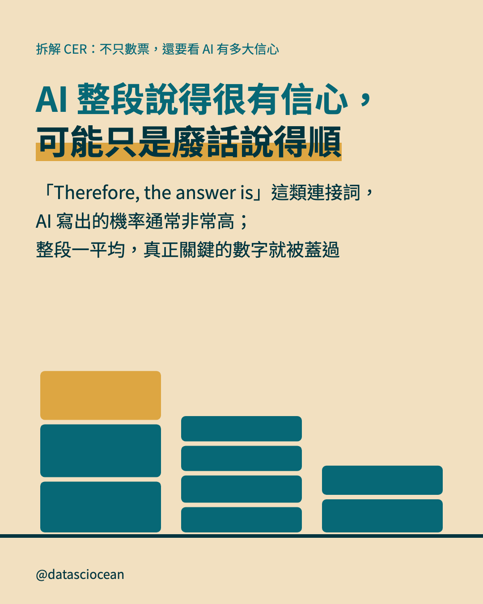

- **主標**：AI 整段說得很有信心，
可能只是廢話說得順
- **副標**：「Therefore, the answer is」這類連接詞，
AI 寫出的機率通常非常高；
整段一平均，真正關鍵的數字就被蓋過
- **替代文字**：AI 整段說得很有信心，
可能只是廢話說得順。「Therefore, the answer is」這類連接詞，
AI 寫出的機率通常非常高；
整段一平均，真正關鍵的數字就被蓋過

## 第 2 頁（示意圖）

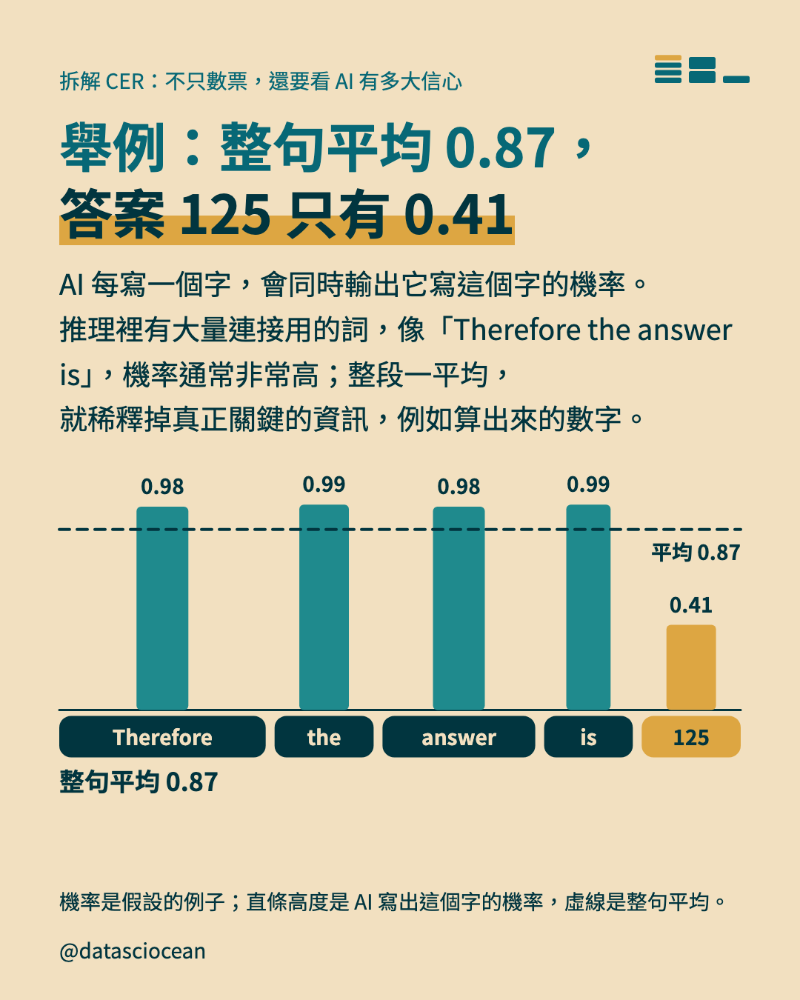

- **主標**：舉例：整句平均 0.87，
答案 125 只有 0.41
- **補充**：AI 每寫一個字，會同時輸出它寫這個字的機率。推理裡有大量連接用的詞，像「Therefore the answer is」，機率通常非常高；整段一平均，就稀釋掉真正關鍵的資訊，例如算出來的數字。
- **示意圖（tokprob）上的文字與數字**：Therefore｜the｜answer｜is｜125｜整句平均｜只算關鍵字｜0.98｜0.99｜0.98｜0.99｜0.41｜整句平均 0.87｜平均 0.87
- **圖註**：機率是假設的例子；直條高度是 AI 寫出這個字的機率，虛線是整句平均。
- **替代文字**：舉例：整句平均 0.87，
答案 125 只有 0.41。AI 每寫一個字，會同時輸出它寫這個字的機率。推理裡有大量連接用的詞，像「Therefore the answer is」，機率通常非常高；整段一平均，就稀釋掉真正關鍵的資訊，例如算出來的數字。。圖上寫：Therefore、the、answer、is、125、整句平均、只算關鍵字、0.98、0.99、0.98、0.99、0.41、整句平均 0.87、平均 0.87

## 第 3 頁（前情回顧）

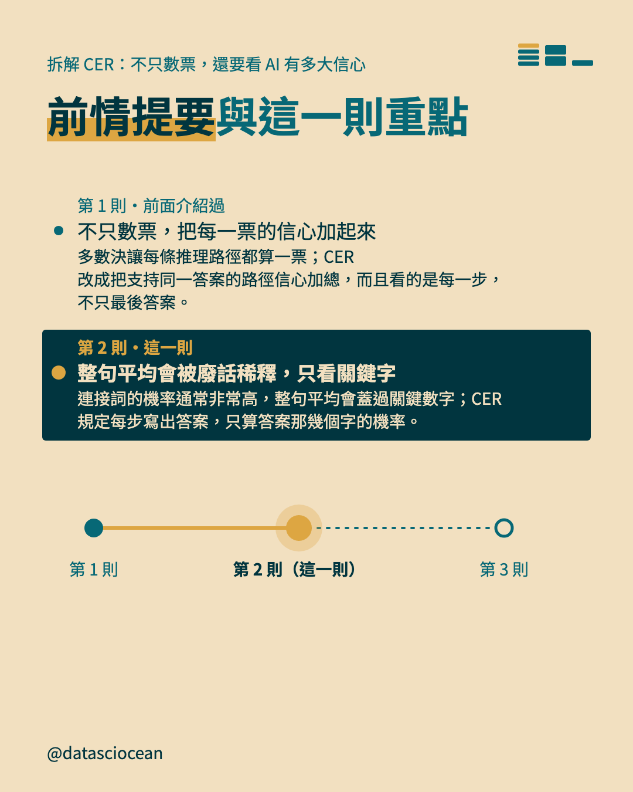

- **主標**：前情提要與這一則重點
- **第 1 則**：不只數票，把每一票的信心加起來　多數決讓每條推理路徑都算一票；CER 改成把支持同一答案的路徑信心加總，而且看的是每一步，不只最後答案。
- **第 2 則**：整句平均會被廢話稀釋，只看關鍵字　連接詞的機率通常非常高，整句平均會蓋過關鍵數字；CER 規定每步寫出答案，只算答案那幾個字的機率。
- **替代文字**：前情提要與這一則重點。第 1 則「不只數票，把每一票的信心加起來」：多數決讓每條推理路徑都算一票；CER 改成把支持同一答案的路徑信心加總，而且看的是每一步，不只最後答案。；第 2 則「整句平均會被廢話稀釋，只看關鍵字」：連接詞的機率通常非常高，整句平均會蓋過關鍵數字；CER 規定每步寫出答案，只算答案那幾個字的機率。

## 第 4 頁（脈絡）

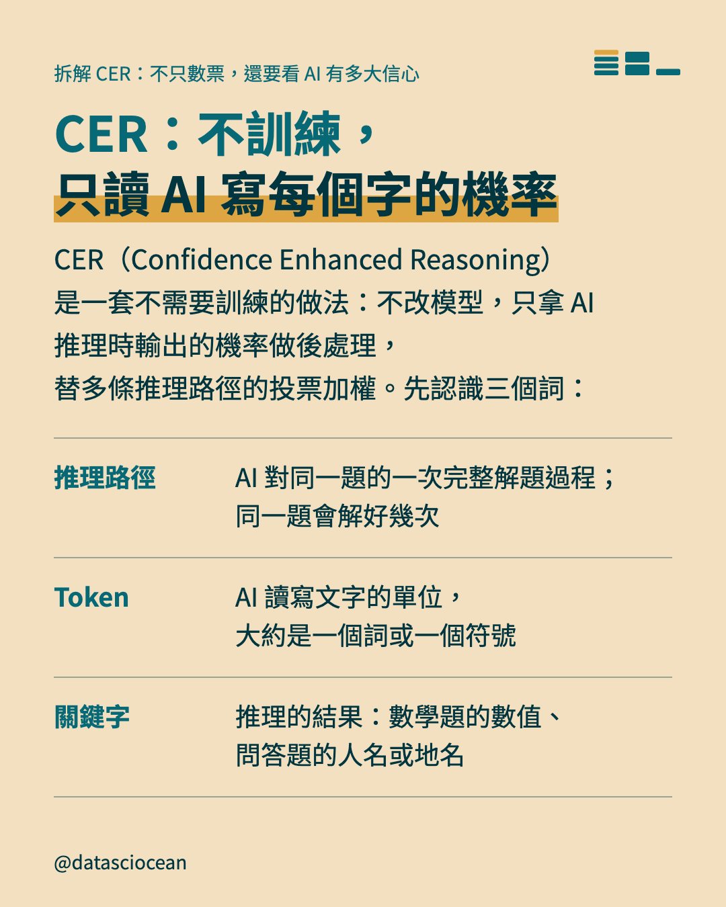

- **主標**：CER：不訓練，
只讀 AI 寫每個字的機率
- **補充**：CER（Confidence Enhanced Reasoning）是一套不需要訓練的做法：不改模型，只拿 AI 推理時輸出的機率做後處理，替多條推理路徑的投票加權。先認識三個詞：
- **表列**：推理路徑｜AI 對同一題的一次完整解題過程；同一題會解好幾次
- **表列**：Token｜AI 讀寫文字的單位，大約是一個詞或一個符號
- **表列**：關鍵字｜推理的結果：數學題的數值、問答題的人名或地名
- **替代文字**：CER：不訓練，
只讀 AI 寫每個字的機率。CER（Confidence Enhanced Reasoning）是一套不需要訓練的做法：不改模型，只拿 AI 推理時輸出的機率做後處理，替多條推理路徑的投票加權。先認識三個詞：

## 第 5 頁（示意圖）

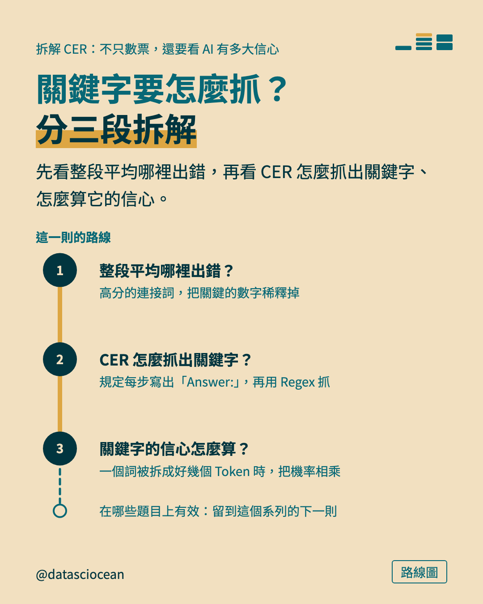

- **小標籤**：路線圖
- **主標**：關鍵字要怎麼抓？
分三段拆解
- **補充**：先看整段平均哪裡出錯，再看 CER 怎麼抓出關鍵字、怎麼算它的信心。
- **示意圖（route）上的文字與數字**：整段平均哪裡出錯？｜高分的連接詞，把關鍵的數字稀釋掉｜CER 怎麼抓出關鍵字？｜規定每步寫出「Answer:」，再用 Regex 抓｜關鍵字的信心怎麼算？｜一個詞被拆成好幾個 Token 時，把機率相乘｜這一則的路線｜在哪些題目上有效：留到這個系列的下一則
- **替代文字**：關鍵字要怎麼抓？
分三段拆解。先看整段平均哪裡出錯，再看 CER 怎麼抓出關鍵字、怎麼算它的信心。。圖上寫：整段平均哪裡出錯？、高分的連接詞，把關鍵的數字稀釋掉、CER 怎麼抓出關鍵字？、規定每步寫出「Answer:」，再用 Regex 抓、關鍵字的信心怎麼算？、一個詞被拆成好幾個 Token 時，把機率相乘、這一則的路線、在哪些題目上有效：留到這個系列的下一則

## 第 6 頁（示意圖）

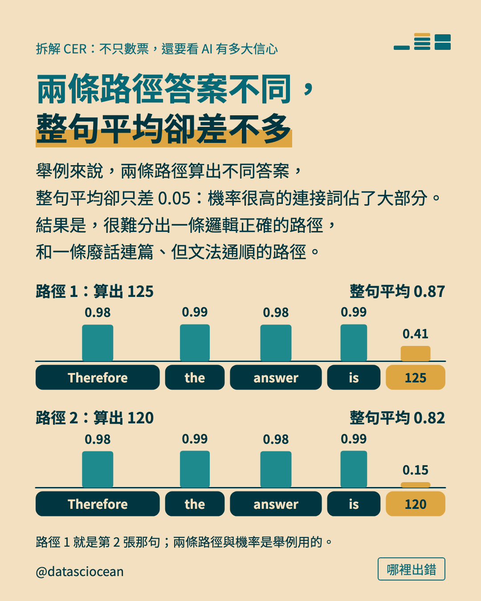

- **小標籤**：哪裡出錯
- **主標**：兩條路徑答案不同，
整句平均卻差不多
- **補充**：舉例來說，兩條路徑算出不同答案，整句平均卻只差 0.05：機率很高的連接詞佔了大部分。結果是，很難分出一條邏輯正確的路徑，和一條廢話連篇、但文法通順的路徑。
- **示意圖（tokprob）上的文字與數字**：路徑 1：算出 125｜Therefore｜the｜answer｜is｜125｜路徑 2：算出 120｜Therefore｜the｜answer｜is｜120｜整句平均｜只算關鍵字｜0.98｜0.99｜0.98｜0.99｜0.41｜整句平均 0.87｜0.98｜0.99｜0.98｜0.99｜0.15｜整句平均 0.82
- **圖註**：路徑 1 就是第 2 張那句；兩條路徑與機率是舉例用的。
- **替代文字**：兩條路徑答案不同，
整句平均卻差不多。舉例來說，兩條路徑算出不同答案，整句平均卻只差 0.05：機率很高的連接詞佔了大部分。結果是，很難分出一條邏輯正確的路徑，和一條廢話連篇、但文法通順的路徑。。圖上寫：路徑 1：算出 125、Therefore、the、answer、is、125、路徑 2：算出 120、Therefore、the、answer、is、120、整句平均、只算關鍵字、0.98、0.99、0.98、0.99、0.41、整句平均 0.87、0.98、0.99、0.98、0.99、0.15、整句平均 0.82

## 第 7 頁（示意圖）

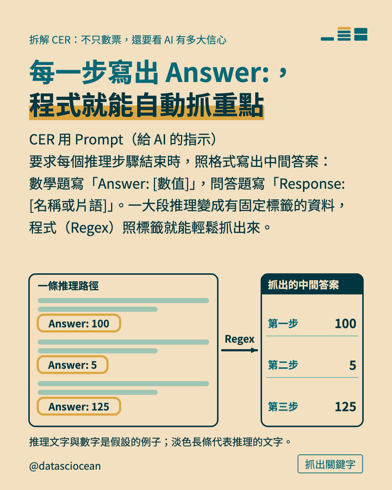

- **小標籤**：抓出關鍵字
- **主標**：每一步寫出 Answer:，
程式就能自動抓重點
- **補充**：CER 用 Prompt（給 AI 的指示）要求每個推理步驟結束時，照格式寫出中間答案：數學題寫「Answer: [數值]」，問答題寫「Response: [名稱或片語]」。一大段推理變成有固定標籤的資料，程式（Regex）照標籤就能輕鬆抓出來。
- **示意圖（extract）上的文字與數字**：第一步｜100｜第二步｜5｜第三步｜125｜一條推理路徑｜Regex｜抓出的中間答案｜Answer: 100｜Answer: 5｜Answer: 125
- **圖註**：推理文字與數字是假設的例子；淡色長條代表推理的文字。
- **替代文字**：每一步寫出 Answer:，
程式就能自動抓重點。CER 用 Prompt（給 AI 的指示）要求每個推理步驟結束時，照格式寫出中間答案：數學題寫「Answer: [數值]」，問答題寫「Response: [名稱或片語]」。一大段推理變成有固定標籤的資料，程式（Regex）照標籤就能輕鬆抓出來。。圖上寫：第一步、100、第二步、5、第三步、125、一條推理路徑、Regex、抓出的中間答案、Answer: 100、Answer: 5、Answer: 125

## 第 8 頁（示意圖）

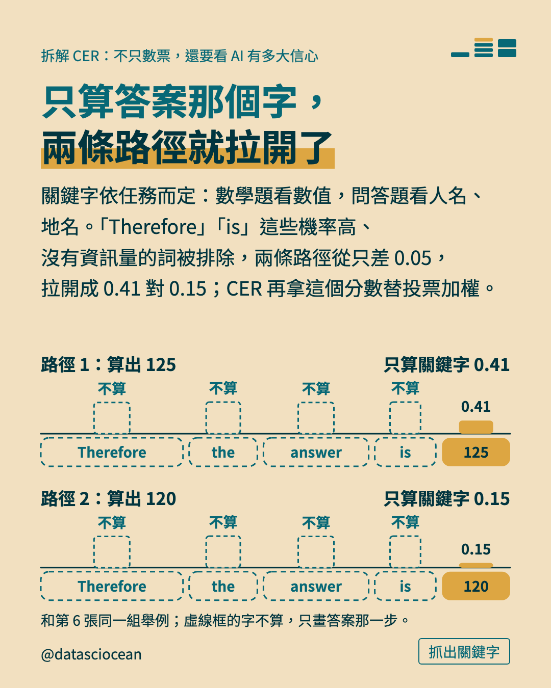

- **小標籤**：抓出關鍵字
- **主標**：只算答案那個字，
兩條路徑就拉開了
- **補充**：關鍵字依任務而定：數學題看數值，問答題看人名、地名。「Therefore」「is」這些機率高、沒有資訊量的詞被排除，兩條路徑從只差 0.05，拉開成 0.41 對 0.15；CER 再拿這個分數替投票加權。
- **示意圖（tokprob）上的文字與數字**：路徑 1：算出 125｜Therefore｜the｜answer｜is｜125｜路徑 2：算出 120｜Therefore｜the｜answer｜is｜120｜整句平均｜只算關鍵字｜0.98｜0.99｜0.98｜0.99｜0.41｜只算關鍵字 0.41｜0.98｜0.99｜0.98｜0.99｜0.15｜只算關鍵字 0.15
- **圖註**：和第 6 張同一組舉例；虛線框的字不算，只畫答案那一步。
- **替代文字**：只算答案那個字，
兩條路徑就拉開了。關鍵字依任務而定：數學題看數值，問答題看人名、地名。「Therefore」「is」這些機率高、沒有資訊量的詞被排除，兩條路徑從只差 0.05，拉開成 0.41 對 0.15；CER 再拿這個分數替投票加權。。圖上寫：路徑 1：算出 125、Therefore、the、answer、is、125、路徑 2：算出 120、Therefore、the、answer、is、120、整句平均、只算關鍵字、0.98、0.99、0.98、0.99、0.41、只算關鍵字 0.41、0.98、0.99、0.98、0.99、0.15、只算關鍵字 0.15

## 第 9 頁（示意圖）

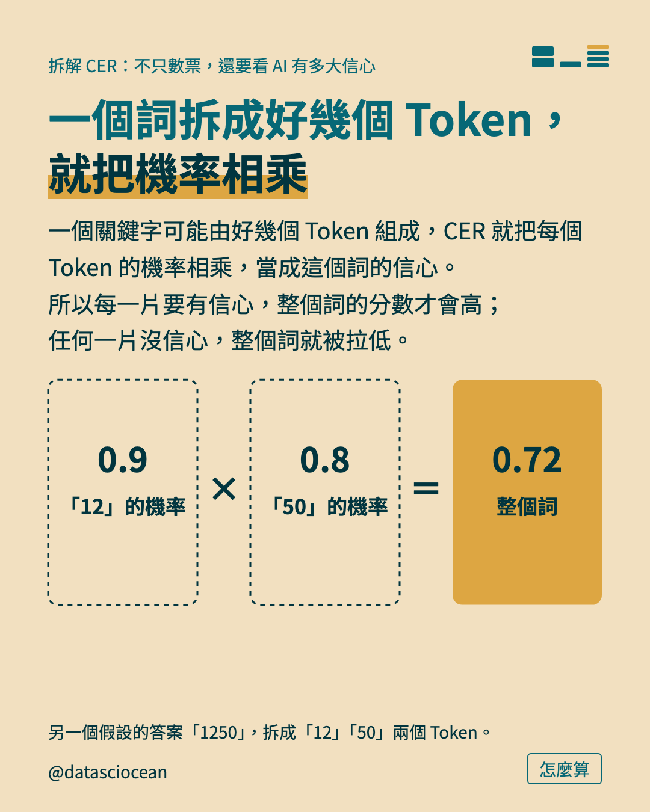

- **小標籤**：怎麼算
- **主標**：一個詞拆成好幾個 Token，
就把機率相乘
- **補充**：一個關鍵字可能由好幾個 Token 組成，CER 就把每個 Token 的機率相乘，當成這個詞的信心。所以每一片要有信心，整個詞的分數才會高；任何一片沒信心，整個詞就被拉低。
- **示意圖（equation）上的文字與數字**：0.9｜「12」的機率｜0.8｜「50」的機率｜0.72｜整個詞｜算式：0.9 × 0.8 ＝ 0.72
- **圖註**：另一個假設的答案「1250」，拆成「12」「50」兩個 Token。
- **替代文字**：一個詞拆成好幾個 Token，
就把機率相乘。一個關鍵字可能由好幾個 Token 組成，CER 就把每個 Token 的機率相乘，當成這個詞的信心。所以每一片要有信心，整個詞的分數才會高；任何一片沒信心，整個詞就被拉低。。圖上寫：0.9、「12」的機率、0.8、「50」的機率、0.72、整個詞、算式：0.9 × 0.8 ＝ 0.72

## 第 10 頁（對照表）

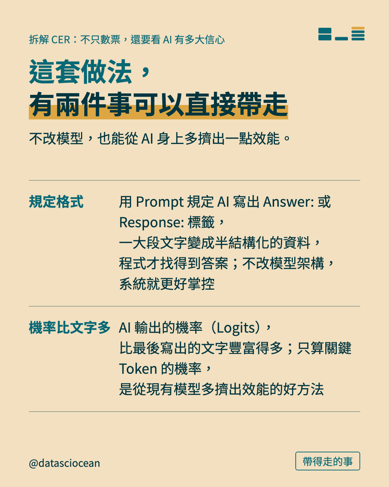

- **小標籤**：帶得走的事
- **主標**：這套做法，
有兩件事可以直接帶走
- **補充**：不改模型，也能從 AI 身上多擠出一點效能。
- **表列**：規定格式｜用 Prompt 規定 AI 寫出 Answer: 或 Response: 標籤，一大段文字變成半結構化的資料，程式才找得到答案；不改模型架構，系統就更好掌控
- **表列**：機率比文字多｜AI 輸出的機率（Logits），比最後寫出的文字豐富得多；只算關鍵 Token 的機率，是從現有模型多擠出效能的好方法
- **替代文字**：這套做法，
有兩件事可以直接帶走。不改模型，也能從 AI 身上多擠出一點效能。

## 第 11 頁（帶走）

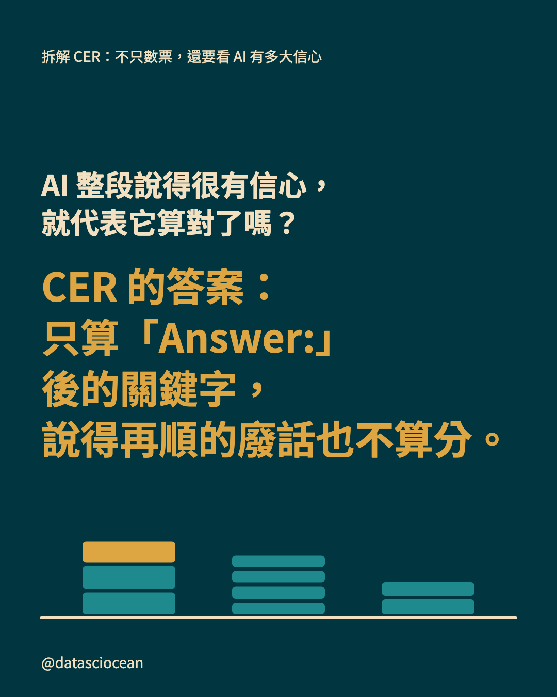

- **先問的問題**：AI 整段說得很有信心，就代表它算對了嗎？
- **一句話**：CER 的答案：
只算「Answer:」後的關鍵字，
說得再順的廢話也不算分。
- **替代文字**：AI 整段說得很有信心，就代表它算對了嗎？　CER 的答案：
只算「Answer:」後的關鍵字，
說得再順的廢話也不算分。

## 第 12 頁（系列地圖）

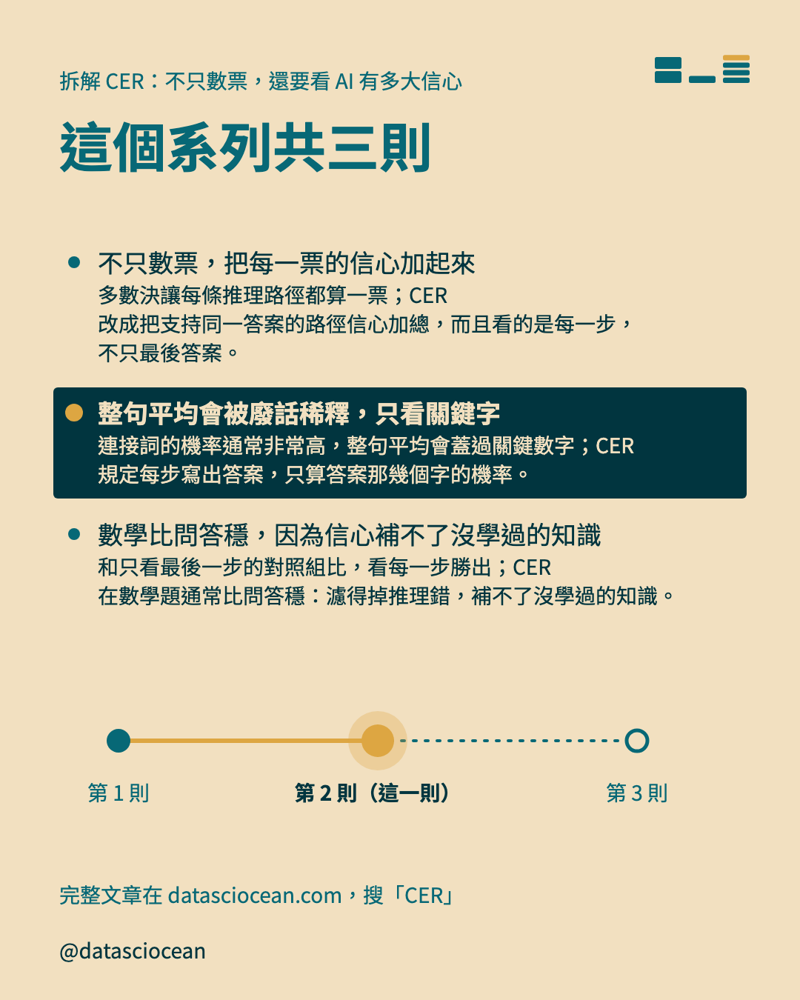

- **主標**：這個系列共三則
- **導流行**：完整文章在 datasciocean.com，搜「CER」
- **第 1 則**：不只數票，把每一票的信心加起來　多數決讓每條推理路徑都算一票；CER 改成把支持同一答案的路徑信心加總，而且看的是每一步，不只最後答案。
- **第 2 則**：整句平均會被廢話稀釋，只看關鍵字　連接詞的機率通常非常高，整句平均會蓋過關鍵數字；CER 規定每步寫出答案，只算答案那幾個字的機率。
- **第 3 則**：數學比問答穩，因為信心補不了沒學過的知識　和只看最後一步的對照組比，看每一步勝出；CER 在數學題通常比問答穩：濾得掉推理錯，補不了沒學過的知識。
- **替代文字**：這個系列共三則。不只數票，把每一票的信心加起來：多數決讓每條推理路徑都算一票；CER 改成把支持同一答案的路徑信心加總，而且看的是每一步，不只最後答案。、整句平均會被廢話稀釋，只看關鍵字：連接詞的機率通常非常高，整句平均會蓋過關鍵數字；CER 規定每步寫出答案，只算答案那幾個字的機率。、數學比問答穩，因為信心補不了沒學過的知識：和只看最後一步的對照組比，看每一步勝出；CER 在數學題通常比問答穩：濾得掉推理錯，補不了沒學過的知識。

## Caption（整段貼到 IG）

```text
AI 說得很有信心，就代表它算對了嗎？CER 只看答案那幾個字的機率

・舉例：整句平均 0.87，答案 125 只有 0.41（AI 每寫一個字，會同時輸出它寫這個字的機率）
・哪裡出錯：兩條路徑答案不同，整句平均卻差不多
・抓出關鍵字：每一步寫出 Answer:，程式就能自動抓重點
・只算答案那個字，兩條路徑就拉開了
・怎麼算：一個詞拆成好幾個 Token，就把機率相乘
・帶得走的事：這套做法，有兩件事可以直接帶走（不改模型，也能從 AI 身上多擠出一點效能）

完整文章在 datasciocean.com，搜「CER」

#CER #LLM推理 #LLM
```
