# Threads：整句平均會被廢話稀釋，只看關鍵字

- 發文方式：**一則輪播貼文**（正文＋全部 12 張圖，順序與 IG 相同），再用一則回覆放連結與系列（連結只放那則回覆）
- 圖檔在 `../ig/`（與 IG 輪播共用同一套）

## 貼文正文（附下方全部圖片）

```text
AI 整段說得很有信心，可能只是廢話說得順。

AI 每寫一個字，會同時輸出它寫這個字的機率。讓 AI 一步步推理時，句子裡有大量「First, we need to calculate」「Therefore, the answer is」這類連接用的詞，機率通常非常高。如果直接算整段的平均機率，這些詞會稀釋掉真正關鍵的資訊，例如某個運算數字，結果很難分出邏輯正確的推理，和廢話連篇、但文法通順的推理。

CER 的做法：用指示規定 AI 每一步結尾寫出「Answer: 數值」（問答題寫「Response: 名稱或片語」），再用程式把標籤後面的關鍵字抓出來，只算這幾個字的機率；一個詞被拆成好幾片時，把每一片的機率相乘。細節在圖裡。

這是 CER 系列的第二則；CER 在哪些題目上有效，在這個系列的下一則。
```

## 附圖（依序）

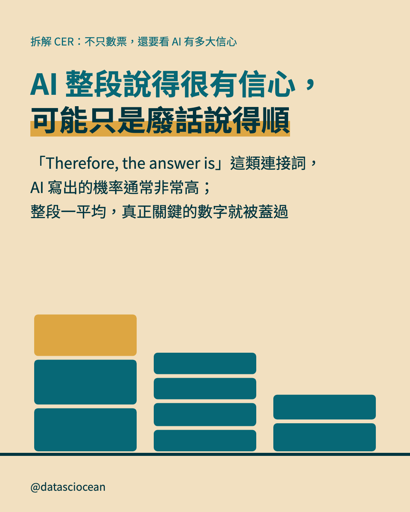
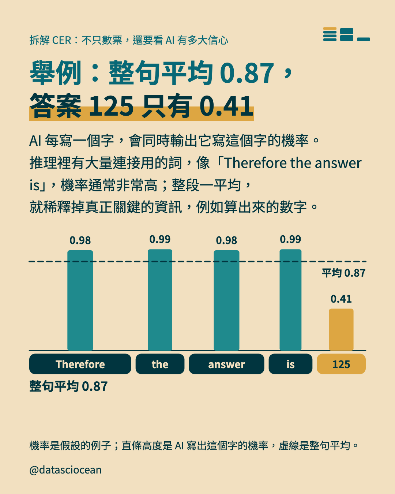
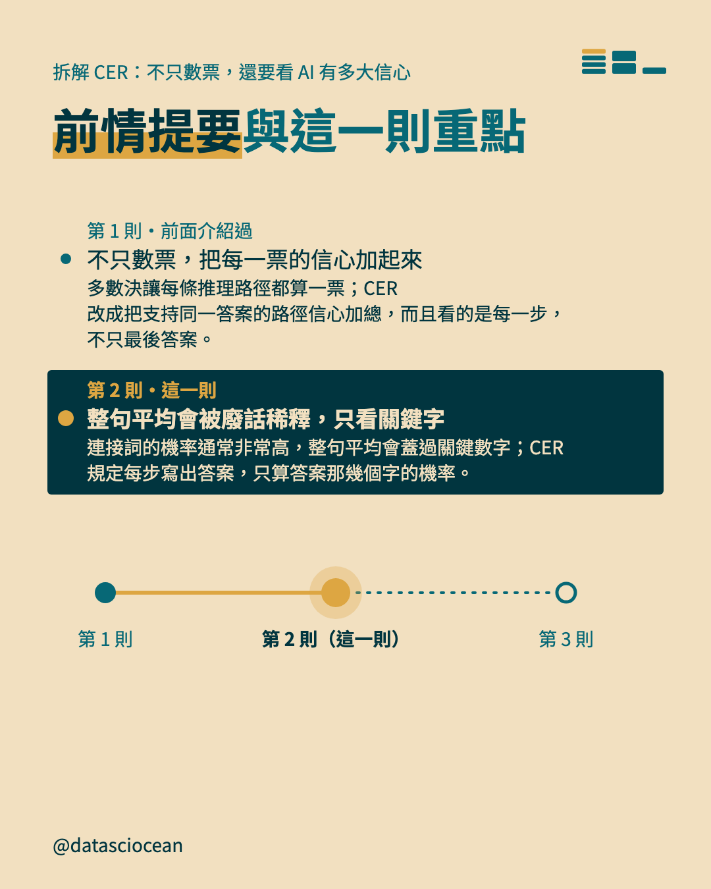
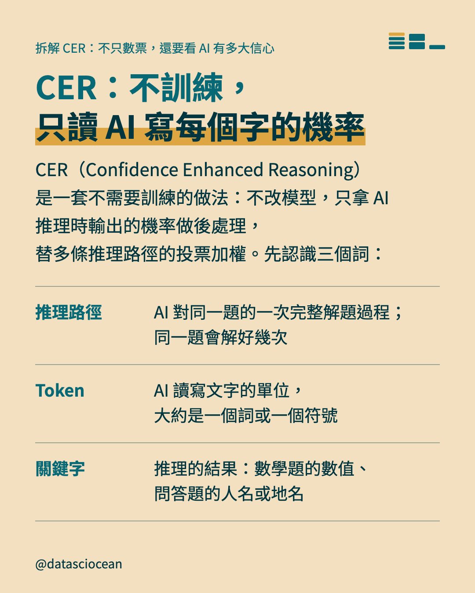
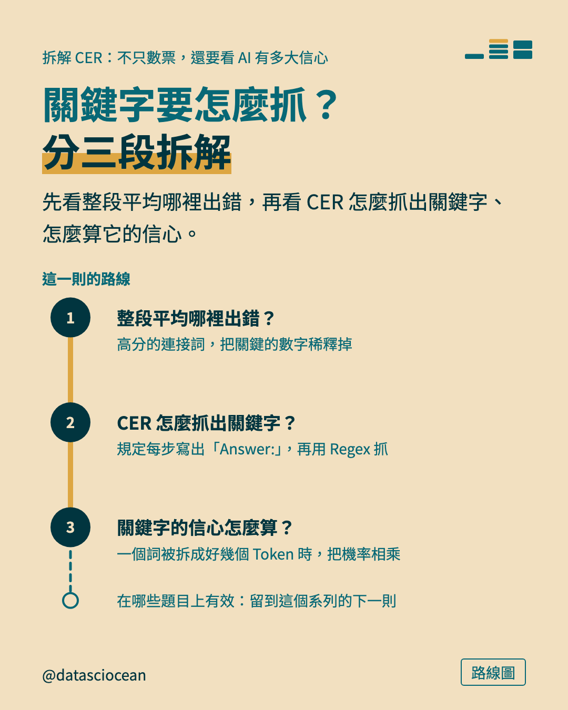
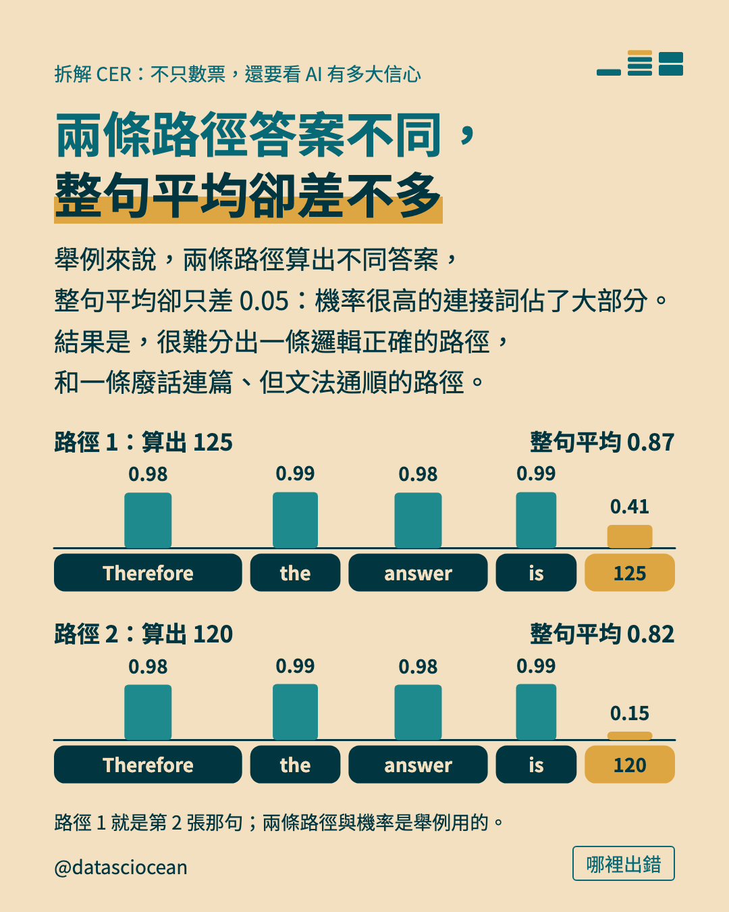
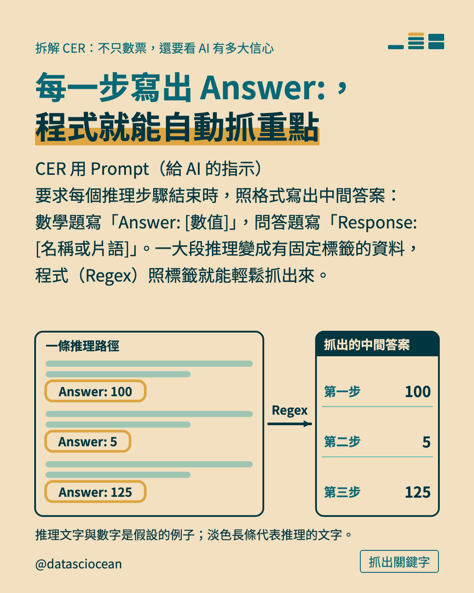
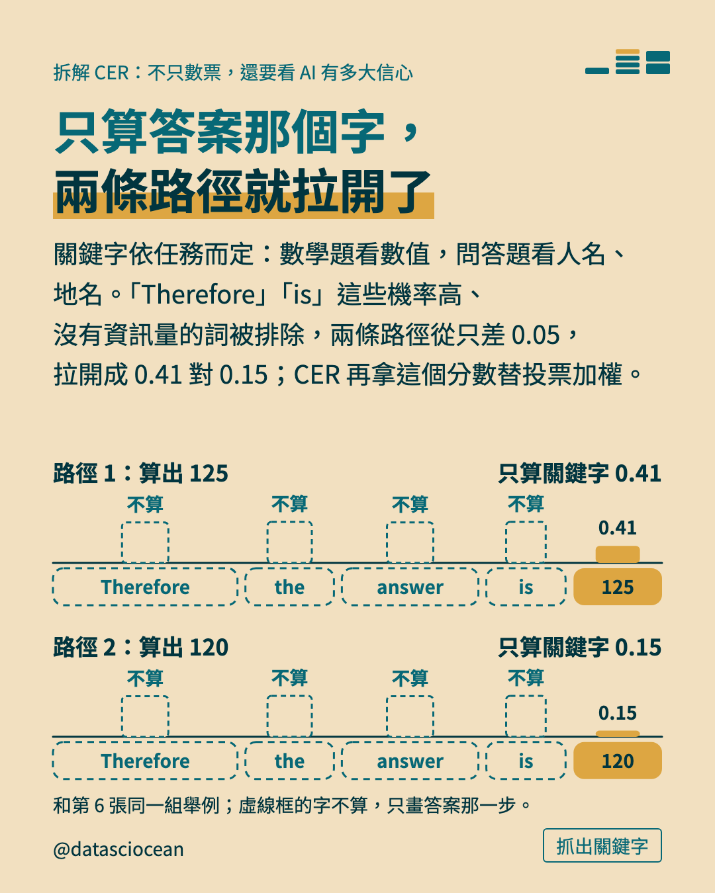
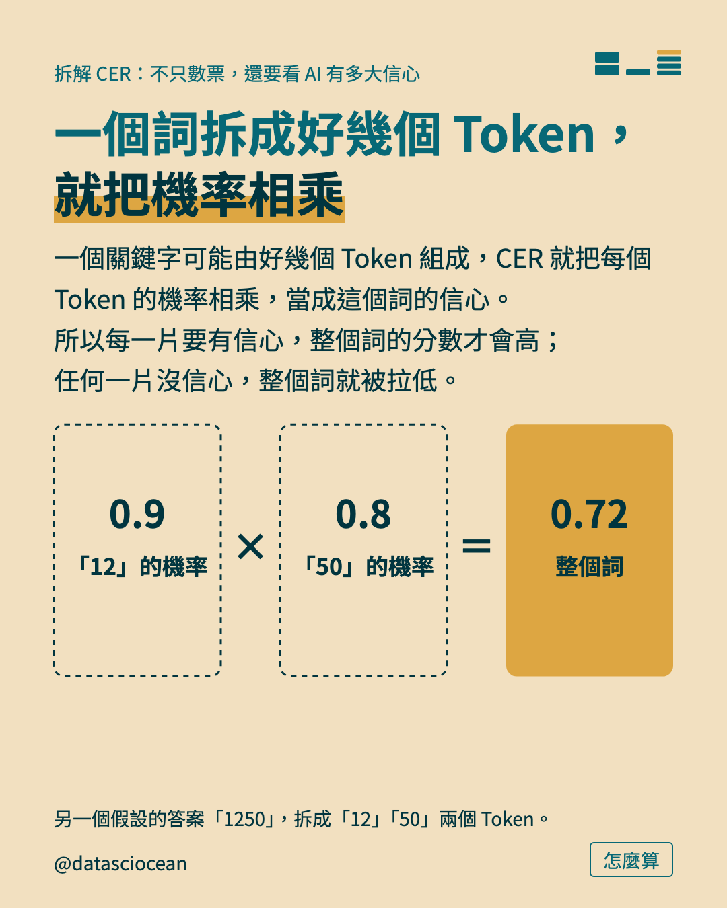
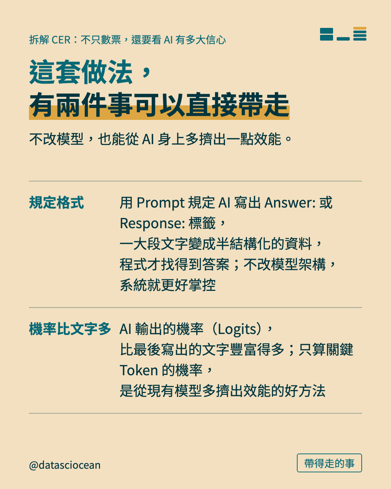
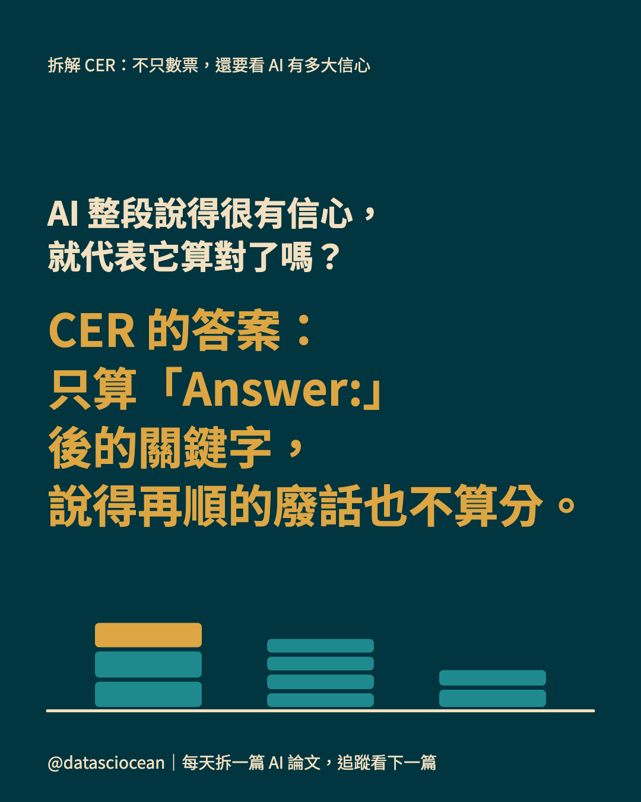
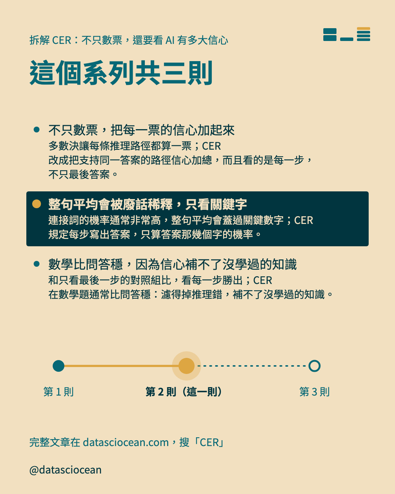

## 回覆：連結與系列

```text
CER：只算每一步「Answer:」後面關鍵字的機率，說得再順的廢話也不算分。
文章：datasciocean.com/paper-intro/cer
同系列：不只數票，把每一票的信心加起來
https://www.threads.com/@datasciocean/post/Df5yzotH4IY
同系列：數學比問答穩，因為信心補不了沒學過的知識（尚未發布）
```
