# IG 輪播：不只數票，把每一票的信心加起來

- 系列：拆解 CER：不只數票，還要看 AI 有多大信心　｜　hook 樣態：讀者疑問　｜　共 12 張，**依頁碼順序上傳**
- 每頁下方的「替代文字」貼到 IG 的替代文字欄；最後的 Caption 整段貼上

## 第 1 頁（封面）

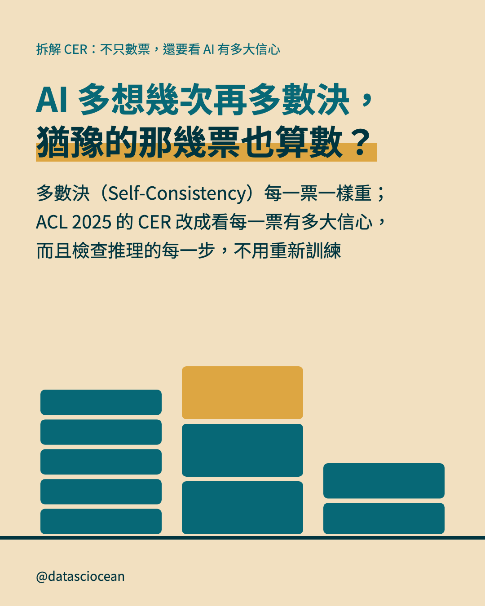

- **主標**：AI 多想幾次再多數決，
猶豫的那幾票也算數？
- **副標**：多數決（Self-Consistency）每一票一樣重；
ACL 2025 的 CER 改成看每一票有多大信心，
而且檢查推理的每一步，不用重新訓練
- **替代文字**：AI 多想幾次再多數決，
猶豫的那幾票也算數？。多數決（Self-Consistency）每一票一樣重；
ACL 2025 的 CER 改成看每一票有多大信心，
而且檢查推理的每一步，不用重新訓練

## 第 2 頁（示意圖）

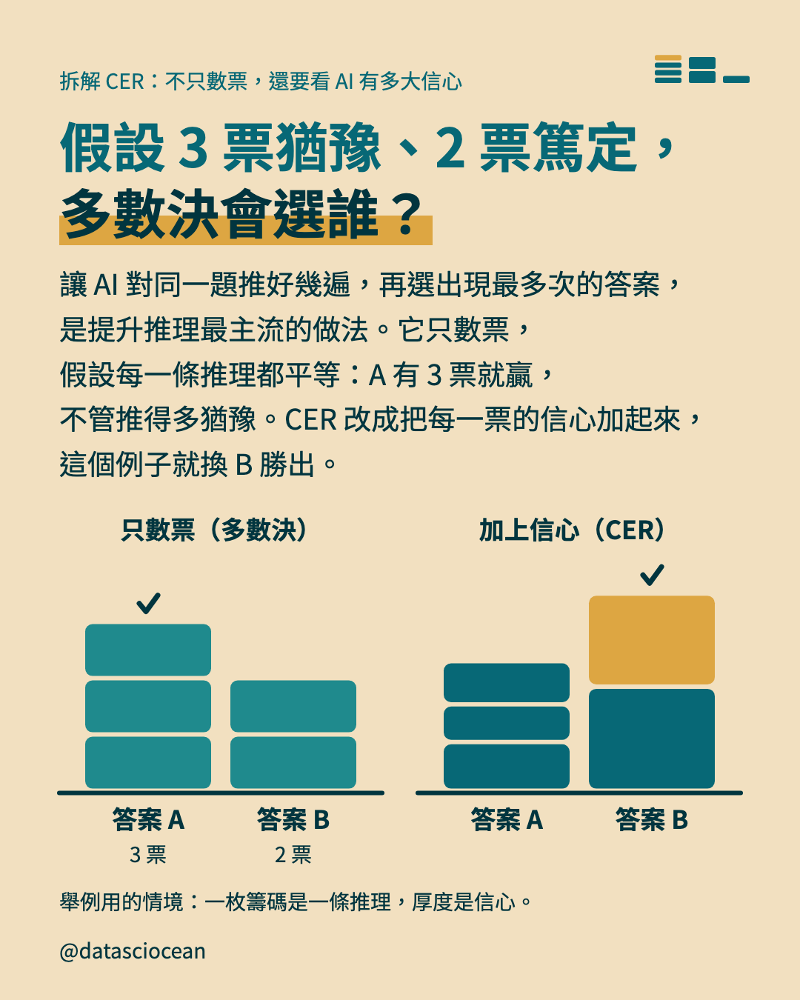

- **主標**：假設 3 票猶豫、2 票篤定，
多數決會選誰？
- **補充**：讓 AI 對同一題推好幾遍，再選出現最多次的答案，是提升推理最主流的做法。它只數票，假設每一條推理都平等：A 有 3 票就贏，不管推得多猶豫。CER 改成把每一票的信心加起來，這個例子就換 B 勝出。
- **示意圖（chips）上的文字與數字**：答案 A｜答案 B｜只數票（多數決）｜加上信心（CER）｜3 票｜2 票
- **圖註**：舉例用的情境：一枚籌碼是一條推理，厚度是信心。
- **替代文字**：假設 3 票猶豫、2 票篤定，
多數決會選誰？。讓 AI 對同一題推好幾遍，再選出現最多次的答案，是提升推理最主流的做法。它只數票，假設每一條推理都平等：A 有 3 票就贏，不管推得多猶豫。CER 改成把每一票的信心加起來，這個例子就換 B 勝出。。圖上寫：答案 A、答案 B、只數票（多數決）、加上信心（CER）、3 票、2 票

## 第 3 頁（脈絡）

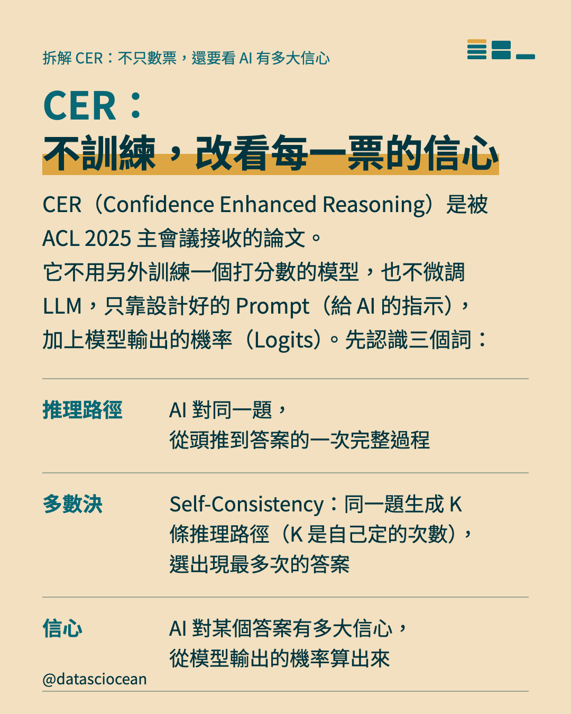

- **主標**：CER：
不訓練，改看每一票的信心
- **補充**：CER（Confidence Enhanced Reasoning）是被 ACL 2025 主會議接收的論文。它不用另外訓練一個打分數的模型，也不微調 LLM，只靠設計好的 Prompt（給 AI 的指示），加上模型輸出的機率（Logits）。先認識三個詞：
- **表列**：推理路徑｜AI 對同一題，從頭推到答案的一次完整過程
- **表列**：多數決｜Self-Consistency：同一題生成 K 條推理路徑（K 是自己定的次數），選出現最多次的答案
- **表列**：信心｜AI 對某個答案有多大信心，從模型輸出的機率算出來
- **替代文字**：CER：
不訓練，改看每一票的信心。CER（Confidence Enhanced Reasoning）是被 ACL 2025 主會議接收的論文。它不用另外訓練一個打分數的模型，也不微調 LLM，只靠設計好的 Prompt（給 AI 的指示），加上模型輸出的機率（Logits）。先認識三個詞：

## 第 4 頁（示意圖）

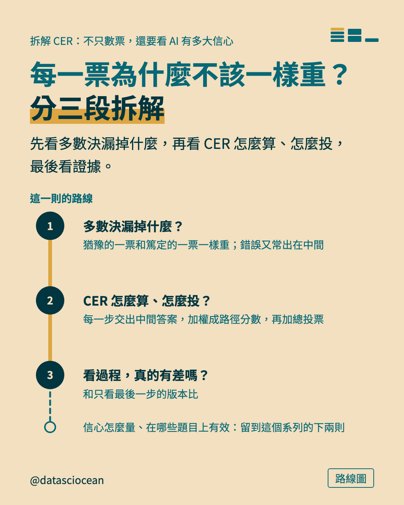

- **小標籤**：路線圖
- **主標**：每一票為什麼不該一樣重？
分三段拆解
- **補充**：先看多數決漏掉什麼，再看 CER 怎麼算、怎麼投，最後看證據。
- **示意圖（route）上的文字與數字**：多數決漏掉什麼？｜猶豫的一票和篤定的一票一樣重；錯誤又常出在中間｜CER 怎麼算、怎麼投？｜每一步交出中間答案，加權成路徑分數，再加總投票｜看過程，真的有差嗎？｜和只看最後一步的版本比｜這一則的路線｜信心怎麼量、在哪些題目上有效：留到這個系列的下兩則
- **替代文字**：每一票為什麼不該一樣重？
分三段拆解。先看多數決漏掉什麼，再看 CER 怎麼算、怎麼投，最後看證據。。圖上寫：多數決漏掉什麼？、猶豫的一票和篤定的一票一樣重；錯誤又常出在中間、CER 怎麼算、怎麼投？、每一步交出中間答案，加權成路徑分數，再加總投票、看過程，真的有差嗎？、和只看最後一步的版本比、這一則的路線、信心怎麼量、在哪些題目上有效：留到這個系列的下兩則

## 第 5 頁（示意圖）

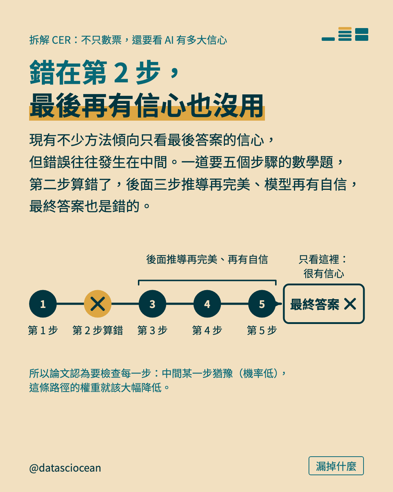

- **小標籤**：漏掉什麼
- **主標**：錯在第 2 步，
最後再有信心也沒用
- **補充**：現有不少方法傾向只看最後答案的信心，但錯誤往往發生在中間。一道要五個步驟的數學題，第二步算錯了，後面三步推導再完美、模型再有自信，最終答案也是錯的。
- **示意圖（midfail）上的文字與數字**：第 1 步｜第 2 步算錯｜第 3 步｜第 4 步｜第 5 步｜最終答案｜所以論文認為要檢查每一步：中間某一步猶豫（機率低），這條路徑的權重就該大幅降低。｜後面推導再完美、再有自信｜只看這裡：很有信心
- **替代文字**：錯在第 2 步，
最後再有信心也沒用。現有不少方法傾向只看最後答案的信心，但錯誤往往發生在中間。一道要五個步驟的數學題，第二步算錯了，後面三步推導再完美、模型再有自信，最終答案也是錯的。。圖上寫：第 1 步、第 2 步算錯、第 3 步、第 4 步、第 5 步、最終答案、所以論文認為要檢查每一步：中間某一步猶豫（機率低），這條路徑的權重就該大幅降低。、後面推導再完美、再有自信、只看這裡：很有信心

## 第 6 頁（示意圖）

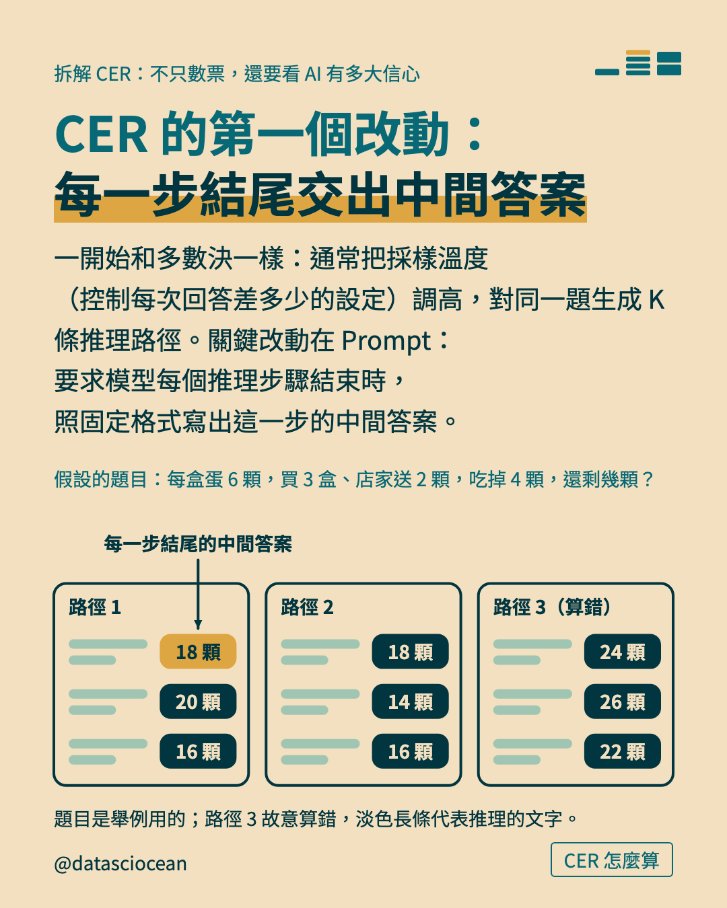

- **小標籤**：CER 怎麼算
- **主標**：CER 的第一個改動：
每一步結尾交出中間答案
- **補充**：一開始和多數決一樣：通常把採樣溫度（控制每次回答差多少的設定）調高，對同一題生成 K 條推理路徑。關鍵改動在 Prompt：要求模型每個推理步驟結束時，照固定格式寫出這一步的中間答案。
- **示意圖（tagged）上的文字與數字**：路徑 1｜路徑 2｜路徑 3（算錯）｜假設的題目：每盒蛋 6 顆，買 3 盒、店家送 2 顆，吃掉 4 顆，還剩幾顆？｜每一步結尾的中間答案｜18 顆｜20 顆｜16 顆｜18 顆｜14 顆｜16 顆｜24 顆｜26 顆｜22 顆
- **圖註**：題目是舉例用的；路徑 3 故意算錯，淡色長條代表推理的文字。
- **替代文字**：CER 的第一個改動：
每一步結尾交出中間答案。一開始和多數決一樣：通常把採樣溫度（控制每次回答差多少的設定）調高，對同一題生成 K 條推理路徑。關鍵改動在 Prompt：要求模型每個推理步驟結束時，照固定格式寫出這一步的中間答案。。圖上寫：路徑 1、路徑 2、路徑 3（算錯）、假設的題目：每盒蛋 6 顆，買 3 盒、店家送 2 顆，吃掉 4 顆，還剩幾顆？、每一步結尾的中間答案、18 顆、20 顆、16 顆、18 顆、14 顆、16 顆、24 顆、26 顆、22 顆

## 第 7 頁（示意圖）

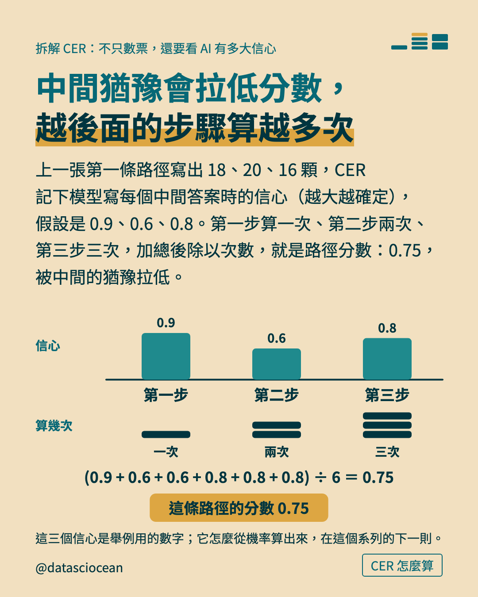

- **小標籤**：CER 怎麼算
- **主標**：中間猶豫會拉低分數，
越後面的步驟算越多次
- **補充**：上一張第一條路徑寫出 18、20、16 顆，CER 記下模型寫每個中間答案時的信心（越大越確定），假設是 0.9、0.6、0.8。第一步算一次、第二步兩次、第三步三次，加總後除以次數，就是路徑分數：0.75，被中間的猶豫拉低。
- **示意圖（weights）上的文字與數字**：第一步｜第二步｜第三步｜信心｜算幾次｜這條路徑的分數｜0.9｜0.6｜0.8｜一次｜兩次｜三次｜(0.9 + 0.6 + 0.6 + 0.8 + 0.8 + 0.8) ÷ 6 ＝ 0.75｜這條路徑的分數 0.75
- **圖註**：這三個信心是舉例用的數字；它怎麼從機率算出來，在這個系列的下一則。
- **替代文字**：中間猶豫會拉低分數，
越後面的步驟算越多次。上一張第一條路徑寫出 18、20、16 顆，CER 記下模型寫每個中間答案時的信心（越大越確定），假設是 0.9、0.6、0.8。第一步算一次、第二步兩次、第三步三次，加總後除以次數，就是路徑分數：0.75，被中間的猶豫拉低。。圖上寫：第一步、第二步、第三步、信心、算幾次、這條路徑的分數、0.9、0.6、0.8、一次、兩次、三次、(0.9 + 0.6 + 0.6 + 0.8 + 0.8 + 0.8) ÷ 6 ＝ 0.75、這條路徑的分數 0.75

## 第 8 頁（示意圖）

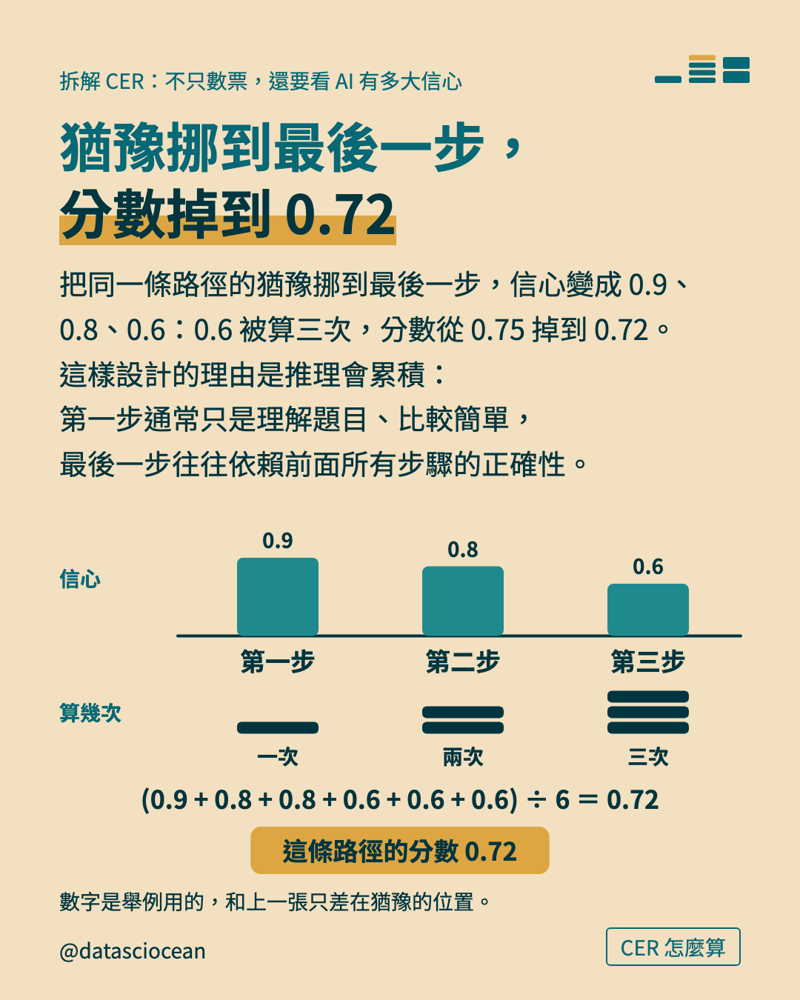

- **小標籤**：CER 怎麼算
- **主標**：猶豫挪到最後一步，
分數掉到 0.72
- **補充**：把同一條路徑的猶豫挪到最後一步，信心變成 0.9、0.8、0.6：0.6 被算三次，分數從 0.75 掉到 0.72。這樣設計的理由是推理會累積：第一步通常只是理解題目、比較簡單，最後一步往往依賴前面所有步驟的正確性。
- **示意圖（weights）上的文字與數字**：第一步｜第二步｜第三步｜信心｜算幾次｜這條路徑的分數｜0.9｜0.8｜0.6｜一次｜兩次｜三次｜(0.9 + 0.8 + 0.8 + 0.6 + 0.6 + 0.6) ÷ 6 ＝ 0.72｜這條路徑的分數 0.72
- **圖註**：數字是舉例用的，和上一張只差在猶豫的位置。
- **替代文字**：猶豫挪到最後一步，
分數掉到 0.72。把同一條路徑的猶豫挪到最後一步，信心變成 0.9、0.8、0.6：0.6 被算三次，分數從 0.75 掉到 0.72。這樣設計的理由是推理會累積：第一步通常只是理解題目、比較簡單，最後一步往往依賴前面所有步驟的正確性。。圖上寫：第一步、第二步、第三步、信心、算幾次、這條路徑的分數、0.9、0.8、0.6、一次、兩次、三次、(0.9 + 0.8 + 0.8 + 0.6 + 0.6 + 0.6) ÷ 6 ＝ 0.72、這條路徑的分數 0.72

## 第 9 頁（示意圖）

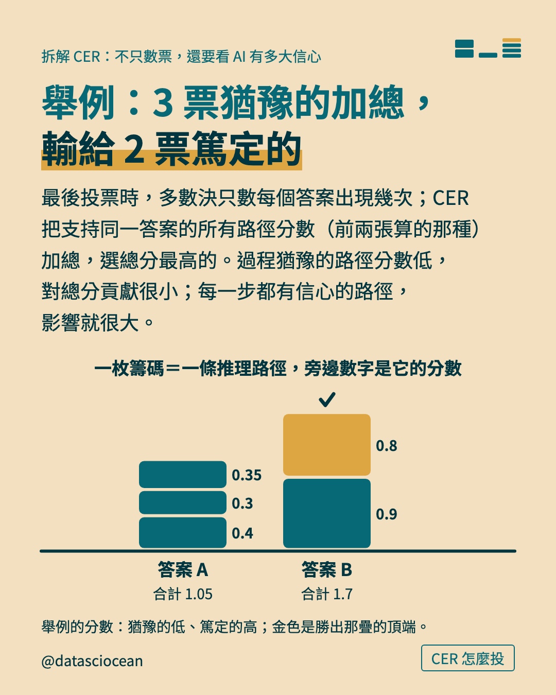

- **小標籤**：CER 怎麼投
- **主標**：舉例：3 票猶豫的加總，
輸給 2 票篤定的
- **補充**：最後投票時，多數決只數每個答案出現幾次；CER 把支持同一答案的所有路徑分數（前兩張算的那種）加總，選總分最高的。過程猶豫的路徑分數低，對總分貢獻很小；每一步都有信心的路徑，影響就很大。
- **示意圖（chips）上的文字與數字**：答案 A｜答案 B｜一枚籌碼＝一條推理路徑，旁邊數字是它的分數｜0.4｜0.3｜0.35｜合計 1.05｜0.9｜0.8｜合計 1.7
- **圖註**：舉例的分數：猶豫的低、篤定的高；金色是勝出那疊的頂端。
- **替代文字**：舉例：3 票猶豫的加總，
輸給 2 票篤定的。最後投票時，多數決只數每個答案出現幾次；CER 把支持同一答案的所有路徑分數（前兩張算的那種）加總，選總分最高的。過程猶豫的路徑分數低，對總分貢獻很小；每一步都有信心的路徑，影響就很大。。圖上寫：答案 A、答案 B、一枚籌碼＝一條推理路徑，旁邊數字是它的分數、0.4、0.3、0.35、合計 1.05、0.9、0.8、合計 1.7

## 第 10 頁（示意圖）

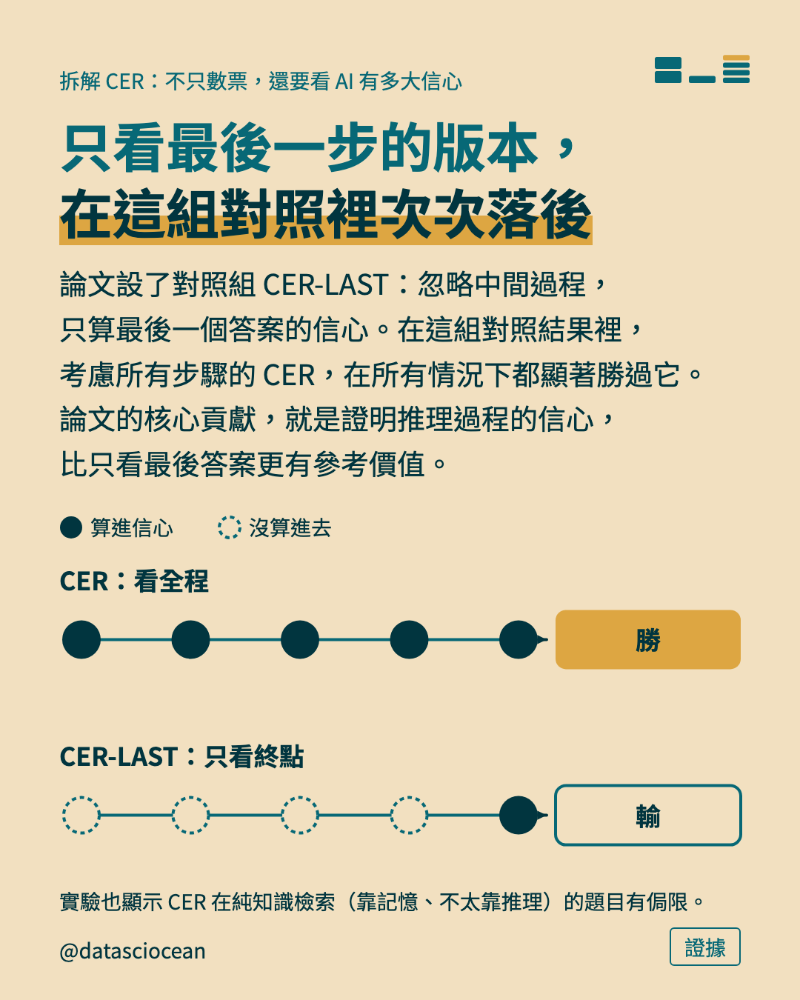

- **小標籤**：證據
- **主標**：只看最後一步的版本，
在這組對照裡次次落後
- **補充**：論文設了對照組 CER-LAST：忽略中間過程，只算最後一個答案的信心。在這組對照結果裡，考慮所有步驟的 CER，在所有情況下都顯著勝過它。論文的核心貢獻，就是證明推理過程的信心，比只看最後答案更有參考價值。
- **示意圖（watch）上的文字與數字**：CER：看全程｜CER-LAST：只看終點｜勝｜輸｜算進信心｜沒算進去
- **圖註**：實驗也顯示 CER 在純知識檢索（靠記憶、不太靠推理）的題目有侷限。
- **替代文字**：只看最後一步的版本，
在這組對照裡次次落後。論文設了對照組 CER-LAST：忽略中間過程，只算最後一個答案的信心。在這組對照結果裡，考慮所有步驟的 CER，在所有情況下都顯著勝過它。論文的核心貢獻，就是證明推理過程的信心，比只看最後答案更有參考價值。。圖上寫：CER：看全程、CER-LAST：只看終點、勝、輸、算進信心、沒算進去

## 第 11 頁（帶走）

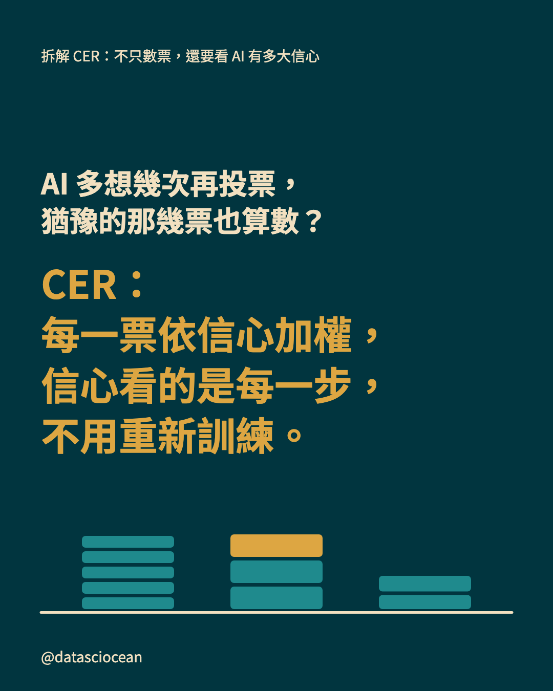

- **先問的問題**：AI 多想幾次再投票，猶豫的那幾票也算數？
- **一句話**：CER：
每一票依信心加權，
信心看的是每一步，
不用重新訓練。
- **替代文字**：AI 多想幾次再投票，猶豫的那幾票也算數？　CER：
每一票依信心加權，
信心看的是每一步，
不用重新訓練。

## 第 12 頁（系列地圖）

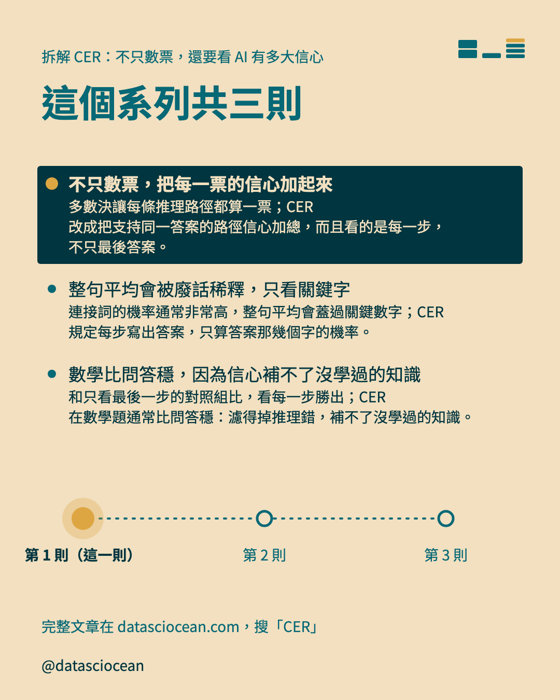

- **主標**：這個系列共三則
- **導流行**：完整文章在 datasciocean.com，搜「CER」
- **第 1 則**：不只數票，把每一票的信心加起來　多數決讓每條推理路徑都算一票；CER 改成把支持同一答案的路徑信心加總，而且看的是每一步，不只最後答案。
- **第 2 則**：整句平均會被廢話稀釋，只看關鍵字　連接詞的機率通常非常高，整句平均會蓋過關鍵數字；CER 規定每步寫出答案，只算答案那幾個字的機率。
- **第 3 則**：數學比問答穩，因為信心補不了沒學過的知識　和只看最後一步的對照組比，看每一步勝出；CER 在數學題通常比問答穩：濾得掉推理錯，補不了沒學過的知識。
- **替代文字**：這個系列共三則。不只數票，把每一票的信心加起來：多數決讓每條推理路徑都算一票；CER 改成把支持同一答案的路徑信心加總，而且看的是每一步，不只最後答案。、整句平均會被廢話稀釋，只看關鍵字：連接詞的機率通常非常高，整句平均會蓋過關鍵數字；CER 規定每步寫出答案，只算答案那幾個字的機率。、數學比問答穩，因為信心補不了沒學過的知識：和只看最後一步的對照組比，看每一步勝出；CER 在數學題通常比問答穩：濾得掉推理錯，補不了沒學過的知識。

## Caption（整段貼到 IG）

```text
Self-Consistency 多數決只數票，CER 怎麼讓每一票依信心加權？

・假設 3 票猶豫、2 票篤定，多數決會選誰？
・漏掉什麼：錯在第 2 步，最後再有信心也沒用
・CER 怎麼算：CER 的第一個改動：每一步結尾交出中間答案
・中間猶豫會拉低分數，越後面的步驟算越多次
・猶豫挪到最後一步，分數掉到 0.72
・CER 怎麼投：舉例：3 票猶豫的加總，輸給 2 票篤定的（最後投票時，多數決只數每個答案出現幾次）
・證據：只看最後一步的版本，在這組對照裡次次落後

完整文章在 datasciocean.com，搜「CER」

#CER #SelfConsistency #LLM推理 #LLM
```
