# Threads：不只數票，把每一票的信心加起來

- 發文方式：**一則輪播貼文**（正文＋全部 12 張圖，順序與 IG 相同），再用一則回覆放連結與系列（連結只放那則回覆）
- 圖檔在 `../ig/`（與 IG 輪播共用同一套）

## 貼文正文（附下方全部圖片）

```text
AI 多想幾次再多數決，猶豫的那幾票也算數？

讓 AI 對同一題推好幾遍、選出現最多次的答案（Self-Consistency，多數決），是提升推理最主流的做法。但它假設每一條推理都平等。舉個假設的例子：一條嚴謹推導、很有信心的推理，和一條一路猶豫、剛好湊出答案的推理，在多數決裡都只算一票。

ACL 2025 的論文 CER 改成看信心：要求 AI 每一步都寫出中間答案，把各步的信心加權成這條推理的分數（越後面的步驟算越多次），再把支持同一答案的分數加總，選總分最高的。整套不用訓練，只靠給 AI 的指示（Prompt）和模型輸出的機率。

論文的對照組只看最後一步的信心；在這組對照結果裡，看全程的 CER 在所有情況下都顯著勝過它。不過實驗也顯示，CER 在純知識檢索的題目上有侷限。細節在圖裡。

這是 CER 系列的第一則；信心怎麼量，在這個系列的下一則。
```

## 附圖（依序）

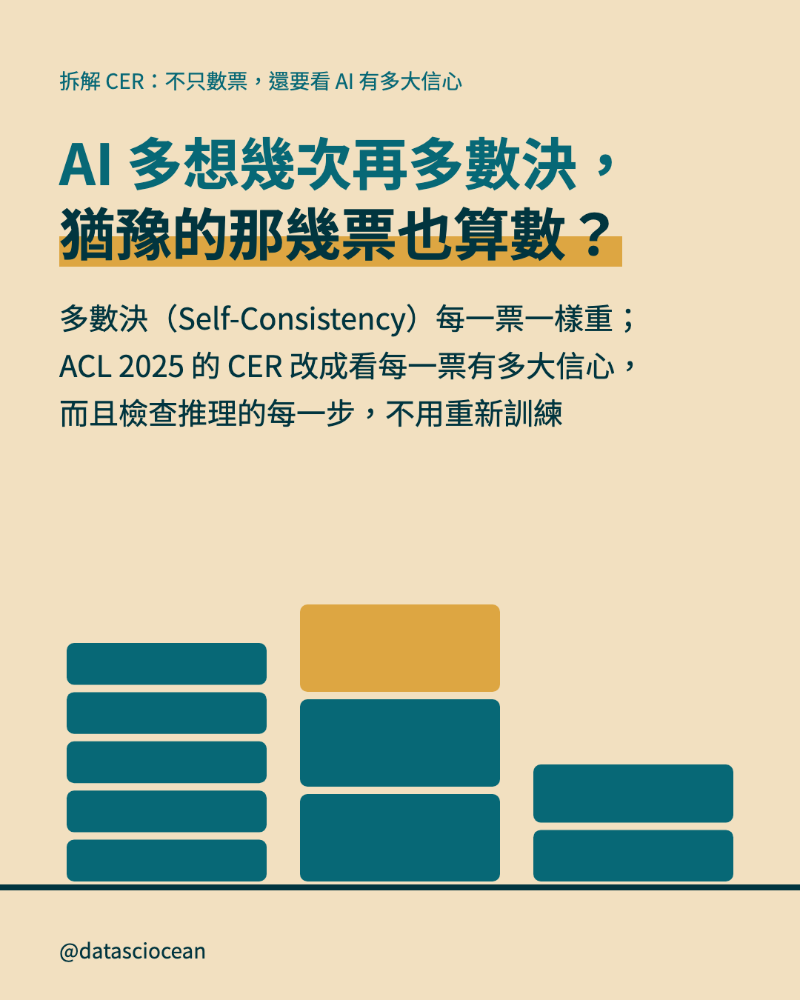
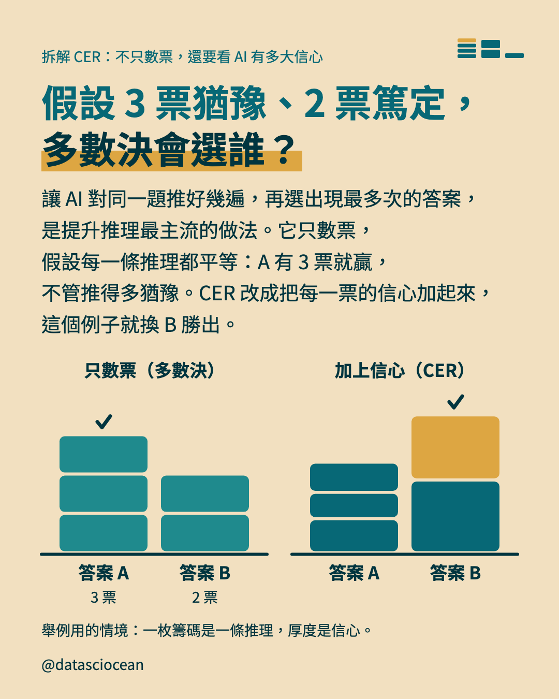
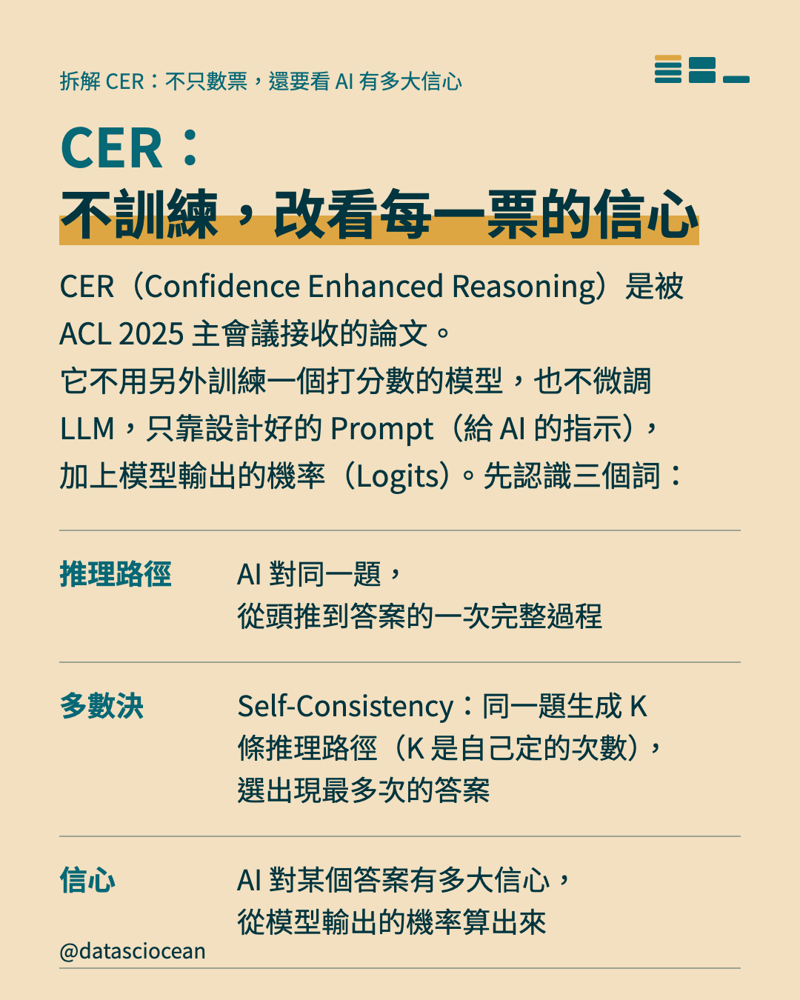
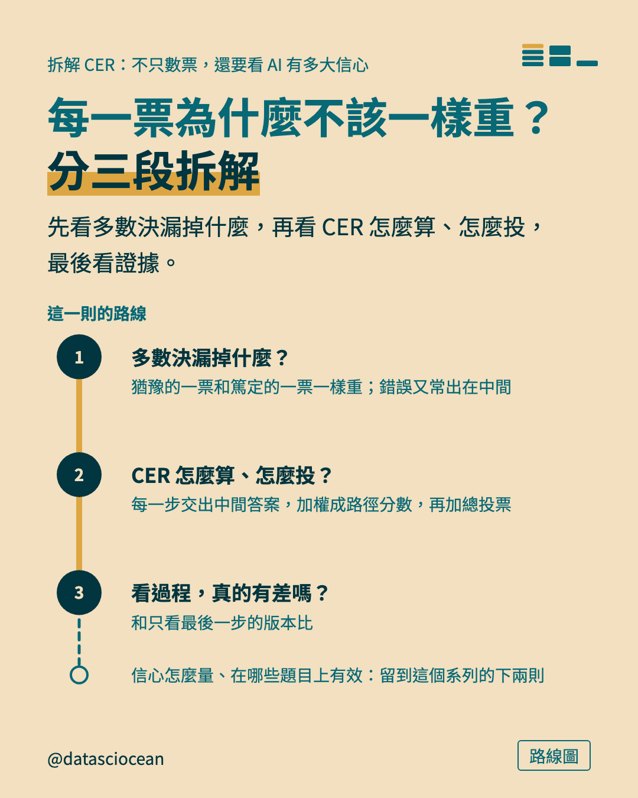
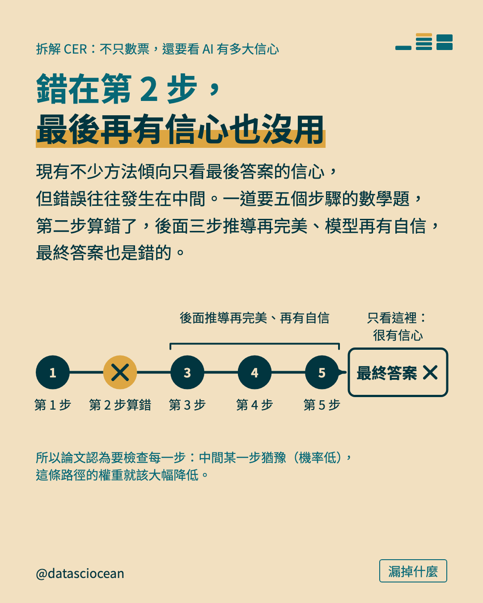
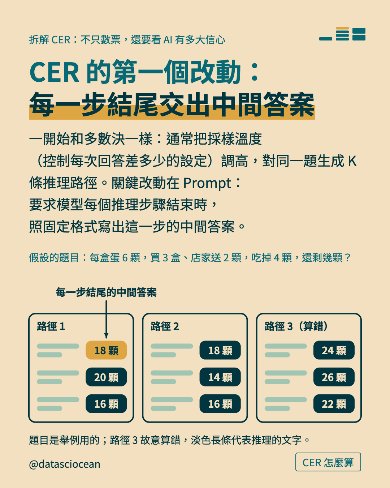
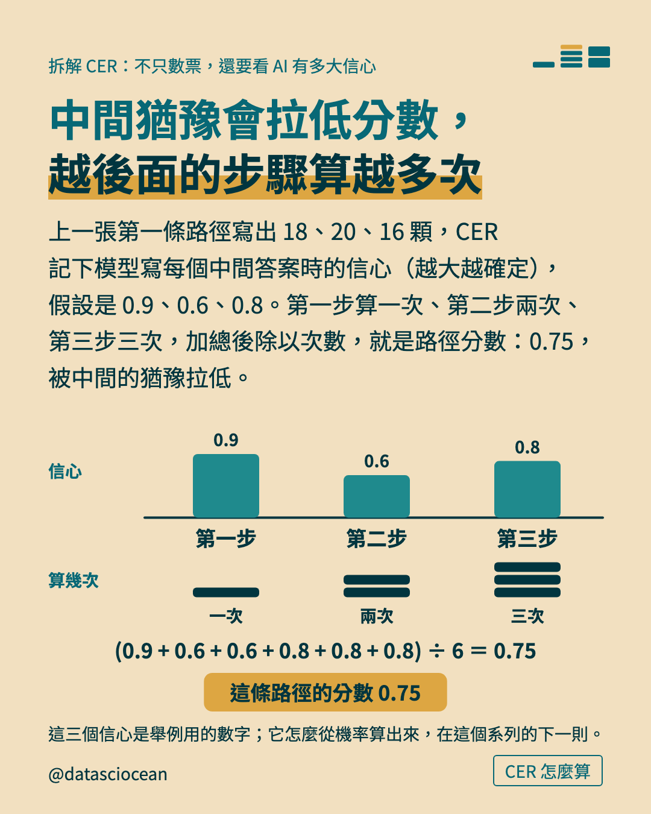
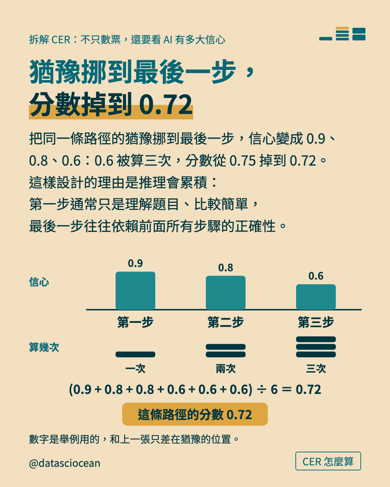
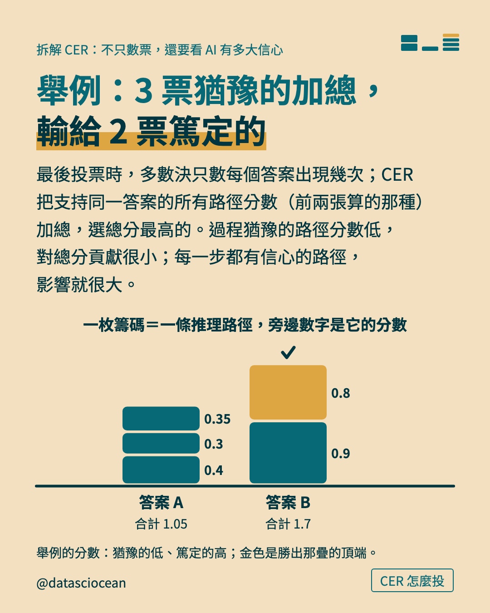
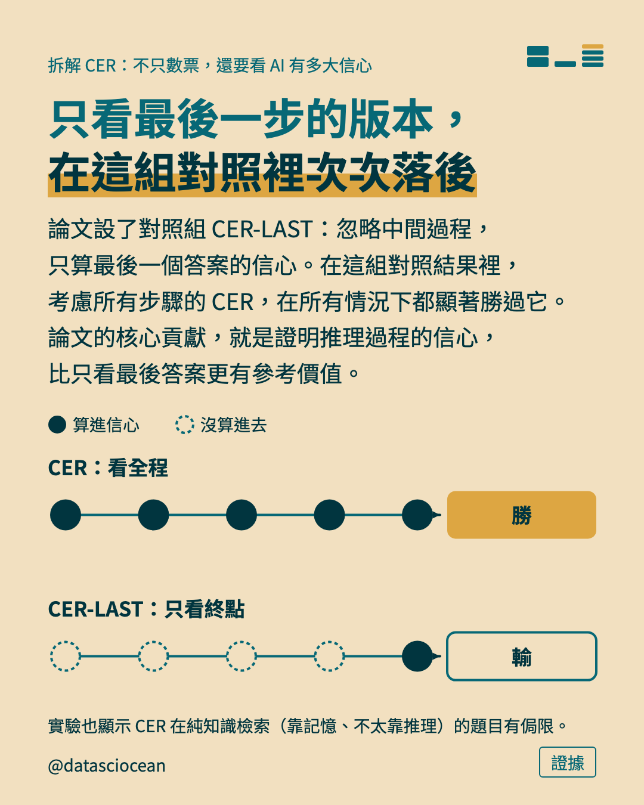
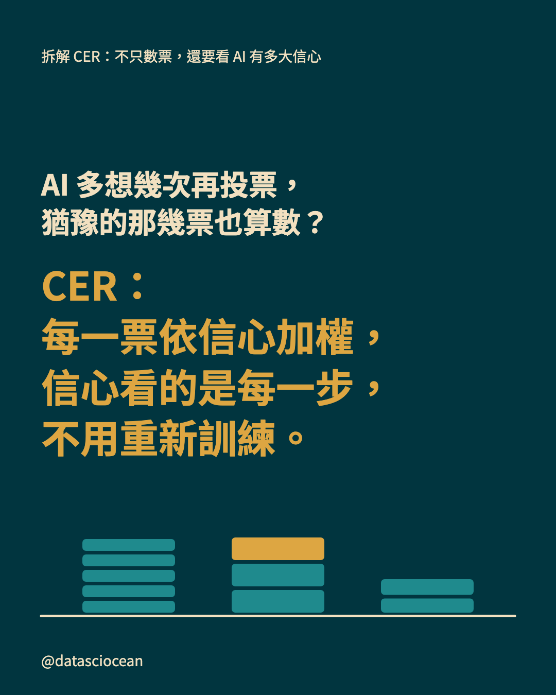
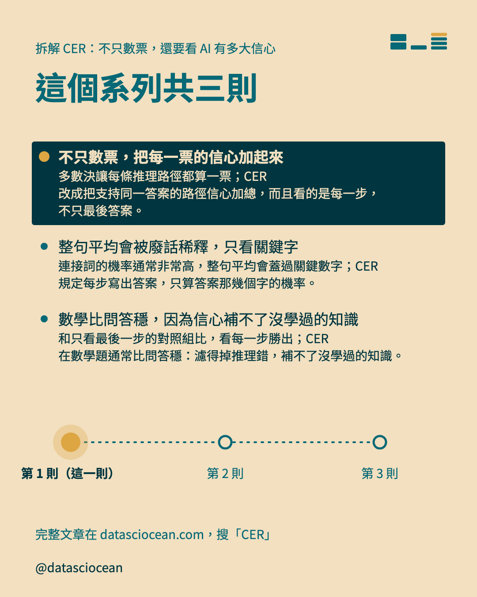

## 回覆：連結與系列

```text
CER：不只數票，把每一條推理的信心加起來，而且看的是每一步。
文章：datasciocean.com/paper-intro/cer
同系列：整句平均會被廢話稀釋，只看關鍵字（尚未發布）
同系列：數學比問答穩，因為信心補不了沒學過的知識（尚未發布）
```
