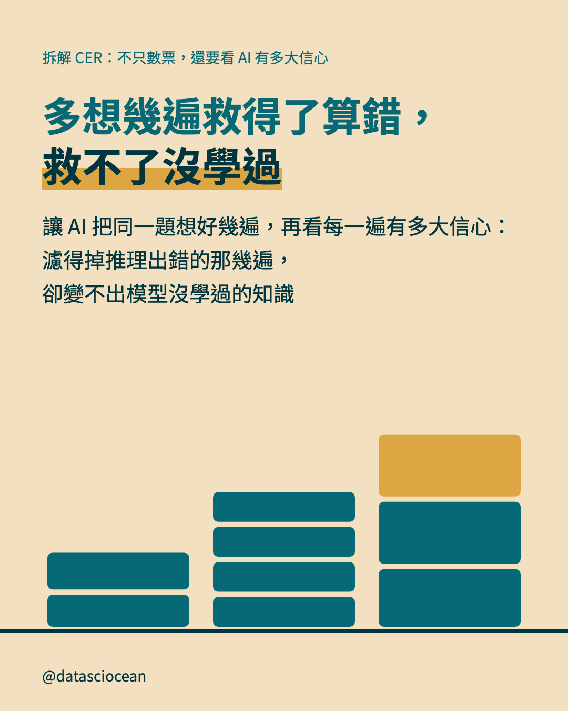
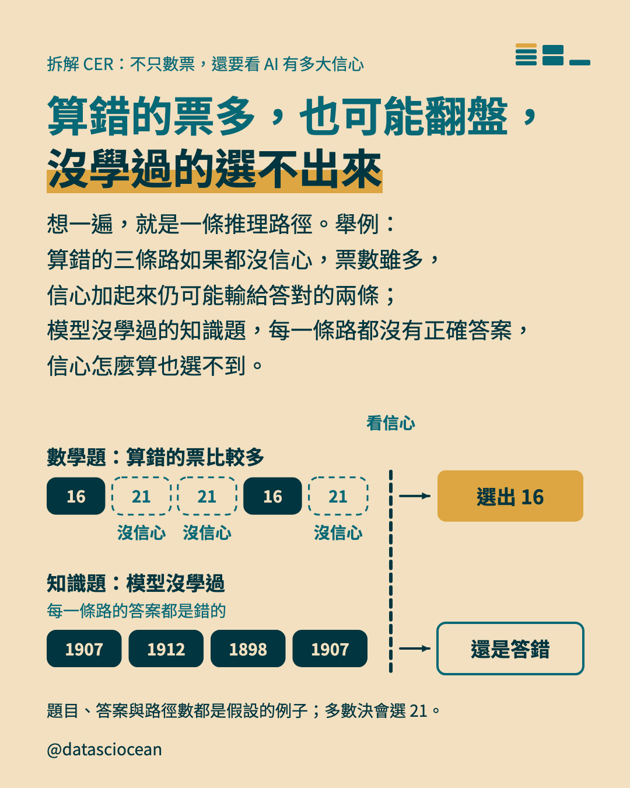
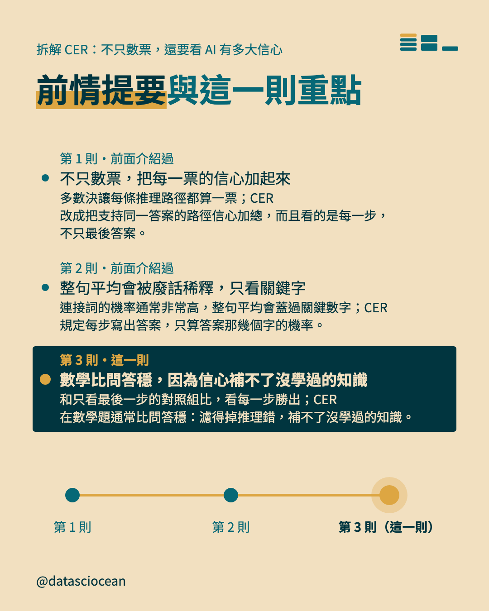
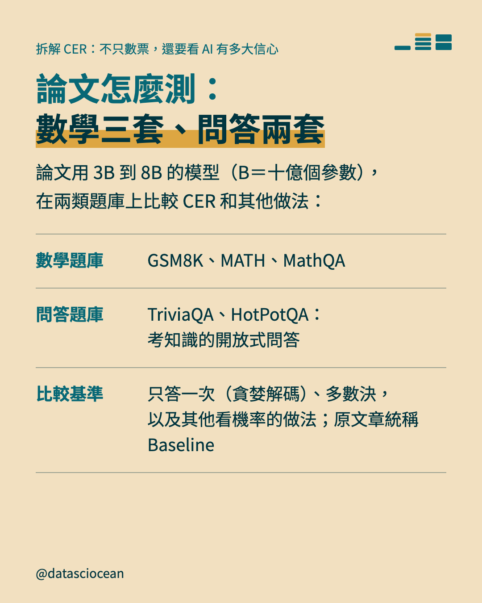
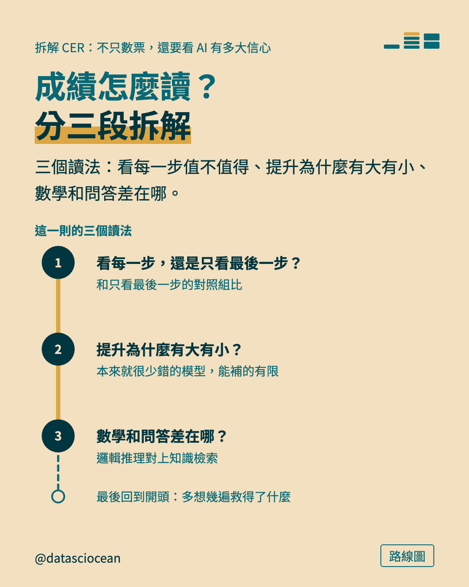
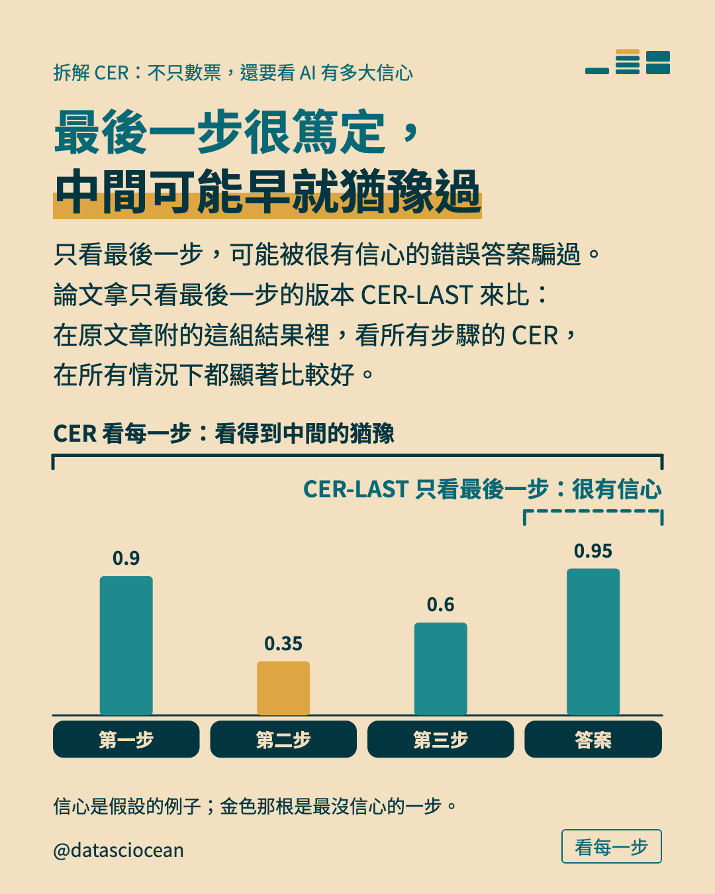
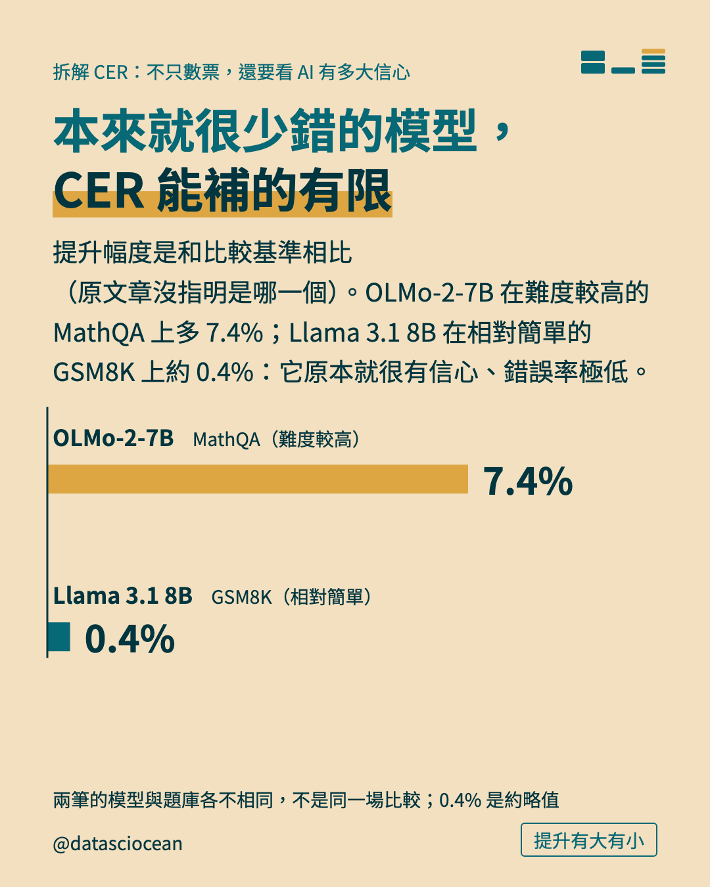
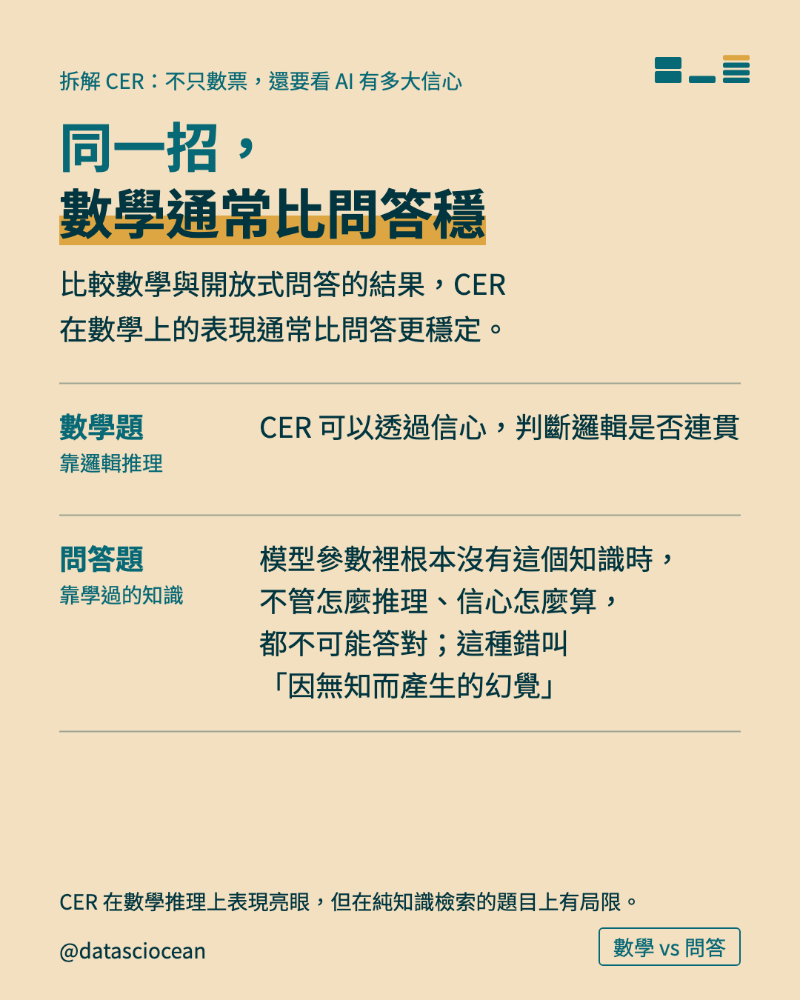
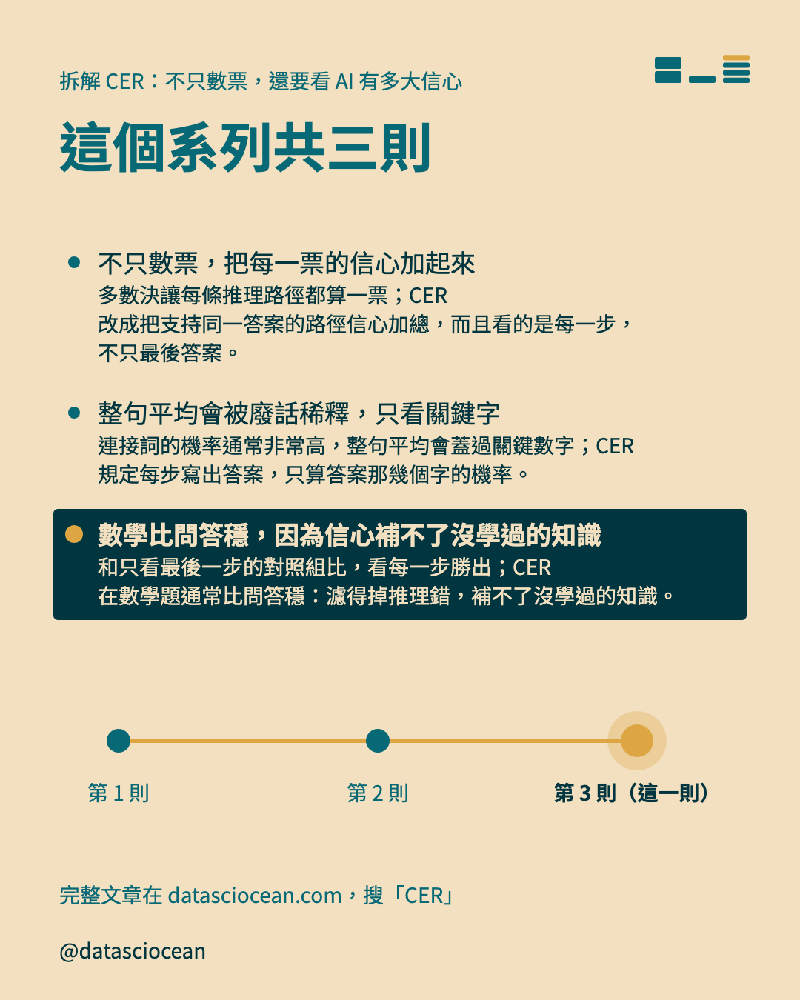

# IG 輪播：數學比問答穩，因為信心補不了沒學過的知識

- 系列：拆解 CER：不只數票，還要看 AI 有多大信心　｜　hook 樣態：能力邊界　｜　共 10 張，**依頁碼順序上傳**
- 每頁下方的「替代文字」貼到 IG 的替代文字欄；最後的 Caption 整段貼上

## 第 1 頁（封面）



- **主標**：多想幾遍救得了算錯，
救不了沒學過
- **副標**：讓 AI 把同一題想好幾遍，再看每一遍有多大信心：
濾得掉推理出錯的那幾遍，
卻變不出模型沒學過的知識
- **替代文字**：多想幾遍救得了算錯，
救不了沒學過。讓 AI 把同一題想好幾遍，再看每一遍有多大信心：
濾得掉推理出錯的那幾遍，
卻變不出模型沒學過的知識

## 第 2 頁（示意圖）



- **主標**：算錯的票多，也可能翻盤，
沒學過的選不出來
- **補充**：想一遍，就是一條推理路徑。舉例：算錯的三條路如果都沒信心，票數雖多，信心加起來仍可能輸給答對的兩條；模型沒學過的知識題，每一條路都沒有正確答案，信心怎麼算也選不到。
- **示意圖（sieve）上的文字與數字**：數學題：算錯的票比較多｜知識題：模型沒學過｜每一條路的答案都是錯的｜選出 16｜還是答錯｜看信心｜沒信心｜16｜21｜21｜16｜21｜1907｜1912｜1898｜1907
- **圖註**：題目、答案與路徑數都是假設的例子；多數決會選 21。
- **替代文字**：算錯的票多，也可能翻盤，
沒學過的選不出來。想一遍，就是一條推理路徑。舉例：算錯的三條路如果都沒信心，票數雖多，信心加起來仍可能輸給答對的兩條；模型沒學過的知識題，每一條路都沒有正確答案，信心怎麼算也選不到。。圖上寫：數學題：算錯的票比較多、知識題：模型沒學過、每一條路的答案都是錯的、選出 16、還是答錯、看信心、沒信心、16、21、21、16、21、1907、1912、1898、1907

## 第 3 頁（前情回顧）



- **主標**：前情提要與這一則重點
- **第 1 則**：不只數票，把每一票的信心加起來　多數決讓每條推理路徑都算一票；CER 改成把支持同一答案的路徑信心加總，而且看的是每一步，不只最後答案。
- **第 2 則**：整句平均會被廢話稀釋，只看關鍵字　連接詞的機率通常非常高，整句平均會蓋過關鍵數字；CER 規定每步寫出答案，只算答案那幾個字的機率。
- **第 3 則**：數學比問答穩，因為信心補不了沒學過的知識　和只看最後一步的對照組比，看每一步勝出；CER 在數學題通常比問答穩：濾得掉推理錯，補不了沒學過的知識。
- **替代文字**：前情提要與這一則重點。第 1 則「不只數票，把每一票的信心加起來」：多數決讓每條推理路徑都算一票；CER 改成把支持同一答案的路徑信心加總，而且看的是每一步，不只最後答案。；第 2 則「整句平均會被廢話稀釋，只看關鍵字」：連接詞的機率通常非常高，整句平均會蓋過關鍵數字；CER 規定每步寫出答案，只算答案那幾個字的機率。；第 3 則「數學比問答穩，因為信心補不了沒學過的知識」：和只看最後一步的對照組比，看每一步勝出；CER 在數學題通常比問答穩：濾得掉推理錯，補不了沒學過的知識。

## 第 4 頁（脈絡）



- **主標**：論文怎麼測：
數學三套、問答兩套
- **補充**：論文用 3B 到 8B 的模型（B＝十億個參數），在兩類題庫上比較 CER 和其他做法：
- **表列**：數學題庫｜GSM8K、MATH、MathQA
- **表列**：問答題庫｜TriviaQA、HotPotQA：考知識的開放式問答
- **表列**：比較基準｜只答一次（貪婪解碼）、多數決，以及其他看機率的做法；原文章統稱 Baseline
- **替代文字**：論文怎麼測：
數學三套、問答兩套。論文用 3B 到 8B 的模型（B＝十億個參數），在兩類題庫上比較 CER 和其他做法：

## 第 5 頁（示意圖）



- **小標籤**：路線圖
- **主標**：成績怎麼讀？
分三段拆解
- **補充**：三個讀法：看每一步值不值得、提升為什麼有大有小、數學和問答差在哪。
- **示意圖（route）上的文字與數字**：看每一步，還是只看最後一步？｜和只看最後一步的對照組比｜提升為什麼有大有小？｜本來就很少錯的模型，能補的有限｜數學和問答差在哪？｜邏輯推理對上知識檢索｜這一則的三個讀法｜最後回到開頭：多想幾遍救得了什麼
- **替代文字**：成績怎麼讀？
分三段拆解。三個讀法：看每一步值不值得、提升為什麼有大有小、數學和問答差在哪。。圖上寫：看每一步，還是只看最後一步？、和只看最後一步的對照組比、提升為什麼有大有小？、本來就很少錯的模型，能補的有限、數學和問答差在哪？、邏輯推理對上知識檢索、這一則的三個讀法、最後回到開頭：多想幾遍救得了什麼

## 第 6 頁（示意圖）



- **小標籤**：看每一步
- **主標**：最後一步很篤定，
中間可能早就猶豫過
- **補充**：只看最後一步，可能被很有信心的錯誤答案騙過。論文拿只看最後一步的版本 CER-LAST 來比：在原文章附的這組結果裡，看所有步驟的 CER，在所有情況下都顯著比較好。
- **示意圖（lens）上的文字與數字**：第一步｜第二步｜第三步｜答案｜看得到中間的猶豫｜很有信心｜CER 看每一步｜CER-LAST 只看最後一步｜0.9｜0.35｜0.6｜0.95｜CER 看每一步：看得到中間的猶豫｜CER-LAST 只看最後一步：很有信心
- **圖註**：信心是假設的例子；金色那根是最沒信心的一步。
- **替代文字**：最後一步很篤定，
中間可能早就猶豫過。只看最後一步，可能被很有信心的錯誤答案騙過。論文拿只看最後一步的版本 CER-LAST 來比：在原文章附的這組結果裡，看所有步驟的 CER，在所有情況下都顯著比較好。。圖上寫：第一步、第二步、第三步、答案、看得到中間的猶豫、很有信心、CER 看每一步、CER-LAST 只看最後一步、0.9、0.35、0.6、0.95、CER 看每一步：看得到中間的猶豫、CER-LAST 只看最後一步：很有信心

## 第 7 頁（橫條圖）



- **小標籤**：提升有大有小
- **主標**：本來就很少錯的模型，
CER 能補的有限
- **補充**：提升幅度是和比較基準相比（原文章沒指明是哪一個）。OLMo-2-7B 在難度較高的 MathQA 上多 7.4%；Llama 3.1 8B 在相對簡單的 GSM8K 上約 0.4%：它原本就很有信心、錯誤率極低。
- **圖上項目**：OLMo-2-7B（MathQA（難度較高））＝ 7.4 %　★強調
- **圖上項目**：Llama 3.1 8B（GSM8K（相對簡單））＝ 0.4 %
- **圖註**：兩筆的模型與題庫各不相同，不是同一場比較；0.4% 是約略值
- **替代文字**：本來就很少錯的模型，
CER 能補的有限。提升幅度是和比較基準相比（原文章沒指明是哪一個）。OLMo-2-7B 在難度較高的 MathQA 上多 7.4%；Llama 3.1 8B 在相對簡單的 GSM8K 上約 0.4%：它原本就很有信心、錯誤率極低。

## 第 8 頁（對照表）



- **小標籤**：數學 vs 問答
- **主標**：同一招，
數學通常比問答穩
- **補充**：比較數學與開放式問答的結果，CER 在數學上的表現通常比問答更穩定。
- **表列**：數學題｜靠邏輯推理｜CER 可以透過信心，判斷邏輯是否連貫
- **表列**：問答題｜靠學過的知識｜模型參數裡根本沒有這個知識時，不管怎麼推理、信心怎麼算，都不可能答對；這種錯叫「因無知而產生的幻覺」
- **圖註**：CER 在數學推理上表現亮眼，但在純知識檢索的題目上有局限。
- **替代文字**：同一招，
數學通常比問答穩。比較數學與開放式問答的結果，CER 在數學上的表現通常比問答更穩定。

## 第 9 頁（帶走）


- **先問的問題**：讓 AI 多想幾遍再看信心，救得了什麼？
- **一句話**：多想幾遍、看信心：
能幫 AI 把推理理清楚，
不會讓它多懂一點知識。
- **替代文字**：讓 AI 多想幾遍再看信心，救得了什麼？　多想幾遍、看信心：
能幫 AI 把推理理清楚，
不會讓它多懂一點知識。

## 第 10 頁（系列地圖）



- **主標**：這個系列共三則
- **導流行**：完整文章在 datasciocean.com，搜「CER」
- **第 1 則**：不只數票，把每一票的信心加起來　多數決讓每條推理路徑都算一票；CER 改成把支持同一答案的路徑信心加總，而且看的是每一步，不只最後答案。
- **第 2 則**：整句平均會被廢話稀釋，只看關鍵字　連接詞的機率通常非常高，整句平均會蓋過關鍵數字；CER 規定每步寫出答案，只算答案那幾個字的機率。
- **第 3 則**：數學比問答穩，因為信心補不了沒學過的知識　和只看最後一步的對照組比，看每一步勝出；CER 在數學題通常比問答穩：濾得掉推理錯，補不了沒學過的知識。
- **替代文字**：這個系列共三則。不只數票，把每一票的信心加起來：多數決讓每條推理路徑都算一票；CER 改成把支持同一答案的路徑信心加總，而且看的是每一步，不只最後答案。、整句平均會被廢話稀釋，只看關鍵字：連接詞的機率通常非常高，整句平均會蓋過關鍵數字；CER 規定每步寫出答案，只算答案那幾個字的機率。、數學比問答穩，因為信心補不了沒學過的知識：和只看最後一步的對照組比，看每一步勝出；CER 在數學題通常比問答穩：濾得掉推理錯，補不了沒學過的知識。

## Caption（整段貼到 IG）

```text
AI 多想幾遍、看信心再投票，就會變準嗎？CER 的實驗：數學題通常比知識問答穩

・算錯的票多，也可能翻盤，沒學過的選不出來（想一遍，就是一條推理路徑）
・看每一步：最後一步很篤定，中間可能早就猶豫過（只看最後一步，可能被很有信心的錯誤答案騙過）
・提升有大有小：本來就很少錯的模型，CER 能補的有限（提升幅度是和比較基準相比（原文章沒指明是哪一個））
・數學 vs 問答：同一招，數學通常比問答穩

完整文章在 datasciocean.com，搜「CER」

#CER #LLM推理 #LLM
```
