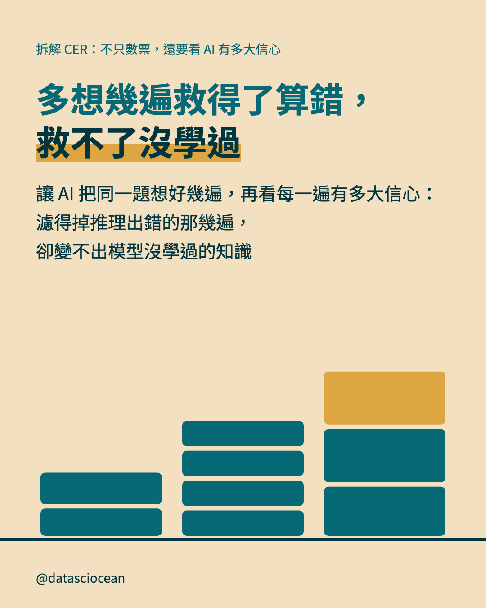
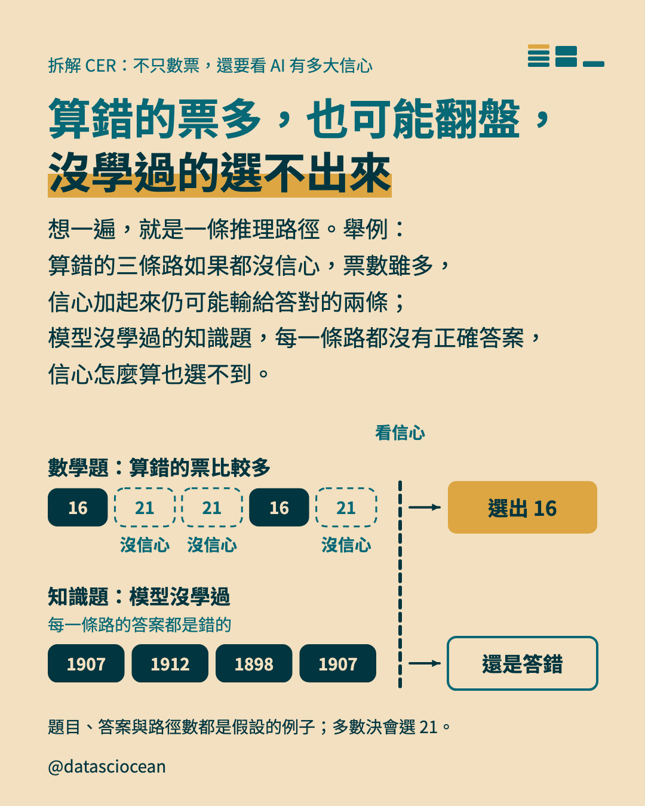
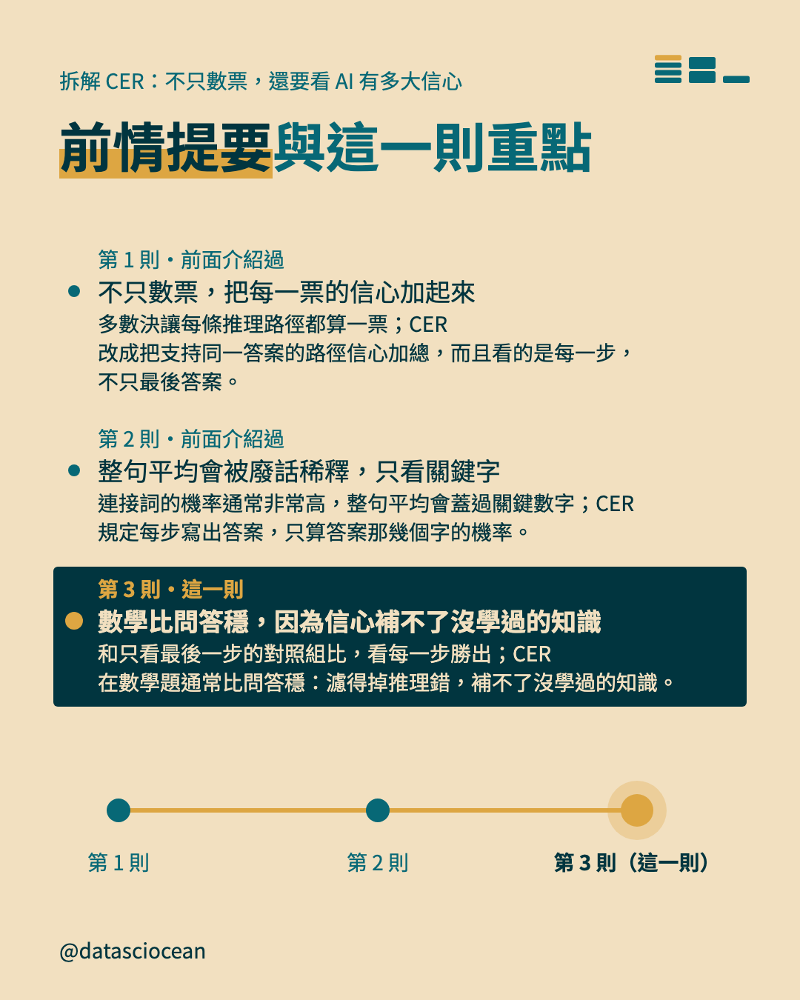
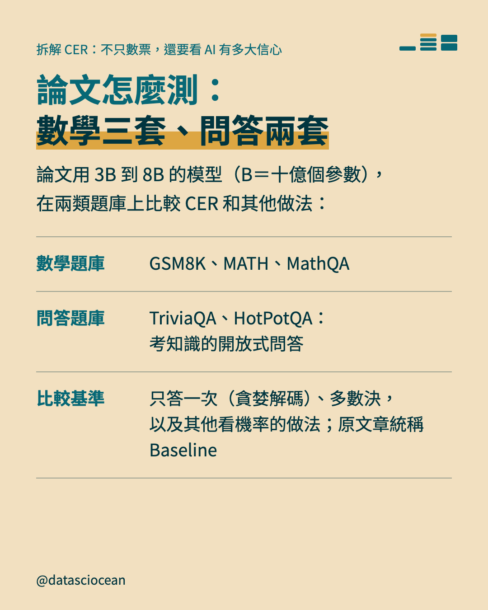
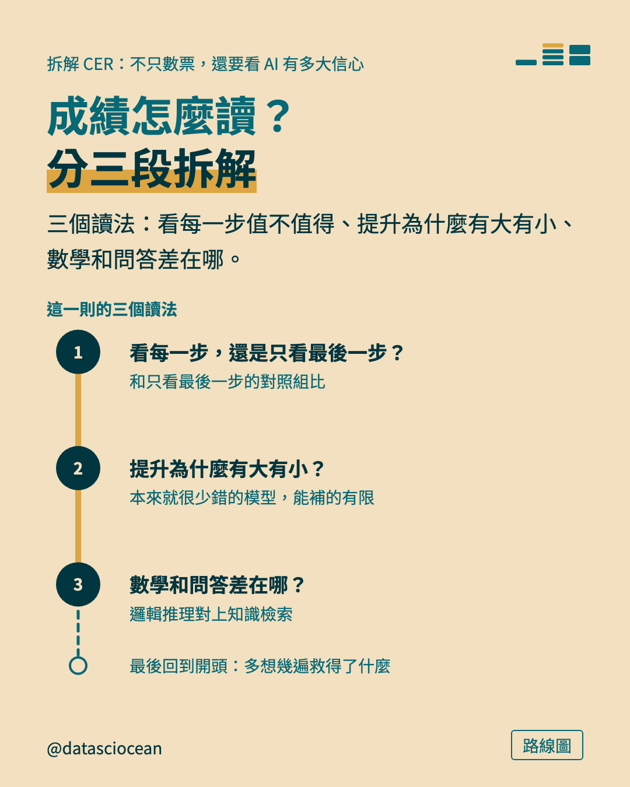
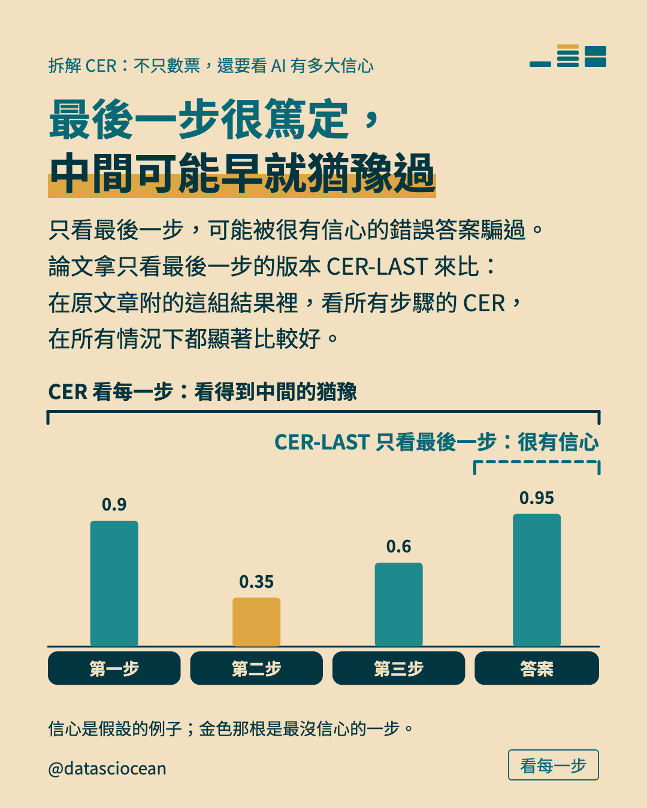
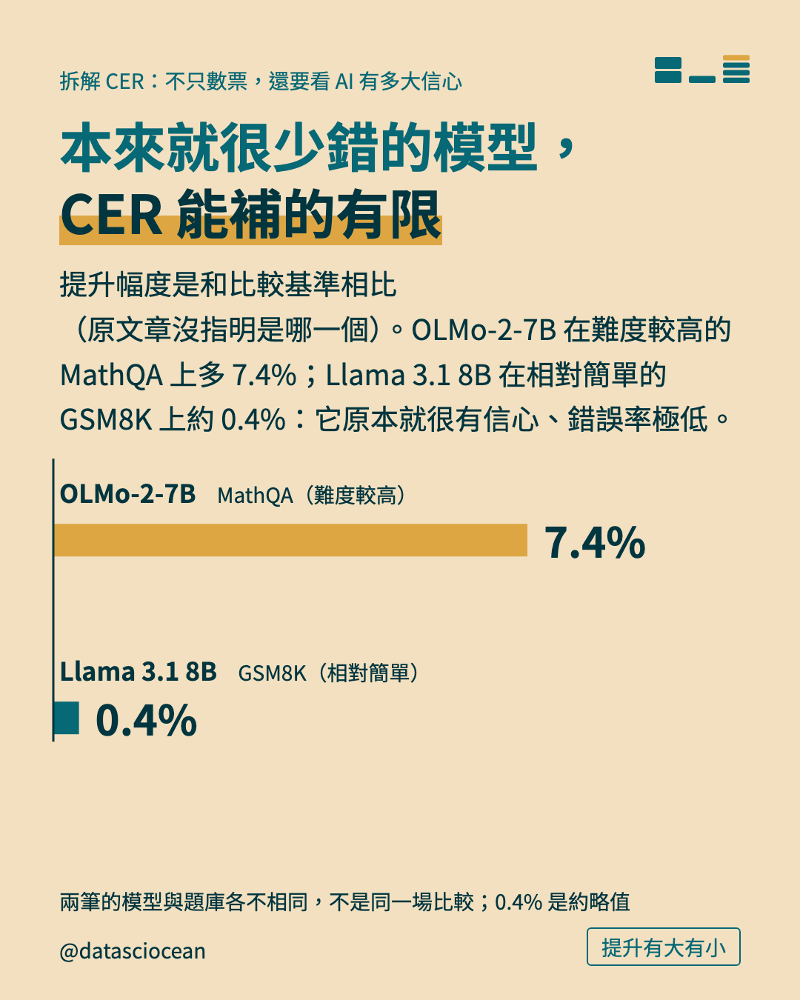
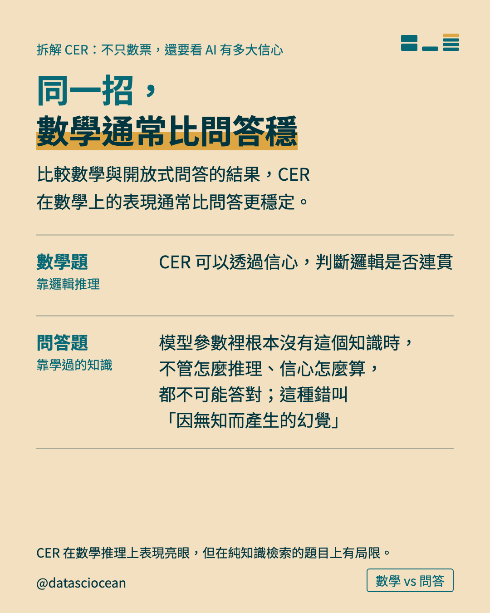
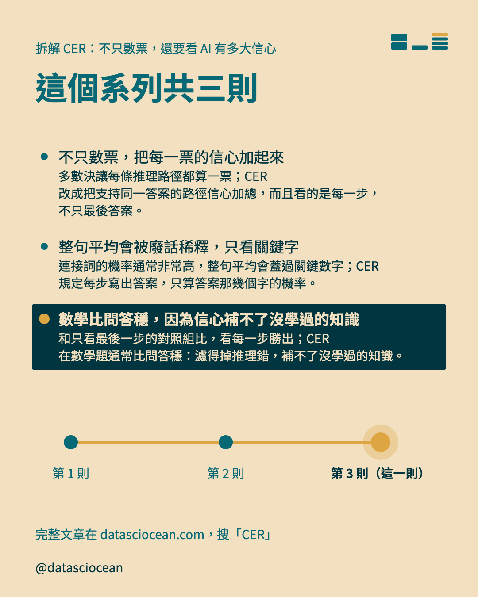

# Threads：數學比問答穩，因為信心補不了沒學過的知識

- 發文方式：**一則輪播貼文**（正文＋全部 10 張圖，順序與 IG 相同），再用一則回覆放連結與系列（連結只放那則回覆）
- 圖檔在 `../ig/`（與 IG 輪播共用同一套）

## 貼文正文（附下方全部圖片）

```text
多想幾遍救得了算錯，救不了沒學過。

CER 讓 AI 把同一題想好幾遍，再依每一遍推理過程的信心加權投票。論文用 3B 到 8B 的模型，在三個數學題庫和兩個知識問答題庫上測試。

有意思的是，提升有大有小：和比較基準相比，OLMo-2-7B 在較難的 MathQA 上多 7.4%，Llama 3.1 8B 在相對簡單的 GSM8K 上只有約 0.4%。原文章的解釋是，這類模型原本就很有信心、錯誤率極低，改進空間有限。

數學上通常比問答穩定，原因是：信心可以過濾邏輯錯誤，卻無法憑空創造缺失的知識。模型參數裡沒有的知識，不管怎麼推理、信心怎麼算，都不可能答對。CER 在數學推理上表現亮眼，但在純知識檢索的題目上有局限。

這是 CER 系列的第三則，也是完結篇。
```

## 附圖（依序）












## 回覆：連結與系列

```text
多想幾遍、看信心，幫的是推理，不是知識。
文章：datasciocean.com/paper-intro/cer
```
