# IG 輪播：搜尋每次都把所有工具叫一遍？又慢又貴

- 系列：拆解 Cerebras 知識庫：資料怎麼進來，答案怎麼出去　｜　hook 樣態：情境痛點　｜　共 19 張，**依頁碼順序上傳**
- 每頁下方的「替代文字」貼到 IG 的替代文字欄；最後的 Caption 整段貼上

## 第 1 頁（封面）

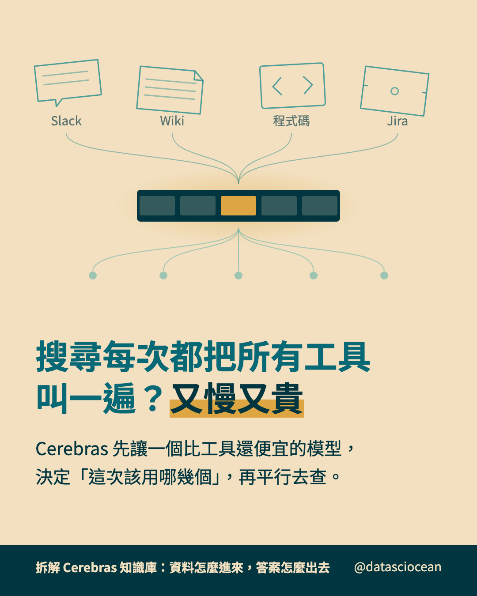

- **主標**：搜尋每次都把所有工具
叫一遍？又慢又貴
- **副標**：Cerebras 先讓一個比工具還便宜的模型，
決定「這次該用哪幾個」，再平行去查。
- **替代文字**：搜尋每次都把所有工具
叫一遍？又慢又貴。Cerebras 先讓一個比工具還便宜的模型，
決定「這次該用哪幾個」，再平行去查。

## 第 2 頁（前情回顧）


- **主標**：前情提要與這一則重點
- **第 1 則**：Slack、Wiki、程式碼、Jira，怎麼塞進同一張表？　異質來源收斂成只有五個欄位的一張表；寫入前先把討論串正規化成固定四樣再做 embedding。
- **第 2 則**：搜尋出三種毛病，Cerebras 不是多加幾招，是一種毛病配一帖藥　用向量搜尋找對話紀錄有三種毛病，每種配一個不會跟著犯錯的做法；好幾種搜法的結果，改用名次合成一份。
- **第 3 則**：搜尋每次都把所有工具叫一遍？又慢又貴　LLM 先挑這次用哪些工具、平行查一輪，推理留到最後才做；整條流程只走一輪，不會回頭再查。
- **替代文字**：前情提要與這一則重點。第 1 則「Slack、Wiki、程式碼、Jira，怎麼塞進同一張表？」：異質來源收斂成只有五個欄位的一張表；寫入前先把討論串正規化成固定四樣再做 embedding。；第 2 則「搜尋出三種毛病，Cerebras 不是多加幾招，是一種毛病配一帖藥」：用向量搜尋找對話紀錄有三種毛病，每種配一個不會跟著犯錯的做法；好幾種搜法的結果，改用名次合成一份。；第 3 則「搜尋每次都把所有工具叫一遍？又慢又貴」：LLM 先挑這次用哪些工具、平行查一輪，推理留到最後才做；整條流程只走一輪，不會回頭再查。

## 第 3 頁（示意圖）

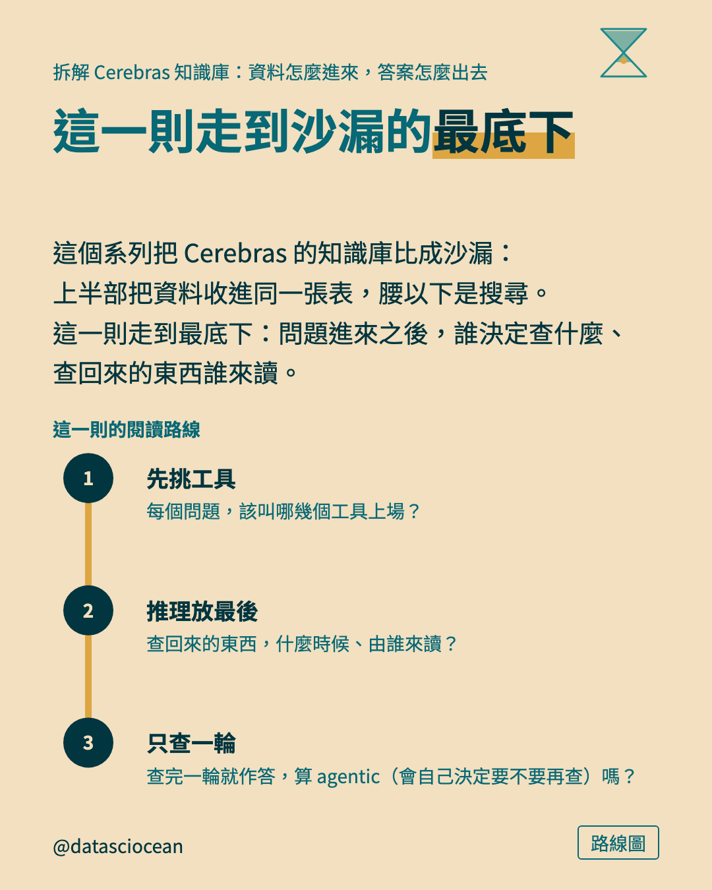

- **小標籤**：路線圖
- **主標**：這一則走到沙漏的最底下
- **補充**：這個系列把 Cerebras 的知識庫比成沙漏：上半部把資料收進同一張表，腰以下是搜尋。這一則走到最底下：問題進來之後，誰決定查什麼、查回來的東西誰來讀。
- **示意圖（route）上的文字與數字**：先挑工具｜每個問題，該叫哪幾個工具上場？｜推理放最後｜查回來的東西，什麼時候、由誰來讀？｜只查一輪｜查完一輪就作答，算 agentic（會自己決定要不要再查）嗎？｜這一則的閱讀路線
- **替代文字**：這一則走到沙漏的最底下。這個系列把 Cerebras 的知識庫比成沙漏：上半部把資料收進同一張表，腰以下是搜尋。這一則走到最底下：問題進來之後，誰決定查什麼、查回來的東西誰來讀。。圖上寫：先挑工具、每個問題，該叫哪幾個工具上場？、推理放最後、查回來的東西，什麼時候、由誰來讀？、只查一輪、查完一輪就作答，算 agentic（會自己決定要不要再查）嗎？、這一則的閱讀路線

## 第 4 頁（脈絡）

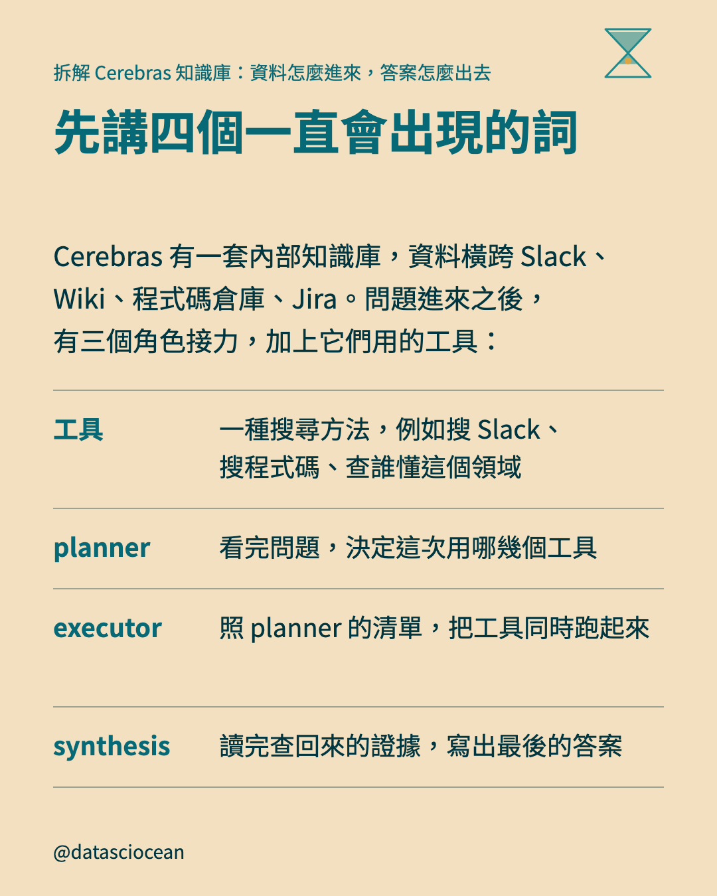

- **主標**：先講四個一直會出現的詞
- **補充**：Cerebras 有一套內部知識庫，資料橫跨 Slack、Wiki、程式碼倉庫、Jira。問題進來之後，有三個角色接力，加上它們用的工具：
- **表列**：工具｜一種搜尋方法，例如搜 Slack、搜程式碼、查誰懂這個領域
- **表列**：planner｜看完問題，決定這次用哪幾個工具
- **表列**：executor｜照 planner 的清單，把工具同時跑起來
- **表列**：synthesis｜讀完查回來的證據，寫出最後的答案
- **替代文字**：先講四個一直會出現的詞。Cerebras 有一套內部知識庫，資料橫跨 Slack、Wiki、程式碼倉庫、Jira。問題進來之後，有三個角色接力，加上它們用的工具：

## 第 5 頁（示意圖）

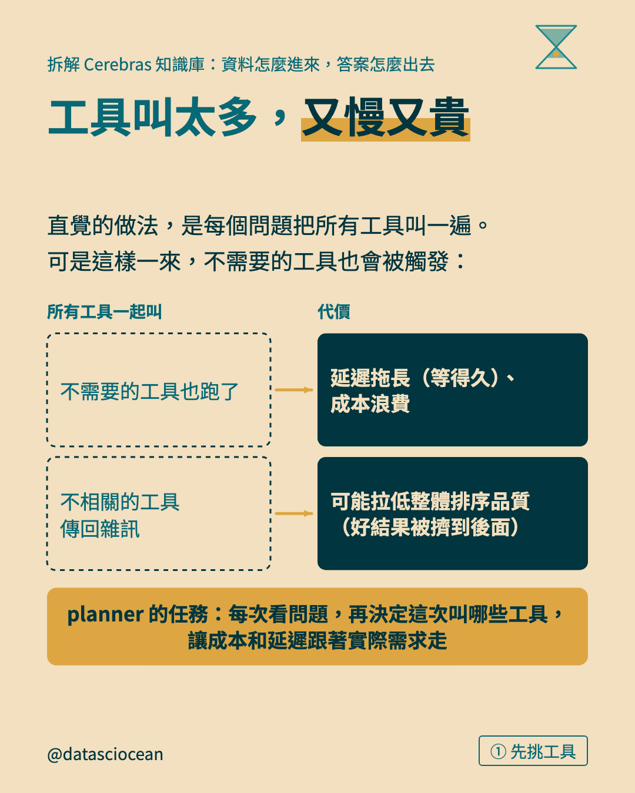

- **小標籤**：① 先挑工具
- **主標**：工具叫太多，又慢又貴
- **補充**：直覺的做法，是每個問題把所有工具叫一遍。可是這樣一來，不需要的工具也會被觸發：
- **示意圖（pairs）上的文字與數字**：planner 的任務：每次看問題，再決定這次叫哪些工具，讓成本和延遲跟著實際需求走｜所有工具一起叫｜代價｜不需要的工具也跑了｜延遲拖長（等得久）、成本浪費｜不相關的工具
傳回雜訊｜可能拉低整體排序品質
（好結果被擠到後面）
- **替代文字**：工具叫太多，又慢又貴。直覺的做法，是每個問題把所有工具叫一遍。可是這樣一來，不需要的工具也會被觸發：。圖上寫：planner 的任務：每次看問題，再決定這次叫哪些工具，讓成本和延遲跟著實際需求走、所有工具一起叫、代價、不需要的工具也跑了、延遲拖長（等得久）、成本浪費、不相關的工具
傳回雜訊、可能拉低整體排序品質
（好結果被擠到後面）

## 第 6 頁（示意圖）

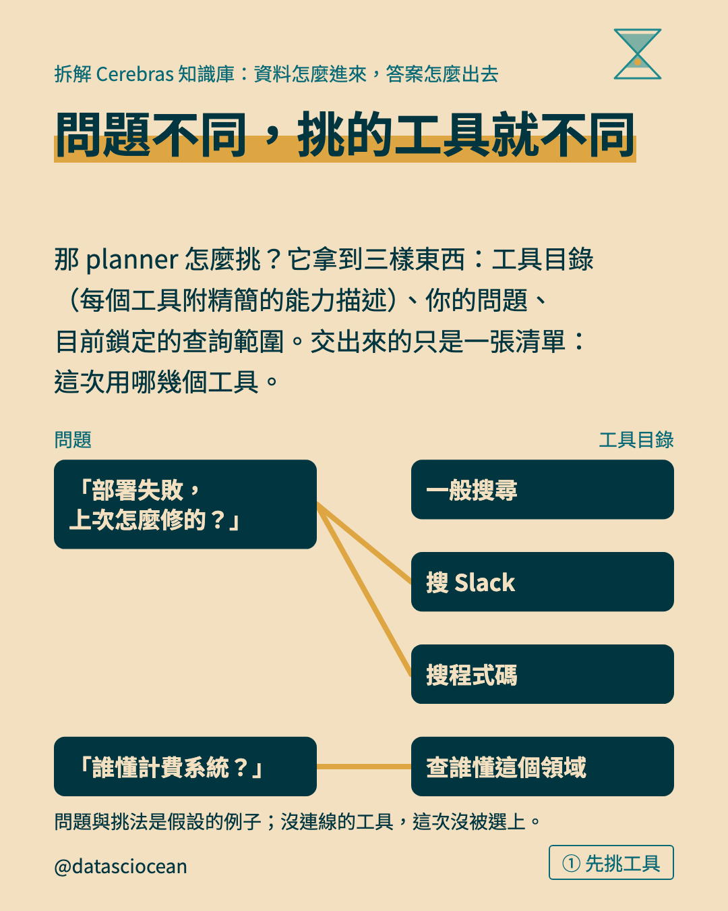

- **小標籤**：① 先挑工具
- **主標**：問題不同，挑的工具就不同
- **補充**：那 planner 怎麼挑？它拿到三樣東西：工具目錄（每個工具附精簡的能力描述）、你的問題、目前鎖定的查詢範圍。交出來的只是一張清單：這次用哪幾個工具。
- **示意圖（links）上的文字與數字**：「部署失敗，
上次怎麼修的？」｜「誰懂計費系統？」｜一般搜尋｜搜 Slack｜搜程式碼｜查誰懂這個領域｜問題｜工具目錄
- **圖註**：問題與挑法是假設的例子；沒連線的工具，這次沒被選上。
- **替代文字**：問題不同，挑的工具就不同。那 planner 怎麼挑？它拿到三樣東西：工具目錄（每個工具附精簡的能力描述）、你的問題、目前鎖定的查詢範圍。交出來的只是一張清單：這次用哪幾個工具。。圖上寫：「部署失敗，
上次怎麼修的？」、「誰懂計費系統？」、一般搜尋、搜 Slack、搜程式碼、查誰懂這個領域、問題、工具目錄

## 第 7 頁（示意圖）

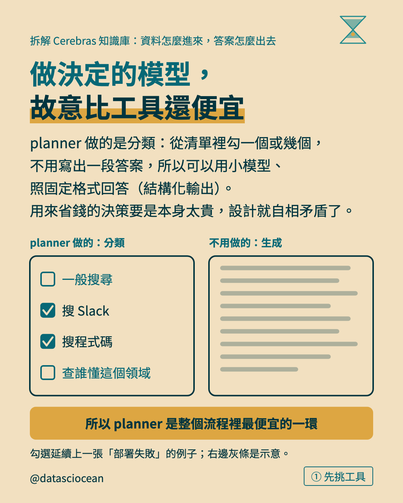

- **小標籤**：① 先挑工具
- **主標**：做決定的模型，故意比工具還便宜
- **補充**：planner 做的是分類：從清單裡勾一個或幾個，不用寫出一段答案，所以可以用小模型、照固定格式回答（結構化輸出）。用來省錢的決策要是本身太貴，設計就自相矛盾了。
- **示意圖（pick）上的文字與數字**：一般搜尋｜搜 Slack｜搜程式碼｜查誰懂這個領域｜所以 planner 是整個流程裡最便宜的一環｜planner 做的：分類｜不用做的：生成
- **圖註**：勾選延續上一張「部署失敗」的例子；右邊灰條是示意。
- **替代文字**：做決定的模型，故意比工具還便宜。planner 做的是分類：從清單裡勾一個或幾個，不用寫出一段答案，所以可以用小模型、照固定格式回答（結構化輸出）。用來省錢的決策要是本身太貴，設計就自相矛盾了。。圖上寫：一般搜尋、搜 Slack、搜程式碼、查誰懂這個領域、所以 planner 是整個流程裡最便宜的一環、planner 做的：分類、不用做的：生成

## 第 8 頁（示意圖）

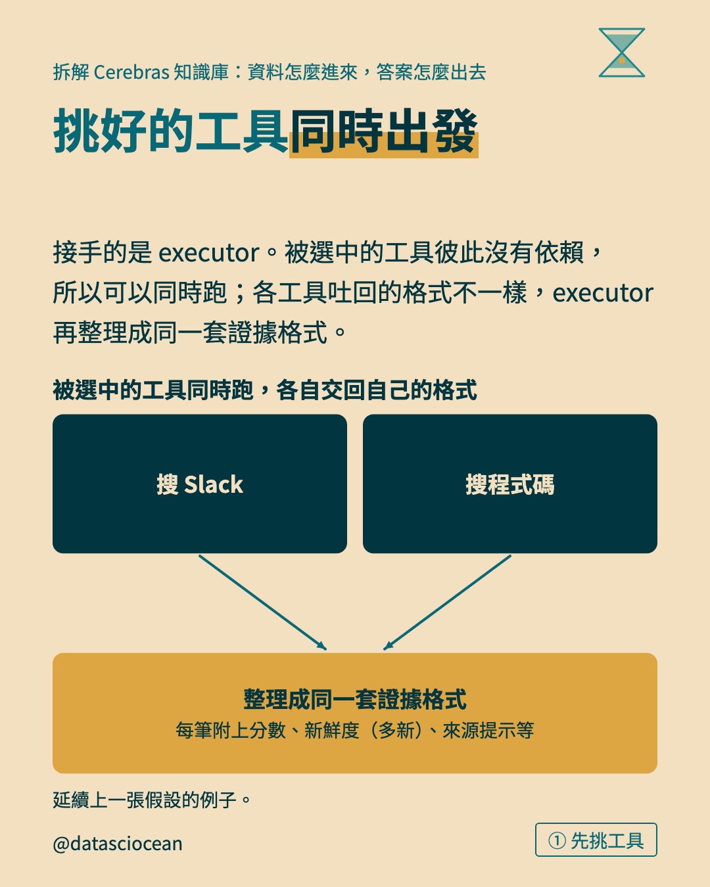

- **小標籤**：① 先挑工具
- **主標**：挑好的工具同時出發
- **補充**：接手的是 executor。被選中的工具彼此沒有依賴，所以可以同時跑；各工具吐回的格式不一樣，executor 再整理成同一套證據格式。
- **示意圖（fan）上的文字與數字**：被選中的工具同時跑，各自交回自己的格式｜整理成同一套證據格式｜每筆附上分數、新鮮度（多新）、來源提示等｜搜 Slack｜搜程式碼
- **圖註**：延續上一張假設的例子。
- **替代文字**：挑好的工具同時出發。接手的是 executor。被選中的工具彼此沒有依賴，所以可以同時跑；各工具吐回的格式不一樣，executor 再整理成同一套證據格式。。圖上寫：被選中的工具同時跑，各自交回自己的格式、整理成同一套證據格式、每筆附上分數、新鮮度（多新）、來源提示等、搜 Slack、搜程式碼

## 第 9 頁（示意圖）

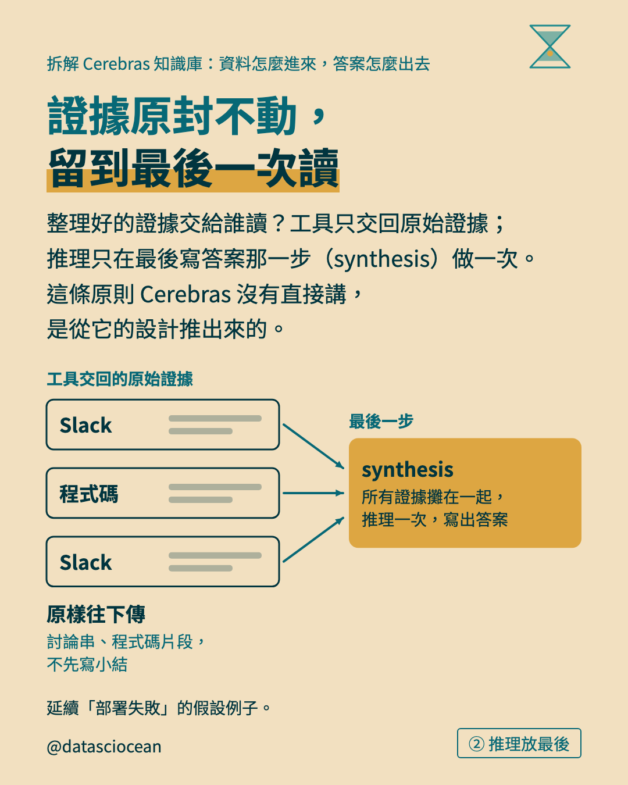

- **小標籤**：② 推理放最後
- **主標**：證據原封不動，留到最後一次讀
- **補充**：整理好的證據交給誰讀？工具只交回原始證據；推理只在最後寫答案那一步（synthesis）做一次。這條原則 Cerebras 沒有直接講，是從它的設計推出來的。
- **示意圖（pile）上的文字與數字**：原樣往下傳｜討論串、程式碼片段，不先寫小結｜synthesis｜所有證據攤在一起，推理一次，寫出答案｜Slack｜程式碼｜Slack｜工具交回的原始證據｜最後一步
- **圖註**：延續「部署失敗」的假設例子。
- **替代文字**：證據原封不動，留到最後一次讀。整理好的證據交給誰讀？工具只交回原始證據；推理只在最後寫答案那一步（synthesis）做一次。這條原則 Cerebras 沒有直接講，是從它的設計推出來的。。圖上寫：原樣往下傳、討論串、程式碼片段，不先寫小結、synthesis、所有證據攤在一起，推理一次，寫出答案、Slack、程式碼、Slack、工具交回的原始證據、最後一步

## 第 10 頁（示意圖）

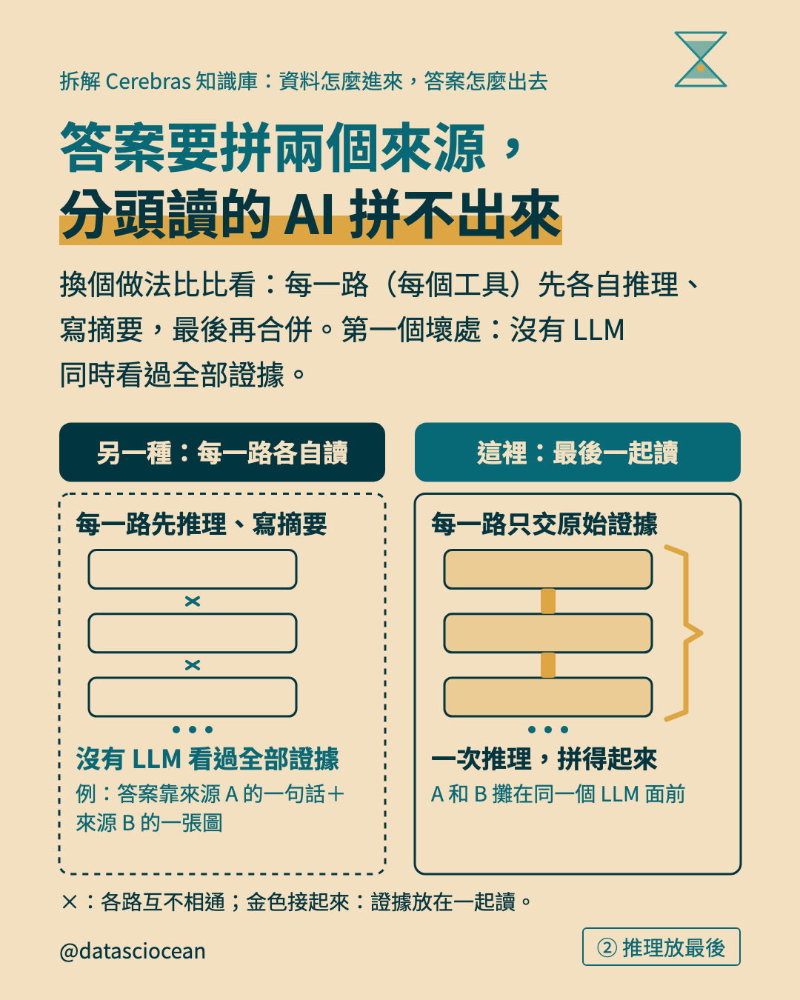

- **小標籤**：② 推理放最後
- **主標**：答案要拼兩個來源，分頭讀的 AI 拼不出來
- **補充**：換個做法比比看：每一路（每個工具）先各自推理、寫摘要，最後再合併。第一個壞處：沒有 LLM 同時看過全部證據。
- **示意圖（joint）上的文字與數字**：每一路先推理、寫摘要｜例：答案靠來源 A 的一句話＋來源 B 的一張圖｜沒有 LLM 看過全部證據｜每一路只交原始證據｜A 和 B 攤在同一個 LLM 面前｜一次推理，拼得起來｜另一種：每一路各自讀｜這裡：最後一起讀
- **圖註**：×：各路互不相通；金色接起來：證據放在一起讀。
- **替代文字**：答案要拼兩個來源，分頭讀的 AI 拼不出來。換個做法比比看：每一路（每個工具）先各自推理、寫摘要，最後再合併。第一個壞處：沒有 LLM 同時看過全部證據。。圖上寫：每一路先推理、寫摘要、例：答案靠來源 A 的一句話＋來源 B 的一張圖、沒有 LLM 看過全部證據、每一路只交原始證據、A 和 B 攤在同一個 LLM 面前、一次推理，拼得起來、另一種：每一路各自讀、這裡：最後一起讀

## 第 11 頁（示意圖）

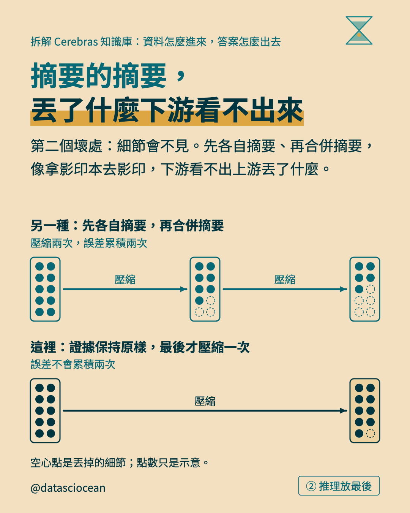

- **小標籤**：② 推理放最後
- **主標**：摘要的摘要，丟了什麼下游看不出來
- **補充**：第二個壞處：細節會不見。先各自摘要、再合併摘要，像拿影印本去影印，下游看不出上游丟了什麼。
- **示意圖（leak）上的文字與數字**：另一種：先各自摘要，再合併摘要｜壓縮兩次，誤差累積兩次｜這裡：證據保持原樣，最後才壓縮一次｜誤差不會累積兩次｜壓縮
- **圖註**：空心點是丟掉的細節；點數只是示意。
- **替代文字**：摘要的摘要，丟了什麼下游看不出來。第二個壞處：細節會不見。先各自摘要、再合併摘要，像拿影印本去影印，下游看不出上游丟了什麼。。圖上寫：另一種：先各自摘要，再合併摘要、壓縮兩次，誤差累積兩次、這裡：證據保持原樣，最後才壓縮一次、誤差不會累積兩次、壓縮

## 第 12 頁（示意圖）

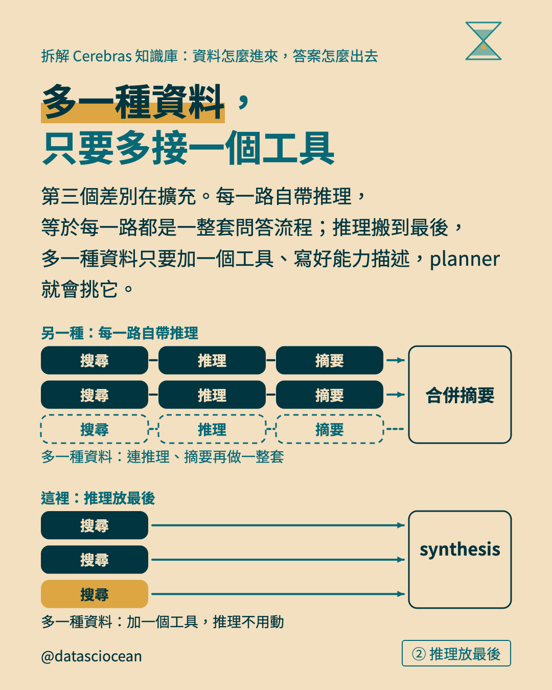

- **小標籤**：② 推理放最後
- **主標**：多一種資料，只要多接一個工具
- **補充**：第三個差別在擴充。每一路自帶推理，等於每一路都是一整套問答流程；推理搬到最後，多一種資料只要加一個工具、寫好能力描述，planner 就會挑它。
- **示意圖（addlane）上的文字與數字**：搜尋｜推理｜摘要｜多一種資料：連推理、摘要再做一整套｜合併摘要｜多一種資料：加一個工具，推理不用動｜synthesis｜另一種：每一路自帶推理｜這裡：推理放最後
- **替代文字**：多一種資料，只要多接一個工具。第三個差別在擴充。每一路自帶推理，等於每一路都是一整套問答流程；推理搬到最後，多一種資料只要加一個工具、寫好能力描述，planner 就會挑它。。圖上寫：搜尋、推理、摘要、多一種資料：連推理、摘要再做一整套、合併摘要、多一種資料：加一個工具，推理不用動、synthesis、另一種：每一路自帶推理、這裡：推理放最後

## 第 13 頁（示意圖）

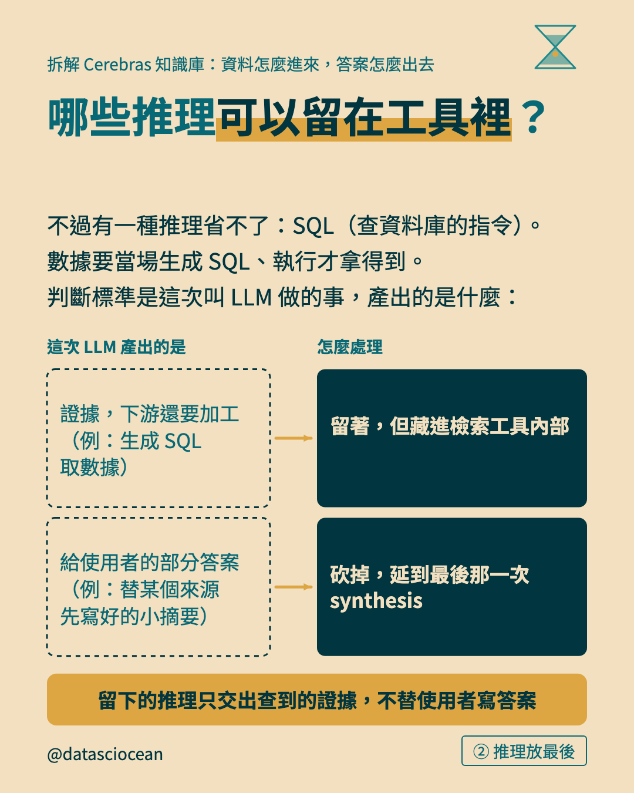

- **小標籤**：② 推理放最後
- **主標**：哪些推理可以留在工具裡？
- **補充**：不過有一種推理省不了：SQL（查資料庫的指令）。數據要當場生成 SQL、執行才拿得到。判斷標準是這次叫 LLM 做的事，產出的是什麼：
- **示意圖（pairs）上的文字與數字**：留下的推理只交出查到的證據，不替使用者寫答案｜這次 LLM 產出的是｜怎麼處理｜證據，下游還要加工
（例：生成 SQL 取數據）｜留著，但藏進檢索工具內部｜給使用者的部分答案
（例：替某個來源
先寫好的小摘要）｜砍掉，延到最後那一次 synthesis
- **替代文字**：哪些推理可以留在工具裡？。不過有一種推理省不了：SQL（查資料庫的指令）。數據要當場生成 SQL、執行才拿得到。判斷標準是這次叫 LLM 做的事，產出的是什麼：。圖上寫：留下的推理只交出查到的證據，不替使用者寫答案、這次 LLM 產出的是、怎麼處理、證據，下游還要加工
（例：生成 SQL 取數據）、留著，但藏進檢索工具內部、給使用者的部分答案
（例：替某個來源
先寫好的小摘要）、砍掉，延到最後那一次 synthesis

## 第 14 頁（示意圖）

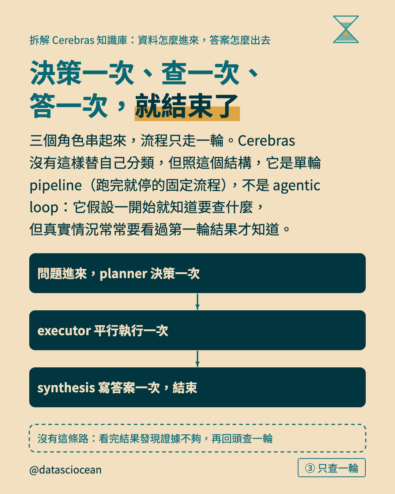

- **小標籤**：③ 只查一輪
- **主標**：決策一次、查一次、答一次，就結束了
- **補充**：三個角色串起來，流程只走一輪。Cerebras 沒有這樣替自己分類，但照這個結構，它是單輪 pipeline（跑完就停的固定流程），不是 agentic loop：它假設一開始就知道要查什麼，但真實情況常常要看過第一輪結果才知道。
- **示意圖（flow）上的文字與數字**：問題進來，planner 決策一次｜executor 平行執行一次｜synthesis 寫答案一次，結束｜沒有這條路：看完結果發現證據不夠，再回頭查一輪
- **替代文字**：決策一次、查一次、答一次，就結束了。三個角色串起來，流程只走一輪。Cerebras 沒有這樣替自己分類，但照這個結構，它是單輪 pipeline（跑完就停的固定流程），不是 agentic loop：它假設一開始就知道要查什麼，但真實情況常常要看過第一輪結果才知道。。圖上寫：問題進來，planner 決策一次、executor 平行執行一次、synthesis 寫答案一次，結束、沒有這條路：看完結果發現證據不夠，再回頭查一輪

## 第 15 頁（示意圖）

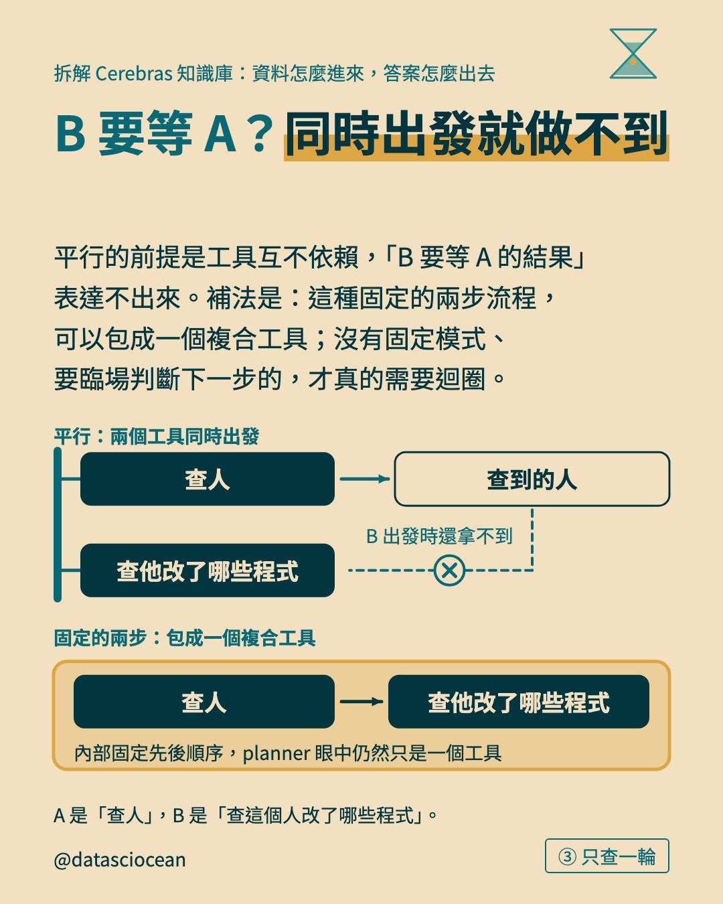

- **小標籤**：③ 只查一輪
- **主標**：B 要等 A？同時出發就做不到
- **補充**：平行的前提是工具互不依賴，「B 要等 A 的結果」表達不出來。補法是：這種固定的兩步流程，可以包成一個複合工具；沒有固定模式、要臨場判斷下一步的，才真的需要迴圈。
- **示意圖（depend）上的文字與數字**：查人｜查他改了哪些程式｜查到的人｜B 出發時還拿不到｜內部固定先後順序，planner 眼中仍然只是一個工具｜平行：兩個工具同時出發｜固定的兩步：包成一個複合工具
- **圖註**：A 是「查人」，B 是「查這個人改了哪些程式」。
- **替代文字**：B 要等 A？同時出發就做不到。平行的前提是工具互不依賴，「B 要等 A 的結果」表達不出來。補法是：這種固定的兩步流程，可以包成一個複合工具；沒有固定模式、要臨場判斷下一步的，才真的需要迴圈。。圖上寫：查人、查他改了哪些程式、查到的人、B 出發時還拿不到、內部固定先後順序，planner 眼中仍然只是一個工具、平行：兩個工具同時出發、固定的兩步：包成一個複合工具

## 第 16 頁（示意圖）

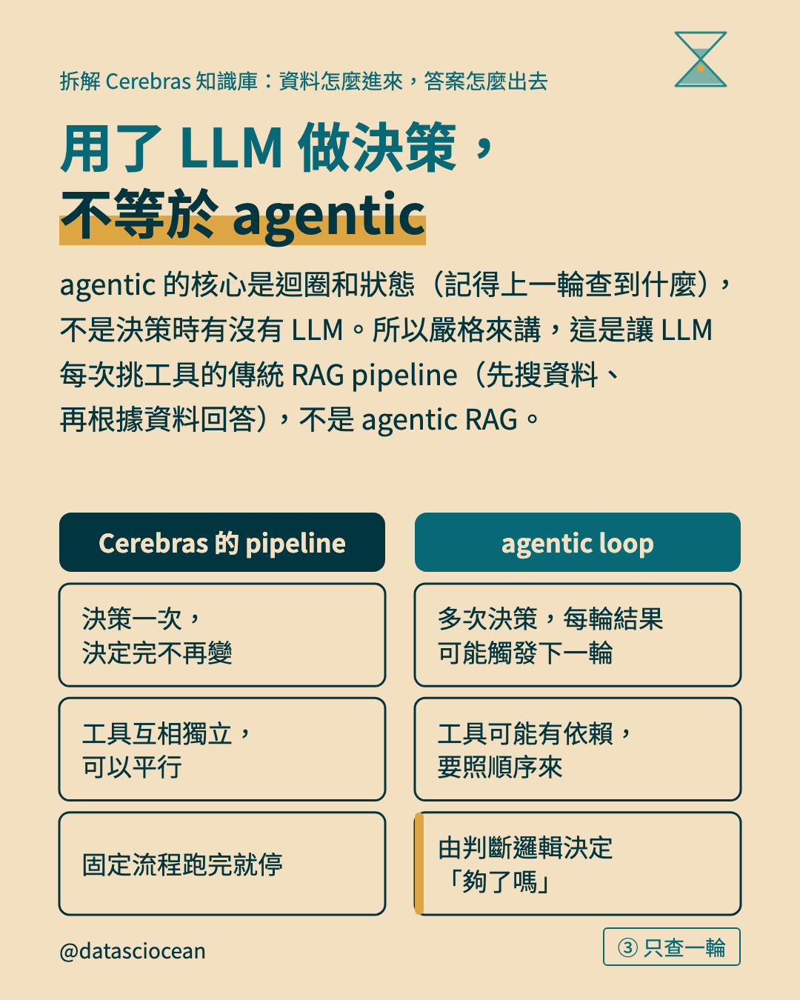

- **小標籤**：③ 只查一輪
- **主標**：用了 LLM 做決策，不等於 agentic
- **補充**：agentic 的核心是迴圈和狀態（記得上一輪查到什麼），不是決策時有沒有 LLM。所以嚴格來講，這是讓 LLM 每次挑工具的傳統 RAG pipeline（先搜資料、再根據資料回答），不是 agentic RAG。
- **示意圖（compare）上的文字與數字**：Cerebras 的 pipeline｜決策一次，
決定完不再變｜工具互相獨立，
可以平行｜固定流程跑完就停｜agentic loop｜多次決策，每輪結果
可能觸發下一輪｜工具可能有依賴，
要照順序來｜由判斷邏輯決定
「夠了嗎」
- **替代文字**：用了 LLM 做決策，不等於 agentic。agentic 的核心是迴圈和狀態（記得上一輪查到什麼），不是決策時有沒有 LLM。所以嚴格來講，這是讓 LLM 每次挑工具的傳統 RAG pipeline（先搜資料、再根據資料回答），不是 agentic RAG。。圖上寫：Cerebras 的 pipeline、決策一次，
決定完不再變、工具互相獨立，
可以平行、固定流程跑完就停、agentic loop、多次決策，每輪結果
可能觸發下一輪、工具可能有依賴，
要照順序來、由判斷邏輯決定
「夠了嗎」

## 第 17 頁（示意圖）

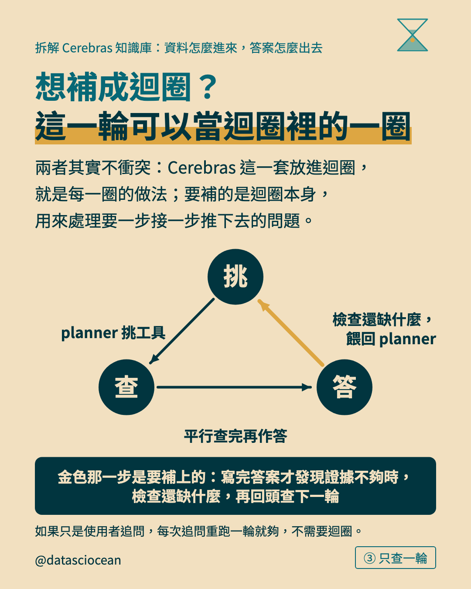

- **小標籤**：③ 只查一輪
- **主標**：想補成迴圈？這一輪可以當迴圈裡的一圈
- **補充**：兩者其實不衝突：Cerebras 這一套放進迴圈，就是每一圈的做法；要補的是迴圈本身，用來處理要一步接一步推下去的問題。
- **示意圖（cycle）上的文字與數字**：挑｜查｜答｜金色那一步是要補上的：寫完答案才發現證據不夠時，檢查還缺什麼，再回頭查下一輪｜planner 挑工具｜平行查完再作答｜檢查還缺什麼，
餵回 planner
- **圖註**：如果只是使用者追問，每次追問重跑一輪就夠，不需要迴圈。
- **替代文字**：想補成迴圈？這一輪可以當迴圈裡的一圈。兩者其實不衝突：Cerebras 這一套放進迴圈，就是每一圈的做法；要補的是迴圈本身，用來處理要一步接一步推下去的問題。。圖上寫：挑、查、答、金色那一步是要補上的：寫完答案才發現證據不夠時，檢查還缺什麼，再回頭查下一輪、planner 挑工具、平行查完再作答、檢查還缺什麼，
餵回 planner

## 第 18 頁（帶走）


- **先問的問題**：用 LLM 挑工具的搜尋，算 agentic 嗎？
- **一句話**：LLM 只挑一次工具，
推理留到最後一次，
是單輪，不是迴圈
- **替代文字**：用 LLM 挑工具的搜尋，算 agentic 嗎？　LLM 只挑一次工具，
推理留到最後一次，
是單輪，不是迴圈

## 第 19 頁（系列地圖）

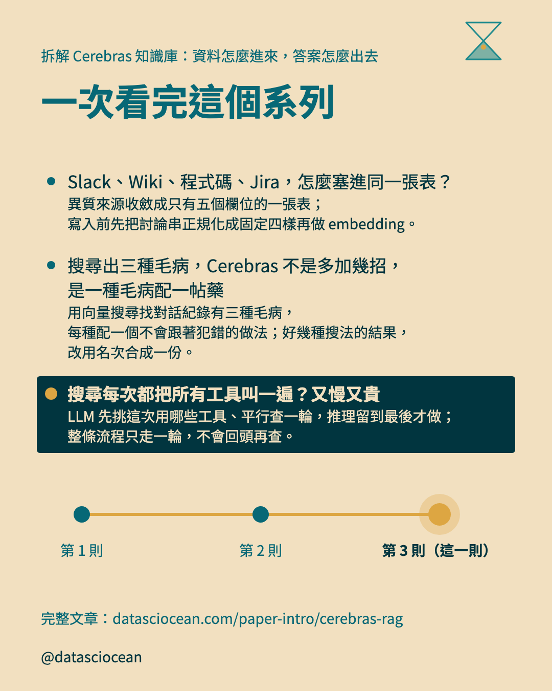

- **主標**：一次看完這個系列
- **導流行**：完整文章：datasciocean.com/paper-intro/cerebras-rag
- **第 1 則**：Slack、Wiki、程式碼、Jira，怎麼塞進同一張表？　異質來源收斂成只有五個欄位的一張表；寫入前先把討論串正規化成固定四樣再做 embedding。
- **第 2 則**：搜尋出三種毛病，Cerebras 不是多加幾招，是一種毛病配一帖藥　用向量搜尋找對話紀錄有三種毛病，每種配一個不會跟著犯錯的做法；好幾種搜法的結果，改用名次合成一份。
- **第 3 則**：搜尋每次都把所有工具叫一遍？又慢又貴　LLM 先挑這次用哪些工具、平行查一輪，推理留到最後才做；整條流程只走一輪，不會回頭再查。
- **替代文字**：一次看完這個系列。Slack、Wiki、程式碼、Jira，怎麼塞進同一張表？：異質來源收斂成只有五個欄位的一張表；寫入前先把討論串正規化成固定四樣再做 embedding。、搜尋出三種毛病，Cerebras 不是多加幾招，是一種毛病配一帖藥：用向量搜尋找對話紀錄有三種毛病，每種配一個不會跟著犯錯的做法；好幾種搜法的結果，改用名次合成一份。、搜尋每次都把所有工具叫一遍？又慢又貴：LLM 先挑這次用哪些工具、平行查一輪，推理留到最後才做；整條流程只走一輪，不會回頭再查。

## Caption（整段貼到 IG）

```text
RAG 搜尋怎麼決定叫哪些工具？用 LLM 挑工具，算不算 agentic

・路線圖：這一則走到沙漏的最底下
・① 先挑工具：工具叫太多，又慢又貴（直覺的做法，是每個問題把所有工具叫一遍）
・問題不同，挑的工具就不同
・做決定的模型，故意比工具還便宜
・挑好的工具同時出發（接手的是 executor）
・② 推理放最後：證據原封不動，留到最後一次讀（整理好的證據交給誰讀？工具只交回原始證據）
・答案要拼兩個來源，分頭讀的 AI 拼不出來
・摘要的摘要，丟了什麼下游看不出來（第二個壞處：細節會不見）
・多一種資料，只要多接一個工具（第三個差別在擴充）
・哪些推理可以留在工具裡？（不過有一種推理省不了：SQL（查資料庫的指令））
・③ 只查一輪：決策一次、查一次、答一次，就結束了（三個角色串起來，流程只走一輪）
・B 要等 A？同時出發就做不到
・用了 LLM 做決策，不等於 agentic
・想補成迴圈？這一輪可以當迴圈裡的一圈

完整文章在 datasciocean.com，搜「Cerebras 知識庫」

#CerebrasRAG #RAG #AIAgent
```
