# IG 輪播：搜尋出三種毛病，Cerebras 不是多加幾招，是一種毛病配一帖藥

- 系列：拆解 Cerebras 知識庫：資料怎麼進來，答案怎麼出去　｜　hook 樣態：並列重點　｜　共 18 張，**依頁碼順序上傳**
- 每頁下方的「替代文字」貼到 IG 的替代文字欄；最後的 Caption 整段貼上

## 第 1 頁（封面）

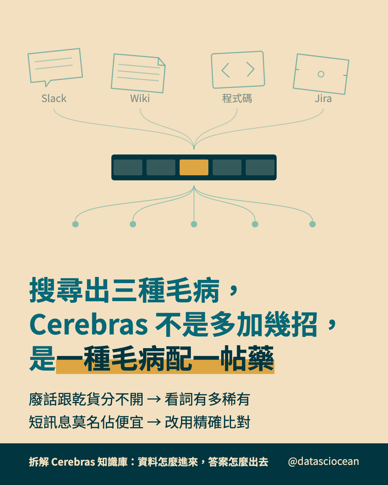

- **主標**：搜尋出三種毛病，Cerebras 不是多加幾招，是一種毛病配一帖藥
- **副標**：廢話跟乾貨分不開 → 看詞有多稀有
短訊息莫名佔便宜 → 改用精確比對
- **替代文字**：搜尋出三種毛病，Cerebras 不是多加幾招，是一種毛病配一帖藥。廢話跟乾貨分不開 → 看詞有多稀有
短訊息莫名佔便宜 → 改用精確比對

## 第 2 頁（前情回顧）


- **主標**：前情提要與這一則重點
- **第 1 則**：Slack、Wiki、程式碼、Jira，怎麼塞進同一張表？　異質來源收斂成只有五個欄位的一張表；寫入前先把討論串正規化成固定四樣再做 embedding。
- **第 2 則**：搜尋出三種毛病，Cerebras 不是多加幾招，是一種毛病配一帖藥　用向量搜尋找對話紀錄有三種毛病，每種配一個不會跟著犯錯的做法；好幾種搜法的結果，改用名次合成一份。
- **替代文字**：前情提要與這一則重點。第 1 則「Slack、Wiki、程式碼、Jira，怎麼塞進同一張表？」：異質來源收斂成只有五個欄位的一張表；寫入前先把討論串正規化成固定四樣再做 embedding。；第 2 則「搜尋出三種毛病，Cerebras 不是多加幾招，是一種毛病配一帖藥」：用向量搜尋找對話紀錄有三種毛病，每種配一個不會跟著犯錯的做法；好幾種搜法的結果，改用名次合成一份。

## 第 3 頁（示意圖）

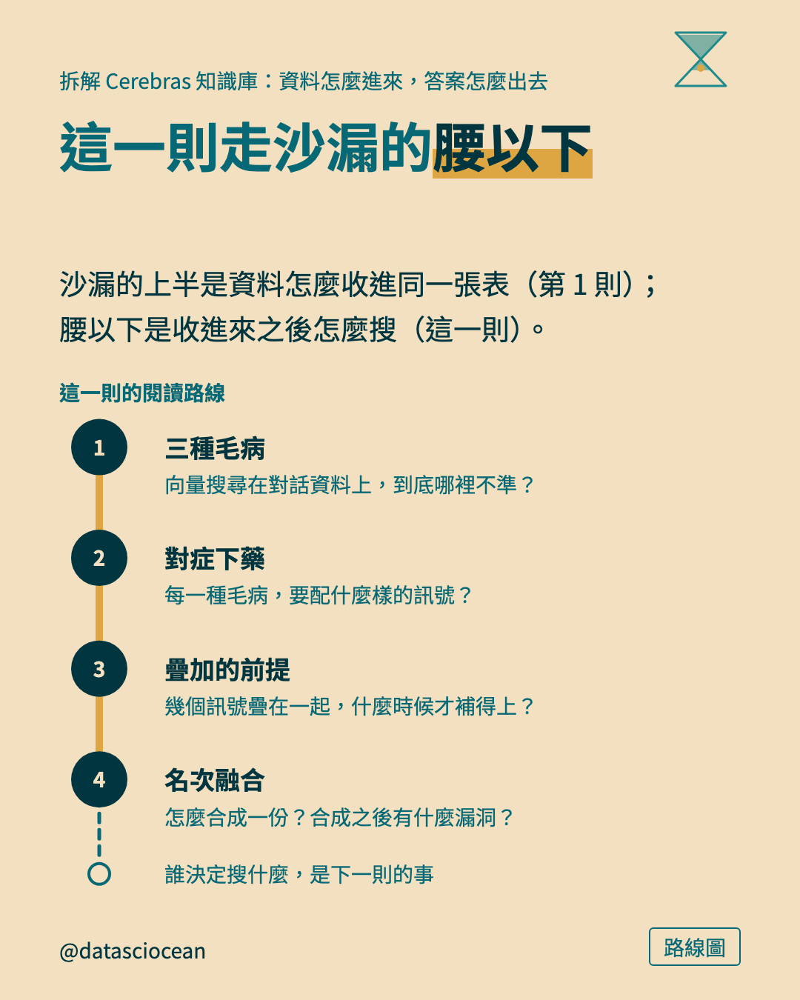

- **小標籤**：路線圖
- **主標**：這一則走沙漏的腰以下
- **補充**：沙漏的上半是資料怎麼收進同一張表（第 1 則）；腰以下是收進來之後怎麼搜（這一則）。
- **示意圖（route）上的文字與數字**：三種毛病｜向量搜尋在對話資料上，到底哪裡不準？｜對症下藥｜每一種毛病，要配什麼樣的訊號？｜疊加的前提｜幾個訊號疊在一起，什麼時候才補得上？｜名次融合｜怎麼合成一份？合成之後有什麼漏洞？｜這一則的閱讀路線｜誰決定搜什麼，是下一則的事
- **替代文字**：這一則走沙漏的腰以下。沙漏的上半是資料怎麼收進同一張表（第 1 則）；腰以下是收進來之後怎麼搜（這一則）。。圖上寫：三種毛病、向量搜尋在對話資料上，到底哪裡不準？、對症下藥、每一種毛病，要配什麼樣的訊號？、疊加的前提、幾個訊號疊在一起，什麼時候才補得上？、名次融合、怎麼合成一份？合成之後有什麼漏洞？、這一則的閱讀路線、誰決定搜什麼，是下一則的事

## 第 4 頁（脈絡）

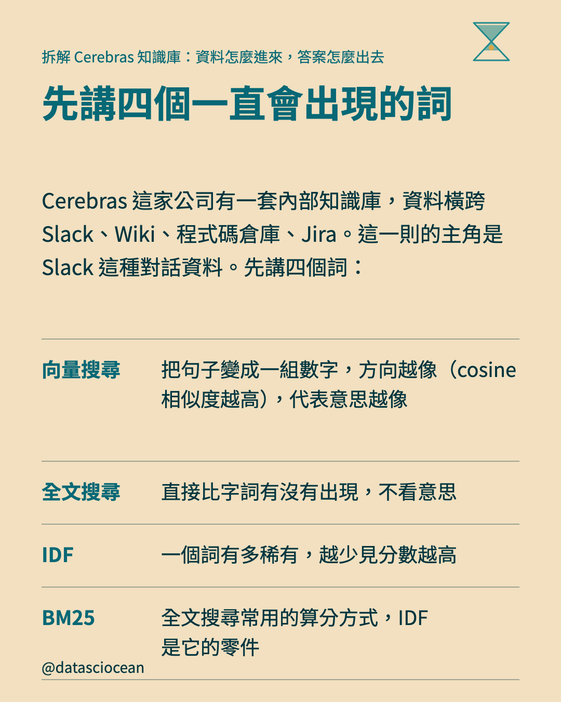

- **主標**：先講四個一直會出現的詞
- **補充**：Cerebras 這家公司有一套內部知識庫，資料橫跨 Slack、Wiki、程式碼倉庫、Jira。這一則的主角是 Slack 這種對話資料。先講四個詞：
- **表列**：向量搜尋｜把句子變成一組數字，方向越像（cosine 相似度越高），代表意思越像
- **表列**：全文搜尋｜直接比字詞有沒有出現，不看意思
- **表列**：IDF｜一個詞有多稀有，越少見分數越高
- **表列**：BM25｜全文搜尋常用的算分方式，IDF 是它的零件
- **替代文字**：先講四個一直會出現的詞。Cerebras 這家公司有一套內部知識庫，資料橫跨 Slack、Wiki、程式碼倉庫、Jira。這一則的主角是 Slack 這種對話資料。先講四個詞：

## 第 5 頁（示意圖）

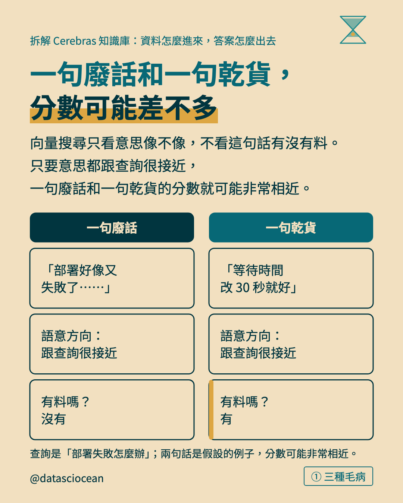

- **小標籤**：① 三種毛病
- **主標**：一句廢話和一句乾貨，分數可能差不多
- **補充**：向量搜尋只看意思像不像，不看這句話有沒有料。只要意思都跟查詢很接近，一句廢話和一句乾貨的分數就可能非常相近。
- **示意圖（compare）上的文字與數字**：一句廢話｜「部署好像又
失敗了⋯⋯」｜語意方向：
跟查詢很接近｜有料嗎？
沒有｜一句乾貨｜「等待時間
改 30 秒就好」｜語意方向：
跟查詢很接近｜有料嗎？
有
- **圖註**：查詢是「部署失敗怎麼辦」；兩句話是假設的例子，分數可能非常相近。
- **替代文字**：一句廢話和一句乾貨，分數可能差不多。向量搜尋只看意思像不像，不看這句話有沒有料。只要意思都跟查詢很接近，一句廢話和一句乾貨的分數就可能非常相近。。圖上寫：一句廢話、「部署好像又
失敗了⋯⋯」、語意方向：
跟查詢很接近、有料嗎？
沒有、一句乾貨、「等待時間
改 30 秒就好」、語意方向：
跟查詢很接近、有料嗎？
有

## 第 6 頁（示意圖）

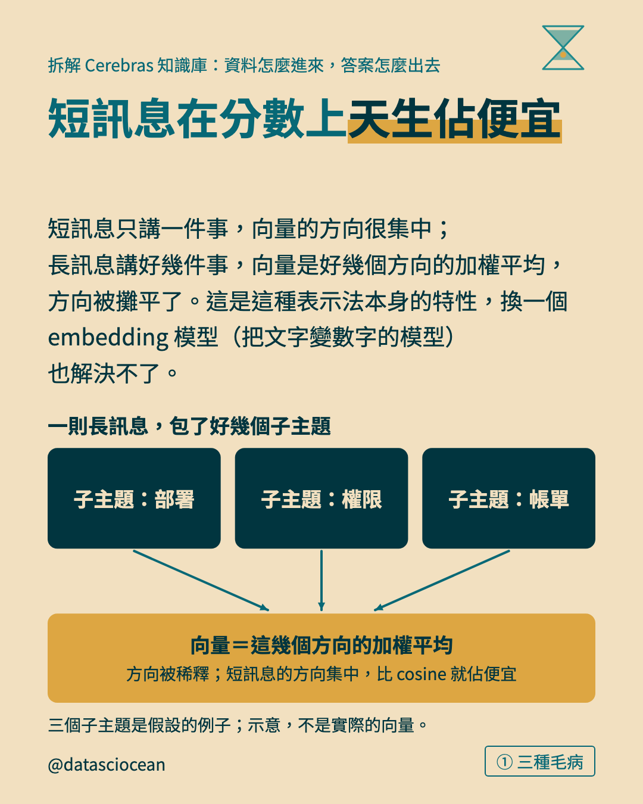

- **小標籤**：① 三種毛病
- **主標**：短訊息在分數上天生佔便宜
- **補充**：短訊息只講一件事，向量的方向很集中；長訊息講好幾件事，向量是好幾個方向的加權平均，方向被攤平了。這是這種表示法本身的特性，換一個 embedding 模型（把文字變數字的模型）也解決不了。
- **示意圖（fan）上的文字與數字**：一則長訊息，包了好幾個子主題｜向量＝這幾個方向的加權平均｜方向被稀釋；短訊息的方向集中，比 cosine 就佔便宜｜子主題：部署｜子主題：權限｜子主題：帳單
- **圖註**：三個子主題是假設的例子；示意，不是實際的向量。
- **替代文字**：短訊息在分數上天生佔便宜。短訊息只講一件事，向量的方向很集中；長訊息講好幾件事，向量是好幾個方向的加權平均，方向被攤平了。這是這種表示法本身的特性，換一個 embedding 模型（把文字變數字的模型）也解決不了。。圖上寫：一則長訊息，包了好幾個子主題、向量＝這幾個方向的加權平均、方向被稀釋；短訊息的方向集中，比 cosine 就佔便宜、子主題：部署、子主題：權限、子主題：帳單

## 第 7 頁（示意圖）

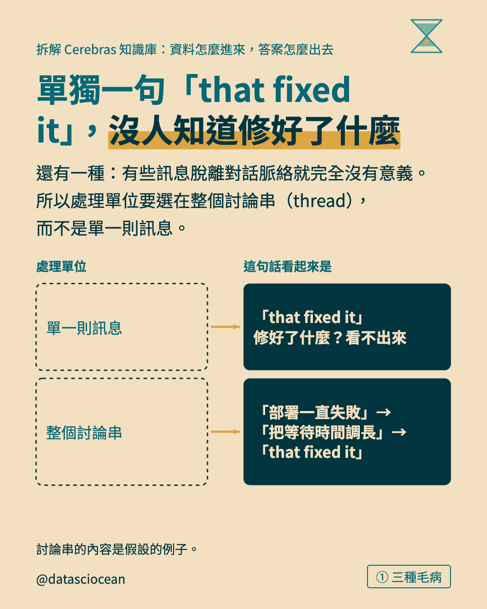

- **小標籤**：① 三種毛病
- **主標**：單獨一句「that fixed it」，沒人知道修好了什麼
- **補充**：還有一種：有些訊息脫離對話脈絡就完全沒有意義。所以處理單位要選在整個討論串（thread），而不是單一則訊息。
- **示意圖（pairs）上的文字與數字**：處理單位｜這句話看起來是｜單一則訊息｜「that fixed it」
修好了什麼？看不出來｜整個討論串｜「部署一直失敗」→
「把等待時間調長」→
「that fixed it」
- **圖註**：討論串的內容是假設的例子。
- **替代文字**：單獨一句「that fixed it」，沒人知道修好了什麼。還有一種：有些訊息脫離對話脈絡就完全沒有意義。所以處理單位要選在整個討論串（thread），而不是單一則訊息。。圖上寫：處理單位、這句話看起來是、單一則訊息、「that fixed it」
修好了什麼？看不出來、整個討論串、「部署一直失敗」→
「把等待時間調長」→
「that fixed it」

## 第 8 頁（示意圖）

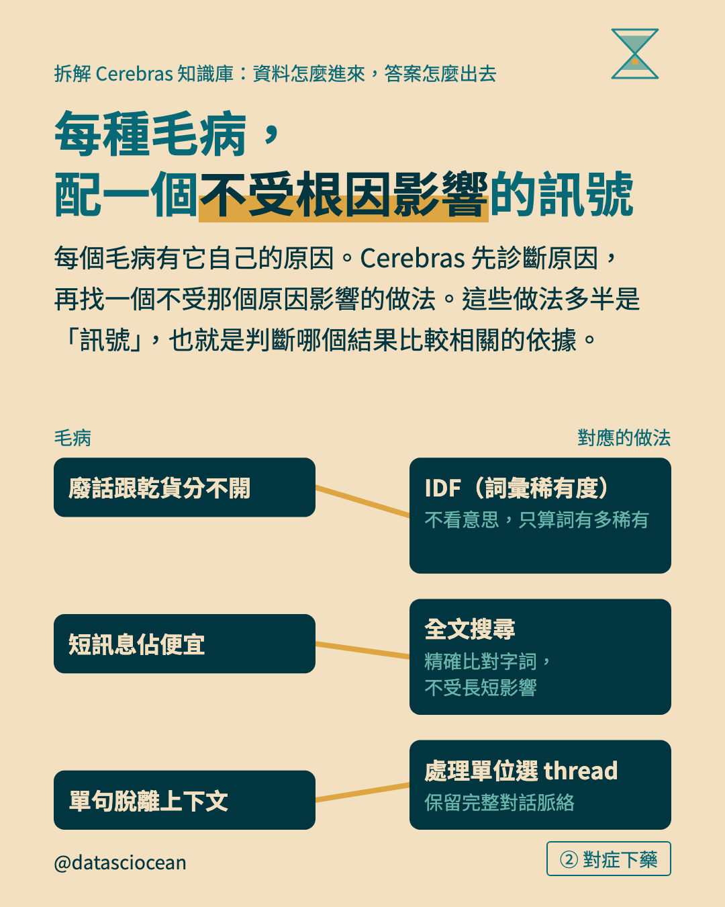

- **小標籤**：② 對症下藥
- **主標**：每種毛病，配一個不受根因影響的訊號
- **補充**：每個毛病有它自己的原因。Cerebras 先診斷原因，再找一個不受那個原因影響的做法。這些做法多半是「訊號」，也就是判斷哪個結果比較相關的依據。
- **示意圖（links）上的文字與數字**：廢話跟乾貨分不開｜短訊息佔便宜｜單句脫離上下文｜IDF（詞彙稀有度）｜不看意思，只算詞有多稀有｜全文搜尋｜精確比對字詞，不受長短影響｜處理單位選 thread｜保留完整對話脈絡｜毛病｜對應的做法
- **替代文字**：每種毛病，配一個不受根因影響的訊號。每個毛病有它自己的原因。Cerebras 先診斷原因，再找一個不受那個原因影響的做法。這些做法多半是「訊號」，也就是判斷哪個結果比較相關的依據。。圖上寫：廢話跟乾貨分不開、短訊息佔便宜、單句脫離上下文、IDF（詞彙稀有度）、不看意思，只算詞有多稀有、全文搜尋、精確比對字詞，不受長短影響、處理單位選 thread、保留完整對話脈絡、毛病、對應的做法

## 第 9 頁（示意圖）

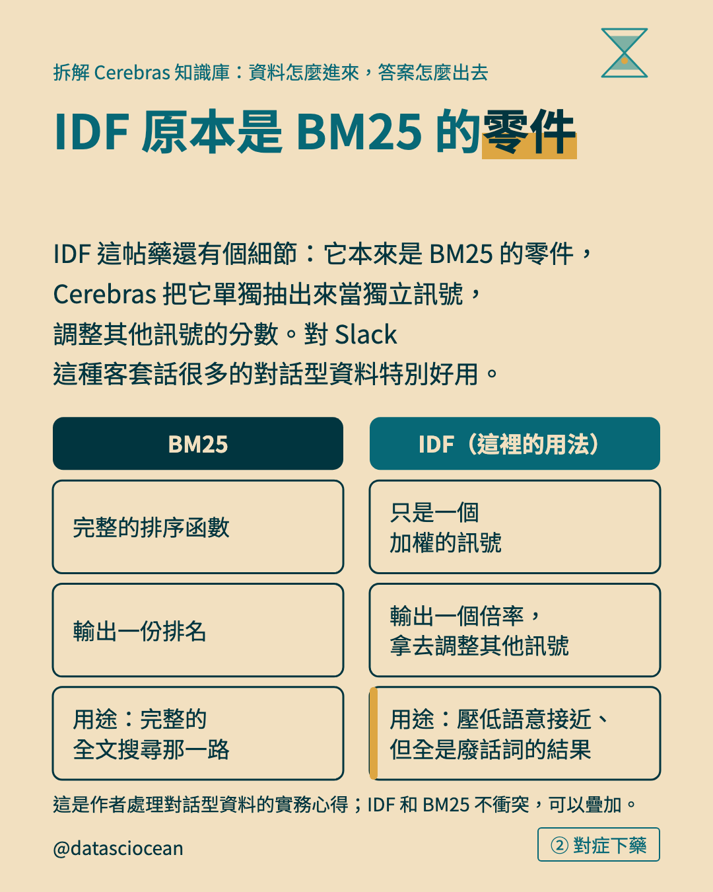

- **小標籤**：② 對症下藥
- **主標**：IDF 原本是 BM25 的零件
- **補充**：IDF 這帖藥還有個細節：它本來是 BM25 的零件，Cerebras 把它單獨抽出來當獨立訊號，調整其他訊號的分數。對 Slack 這種客套話很多的對話型資料特別好用。
- **示意圖（compare）上的文字與數字**：BM25｜完整的排序函數｜輸出一份排名｜用途：完整的
全文搜尋那一路｜IDF（這裡的用法）｜只是一個
加權的訊號｜輸出一個倍率，
拿去調整其他訊號｜用途：壓低語意接近、
但全是廢話詞的結果
- **圖註**：這是作者處理對話型資料的實務心得；IDF 和 BM25 不衝突，可以疊加。
- **替代文字**：IDF 原本是 BM25 的零件。IDF 這帖藥還有個細節：它本來是 BM25 的零件，Cerebras 把它單獨抽出來當獨立訊號，調整其他訊號的分數。對 Slack 這種客套話很多的對話型資料特別好用。。圖上寫：BM25、完整的排序函數、輸出一份排名、用途：完整的
全文搜尋那一路、IDF（這裡的用法）、只是一個
加權的訊號、輸出一個倍率，
拿去調整其他訊號、用途：壓低語意接近、
但全是廢話詞的結果

## 第 10 頁（示意圖）

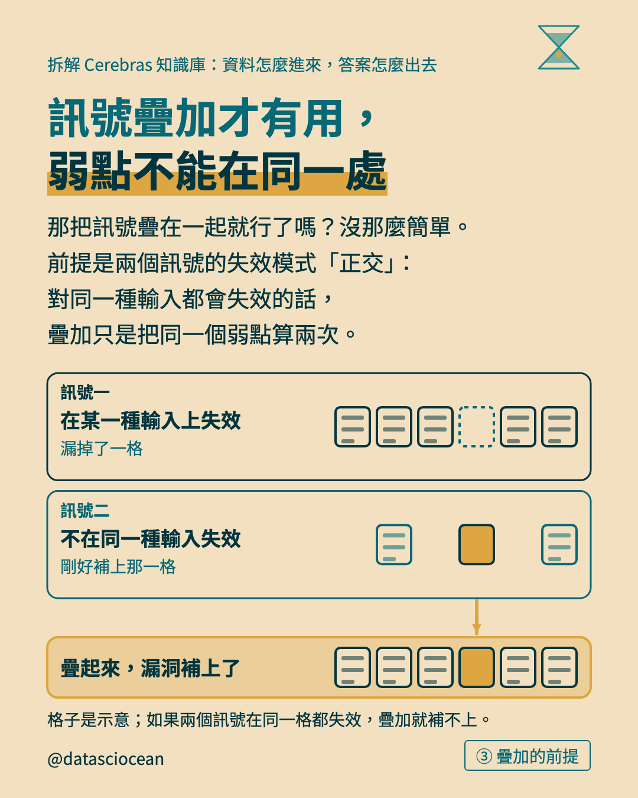

- **小標籤**：③ 疊加的前提
- **主標**：訊號疊加才有用，弱點不能在同一處
- **補充**：那把訊號疊在一起就行了嗎？沒那麼簡單。前提是兩個訊號的失效模式「正交」：對同一種輸入都會失效的話，疊加只是把同一個弱點算兩次。
- **示意圖（rails）上的文字與數字**：在某一種輸入上失效｜漏掉了一格｜不在同一種輸入失效｜剛好補上那一格｜疊起來，漏洞補上了｜訊號一｜訊號二
- **圖註**：格子是示意；如果兩個訊號在同一格都失效，疊加就補不上。
- **替代文字**：訊號疊加才有用，弱點不能在同一處。那把訊號疊在一起就行了嗎？沒那麼簡單。前提是兩個訊號的失效模式「正交」：對同一種輸入都會失效的話，疊加只是把同一個弱點算兩次。。圖上寫：在某一種輸入上失效、漏掉了一格、不在同一種輸入失效、剛好補上那一格、疊起來，漏洞補上了、訊號一、訊號二

## 第 11 頁（示意圖）

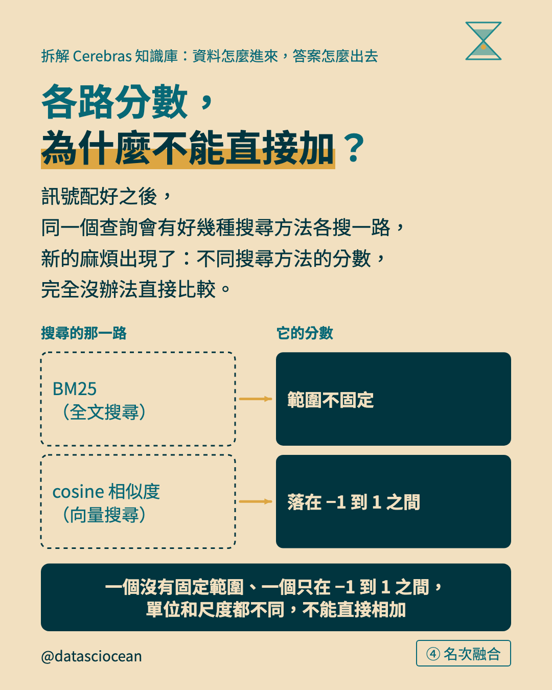

- **小標籤**：④ 名次融合
- **主標**：各路分數，為什麼不能直接加？
- **補充**：訊號配好之後，同一個查詢會有好幾種搜尋方法各搜一路，新的麻煩出現了：不同搜尋方法的分數，完全沒辦法直接比較。
- **示意圖（pairs）上的文字與數字**：一個沒有固定範圍、一個只在 −1 到 1 之間，單位和尺度都不同，不能直接相加｜搜尋的那一路｜它的分數｜BM25
（全文搜尋）｜範圍不固定｜cosine 相似度
（向量搜尋）｜落在 −1 到 1 之間
- **替代文字**：各路分數，為什麼不能直接加？。訊號配好之後，同一個查詢會有好幾種搜尋方法各搜一路，新的麻煩出現了：不同搜尋方法的分數，完全沒辦法直接比較。。圖上寫：一個沒有固定範圍、一個只在 −1 到 1 之間，單位和尺度都不同，不能直接相加、搜尋的那一路、它的分數、BM25
（全文搜尋）、範圍不固定、cosine 相似度
（向量搜尋）、落在 −1 到 1 之間

## 第 12 頁（示意圖）

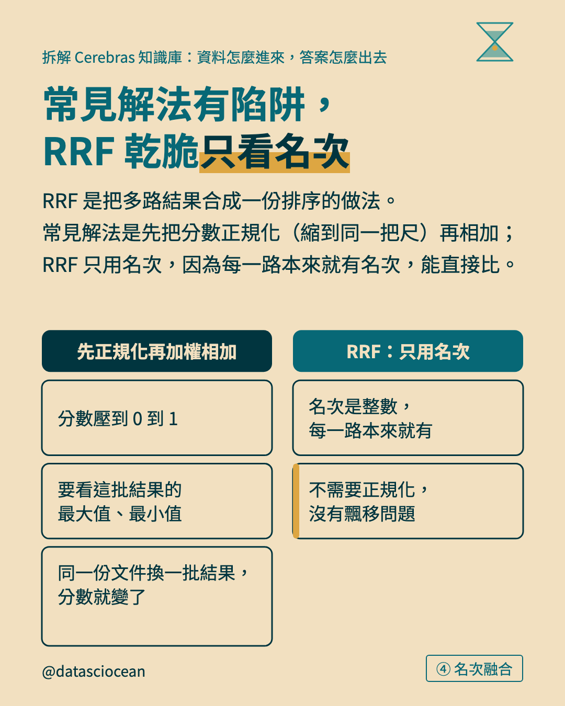

- **小標籤**：④ 名次融合
- **主標**：常見解法有陷阱，RRF 乾脆只看名次
- **補充**：RRF 是把多路結果合成一份排序的做法。常見解法是先把分數正規化（縮到同一把尺）再相加；RRF 只用名次，因為每一路本來就有名次，能直接比。
- **示意圖（compare）上的文字與數字**：先正規化再加權相加｜分數壓到 0 到 1｜要看這批結果的
最大值、最小值｜同一份文件換一批結果，
分數就變了｜RRF：只用名次｜名次是整數，每一路本來就有｜不需要正規化，沒有飄移問題
- **替代文字**：常見解法有陷阱，RRF 乾脆只看名次。RRF 是把多路結果合成一份排序的做法。常見解法是先把分數正規化（縮到同一把尺）再相加；RRF 只用名次，因為每一路本來就有名次，能直接比。。圖上寫：先正規化再加權相加、分數壓到 0 到 1、要看這批結果的
最大值、最小值、同一份文件換一批結果，
分數就變了、RRF：只用名次、名次是整數，每一路本來就有、不需要正規化，沒有飄移問題

## 第 13 頁（示意圖）

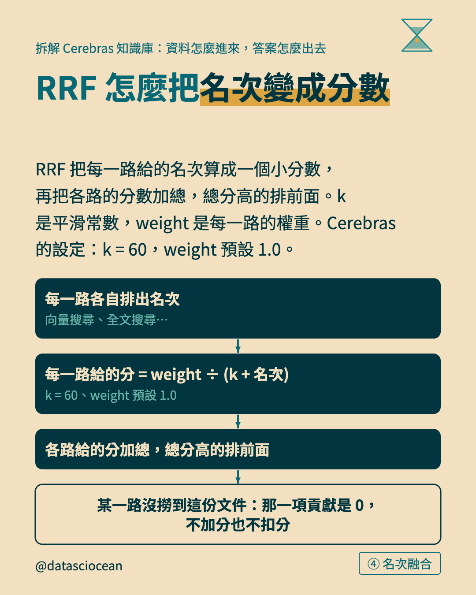

- **小標籤**：④ 名次融合
- **主標**：RRF 怎麼把名次變成分數
- **補充**：RRF 把每一路給的名次算成一個小分數，再把各路的分數加總，總分高的排前面。k 是平滑常數，weight 是每一路的權重。Cerebras 的設定：k = 60，weight 預設 1.0。
- **示意圖（flow）上的文字與數字**：每一路各自排出名次｜向量搜尋、全文搜尋…｜每一路給的分 = weight ÷ (k + 名次)｜k = 60、weight 預設 1.0｜各路給的分加總，總分高的排前面｜某一路沒撈到這份文件：那一項貢獻是 0，不加分也不扣分
- **替代文字**：RRF 怎麼把名次變成分數。RRF 把每一路給的名次算成一個小分數，再把各路的分數加總，總分高的排前面。k 是平滑常數，weight 是每一路的權重。Cerebras 的設定：k = 60，weight 預設 1.0。。圖上寫：每一路各自排出名次、向量搜尋、全文搜尋…、每一路給的分 = weight ÷ (k + 名次)、k = 60、weight 預設 1.0、各路給的分加總，總分高的排前面、某一路沒撈到這份文件：那一項貢獻是 0，不加分也不扣分

## 第 14 頁（示意圖）

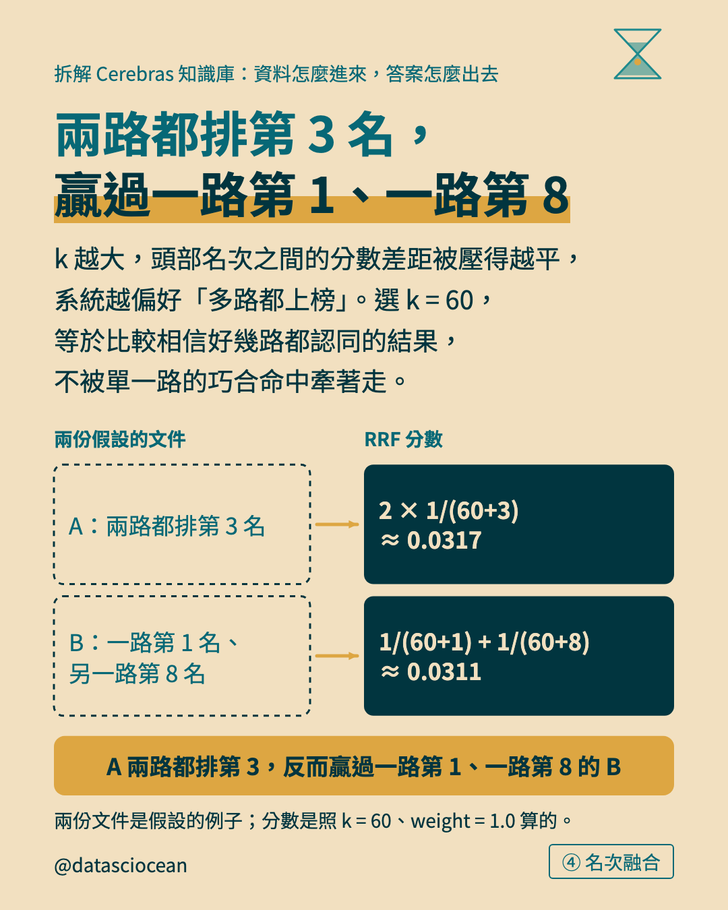

- **小標籤**：④ 名次融合
- **主標**：兩路都排第 3 名，贏過一路第 1、一路第 8
- **補充**：k 越大，頭部名次之間的分數差距被壓得越平，系統越偏好「多路都上榜」。選 k = 60，等於比較相信好幾路都認同的結果，不被單一路的巧合命中牽著走。
- **示意圖（pairs）上的文字與數字**：A 兩路都排第 3，反而贏過一路第 1、一路第 8 的 B｜兩份假設的文件｜RRF 分數｜A：兩路都排第 3 名｜2 × 1/(60+3)
≈ 0.0317｜B：一路第 1 名、
另一路第 8 名｜1/(60+1) + 1/(60+8)
≈ 0.0311
- **圖註**：兩份文件是假設的例子；分數是照 k = 60、weight = 1.0 算的。
- **替代文字**：兩路都排第 3 名，贏過一路第 1、一路第 8。k 越大，頭部名次之間的分數差距被壓得越平，系統越偏好「多路都上榜」。選 k = 60，等於比較相信好幾路都認同的結果，不被單一路的巧合命中牽著走。。圖上寫：A 兩路都排第 3，反而贏過一路第 1、一路第 8 的 B、兩份假設的文件、RRF 分數、A：兩路都排第 3 名、2 × 1/(60+3)
≈ 0.0317、B：一路第 1 名、
另一路第 8 名、1/(60+1) + 1/(60+8)
≈ 0.0311

## 第 15 頁（示意圖）

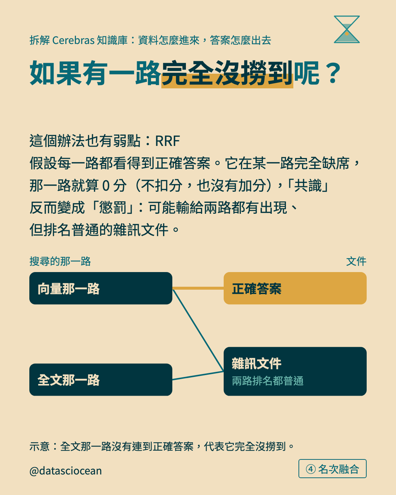

- **小標籤**：④ 名次融合
- **主標**：如果有一路完全沒撈到呢？
- **補充**：這個辦法也有弱點：RRF 假設每一路都看得到正確答案。它在某一路完全缺席，那一路就算 0 分（不扣分，也沒有加分），「共識」反而變成「懲罰」：可能輸給兩路都有出現、但排名普通的雜訊文件。
- **示意圖（links）上的文字與數字**：向量那一路｜全文那一路｜正確答案｜雜訊文件｜兩路排名都普通｜搜尋的那一路｜文件
- **圖註**：示意：全文那一路沒有連到正確答案，代表它完全沒撈到。
- **替代文字**：如果有一路完全沒撈到呢？。這個辦法也有弱點：RRF 假設每一路都看得到正確答案。它在某一路完全缺席，那一路就算 0 分（不扣分，也沒有加分），「共識」反而變成「懲罰」：可能輸給兩路都有出現、但排名普通的雜訊文件。。圖上寫：向量那一路、全文那一路、正確答案、雜訊文件、兩路排名都普通、搜尋的那一路、文件

## 第 16 頁（示意圖）

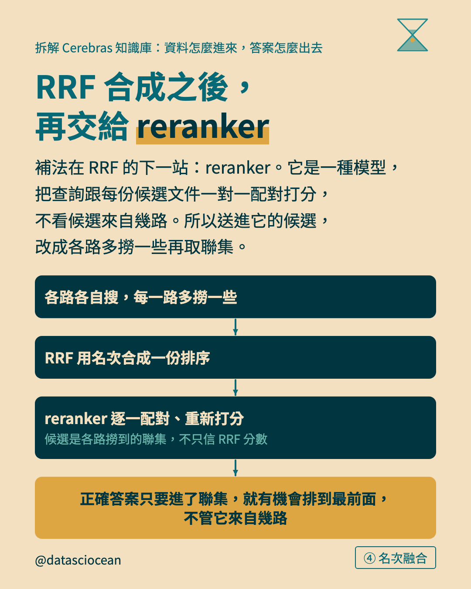

- **小標籤**：④ 名次融合
- **主標**：RRF 合成之後，再交給 reranker
- **補充**：補法在 RRF 的下一站：reranker。它是一種模型，把查詢跟每份候選文件一對一配對打分，不看候選來自幾路。所以送進它的候選，改成各路多撈一些再取聯集。
- **示意圖（flow）上的文字與數字**：各路各自搜，每一路多撈一些｜RRF 用名次合成一份排序｜reranker 逐一配對、重新打分｜候選是各路撈到的聯集，不只信 RRF 分數｜正確答案只要進了聯集，就有機會排到最前面，不管它來自幾路
- **替代文字**：RRF 合成之後，再交給 reranker。補法在 RRF 的下一站：reranker。它是一種模型，把查詢跟每份候選文件一對一配對打分，不看候選來自幾路。所以送進它的候選，改成各路多撈一些再取聯集。。圖上寫：各路各自搜，每一路多撈一些、RRF 用名次合成一份排序、reranker 逐一配對、重新打分、候選是各路撈到的聯集，不只信 RRF 分數、正確答案只要進了聯集，就有機會排到最前面，不管它來自幾路

## 第 17 頁（帶走）


- **先問的問題**：多路搜尋，為什麼不是多疊幾招就好？
- **一句話**：先診斷根因，
再配不受影響的訊號，
最後用名次合成一份
- **替代文字**：多路搜尋，為什麼不是多疊幾招就好？　先診斷根因，
再配不受影響的訊號，
最後用名次合成一份

## 第 18 頁（系列地圖）


- **主標**：一次看完這個系列
- **導流行**：完整文章：datasciocean.com/paper-intro/cerebras-rag
- **第 1 則**：Slack、Wiki、程式碼、Jira，怎麼塞進同一張表？　異質來源收斂成只有五個欄位的一張表；寫入前先把討論串正規化成固定四樣再做 embedding。
- **第 2 則**：搜尋出三種毛病，Cerebras 不是多加幾招，是一種毛病配一帖藥　用向量搜尋找對話紀錄有三種毛病，每種配一個不會跟著犯錯的做法；好幾種搜法的結果，改用名次合成一份。
- **第 3 則**：搜尋每次都把所有工具叫一遍？又慢又貴　LLM 先挑這次用哪些工具、平行查一輪，推理留到最後才做；整條流程只走一輪，不會回頭再查。
- **替代文字**：一次看完這個系列。Slack、Wiki、程式碼、Jira，怎麼塞進同一張表？：異質來源收斂成只有五個欄位的一張表；寫入前先把討論串正規化成固定四樣再做 embedding。、搜尋出三種毛病，Cerebras 不是多加幾招，是一種毛病配一帖藥：用向量搜尋找對話紀錄有三種毛病，每種配一個不會跟著犯錯的做法；好幾種搜法的結果，改用名次合成一份。、搜尋每次都把所有工具叫一遍？又慢又貴：LLM 先挑這次用哪些工具、平行查一輪，推理留到最後才做；整條流程只走一輪，不會回頭再查。

## Caption（整段貼到 IG）

```text
RAG 對話資料的搜尋為什麼不能只靠向量：Cerebras 的三種毛病與三帖藥

・路線圖：這一則走沙漏的腰以下（沙漏的上半是資料怎麼收進同一張表（第 1 則））
・① 三種毛病：一句廢話和一句乾貨，分數可能差不多（向量搜尋只看意思像不像，不看這句話有沒有料）
・短訊息在分數上天生佔便宜（短訊息只講一件事，向量的方向很集中）
・單獨一句「that fixed it」，沒人知道修好了什麼（還有一種：有些訊息脫離對話脈絡就完全沒有意義）
・② 對症下藥：每種毛病，配一個不受根因影響的訊號（每個毛病有它自己的原因）
・IDF 原本是 BM25 的零件
・③ 疊加的前提：訊號疊加才有用，弱點不能在同一處（那把訊號疊在一起就行了嗎？沒那麼簡單）
・④ 名次融合：各路分數，為什麼不能直接加？
・常見解法有陷阱，RRF 乾脆只看名次（RRF 是把多路結果合成一份排序的做法）
・RRF 怎麼把名次變成分數
・兩路都排第 3 名，贏過一路第 1、一路第 8
・如果有一路完全沒撈到呢？
・RRF 合成之後，再交給 reranker（補法在 RRF 的下一站：reranker）

完整文章在 datasciocean.com，搜「Cerebras 知識庫」

#CerebrasRAG #RAG #向量搜尋
```
