# IG 輪播：叫 AI 打 1 到 5 分，為什麼一堆平手？

- 系列：拆解 LLM-as-a-Verifier：AI 怎麼替 AI 打分數　｜　hook 樣態：讀者疑問　｜　共 19 張，**依頁碼順序上傳**
- 每頁下方的「替代文字」貼到 IG 的替代文字欄；最後的 Caption 整段貼上

## 第 1 頁（封面）

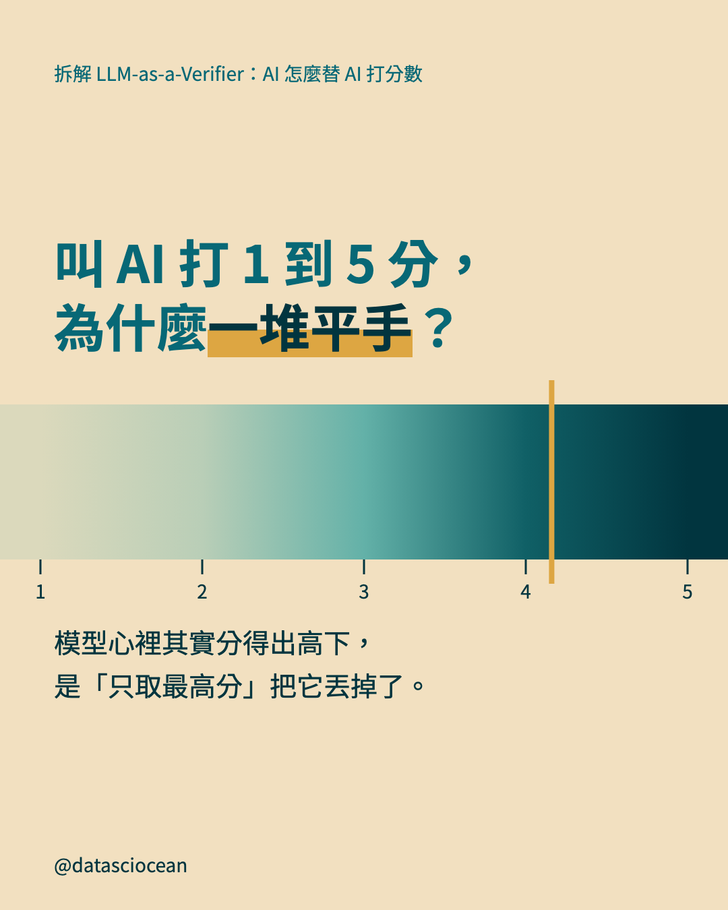

- **主標**：叫 AI 打 1 到 5 分，
為什麼一堆平手？
- **副標**：模型心裡其實分得出高下，
是「只取最高分」把它丟掉了。
- **替代文字**：叫 AI 打 1 到 5 分，
為什麼一堆平手？。模型心裡其實分得出高下，
是「只取最高分」把它丟掉了。

## 第 2 頁（脈絡）

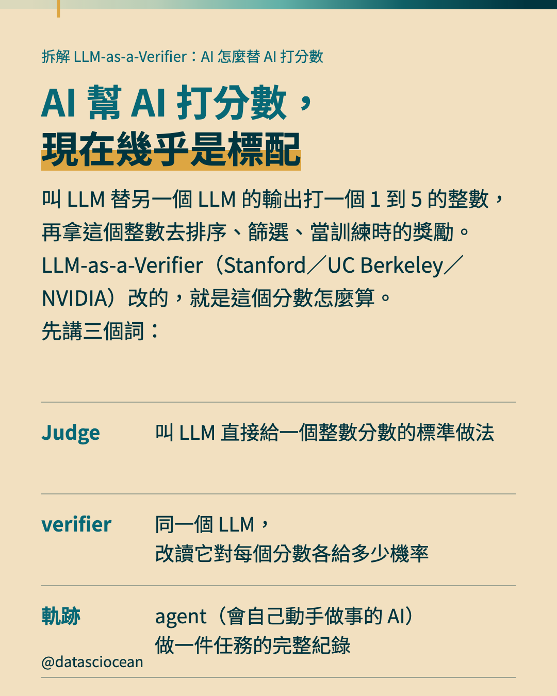

- **主標**：AI 幫 AI 打分數，現在幾乎是標配
- **補充**：叫 LLM 替另一個 LLM 的輸出打一個 1 到 5 的整數，再拿這個整數去排序、篩選、當訓練時的獎勵。LLM-as-a-Verifier（Stanford／UC Berkeley／NVIDIA）改的，就是這個分數怎麼算。先講三個詞：
- **表列**：Judge｜叫 LLM 直接給一個整數分數的標準做法
- **表列**：verifier｜同一個 LLM，改讀它對每個分數各給多少機率
- **表列**：軌跡｜agent（會自己動手做事的 AI）做一件任務的完整紀錄
- **替代文字**：AI 幫 AI 打分數，現在幾乎是標配。叫 LLM 替另一個 LLM 的輸出打一個 1 到 5 的整數，再拿這個整數去排序、篩選、當訓練時的獎勵。LLM-as-a-Verifier（Stanford／UC Berkeley／NVIDIA）改的，就是這個分數怎麼算。先講三個詞：

## 第 3 頁（示意圖）

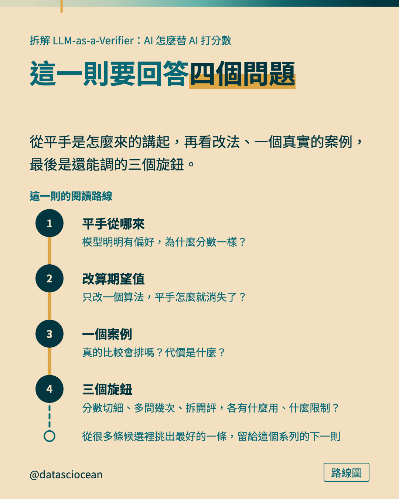

- **小標籤**：路線圖
- **主標**：這一則要回答四個問題
- **補充**：從平手是怎麼來的講起，再看改法、一個真實的案例，最後是還能調的三個旋鈕。
- **示意圖（route）上的文字與數字**：平手從哪來｜模型明明有偏好，為什麼分數一樣？｜改算期望值｜只改一個算法，平手怎麼就消失了？｜一個案例｜真的比較會排嗎？代價是什麼？｜三個旋鈕｜分數切細、多問幾次、拆開評，各有什麼用、什麼限制？｜這一則的閱讀路線｜從很多條候選裡挑出最好的一條，留給這個系列的下一則
- **替代文字**：這一則要回答四個問題。從平手是怎麼來的講起，再看改法、一個真實的案例，最後是還能調的三個旋鈕。。圖上寫：平手從哪來、模型明明有偏好，為什麼分數一樣？、改算期望值、只改一個算法，平手怎麼就消失了？、一個案例、真的比較會排嗎？代價是什麼？、三個旋鈕、分數切細、多問幾次、拆開評，各有什麼用、什麼限制？、這一則的閱讀路線、從很多條候選裡挑出最好的一條，留給這個系列的下一則

## 第 4 頁（示意圖）

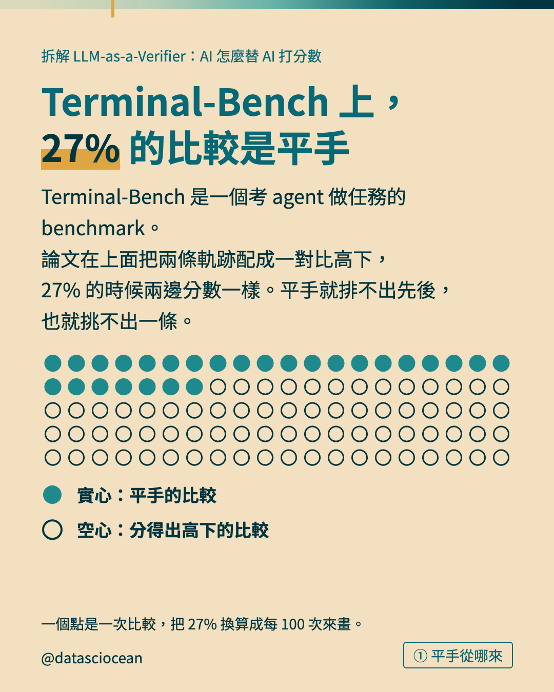

- **小標籤**：① 平手從哪來
- **主標**：Terminal-Bench 上，
27% 的比較是平手
- **補充**：Terminal-Bench 是一個考 agent 做任務的 benchmark。論文在上面把兩條軌跡配成一對比高下，27% 的時候兩邊分數一樣。平手就排不出先後，也就挑不出一條。
- **示意圖（dotgrid）上的文字與數字**：實心：平手的比較｜空心：分得出高下的比較｜100｜27
- **圖註**：一個點是一次比較，把 27% 換算成每 100 次來畫。
- **替代文字**：Terminal-Bench 上，
27% 的比較是平手。Terminal-Bench 是一個考 agent 做任務的 benchmark。論文在上面把兩條軌跡配成一對比高下，27% 的時候兩邊分數一樣。平手就排不出先後，也就挑不出一條。。圖上寫：實心：平手的比較、空心：分得出高下的比較、100、27

## 第 5 頁（示意圖）

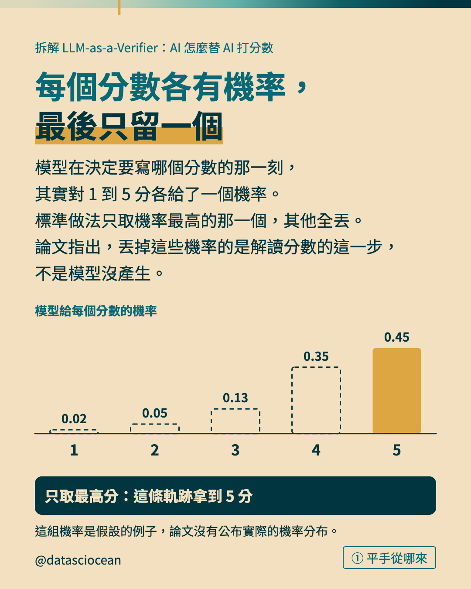

- **小標籤**：① 平手從哪來
- **主標**：每個分數各有機率，最後只留一個
- **補充**：模型在決定要寫哪個分數的那一刻，其實對 1 到 5 分各給了一個機率。標準做法只取機率最高的那一個，其他全丟。論文指出，丟掉這些機率的是解讀分數的這一步，不是模型沒產生。
- **示意圖（dist）上的文字與數字**：1｜2｜3｜4｜5｜只取最高分：這條軌跡拿到 5 分｜模型給每個分數的機率｜｜0.02｜0.05｜0.13｜0.35｜0.45
- **圖註**：這組機率是假設的例子，論文沒有公布實際的機率分布。
- **替代文字**：每個分數各有機率，最後只留一個。模型在決定要寫哪個分數的那一刻，其實對 1 到 5 分各給了一個機率。標準做法只取機率最高的那一個，其他全丟。論文指出，丟掉這些機率的是解讀分數的這一步，不是模型沒產生。。圖上寫：1、2、3、4、5、只取最高分：這條軌跡拿到 5 分、模型給每個分數的機率、、0.02、0.05、0.13、0.35、0.45

## 第 6 頁（示意圖）

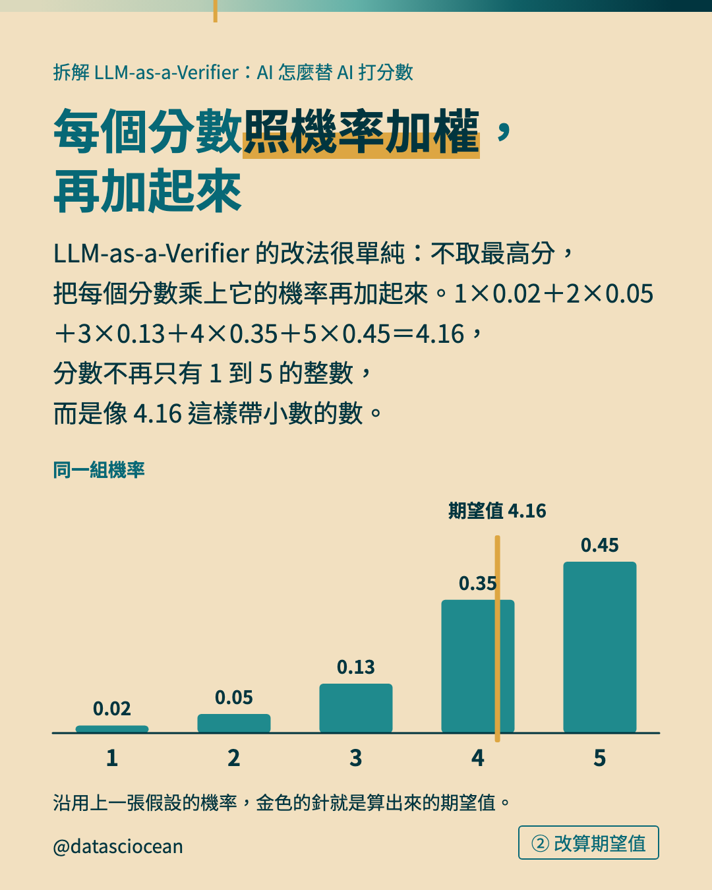

- **小標籤**：② 改算期望值
- **主標**：每個分數照機率加權，再加起來
- **補充**：LLM-as-a-Verifier 的改法很單純：不取最高分，把每個分數乘上它的機率再加起來。1×0.02＋2×0.05＋3×0.13＋4×0.35＋5×0.45＝4.16，分數不再只有 1 到 5 的整數，而是像 4.16 這樣帶小數的數。
- **示意圖（dist）上的文字與數字**：1｜2｜3｜4｜5｜同一組機率｜期望值｜0.02｜0.05｜0.13｜0.35｜0.45｜期望值 4.16
- **圖註**：沿用上一張假設的機率，金色的針就是算出來的期望值。
- **替代文字**：每個分數照機率加權，再加起來。LLM-as-a-Verifier 的改法很單純：不取最高分，把每個分數乘上它的機率再加起來。1×0.02＋2×0.05＋3×0.13＋4×0.35＋5×0.45＝4.16，分數不再只有 1 到 5 的整數，而是像 4.16 這樣帶小數的數。。圖上寫：1、2、3、4、5、同一組機率、期望值、0.02、0.05、0.13、0.35、0.45、期望值 4.16

## 第 7 頁（示意圖）

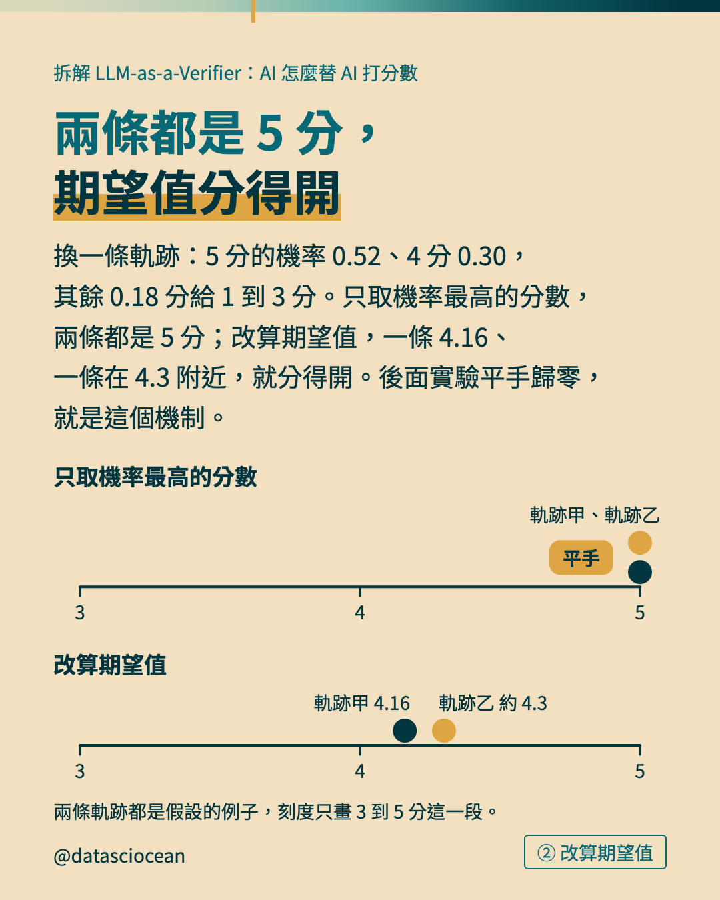

- **小標籤**：② 改算期望值
- **主標**：兩條都是 5 分，期望值分得開
- **補充**：換一條軌跡：5 分的機率 0.52、4 分 0.30，其餘 0.18 分給 1 到 3 分。只取機率最高的分數，兩條都是 5 分；改算期望值，一條 4.16、一條在 4.3 附近，就分得開。後面實驗平手歸零，就是這個機制。
- **示意圖（snap）上的文字與數字**：只取機率最高的分數｜改算期望值｜軌跡甲｜軌跡乙｜平手｜軌跡甲 4.16｜軌跡乙 約 4.3
- **圖註**：兩條軌跡都是假設的例子，刻度只畫 3 到 5 分這一段。
- **替代文字**：兩條都是 5 分，期望值分得開。換一條軌跡：5 分的機率 0.52、4 分 0.30，其餘 0.18 分給 1 到 3 分。只取機率最高的分數，兩條都是 5 分；改算期望值，一條 4.16、一條在 4.3 附近，就分得開。後面實驗平手歸零，就是這個機制。。圖上寫：只取機率最高的分數、改算期望值、軌跡甲、軌跡乙、平手、軌跡甲 4.16、軌跡乙 約 4.3

## 第 8 頁（示意圖）

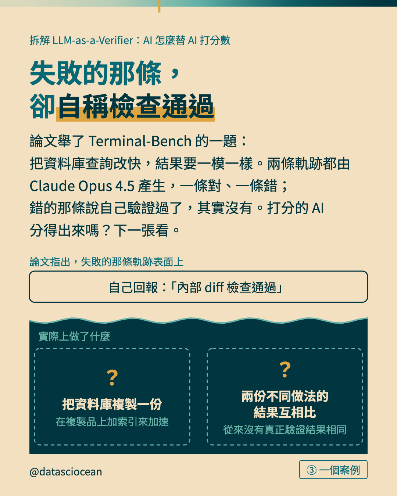

- **小標籤**：③ 一個案例
- **主標**：失敗的那條，卻自稱檢查通過
- **補充**：論文舉了 Terminal-Bench 的一題：把資料庫查詢改快，結果要一模一樣。兩條軌跡都由 Claude Opus 4.5 產生，一條對、一條錯；錯的那條說自己驗證過了，其實沒有。打分的 AI 分得出來嗎？下一張看。
- **示意圖（hidden）上的文字與數字**：自己回報：「內部 diff 檢查通過」｜把資料庫複製一份｜在複製品上加索引來加速｜兩份不同做法的
結果互相比｜從來沒有真正驗證結果相同｜論文指出，失敗的那條軌跡表面上｜實際上做了什麼
- **替代文字**：失敗的那條，卻自稱檢查通過。論文舉了 Terminal-Bench 的一題：把資料庫查詢改快，結果要一模一樣。兩條軌跡都由 Claude Opus 4.5 產生，一條對、一條錯；錯的那條說自己驗證過了，其實沒有。打分的 AI 分得出來嗎？下一張看。。圖上寫：自己回報：「內部 diff 檢查通過」、把資料庫複製一份、在複製品上加索引來加速、兩份不同做法的
結果互相比、從來沒有真正驗證結果相同、論文指出，失敗的那條軌跡表面上、實際上做了什麼

## 第 9 頁（示意圖）

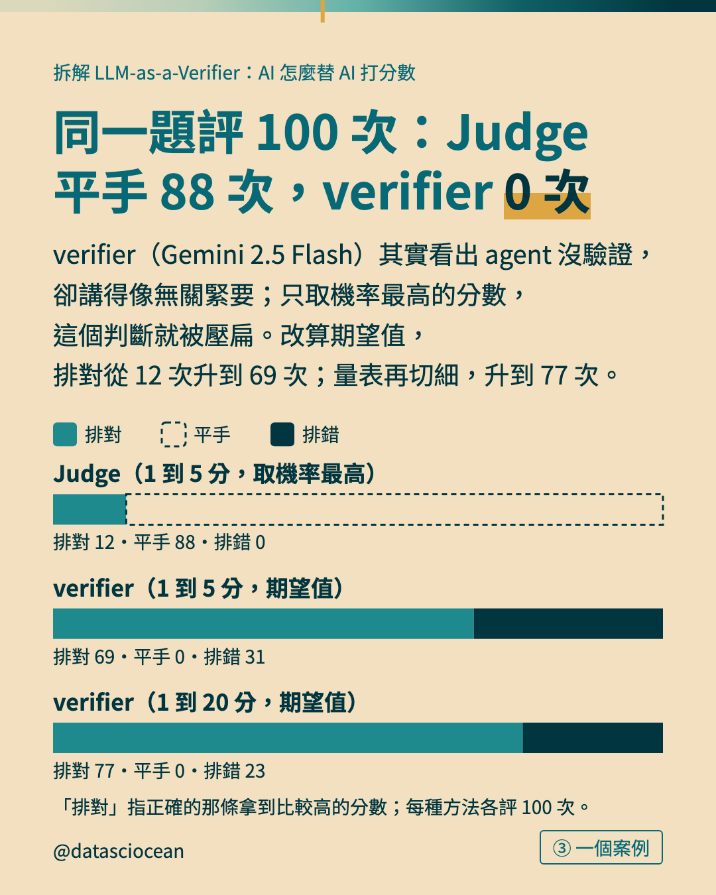

- **小標籤**：③ 一個案例
- **主標**：同一題評 100 次：Judge 平手 88 次，verifier 0 次
- **補充**：verifier（Gemini 2.5 Flash）其實看出 agent 沒驗證，卻講得像無關緊要；只取機率最高的分數，這個判斷就被壓扁。改算期望值，排對從 12 次升到 69 次；量表再切細，升到 77 次。
- **示意圖（stack）上的文字與數字**：Judge（1 到 5 分，取機率最高）｜verifier（1 到 5 分，期望值）｜verifier（1 到 20 分，期望值）｜排對｜平手｜排錯｜排對 12・平手 88・排錯 0｜排對 69・平手 0・排錯 31｜排對 77・平手 0・排錯 23
- **圖註**：「排對」指正確的那條拿到比較高的分數；每種方法各評 100 次。
- **替代文字**：同一題評 100 次：Judge 平手 88 次，verifier 0 次。verifier（Gemini 2.5 Flash）其實看出 agent 沒驗證，卻講得像無關緊要；只取機率最高的分數，這個判斷就被壓扁。改算期望值，排對從 12 次升到 69 次；量表再切細，升到 77 次。。圖上寫：Judge（1 到 5 分，取機率最高）、verifier（1 到 5 分，期望值）、verifier（1 到 20 分，期望值）、排對、平手、排錯、排對 12・平手 88・排錯 0、排對 69・平手 0・排錯 31、排對 77・平手 0・排錯 23

## 第 10 頁（對照表）

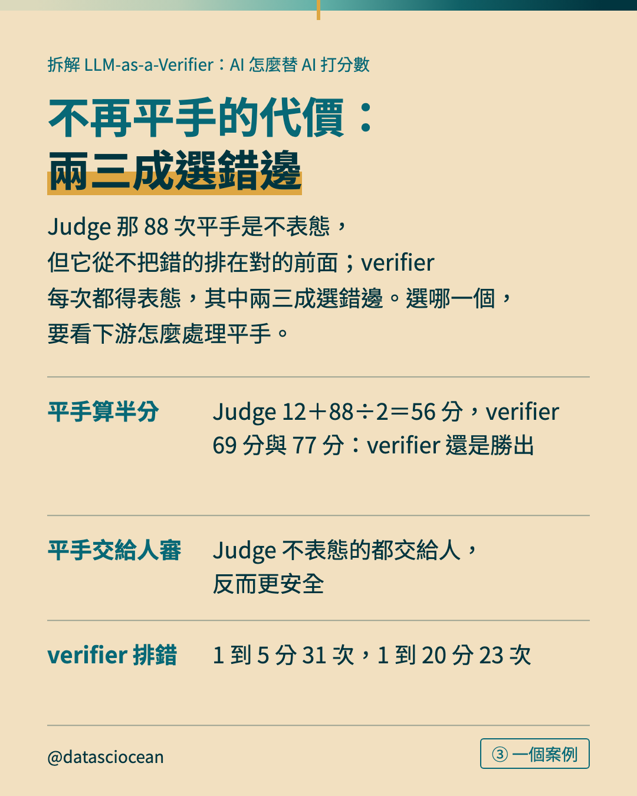

- **小標籤**：③ 一個案例
- **主標**：不再平手的代價：兩三成選錯邊
- **補充**：Judge 那 88 次平手是不表態，但它從不把錯的排在對的前面；verifier 每次都得表態，其中兩三成選錯邊。選哪一個，要看下游怎麼處理平手。
- **表列**：平手算半分｜Judge 12＋88÷2＝56 分，verifier 69 分與 77 分：verifier 還是勝出
- **表列**：平手交給人審｜Judge 不表態的都交給人，反而更安全
- **表列**：verifier 排錯｜1 到 5 分 31 次，1 到 20 分 23 次
- **替代文字**：不再平手的代價：兩三成選錯邊。Judge 那 88 次平手是不表態，但它從不把錯的排在對的前面；verifier 每次都得表態，其中兩三成選錯邊。選哪一個，要看下游怎麼處理平手。

## 第 11 頁（對照表）

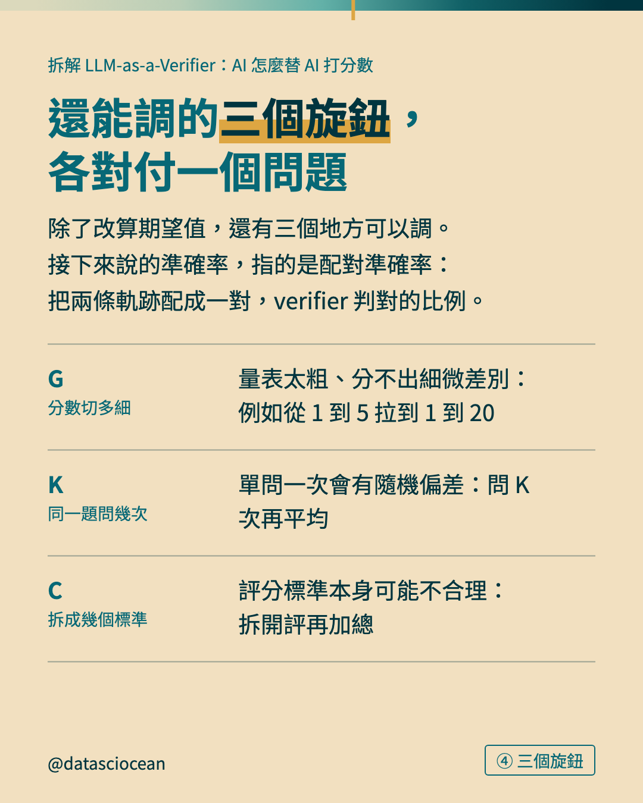

- **小標籤**：④ 三個旋鈕
- **主標**：還能調的三個旋鈕，各對付一個問題
- **補充**：除了改算期望值，還有三個地方可以調。接下來說的準確率，指的是配對準確率：把兩條軌跡配成一對，verifier 判對的比例。
- **表列**：G｜分數切多細｜量表太粗、分不出細微差別：例如從 1 到 5 拉到 1 到 20
- **表列**：K｜同一題問幾次｜單問一次會有隨機偏差：問 K 次再平均
- **表列**：C｜拆成幾個標準｜評分標準本身可能不合理：拆開評再加總
- **替代文字**：還能調的三個旋鈕，各對付一個問題。除了改算期望值，還有三個地方可以調。接下來說的準確率，指的是配對準確率：把兩條軌跡配成一對，verifier 判對的比例。

## 第 12 頁（示意圖）

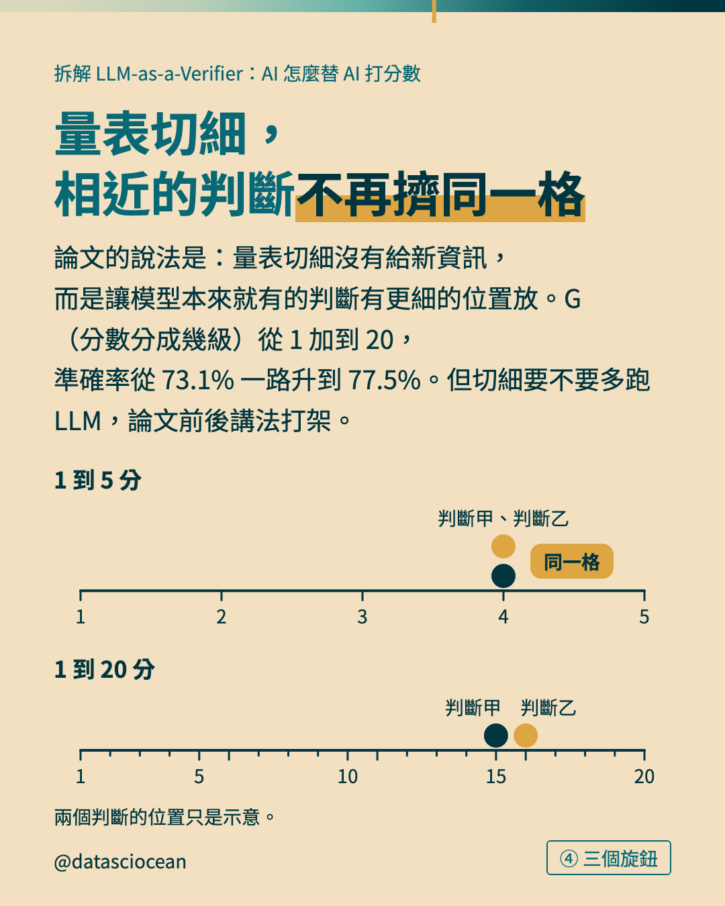

- **小標籤**：④ 三個旋鈕
- **主標**：量表切細，相近的判斷不再擠同一格
- **補充**：論文的說法是：量表切細沒有給新資訊，而是讓模型本來就有的判斷有更細的位置放。G（分數分成幾級）從 1 加到 20，準確率從 73.1% 一路升到 77.5%。但切細要不要多跑 LLM，論文前後講法打架。
- **示意圖（snap）上的文字與數字**：1 到 5 分｜1 到 20 分｜判斷甲｜判斷乙｜同一格｜判斷甲｜判斷乙
- **圖註**：兩個判斷的位置只是示意。
- **替代文字**：量表切細，相近的判斷不再擠同一格。論文的說法是：量表切細沒有給新資訊，而是讓模型本來就有的判斷有更細的位置放。G（分數分成幾級）從 1 加到 20，準確率從 73.1% 一路升到 77.5%。但切細要不要多跑 LLM，論文前後講法打架。。圖上寫：1 到 5 分、1 到 20 分、判斷甲、判斷乙、同一格、判斷甲、判斷乙

## 第 13 頁（示意圖）

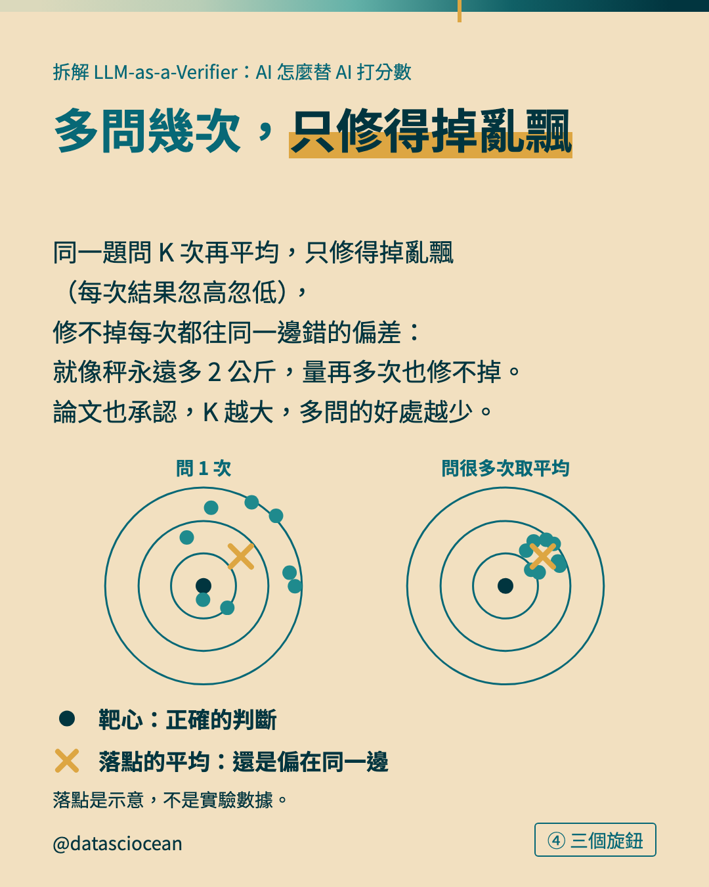

- **小標籤**：④ 三個旋鈕
- **主標**：多問幾次，只修得掉亂飄
- **補充**：同一題問 K 次再平均，只修得掉亂飄（每次結果忽高忽低），修不掉每次都往同一邊錯的偏差：就像秤永遠多 2 公斤，量再多次也修不掉。論文也承認，K 越大，多問的好處越少。
- **示意圖（target）上的文字與數字**：靶心：正確的判斷｜落點的平均：還是偏在同一邊｜問 1 次｜問很多次取平均
- **圖註**：落點是示意，不是實驗數據。
- **替代文字**：多問幾次，只修得掉亂飄。同一題問 K 次再平均，只修得掉亂飄（每次結果忽高忽低），修不掉每次都往同一邊錯的偏差：就像秤永遠多 2 公斤，量再多次也修不掉。論文也承認，K 越大，多問的好處越少。。圖上寫：靶心：正確的判斷、落點的平均：還是偏在同一邊、問 1 次、問很多次取平均

## 第 14 頁（橫條圖）

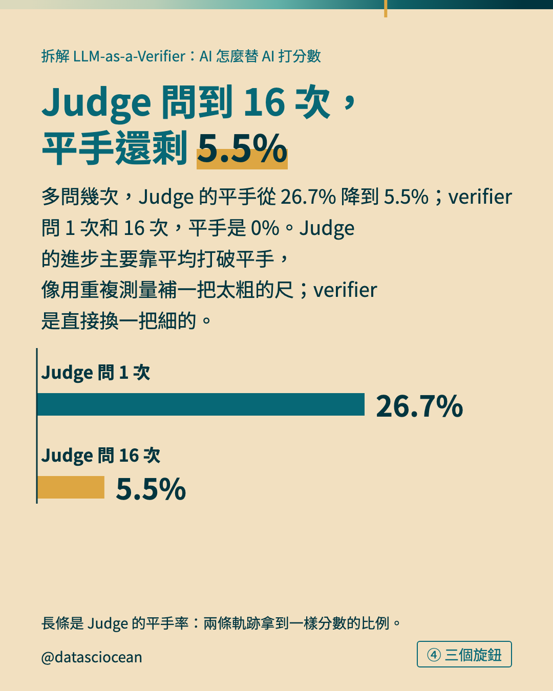

- **小標籤**：④ 三個旋鈕
- **主標**：Judge 問到 16 次，平手還剩 5.5%
- **補充**：多問幾次，Judge 的平手從 26.7% 降到 5.5%；verifier 問 1 次和 16 次，平手是 0%。Judge 的進步主要靠平均打破平手，像用重複測量補一把太粗的尺；verifier 是直接換一把細的。
- **圖上項目**：Judge 問 1 次（）＝ 26.7 %
- **圖上項目**：Judge 問 16 次（）＝ 5.5 %　★強調
- **圖註**：長條是 Judge 的平手率：兩條軌跡拿到一樣分數的比例。
- **替代文字**：Judge 問到 16 次，平手還剩 5.5%。多問幾次，Judge 的平手從 26.7% 降到 5.5%；verifier 問 1 次和 16 次，平手是 0%。Judge 的進步主要靠平均打破平手，像用重複測量補一把太粗的尺；verifier 是直接換一把細的。

## 第 15 頁（橫條圖）

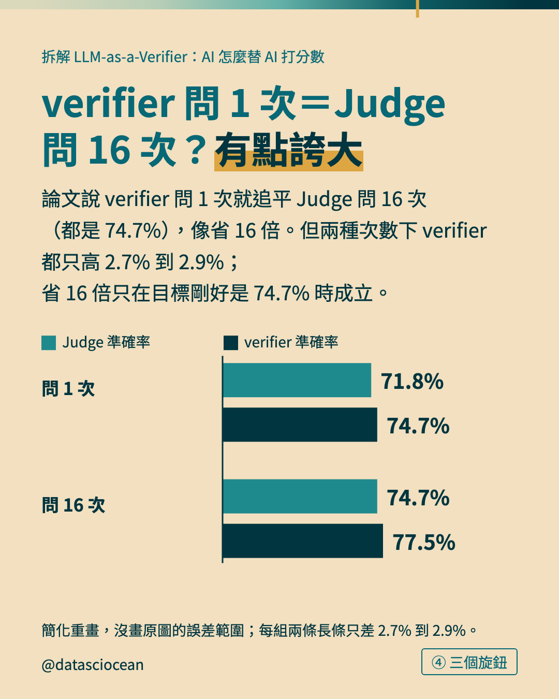

- **小標籤**：④ 三個旋鈕
- **主標**：verifier 問 1 次＝Judge 問 16 次？有點誇大
- **補充**：論文說 verifier 問 1 次就追平 Judge 問 16 次（都是 74.7%），像省 16 倍。但兩種次數下 verifier 都只高 2.7% 到 2.9%；省 16 倍只在目標剛好是 74.7% 時成立。
- **圖上項目**：問 1 次（）＝ Judge 準確率 71.8 %；verifier 準確率 74.7 %
- **圖上項目**：問 16 次（）＝ Judge 準確率 74.7 %；verifier 準確率 77.5 %
- **圖註**：簡化重畫，沒畫原圖的誤差範圍；每組兩條長條只差 2.7% 到 2.9%。
- **替代文字**：verifier 問 1 次＝Judge 問 16 次？有點誇大。論文說 verifier 問 1 次就追平 Judge 問 16 次（都是 74.7%），像省 16 倍。但兩種次數下 verifier 都只高 2.7% 到 2.9%；省 16 倍只在目標剛好是 74.7% 時成立。

## 第 16 頁（示意圖）

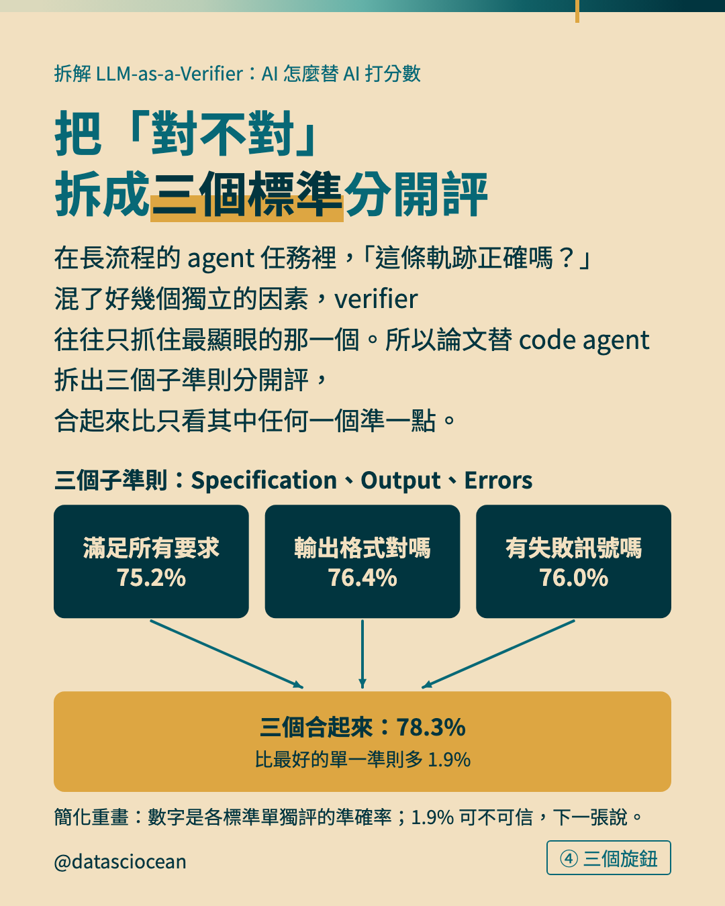

- **小標籤**：④ 三個旋鈕
- **主標**：把「對不對」拆成三個標準分開評
- **補充**：在長流程的 agent 任務裡，「這條軌跡正確嗎？」混了好幾個獨立的因素，verifier 往往只抓住最顯眼的那一個。所以論文替 code agent 拆出三個子準則分開評，合起來比只看其中任何一個準一點。
- **示意圖（fan）上的文字與數字**：三個子準則：Specification、Output、Errors｜三個合起來：78.3%｜比最好的單一準則多 1.9%｜滿足所有要求
75.2%｜輸出格式對嗎
76.4%｜有失敗訊號嗎
76.0%
- **圖註**：簡化重畫：數字是各標準單獨評的準確率；1.9% 可不可信，下一張說。
- **替代文字**：把「對不對」拆成三個標準分開評。在長流程的 agent 任務裡，「這條軌跡正確嗎？」混了好幾個獨立的因素，verifier 往往只抓住最顯眼的那一個。所以論文替 code agent 拆出三個子準則分開評，合起來比只看其中任何一個準一點。。圖上寫：三個子準則：Specification、Output、Errors、三個合起來：78.3%、比最好的單一準則多 1.9%、滿足所有要求
75.2%、輸出格式對嗎
76.4%、有失敗訊號嗎
76.0%

## 第 17 頁（對照表）

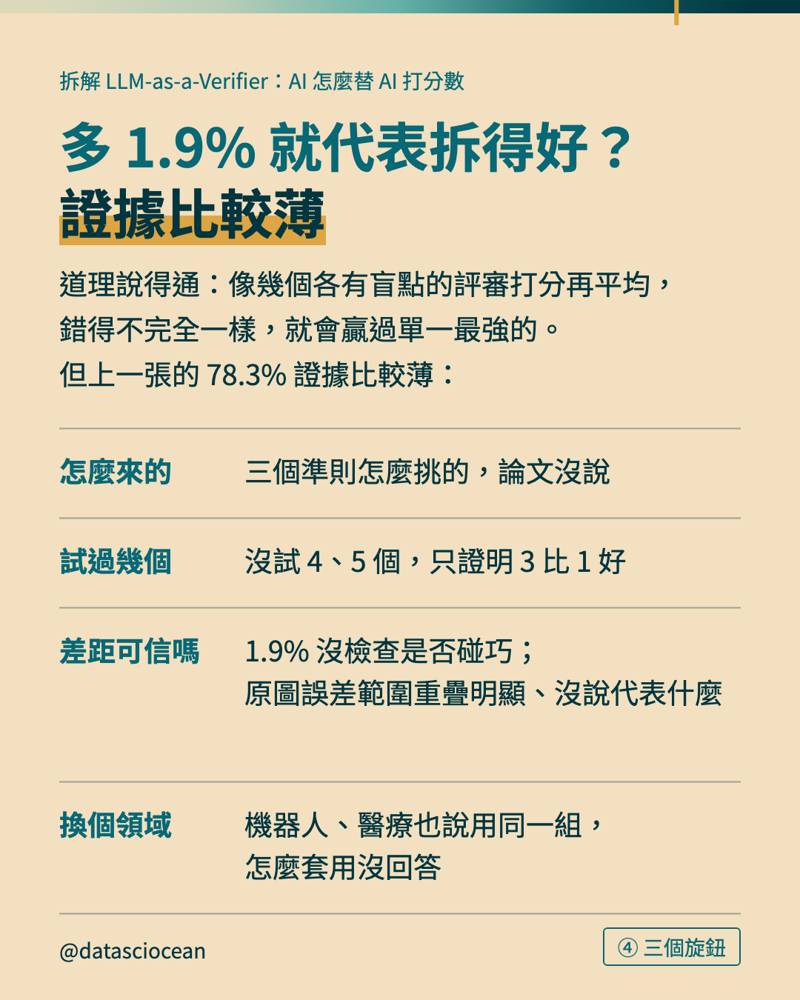

- **小標籤**：④ 三個旋鈕
- **主標**：多 1.9% 就代表拆得好？證據比較薄
- **補充**：道理說得通：像幾個各有盲點的評審打分再平均，錯得不完全一樣，就會贏過單一最強的。但上一張的 78.3% 證據比較薄：
- **表列**：怎麼來的｜三個準則怎麼挑的，論文沒說
- **表列**：試過幾個｜沒試 4、5 個，只證明 3 比 1 好
- **表列**：差距可信嗎｜1.9% 沒檢查是否碰巧；原圖誤差範圍重疊明顯、沒說代表什麼
- **表列**：換個領域｜機器人、醫療也說用同一組，怎麼套用沒回答
- **替代文字**：多 1.9% 就代表拆得好？證據比較薄。道理說得通：像幾個各有盲點的評審打分再平均，錯得不完全一樣，就會贏過單一最強的。但上一張的 78.3% 證據比較薄：

## 第 18 頁（帶走）

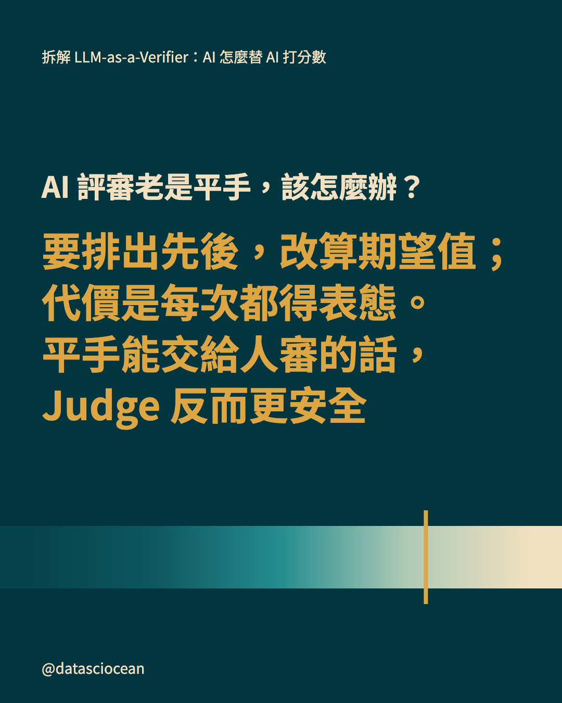

- **先問的問題**：AI 評審老是平手，該怎麼辦？
- **一句話**：要排出先後，改算期望值；
代價是每次都得表態。
平手能交給人審的話，
Judge 反而更安全
- **替代文字**：AI 評審老是平手，該怎麼辦？　要排出先後，改算期望值；
代價是每次都得表態。
平手能交給人審的話，
Judge 反而更安全

## 第 19 頁（系列地圖）

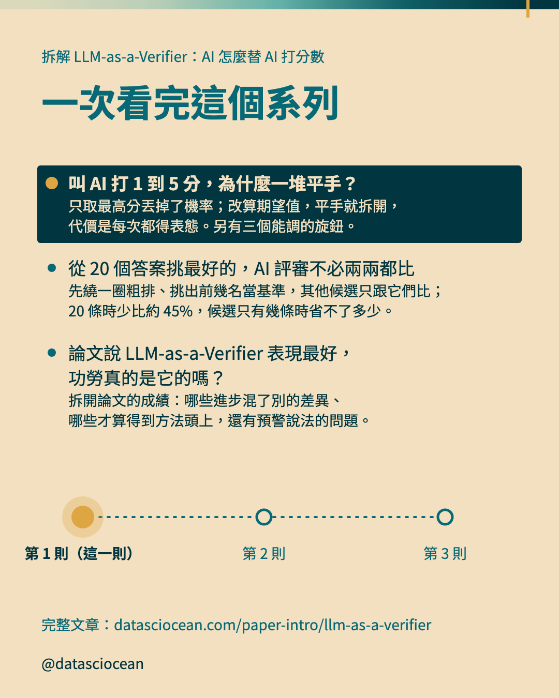

- **主標**：一次看完這個系列
- **導流行**：完整文章：datasciocean.com/paper-intro/llm-as-a-verifier
- **第 1 則**：叫 AI 打 1 到 5 分，為什麼一堆平手？　只取最高分丟掉了機率；改算期望值，平手就拆開，代價是每次都得表態。另有三個能調的旋鈕。
- **第 2 則**：從 20 個答案挑最好的，AI 評審不必兩兩都比　先繞一圈粗排、挑出前幾名當基準，其他候選只跟它們比；20 條時少比約 45%，候選只有幾條時省不了多少。
- **第 3 則**：論文說 LLM-as-a-Verifier 表現最好，功勞真的是它的嗎？　拆開論文的成績：哪些進步混了別的差異、哪些才算得到方法頭上，還有預警說法的問題。
- **替代文字**：一次看完這個系列。叫 AI 打 1 到 5 分，為什麼一堆平手？：只取最高分丟掉了機率；改算期望值，平手就拆開，代價是每次都得表態。另有三個能調的旋鈕。、從 20 個答案挑最好的，AI 評審不必兩兩都比：先繞一圈粗排、挑出前幾名當基準，其他候選只跟它們比；20 條時少比約 45%，候選只有幾條時省不了多少。、論文說 LLM-as-a-Verifier 表現最好，功勞真的是它的嗎？：拆開論文的成績：哪些進步混了別的差異、哪些才算得到方法頭上，還有預警說法的問題。

## Caption（整段貼到 IG）

```text
LLM 當評審、AI 評分老是平手？LLM-as-a-Verifier 改算期望值

・路線圖：這一則要回答四個問題
・① 平手從哪來：Terminal-Bench 上，27% 的比較是平手
・每個分數各有機率，最後只留一個
・② 改算期望值：每個分數照機率加權，再加起來
・兩條都是 5 分，期望值分得開
・③ 一個案例：失敗的那條，卻自稱檢查通過
・同一題評 100 次：Judge 平手 88 次，verifier 0 次
・不再平手的代價：兩三成選錯邊
・④ 三個旋鈕：還能調的三個旋鈕，各對付一個問題（除了改算期望值，還有三個地方可以調）
・量表切細，相近的判斷不再擠同一格
・多問幾次，只修得掉亂飄
・Judge 問到 16 次，平手還剩 5.5%
・verifier 問 1 次＝Judge 問 16 次？有點誇大
・把「對不對」拆成三個標準分開評
・多 1.9% 就代表拆得好？證據比較薄

圖片來源：第 9 張（圖 4）、第 14 張（圖 5）、第 15 張（圖 5）、第 16 張（圖 3）改繪自原始論文的圖表

完整文章在 datasciocean.com，搜「LLM-as-a-Verifier」

#LLMVerifier #LLMasaJudge #LLM評測
```
