# IG 輪播：論文說 LLM-as-a-Verifier 表現最好，功勞真的是它的嗎？

- 系列：拆解 LLM-as-a-Verifier：AI 怎麼替 AI 打分數　｜　hook 樣態：讀者疑問　｜　共 14 張，**依頁碼順序上傳**
- 每頁下方的「替代文字」貼到 IG 的替代文字欄；最後的 Caption 整段貼上

## 第 1 頁（封面）

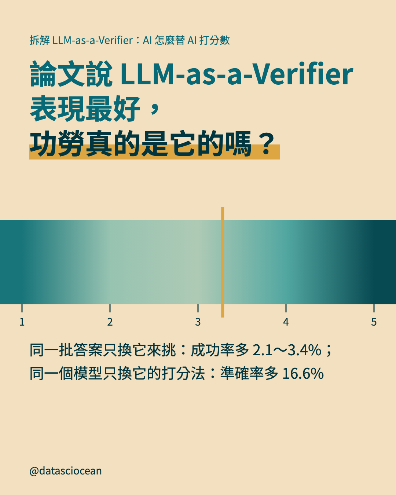

- **主標**：論文說 LLM-as-a-Verifier 表現最好，
功勞真的是它的嗎？
- **副標**：同一批答案只換它來挑：成功率多 2.1～3.4%；
同一個模型只換它的打分法：準確率多 16.6%
- **替代文字**：論文說 LLM-as-a-Verifier 表現最好，
功勞真的是它的嗎？。同一批答案只換它來挑：成功率多 2.1～3.4%；
同一個模型只換它的打分法：準確率多 16.6%

## 第 2 頁（前情回顧）

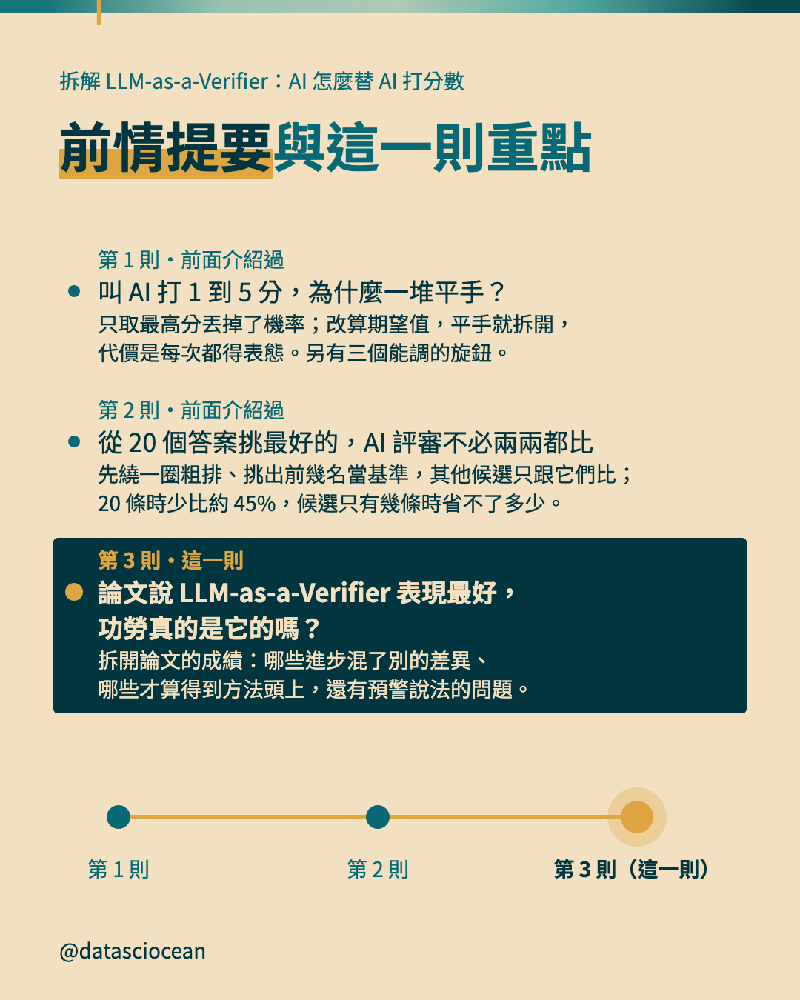

- **主標**：前情提要與這一則重點
- **第 1 則**：叫 AI 打 1 到 5 分，為什麼一堆平手？　只取最高分丟掉了機率；改算期望值，平手就拆開，代價是每次都得表態。另有三個能調的旋鈕。
- **第 2 則**：從 20 個答案挑最好的，AI 評審不必兩兩都比　先繞一圈粗排、挑出前幾名當基準，其他候選只跟它們比；20 條時少比約 45%，候選只有幾條時省不了多少。
- **第 3 則**：論文說 LLM-as-a-Verifier 表現最好，功勞真的是它的嗎？　拆開論文的成績：哪些進步混了別的差異、哪些才算得到方法頭上，還有預警說法的問題。
- **替代文字**：前情提要與這一則重點。第 1 則「叫 AI 打 1 到 5 分，為什麼一堆平手？」：只取最高分丟掉了機率；改算期望值，平手就拆開，代價是每次都得表態。另有三個能調的旋鈕。；第 2 則「從 20 個答案挑最好的，AI 評審不必兩兩都比」：先繞一圈粗排、挑出前幾名當基準，其他候選只跟它們比；20 條時少比約 45%，候選只有幾條時省不了多少。；第 3 則「論文說 LLM-as-a-Verifier 表現最好，功勞真的是它的嗎？」：拆開論文的成績：哪些進步混了別的差異、哪些才算得到方法頭上，還有預警說法的問題。

## 第 3 頁（脈絡）

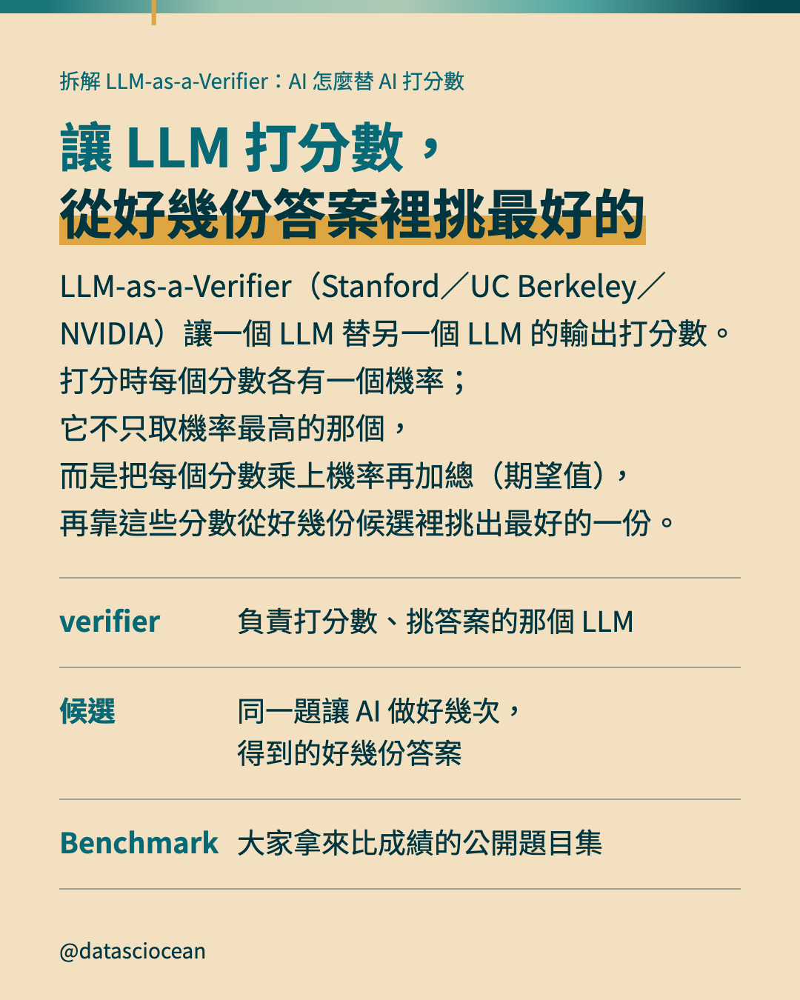

- **主標**：讓 LLM 打分數，
從好幾份答案裡挑最好的
- **補充**：LLM-as-a-Verifier（Stanford／UC Berkeley／NVIDIA）讓一個 LLM 替另一個 LLM 的輸出打分數。打分時每個分數各有一個機率；它不只取機率最高的那個，而是把每個分數乘上機率再加總（期望值），再靠這些分數從好幾份候選裡挑出最好的一份。
- **表列**：verifier｜負責打分數、挑答案的那個 LLM
- **表列**：候選｜同一題讓 AI 做好幾次，得到的好幾份答案
- **表列**：Benchmark｜大家拿來比成績的公開題目集
- **替代文字**：讓 LLM 打分數，
從好幾份答案裡挑最好的。LLM-as-a-Verifier（Stanford／UC Berkeley／NVIDIA）讓一個 LLM 替另一個 LLM 的輸出打分數。打分時每個分數各有一個機率；它不只取機率最高的那個，而是把每個分數乘上機率再加總（期望值），再靠這些分數從好幾份候選裡挑出最好的一份。

## 第 4 頁（示意圖）

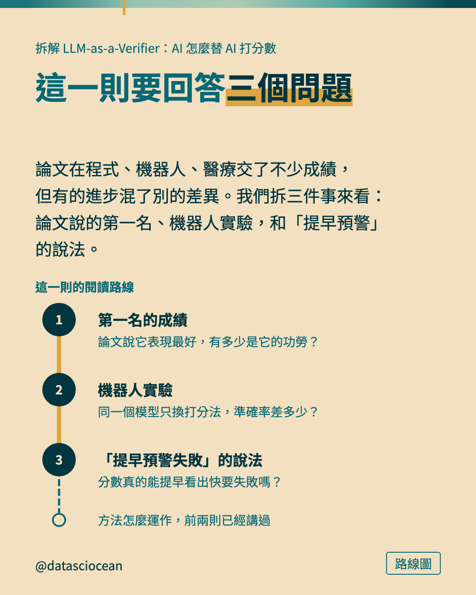

- **小標籤**：路線圖
- **主標**：這一則要回答三個問題
- **補充**：論文在程式、機器人、醫療交了不少成績，但有的進步混了別的差異。我們拆三件事來看：論文說的第一名、機器人實驗，和「提早預警」的說法。
- **示意圖（route）上的文字與數字**：第一名的成績｜論文說它表現最好，有多少是它的功勞？｜機器人實驗｜同一個模型只換打分法，準確率差多少？｜「提早預警失敗」的說法｜分數真的能提早看出快要失敗嗎？｜這一則的閱讀路線｜方法怎麼運作，前兩則已經講過
- **替代文字**：這一則要回答三個問題。論文在程式、機器人、醫療交了不少成績，但有的進步混了別的差異。我們拆三件事來看：論文說的第一名、機器人實驗，和「提早預警」的說法。。圖上寫：第一名的成績、論文說它表現最好，有多少是它的功勞？、機器人實驗、同一個模型只換打分法，準確率差多少？、「提早預警失敗」的說法、分數真的能提早看出快要失敗嗎？、這一則的閱讀路線、方法怎麼運作，前兩則已經講過

## 第 5 頁（示意圖）

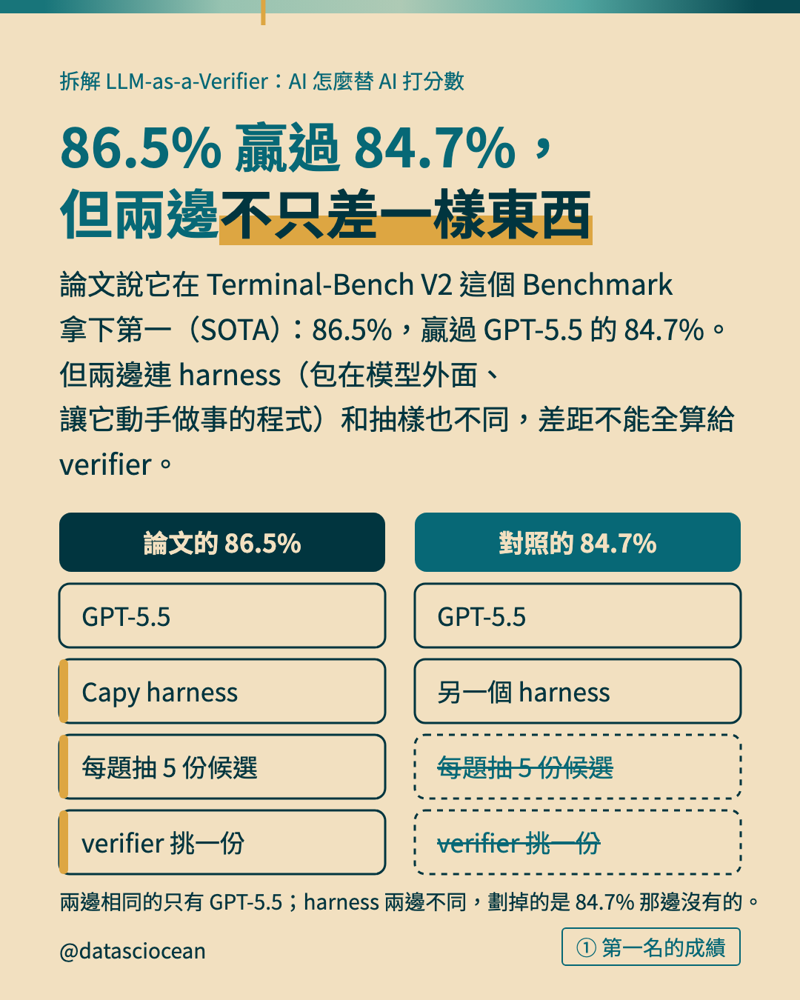

- **小標籤**：① 第一名的成績
- **主標**：86.5% 贏過 84.7%，
但兩邊不只差一樣東西
- **補充**：論文說它在 Terminal-Bench V2 這個 Benchmark 拿下第一（SOTA）：86.5%，贏過 GPT-5.5 的 84.7%。但兩邊連 harness（包在模型外面、讓它動手做事的程式）和抽樣也不同，差距不能全算給 verifier。
- **示意圖（compare）上的文字與數字**：論文的 86.5%｜GPT-5.5｜Capy harness｜每題抽 5 份候選｜verifier 挑一份｜對照的 84.7%｜GPT-5.5｜另一個 harness｜每題抽 5 份候選｜verifier 挑一份
- **圖註**：兩邊相同的只有 GPT-5.5；harness 兩邊不同，劃掉的是 84.7% 那邊沒有的。
- **替代文字**：86.5% 贏過 84.7%，
但兩邊不只差一樣東西。論文說它在 Terminal-Bench V2 這個 Benchmark 拿下第一（SOTA）：86.5%，贏過 GPT-5.5 的 84.7%。但兩邊連 harness（包在模型外面、讓它動手做事的程式）和抽樣也不同，差距不能全算給 verifier。。圖上寫：論文的 86.5%、GPT-5.5、Capy harness、每題抽 5 份候選、verifier 挑一份、對照的 84.7%、GPT-5.5、另一個 harness、每題抽 5 份候選、verifier 挑一份

## 第 6 頁（示意圖）

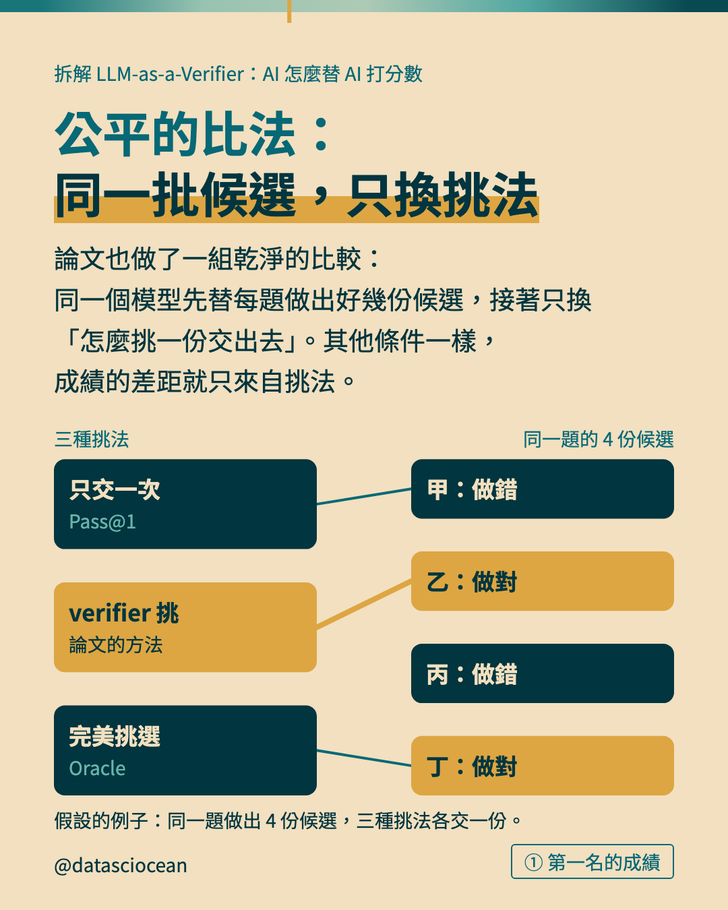

- **小標籤**：① 第一名的成績
- **主標**：公平的比法：
同一批候選，只換挑法
- **補充**：論文也做了一組乾淨的比較：同一個模型先替每題做出好幾份候選，接著只換「怎麼挑一份交出去」。其他條件一樣，成績的差距就只來自挑法。
- **示意圖（links）上的文字與數字**：只交一次｜Pass@1｜verifier 挑｜論文的方法｜完美挑選｜Oracle｜甲：做錯｜乙：做對｜丙：做錯｜丁：做對｜三種挑法｜同一題的 4 份候選
- **圖註**：假設的例子：同一題做出 4 份候選，三種挑法各交一份。
- **替代文字**：公平的比法：
同一批候選，只換挑法。論文也做了一組乾淨的比較：同一個模型先替每題做出好幾份候選，接著只換「怎麼挑一份交出去」。其他條件一樣，成績的差距就只來自挑法。。圖上寫：只交一次、Pass@1、verifier 挑、論文的方法、完美挑選、Oracle、甲：做錯、乙：做對、丙：做錯、丁：做對、三種挑法、同一題的 4 份候選

## 第 7 頁（橫條圖）

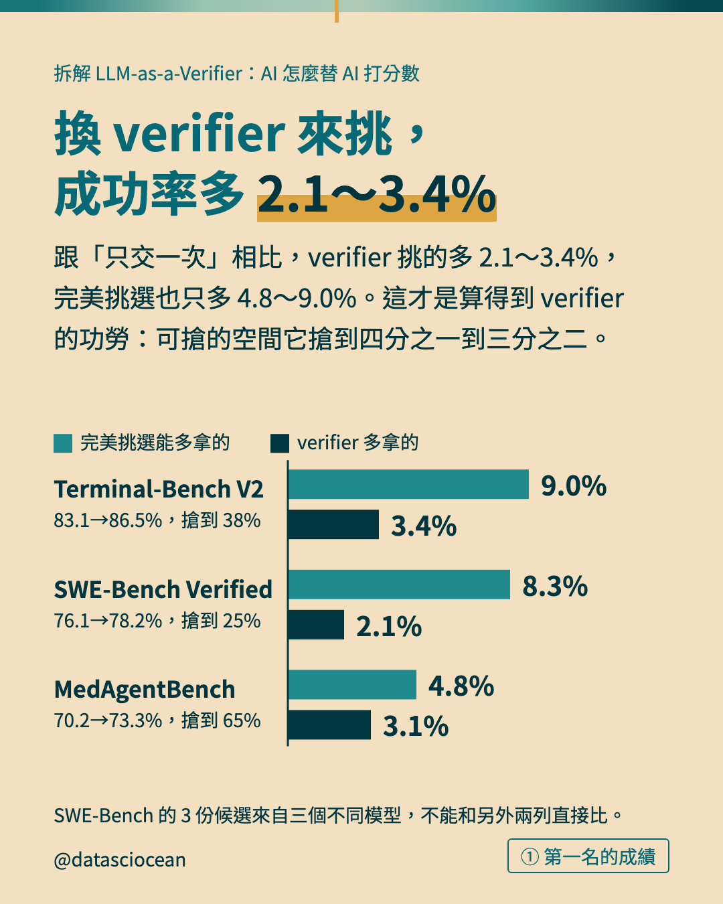

- **小標籤**：① 第一名的成績
- **主標**：換 verifier 來挑，
成功率多 2.1～3.4%
- **補充**：跟「只交一次」相比，verifier 挑的多 2.1～3.4%，完美挑選也只多 4.8～9.0%。這才是算得到 verifier 的功勞：可搶的空間它搶到四分之一到三分之二。
- **圖上項目**：Terminal-Bench V2（83.1→86.5%，搶到 38%）＝ 完美挑選能多拿的 9 %；verifier 多拿的 3.4 %
- **圖上項目**：SWE-Bench Verified（76.1→78.2%，搶到 25%）＝ 完美挑選能多拿的 8.3 %；verifier 多拿的 2.1 %
- **圖上項目**：MedAgentBench（70.2→73.3%，搶到 65%）＝ 完美挑選能多拿的 4.8 %；verifier 多拿的 3.1 %
- **圖註**：SWE-Bench 的 3 份候選來自三個不同模型，不能和另外兩列直接比。
- **替代文字**：換 verifier 來挑，
成功率多 2.1～3.4%。跟「只交一次」相比，verifier 挑的多 2.1～3.4%，完美挑選也只多 4.8～9.0%。這才是算得到 verifier 的功勞：可搶的空間它搶到四分之一到三分之二。

## 第 8 頁（橫條圖）

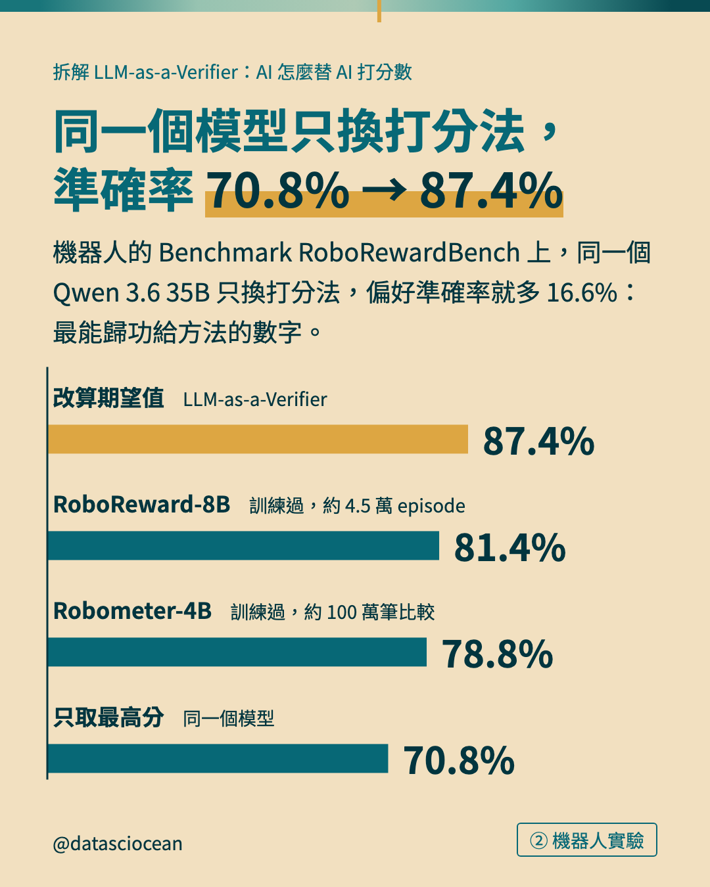

- **小標籤**：② 機器人實驗
- **主標**：同一個模型只換打分法，
準確率 70.8% → 87.4%
- **補充**：機器人的 Benchmark RoboRewardBench 上，同一個 Qwen 3.6 35B 只換打分法，偏好準確率就多 16.6%：最能歸功給方法的數字。
- **圖上項目**：改算期望值（LLM-as-a-Verifier）＝ 87.4 %　★強調
- **圖上項目**：RoboReward-8B（訓練過，約 4.5 萬 episode）＝ 81.4 %
- **圖上項目**：Robometer-4B（訓練過，約 100 萬筆比較）＝ 78.8 %
- **圖上項目**：只取最高分（同一個模型）＝ 70.8 %
- **替代文字**：同一個模型只換打分法，
準確率 70.8% → 87.4%。機器人的 Benchmark RoboRewardBench 上，同一個 Qwen 3.6 35B 只換打分法，偏好準確率就多 16.6%：最能歸功給方法的數字。

## 第 9 頁（對照表）

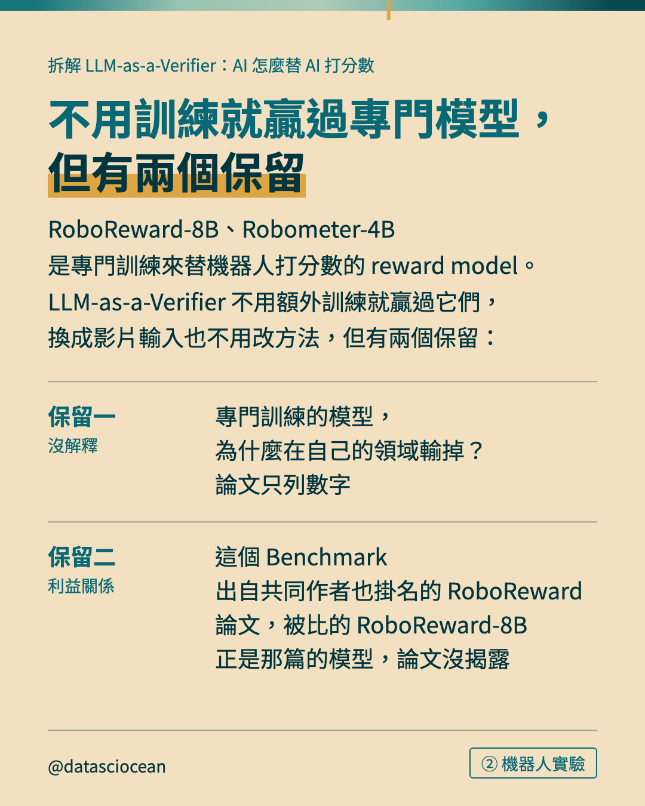

- **小標籤**：② 機器人實驗
- **主標**：不用訓練就贏過專門模型，
但有兩個保留
- **補充**：RoboReward-8B、Robometer-4B 是專門訓練來替機器人打分數的 reward model。LLM-as-a-Verifier 不用額外訓練就贏過它們，換成影片輸入也不用改方法，但有兩個保留：
- **表列**：保留一｜沒解釋｜專門訓練的模型，為什麼在自己的領域輸掉？論文只列數字
- **表列**：保留二｜利益關係｜這個 Benchmark 出自共同作者也掛名的 RoboReward 論文，被比的 RoboReward-8B 正是那篇的模型，論文沒揭露
- **替代文字**：不用訓練就贏過專門模型，
但有兩個保留。RoboReward-8B、Robometer-4B 是專門訓練來替機器人打分數的 reward model。LLM-as-a-Verifier 不用額外訓練就贏過它們，換成影片輸入也不用改方法，但有兩個保留：

## 第 10 頁（橫條圖）

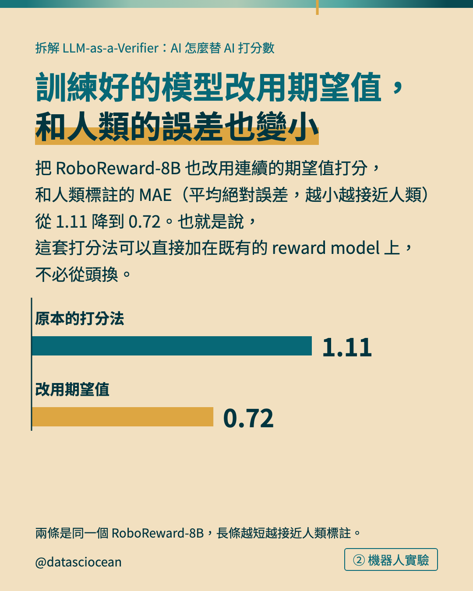

- **小標籤**：② 機器人實驗
- **主標**：訓練好的模型改用期望值，
和人類的誤差也變小
- **補充**：把 RoboReward-8B 也改用連續的期望值打分，和人類標註的 MAE（平均絕對誤差，越小越接近人類）從 1.11 降到 0.72。也就是說，這套打分法可以直接加在既有的 reward model 上，不必從頭換。
- **圖上項目**：原本的打分法（）＝ 1.11 
- **圖上項目**：改用期望值（）＝ 0.72 　★強調
- **圖註**：兩條是同一個 RoboReward-8B，長條越短越接近人類標註。
- **替代文字**：訓練好的模型改用期望值，
和人類的誤差也變小。把 RoboReward-8B 也改用連續的期望值打分，和人類標註的 MAE（平均絕對誤差，越小越接近人類）從 1.11 降到 0.72。也就是說，這套打分法可以直接加在既有的 reward model 上，不必從頭換。

## 第 11 頁（對照表）


- **小標籤**：③ 預警說法
- **主標**：論文說：分數能提早看出 AI 快要失敗
- **補充**：AI agent（會自己動手做事的 AI）一步步執行任務，verifier 可以每走一步就打一次分。論文主張：快要失敗或卡住時，分數會大致停在原地，所以同一個分數能當進度條，也能提早預警。它舉的例子是：
- **表列**：成功的那次｜分數持續上升到約 1.0
- **表列**：失敗的那次｜多裝了不必要的套件、磁碟空間耗盡之後，分數一路偏低
- **表列**：但這只是｜單一任務的單一案例，不是 500 次任務的統計
- **替代文字**：論文說：分數能提早看出 AI 快要失敗。AI agent（會自己動手做事的 AI）一步步執行任務，verifier 可以每走一步就打一次分。論文主張：快要失敗或卡住時，分數會大致停在原地，所以同一個分數能當進度條，也能提早預警。它舉的例子是：

## 第 12 頁（示意圖）

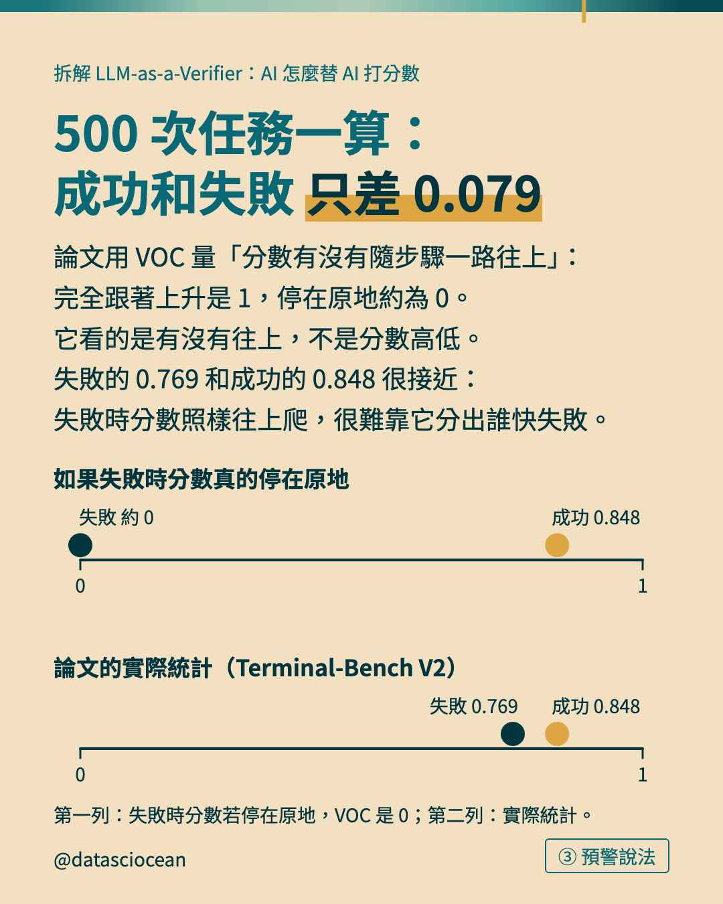

- **小標籤**：③ 預警說法
- **主標**：500 次任務一算：成功和失敗
只差 0.079
- **補充**：論文用 VOC 量「分數有沒有隨步驟一路往上」：完全跟著上升是 1，停在原地約為 0。它看的是有沒有往上，不是分數高低。失敗的 0.769 和成功的 0.848 很接近：失敗時分數照樣往上爬，很難靠它分出誰快失敗。
- **示意圖（snap）上的文字與數字**：如果失敗時分數真的停在原地｜論文的實際統計（Terminal-Bench V2）｜失敗 約 0｜成功 0.848｜失敗 0.769｜成功 0.848
- **圖註**：第一列：失敗時分數若停在原地，VOC 是 0；第二列：實際統計。
- **替代文字**：500 次任務一算：成功和失敗
只差 0.079。論文用 VOC 量「分數有沒有隨步驟一路往上」：完全跟著上升是 1，停在原地約為 0。它看的是有沒有往上，不是分數高低。失敗的 0.769 和成功的 0.848 很接近：失敗時分數照樣往上爬，很難靠它分出誰快失敗。。圖上寫：如果失敗時分數真的停在原地、論文的實際統計（Terminal-Bench V2）、失敗 約 0、成功 0.848、失敗 0.769、成功 0.848

## 第 13 頁（帶走）

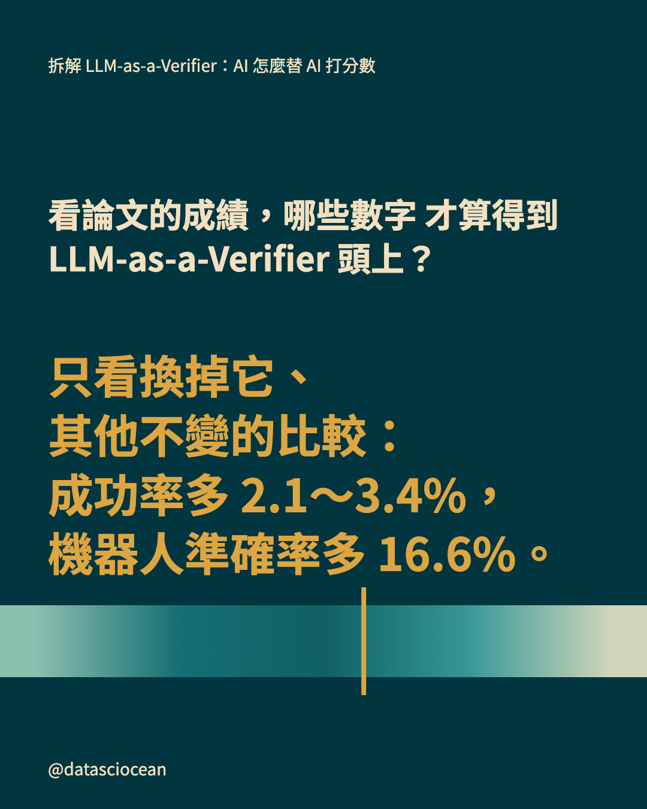

- **先問的問題**：看論文的成績，哪些數字
才算得到 LLM-as-a-Verifier 頭上？
- **一句話**：只看換掉它、
其他不變的比較：
成功率多 2.1～3.4%，
機器人準確率多 16.6%。
- **替代文字**：看論文的成績，哪些數字
才算得到 LLM-as-a-Verifier 頭上？　只看換掉它、
其他不變的比較：
成功率多 2.1～3.4%，
機器人準確率多 16.6%。

## 第 14 頁（系列地圖）

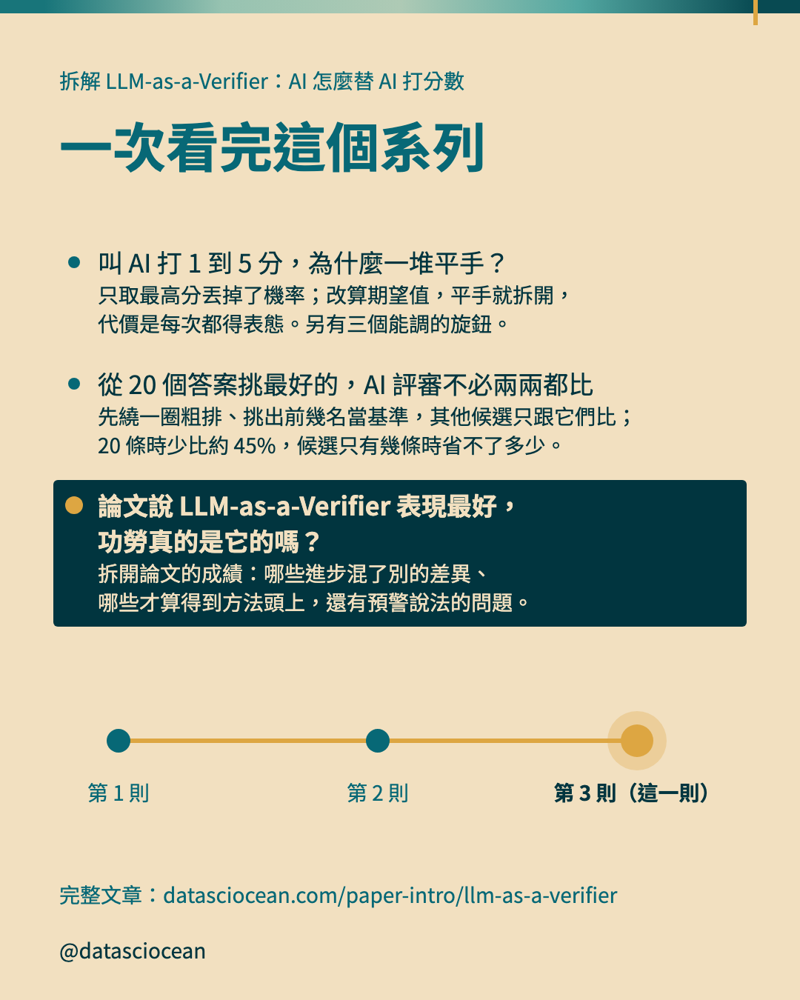

- **主標**：一次看完這個系列
- **導流行**：完整文章：datasciocean.com/paper-intro/llm-as-a-verifier
- **第 1 則**：叫 AI 打 1 到 5 分，為什麼一堆平手？　只取最高分丟掉了機率；改算期望值，平手就拆開，代價是每次都得表態。另有三個能調的旋鈕。
- **第 2 則**：從 20 個答案挑最好的，AI 評審不必兩兩都比　先繞一圈粗排、挑出前幾名當基準，其他候選只跟它們比；20 條時少比約 45%，候選只有幾條時省不了多少。
- **第 3 則**：論文說 LLM-as-a-Verifier 表現最好，功勞真的是它的嗎？　拆開論文的成績：哪些進步混了別的差異、哪些才算得到方法頭上，還有預警說法的問題。
- **替代文字**：一次看完這個系列。叫 AI 打 1 到 5 分，為什麼一堆平手？：只取最高分丟掉了機率；改算期望值，平手就拆開，代價是每次都得表態。另有三個能調的旋鈕。、從 20 個答案挑最好的，AI 評審不必兩兩都比：先繞一圈粗排、挑出前幾名當基準，其他候選只跟它們比；20 條時少比約 45%，候選只有幾條時省不了多少。、論文說 LLM-as-a-Verifier 表現最好，功勞真的是它的嗎？：拆開論文的成績：哪些進步混了別的差異、哪些才算得到方法頭上，還有預警說法的問題。

## Caption（整段貼到 IG）

```text
LLM-as-a-Verifier 的成績怎麼看：只換掉它、其他條件不變的比較才算數

・路線圖：這一則要回答三個問題
・① 第一名的成績：86.5% 贏過 84.7%，但兩邊不只差一樣東西
・公平的比法：同一批候選，只換挑法
・換 verifier 來挑，成功率多 2.1～3.4%
・② 機器人實驗：同一個模型只換打分法，準確率 70.8% → 87.4%
・不用訓練就贏過專門模型，但有兩個保留
・訓練好的模型改用期望值，和人類的誤差也變小
・③ 預警說法：論文說：分數能提早看出 AI 快要失敗
・500 次任務一算：成功和失敗只差 0.079

圖片來源：第 7 張（圖 8）、第 8 張（圖 9）改繪自原始論文的圖表

完整文章在 datasciocean.com，搜「LLM-as-a-Verifier」

#LLMVerifier #LLMasaJudge #LLM評測
```
