# Threads：論文說 LLM-as-a-Verifier 表現最好，功勞真的是它的嗎？

- 發文方式：**一則輪播貼文**（正文＋全部 14 張圖，順序與 IG 相同），再用一則回覆放連結與系列（連結只放那則回覆）
- 圖檔在 `../ig/`（與 IG 輪播共用同一套）

## 貼文正文（附下方全部圖片）

```text
論文說 LLM-as-a-Verifier 表現最好，功勞真的是它的嗎？

LLM-as-a-Verifier 讓 LLM 替另一個 LLM 的輸出打分數，再從同一題的好幾份候選裡挑最好的一份。論文說它在 Terminal-Bench V2 拿下第一（SOTA）：86.5%，贏過 GPT-5.5 的 84.7%。但兩邊的 harness（包在模型外面的程式）、抽樣、有沒有 verifier 三處不同，不能全算給它。

公平的比法是同一批候選、只換挑法：成功率多 2.1～3.4%（SWE-Bench 的候選來自三個不同模型，不能和另外兩個比）。

最乾淨的證據在機器人：同一個 Qwen 3.6 35B，只把「取機率最高的分數」換成「算期望值」，準確率 70.8% → 87.4%。但論文沒解釋專門訓練的模型為什麼在自己的領域輸掉；這個 Benchmark 也出自共同作者掛名的論文，被比的 RoboReward-8B 正是那篇的模型，論文沒揭露。

論文還說分數能提早預警失敗，但衡量分數往上爬程度的 VOC，成功 0.848、失敗 0.769，只差 0.079。

這是系列第 3 則。
```

## 附圖（依序）

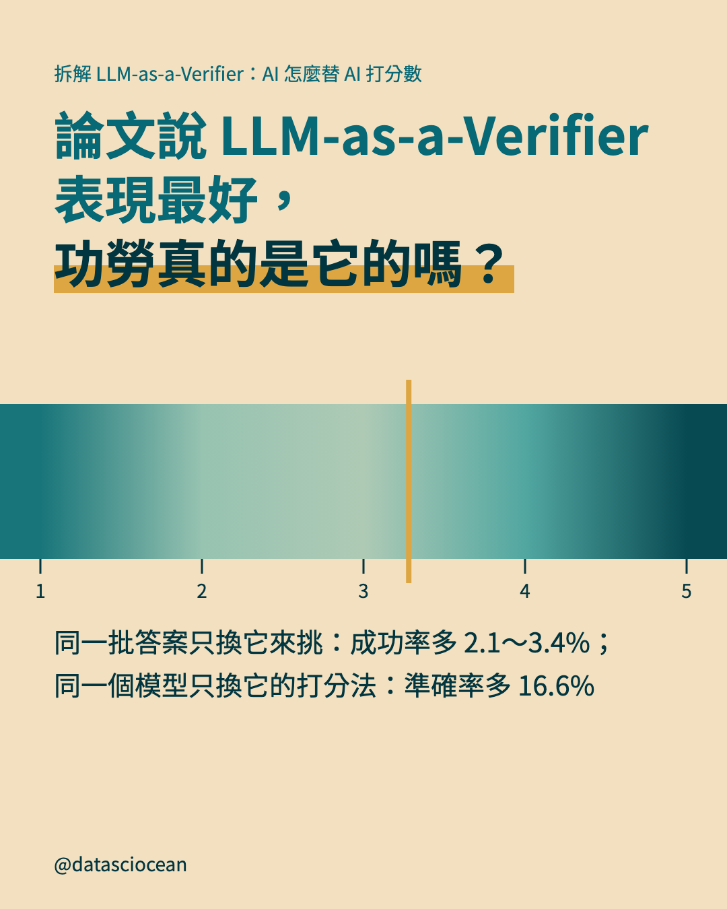
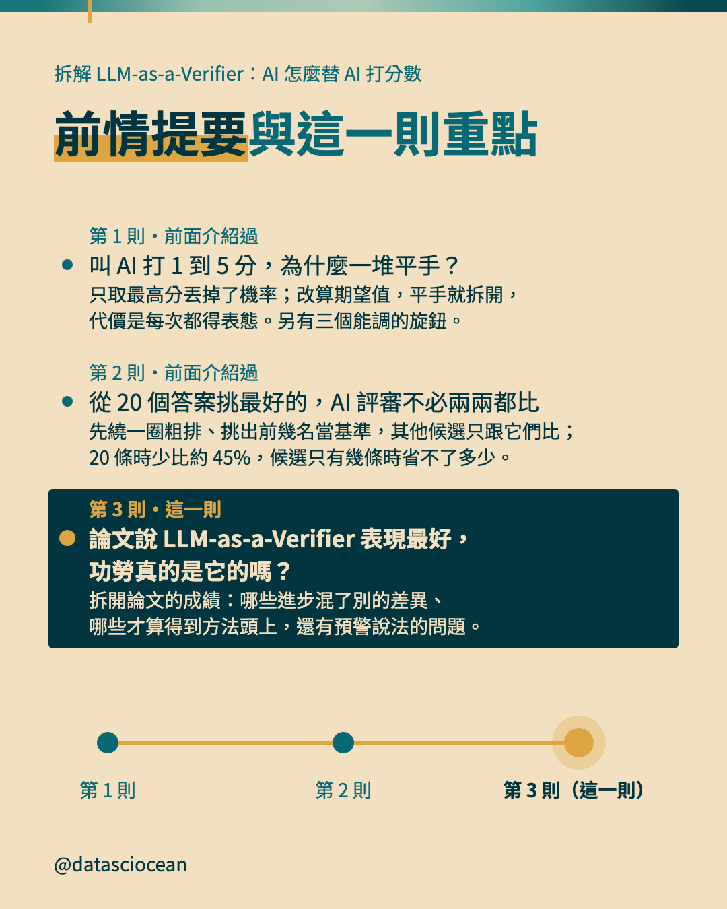
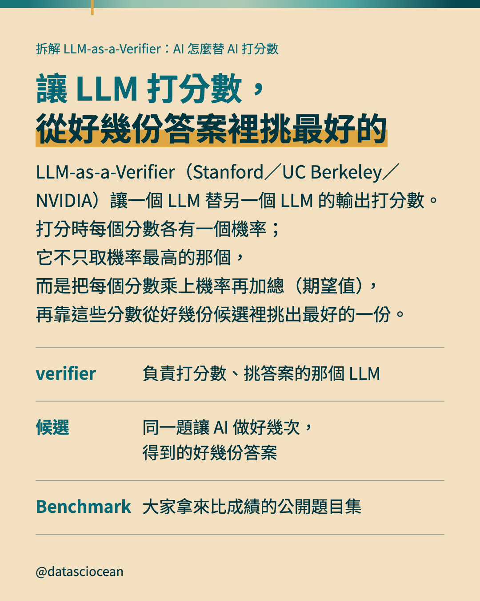
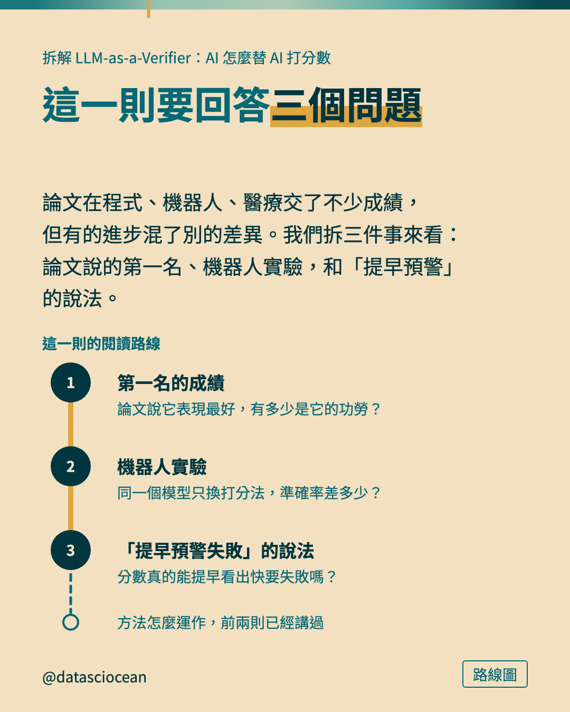
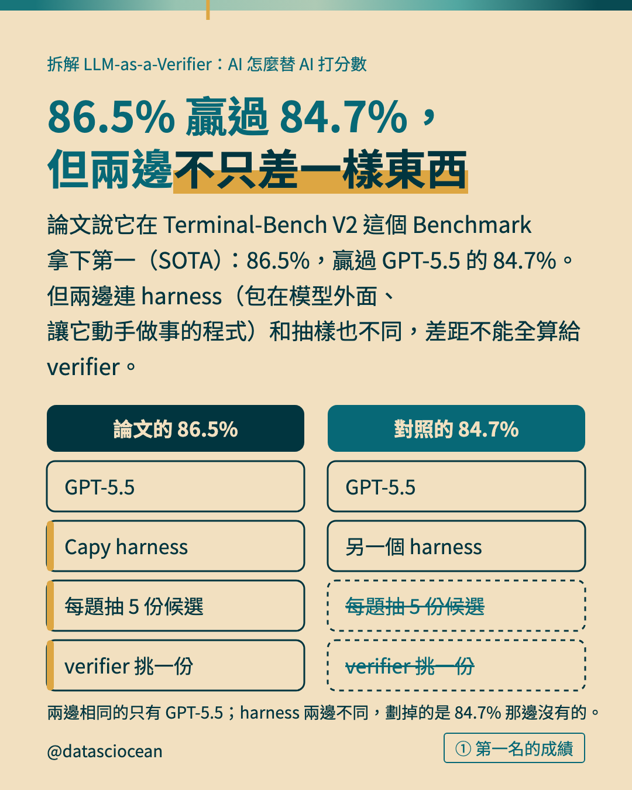
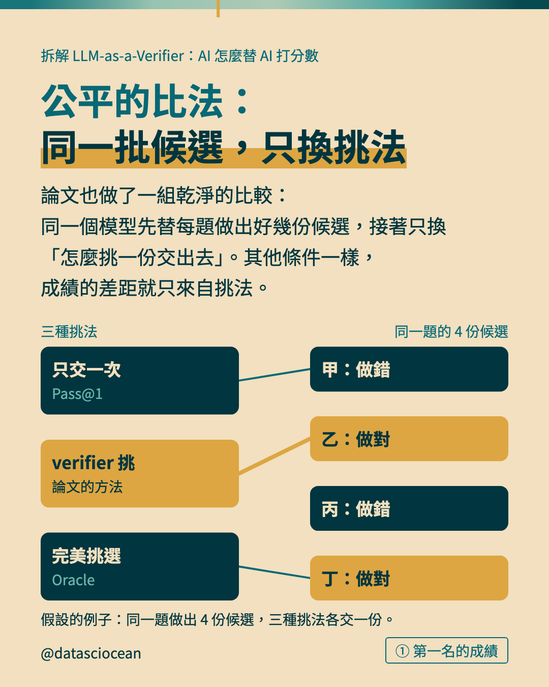
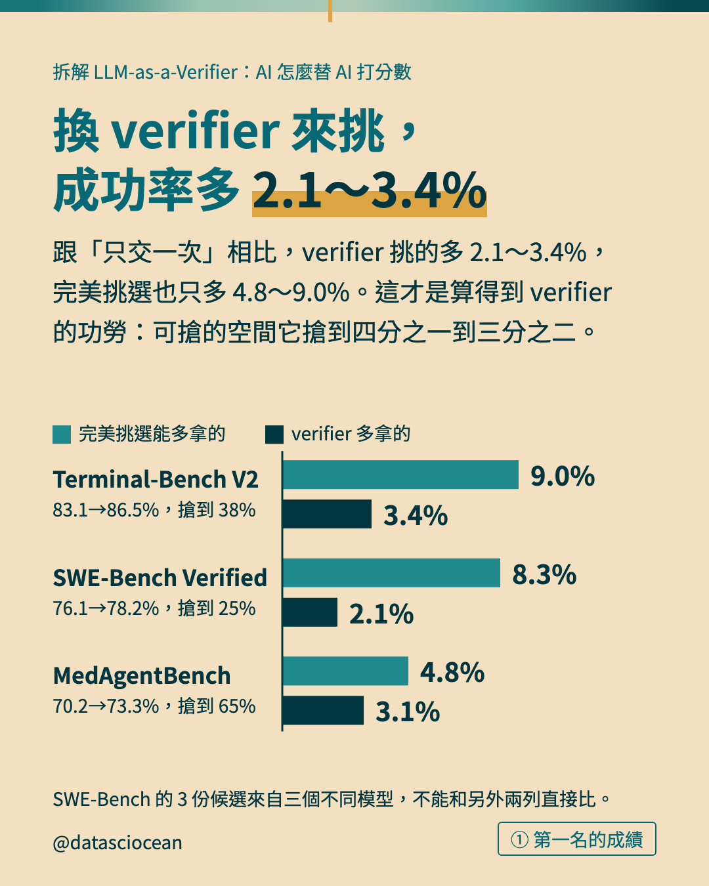
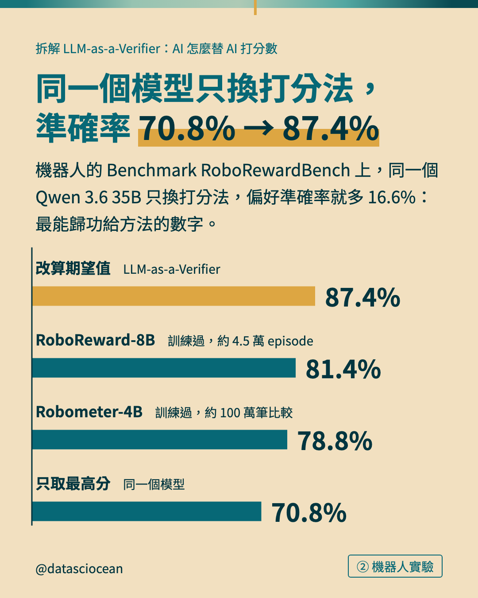
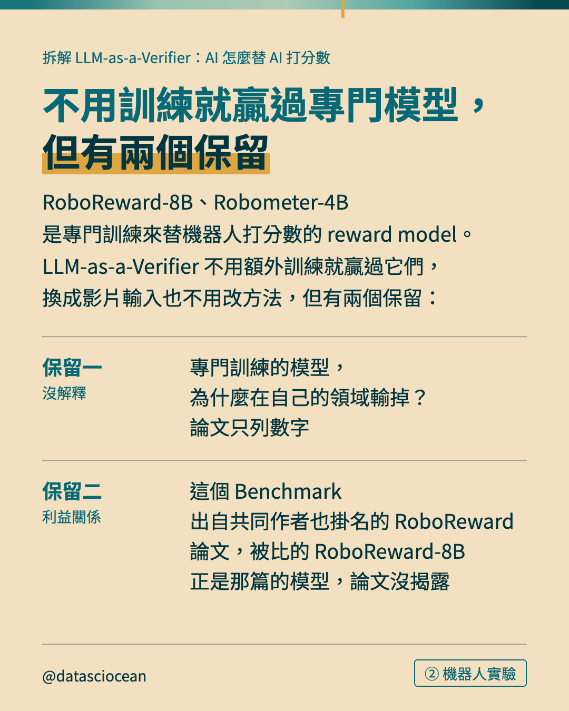
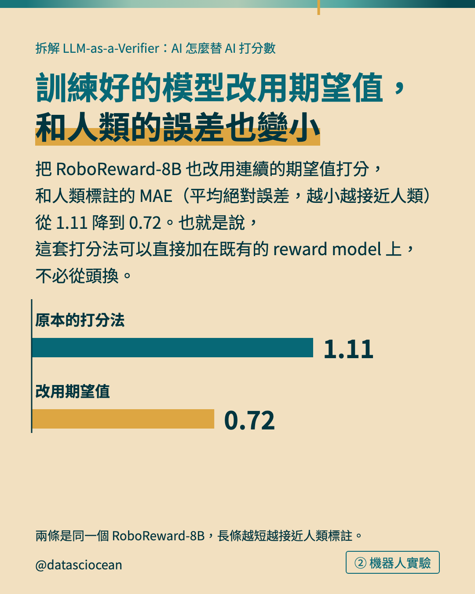

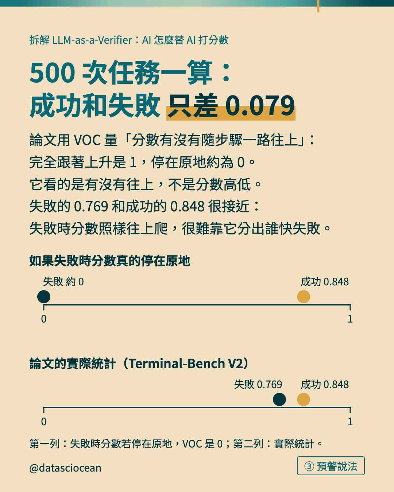
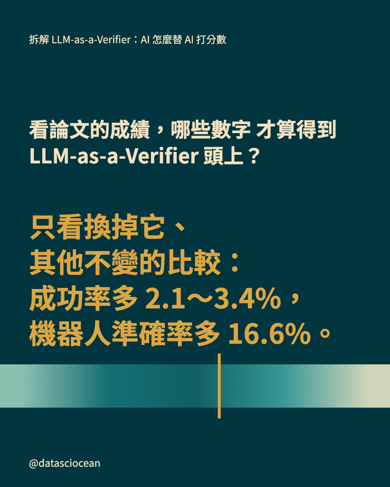
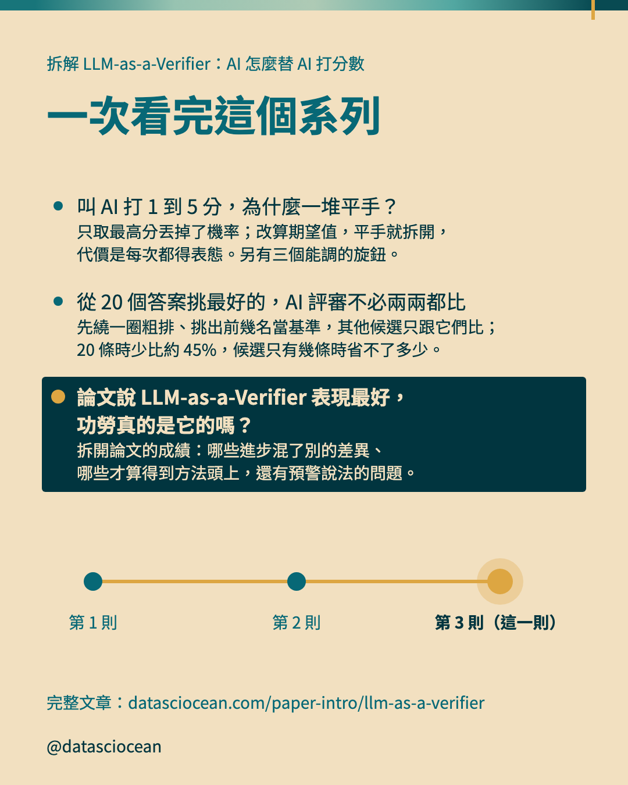

## 回覆：連結與系列

```text
看論文成績，只看「只換掉它、其他條件不變」的比較：挑答案成功率多 2.1～3.4%，機器人準確率多 16.6%。
文章：datasciocean.com/paper-intro/llm-as-a-verifier
同系列：叫 AI 打 1 到 5 分，為什麼一堆平手？（尚未發布）
同系列：從 20 個答案挑最好的，AI 評審不必兩兩都比（尚未發布）
```
