# IG 輪播：同一份文件，怎麼長出四種簡報？

- 系列：Persona-Aware-D2S: 同一份文件，怎麼長出不同簡報　｜　hook 樣態：讀者疑問　｜　共 16 張，**依頁碼順序上傳**
- 每頁下方的「替代文字」貼到 IG 的替代文字欄；最後的 Caption 整段貼上

## 第 1 頁（封面）

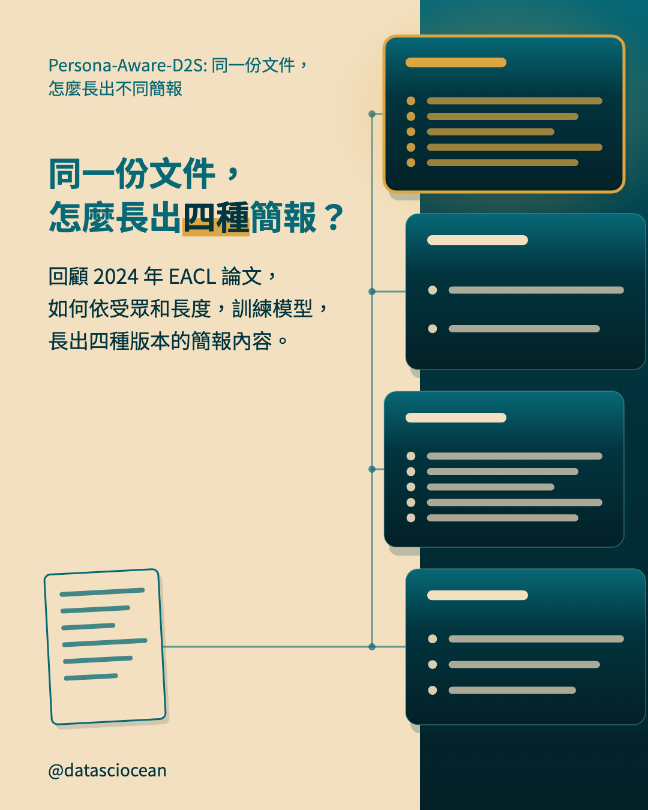

- **主標**：同一份文件，怎麼長出四種簡報？
- **副標**：回顧 2024 年 EACL 論文，如何依受眾和長度，訓練模型，長出四種版本的簡報內容。
- **替代文字**：同一份文件，怎麼長出四種簡報？。回顧 2024 年 EACL 論文，如何依受眾和長度，訓練模型，長出四種版本的簡報內容。

## 第 2 頁（脈絡）

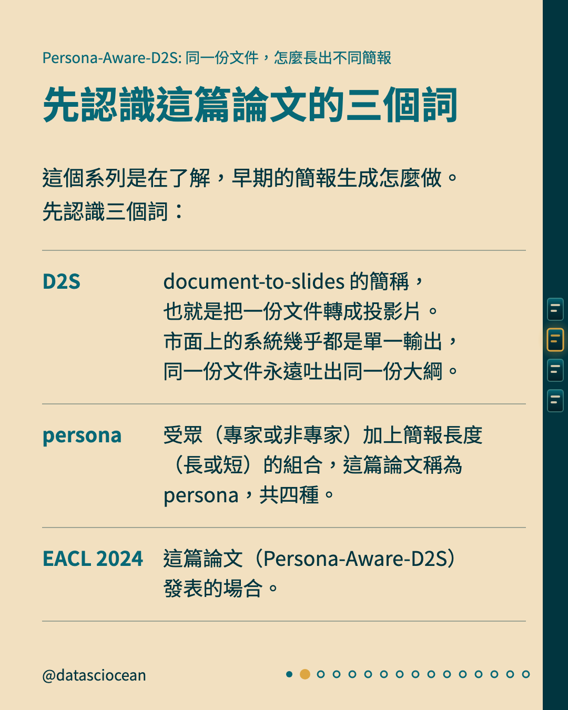

- **主標**：先認識這篇論文的三個詞
- **補充**：這個系列是在了解，早期的簡報生成怎麼做。先認識三個詞：
- **表列**：D2S｜document-to-slides 的簡稱，也就是把一份文件轉成投影片。市面上的系統幾乎都是單一輸出，同一份文件永遠吐出同一份大綱。
- **表列**：persona｜受眾（專家或非專家）加上簡報長度（長或短）的組合，這篇論文稱為 persona，共四種。
- **表列**：EACL 2024｜這篇論文（Persona-Aware-D2S）發表的場合。
- **替代文字**：先認識這篇論文的三個詞。這個系列是在了解，早期的簡報生成怎麼做。先認識三個詞：

## 第 3 頁（示意圖）

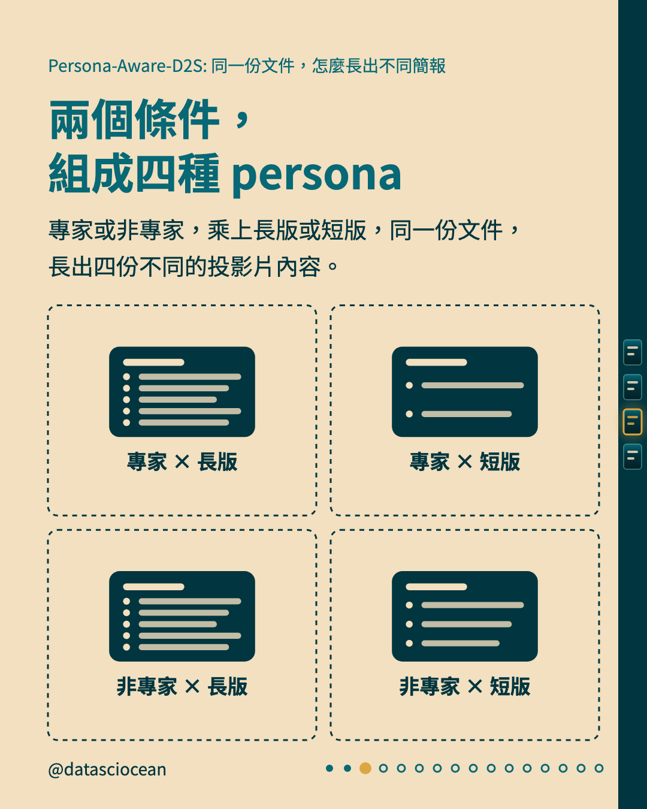

- **主標**：兩個條件，組成四種 persona
- **補充**：專家或非專家，乘上長版或短版，同一份文件，長出四份不同的投影片內容。
- **示意圖（quad）上的文字與數字**：專家 × 長版｜專家 × 短版｜非專家 × 長版｜非專家 × 短版
- **替代文字**：兩個條件，組成四種 persona。專家或非專家，乘上長版或短版，同一份文件，長出四份不同的投影片內容。。圖上寫：專家 × 長版、專家 × 短版、非專家 × 長版、非專家 × 短版

## 第 4 頁（文字）

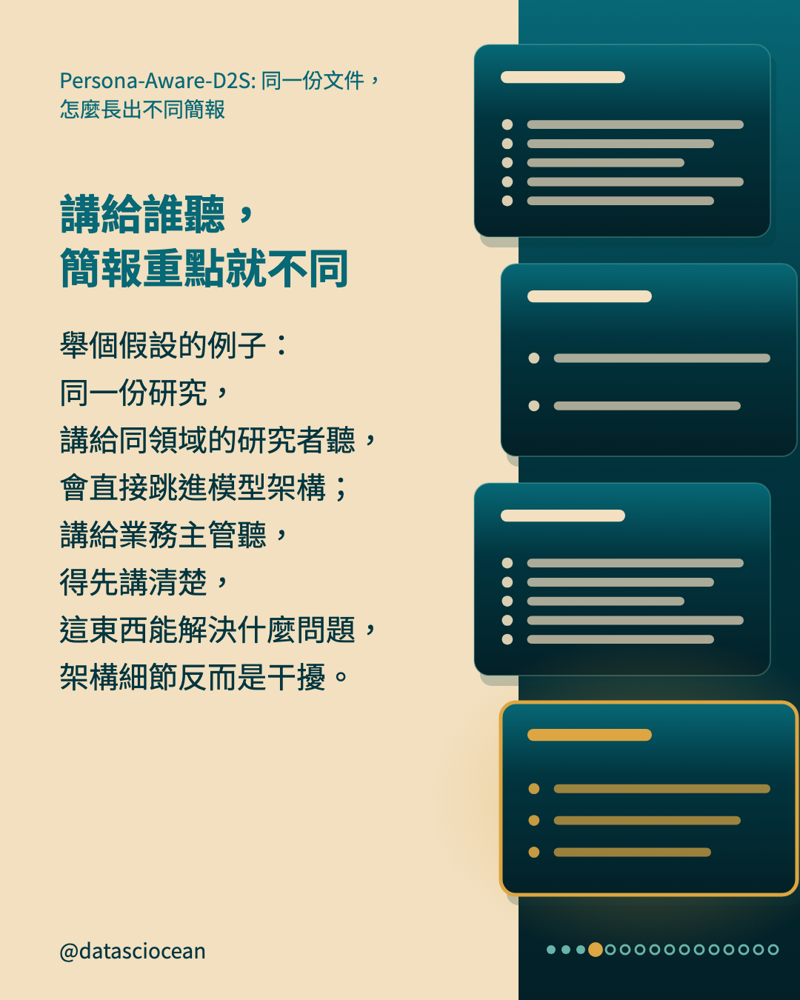

- **主標**：講給誰聽，簡報重點就不同
- **補充**：舉個假設的例子：同一份研究，講給同領域的研究者聽，會直接跳進模型架構；講給業務主管聽，得先講清楚，這東西能解決什麼問題，架構細節反而是干擾。
- **替代文字**：講給誰聽，簡報重點就不同。舉個假設的例子：同一份研究，講給同領域的研究者聽，會直接跳進模型架構；講給業務主管聽，得先講清楚，這東西能解決什麼問題，架構細節反而是干擾。

## 第 5 頁（示意圖）

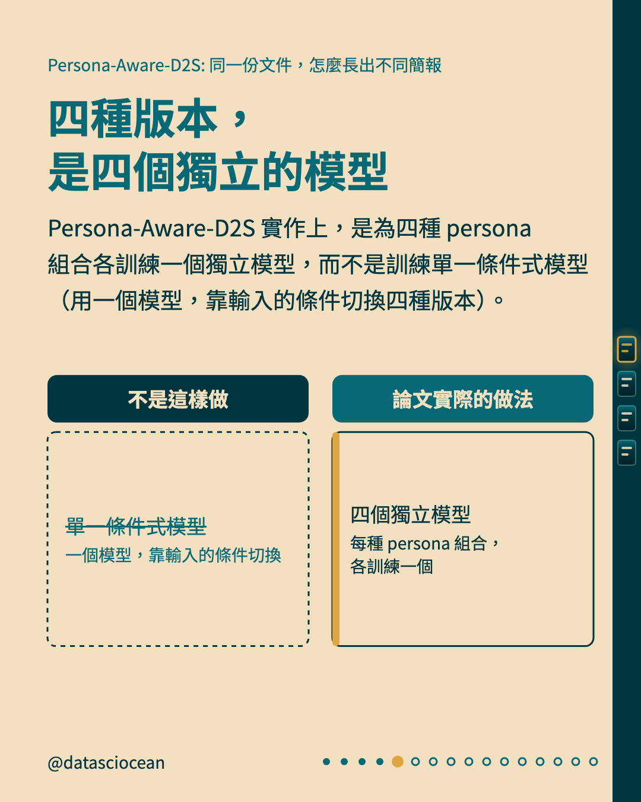

- **主標**：四種版本，是四個獨立的模型
- **補充**：Persona-Aware-D2S 實作上，是為四種 persona 組合各訓練一個獨立模型，而不是訓練單一條件式模型（用一個模型，靠輸入的條件切換四種版本）。
- **示意圖（compare）上的文字與數字**：不是這樣做｜單一條件式模型｜一個模型，靠輸入的條件切換｜論文實際的做法｜四個獨立模型｜每種 persona 組合，各訓練一個
- **替代文字**：四種版本，是四個獨立的模型。Persona-Aware-D2S 實作上，是為四種 persona 組合各訓練一個獨立模型，而不是訓練單一條件式模型（用一個模型，靠輸入的條件切換四種版本）。。圖上寫：不是這樣做、單一條件式模型、一個模型，靠輸入的條件切換、論文實際的做法、四個獨立模型、每種 persona 組合，各訓練一個

## 第 6 頁（示意圖）

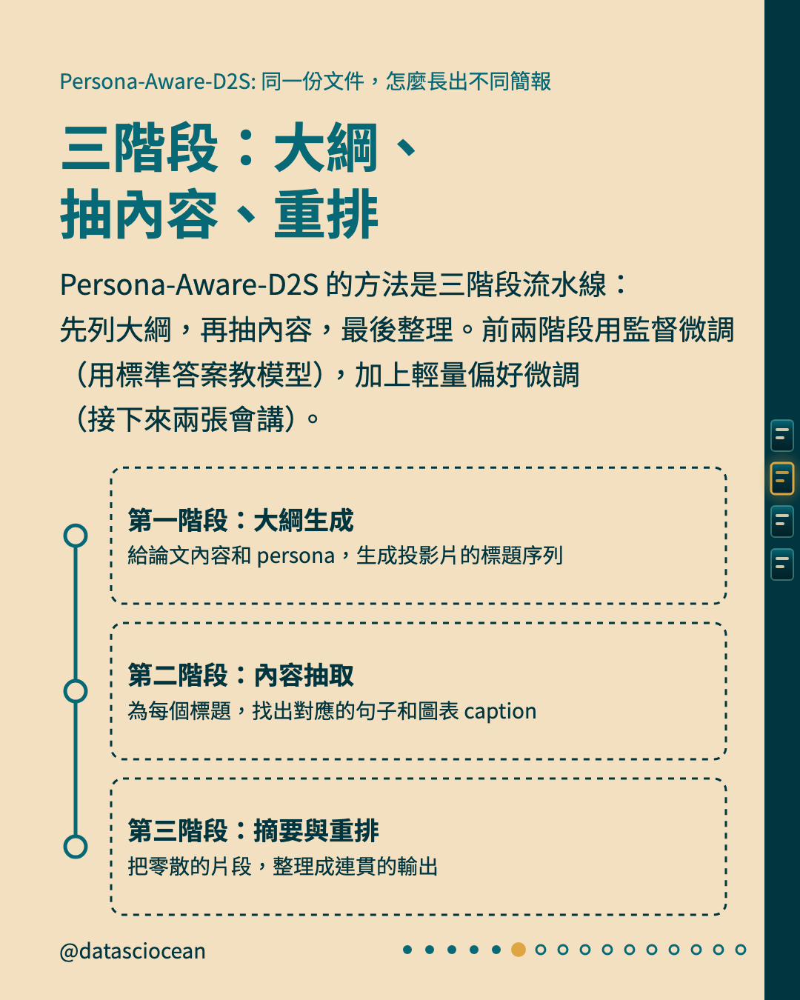

- **主標**：三階段：大綱、抽內容、重排
- **補充**：Persona-Aware-D2S 的方法是三階段流水線：先列大綱，再抽內容，最後整理。前兩階段用監督微調（用標準答案教模型），加上輕量偏好微調（接下來兩張會講）。
- **示意圖（stops）上的文字與數字**：第一階段：大綱生成｜給論文內容和 persona，生成投影片的標題序列｜第二階段：內容抽取｜為每個標題，找出對應的句子和圖表 caption｜第三階段：摘要與重排｜把零散的片段，整理成連貫的輸出
- **替代文字**：三階段：大綱、抽內容、重排。Persona-Aware-D2S 的方法是三階段流水線：先列大綱，再抽內容，最後整理。前兩階段用監督微調（用標準答案教模型），加上輕量偏好微調（接下來兩張會講）。。圖上寫：第一階段：大綱生成、給論文內容和 persona，生成投影片的標題序列、第二階段：內容抽取、為每個標題，找出對應的句子和圖表 caption、第三階段：摘要與重排、把零散的片段，整理成連貫的輸出

## 第 7 頁（示意圖）

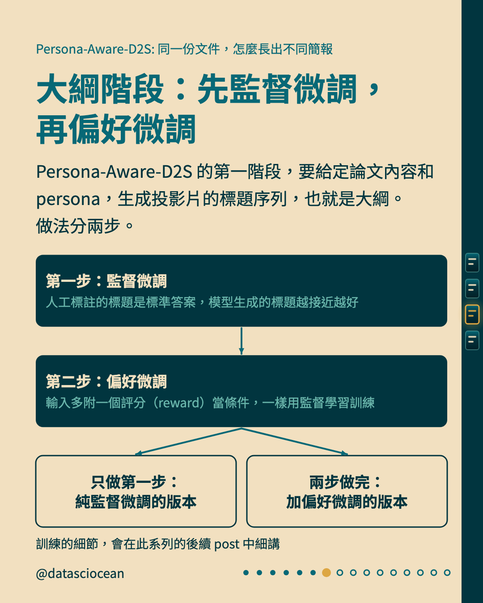

- **主標**：大綱階段：先監督微調，再偏好微調
- **補充**：Persona-Aware-D2S 的第一階段，要給定論文內容和 persona，生成投影片的標題序列，也就是大綱。做法分兩步。
- **示意圖（flow）上的文字與數字**：第一步：監督微調｜人工標註的標題是標準答案，模型生成的標題越接近越好｜第二步：偏好微調｜輸入多附一個評分（reward）當條件，一樣用監督學習訓練｜只做第一步：純監督微調的版本｜兩步做完：加偏好微調的版本
- **圖註**：訓練的細節，會在此系列的後續 post 中細講
- **替代文字**：大綱階段：先監督微調，再偏好微調。Persona-Aware-D2S 的第一階段，要給定論文內容和 persona，生成投影片的標題序列，也就是大綱。做法分兩步。。圖上寫：第一步：監督微調、人工標註的標題是標準答案，模型生成的標題越接近越好、第二步：偏好微調、輸入多附一個評分（reward）當條件，一樣用監督學習訓練、只做第一步：純監督微調的版本、兩步做完：加偏好微調的版本

## 第 8 頁（示意圖）

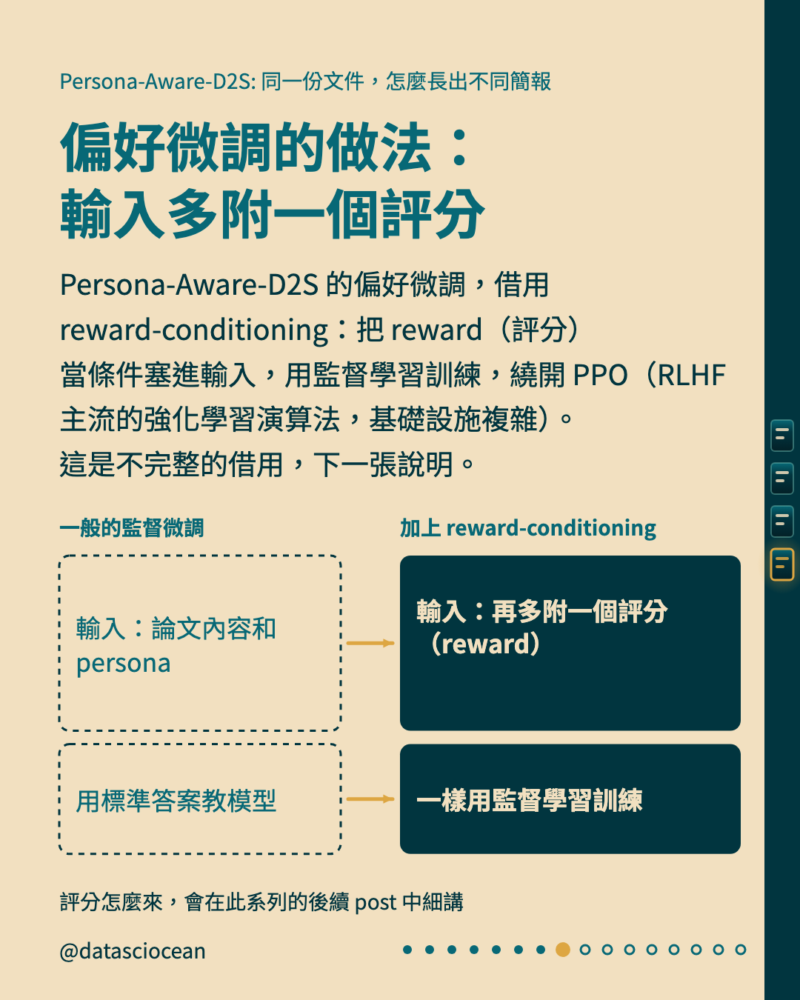

- **主標**：偏好微調的做法：輸入多附一個評分
- **補充**：Persona-Aware-D2S 的偏好微調，借用 reward-conditioning：把 reward（評分）當條件塞進輸入，用監督學習訓練，繞開 PPO（RLHF 主流的強化學習演算法，基礎設施複雜）。這是不完整的借用，下一張說明。
- **示意圖（pairs）上的文字與數字**：一般的監督微調｜加上 reward-conditioning｜輸入：論文內容和 persona｜輸入：再多附一個評分（reward）｜用標準答案教模型｜一樣用監督學習訓練
- **圖註**：評分怎麼來，會在此系列的後續 post 中細講
- **替代文字**：偏好微調的做法：輸入多附一個評分。Persona-Aware-D2S 的偏好微調，借用 reward-conditioning：把 reward（評分）當條件塞進輸入，用監督學習訓練，繞開 PPO（RLHF 主流的強化學習演算法，基礎設施複雜）。這是不完整的借用，下一張說明。。圖上寫：一般的監督微調、加上 reward-conditioning、輸入：論文內容和 persona、輸入：再多附一個評分（reward）、用標準答案教模型、一樣用監督學習訓練

## 第 9 頁（示意圖）

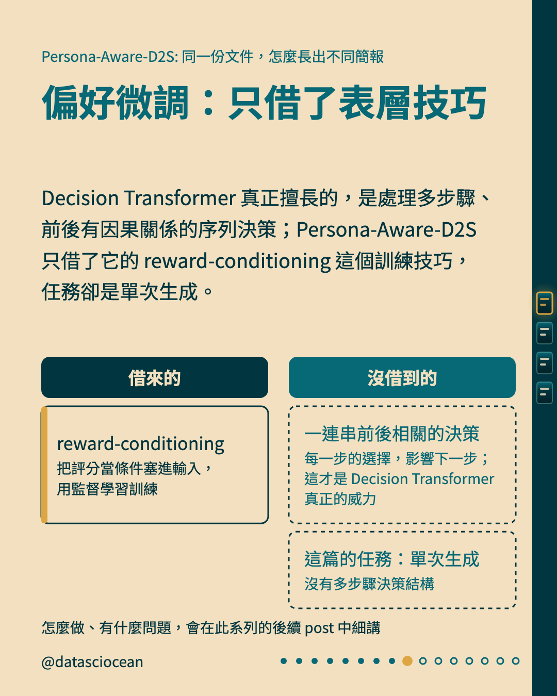

- **主標**：偏好微調：只借了表層技巧
- **補充**：Decision Transformer 真正擅長的，是處理多步驟、前後有因果關係的序列決策；Persona-Aware-D2S 只借了它的 reward-conditioning 這個訓練技巧，任務卻是單次生成。
- **示意圖（compare）上的文字與數字**：借來的｜reward-conditioning｜把評分當條件塞進輸入，用監督學習訓練｜沒借到的｜一連串前後相關的決策｜每一步的選擇，影響下一步；這才是 Decision Transformer 真正的威力｜這篇的任務：單次生成｜沒有多步驟決策結構
- **圖註**：怎麼做、有什麼問題，會在此系列的後續 post 中細講
- **替代文字**：偏好微調：只借了表層技巧。Decision Transformer 真正擅長的，是處理多步驟、前後有因果關係的序列決策；Persona-Aware-D2S 只借了它的 reward-conditioning 這個訓練技巧，任務卻是單次生成。。圖上寫：借來的、reward-conditioning、把評分當條件塞進輸入，用監督學習訓練、沒借到的、一連串前後相關的決策、每一步的選擇，影響下一步；這才是 Decision Transformer 真正的威力、這篇的任務：單次生成、沒有多步驟決策結構

## 第 10 頁（示意圖）

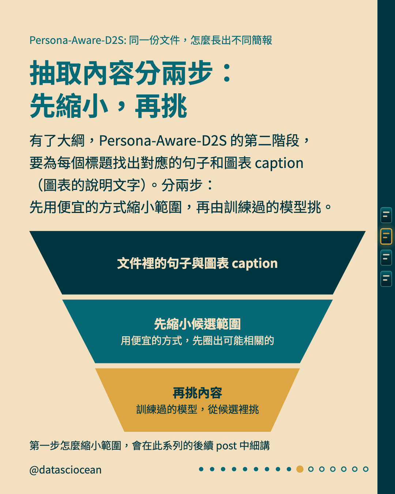

- **主標**：抽取內容分兩步：先縮小，再挑
- **補充**：有了大綱，Persona-Aware-D2S 的第二階段，要為每個標題找出對應的句子和圖表 caption（圖表的說明文字）。分兩步：先用便宜的方式縮小範圍，再由訓練過的模型挑。
- **示意圖（funnel）上的文字與數字**：文件裡的句子與圖表 caption｜先縮小候選範圍｜用便宜的方式，先圈出可能相關的｜再挑內容｜訓練過的模型，從候選裡挑
- **圖註**：第一步怎麼縮小範圍，會在此系列的後續 post 中細講
- **替代文字**：抽取內容分兩步：先縮小，再挑。有了大綱，Persona-Aware-D2S 的第二階段，要為每個標題找出對應的句子和圖表 caption（圖表的說明文字）。分兩步：先用便宜的方式縮小範圍，再由訓練過的模型挑。。圖上寫：文件裡的句子與圖表 caption、先縮小候選範圍、用便宜的方式，先圈出可能相關的、再挑內容、訓練過的模型，從候選裡挑

## 第 11 頁（示意圖）

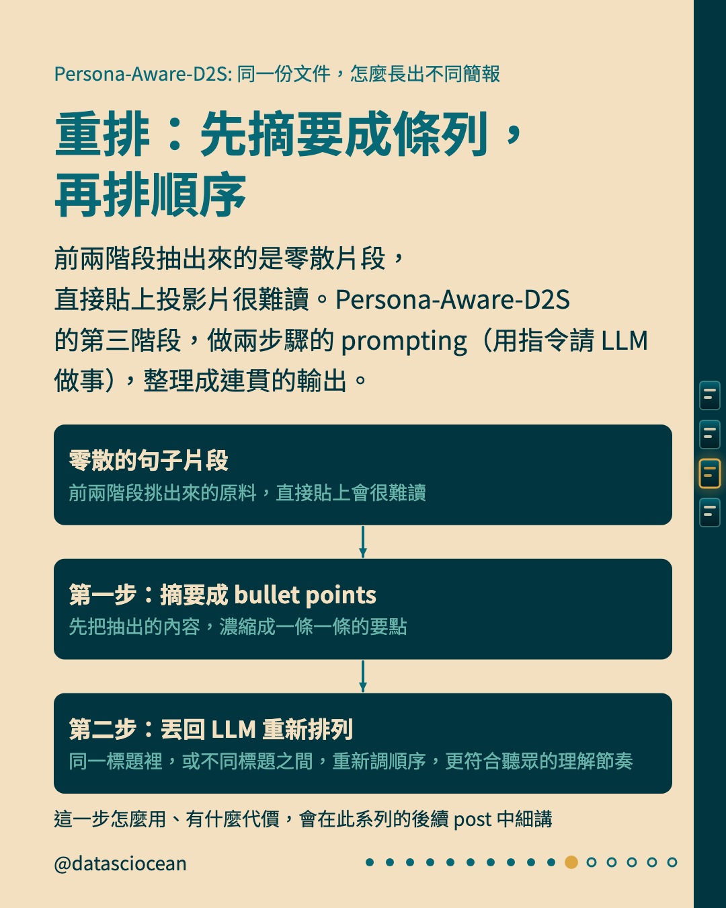

- **主標**：重排：先摘要成條列，再排順序
- **補充**：前兩階段抽出來的是零散片段，直接貼上投影片很難讀。Persona-Aware-D2S 的第三階段，做兩步驟的 prompting（用指令請 LLM 做事），整理成連貫的輸出。
- **示意圖（flow）上的文字與數字**：零散的句子片段｜前兩階段挑出來的原料，直接貼上會很難讀｜第一步：摘要成 bullet points｜先把抽出的內容，濃縮成一條一條的要點｜第二步：丟回 LLM 重新排列｜同一標題裡，或不同標題之間，重新調順序，更符合聽眾的理解節奏
- **圖註**：這一步怎麼用、有什麼代價，會在此系列的後續 post 中細講
- **替代文字**：重排：先摘要成條列，再排順序。前兩階段抽出來的是零散片段，直接貼上投影片很難讀。Persona-Aware-D2S 的第三階段，做兩步驟的 prompting（用指令請 LLM 做事），整理成連貫的輸出。。圖上寫：零散的句子片段、前兩階段挑出來的原料，直接貼上會很難讀、第一步：摘要成 bullet points、先把抽出的內容，濃縮成一條一條的要點、第二步：丟回 LLM 重新排列、同一標題裡，或不同標題之間，重新調順序，更符合聽眾的理解節奏

## 第 12 頁（對照表）

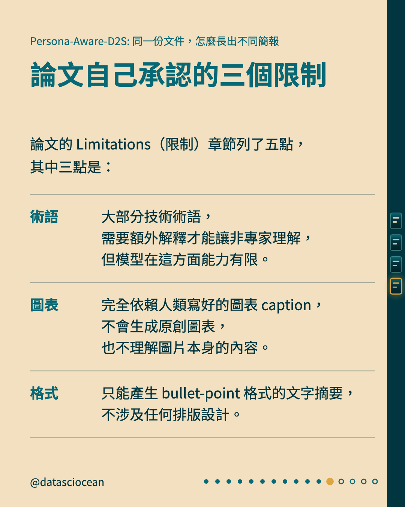

- **主標**：論文自己承認的三個限制
- **補充**：論文的 Limitations（限制）章節列了五點，其中三點是：
- **表列**：術語｜大部分技術術語，需要額外解釋才能讓非專家理解，但模型在這方面能力有限。
- **表列**：圖表｜完全依賴人類寫好的圖表 caption，不會生成原創圖表，也不理解圖片本身的內容。
- **表列**：格式｜只能產生 bullet-point 格式的文字摘要，不涉及任何排版設計。
- **替代文字**：論文自己承認的三個限制。論文的 Limitations（限制）章節列了五點，其中三點是：

## 第 13 頁（示意圖）

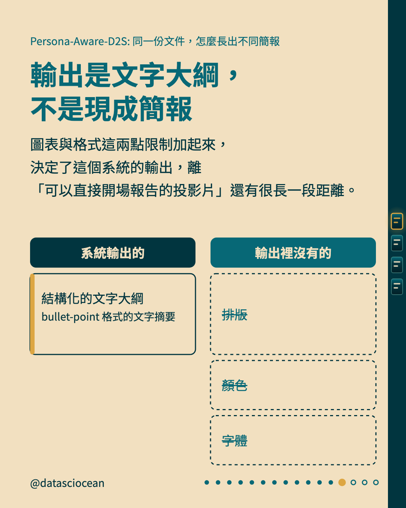

- **主標**：輸出是文字大綱，不是現成簡報
- **補充**：圖表與格式這兩點限制加起來，決定了這個系統的輸出，離「可以直接開場報告的投影片」還有很長一段距離。
- **示意圖（compare）上的文字與數字**：系統輸出的｜結構化的文字大綱｜bullet-point 格式的文字摘要｜輸出裡沒有的｜排版｜顏色｜字體
- **替代文字**：輸出是文字大綱，不是現成簡報。圖表與格式這兩點限制加起來，決定了這個系統的輸出，離「可以直接開場報告的投影片」還有很長一段距離。。圖上寫：系統輸出的、結構化的文字大綱、bullet-point 格式的文字摘要、輸出裡沒有的、排版、顏色、字體

## 第 14 頁（對照表）

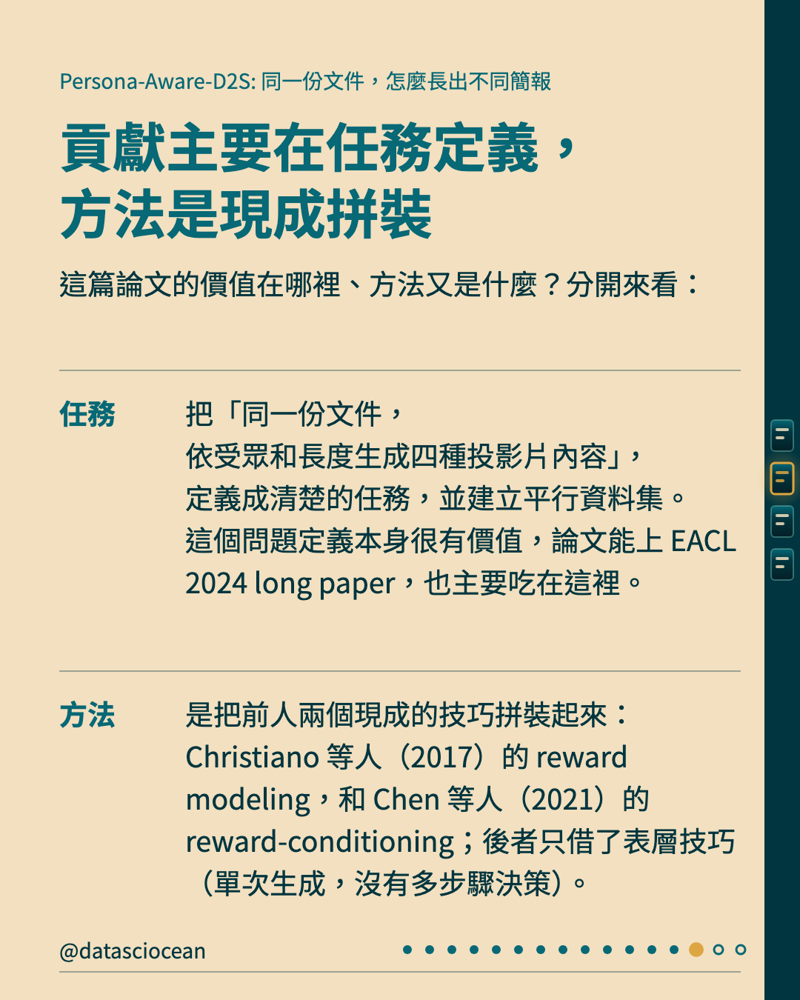

- **主標**：貢獻主要在任務定義，方法是現成拼裝
- **補充**：這篇論文的價值在哪裡、方法又是什麼？分開來看：
- **表列**：任務｜把「同一份文件，依受眾和長度生成四種投影片內容」，定義成清楚的任務，並建立平行資料集。這個問題定義本身很有價值，論文能上 EACL 2024 long paper，也主要吃在這裡。
- **表列**：方法｜是把前人兩個現成的技巧拼裝起來：Christiano 等人（2017）的 reward modeling，和 Chen 等人（2021）的 reward-conditioning；後者只借了表層技巧（單次生成，沒有多步驟決策）。
- **替代文字**：貢獻主要在任務定義，方法是現成拼裝。這篇論文的價值在哪裡、方法又是什麼？分開來看：

## 第 15 頁（帶走）


- **先問的問題**：這篇論文，值得參考什麼？
- **一句話**：更適合參考，
它的問題定義，
而不是解決方案
- **替代文字**：這篇論文，值得參考什麼？　更適合參考，
它的問題定義，
而不是解決方案

## 第 16 頁（系列地圖）

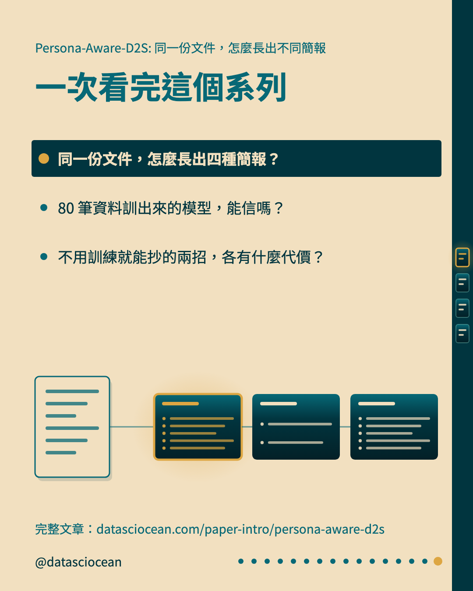

- **主標**：一次看完這個系列
- **導流行**：完整文章：datasciocean.com/paper-intro/persona-aware-d2s
- **替代文字**：一次看完這個系列。同一份文件，怎麼長出四種簡報？、80 筆資料訓出來的模型，能信嗎？、不用訓練就能抄的兩招，各有什麼代價？

## Caption（整段貼到 IG）

```text
簡報生成怎麼做？EACL 2024 論文依受眾與長度，讓同一份文件長出四種簡報。

・兩個條件，組成四種 persona
・講給誰聽，簡報重點就不同
・四種版本，是四個獨立的模型
・三階段：大綱、抽內容、重排
・大綱階段：先監督微調，再偏好微調
・偏好微調的做法：輸入多附一個評分
・偏好微調：只借了表層技巧
・抽取內容分兩步：先縮小，再挑
・重排：先摘要成條列，再排順序（前兩階段抽出來的是零散片段，直接貼上投影片很難讀）
・論文自己承認的三個限制
・輸出是文字大綱，不是現成簡報
・貢獻主要在任務定義，方法是現成拼裝（這篇論文的價值在哪裡、方法又是什麼？分開來看：）

完整文章請在 datasciocean.com 搜尋「拆解 Persona-Aware-D2S：同一份文件，怎麼依受眾和長度長出不同簡報」

#DSO_PersonaD2S #簡報生成 #EACL2024 #LLM
```
