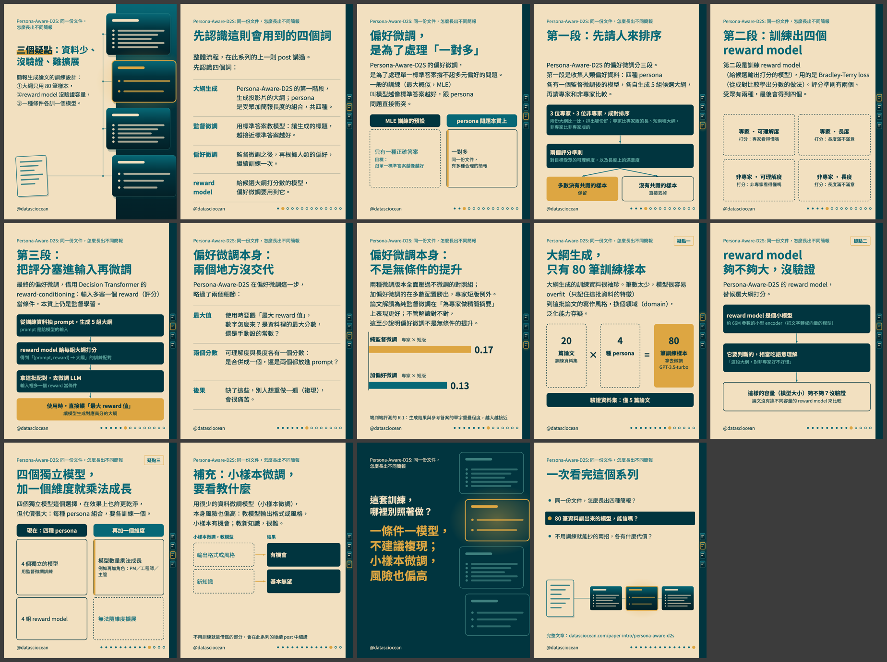

# 80 筆資料訓出來的模型，能信嗎？

| 項目 | 內容 |
|---|---|
| 系列 | Persona-Aware-D2S: 同一份文件，怎麼長出不同簡報 |
| 觀念 | `persona-d2s-training-design-flaws`（卡：`concept-wiki/wiki/concepts/persona-d2s-training-design-flaws.md`） |
| hook 樣態 | 並列重點 |
| IG 輪播 | 待發布（14 張） |
| Threads 串文 | 待發布（2 則） |

## 要看／要發的檔案

| 要做什麼 | 打開哪個檔案 |
|---|---|
| 看 IG 每一頁的圖與文字、複製 caption | [`ig/post.md`](ig/post.md)（圖在 `ig/01.png` …） |
| 看 Threads（正文與附圖、最後一則回覆；舊格式是逐張串文） | [`threads/post.md`](threads/post.md) |
| 一眼看全部縮圖 | 下方縮圖，或 [`_build/contact-sheet.png`](_build/contact-sheet.png) |

## 檢查結果（程式產生）

- 程式 B：14/14 張通過（模板版本 `4c31eba78489`）
- 程式 A、批次檢查、忠實者與讀者審查的結果不存在發布包裡（審查產出放暫存，不進 repo）；最後確認時由 Claude 在報告中說明

## 發布前

- [ ] 人最後確認圖、文字、caption
- [ ] IG（API）：`ig_publish.py prepare` → push `ig/jpg/` → `preflight` → `publish`（dry-run）→ 人說「發」後 `--confirm`（見 references/publish-flow.md）
- [ ] Threads（API）：`threads_publish.py publish`（dry-run）→ 人說「發」後 `--confirm`（見 references/publish-flow.md）

## 發布後

- 網址與時間由 `--confirm` 自動寫回 `state/`，不用另外記錄
- [ ] 系列其他則發布後，Threads 回補由 Claude 做：`threads_publish.py backfill`（見 `state/backfill.md`）；IG 回補、限時動態、精選集、置頂都不做

## `_build/`（機器用，不用看）

`spec.json`（內容規格，唯一的真相來源）、`checks-b.json`、`alt-text.json`、`html/`、`post-with-refs.md`、`post-reader.md`、`contact-sheet.png`。
改內容請改 `spec.json` 後重跑 `check_a.py` → `render.py` → `build_package.py`。
