# Threads：不用訓練就能抄的兩招，各有什麼代價？

- 發文方式：**一則輪播貼文**（正文＋全部 13 張圖，順序與 IG 相同），再用一則回覆放連結與系列（連結只放那則回覆）
- 圖檔在 `../ig/`（與 IG 輪播共用同一套）

## 貼文正文（附下方全部圖片）

```text
兩招不用訓練的技巧，代價各是什麼？

簡報生成論文 Persona-Aware-D2S 裡，有兩個能直接借來用的做法，不需要訓練，遷移成本接近零：

①章節過濾（兩段式檢索）：先用便宜的字面匹配，失敗才動用語意模型，省 API 費用。但篩選不可逆，被濾掉的句子，之後的階段再也看不到；門檻只在 5 篇論文上調過；也依賴標準化的章節結構。

②摘要重排：只多兩次 LLM 呼叫，成本最低。但消融實驗只有 10 篇，評分者也不是獨立第三方。

這是此系列的第 3 則。
```

## 附圖（依序）

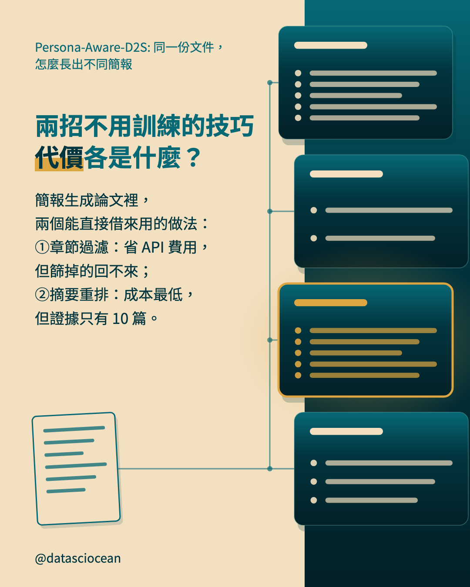
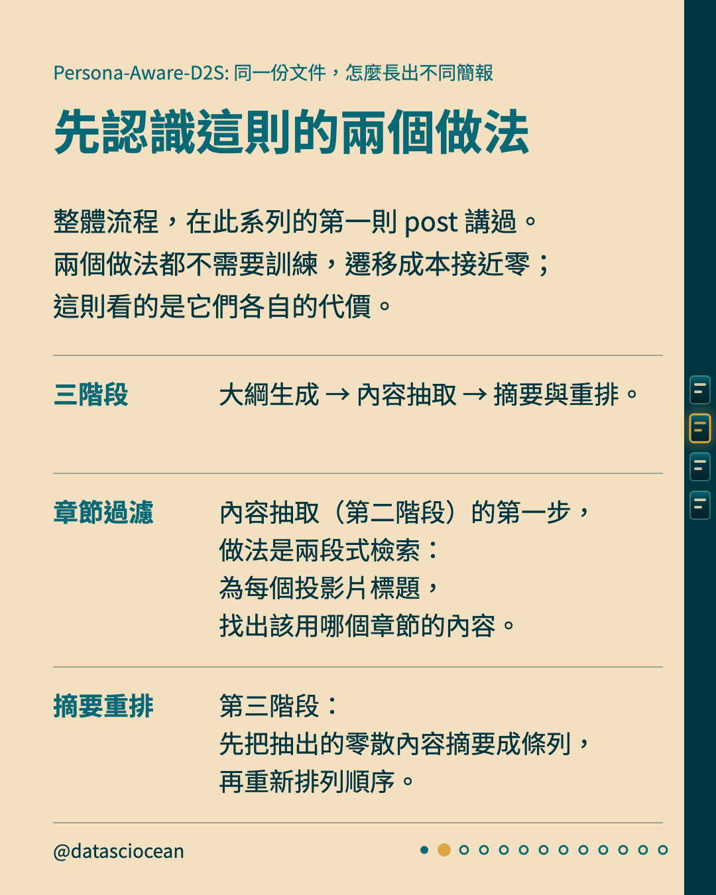
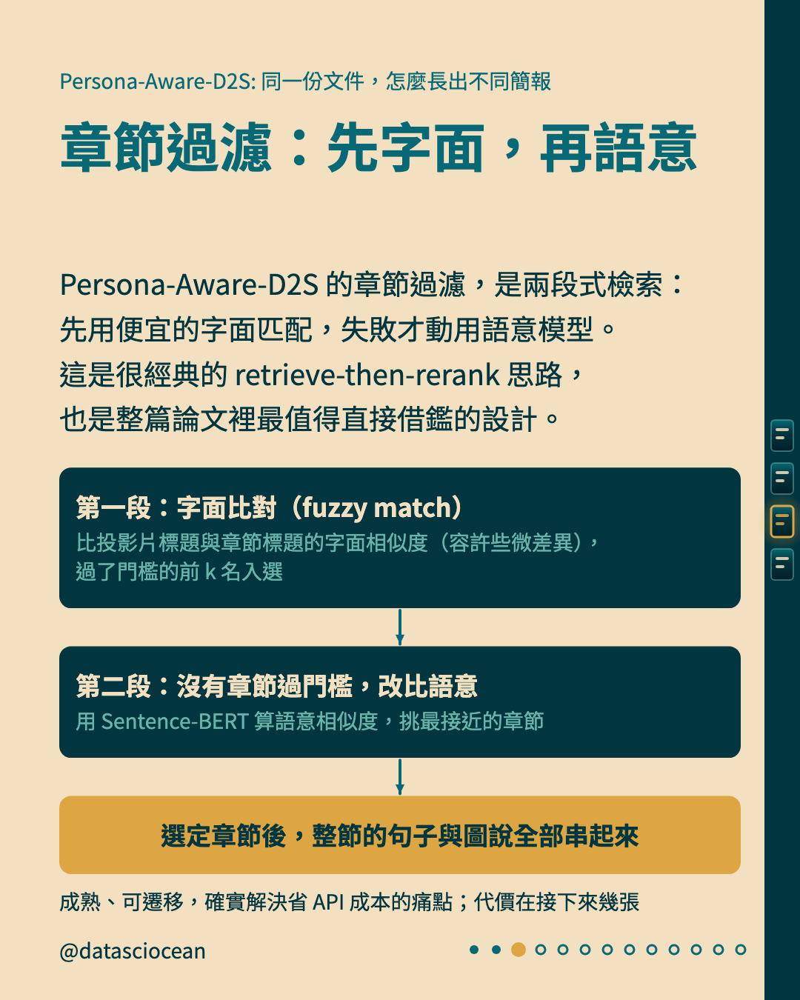
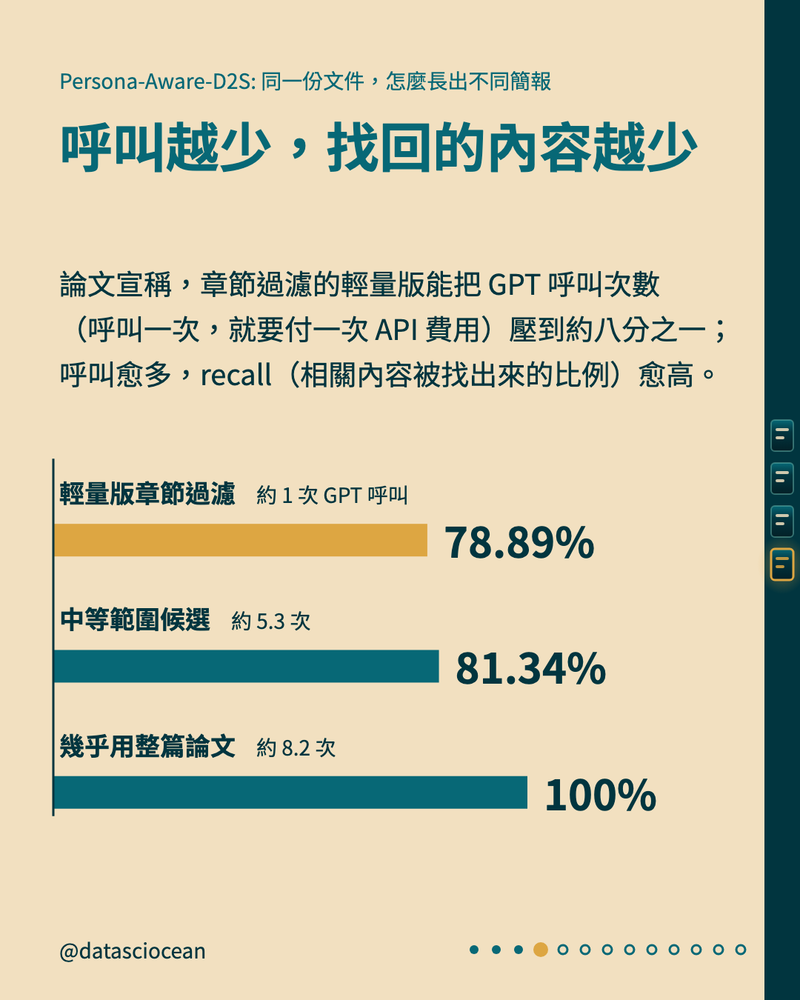
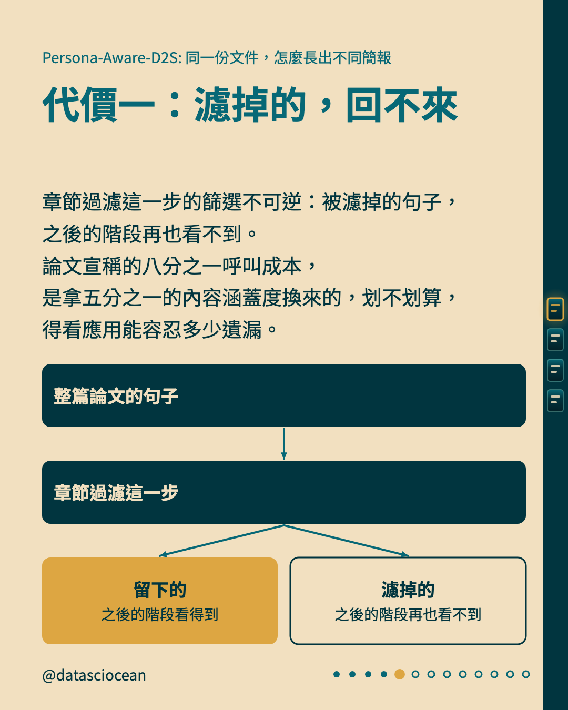
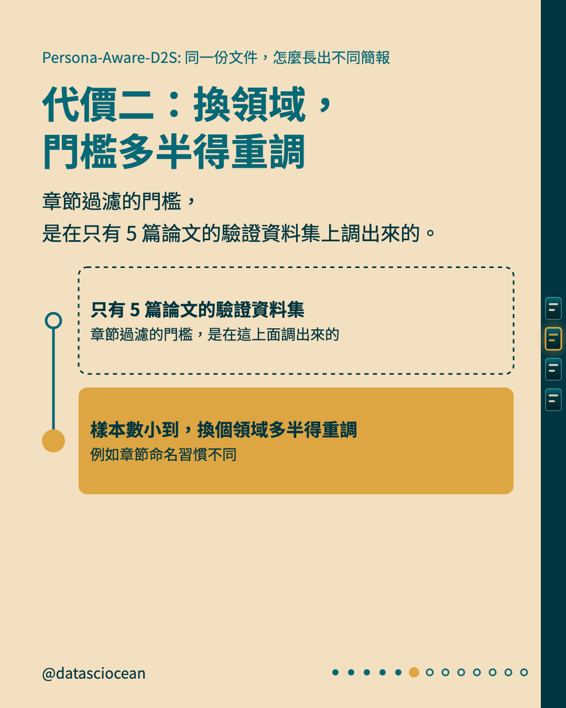
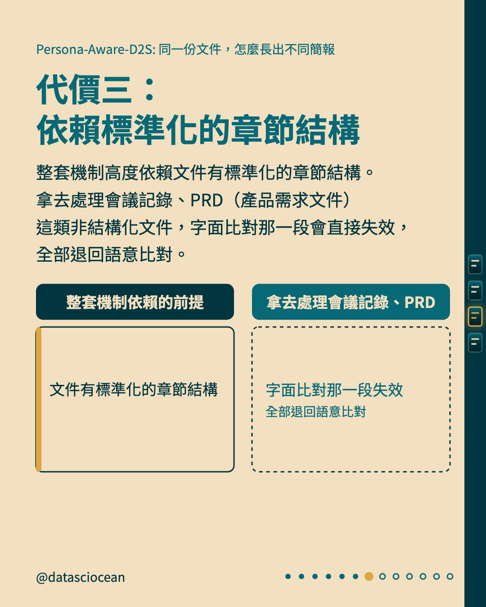
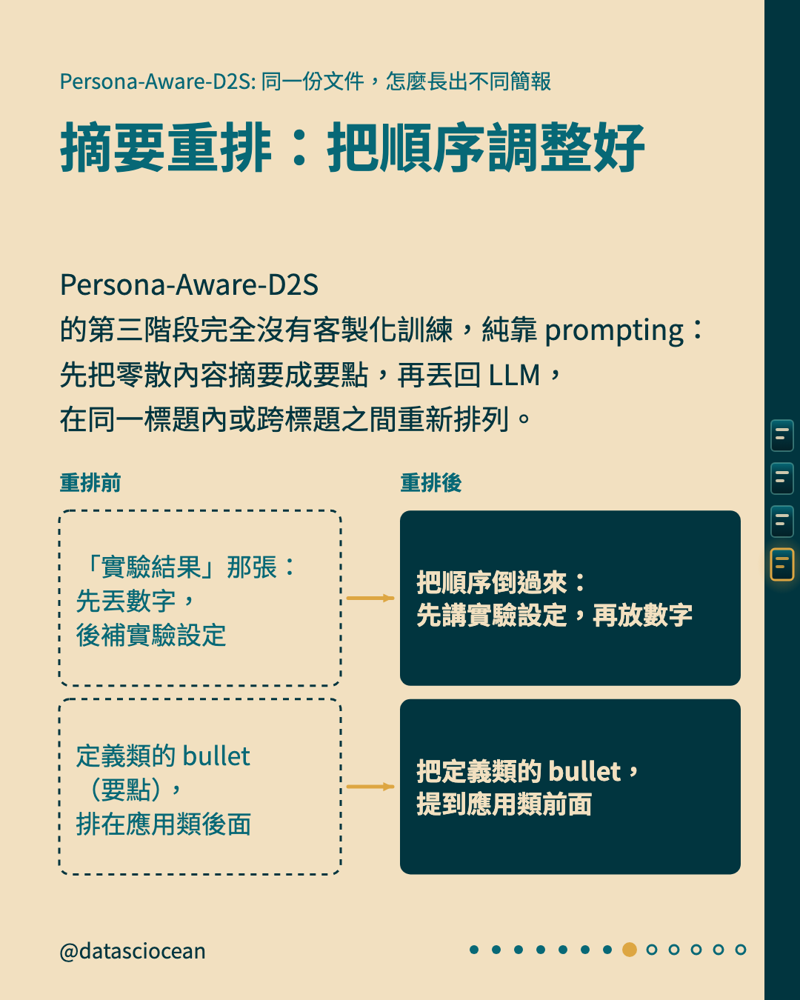
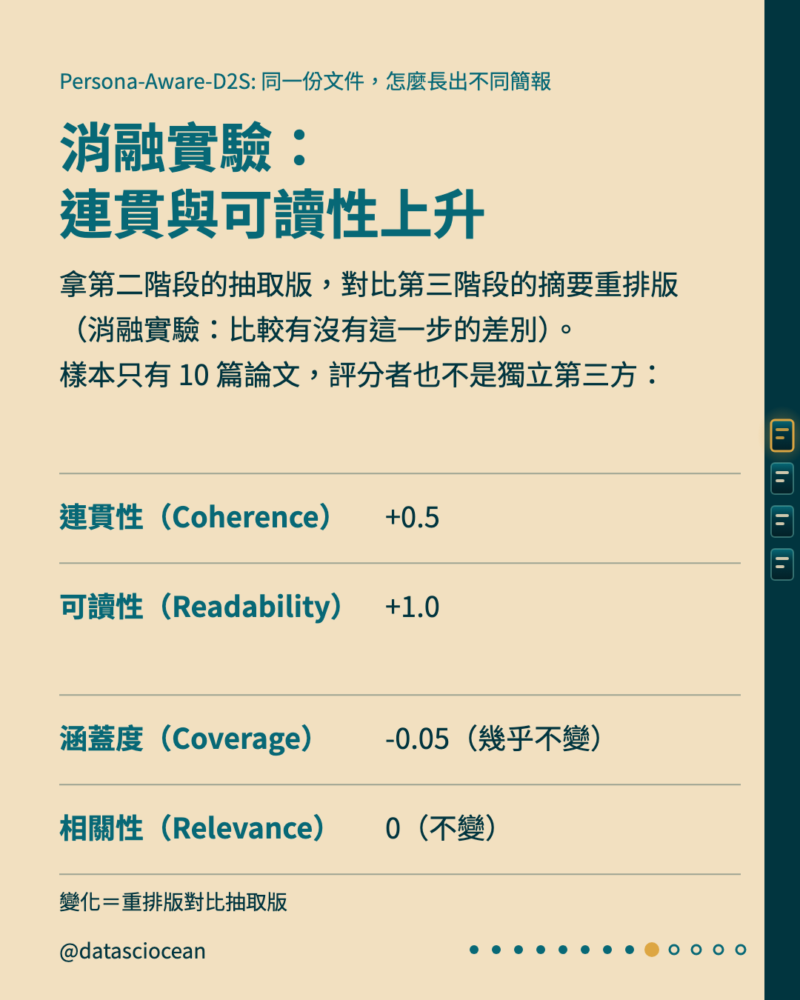
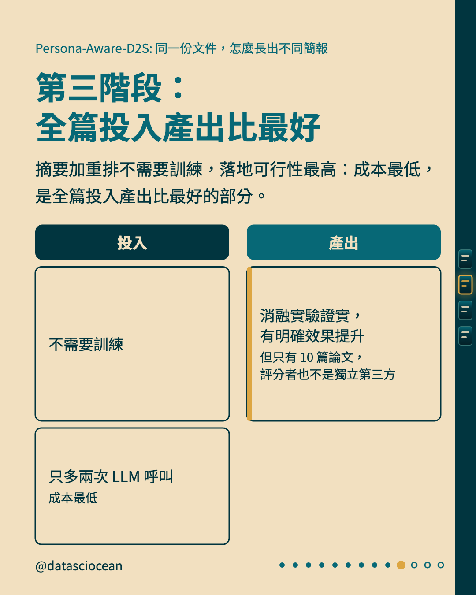
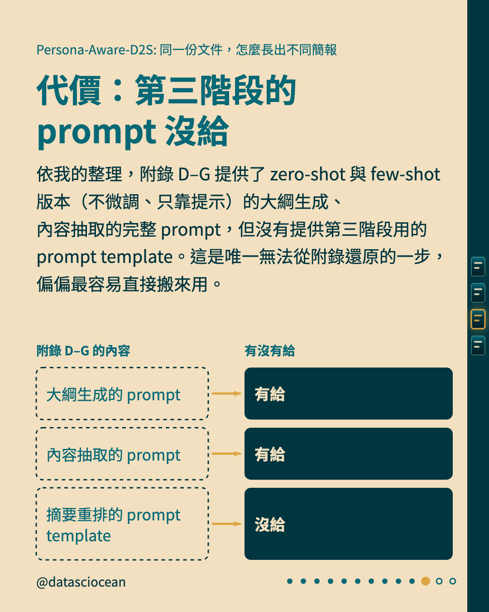
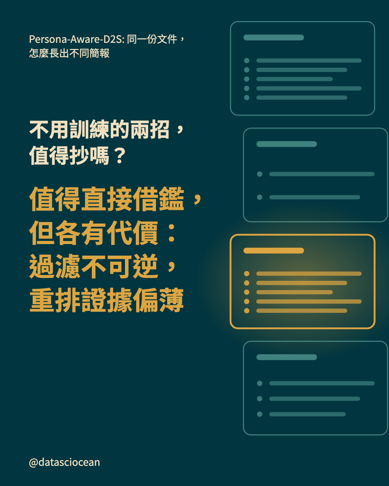
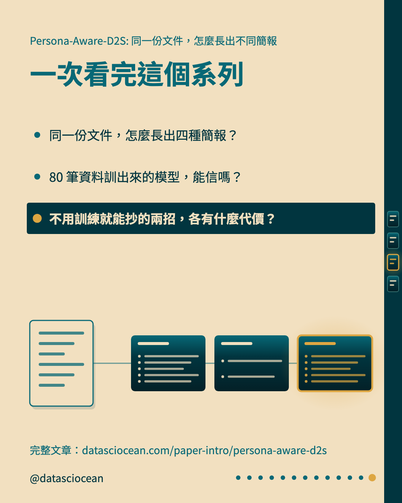

## 回覆：連結與系列

```text
Persona-Aware-D2S 不用訓練的兩招，值得抄嗎？章節過濾省 API 費用但不可逆，摘要重排成本最低但證據偏小。
文章：datasciocean.com/paper-intro/persona-aware-d2s
同系列：同一份文件，怎麼長出四種簡報？（尚未發布）
同系列：80 筆資料訓出來的模型，能信嗎？（尚未發布）
```
