# Threads：把提示詞貼兩次，第二遍就看得到全文

- 發文方式：**一則輪播貼文**（正文＋全部 12 張圖，順序與 IG 相同），再用一則回覆放連結與系列（連結只放那則回覆）
- 圖檔在 `../ig/`（與 IG 輪播共用同一套）

## 貼文正文（附下方全部圖片）

```text
提示詞貼兩次，不是囉嗦，是在補 AI 的盲點。

主流的 LLM（GPT-4、Gemini 等）大多只能往前看。舉個例子，讀「The bark was rough.」讀到 bark 時，後面的 rough 還沒出現，分不出是狗叫聲還是樹皮；只能先記下一份模糊的理解；等讀到 rough 知道是樹皮，回頭去翻 bark 那份早先記下的紀錄，翻到的仍然模糊。

Google Research 2025 年 12 月的論文提出 Prompt Repetition：把整段提示詞原封不動再貼一次，第二遍的每個字都看得到整個第一遍，不改模型，就能模擬出讓字前後互相看見的效果。只在前面塞一串點點拉長輸入則完全無效。細節在圖裡。

這是 Prompt Repetition 系列的第一則；輸入變兩倍會不會變慢，在這個系列的下一則。
```

## 附圖（依序）


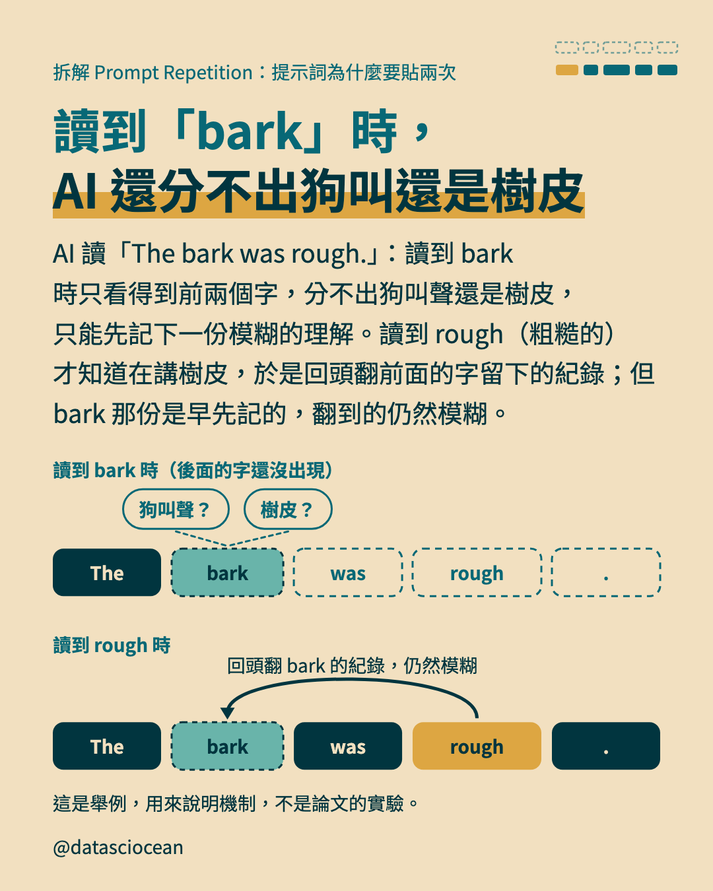
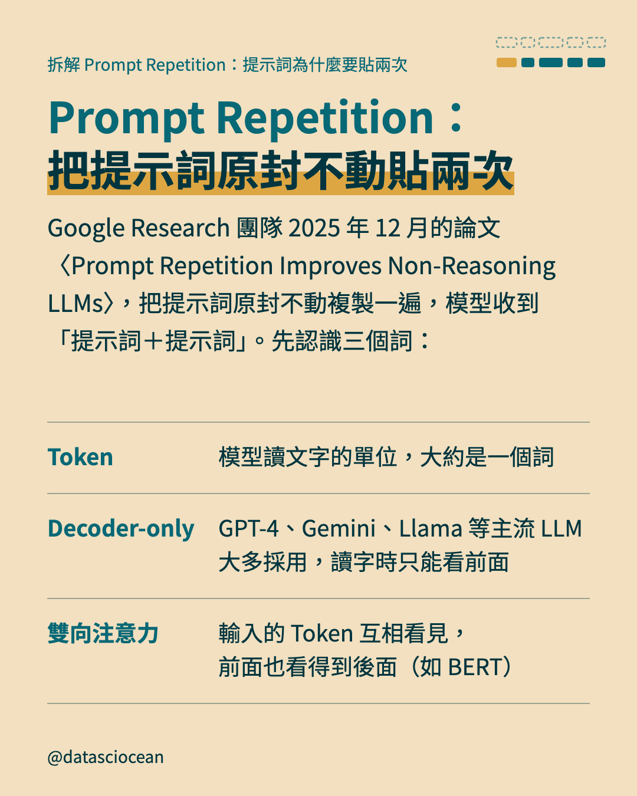
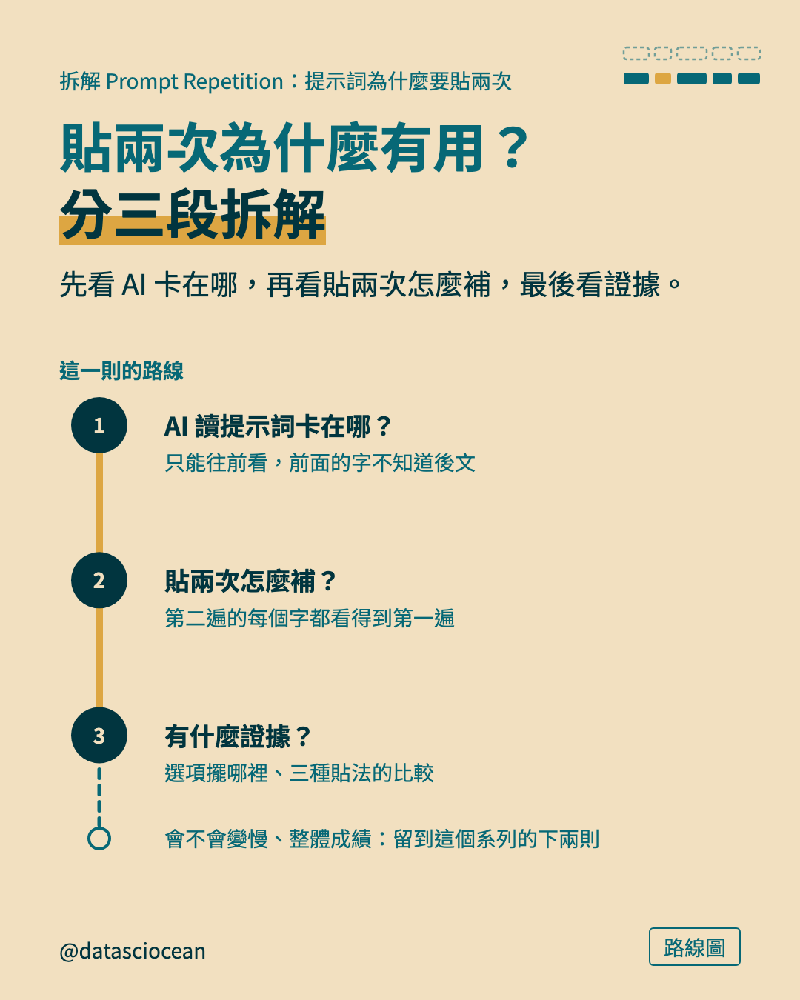
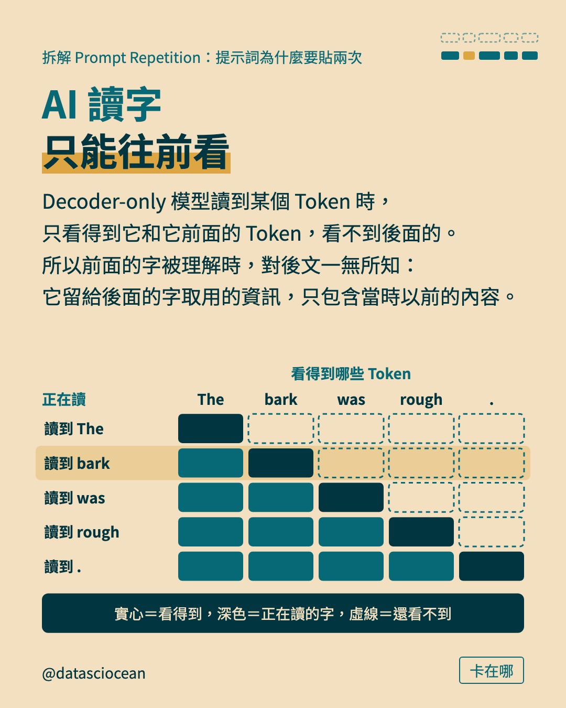
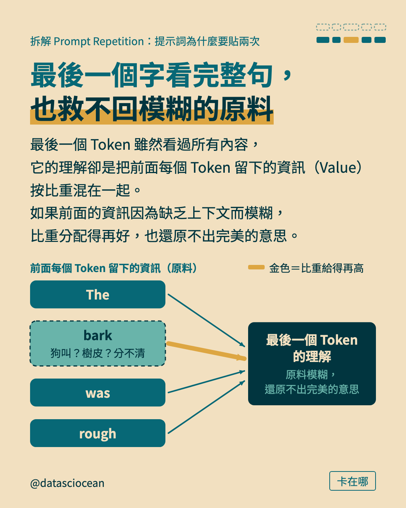
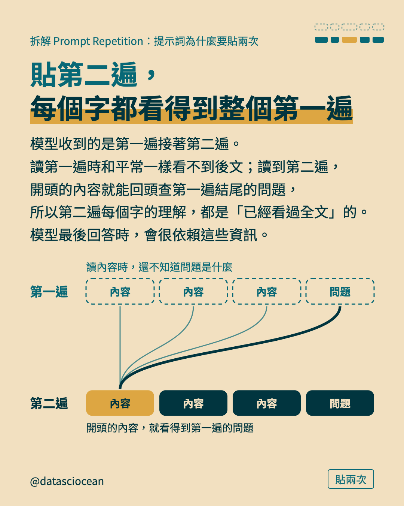
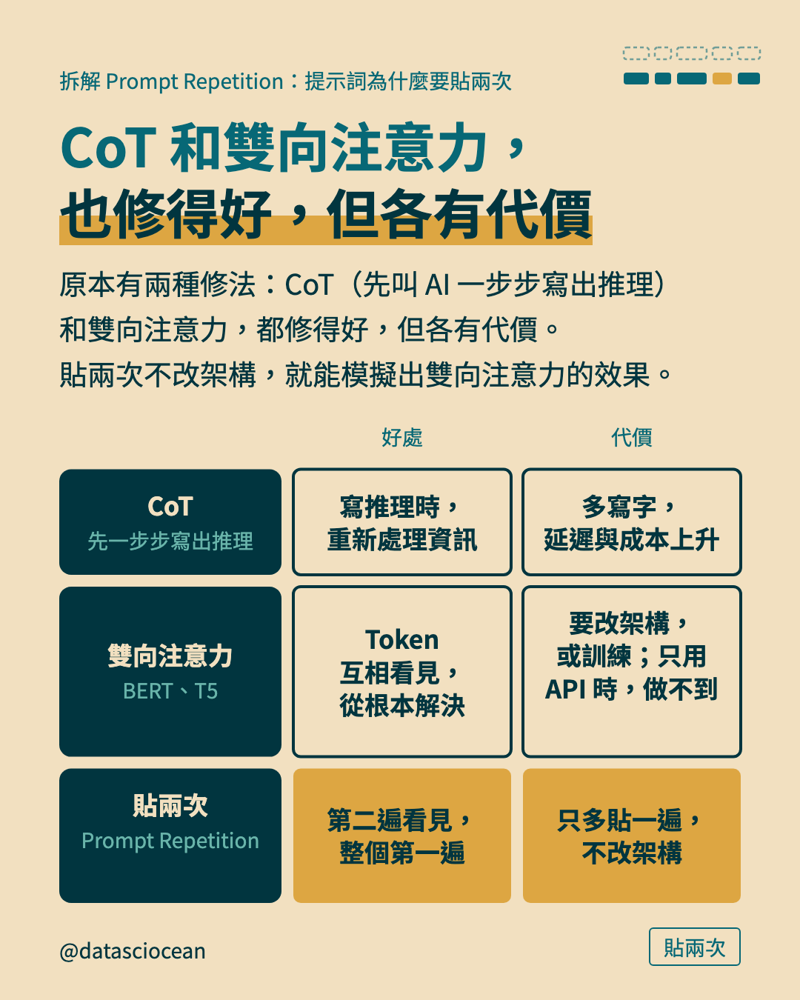
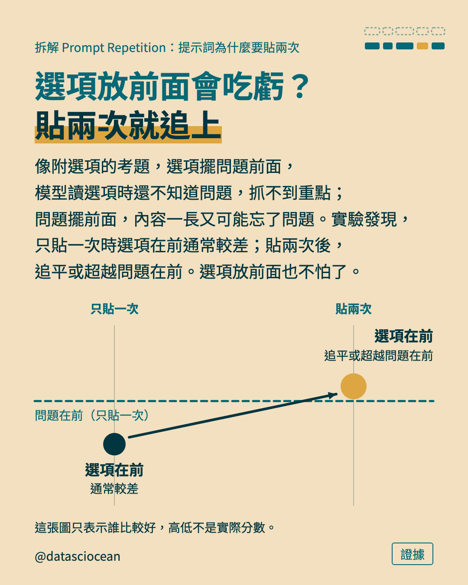
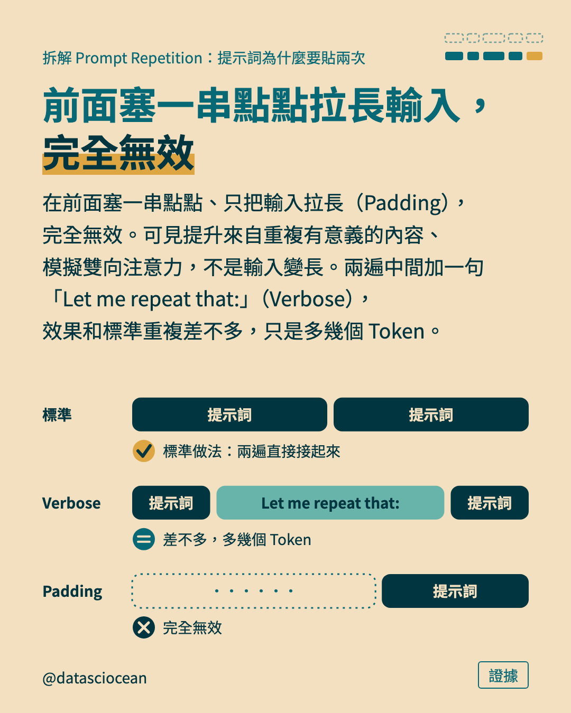
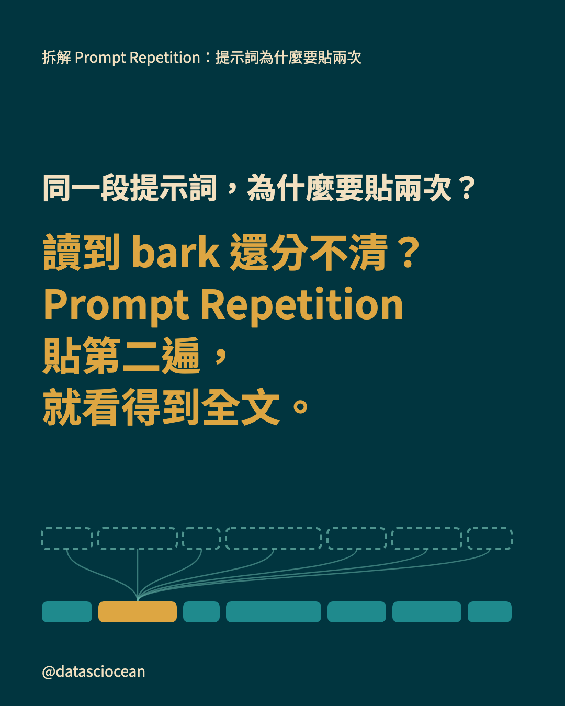
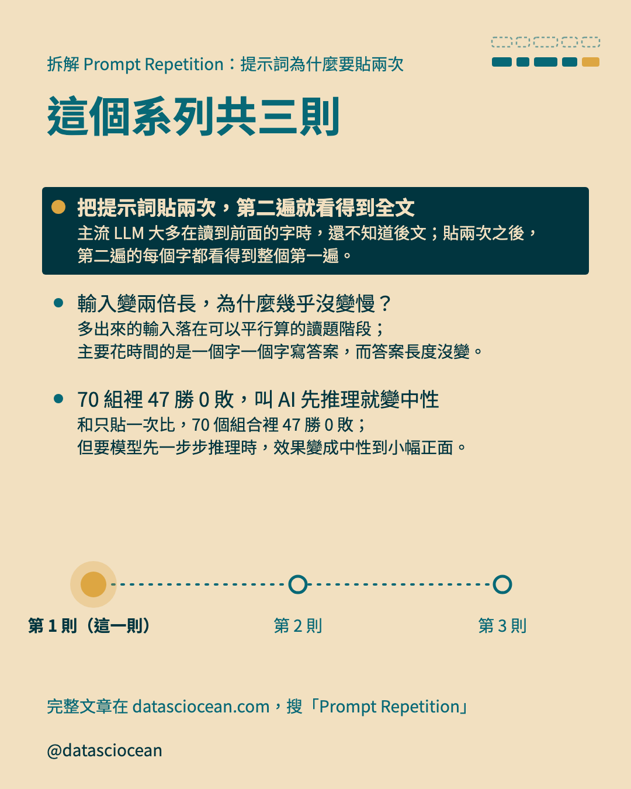

## 回覆：連結與系列

```text
Prompt Repetition：把提示詞原封不動貼兩次，第二遍的每個字都看得到整個第一遍。
文章：datasciocean.com/paper-intro/prompt-repetition
同系列：輸入變兩倍長，為什麼幾乎沒變慢？（尚未發布）
同系列：70 組裡 47 勝 0 敗，叫 AI 先推理就變中性（尚未發布）
```
