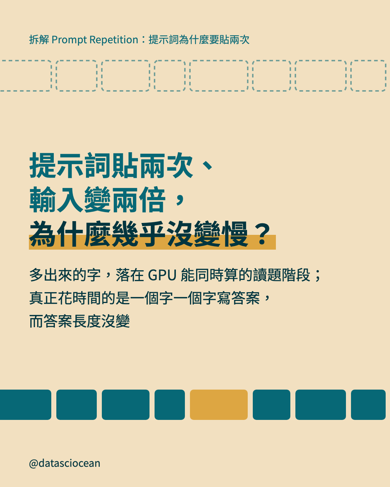
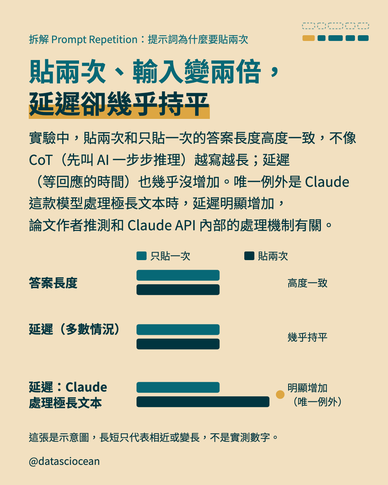
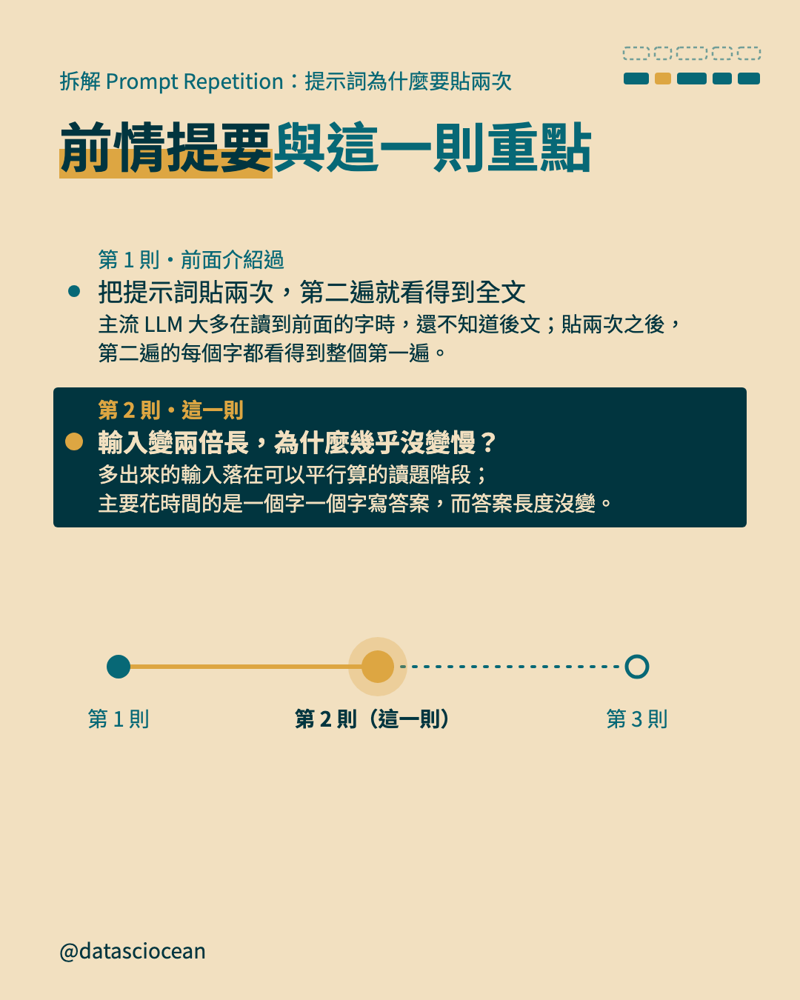
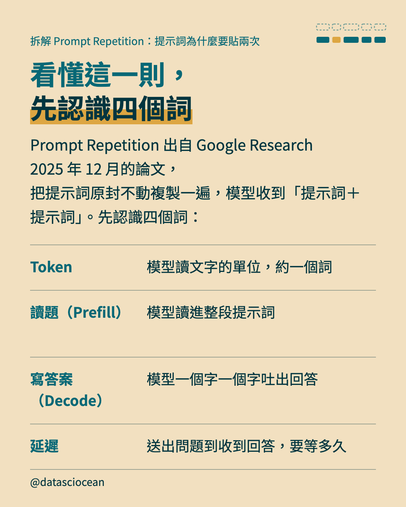
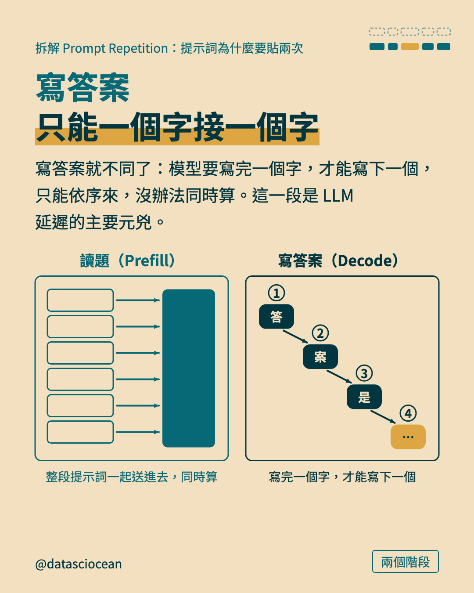
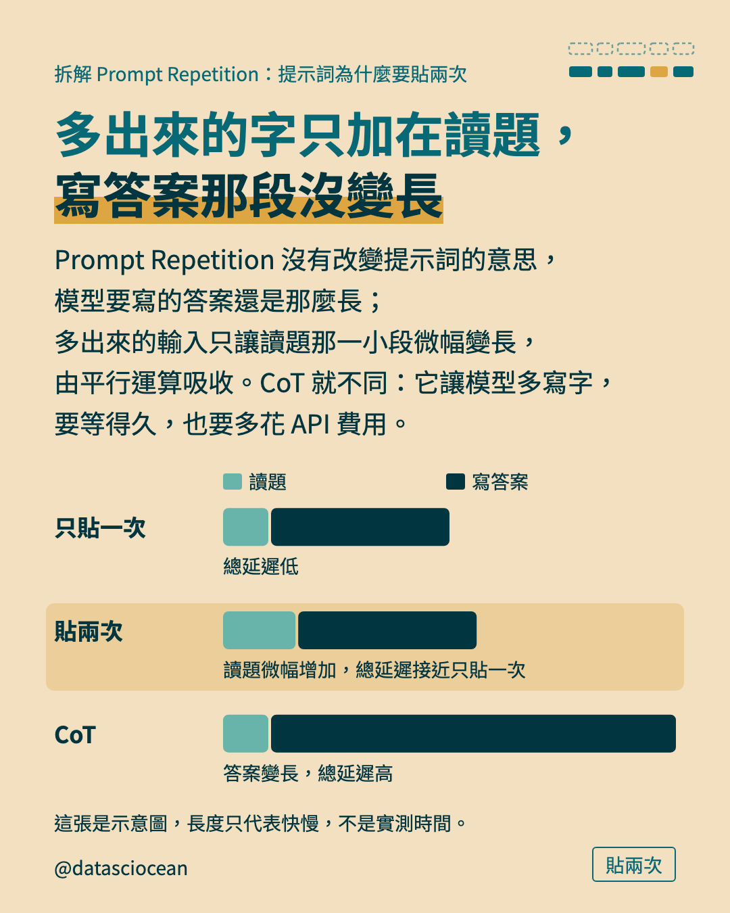
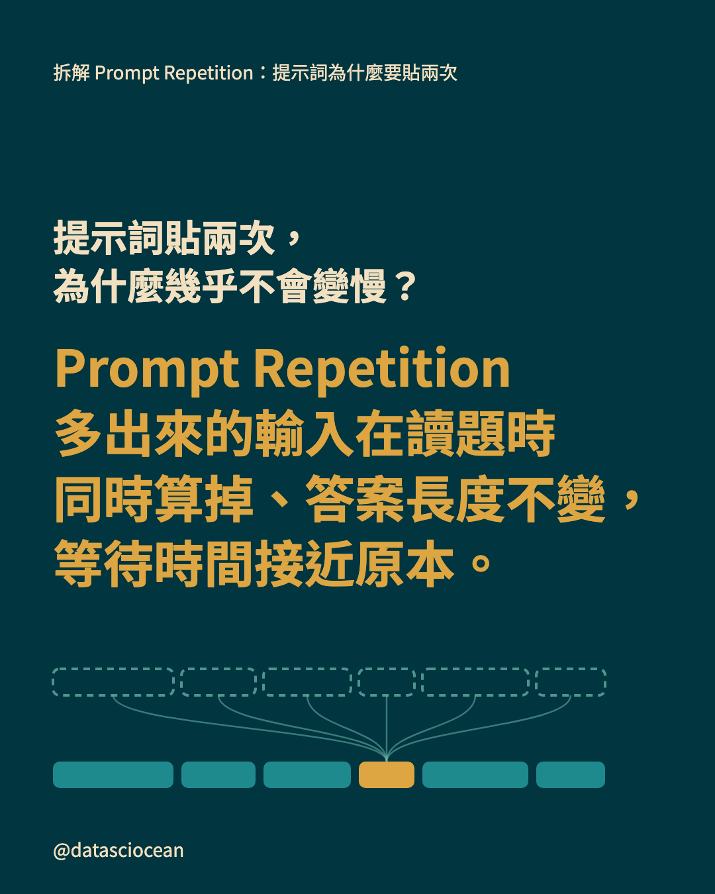
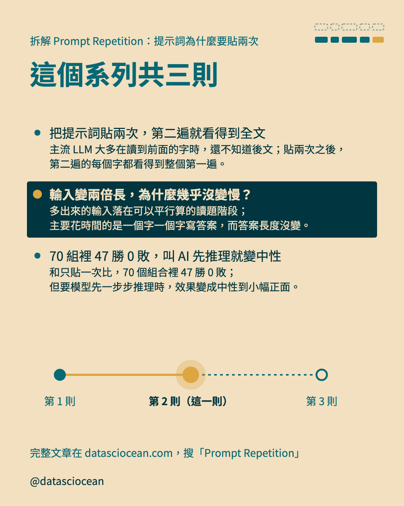

# IG 輪播：輸入變兩倍長，為什麼幾乎沒變慢？

- 系列：拆解 Prompt Repetition：提示詞為什麼要貼兩次　｜　hook 樣態：讀者疑問　｜　共 10 張，**依頁碼順序上傳**
- 每頁下方的「替代文字」貼到 IG 的替代文字欄；最後的 Caption 整段貼上

## 第 1 頁（封面）



- **主標**：提示詞貼兩次、輸入變兩倍，
為什麼幾乎沒變慢？
- **副標**：多出來的字，落在 GPU 能同時算的讀題階段；
真正花時間的是一個字一個字寫答案，
而答案長度沒變
- **替代文字**：提示詞貼兩次、輸入變兩倍，
為什麼幾乎沒變慢？。多出來的字，落在 GPU 能同時算的讀題階段；
真正花時間的是一個字一個字寫答案，
而答案長度沒變

## 第 2 頁（示意圖）



- **主標**：貼兩次、輸入變兩倍，
延遲卻幾乎持平
- **補充**：實驗中，貼兩次和只貼一次的答案長度高度一致，不像 CoT（先叫 AI 一步步推理）越寫越長；延遲（等回應的時間）也幾乎沒增加。唯一例外是 Claude 這款模型處理極長文本時，延遲明顯增加，論文作者推測和 Claude API 內部的處理機制有關。
- **示意圖（twin）上的文字與數字**：答案長度｜高度一致｜延遲（多數情況）｜幾乎持平｜延遲：Claude 處理極長文本｜明顯增加（唯一例外）｜只貼一次｜貼兩次
- **圖註**：這張是示意圖，長短只代表相近或變長，不是實測數字。
- **替代文字**：貼兩次、輸入變兩倍，
延遲卻幾乎持平。實驗中，貼兩次和只貼一次的答案長度高度一致，不像 CoT（先叫 AI 一步步推理）越寫越長；延遲（等回應的時間）也幾乎沒增加。唯一例外是 Claude 這款模型處理極長文本時，延遲明顯增加，論文作者推測和 Claude API 內部的處理機制有關。。圖上寫：答案長度、高度一致、延遲（多數情況）、幾乎持平、延遲：Claude 處理極長文本、明顯增加（唯一例外）、只貼一次、貼兩次

## 第 3 頁（前情回顧）



- **主標**：前情提要與這一則重點
- **第 1 則**：把提示詞貼兩次，第二遍就看得到全文　主流 LLM 大多在讀到前面的字時，還不知道後文；貼兩次之後，第二遍的每個字都看得到整個第一遍。
- **第 2 則**：輸入變兩倍長，為什麼幾乎沒變慢？　多出來的輸入落在可以平行算的讀題階段；主要花時間的是一個字一個字寫答案，而答案長度沒變。
- **替代文字**：前情提要與這一則重點。第 1 則「把提示詞貼兩次，第二遍就看得到全文」：主流 LLM 大多在讀到前面的字時，還不知道後文；貼兩次之後，第二遍的每個字都看得到整個第一遍。；第 2 則「輸入變兩倍長，為什麼幾乎沒變慢？」：多出來的輸入落在可以平行算的讀題階段；主要花時間的是一個字一個字寫答案，而答案長度沒變。

## 第 4 頁（脈絡）



- **主標**：看懂這一則，
先認識四個詞
- **補充**：Prompt Repetition 出自 Google Research 2025 年 12 月的論文，把提示詞原封不動複製一遍，模型收到「提示詞＋提示詞」。先認識四個詞：
- **表列**：Token｜模型讀文字的單位，約一個詞
- **表列**：讀題（Prefill）｜模型讀進整段提示詞
- **表列**：寫答案（Decode）｜模型一個字一個字吐出回答
- **表列**：延遲｜送出問題到收到回答，要等多久
- **替代文字**：看懂這一則，
先認識四個詞。Prompt Repetition 出自 Google Research 2025 年 12 月的論文，把提示詞原封不動複製一遍，模型收到「提示詞＋提示詞」。先認識四個詞：

## 第 5 頁（示意圖）


- **小標籤**：兩個階段
- **主標**：讀題時 GPU 同時算：
1000 個和 500 個差不多快
- **補充**：讀題階段，GPU（跑 AI 運算的晶片）可以高度平行、同時算。同時處理 1000 個 Token 和 500 個 Token，時間差異極小，通常在毫秒等級；貼兩次多出來的那一倍輸入，就落在這一段。
- **示意圖（grid2）上的文字與數字**：500 個 Token｜原本的提示詞（舉例）｜1000 個 Token｜貼兩次之後（舉例）｜1000 個和 500 個，時間差通常在毫秒等級｜讀題時，GPU 同時算
- **圖註**：一格是一個 Token，格子照數字畫；500 是舉例的長度。
- **替代文字**：讀題時 GPU 同時算：
1000 個和 500 個差不多快。讀題階段，GPU（跑 AI 運算的晶片）可以高度平行、同時算。同時處理 1000 個 Token 和 500 個 Token，時間差異極小，通常在毫秒等級；貼兩次多出來的那一倍輸入，就落在這一段。。圖上寫：500 個 Token、原本的提示詞（舉例）、1000 個 Token、貼兩次之後（舉例）、1000 個和 500 個，時間差通常在毫秒等級、讀題時，GPU 同時算

## 第 6 頁（示意圖）



- **小標籤**：兩個階段
- **主標**：寫答案
只能一個字接一個字
- **補充**：寫答案就不同了：模型要寫完一個字，才能寫下一個，只能依序來，沒辦法同時算。這一段是 LLM 延遲的主要元兇。
- **示意圖（twostage）上的文字與數字**：整段提示詞一起送進去，同時算｜寫完一個字，才能寫下一個｜答｜案｜是｜…｜讀題（Prefill）｜寫答案（Decode）
- **替代文字**：寫答案
只能一個字接一個字。寫答案就不同了：模型要寫完一個字，才能寫下一個，只能依序來，沒辦法同時算。這一段是 LLM 延遲的主要元兇。。圖上寫：整段提示詞一起送進去，同時算、寫完一個字，才能寫下一個、答、案、是、…、讀題（Prefill）、寫答案（Decode）

## 第 7 頁（示意圖）



- **小標籤**：貼兩次
- **主標**：多出來的字只加在讀題，
寫答案那段沒變長
- **補充**：Prompt Repetition 沒有改變提示詞的意思，模型要寫的答案還是那麼長；多出來的輸入只讓讀題那一小段微幅變長，由平行運算吸收。CoT 就不同：它讓模型多寫字，要等得久，也要多花 API 費用。
- **示意圖（timeline）上的文字與數字**：只貼一次｜總延遲低｜貼兩次｜讀題微幅增加，總延遲接近只貼一次｜CoT｜答案變長，總延遲高｜讀題｜寫答案
- **圖註**：這張是示意圖，長度只代表快慢，不是實測時間。
- **替代文字**：多出來的字只加在讀題，
寫答案那段沒變長。Prompt Repetition 沒有改變提示詞的意思，模型要寫的答案還是那麼長；多出來的輸入只讓讀題那一小段微幅變長，由平行運算吸收。CoT 就不同：它讓模型多寫字，要等得久，也要多花 API 費用。。圖上寫：只貼一次、總延遲低、貼兩次、讀題微幅增加，總延遲接近只貼一次、CoT、答案變長，總延遲高、讀題、寫答案

## 第 8 頁（示意圖）


- **小標籤**：為什麼划算
- **主標**：多出來的算力，
換到精確的理解
- **補充**：論文作者大膽稱它是「Free Lunch」（免費午餐）：用 GPU 在讀題階段多出來的算力，換取模型對內容的精確理解，又不用多等。不過好處有範圍：模型已先一步步推理（CoT）時，效果變成中性到小幅正面。
- **示意圖（pairs）上的文字與數字**：等待時間：幾乎不變（Claude 處理極長文本例外）｜拿來用的｜換到｜讀題時，多出來的算力｜模型對內容的精確理解
- **替代文字**：多出來的算力，
換到精確的理解。論文作者大膽稱它是「Free Lunch」（免費午餐）：用 GPU 在讀題階段多出來的算力，換取模型對內容的精確理解，又不用多等。不過好處有範圍：模型已先一步步推理（CoT）時，效果變成中性到小幅正面。。圖上寫：等待時間：幾乎不變（Claude 處理極長文本例外）、拿來用的、換到、讀題時，多出來的算力、模型對內容的精確理解

## 第 9 頁（帶走）



- **先問的問題**：提示詞貼兩次，為什麼幾乎不會變慢？
- **一句話**：Prompt Repetition
多出來的輸入在讀題時
同時算掉、答案長度不變，
等待時間接近原本。
- **替代文字**：提示詞貼兩次，為什麼幾乎不會變慢？　Prompt Repetition
多出來的輸入在讀題時
同時算掉、答案長度不變，
等待時間接近原本。

## 第 10 頁（系列地圖）



- **主標**：這個系列共三則
- **導流行**：完整文章在 datasciocean.com，搜「Prompt Repetition」
- **第 1 則**：把提示詞貼兩次，第二遍就看得到全文　主流 LLM 大多在讀到前面的字時，還不知道後文；貼兩次之後，第二遍的每個字都看得到整個第一遍。
- **第 2 則**：輸入變兩倍長，為什麼幾乎沒變慢？　多出來的輸入落在可以平行算的讀題階段；主要花時間的是一個字一個字寫答案，而答案長度沒變。
- **第 3 則**：70 組裡 47 勝 0 敗，叫 AI 先推理就變中性　和只貼一次比，70 個組合裡 47 勝 0 敗；但要模型先一步步推理時，效果變成中性到小幅正面。
- **替代文字**：這個系列共三則。把提示詞貼兩次，第二遍就看得到全文：主流 LLM 大多在讀到前面的字時，還不知道後文；貼兩次之後，第二遍的每個字都看得到整個第一遍。、輸入變兩倍長，為什麼幾乎沒變慢？：多出來的輸入落在可以平行算的讀題階段；主要花時間的是一個字一個字寫答案，而答案長度沒變。、70 組裡 47 勝 0 敗，叫 AI 先推理就變中性：和只貼一次比，70 個組合裡 47 勝 0 敗；但要模型先一步步推理時，效果變成中性到小幅正面。

## Caption（整段貼到 IG）

```text
Prompt Repetition 把輸入變兩倍，LLM 回答卻幾乎沒變慢？關鍵在 Prefill

・貼兩次、輸入變兩倍，延遲卻幾乎持平
・兩個階段：讀題時 GPU 同時算：1000 個和 500 個差不多快
・寫答案，只能一個字接一個字
・貼兩次：多出來的字只加在讀題，寫答案那段沒變長
・為什麼划算：多出來的算力，換到精確的理解

完整文章在 datasciocean.com，搜「Prompt Repetition」

#PromptRepetition #LLM #提示詞
```
