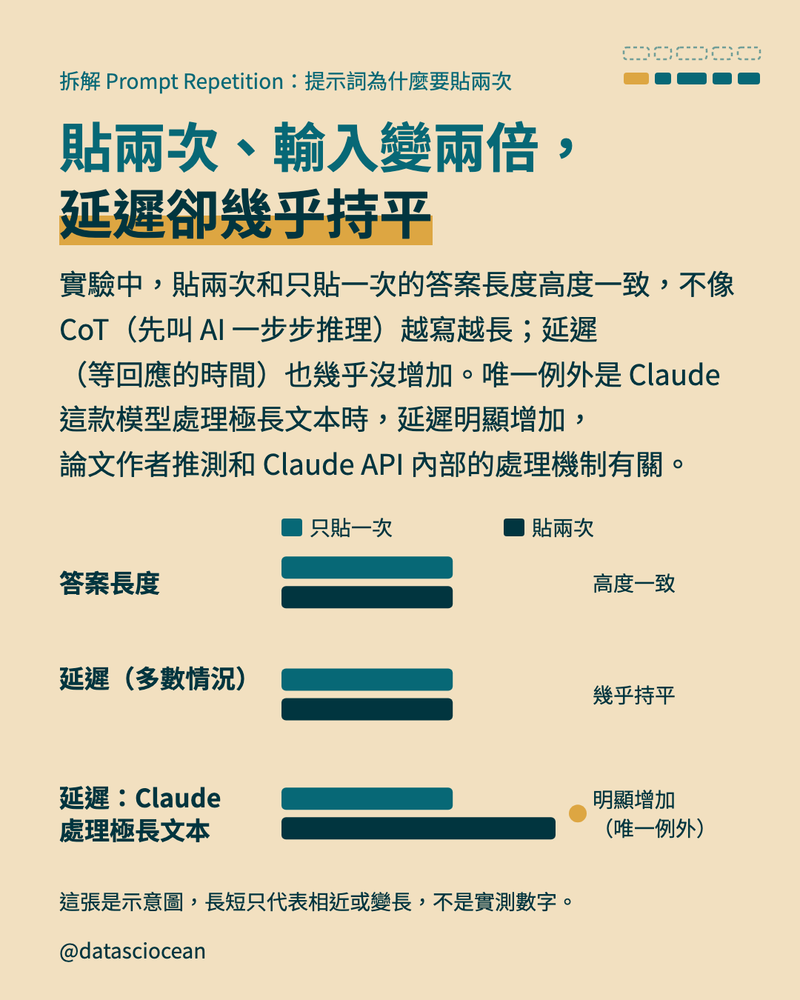
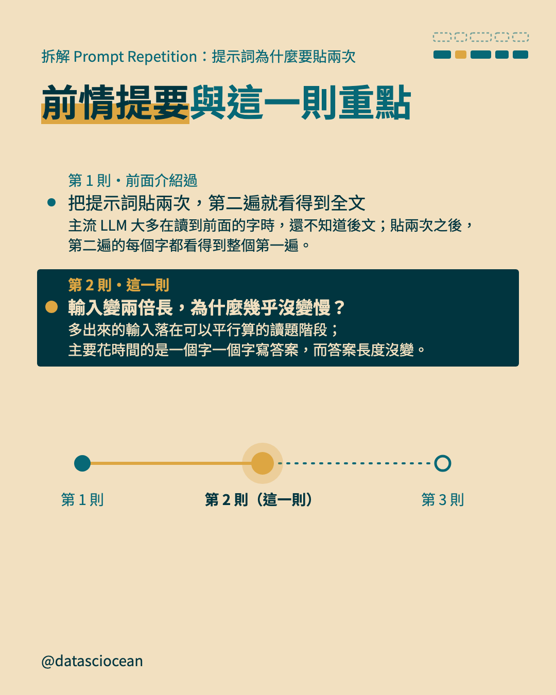
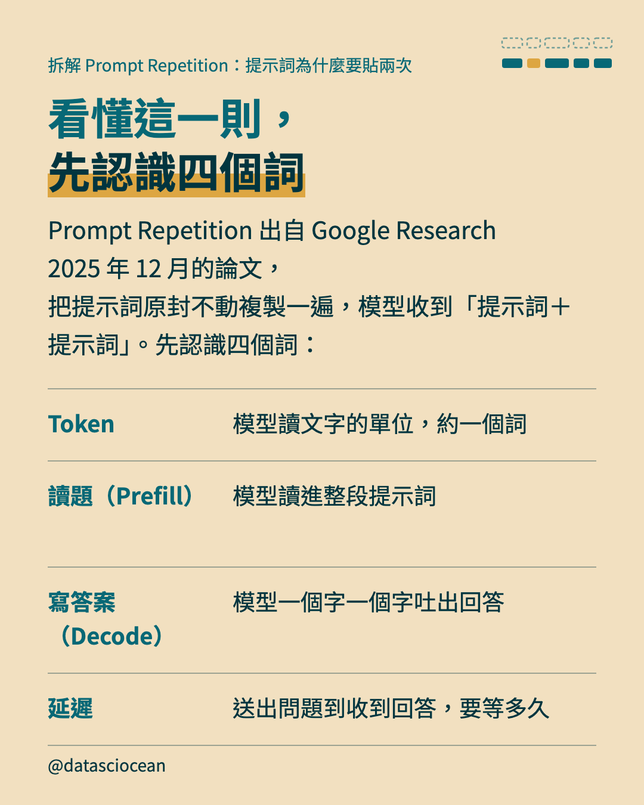
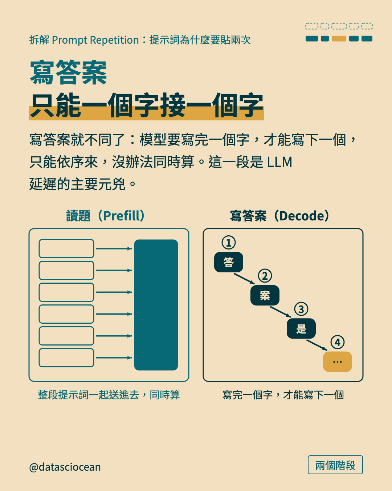
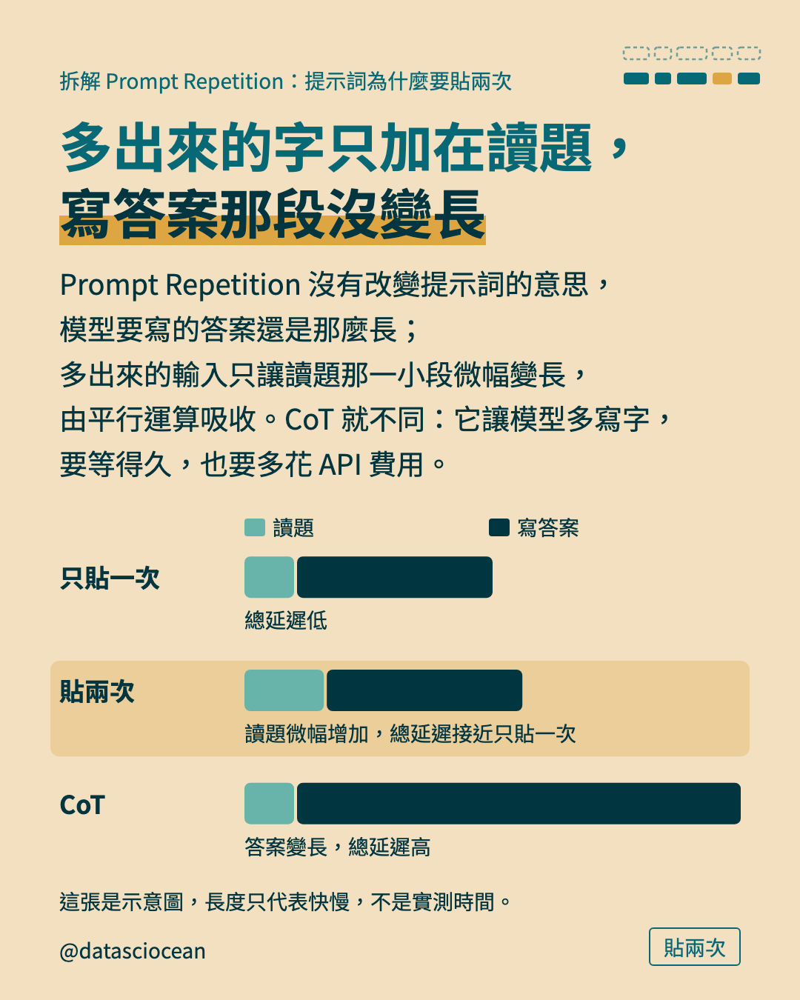
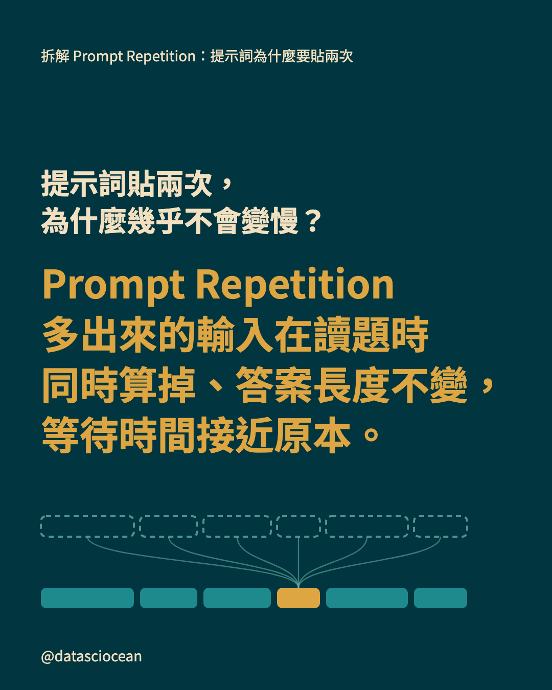
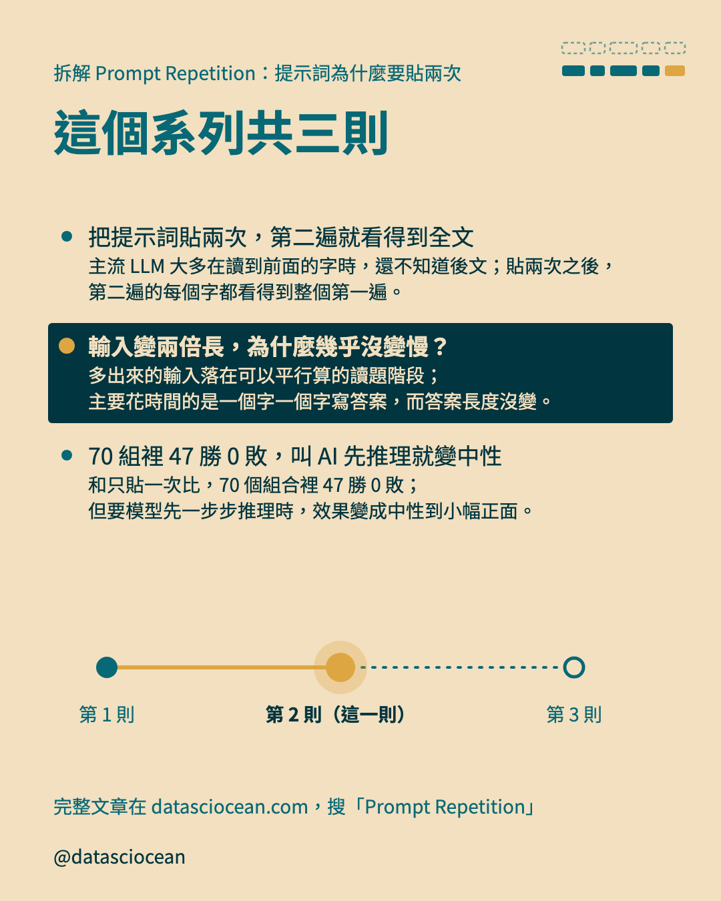

# Threads：輸入變兩倍長，為什麼幾乎沒變慢？

- 發文方式：**一則輪播貼文**（正文＋全部 10 張圖，順序與 IG 相同），再用一則回覆放連結與系列（連結只放那則回覆）
- 圖檔在 `../ig/`（與 IG 輪播共用同一套）

## 貼文正文（附下方全部圖片）

```text
提示詞貼兩次、輸入變兩倍，為什麼幾乎沒變慢？

LLM 回答分兩段：先讀題，再一個字一個字寫答案。讀題時 GPU 可以同時算，處理 1000 個和 500 個 Token，時間差異極小，通常在毫秒等級；寫答案只能一個接一個，才是延遲的主要元兇。Prompt Repetition 沒改變提示詞的意思，答案長度不變，所以多出來的輸入幾乎不拖慢回應。

論文實驗中，答案長度高度一致、延遲幾乎持平；唯一例外是 Claude 處理極長文本時，延遲明顯增加。細節在圖裡。

這是 Prompt Repetition 系列的第二則；效果有多好、什麼時候不靈，在這個系列的下一則。
```

## 附圖（依序）












## 回覆：連結與系列

```text
Prompt Repetition 多出來的輸入落在可以同時算的讀題階段，答案長度不變，所以幾乎不會變慢（Claude 處理極長文本是例外）。
文章：datasciocean.com/paper-intro/prompt-repetition
同系列：把提示詞貼兩次，第二遍就看得到全文（尚未發布）
同系列：70 組裡 47 勝 0 敗，叫 AI 先推理就變中性（尚未發布）
```
