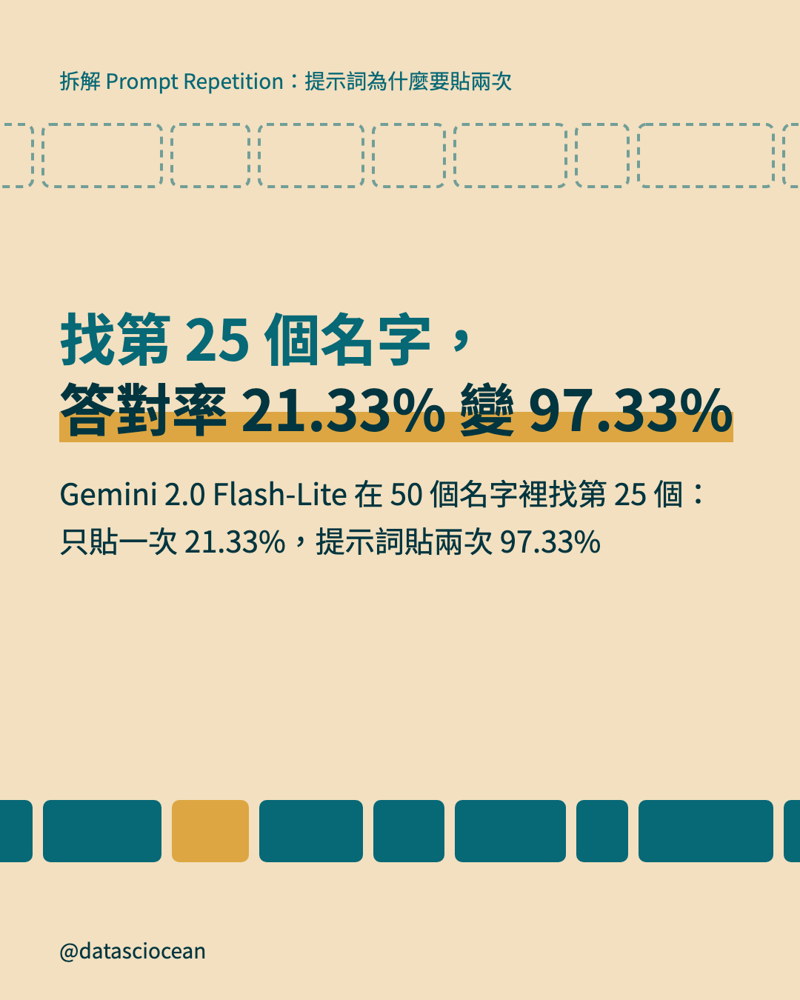
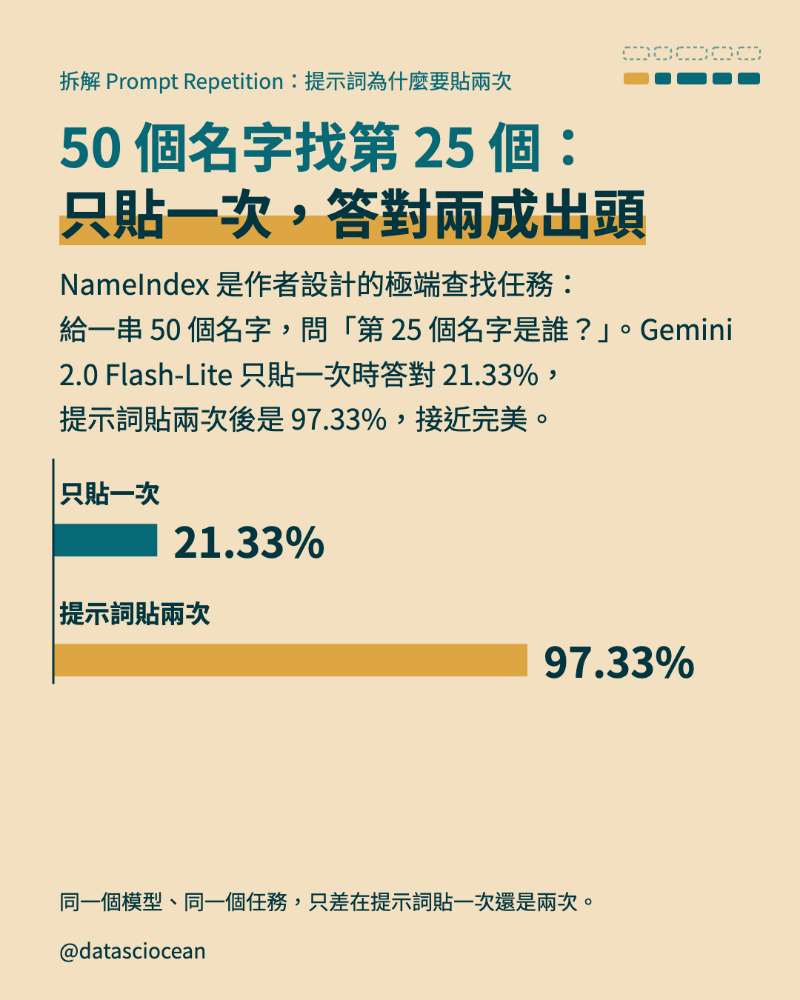
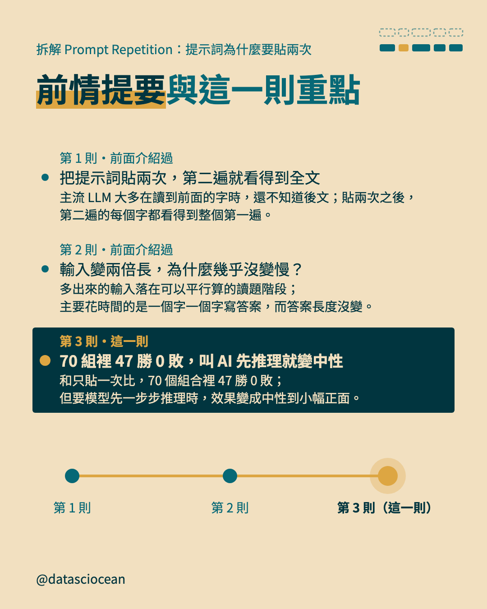
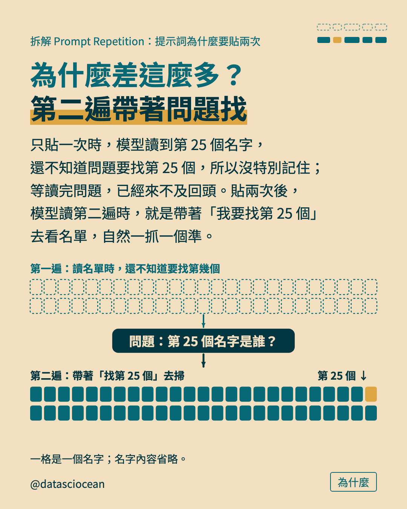
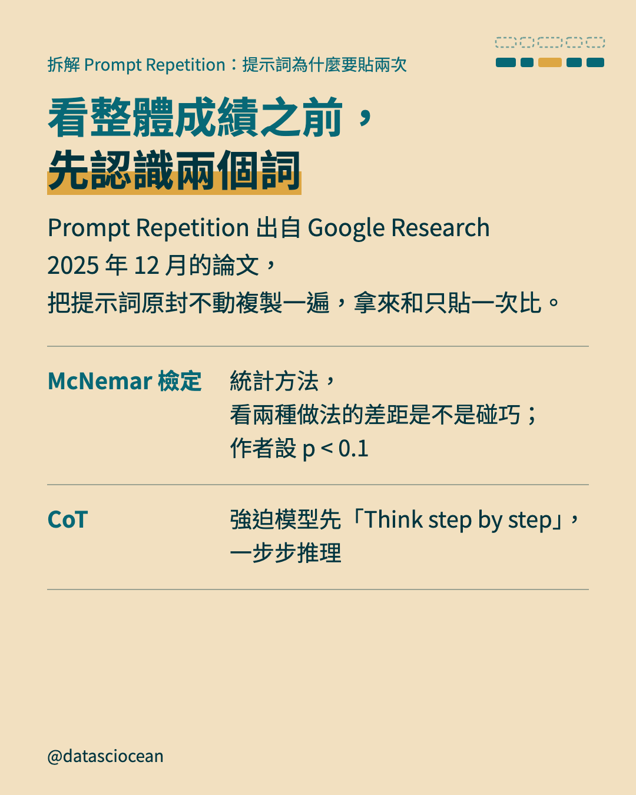
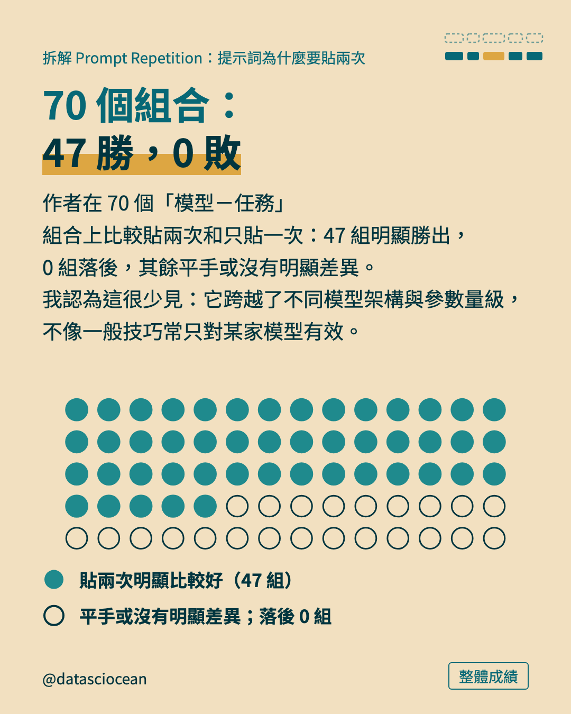
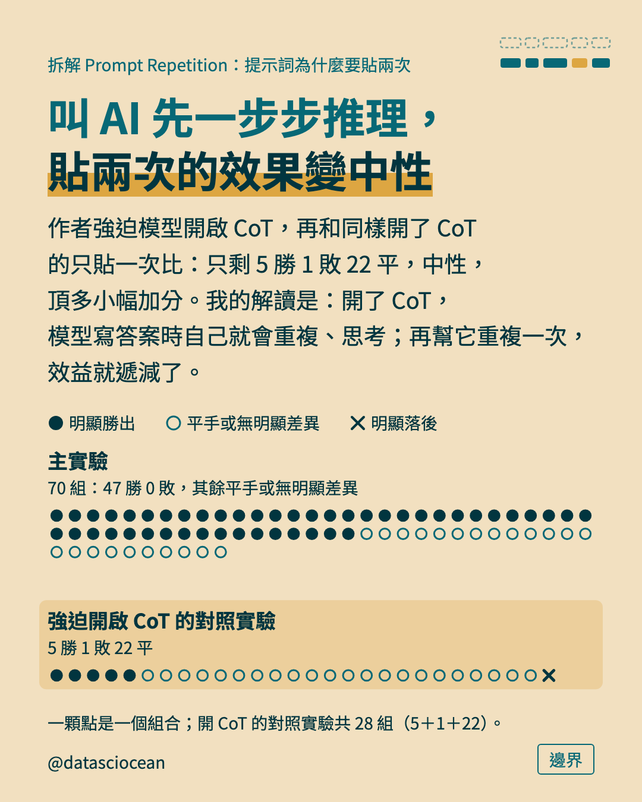
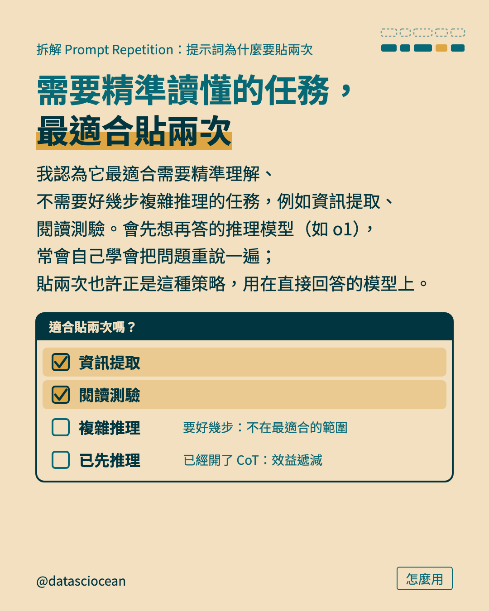
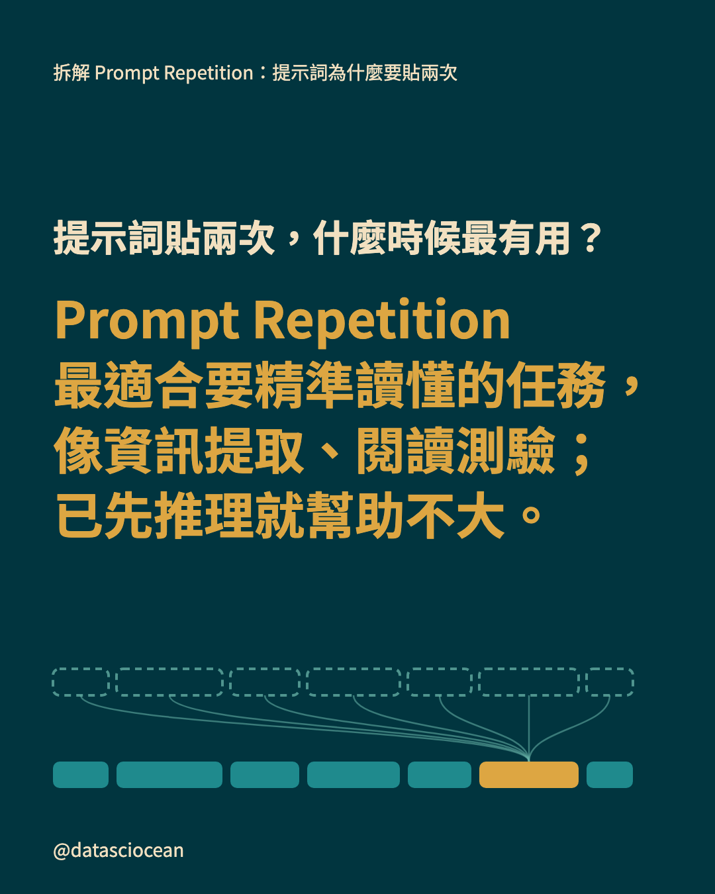
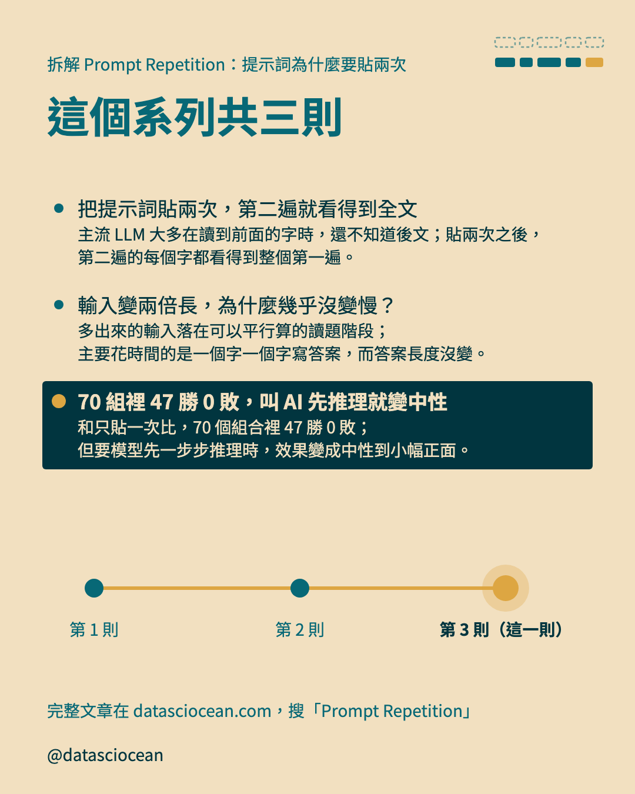

# Threads：70 組裡 47 勝 0 敗，叫 AI 先推理就變中性

- 發文方式：**一則輪播貼文**（正文＋全部 10 張圖，順序與 IG 相同），再用一則回覆放連結與系列（連結只放那則回覆）
- 圖檔在 `../ig/`（與 IG 輪播共用同一套）

## 貼文正文（附下方全部圖片）

```text
找第 25 個名字，答對率從 21.33% 變 97.33%。

這是作者設計的極端查找任務 NameIndex：給 50 個名字，問第 25 個是誰；數字是 Gemini 2.0 Flash-Lite 的結果。讀第二遍時，模型已經知道要找第幾個。

整體來看，70 個「模型－任務」組合裡，貼兩次 47 勝 0 敗，其餘平手或沒有明顯差異。但強迫模型先一步步推理（CoT）時，只剩 5 勝 1 敗 22 平：中性，頂多小幅加分。所以我認為它最適合需要精準理解、不需要好幾步複雜推理的任務，例如資訊提取、閱讀測驗。細節在圖裡。

這是 Prompt Repetition 系列的最後一則。
```

## 附圖（依序）












## 回覆：連結與系列

```text
Prompt Repetition 在 70 組裡 47 勝 0 敗；模型先一步步推理時，效果變成中性，頂多小幅加分。
文章：datasciocean.com/paper-intro/prompt-repetition
同系列：把提示詞貼兩次，第二遍就看得到全文
https://www.threads.com/@datasciocean/post/Dfv2hB6iT0h
同系列：輸入變兩倍長，為什麼幾乎沒變慢？
https://www.threads.com/@datasciocean/post/DfzPNAhn0d8
```
