# IG 輪播：合併同一個東西的寫法，不是分群問題

- 系列：拆解 RAGU：GraphRAG 的天花板有多高　｜　hook 樣態：反直覺斷言　｜　共 13 張，**依頁碼順序上傳**
- 每頁下方的「替代文字」貼到 IG 的替代文字欄；最後的 Caption 整段貼上

## 第 1 頁（封面）

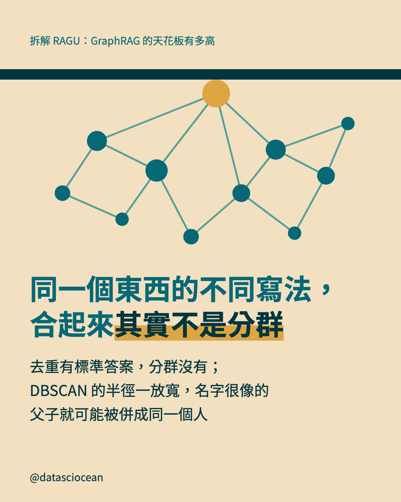

- **主標**：同一個東西的不同寫法，
合起來其實不是分群
- **副標**：去重有標準答案，分群沒有；
DBSCAN 的半徑一放寬，名字很像的
父子就可能被併成同一個人
- **替代文字**：同一個東西的不同寫法，
合起來其實不是分群。去重有標準答案，分群沒有；
DBSCAN 的半徑一放寬，名字很像的
父子就可能被併成同一個人

## 第 2 頁（示意圖）

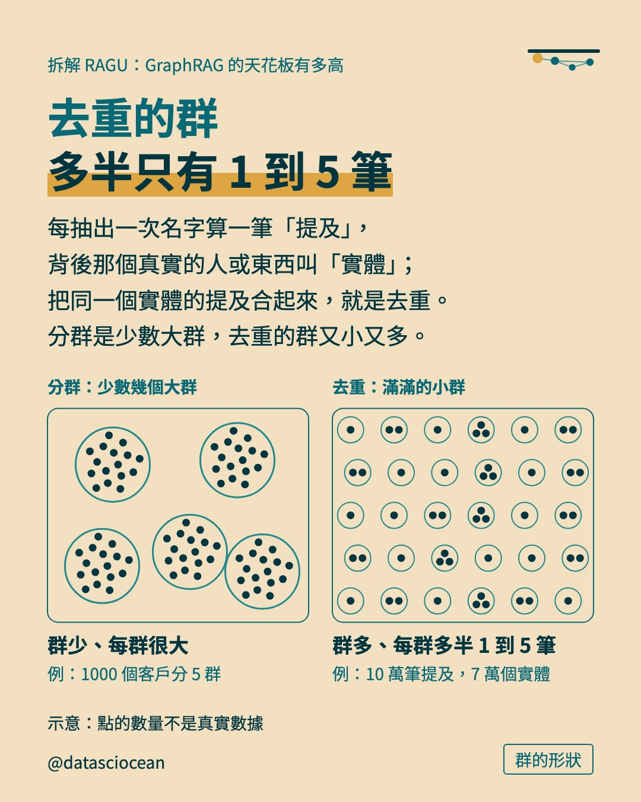

- **小標籤**：群的形狀
- **主標**：去重的群
多半只有 1 到 5 筆
- **補充**：每抽出一次名字算一筆「提及」，背後那個真實的人或東西叫「實體」；把同一個實體的提及合起來，就是去重。分群是少數大群，去重的群又小又多。
- **示意圖（kgroups）上的文字與數字**：群少、每群很大｜例：1000 個客戶分 5 群｜群多、每群多半 1 到 5 筆｜例：10 萬筆提及，7 萬個實體｜分群：少數幾個大群｜去重：滿滿的小群
- **圖註**：示意：點的數量不是真實數據
- **替代文字**：去重的群
多半只有 1 到 5 筆。每抽出一次名字算一筆「提及」，背後那個真實的人或東西叫「實體」；把同一個實體的提及合起來，就是去重。分群是少數大群，去重的群又小又多。。圖上寫：群少、每群很大、例：1000 個客戶分 5 群、群多、每群多半 1 到 5 筆、例：10 萬筆提及，7 萬個實體、分群：少數幾個大群、去重：滿滿的小群

## 第 3 頁（前情回顧）

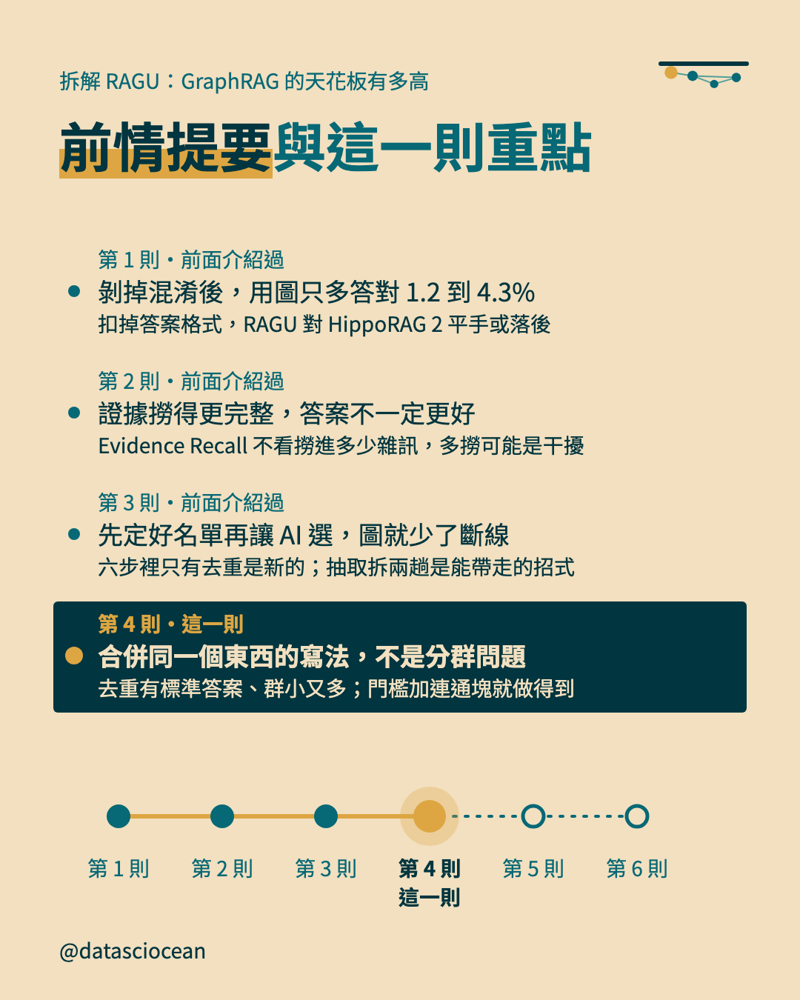

- **主標**：前情提要與這一則重點
- **第 1 則**：剝掉混淆後，用圖只多答對 1.2 到 4.3%　扣掉答案格式，RAGU 對 HippoRAG 2 平手或落後
- **第 2 則**：證據撈得更完整，答案不一定更好　Evidence Recall 不看撈進多少雜訊，多撈可能是干擾
- **第 3 則**：先定好名單再讓 AI 選，圖就少了斷線　六步裡只有去重是新的；抽取拆兩趟是能帶走的招式
- **第 4 則**：合併同一個東西的寫法，不是分群問題　去重有標準答案、群小又多；門檻加連通塊就做得到
- **替代文字**：前情提要與這一則重點。第 1 則「剝掉混淆後，用圖只多答對 1.2 到 4.3%」：扣掉答案格式，RAGU 對 HippoRAG 2 平手或落後；第 2 則「證據撈得更完整，答案不一定更好」：Evidence Recall 不看撈進多少雜訊，多撈可能是干擾；第 3 則「先定好名單再讓 AI 選，圖就少了斷線」：六步裡只有去重是新的；抽取拆兩趟是能帶走的招式；第 4 則「合併同一個東西的寫法，不是分群問題」：去重有標準答案、群小又多；門檻加連通塊就做得到

## 第 4 頁（脈絡）

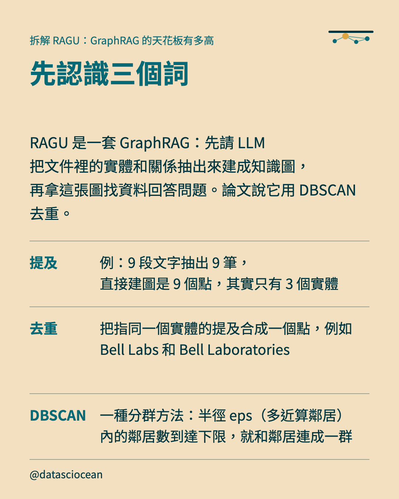

- **主標**：先認識三個詞
- **補充**：RAGU 是一套 GraphRAG：先請 LLM 把文件裡的實體和關係抽出來建成知識圖，再拿這張圖找資料回答問題。論文說它用 DBSCAN 去重。
- **表列**：提及｜例：9 段文字抽出 9 筆，直接建圖是 9 個點，其實只有 3 個實體
- **表列**：去重｜把指同一個實體的提及合成一個點，例如 Bell Labs 和 Bell Laboratories
- **表列**：DBSCAN｜一種分群方法：半徑 eps（多近算鄰居）內的鄰居數到達下限，就和鄰居連成一群
- **替代文字**：先認識三個詞。RAGU 是一套 GraphRAG：先請 LLM 把文件裡的實體和關係抽出來建成知識圖，再拿這張圖找資料回答問題。論文說它用 DBSCAN 去重。

## 第 5 頁（示意圖）

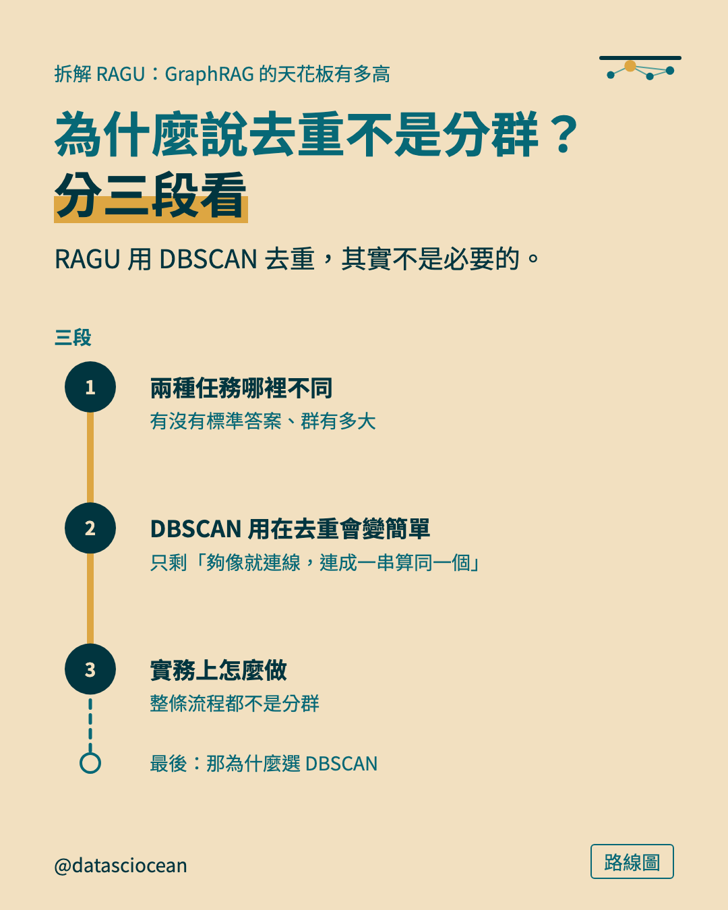

- **小標籤**：路線圖
- **主標**：為什麼說去重不是分群？
分三段看
- **補充**：RAGU 用 DBSCAN 去重，其實不是必要的。
- **示意圖（route）上的文字與數字**：兩種任務哪裡不同｜有沒有標準答案、群有多大｜DBSCAN 用在去重會變簡單｜只剩「夠像就連線，連成一串算同一個」｜實務上怎麼做｜整條流程都不是分群｜三段｜最後：那為什麼選 DBSCAN
- **替代文字**：為什麼說去重不是分群？
分三段看。RAGU 用 DBSCAN 去重，其實不是必要的。。圖上寫：兩種任務哪裡不同、有沒有標準答案、群有多大、DBSCAN 用在去重會變簡單、只剩「夠像就連線，連成一串算同一個」、實務上怎麼做、整條流程都不是分群、三段、最後：那為什麼選 DBSCAN

## 第 6 頁（對照表）

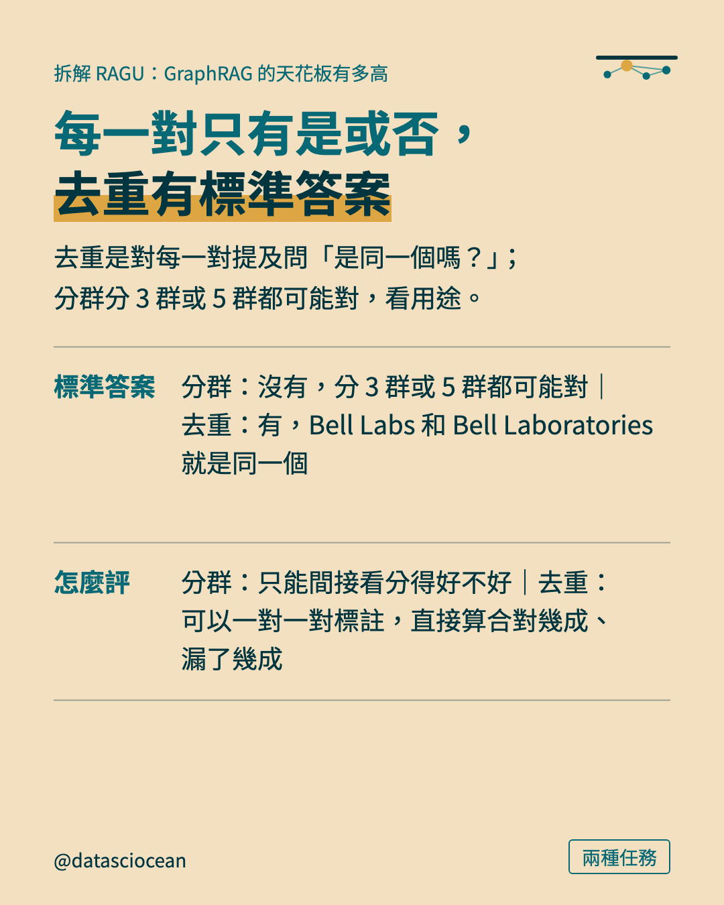

- **小標籤**：兩種任務
- **主標**：每一對只有是或否，
去重有標準答案
- **補充**：去重是對每一對提及問「是同一個嗎？」；分群分 3 群或 5 群都可能對，看用途。
- **表列**：標準答案｜分群：沒有，分 3 群或 5 群都可能對｜去重：有，Bell Labs 和 Bell Laboratories 就是同一個
- **表列**：怎麼評｜分群：只能間接看分得好不好｜去重：可以一對一對標註，直接算合對幾成、漏了幾成
- **替代文字**：每一對只有是或否，
去重有標準答案。去重是對每一對提及問「是同一個嗎？」；分群分 3 群或 5 群都可能對，看用途。

## 第 7 頁（示意圖）

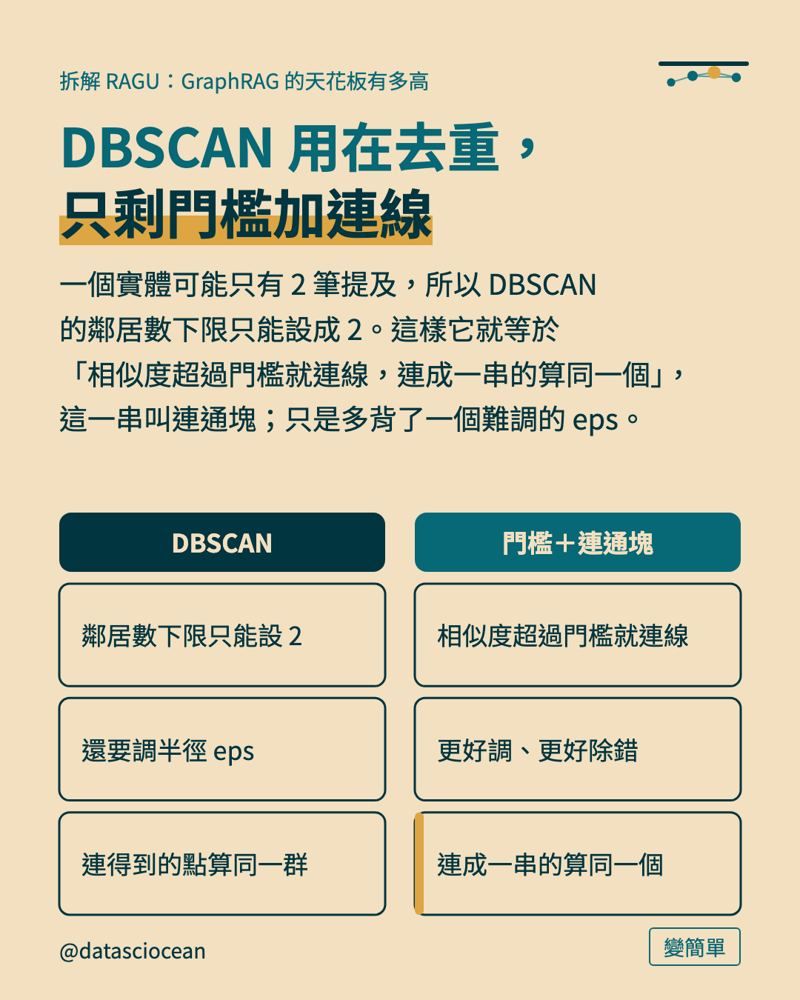

- **小標籤**：變簡單
- **主標**：DBSCAN 用在去重，
只剩門檻加連線
- **補充**：一個實體可能只有 2 筆提及，所以 DBSCAN 的鄰居數下限只能設成 2。這樣它就等於「相似度超過門檻就連線，連成一串的算同一個」，這一串叫連通塊；只是多背了一個難調的 eps。
- **示意圖（compare）上的文字與數字**：DBSCAN｜鄰居數下限只能設 2｜還要調半徑 eps｜連得到的點算同一群｜門檻＋連通塊｜相似度超過門檻就連線｜更好調、更好除錯｜連成一串的算同一個
- **替代文字**：DBSCAN 用在去重，
只剩門檻加連線。一個實體可能只有 2 筆提及，所以 DBSCAN 的鄰居數下限只能設成 2。這樣它就等於「相似度超過門檻就連線，連成一串的算同一個」，這一串叫連通塊；只是多背了一個難調的 eps。。圖上寫：DBSCAN、鄰居數下限只能設 2、還要調半徑 eps、連得到的點算同一群、門檻＋連通塊、相似度超過門檻就連線、更好調、更好除錯、連成一串的算同一個

## 第 8 頁（對照表）

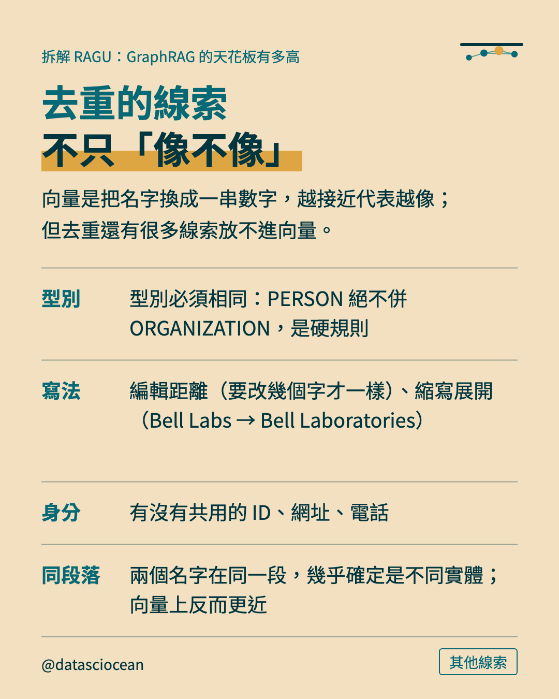

- **小標籤**：其他線索
- **主標**：去重的線索
不只「像不像」
- **補充**：向量是把名字換成一串數字，越接近代表越像；但去重還有很多線索放不進向量。
- **表列**：型別｜型別必須相同：PERSON 絕不併 ORGANIZATION，是硬規則
- **表列**：寫法｜編輯距離（要改幾個字才一樣）、縮寫展開（Bell Labs → Bell Laboratories）
- **表列**：身分｜有沒有共用的 ID、網址、電話
- **表列**：同段落｜兩個名字在同一段，幾乎確定是不同實體；向量上反而更近
- **替代文字**：去重的線索
不只「像不像」。向量是把名字換成一串數字，越接近代表越像；但去重還有很多線索放不進向量。

## 第 9 頁（示意圖）

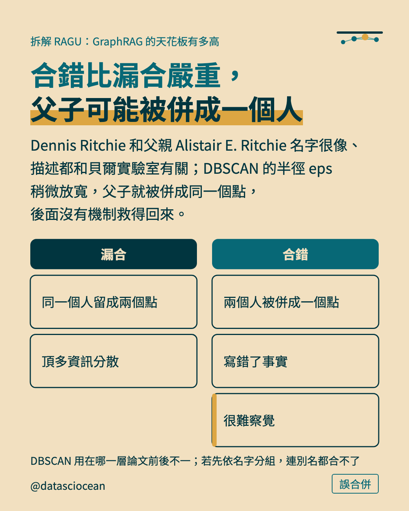

- **小標籤**：誤合併
- **主標**：合錯比漏合嚴重，
父子可能被併成一個人
- **補充**：Dennis Ritchie 和父親 Alistair E. Ritchie 名字很像、描述都和貝爾實驗室有關；DBSCAN 的半徑 eps 稍微放寬，父子就被併成同一個點，後面沒有機制救得回來。
- **示意圖（compare）上的文字與數字**：漏合｜同一個人留成兩個點｜頂多資訊分散｜合錯｜兩個人被併成一個點｜寫錯了事實｜很難察覺
- **圖註**：DBSCAN 用在哪一層論文前後不一；若先依名字分組，連別名都合不了
- **替代文字**：合錯比漏合嚴重，
父子可能被併成一個人。Dennis Ritchie 和父親 Alistair E. Ritchie 名字很像、描述都和貝爾實驗室有關；DBSCAN 的半徑 eps 稍微放寬，父子就被併成同一個點，後面沒有機制救得回來。。圖上寫：漏合、同一個人留成兩個點、頂多資訊分散、合錯、兩個人被併成一個點、寫錯了事實、很難察覺

## 第 10 頁（示意圖）

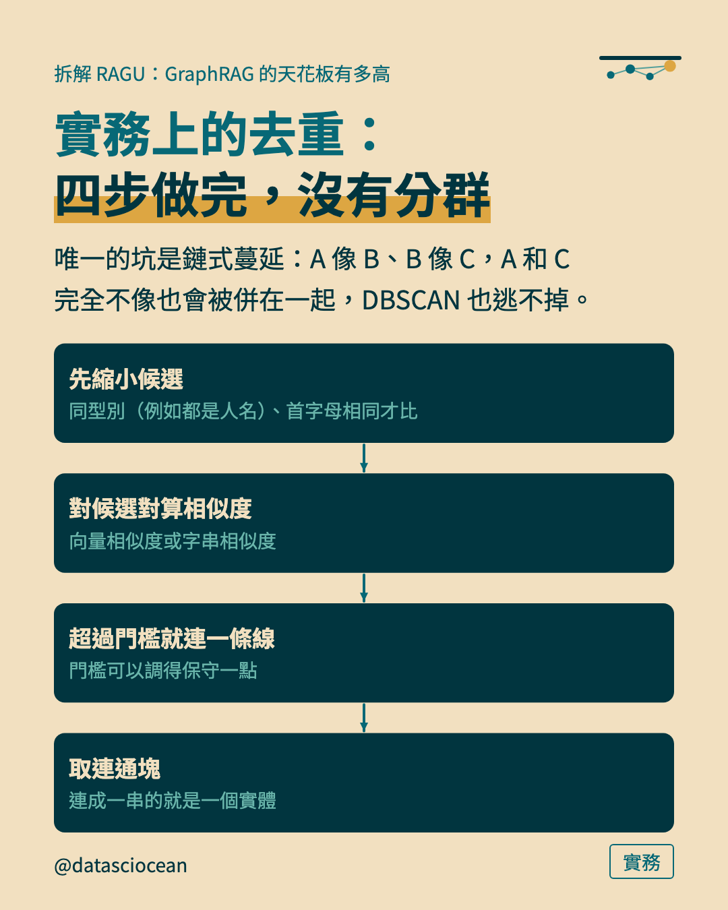

- **小標籤**：實務
- **主標**：實務上的去重：
四步做完，沒有分群
- **補充**：唯一的坑是鏈式蔓延：A 像 B、B 像 C，A 和 C 完全不像也會被併在一起，DBSCAN 也逃不掉。
- **示意圖（flow）上的文字與數字**：先縮小候選｜同型別（例如都是人名）、首字母相同才比｜對候選對算相似度｜向量相似度或字串相似度｜超過門檻就連一條線｜門檻可以調得保守一點｜取連通塊｜連成一串的就是一個實體
- **替代文字**：實務上的去重：
四步做完，沒有分群。唯一的坑是鏈式蔓延：A 像 B、B 像 C，A 和 C 完全不像也會被併在一起，DBSCAN 也逃不掉。。圖上寫：先縮小候選、同型別（例如都是人名）、首字母相同才比、對候選對算相似度、向量相似度或字串相似度、超過門檻就連一條線、門檻可以調得保守一點、取連通塊、連成一串的就是一個實體

## 第 11 頁（對照表）

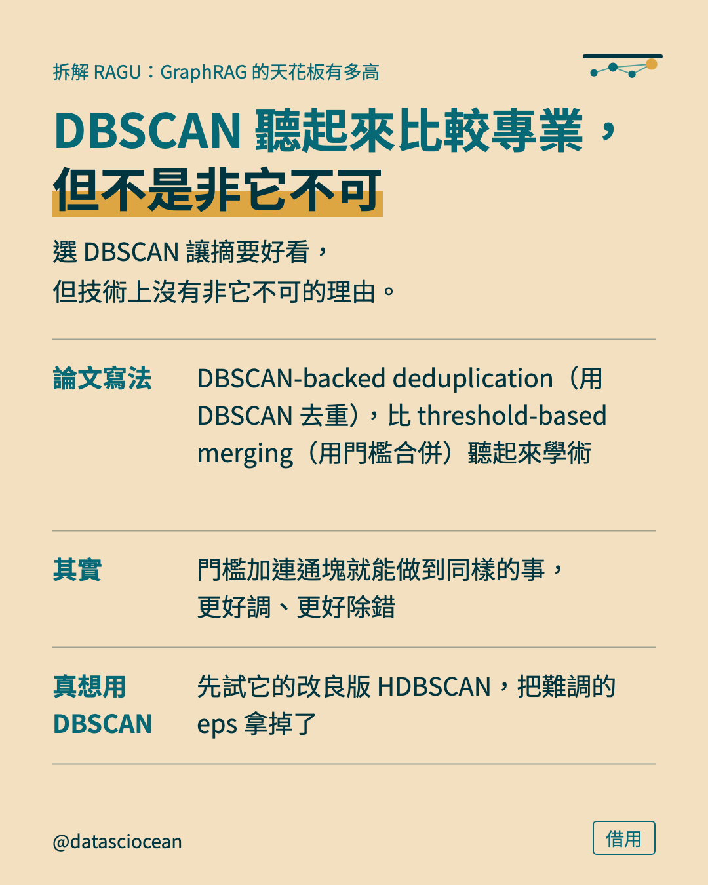

- **小標籤**：借用
- **主標**：DBSCAN 聽起來比較專業，
但不是非它不可
- **補充**：選 DBSCAN 讓摘要好看，但技術上沒有非它不可的理由。
- **表列**：論文寫法｜DBSCAN-backed deduplication（用 DBSCAN 去重），比 threshold-based merging（用門檻合併）聽起來學術
- **表列**：其實｜門檻加連通塊就能做到同樣的事，更好調、更好除錯
- **表列**：真想用 DBSCAN｜先試它的改良版 HDBSCAN，把難調的 eps 拿掉了
- **替代文字**：DBSCAN 聽起來比較專業，
但不是非它不可。選 DBSCAN 讓摘要好看，但技術上沒有非它不可的理由。

## 第 12 頁（帶走）

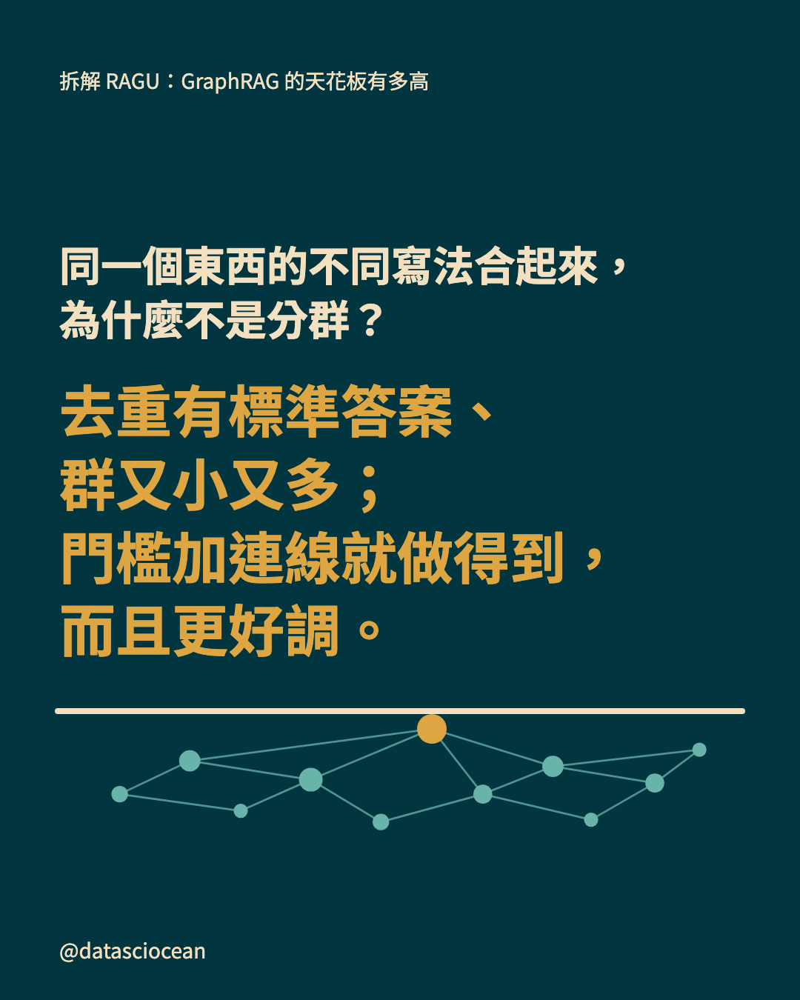

- **先問的問題**：同一個東西的不同寫法合起來，為什麼不是分群？
- **一句話**：去重有標準答案、
群又小又多；
門檻加連線就做得到，
而且更好調。
- **替代文字**：同一個東西的不同寫法合起來，為什麼不是分群？　去重有標準答案、
群又小又多；
門檻加連線就做得到，
而且更好調。

## 第 13 頁（系列地圖）

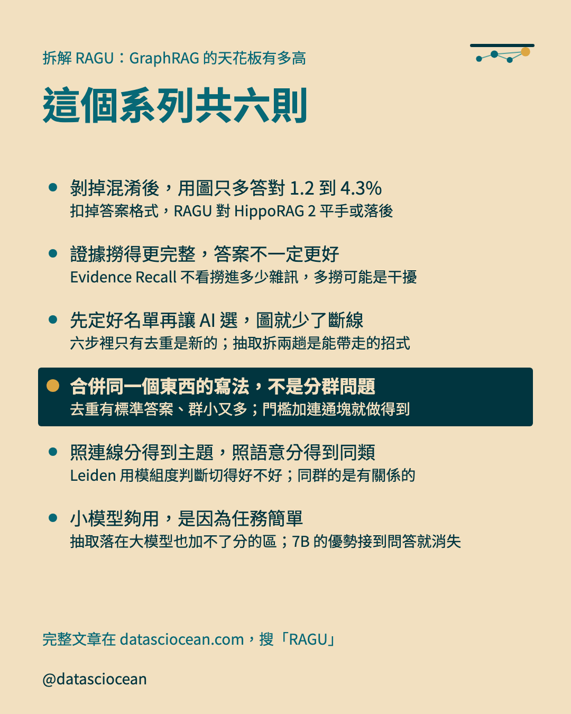

- **主標**：這個系列共六則
- **導流行**：完整文章在 datasciocean.com，搜「RAGU」
- **第 1 則**：剝掉混淆後，用圖只多答對 1.2 到 4.3%　扣掉答案格式，RAGU 對 HippoRAG 2 平手或落後
- **第 2 則**：證據撈得更完整，答案不一定更好　Evidence Recall 不看撈進多少雜訊，多撈可能是干擾
- **第 3 則**：先定好名單再讓 AI 選，圖就少了斷線　六步裡只有去重是新的；抽取拆兩趟是能帶走的招式
- **第 4 則**：合併同一個東西的寫法，不是分群問題　去重有標準答案、群小又多；門檻加連通塊就做得到
- **第 5 則**：照連線分得到主題，照語意分得到同類　Leiden 用模組度判斷切得好不好；同群的是有關係的
- **第 6 則**：小模型夠用，是因為任務簡單　抽取落在大模型也加不了分的區；7B 的優勢接到問答就消失
- **替代文字**：這個系列共六則。剝掉混淆後，用圖只多答對 1.2 到 4.3%：扣掉答案格式，RAGU 對 HippoRAG 2 平手或落後、證據撈得更完整，答案不一定更好：Evidence Recall 不看撈進多少雜訊，多撈可能是干擾、先定好名單再讓 AI 選，圖就少了斷線：六步裡只有去重是新的；抽取拆兩趟是能帶走的招式、合併同一個東西的寫法，不是分群問題：去重有標準答案、群小又多；門檻加連通塊就做得到、照連線分得到主題，照語意分得到同類：Leiden 用模組度判斷切得好不好；同群的是有關係的、小模型夠用，是因為任務簡單：抽取落在大模型也加不了分的區；7B 的優勢接到問答就消失

## Caption（整段貼到 IG）

```text
實體去重（Entity Resolution）不是分群：RAGU 用 DBSCAN，門檻加連線就夠

・群的形狀：去重的群，多半只有 1 到 5 筆
・兩種任務：每一對只有是或否，去重有標準答案（去重是對每一對提及問「是同一個嗎？」）
・變簡單：DBSCAN 用在去重，只剩門檻加連線
・其他線索：去重的線索，不只「像不像」（向量是把名字換成一串數字，越接近代表越像）
・誤合併：合錯比漏合嚴重，父子可能被併成一個人
・實務上的去重：四步做完，沒有分群
・借用：DBSCAN 聽起來比較專業，但不是非它不可

完整文章在 datasciocean.com，搜「RAGU」

#RAGU #GraphRAG #知識圖 #LLM
```
