# Threads：合併同一個東西的寫法，不是分群問題

- 發文方式：**一則輪播貼文**（正文＋全部 13 張圖，順序與 IG 相同），再用一則回覆放連結與系列（連結只放那則回覆）
- 圖檔在 `../ig/`（與 IG 輪播共用同一套）

## 貼文正文（附下方全部圖片）

```text
同一個東西的不同寫法合起來，其實不是分群。

建知識圖時，同一個人會在不同段落各被抽出一次，每一次叫一筆「提及」。把指同一個東西的提及合成一個點叫去重，例如 Bell Labs 和 Bell Laboratories。RAGU 這套 GraphRAG 說它靠分群方法 DBSCAN 去重。

可是去重有標準答案，每一對只有「是同一個」或「不是」；一個實體可能只有 2 筆提及，DBSCAN 的鄰居數下限只能設成 2，結果等於「夠像就連線、連成一串的算同一個」，只是多了一個難調的參數。

更要小心的是合錯：DBSCAN 的半徑稍微放寬，名字很像的 Dennis Ritchie 父子就可能被併成同一個人，而且後面救不回來。不過 DBSCAN 用在哪一層，論文前後說法不一，只能翻原始碼確認。

這是 RAGU 系列的第四則；照連線分群和照語意分群差在哪，在這個系列的下一則。
```

## 附圖（依序）

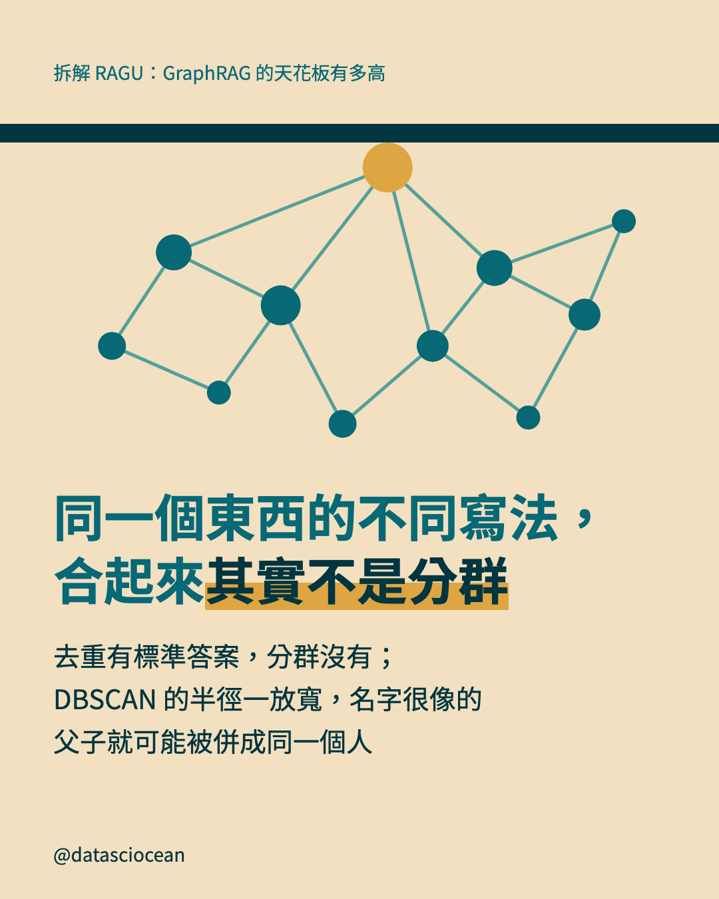
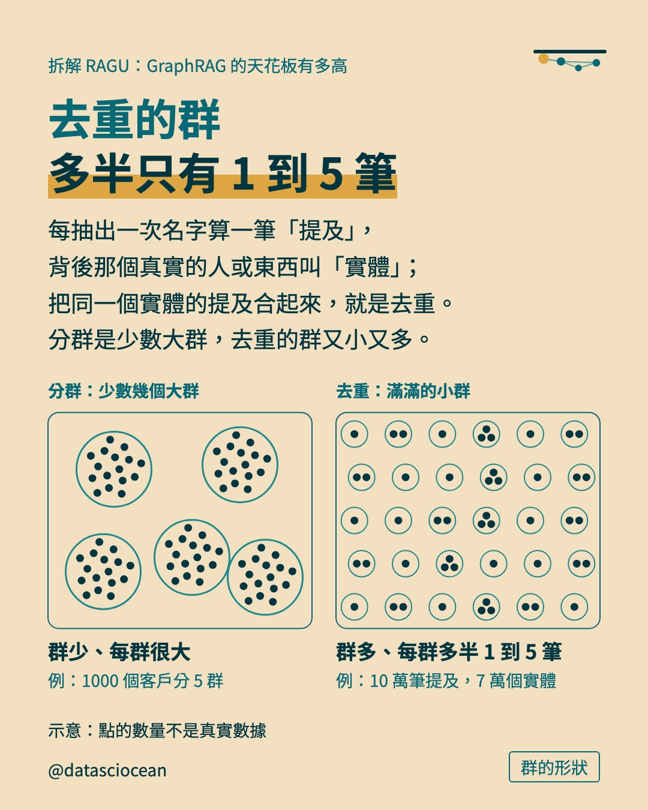
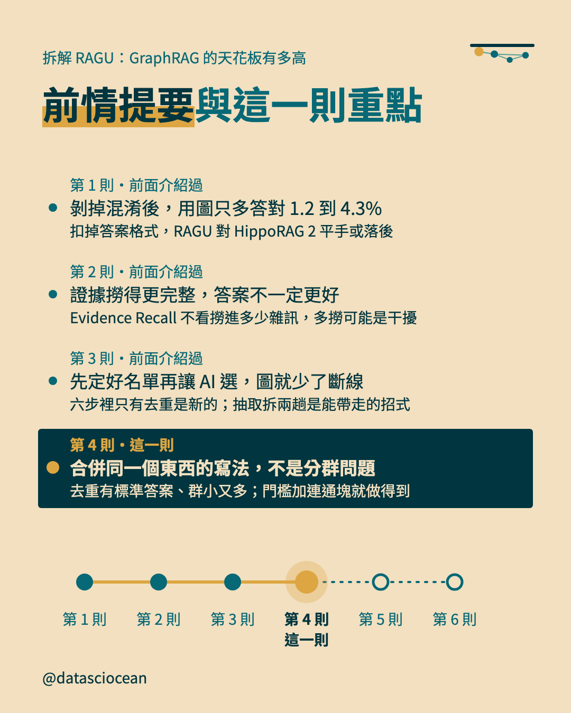
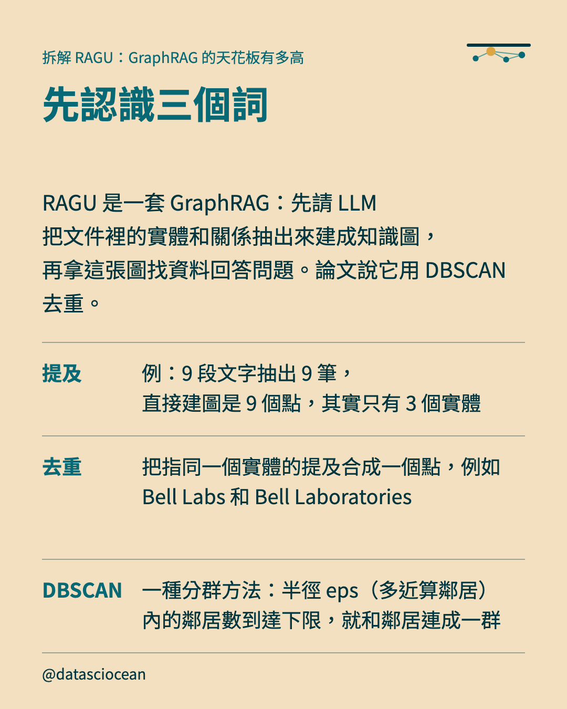
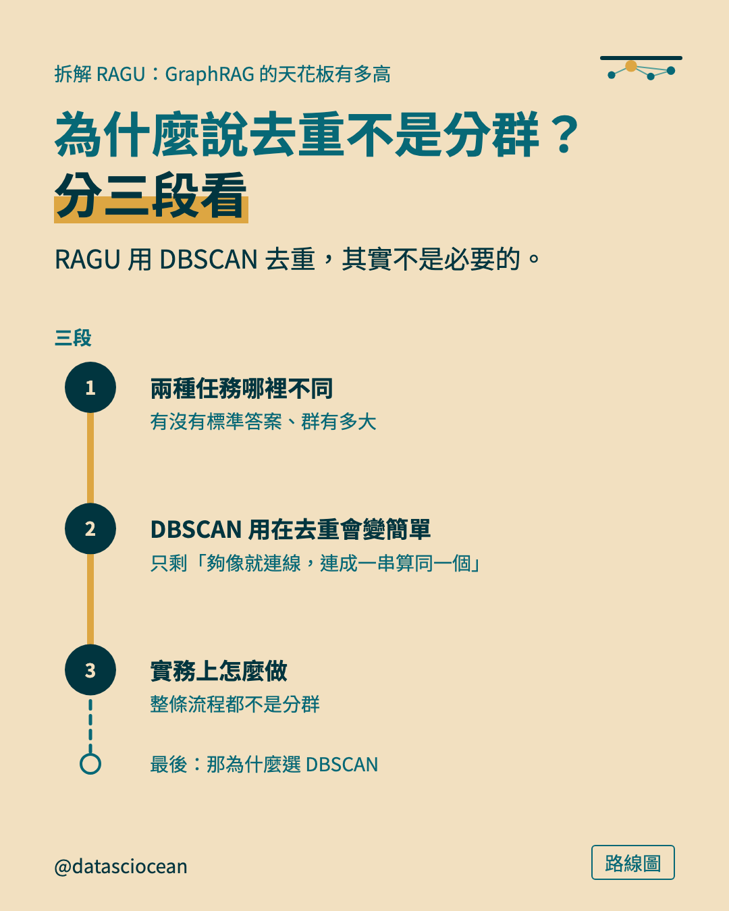
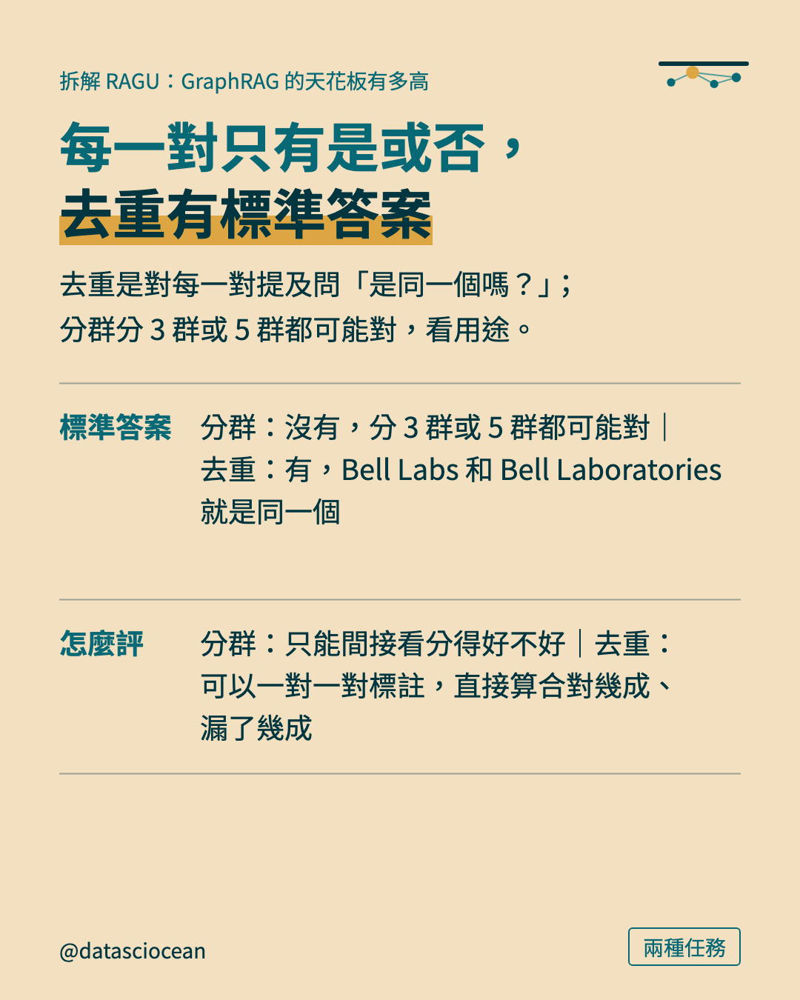
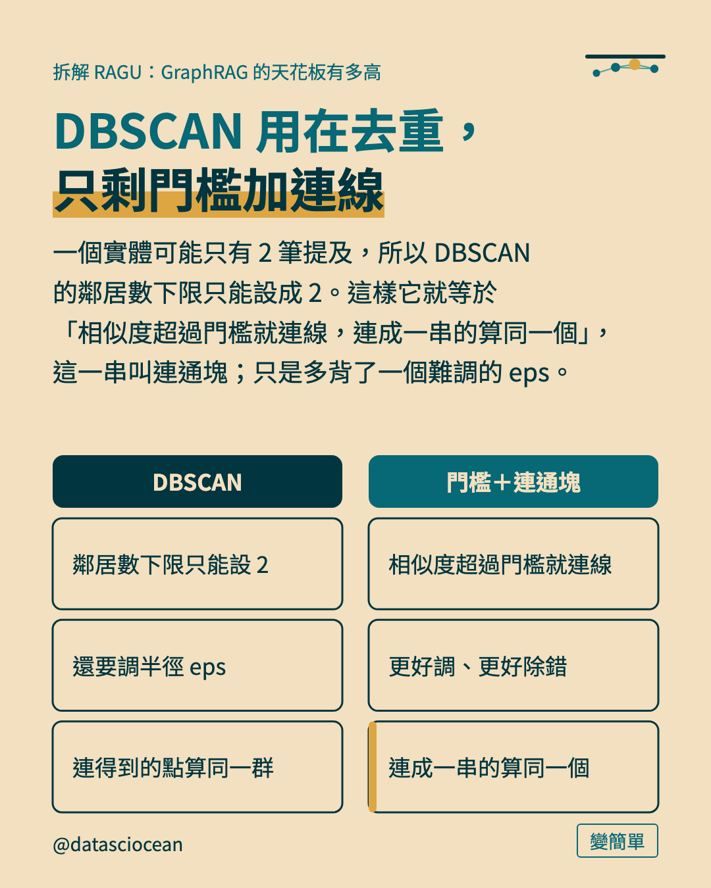
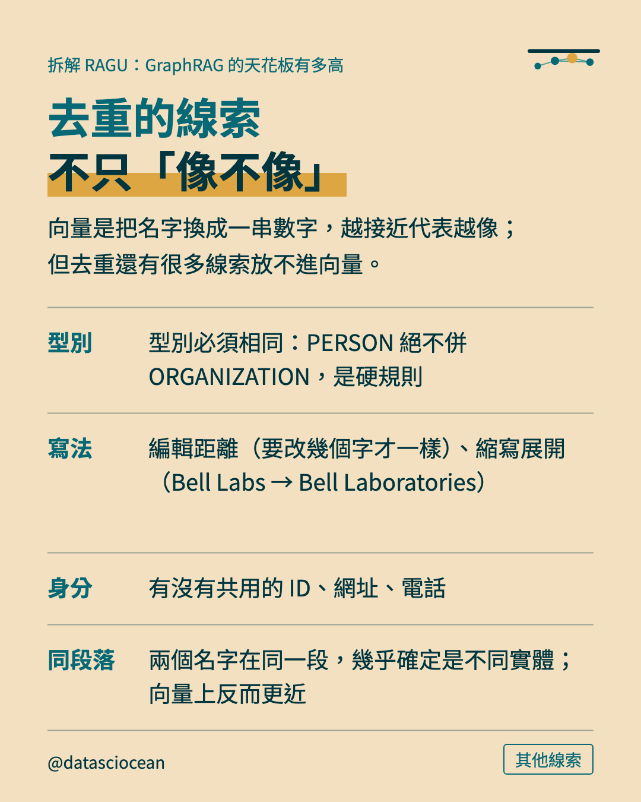
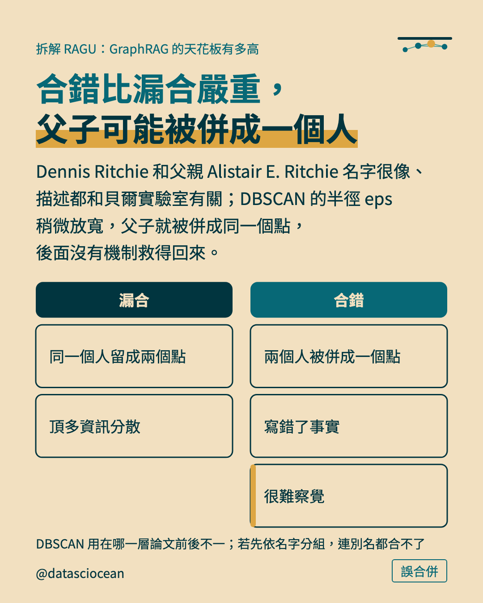
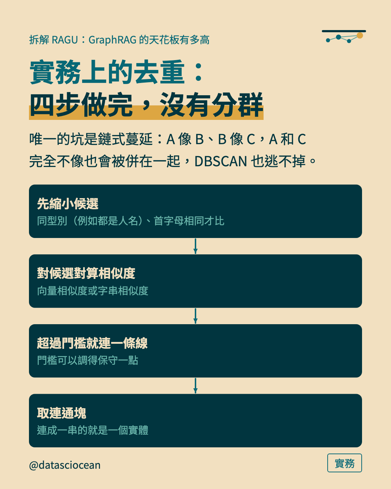
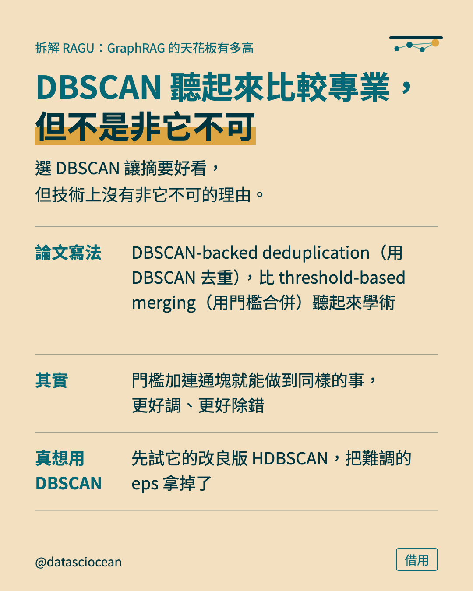
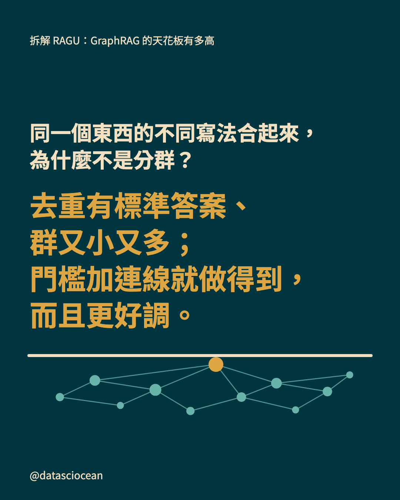
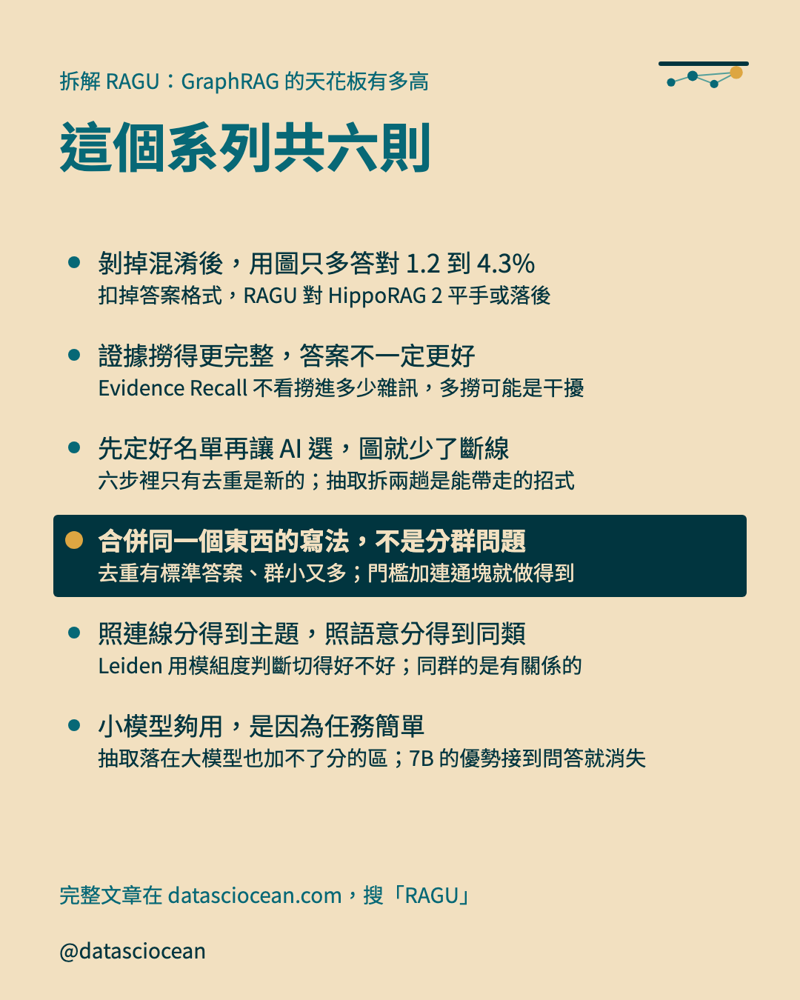

## 回覆：連結與系列

```text
去重有標準答案、群又小又多；門檻加連線就做得到，而且更好調。
文章：datasciocean.com/paper-intro/ragu
同系列：剝掉混淆後，用圖只多答對 1.2 到 4.3%（尚未發布）
同系列：證據撈得更完整，答案不一定更好（尚未發布）
同系列：先定好名單再讓 AI 選，圖就少了斷線（尚未發布）
同系列：照連線分得到主題，照語意分得到同類（尚未發布）
同系列：小模型夠用，是因為任務簡單（尚未發布）
```
