# IG 輪播：照連線分得到主題，照語意分得到同類

- 系列：拆解 RAGU：GraphRAG 的天花板有多高　｜　hook 樣態：反差　｜　共 13 張，**依頁碼順序上傳**
- 每頁下方的「替代文字」貼到 IG 的替代文字欄；最後的 Caption 整段貼上

## 第 1 頁（封面）

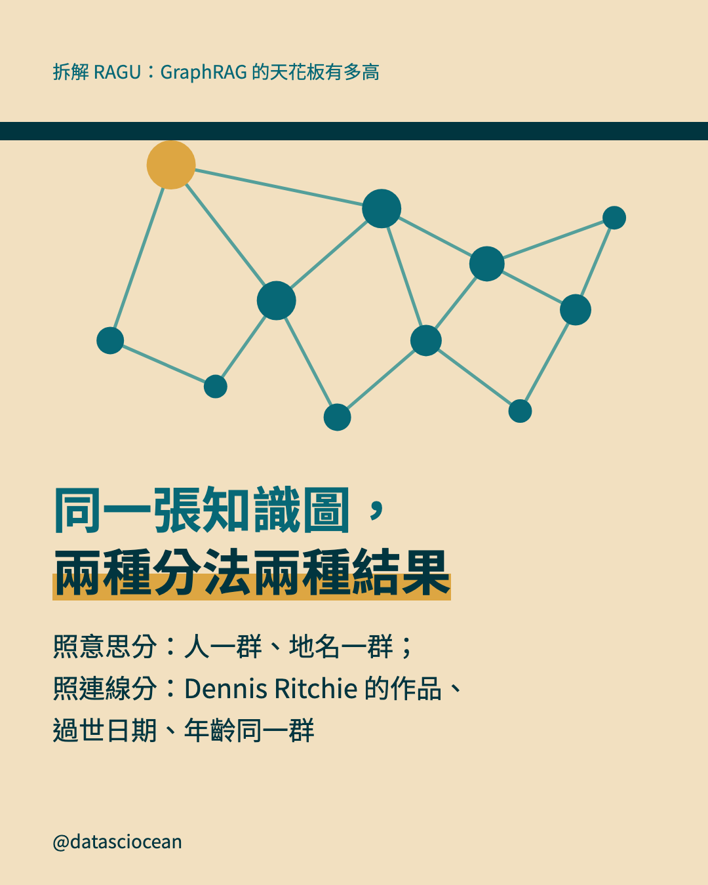

- **主標**：同一張知識圖，
兩種分法兩種結果
- **副標**：照意思分：人一群、地名一群；
照連線分：Dennis Ritchie 的作品、
過世日期、年齡同一群
- **替代文字**：同一張知識圖，
兩種分法兩種結果。照意思分：人一群、地名一群；
照連線分：Dennis Ritchie 的作品、
過世日期、年齡同一群

## 第 2 頁（示意圖）

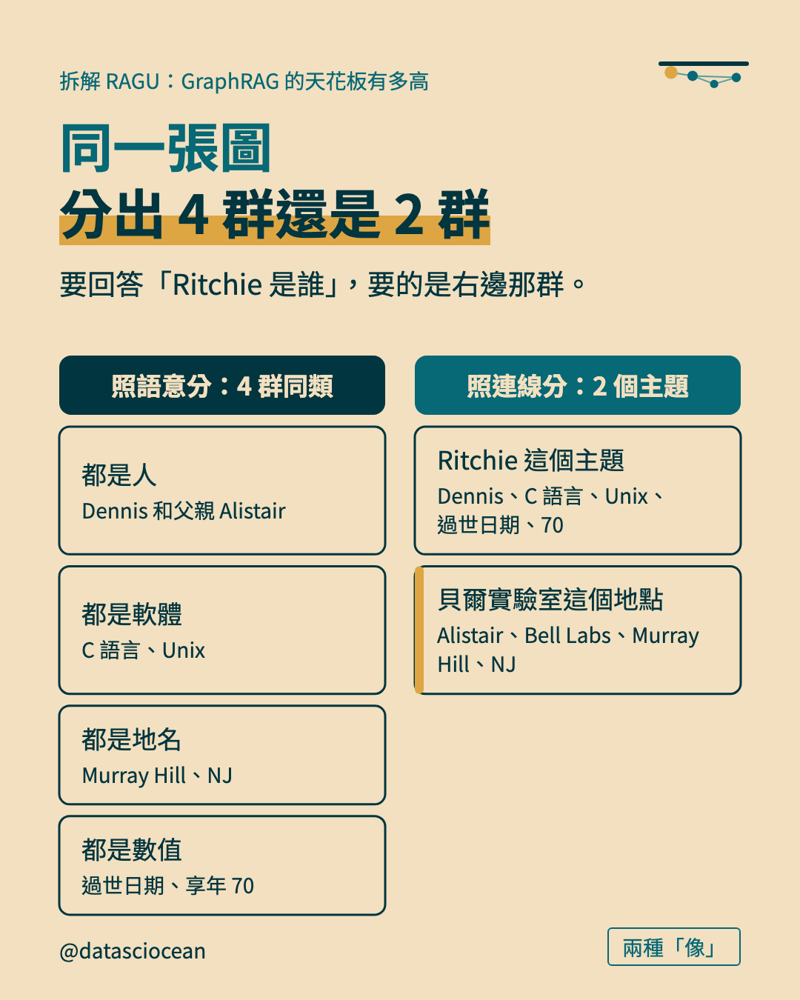

- **小標籤**：兩種「像」
- **主標**：同一張圖
分出 4 群還是 2 群
- **補充**：要回答「Ritchie 是誰」，要的是右邊那群。
- **示意圖（compare）上的文字與數字**：照語意分：4 群同類｜都是人｜Dennis 和父親 Alistair｜都是軟體｜C 語言、Unix｜都是地名｜Murray Hill、NJ｜都是數值｜過世日期、享年 70｜照連線分：2 個主題｜Ritchie 這個主題｜Dennis、C 語言、Unix、過世日期、70｜貝爾實驗室這個地點｜Alistair、Bell Labs、Murray Hill、NJ
- **替代文字**：同一張圖
分出 4 群還是 2 群。要回答「Ritchie 是誰」，要的是右邊那群。。圖上寫：照語意分：4 群同類、都是人、Dennis 和父親 Alistair、都是軟體、C 語言、Unix、都是地名、Murray Hill、NJ、都是數值、過世日期、享年 70、照連線分：2 個主題、Ritchie 這個主題、Dennis、C 語言、Unix、過世日期、70、貝爾實驗室這個地點、Alistair、Bell Labs、Murray Hill、NJ

## 第 3 頁（前情回顧）

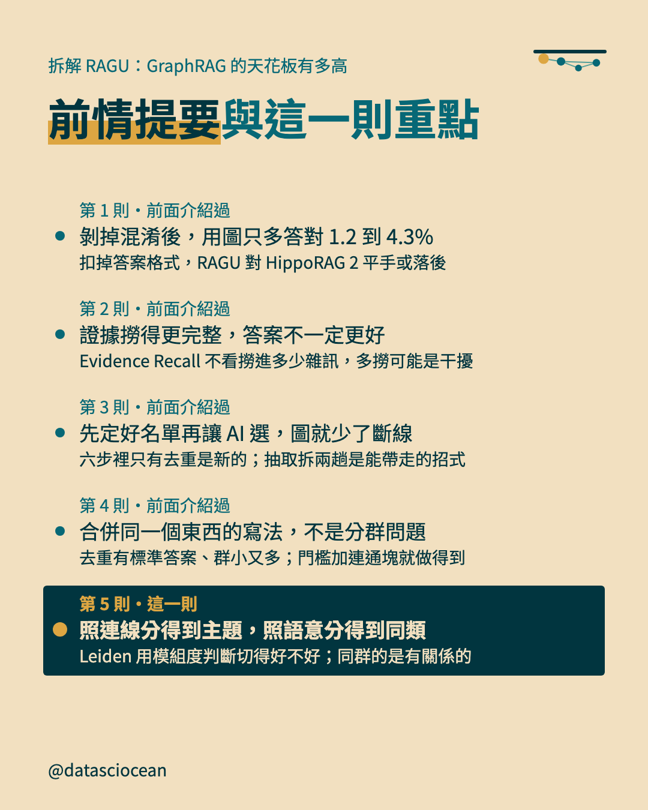

- **主標**：前情提要與這一則重點
- **第 1 則**：剝掉混淆後，用圖只多答對 1.2 到 4.3%　扣掉答案格式，RAGU 對 HippoRAG 2 平手或落後
- **第 2 則**：證據撈得更完整，答案不一定更好　Evidence Recall 不看撈進多少雜訊，多撈可能是干擾
- **第 3 則**：先定好名單再讓 AI 選，圖就少了斷線　六步裡只有去重是新的；抽取拆兩趟是能帶走的招式
- **第 4 則**：合併同一個東西的寫法，不是分群問題　去重有標準答案、群小又多；門檻加連通塊就做得到
- **第 5 則**：照連線分得到主題，照語意分得到同類　Leiden 用模組度判斷切得好不好；同群的是有關係的
- **替代文字**：前情提要與這一則重點。第 1 則「剝掉混淆後，用圖只多答對 1.2 到 4.3%」：扣掉答案格式，RAGU 對 HippoRAG 2 平手或落後；第 2 則「證據撈得更完整，答案不一定更好」：Evidence Recall 不看撈進多少雜訊，多撈可能是干擾；第 3 則「先定好名單再讓 AI 選，圖就少了斷線」：六步裡只有去重是新的；抽取拆兩趟是能帶走的招式；第 4 則「合併同一個東西的寫法，不是分群問題」：去重有標準答案、群小又多；門檻加連通塊就做得到；第 5 則「照連線分得到主題，照語意分得到同類」：Leiden 用模組度判斷切得好不好；同群的是有關係的

## 第 4 頁（脈絡）

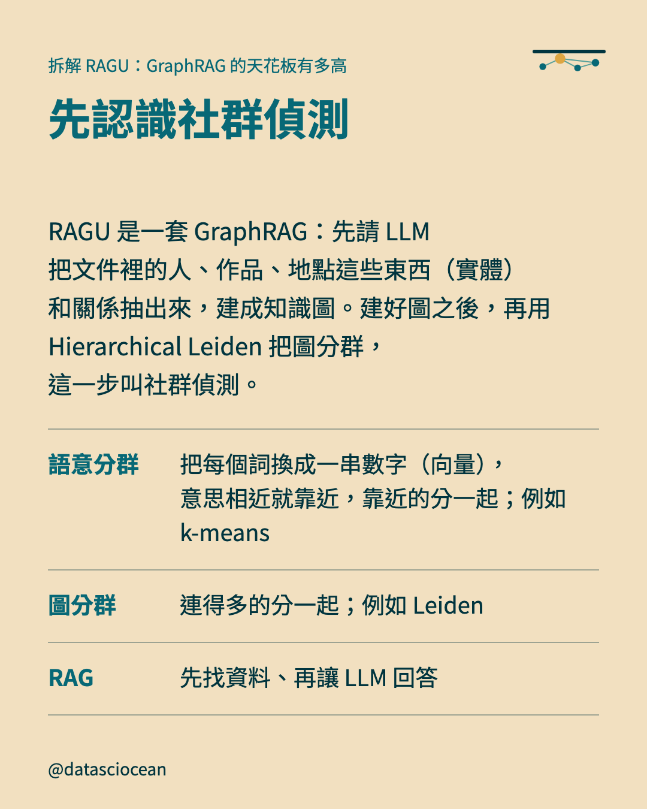

- **主標**：先認識社群偵測
- **補充**：RAGU 是一套 GraphRAG：先請 LLM 把文件裡的人、作品、地點這些東西（實體）和關係抽出來，建成知識圖。建好圖之後，再用 Hierarchical Leiden 把圖分群，這一步叫社群偵測。
- **表列**：語意分群｜把每個詞換成一串數字（向量），意思相近就靠近，靠近的分一起；例如 k-means
- **表列**：圖分群｜連得多的分一起；例如 Leiden
- **表列**：RAG｜先找資料、再讓 LLM 回答
- **替代文字**：先認識社群偵測。RAGU 是一套 GraphRAG：先請 LLM 把文件裡的人、作品、地點這些東西（實體）和關係抽出來，建成知識圖。建好圖之後，再用 Hierarchical Leiden 把圖分群，這一步叫社群偵測。

## 第 5 頁（示意圖）

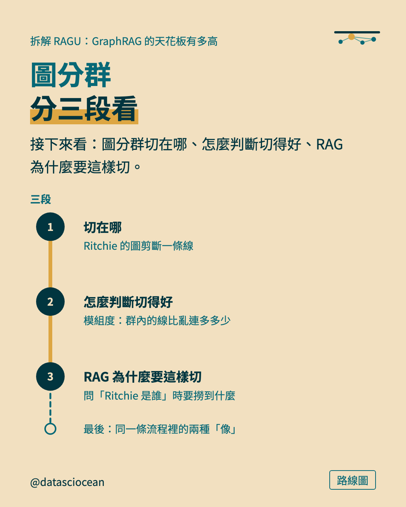

- **小標籤**：路線圖
- **主標**：圖分群
分三段看
- **補充**：接下來看：圖分群切在哪、怎麼判斷切得好、RAG 為什麼要這樣切。
- **示意圖（route）上的文字與數字**：切在哪｜Ritchie 的圖剪斷一條線｜怎麼判斷切得好｜模組度：群內的線比亂連多多少｜RAG 為什麼要這樣切｜問「Ritchie 是誰」時要撈到什麼｜三段｜最後：同一條流程裡的兩種「像」
- **替代文字**：圖分群
分三段看。接下來看：圖分群切在哪、怎麼判斷切得好、RAG 為什麼要這樣切。。圖上寫：切在哪、Ritchie 的圖剪斷一條線、怎麼判斷切得好、模組度：群內的線比亂連多多少、RAG 為什麼要這樣切、問「Ritchie 是誰」時要撈到什麼、三段、最後：同一條流程裡的兩種「像」

## 第 6 頁（示意圖）

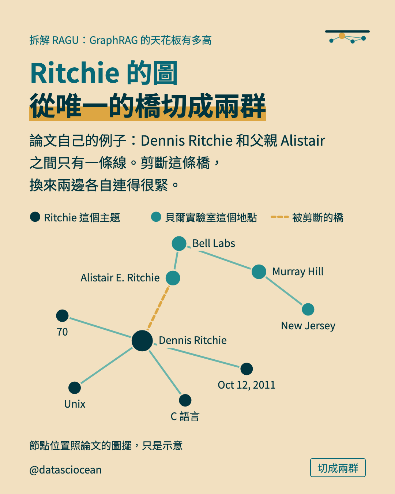

- **小標籤**：切成兩群
- **主標**：Ritchie 的圖
從唯一的橋切成兩群
- **補充**：論文自己的例子：Dennis Ritchie 和父親 Alistair 之間只有一條線。剪斷這條橋，換來兩邊各自連得很緊。
- **示意圖（netgraph）上的文字與數字**：Dennis Ritchie｜C 語言｜Unix｜Oct 12, 2011｜70｜Alistair E. Ritchie｜Bell Labs｜Murray Hill｜New Jersey｜Ritchie 這個主題｜貝爾實驗室這個地點｜被剪斷的橋
- **圖註**：節點位置照論文的圖擺，只是示意
- **替代文字**：Ritchie 的圖
從唯一的橋切成兩群。論文自己的例子：Dennis Ritchie 和父親 Alistair 之間只有一條線。剪斷這條橋，換來兩邊各自連得很緊。。圖上寫：Dennis Ritchie、C 語言、Unix、Oct 12, 2011、70、Alistair E. Ritchie、Bell Labs、Murray Hill、New Jersey、Ritchie 這個主題、貝爾實驗室這個地點、被剪斷的橋

## 第 7 頁（橫條圖）

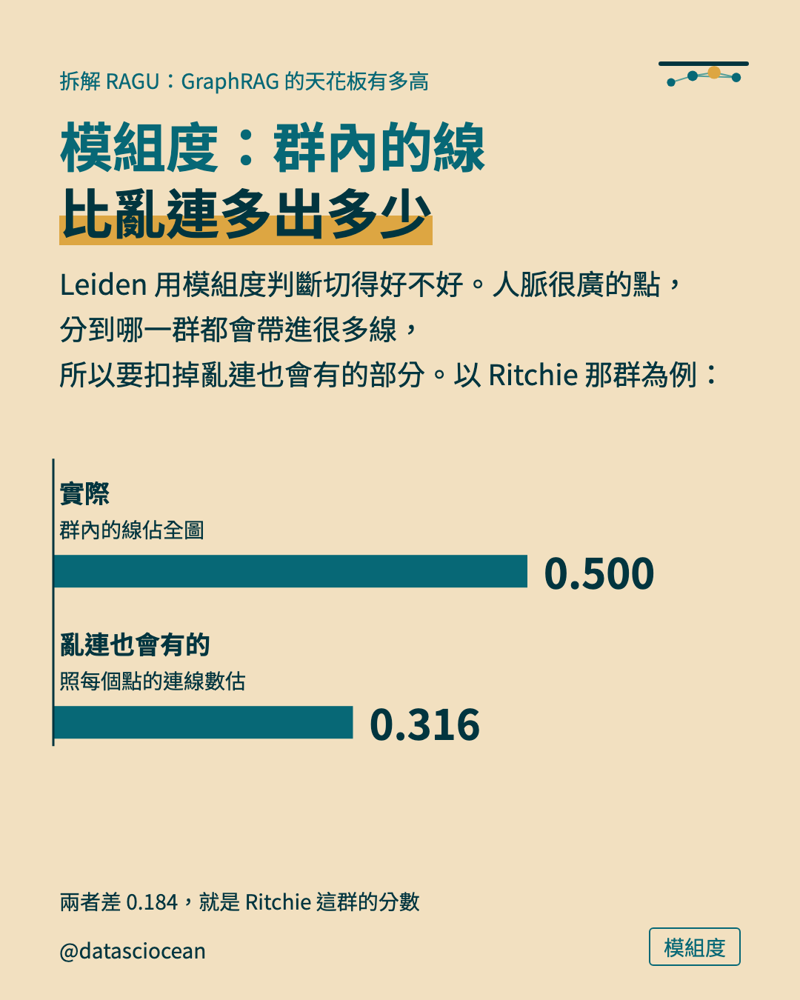

- **小標籤**：模組度
- **主標**：模組度：群內的線
比亂連多出多少
- **補充**：Leiden 用模組度判斷切得好不好。人脈很廣的點，分到哪一群都會帶進很多線，所以要扣掉亂連也會有的部分。以 Ritchie 那群為例：
- **圖上項目**：實際（群內的線佔全圖）＝ 0.5 
- **圖上項目**：亂連也會有的（照每個點的連線數估）＝ 0.316 
- **圖註**：兩者差 0.184，就是 Ritchie 這群的分數
- **替代文字**：模組度：群內的線
比亂連多出多少。Leiden 用模組度判斷切得好不好。人脈很廣的點，分到哪一群都會帶進很多線，所以要扣掉亂連也會有的部分。以 Ritchie 那群為例：

## 第 8 頁（對照表）

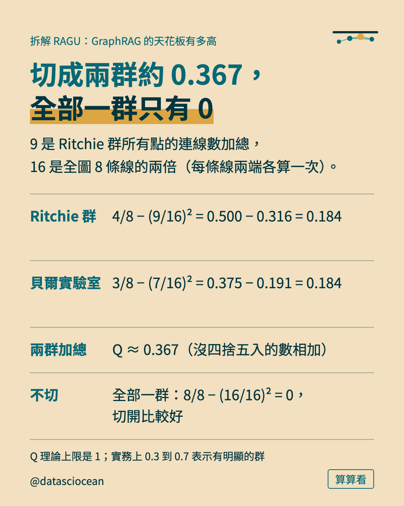

- **小標籤**：算算看
- **主標**：切成兩群約 0.367，
全部一群只有 0
- **補充**：9 是 Ritchie 群所有點的連線數加總，16 是全圖 8 條線的兩倍（每條線兩端各算一次）。
- **表列**：Ritchie 群｜4/8 − (9/16)² = 0.500 − 0.316 = 0.184
- **表列**：貝爾實驗室｜3/8 − (7/16)² = 0.375 − 0.191 = 0.184
- **表列**：兩群加總｜Q ≈ 0.367（沒四捨五入的數相加）
- **表列**：不切｜全部一群：8/8 − (16/16)² = 0，切開比較好
- **圖註**：Q 理論上限是 1；實務上 0.3 到 0.7 表示有明顯的群
- **替代文字**：切成兩群約 0.367，
全部一群只有 0。9 是 Ritchie 群所有點的連線數加總，16 是全圖 8 條線的兩倍（每條線兩端各算一次）。

## 第 9 頁（示意圖）

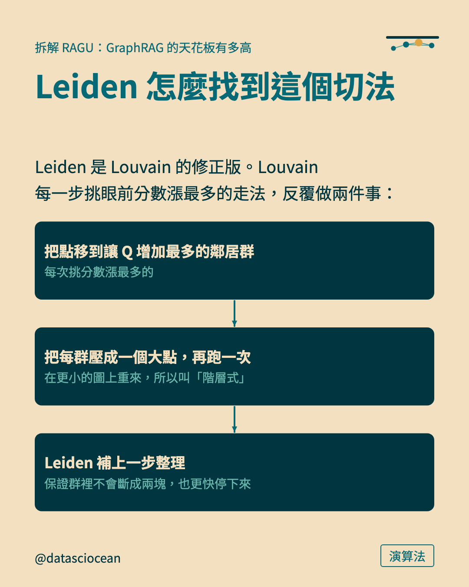

- **小標籤**：演算法
- **主標**：Leiden 怎麼找到這個切法
- **補充**：Leiden 是 Louvain 的修正版。Louvain 每一步挑眼前分數漲最多的走法，反覆做兩件事：
- **示意圖（flow）上的文字與數字**：把點移到讓 Q 增加最多的鄰居群｜每次挑分數漲最多的｜把每群壓成一個大點，再跑一次｜在更小的圖上重來，所以叫「階層式」｜Leiden 補上一步整理｜保證群裡不會斷成兩塊，也更快停下來
- **替代文字**：Leiden 怎麼找到這個切法。Leiden 是 Louvain 的修正版。Louvain 每一步挑眼前分數漲最多的走法，反覆做兩件事：。圖上寫：把點移到讓 Q 增加最多的鄰居群、每次挑分數漲最多的、把每群壓成一個大點，再跑一次、在更小的圖上重來，所以叫「階層式」、Leiden 補上一步整理、保證群裡不會斷成兩塊，也更快停下來

## 第 10 頁（示意圖）

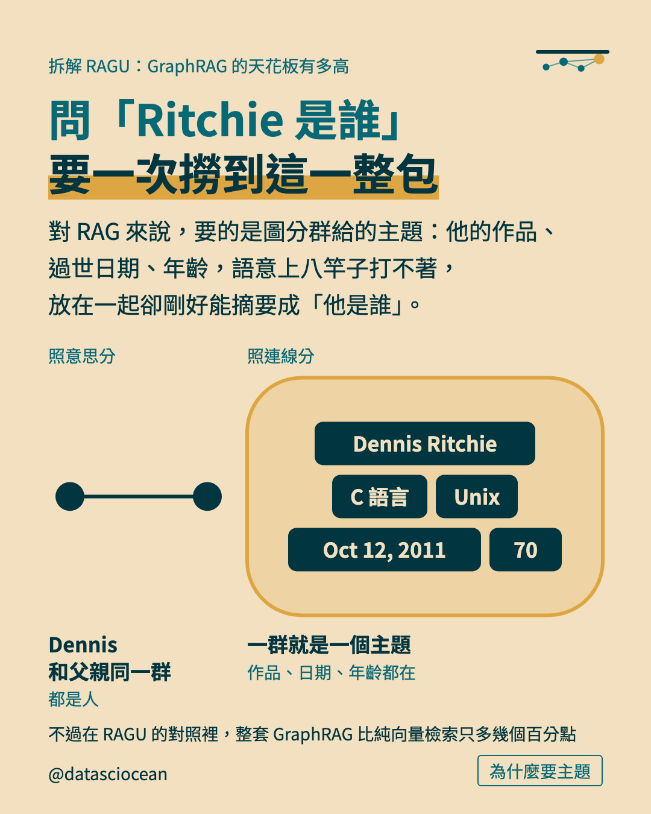

- **小標籤**：為什麼要主題
- **主標**：問「Ritchie 是誰」
要一次撈到這一整包
- **補充**：對 RAG 來說，要的是圖分群給的主題：他的作品、過世日期、年齡，語意上八竿子打不著，放在一起卻剛好能摘要成「他是誰」。
- **示意圖（bubble）上的文字與數字**：Dennis 和父親同一群｜都是人｜一群就是一個主題｜作品、日期、年齡都在｜Dennis Ritchie｜C 語言｜Unix｜Oct 12, 2011｜70｜照意思分｜照連線分
- **圖註**：不過在 RAGU 的對照裡，整套 GraphRAG 比純向量檢索只多幾個百分點
- **替代文字**：問「Ritchie 是誰」
要一次撈到這一整包。對 RAG 來說，要的是圖分群給的主題：他的作品、過世日期、年齡，語意上八竿子打不著，放在一起卻剛好能摘要成「他是誰」。。圖上寫：Dennis 和父親同一群、都是人、一群就是一個主題、作品、日期、年齡都在、Dennis Ritchie、C 語言、Unix、Oct 12, 2011、70、照意思分、照連線分

## 第 11 頁（示意圖）

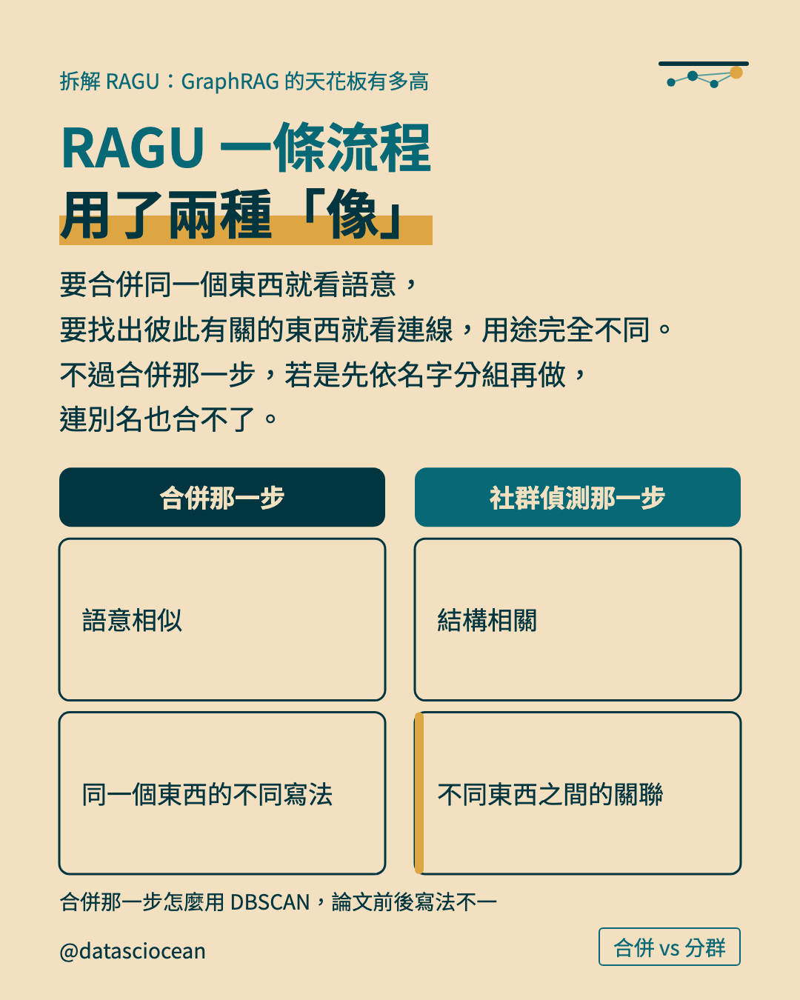

- **小標籤**：合併 vs 分群
- **主標**：RAGU 一條流程
用了兩種「像」
- **補充**：要合併同一個東西就看語意，要找出彼此有關的東西就看連線，用途完全不同。不過合併那一步，若是先依名字分組再做，連別名也合不了。
- **示意圖（compare）上的文字與數字**：合併那一步｜語意相似｜同一個東西的不同寫法｜社群偵測那一步｜結構相關｜不同東西之間的關聯
- **圖註**：合併那一步怎麼用 DBSCAN，論文前後寫法不一
- **替代文字**：RAGU 一條流程
用了兩種「像」。要合併同一個東西就看語意，要找出彼此有關的東西就看連線，用途完全不同。不過合併那一步，若是先依名字分組再做，連別名也合不了。。圖上寫：合併那一步、語意相似、同一個東西的不同寫法、社群偵測那一步、結構相關、不同東西之間的關聯

## 第 12 頁（帶走）

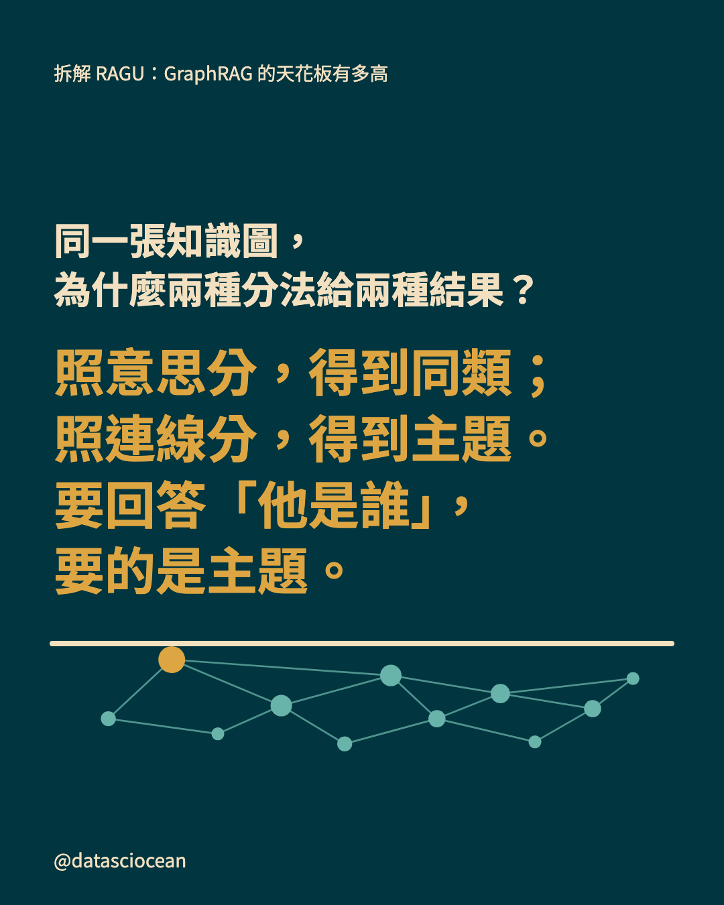

- **先問的問題**：同一張知識圖，為什麼兩種分法給兩種結果？
- **一句話**：照意思分，得到同類；
照連線分，得到主題。
要回答「他是誰」，
要的是主題。
- **替代文字**：同一張知識圖，為什麼兩種分法給兩種結果？　照意思分，得到同類；
照連線分，得到主題。
要回答「他是誰」，
要的是主題。

## 第 13 頁（系列地圖）

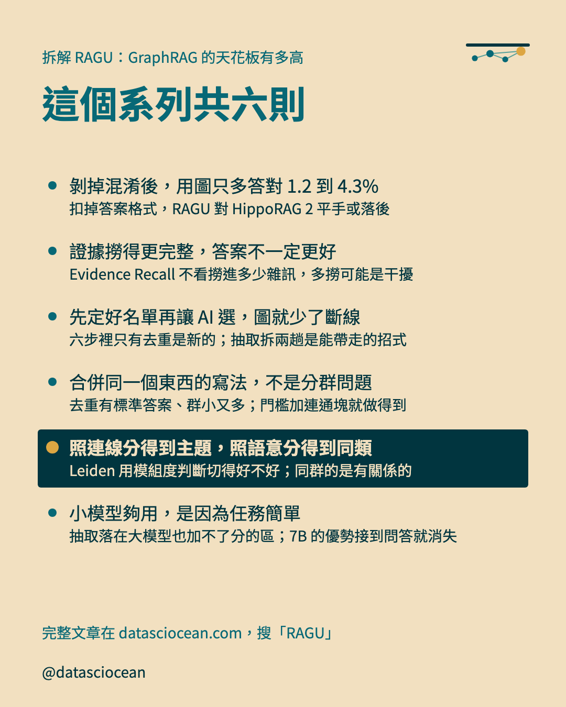

- **主標**：這個系列共六則
- **導流行**：完整文章在 datasciocean.com，搜「RAGU」
- **第 1 則**：剝掉混淆後，用圖只多答對 1.2 到 4.3%　扣掉答案格式，RAGU 對 HippoRAG 2 平手或落後
- **第 2 則**：證據撈得更完整，答案不一定更好　Evidence Recall 不看撈進多少雜訊，多撈可能是干擾
- **第 3 則**：先定好名單再讓 AI 選，圖就少了斷線　六步裡只有去重是新的；抽取拆兩趟是能帶走的招式
- **第 4 則**：合併同一個東西的寫法，不是分群問題　去重有標準答案、群小又多；門檻加連通塊就做得到
- **第 5 則**：照連線分得到主題，照語意分得到同類　Leiden 用模組度判斷切得好不好；同群的是有關係的
- **第 6 則**：小模型夠用，是因為任務簡單　抽取落在大模型也加不了分的區；7B 的優勢接到問答就消失
- **替代文字**：這個系列共六則。剝掉混淆後，用圖只多答對 1.2 到 4.3%：扣掉答案格式，RAGU 對 HippoRAG 2 平手或落後、證據撈得更完整，答案不一定更好：Evidence Recall 不看撈進多少雜訊，多撈可能是干擾、先定好名單再讓 AI 選，圖就少了斷線：六步裡只有去重是新的；抽取拆兩趟是能帶走的招式、合併同一個東西的寫法，不是分群問題：去重有標準答案、群小又多；門檻加連通塊就做得到、照連線分得到主題，照語意分得到同類：Leiden 用模組度判斷切得好不好；同群的是有關係的、小模型夠用，是因為任務簡單：抽取落在大模型也加不了分的區；7B 的優勢接到問答就消失

## Caption（整段貼到 IG）

```text
GraphRAG 的知識圖分群（Leiden、模組度）：照連線分得到主題，照語意分得到同類

・兩種「像」：同一張圖，分出 4 群還是 2 群（要回答「Ritchie 是誰」，要的是右邊那群）
・切成兩群：Ritchie 的圖，從唯一的橋切成兩群
・模組度：群內的線，比亂連多出多少（Leiden 用模組度判斷切得好不好）
・算算看：切成兩群約 0.367，全部一群只有 0
・演算法：Leiden 怎麼找到這個切法（Leiden 是 Louvain 的修正版）
・為什麼要主題：問「Ritchie 是誰」，要一次撈到這一整包
・合併 vs 分群：RAGU 一條流程，用了兩種「像」

圖片來源：第 6 張（圖三）改繪自原始論文的圖表

完整文章在 datasciocean.com，搜「RAGU」

#RAGU #GraphRAG #知識圖 #LLM
```
