# Threads：照連線分得到主題，照語意分得到同類

- 發文方式：**一則輪播貼文**（正文＋全部 13 張圖，順序與 IG 相同），再用一則回覆放連結與系列（連結只放那則回覆）
- 圖檔在 `../ig/`（與 IG 輪播共用同一套）

## 貼文正文（附下方全部圖片）

```text
同一張知識圖，分兩次群，結果很不一樣。

照意思分，Dennis Ritchie 和他父親都是人，就分一起；照連線分，Ritchie 的作品、過世日期、年齡都連在他身上，就分一起。一邊是一類一類，一邊是一個一個主題。

為什麼 RAG 要後者？因為使用者問「Ritchie 是誰」，你希望一次撈到他的作品、死亡日期、年齡，這些東西語意上八竿子打不著，卻共同構成一個能被摘要的主題。不過 RAGU 自己的對照裡，整套 GraphRAG 比純向量檢索，淨貢獻只有幾個百分點。

還有一個沒說清楚的地方：RAGU 合併那一步怎麼用 DBSCAN，論文前後寫法不一，只能翻原始碼確認。

這是 RAGU 系列的第五則；抽取用的小模型為什麼夠用，在這個系列的下一則。
```

## 附圖（依序）

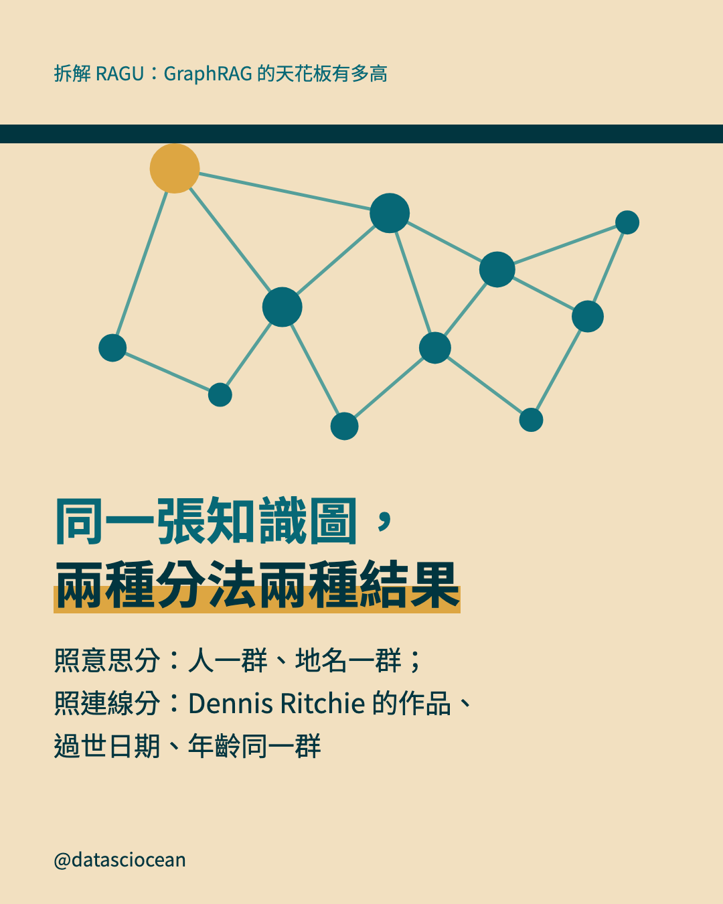
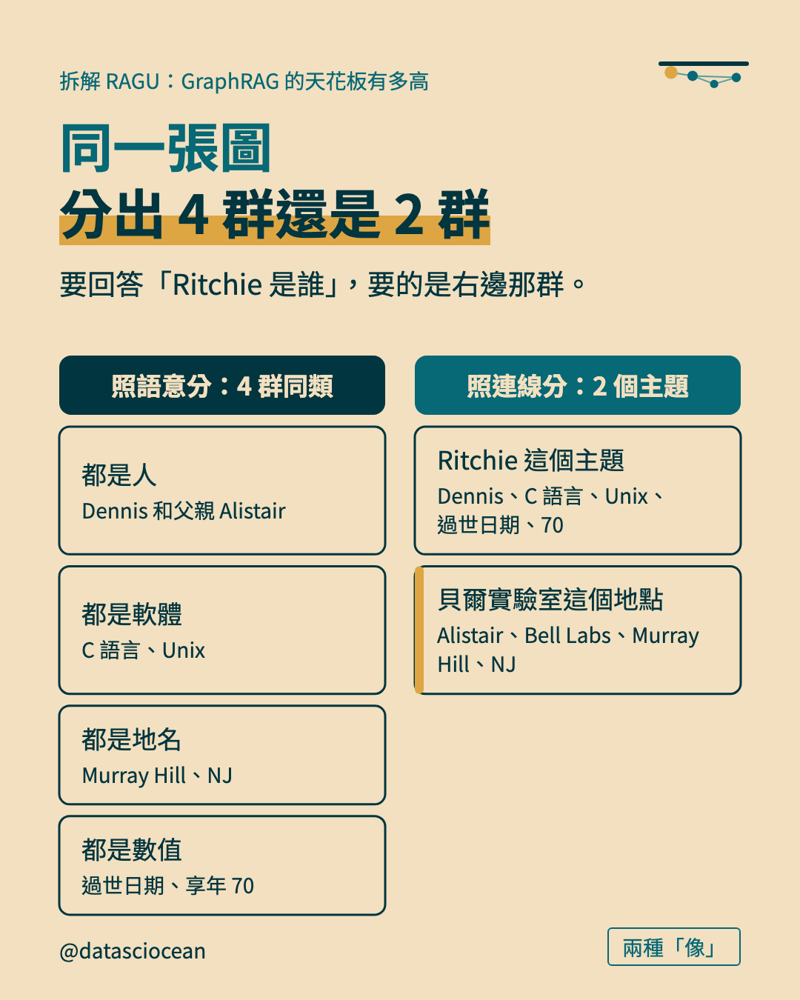
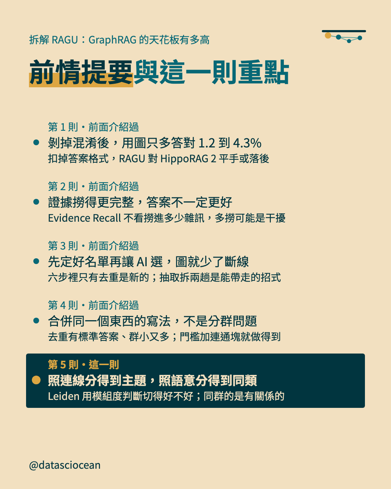
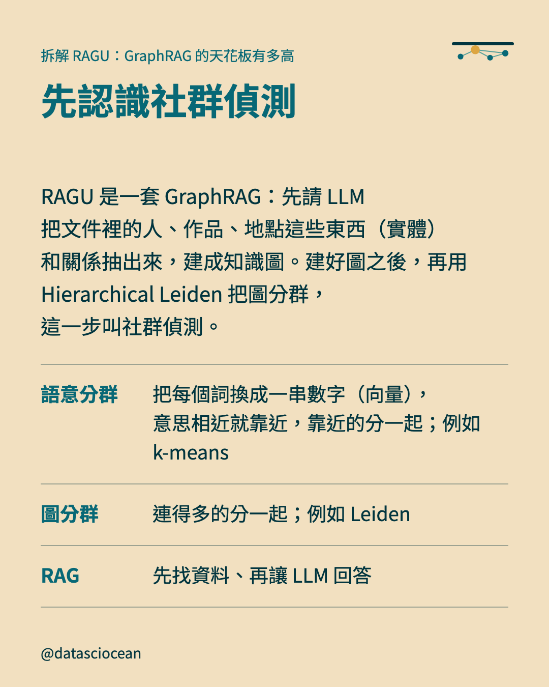
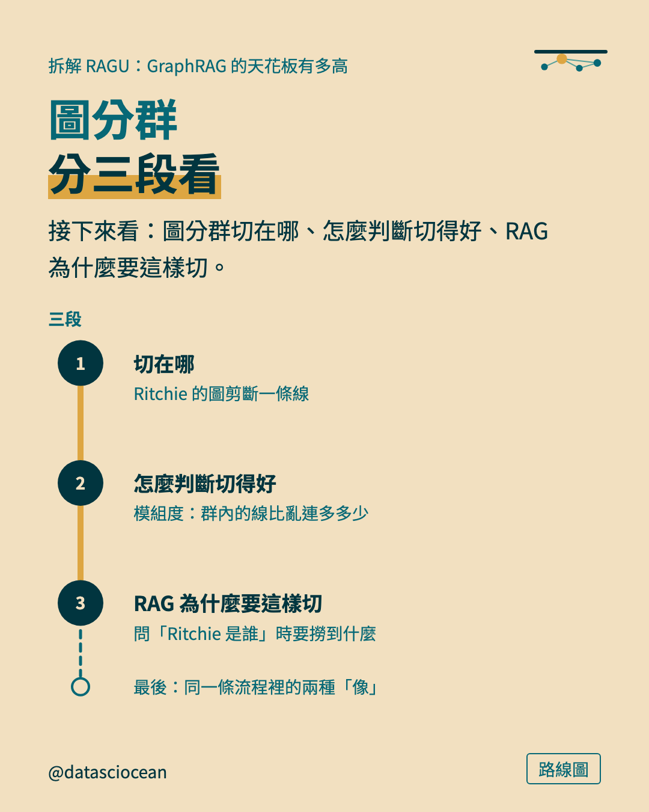
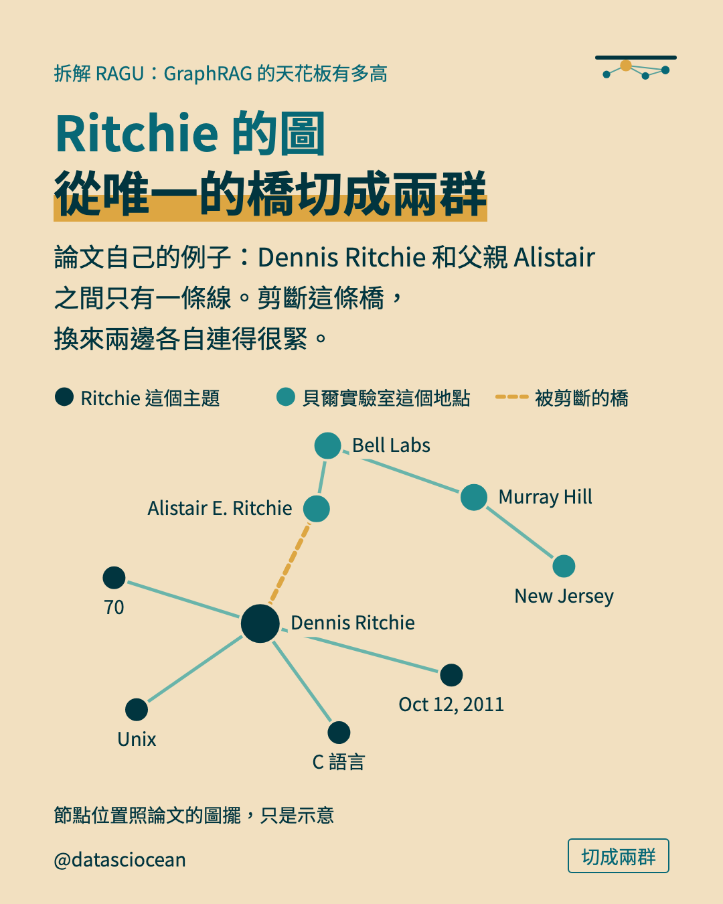
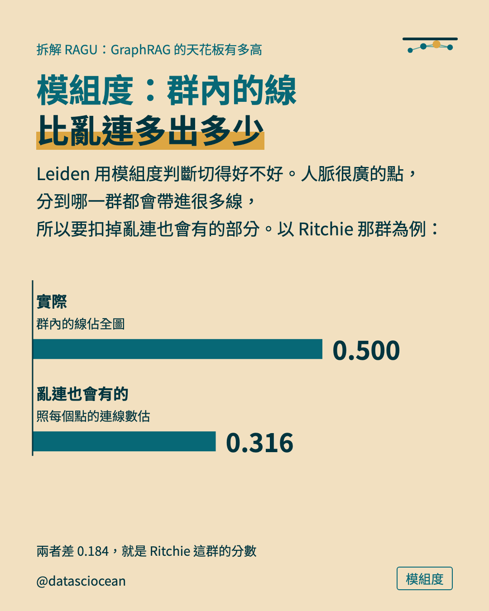
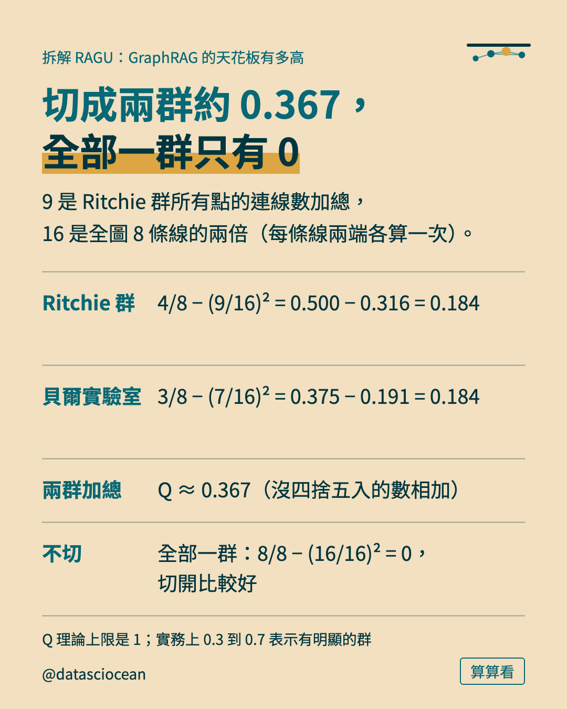
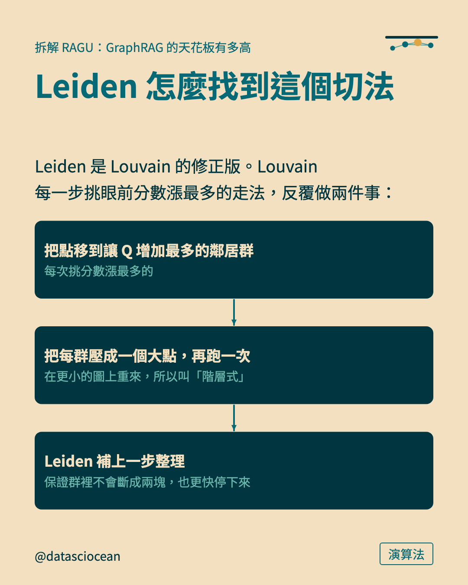
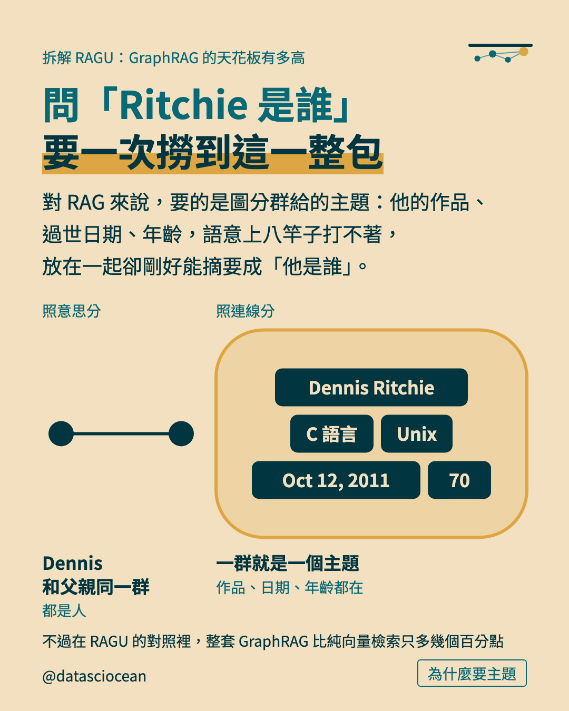
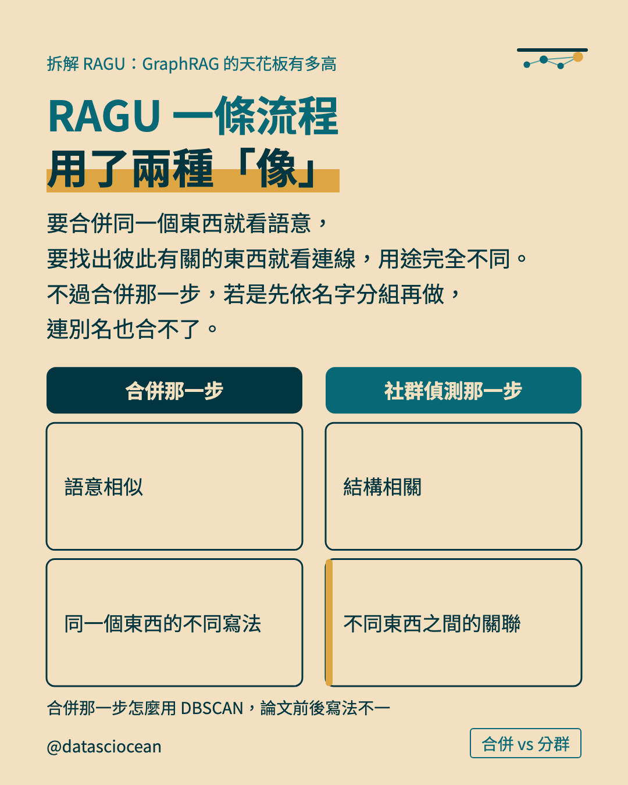
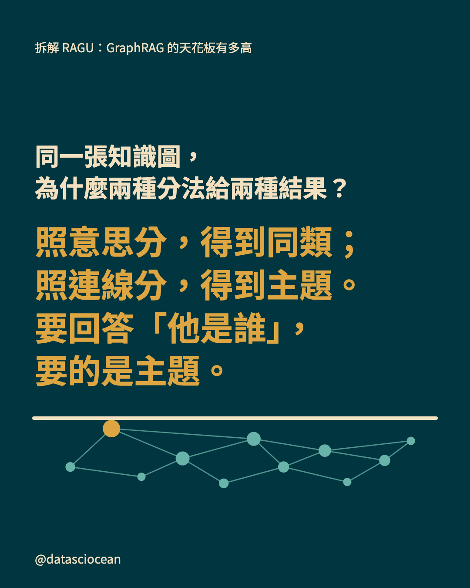
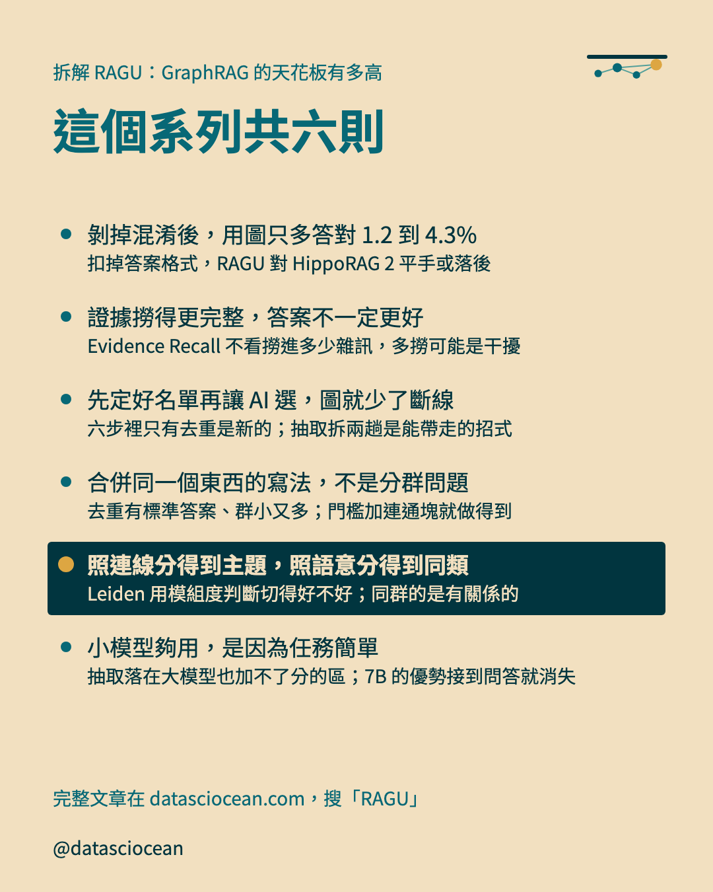

## 回覆：連結與系列

```text
照意思分，得到同類；照連線分，得到主題。要回答「他是誰」，要的是主題。
文章：datasciocean.com/paper-intro/ragu
同系列：剝掉混淆後，用圖只多答對 1.2 到 4.3%（尚未發布）
同系列：證據撈得更完整，答案不一定更好（尚未發布）
同系列：先定好名單再讓 AI 選，圖就少了斷線（尚未發布）
同系列：合併同一個東西的寫法，不是分群問題（尚未發布）
同系列：小模型夠用，是因為任務簡單（尚未發布）
```
