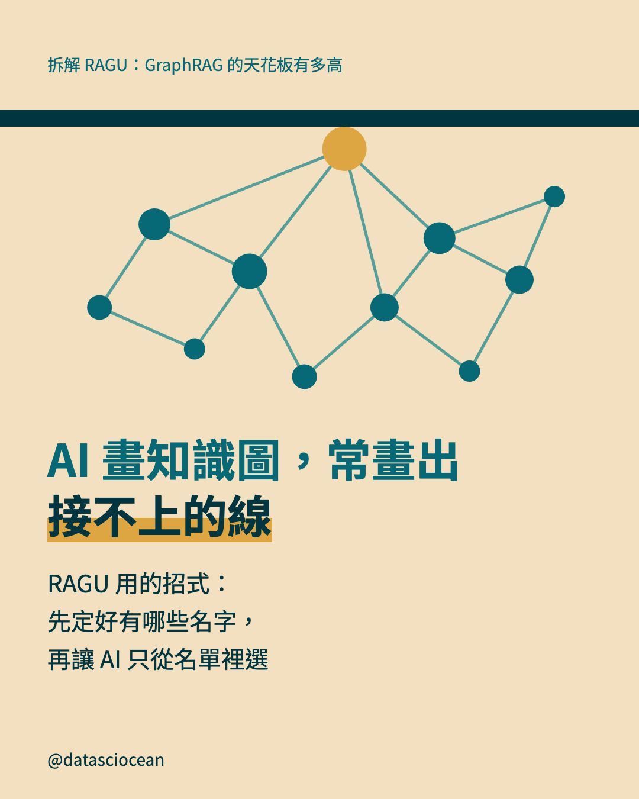
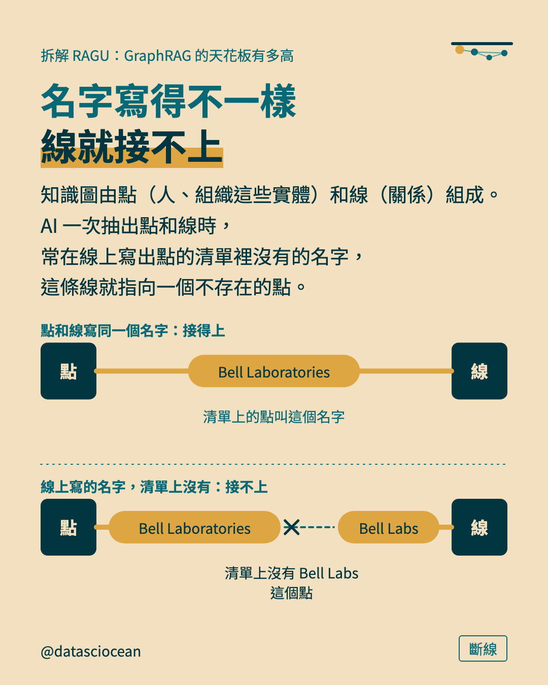
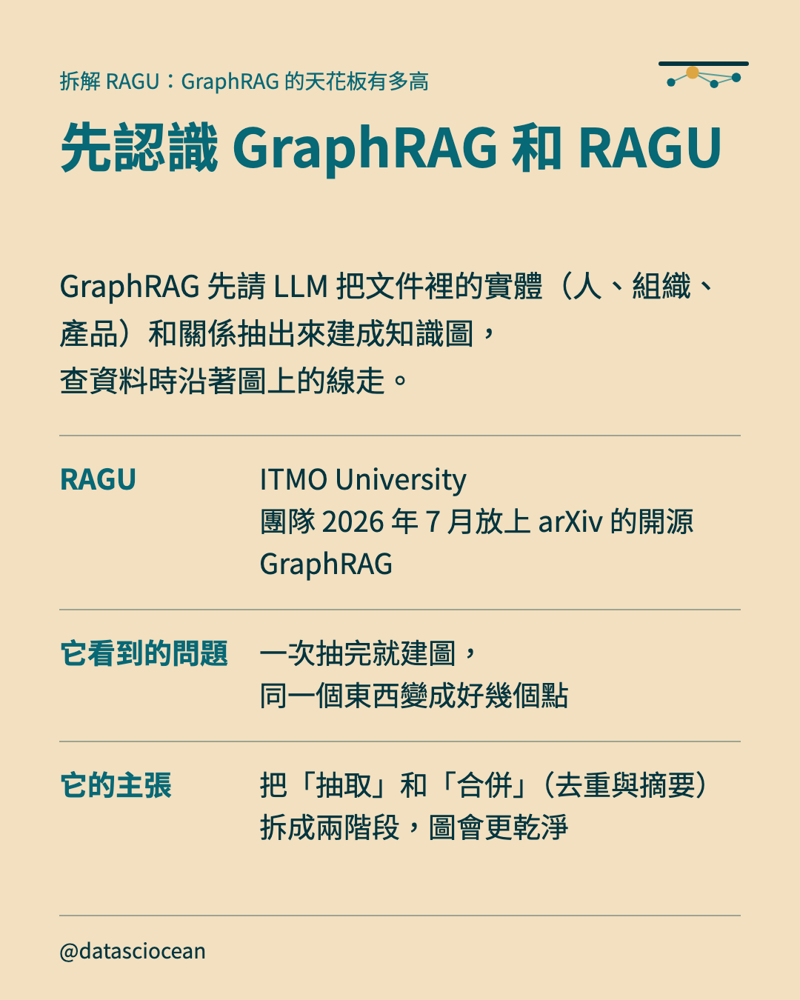
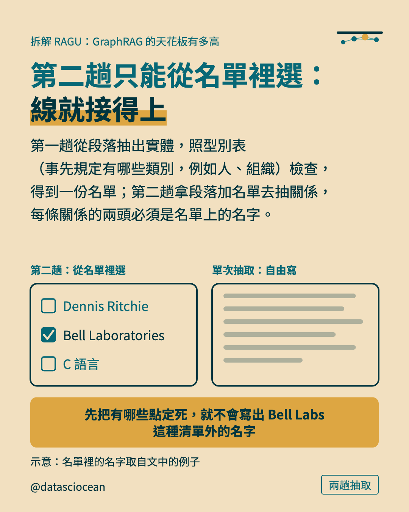
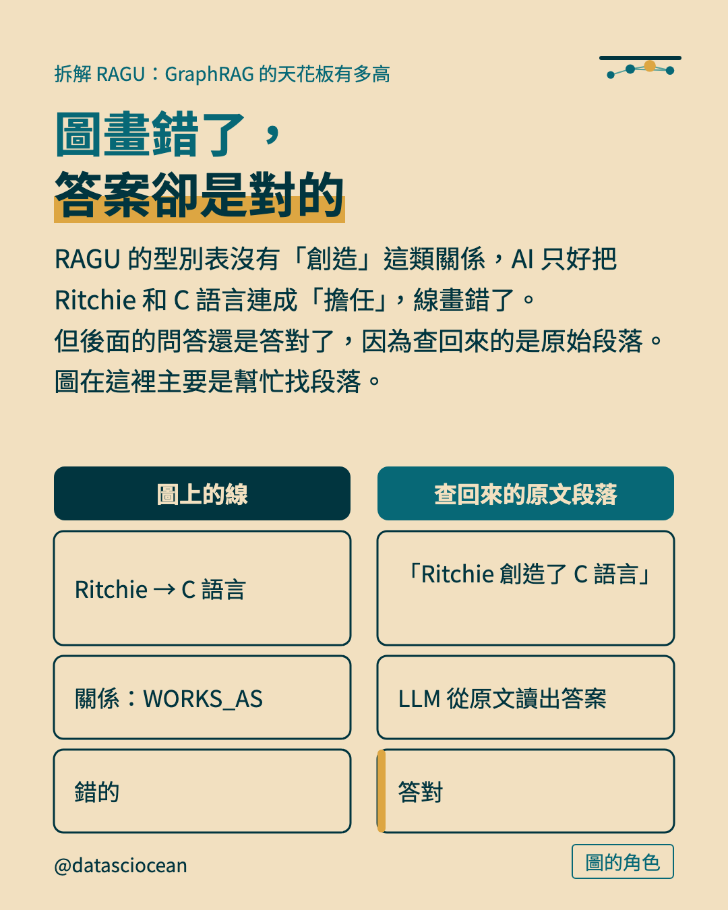
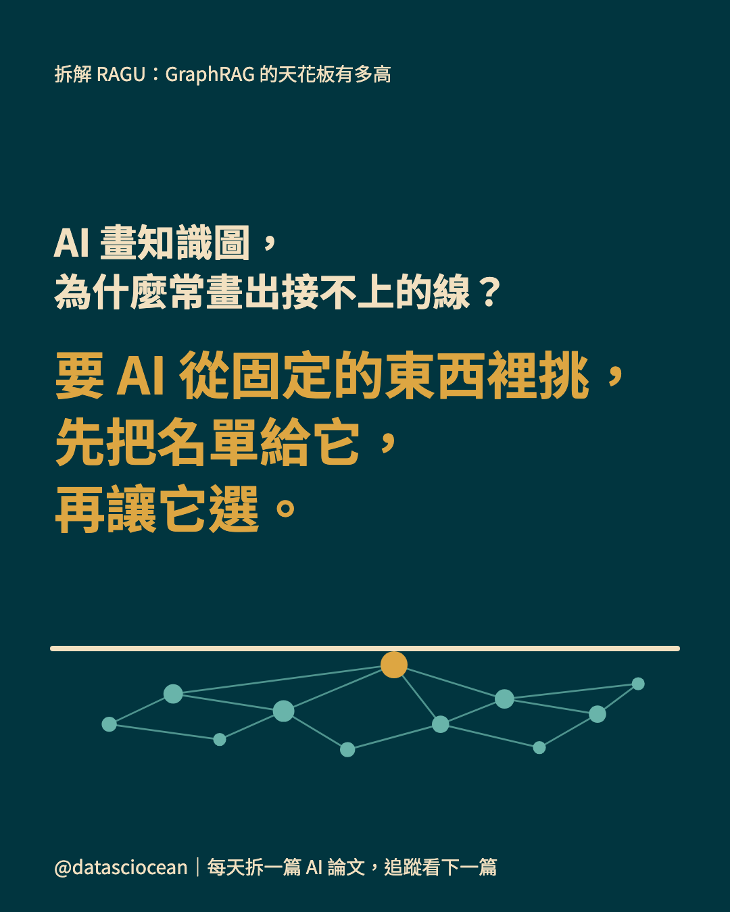
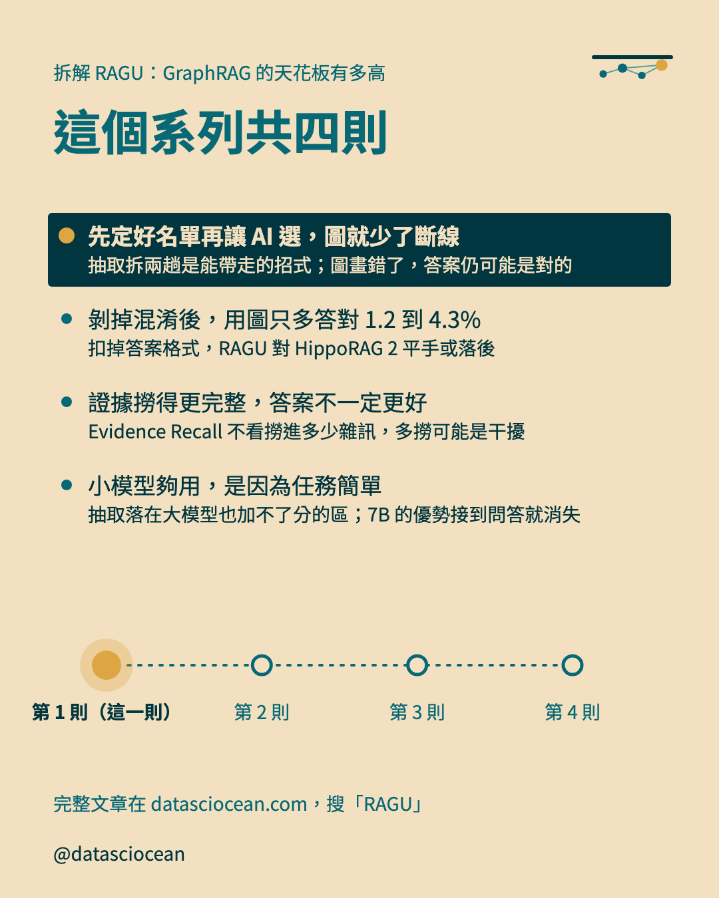

# IG 輪播：先定好名單再讓 AI 選，圖就少了斷線

- 系列：拆解 RAGU：GraphRAG 的天花板有多高　｜　hook 樣態：痛點　｜　共 7 張，**依頁碼順序上傳**
- 每頁下方的「替代文字」貼到 IG 的替代文字欄；最後的 Caption 整段貼上

## 第 1 頁（封面）



- **主標**：AI 畫知識圖，常畫出
接不上的線
- **副標**：RAGU 用的招式：
先定好有哪些名字，
再讓 AI 只從名單裡選
- **替代文字**：AI 畫知識圖，常畫出
接不上的線。RAGU 用的招式：
先定好有哪些名字，
再讓 AI 只從名單裡選

## 第 2 頁（示意圖）



- **小標籤**：斷線
- **主標**：名字寫得不一樣
線就接不上
- **補充**：知識圖由點（人、組織這些實體）和線（關係）組成。AI 一次抽出點和線時，常在線上寫出點的清單裡沒有的名字，這條線就指向一個不存在的點。
- **示意圖（mismatch）上的文字與數字**：Bell Laboratories｜清單上的點叫這個名字｜Bell Labs｜點｜線｜點和線寫同一個名字：接得上｜線上寫的名字，清單上沒有：接不上｜清單上沒有 Bell Labs 這個點
- **替代文字**：名字寫得不一樣
線就接不上。知識圖由點（人、組織這些實體）和線（關係）組成。AI 一次抽出點和線時，常在線上寫出點的清單裡沒有的名字，這條線就指向一個不存在的點。。圖上寫：Bell Laboratories、清單上的點叫這個名字、Bell Labs、點、線、點和線寫同一個名字：接得上、線上寫的名字，清單上沒有：接不上、清單上沒有 Bell Labs 這個點

## 第 3 頁（脈絡）



- **主標**：先認識 GraphRAG 和 RAGU
- **補充**：GraphRAG 先請 LLM 把文件裡的實體（人、組織、產品）和關係抽出來建成知識圖，查資料時沿著圖上的線走。
- **表列**：RAGU｜ITMO University 團隊 2026 年 7 月放上 arXiv 的開源 GraphRAG
- **表列**：它看到的問題｜一次抽完就建圖，同一個東西變成好幾個點
- **表列**：它的主張｜把「抽取」和「合併」（去重與摘要）拆成兩階段，圖會更乾淨
- **替代文字**：先認識 GraphRAG 和 RAGU。GraphRAG 先請 LLM 把文件裡的實體（人、組織、產品）和關係抽出來建成知識圖，查資料時沿著圖上的線走。

## 第 4 頁（示意圖）



- **小標籤**：兩趟抽取
- **主標**：第二趟只能從名單裡選：
線就接得上
- **補充**：第一趟從段落抽出實體，照型別表（事先規定有哪些類別，例如人、組織）檢查，得到一份名單；第二趟拿段落加名單去抽關係，每條關係的兩頭必須是名單上的名字。
- **示意圖（pick）上的文字與數字**：Dennis Ritchie｜Bell Laboratories｜C 語言｜先把有哪些點定死，就不會寫出 Bell Labs 這種清單外的名字｜第二趟：從名單裡選｜單次抽取：自由寫
- **圖註**：示意：名單裡的名字取自文中的例子
- **替代文字**：第二趟只能從名單裡選：
線就接得上。第一趟從段落抽出實體，照型別表（事先規定有哪些類別，例如人、組織）檢查，得到一份名單；第二趟拿段落加名單去抽關係，每條關係的兩頭必須是名單上的名字。。圖上寫：Dennis Ritchie、Bell Laboratories、C 語言、先把有哪些點定死，就不會寫出 Bell Labs 這種清單外的名字、第二趟：從名單裡選、單次抽取：自由寫

## 第 5 頁（示意圖）



- **小標籤**：圖的角色
- **主標**：圖畫錯了，
答案卻是對的
- **補充**：RAGU 的型別表沒有「創造」這類關係，AI 只好把 Ritchie 和 C 語言連成「擔任」，線畫錯了。但後面的問答還是答對了，因為查回來的是原始段落。圖在這裡主要是幫忙找段落。
- **示意圖（compare）上的文字與數字**：圖上的線｜Ritchie → C 語言｜關係：WORKS_AS｜錯的｜查回來的原文段落｜「Ritchie 創造了 C 語言」｜LLM 從原文讀出答案｜答對
- **替代文字**：圖畫錯了，
答案卻是對的。RAGU 的型別表沒有「創造」這類關係，AI 只好把 Ritchie 和 C 語言連成「擔任」，線畫錯了。但後面的問答還是答對了，因為查回來的是原始段落。圖在這裡主要是幫忙找段落。。圖上寫：圖上的線、Ritchie → C 語言、關係：WORKS_AS、錯的、查回來的原文段落、「Ritchie 創造了 C 語言」、LLM 從原文讀出答案、答對

## 第 6 頁（帶走）



- **先問的問題**：AI 畫知識圖，為什麼常畫出接不上的線？
- **一句話**：要 AI 從固定的東西裡挑，
先把名單給它，
再讓它選。
- **替代文字**：AI 畫知識圖，為什麼常畫出接不上的線？　要 AI 從固定的東西裡挑，
先把名單給它，
再讓它選。

## 第 7 頁（系列地圖）



- **主標**：這個系列共四則
- **導流行**：完整文章在 datasciocean.com，搜「RAGU」
- **第 1 則**：先定好名單再讓 AI 選，圖就少了斷線　抽取拆兩趟是能帶走的招式；圖畫錯了，答案仍可能是對的
- **第 2 則**：剝掉混淆後，用圖只多答對 1.2 到 4.3%　扣掉答案格式，RAGU 對 HippoRAG 2 平手或落後
- **第 3 則**：證據撈得更完整，答案不一定更好　Evidence Recall 不看撈進多少雜訊，多撈可能是干擾
- **第 4 則**：小模型夠用，是因為任務簡單　抽取落在大模型也加不了分的區；7B 的優勢接到問答就消失
- **替代文字**：這個系列共四則。先定好名單再讓 AI 選，圖就少了斷線：抽取拆兩趟是能帶走的招式；圖畫錯了，答案仍可能是對的、剝掉混淆後，用圖只多答對 1.2 到 4.3%：扣掉答案格式，RAGU 對 HippoRAG 2 平手或落後、證據撈得更完整，答案不一定更好：Evidence Recall 不看撈進多少雜訊，多撈可能是干擾、小模型夠用，是因為任務簡單：抽取落在大模型也加不了分的區；7B 的優勢接到問答就消失

## Caption（整段貼到 IG）

```text
知識圖一次抽完時，AI 常寫出接不上的線；RAGU 拆成兩趟，先定名單再讓 AI 選

・斷線：名字寫得不一樣，線就接不上（知識圖由點（人、組織這些實體）和線（關係）組成）
・兩趟抽取：第二趟只能從名單裡選：線就接得上
・圖的角色：圖畫錯了，答案卻是對的

完整文章在 datasciocean.com，搜「RAGU」

#RAGU #GraphRAG #知識圖 #LLM
```
