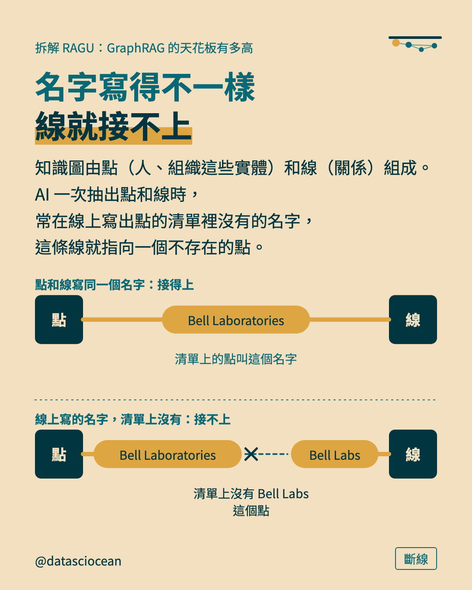
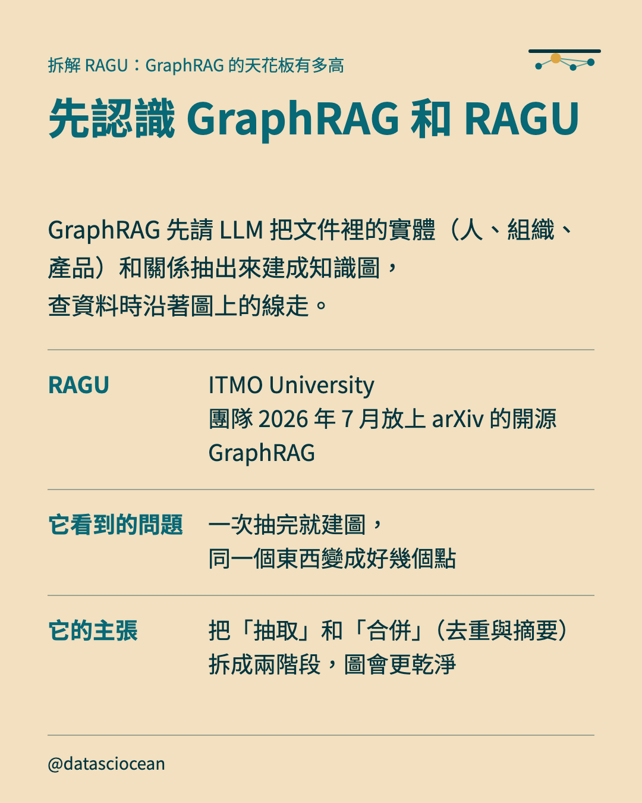
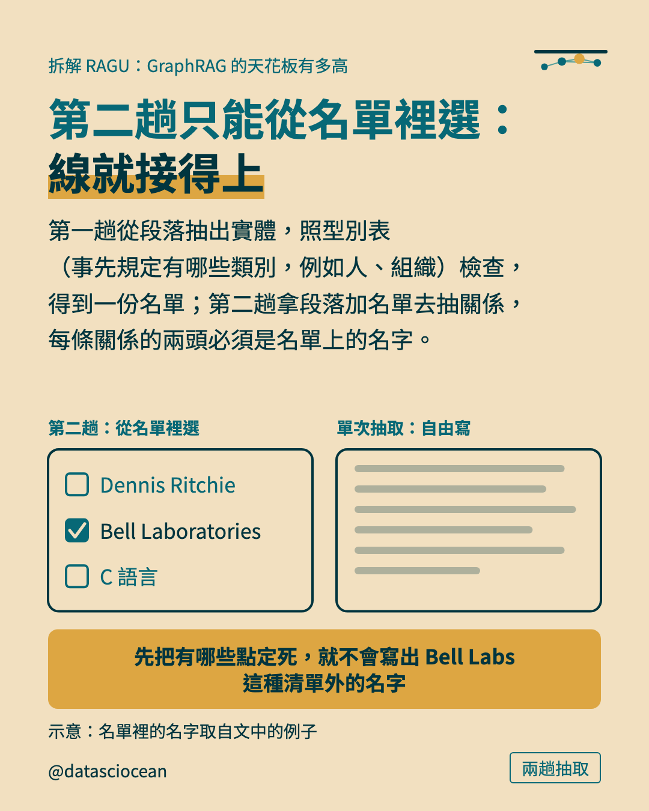
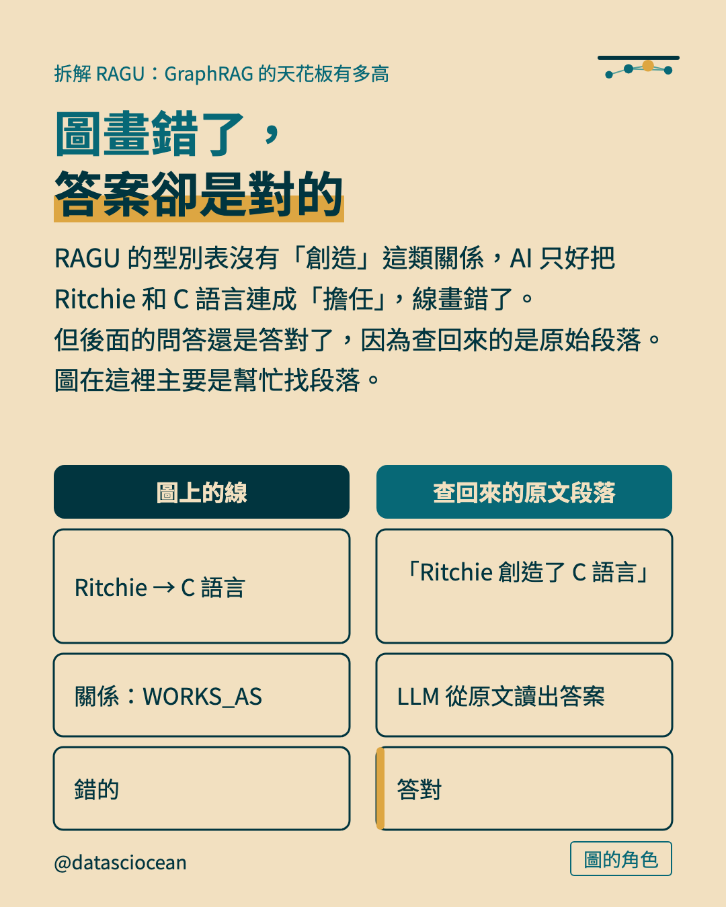
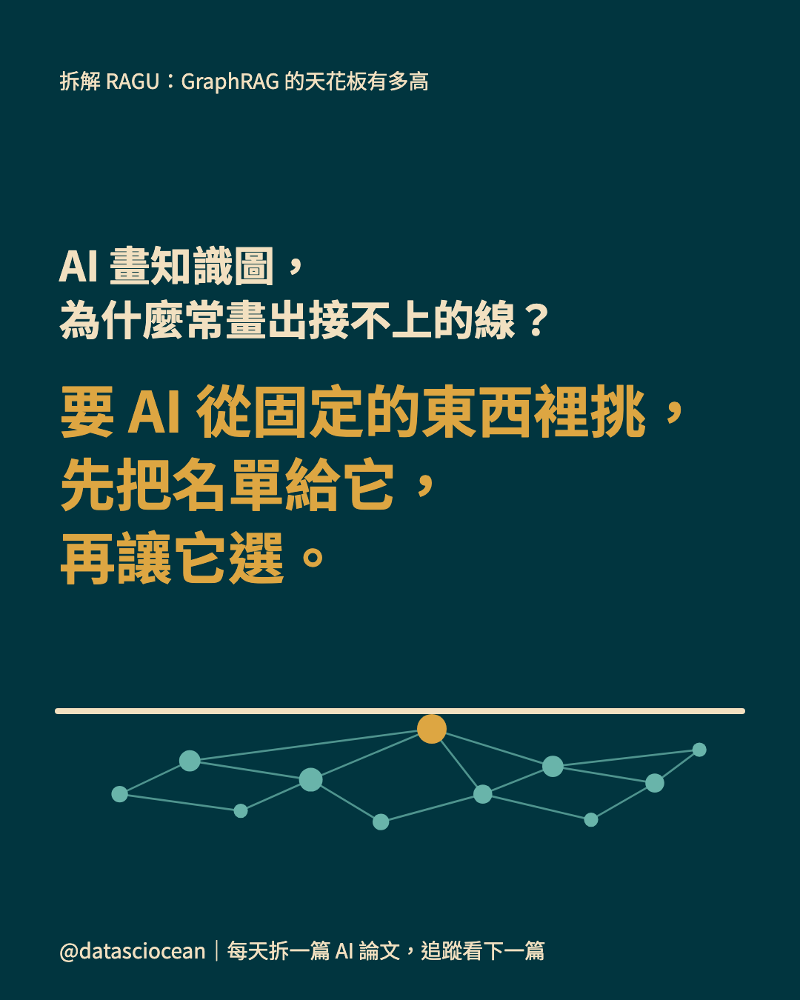

# Threads：先定好名單再讓 AI 選，圖就少了斷線

- 發文方式：**一則輪播貼文**（正文＋全部 7 張圖，順序與 IG 相同），再用一則回覆放連結與系列（連結只放那則回覆）
- 圖檔在 `../ig/`（與 IG 輪播共用同一套）

## 貼文正文（附下方全部圖片）

```text
AI 畫知識圖，常畫出接不上的線。

讓 AI 一次把文件裡的人、組織和它們的關係都抽出來，它常在關係裡寫出清單上沒有的名字，線就指向一個不存在的點。RAGU 這套 GraphRAG 用的招式是拆兩趟：先抽出實體（人、組織、產品這類）、定好名單，再抽關係，兩頭只能是名單上的名字。

這招不是 RAGU 發明的，但很值得借用，也不限於知識圖：只要 AI 要從一組既有的東西裡挑，就先把合法選項定死再讓它選。限制是型別表本身：RAGU 用的來自俄語新聞的標註，論文自己也承認換語言或領域可能要重新設計；表裡沒有的類別，AI 只能挑最接近的，就會挑錯。

有意思的是，RAGU 自己的例子裡圖畫錯了，答案卻是對的，因為查回來的是原文段落。細節在圖裡。

這是 RAGU 系列的第一則；圖建好了，答案到底準多少，在這個系列的下一則。
```

## 附圖（依序）









## 回覆：連結與系列

```text
要 AI 從固定的東西裡挑，先把合法選項定死，再讓它選。
文章：datasciocean.com/paper-intro/ragu
同系列：剝掉混淆後，用圖只多答對 1.2 到 4.3%（尚未發布）
同系列：證據撈得更完整，答案不一定更好（尚未發布）
同系列：小模型夠用，是因為任務簡單（尚未發布）
```
