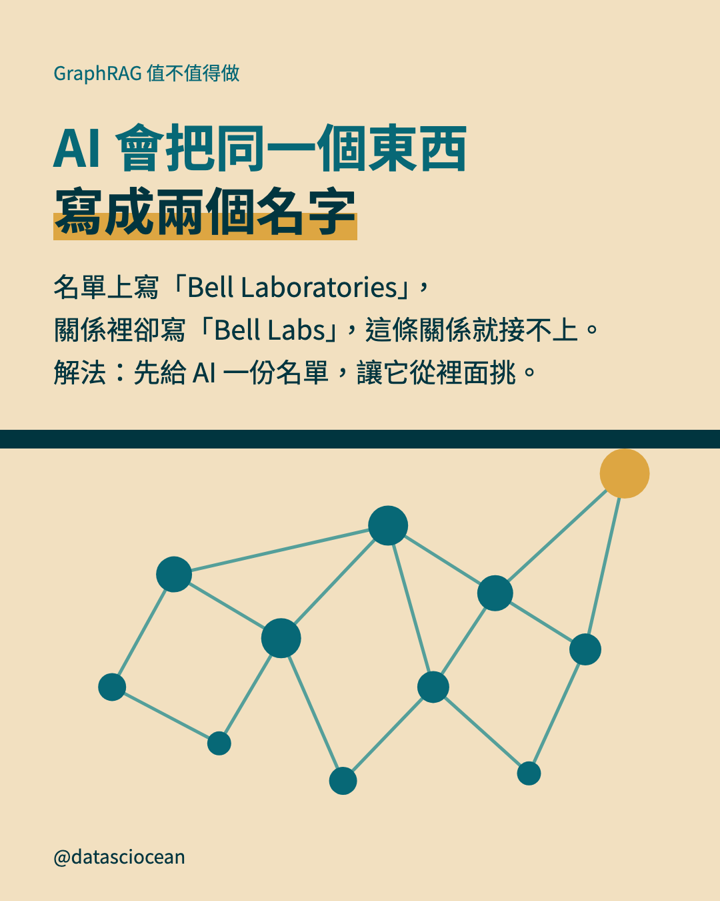
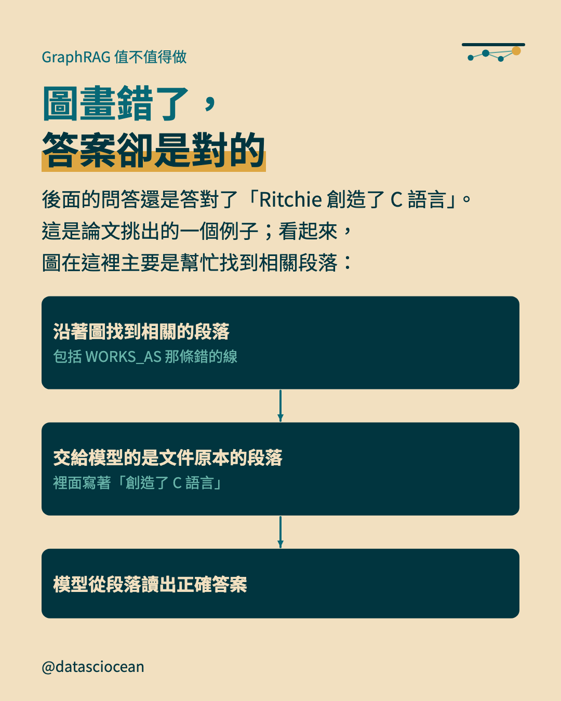
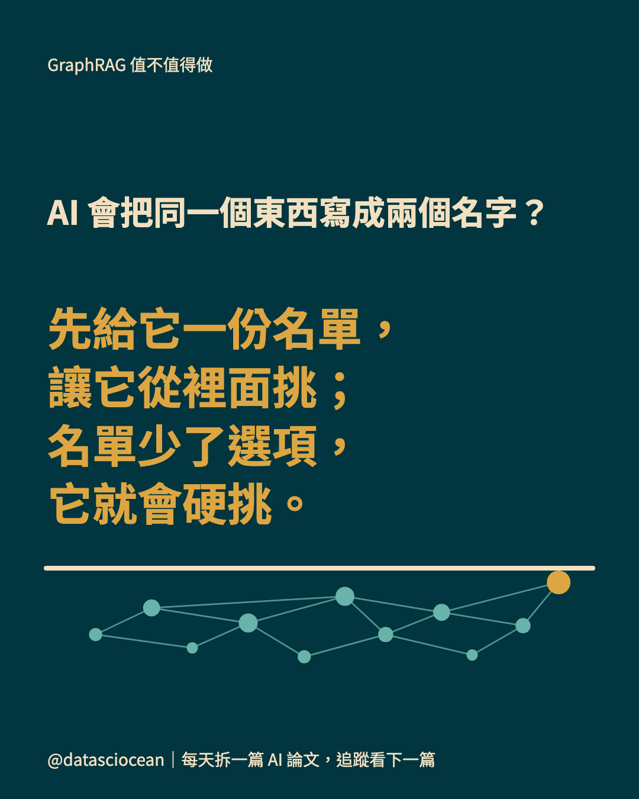

# Threads：AI 會把同一個東西寫成兩個名字

- 發文方式：**一則輪播貼文**（正文＋全部 8 張圖，順序與 IG 相同），再用一則回覆放連結與系列（連結只放那則回覆）
- 圖檔在 `../ig/`（與 IG 輪播共用同一套）

## 貼文正文（附下方全部圖片）

```text
AI 會把同一個東西寫成兩個名字。

知識圖由點（人、組織這些東西）和線（關係）組成。AI 一次抽出點和線時，常在線上寫出名單裡沒有的名字：點寫「Bell Laboratories」，線上卻寫「Bell Labs」，這條線就接到一個不存在的點。

RAGU（ITMO University 團隊的開源 GraphRAG 系統）把抽取拆成兩趟：第一趟只抽點、用型別表檢查，得到一份名單；第二趟才抽線，線的兩端只能寫名單上的名字。這招不只用在建圖：任何要 AI 指向已經存在的東西時，先定好允許的選項，再讓它選。

代價是清單少了選項，AI 只好硬挑。文件寫 Ritchie 創造了 C 語言，但 49 種關係裡沒有 CREATOR_OF，AI 挑了 WORKS_AS（擔任某職位）。這還是論文挑出來展示的最佳案例：展示 5 條，錯了 2 條；型別表來自俄語新聞，論文承認換語言或領域可能要重新設計。有趣的是，後面的問答還是答對了，因為交給 AI 的是文件原本的段落。
```

## 附圖（依序）







## 回覆：連結與系列

```text
任何要 AI 指向既有東西的時候：先把允許的選項定死，再讓它選；也要確認名單涵蓋真正需要的選項。
文章：datasciocean.com/paper-intro/ragu
同系列：換一句提示詞 +16.9%，加一整張知識圖 +1.2%（尚未發布）
同系列：資料撈得越多，AI 答得越好？（尚未發布）
同系列：小模型夠用，是因為題目太簡單（尚未發布）
```
