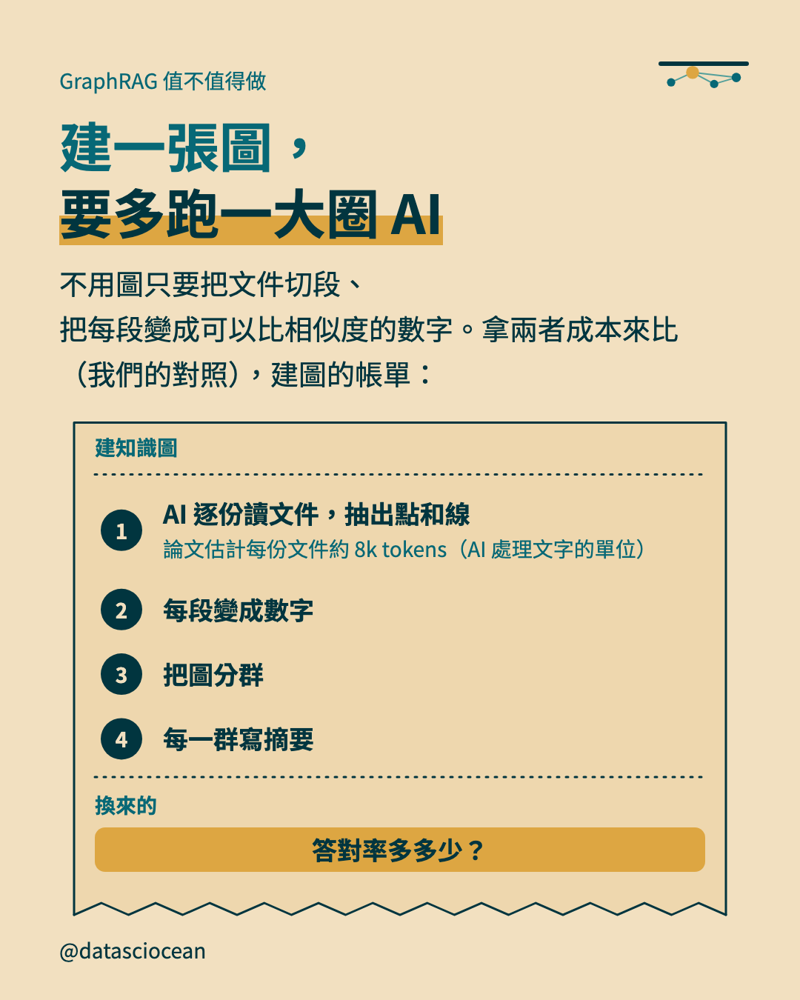
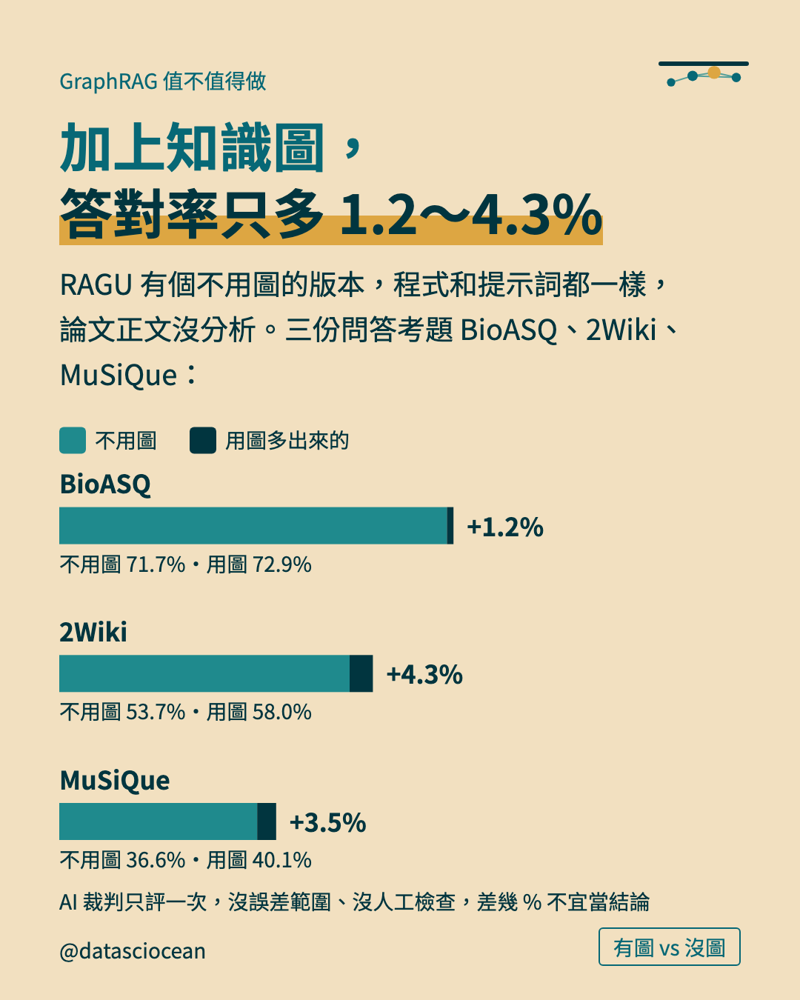
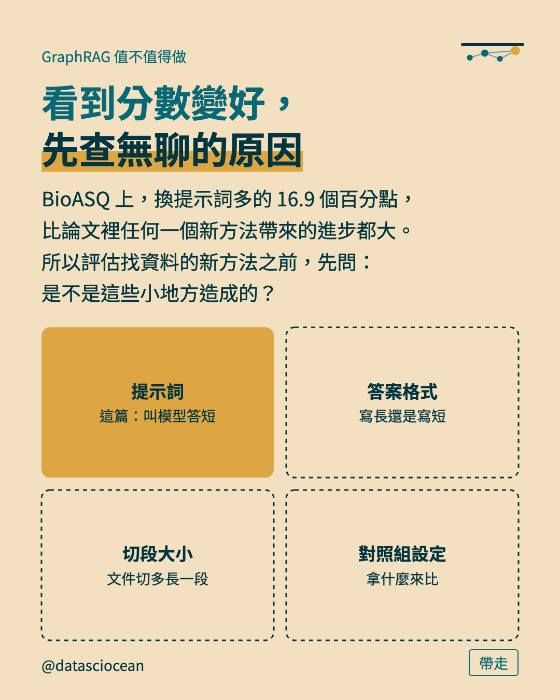

# IG 輪播：換一句提示詞 +16.9%，加一整張知識圖 +1.2%

- 系列：GraphRAG 值不值得做　｜　hook 樣態：反直覺斷言　｜　共 7 張，**依頁碼順序上傳**
- 每頁下方的「替代文字」貼到 IG 的替代文字欄；最後的 Caption 整段貼上

## 第 1 頁（封面）


- **主標**：換句提示詞 +16.9%，
加知識圖只 +1.2%
- **副標**：同一份考題：叫 AI 答短一點，答對率多 16.9 個百分點；
花大工夫建一張知識圖，只多 1.2 個。
- **替代文字**：換句提示詞 +16.9%，
加知識圖只 +1.2%。同一份考題：叫 AI 答短一點，答對率多 16.9 個百分點；
花大工夫建一張知識圖，只多 1.2 個。

## 第 2 頁（脈絡）


- **主標**：GraphRAG：
先把文件畫成一張關係圖
- **補充**：RAG 是先幫 AI 找資料，再讓它讀著回答。
- **表列**：一般的 RAG｜文件切成一段一段，提問時撈出最像的幾段；每段各自獨立，看不到跨文件的關聯
- **表列**：GraphRAG｜先請 AI 抽出文件裡的人、組織、產品和它們的關係，建成知識圖，找資料時沿著圖上的線走
- **表列**：RAGU｜ITMO University 團隊 2026 年 7 月放上 arXiv 的 GraphRAG 系統
- **替代文字**：GraphRAG：
先把文件畫成一張關係圖。RAG 是先幫 AI 找資料，再讓它讀著回答。

## 第 3 頁（示意圖）



- **主標**：建一張圖，
要多跑一大圈 AI
- **補充**：不用圖只要把文件切段、把每段變成可以比相似度的數字。拿兩者成本來比（我們的對照），建圖的帳單：
- **示意圖（receipt）上的文字與數字**：AI 逐份讀文件，抽出點和線｜論文估計每份文件約 8k tokens（AI 處理文字的單位）｜每段變成數字｜把圖分群｜每一群寫摘要｜答對率多多少？｜建知識圖｜換來的
- **替代文字**：建一張圖，
要多跑一大圈 AI。不用圖只要把文件切段、把每段變成可以比相似度的數字。拿兩者成本來比（我們的對照），建圖的帳單：。圖上寫：AI 逐份讀文件，抽出點和線、論文估計每份文件約 8k tokens（AI 處理文字的單位）、每段變成數字、把圖分群、每一群寫摘要、答對率多多少？、建知識圖、換來的

## 第 4 頁（示意圖）



- **小標籤**：有圖 vs 沒圖
- **主標**：加上知識圖，
答對率只多 1.2～4.3%
- **補充**：RAGU 有個不用圖的版本，程式和提示詞都一樣，論文正文沒分析。三份問答考題 BioASQ、2Wiki、MuSiQue：
- **示意圖（lift）上的文字與數字**：BioASQ｜2Wiki｜MuSiQue｜不用圖｜用圖｜不用圖 71.7%・用圖 72.9%｜+1.2%｜不用圖 53.7%・用圖 58.0%｜+4.3%｜不用圖 36.6%・用圖 40.1%｜+3.5%
- **圖註**：AI 裁判只評一次，沒誤差範圍、沒人工檢查，差幾 % 不宜當結論
- **替代文字**：加上知識圖，
答對率只多 1.2～4.3%。RAGU 有個不用圖的版本，程式和提示詞都一樣，論文正文沒分析。三份問答考題 BioASQ、2Wiki、MuSiQue：。圖上寫：BioASQ、2Wiki、MuSiQue、不用圖、用圖、不用圖 71.7%・用圖 72.9%、+1.2%、不用圖 53.7%・用圖 58.0%、+4.3%、不用圖 36.6%・用圖 40.1%、+3.5%

## 第 5 頁（示意圖）


- **小標籤**：只改提示詞
- **主標**：叫 AI 答短一點，
BioASQ 跳了 16.9%
- **補充**：Multi-Hop 問答（要串好幾份資料）的標準答案很短，RAGU 卻預設寫一大段。只改提示詞（答短那欄就是上一張的 RAGU）：
- **示意圖（lift）上的文字與數字**：BioASQ｜2Wiki｜MuSiQue｜答長｜答短｜答長 56.0%・答短 72.9%｜+16.9%｜答長 46.6%・答短 58.0%｜+11.4%｜答長 43.5%・答短 40.1%｜−3.4%
- **圖註**：BioASQ 多的比加整張圖多；MuSiQue 反而少 3.4%。這個混淆論文自己承認
- **替代文字**：叫 AI 答短一點，
BioASQ 跳了 16.9%。Multi-Hop 問答（要串好幾份資料）的標準答案很短，RAGU 卻預設寫一大段。只改提示詞（答短那欄就是上一張的 RAGU）：。圖上寫：BioASQ、2Wiki、MuSiQue、答長、答短、答長 56.0%・答短 72.9%、+16.9%、答長 46.6%・答短 58.0%、+11.4%、答長 43.5%・答短 40.1%、−3.4%

## 第 6 頁（示意圖）



- **小標籤**：帶走
- **主標**：看到分數變好，
先查無聊的原因
- **補充**：BioASQ 上，換提示詞多的 16.9 個百分點，比論文裡任何一個新方法帶來的進步都大。所以評估找資料的新方法之前，先問：是不是這些小地方造成的？
- **示意圖（quad）上的文字與數字**：提示詞｜這篇：叫模型答短｜答案格式｜寫長還是寫短｜切段大小｜文件切多長一段｜對照組設定｜拿什麼來比
- **替代文字**：看到分數變好，
先查無聊的原因。BioASQ 上，換提示詞多的 16.9 個百分點，比論文裡任何一個新方法帶來的進步都大。所以評估找資料的新方法之前，先問：是不是這些小地方造成的？。圖上寫：提示詞、這篇：叫模型答短、答案格式、寫長還是寫短、切段大小、文件切多長一段、對照組設定、拿什麼來比

## 第 7 頁（帶走）


- **先問的問題**：GraphRAG 值不值得做？
- **一句話**：BioASQ：答短 +16.9%，
知識圖只 +1.2%。
分數變好，
先查無聊的原因。
- **替代文字**：GraphRAG 值不值得做？　BioASQ：答短 +16.9%，
知識圖只 +1.2%。
分數變好，
先查無聊的原因。

## Caption（整段貼到 IG）

```text
同一份考題：加整張知識圖只多 1.2%，換句提示詞多 16.9%。GraphRAG 值不值得做？

・建一張圖，要多跑一大圈 AI
・有圖 vs 沒圖：加上知識圖，答對率只多 1.2～4.3%
・只改提示詞：叫 AI 答短一點，BioASQ 跳了 16.9%
・帶走：看到分數變好，先查無聊的原因

完整文章在 datasciocean.com，搜「RAGU」

#RAGU #GraphRAG #RAG #LLM
```
