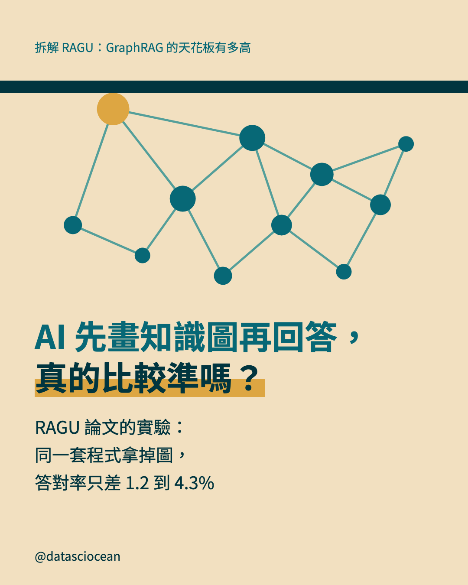
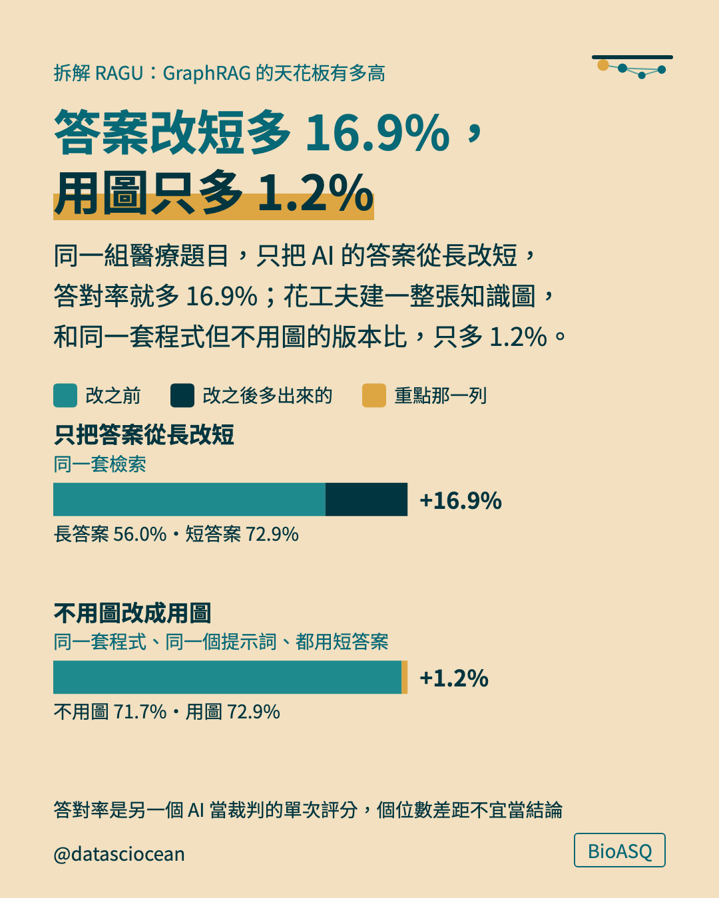
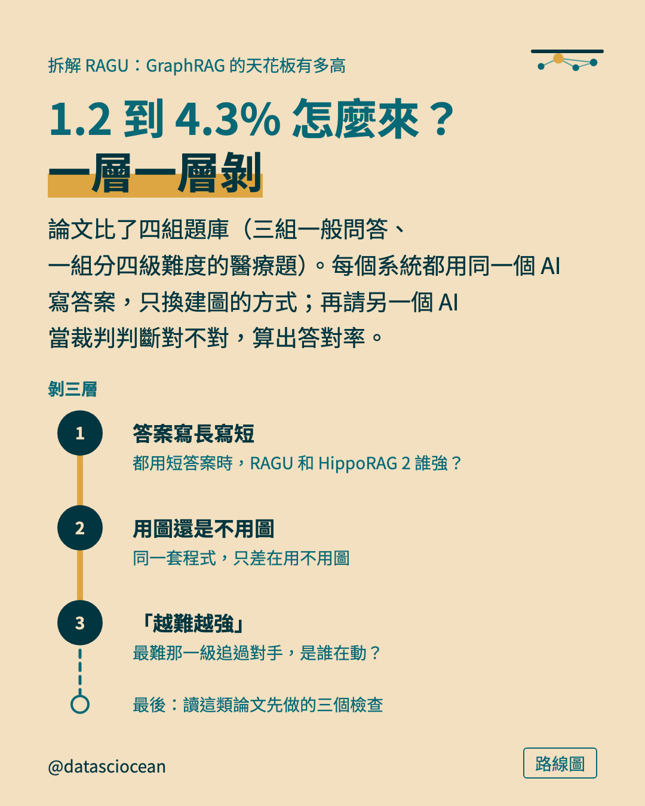
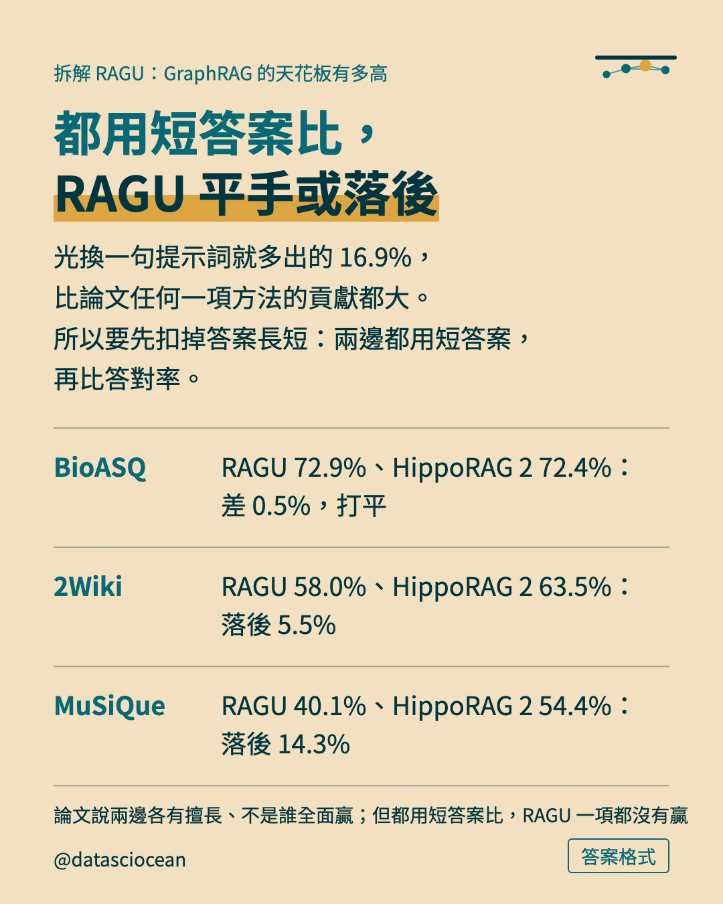
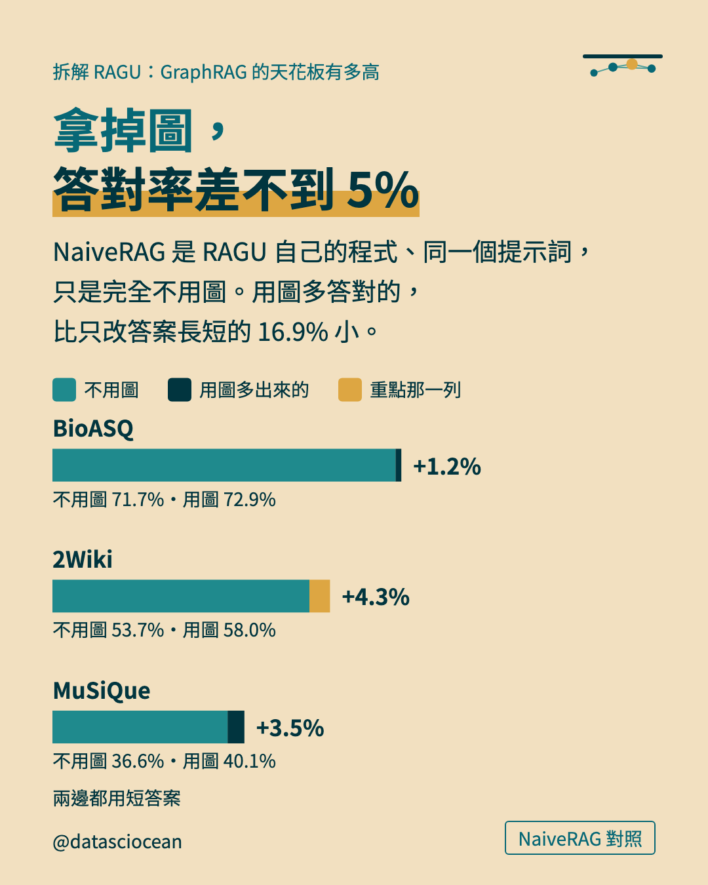
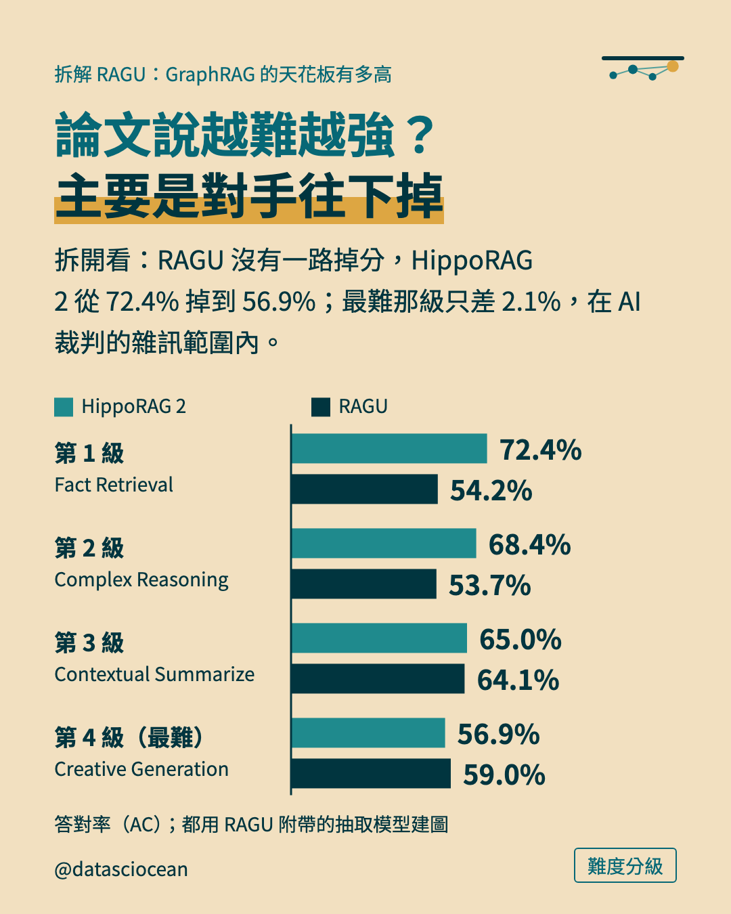
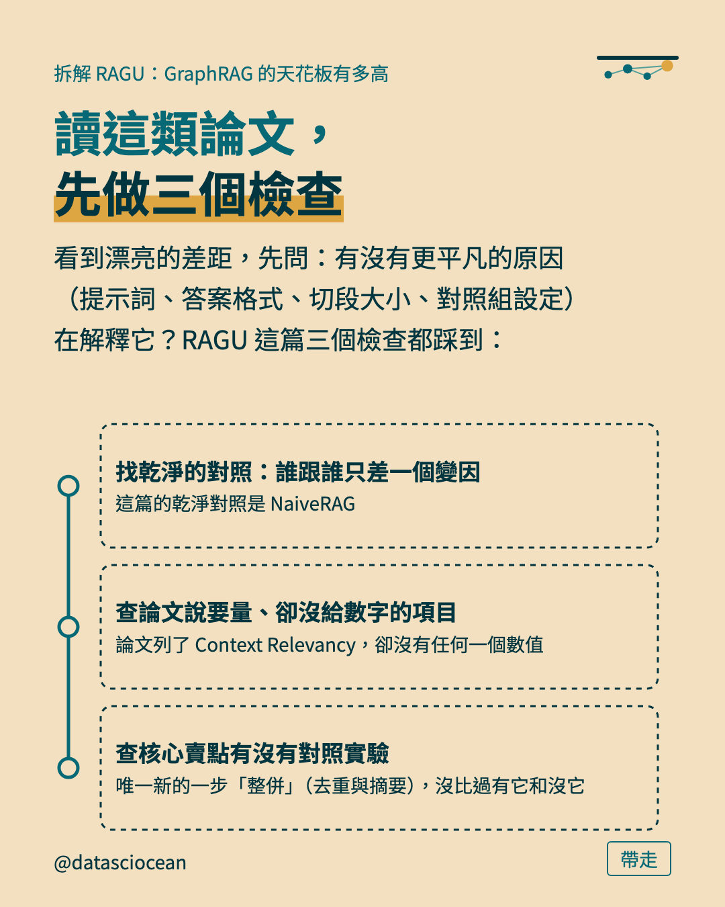
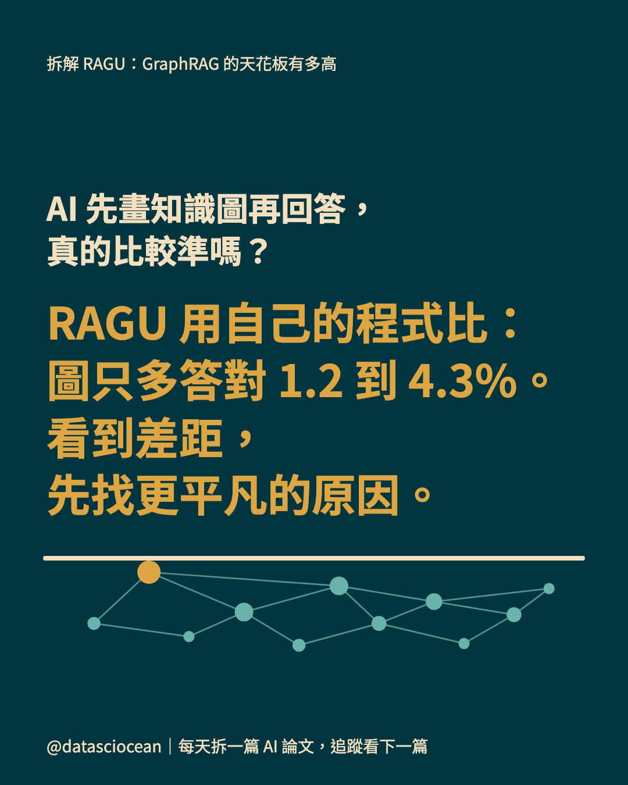

# IG 輪播：剝掉混淆後，用圖只多答對 1.2 到 4.3%

- 系列：拆解 RAGU：GraphRAG 的天花板有多高　｜　hook 樣態：讀者疑問　｜　共 11 張，**依頁碼順序上傳**
- 每頁下方的「替代文字」貼到 IG 的替代文字欄；最後的 Caption 整段貼上

## 第 1 頁（封面）



- **主標**：AI 先畫知識圖再回答，
真的比較準嗎？
- **副標**：RAGU 論文的實驗：
同一套程式拿掉圖，
答對率只差 1.2 到 4.3%
- **替代文字**：AI 先畫知識圖再回答，
真的比較準嗎？。RAGU 論文的實驗：
同一套程式拿掉圖，
答對率只差 1.2 到 4.3%

## 第 2 頁（示意圖）



- **小標籤**：BioASQ
- **主標**：答案改短多 16.9%，
用圖只多 1.2%
- **補充**：同一組醫療題目，只把 AI 的答案從長改短，答對率就多 16.9%；花工夫建一整張知識圖，和同一套程式但不用圖的版本比，只多 1.2%。
- **示意圖（lift）上的文字與數字**：只把答案從長改短｜同一套檢索｜不用圖改成用圖｜同一套程式、同一個提示詞、都用短答案｜改之前｜改之後｜長答案 56.0%・短答案 72.9%｜+16.9%｜不用圖 71.7%・用圖 72.9%｜+1.2%
- **圖註**：答對率是另一個 AI 當裁判的單次評分，個位數差距不宜當結論
- **替代文字**：答案改短多 16.9%，
用圖只多 1.2%。同一組醫療題目，只把 AI 的答案從長改短，答對率就多 16.9%；花工夫建一整張知識圖，和同一套程式但不用圖的版本比，只多 1.2%。。圖上寫：只把答案從長改短、同一套檢索、不用圖改成用圖、同一套程式、同一個提示詞、都用短答案、改之前、改之後、長答案 56.0%・短答案 72.9%、+16.9%、不用圖 71.7%・用圖 72.9%、+1.2%

## 第 3 頁（前情回顧）


- **主標**：前情提要與這一則重點
- **第 1 則**：先定好名單再讓 AI 選，圖就少了斷線　抽取拆兩趟是能帶走的招式；圖畫錯了，答案仍可能是對的
- **第 2 則**：剝掉混淆後，用圖只多答對 1.2 到 4.3%　扣掉答案格式，RAGU 對 HippoRAG 2 平手或落後
- **替代文字**：前情提要與這一則重點。第 1 則「先定好名單再讓 AI 選，圖就少了斷線」：抽取拆兩趟是能帶走的招式；圖畫錯了，答案仍可能是對的；第 2 則「剝掉混淆後，用圖只多答對 1.2 到 4.3%」：扣掉答案格式，RAGU 對 HippoRAG 2 平手或落後

## 第 4 頁（脈絡）


- **主標**：先認識三個名字
- **補充**：一般的 RAG 撈出最像的幾段文件，每段各自獨立，看不到跨文件的關聯。
- **表列**：GraphRAG｜請 LLM 抽出文件裡的實體（人、組織、產品）和關係，建成知識圖，查資料時沿著圖上的線走
- **表列**：RAGU｜ITMO University 團隊 2026 年 7 月放上 arXiv；主張建圖時把「抽取」和「整併」拆開，圖會更乾淨
- **表列**：HippoRAG 2｜另一套 GraphRAG 代表系統，這一則的主要對手
- **替代文字**：先認識三個名字。一般的 RAG 撈出最像的幾段文件，每段各自獨立，看不到跨文件的關聯。

## 第 5 頁（示意圖）



- **小標籤**：路線圖
- **主標**：1.2 到 4.3% 怎麼來？
一層一層剝
- **補充**：論文比了四組題庫（三組一般問答、一組分四級難度的醫療題）。每個系統都用同一個 AI 寫答案，只換建圖的方式；再請另一個 AI 當裁判判斷對不對，算出答對率。
- **示意圖（route）上的文字與數字**：答案寫長寫短｜都用短答案時，RAGU 和 HippoRAG 2 誰強？｜用圖還是不用圖｜同一套程式，只差在用不用圖｜「越難越強」｜最難那一級追過對手，是誰在動？｜剝三層｜最後：讀這類論文先做的三個檢查
- **替代文字**：1.2 到 4.3% 怎麼來？
一層一層剝。論文比了四組題庫（三組一般問答、一組分四級難度的醫療題）。每個系統都用同一個 AI 寫答案，只換建圖的方式；再請另一個 AI 當裁判判斷對不對，算出答對率。。圖上寫：答案寫長寫短、都用短答案時，RAGU 和 HippoRAG 2 誰強？、用圖還是不用圖、同一套程式，只差在用不用圖、「越難越強」、最難那一級追過對手，是誰在動？、剝三層、最後：讀這類論文先做的三個檢查

## 第 6 頁（示意圖）


- **小標籤**：答案格式
- **主標**：標準答案很短，
RAGU 卻預設寫長的
- **補充**：需要串好幾份資料才答得出的題目（Multi-Hop），標準答案很短（例如「Bell Laboratories」），RAGU 卻預設寫長的。系統不變、只要 AI 答短：
- **示意圖（lift）上的文字與數字**：BioASQ｜2Wiki｜MuSiQue｜長答案｜短答案｜長答案 56.0%・短答案 72.9%｜+16.9%｜長答案 46.6%・短答案 58.0%｜+11.4%｜長答案 43.5%・短答案 40.1%｜−3.4%
- **圖註**：光改短，兩組題庫各多 16.9% 和 11.4%
- **替代文字**：標準答案很短，
RAGU 卻預設寫長的。需要串好幾份資料才答得出的題目（Multi-Hop），標準答案很短（例如「Bell Laboratories」），RAGU 卻預設寫長的。系統不變、只要 AI 答短：。圖上寫：BioASQ、2Wiki、MuSiQue、長答案、短答案、長答案 56.0%・短答案 72.9%、+16.9%、長答案 46.6%・短答案 58.0%、+11.4%、長答案 43.5%・短答案 40.1%、−3.4%

## 第 7 頁（對照表）



- **小標籤**：答案格式
- **主標**：都用短答案比，
RAGU 平手或落後
- **補充**：光換一句提示詞就多出的 16.9%，比論文任何一項方法的貢獻都大。所以要先扣掉答案長短：兩邊都用短答案，再比答對率。
- **表列**：BioASQ｜RAGU 72.9%、HippoRAG 2 72.4%：差 0.5%，打平
- **表列**：2Wiki｜RAGU 58.0%、HippoRAG 2 63.5%：落後 5.5%
- **表列**：MuSiQue｜RAGU 40.1%、HippoRAG 2 54.4%：落後 14.3%
- **圖註**：論文說兩邊各有擅長、不是誰全面贏；但都用短答案比，RAGU 一項都沒有贏
- **替代文字**：都用短答案比，
RAGU 平手或落後。光換一句提示詞就多出的 16.9%，比論文任何一項方法的貢獻都大。所以要先扣掉答案長短：兩邊都用短答案，再比答對率。

## 第 8 頁（示意圖）



- **小標籤**：NaiveRAG 對照
- **主標**：拿掉圖，
答對率差不到 5%
- **補充**：NaiveRAG 是 RAGU 自己的程式、同一個提示詞，只是完全不用圖。用圖多答對的，比只改答案長短的 16.9% 小。
- **示意圖（lift）上的文字與數字**：BioASQ｜2Wiki｜MuSiQue｜不用圖｜用圖｜不用圖 71.7%・用圖 72.9%｜+1.2%｜不用圖 53.7%・用圖 58.0%｜+4.3%｜不用圖 36.6%・用圖 40.1%｜+3.5%
- **圖註**：兩邊都用短答案
- **替代文字**：拿掉圖，
答對率差不到 5%。NaiveRAG 是 RAGU 自己的程式、同一個提示詞，只是完全不用圖。用圖多答對的，比只改答案長短的 16.9% 小。。圖上寫：BioASQ、2Wiki、MuSiQue、不用圖、用圖、不用圖 71.7%・用圖 72.9%、+1.2%、不用圖 53.7%・用圖 58.0%、+4.3%、不用圖 36.6%・用圖 40.1%、+3.5%

## 第 9 頁（橫條圖）



- **小標籤**：難度分級
- **主標**：論文說越難越強？
主要是對手往下掉
- **補充**：拆開看：RAGU 沒有一路掉分，HippoRAG 2 從 72.4% 掉到 56.9%；最難那級只差 2.1%，在 AI 裁判的雜訊範圍內。
- **圖上項目**：第 1 級（Fact Retrieval）＝ HippoRAG 2 72.4 %；RAGU 54.2 %
- **圖上項目**：第 2 級（Complex Reasoning）＝ HippoRAG 2 68.4 %；RAGU 53.7 %
- **圖上項目**：第 3 級（Contextual Summarize）＝ HippoRAG 2 65 %；RAGU 64.1 %
- **圖上項目**：第 4 級（最難）（Creative Generation）＝ HippoRAG 2 56.9 %；RAGU 59 %
- **圖註**：答對率（AC）；都用 RAGU 附帶的抽取模型建圖
- **替代文字**：論文說越難越強？
主要是對手往下掉。拆開看：RAGU 沒有一路掉分，HippoRAG 2 從 72.4% 掉到 56.9%；最難那級只差 2.1%，在 AI 裁判的雜訊範圍內。

## 第 10 頁（示意圖）



- **小標籤**：帶走
- **主標**：讀這類論文，
先做三個檢查
- **補充**：看到漂亮的差距，先問：有沒有更平凡的原因（提示詞、答案格式、切段大小、對照組設定）在解釋它？RAGU 這篇三個檢查都踩到：
- **示意圖（stops）上的文字與數字**：找乾淨的對照：誰跟誰只差一個變因｜這篇的乾淨對照是 NaiveRAG｜查論文說要量、卻沒給數字的項目｜論文列了 Context Relevancy，卻沒有任何一個數值｜查核心賣點有沒有對照實驗｜唯一新的一步「整併」（去重與摘要），沒比過有它和沒它
- **替代文字**：讀這類論文，
先做三個檢查。看到漂亮的差距，先問：有沒有更平凡的原因（提示詞、答案格式、切段大小、對照組設定）在解釋它？RAGU 這篇三個檢查都踩到：。圖上寫：找乾淨的對照：誰跟誰只差一個變因、這篇的乾淨對照是 NaiveRAG、查論文說要量、卻沒給數字的項目、論文列了 Context Relevancy，卻沒有任何一個數值、查核心賣點有沒有對照實驗、唯一新的一步「整併」（去重與摘要），沒比過有它和沒它

## 第 11 頁（帶走）



- **先問的問題**：AI 先畫知識圖再回答，真的比較準嗎？
- **一句話**：RAGU 用自己的程式比：
圖只多答對 1.2 到 4.3%。
看到差距，
先找更平凡的原因。
- **替代文字**：AI 先畫知識圖再回答，真的比較準嗎？　RAGU 用自己的程式比：
圖只多答對 1.2 到 4.3%。
看到差距，
先找更平凡的原因。

## Caption（整段貼到 IG）

```text
GraphRAG 先把文件畫成知識圖再回答，真的比較準嗎？RAGU 論文的實驗拆開來看

・BioASQ：答案改短多 16.9%，用圖只多 1.2%
・答案格式：標準答案很短，RAGU 卻預設寫長的
・都用短答案比，RAGU 平手或落後
・NaiveRAG 對照：拿掉圖，答對率差不到 5%
・難度分級：論文說越難越強？主要是對手往下掉
・帶走：讀這類論文，先做三個檢查

圖片來源：第 9 張（圖四）改繪自原始論文的圖表

完整文章在 datasciocean.com，搜「RAGU」

#RAGU #GraphRAG #RAG #LLM
```
