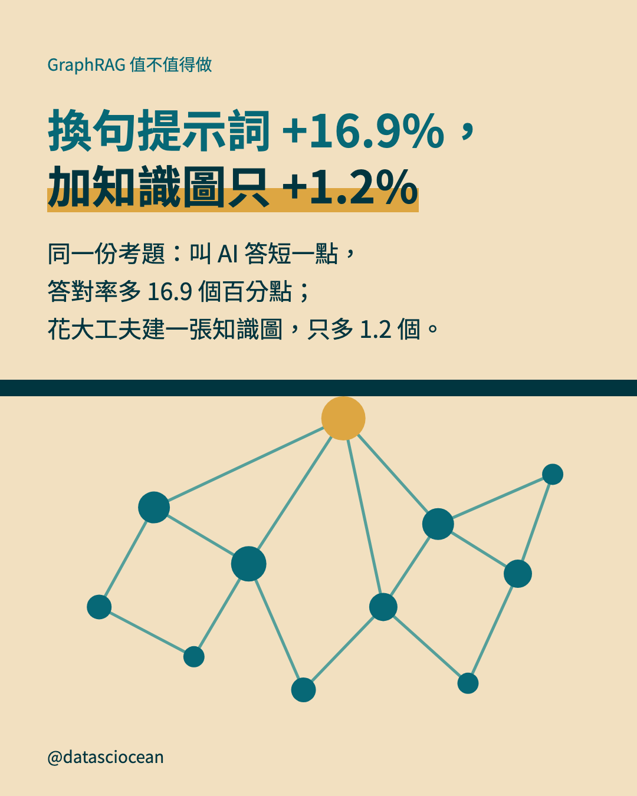
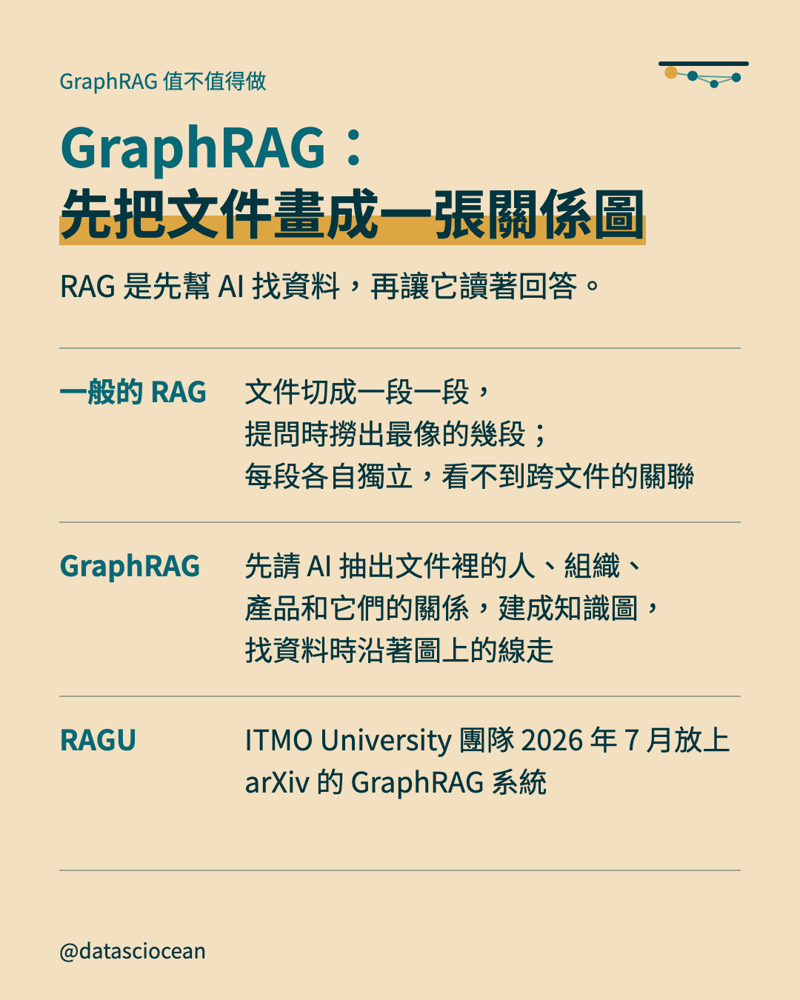
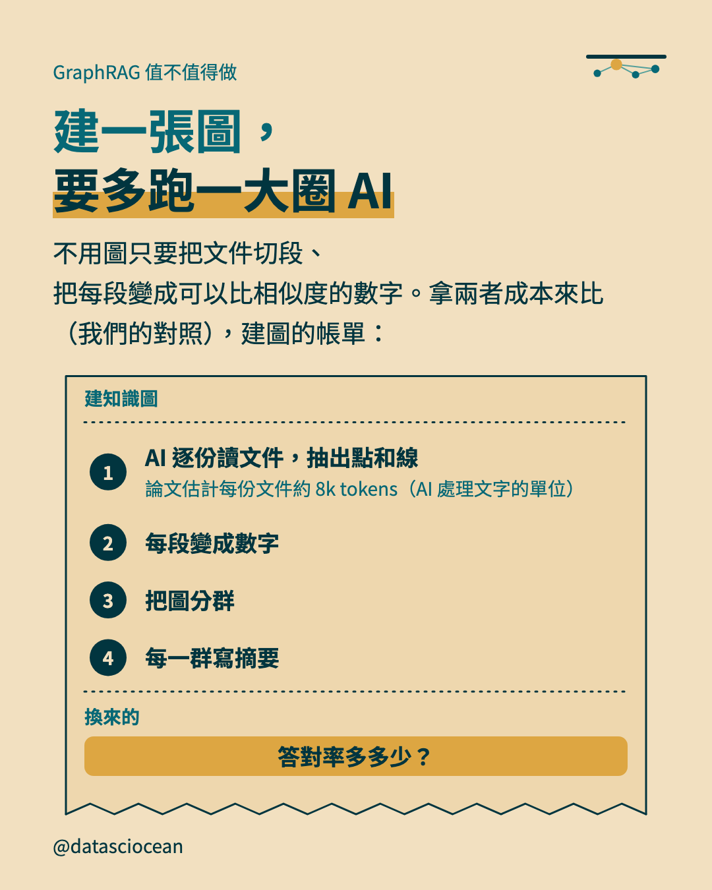
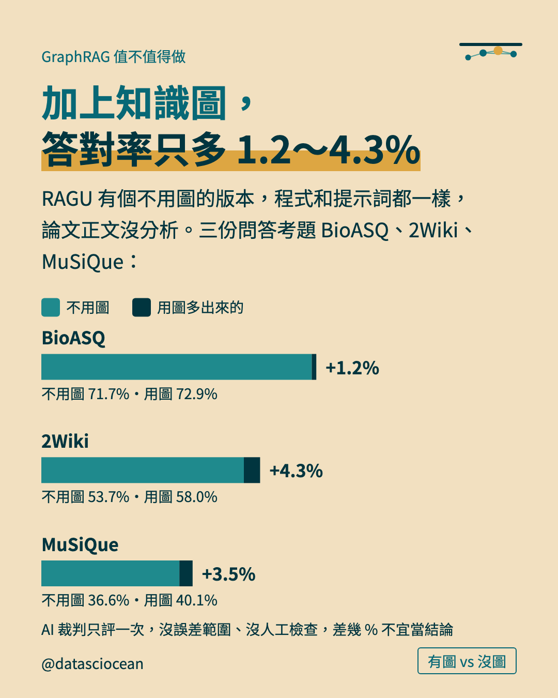
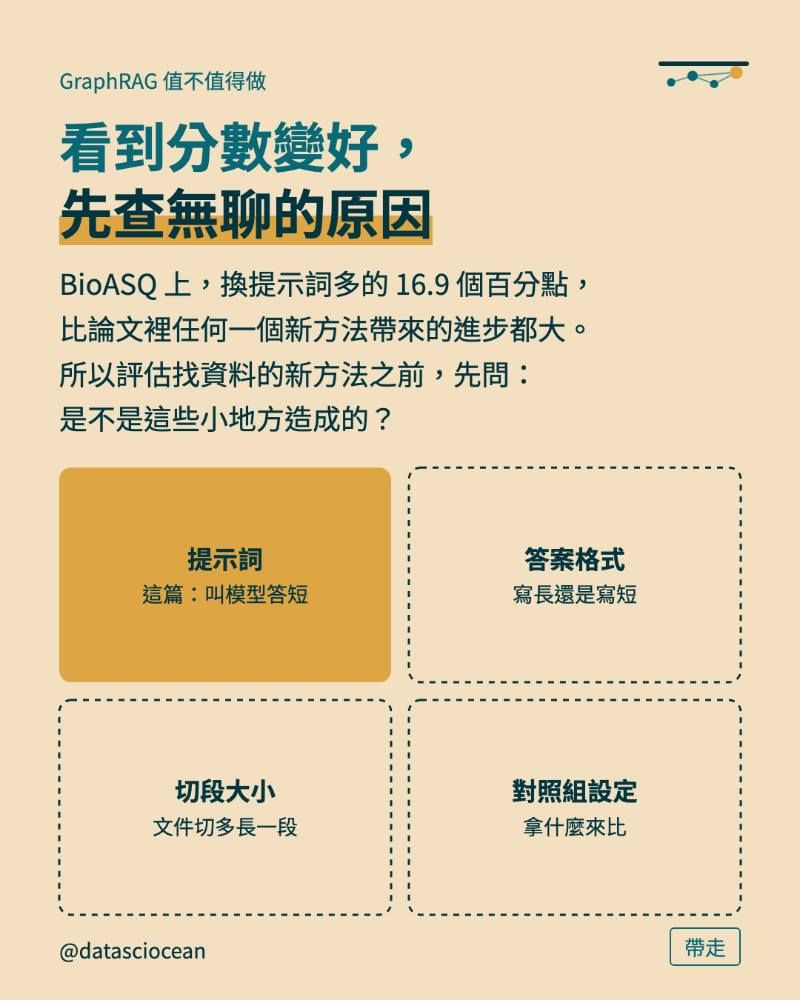
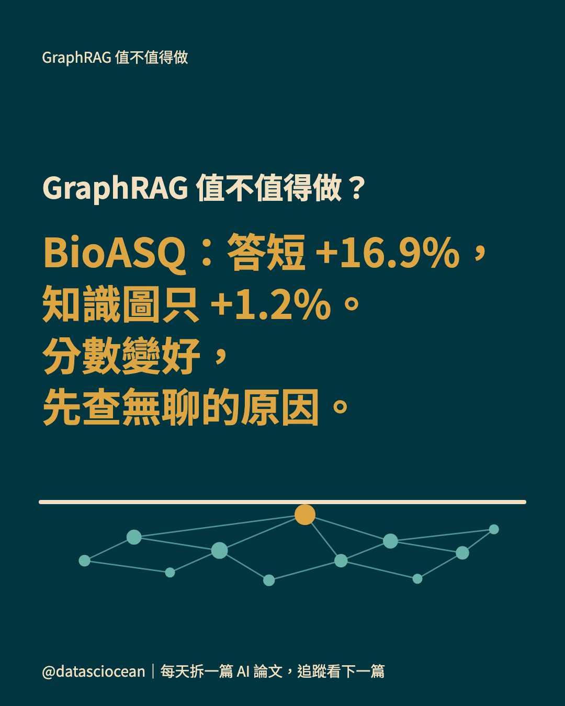

# Threads：換一句提示詞 +16.9%，加一整張知識圖 +1.2%

- 發文方式：**一則輪播貼文**（正文＋全部 7 張圖，順序與 IG 相同），再用一則回覆放連結與系列（連結只放那則回覆）
- 圖檔在 `../ig/`（與 IG 輪播共用同一套）

## 貼文正文（附下方全部圖片）

```text
換一句提示詞，答對率多 16.9 個百分點；加上一整張知識圖，只多 1.2 個。同一套系統、同一份考題（BioASQ）。

GraphRAG 是先請 AI 把文件裡的人、組織、產品和關係抽出來，建成知識圖，找資料時沿著圖走。建圖要每份文件多跑一遍 AI（論文估約 8k tokens，tokens 是 AI 處理文字的單位）；部落格拿來對照的不用圖版本，只要切段、把每段變成可以比相似度的數字。

RAGU（ITMO University 團隊，2026 年 7 月放上 arXiv）的程式裡剛好有一個不用圖的版本：同一套程式、同一句提示詞，只差有沒有圖。兩邊同樣只答短答案時，三份考題上圖只多 1.2 到 4.3 個百分點。反而是把「答長」改成「答短」，BioASQ 就多 16.9（MuSiQue 反而少 3.4）。

答對率是另一個 AI 當裁判、只評一次的分數，沒有誤差範圍，也沒有人工檢查裁判準不準，差幾個百分點不宜當結論。但正在評估要不要導入 GraphRAG 的人，這組數字比論文想證明的東西更有用。
```

## 附圖（依序）









## 回覆：連結與系列

```text
看到分數變好，先問有沒有更無聊的原因：提示詞、答案格式、切段大小、拿什麼來比。
文章：datasciocean.com/paper-intro/ragu
同系列：資料撈得越多，AI 答得越好？（尚未發布）
同系列：AI 會把同一個東西寫成兩個名字（尚未發布）
同系列：小模型夠用，是因為題目太簡單（尚未發布）
```
