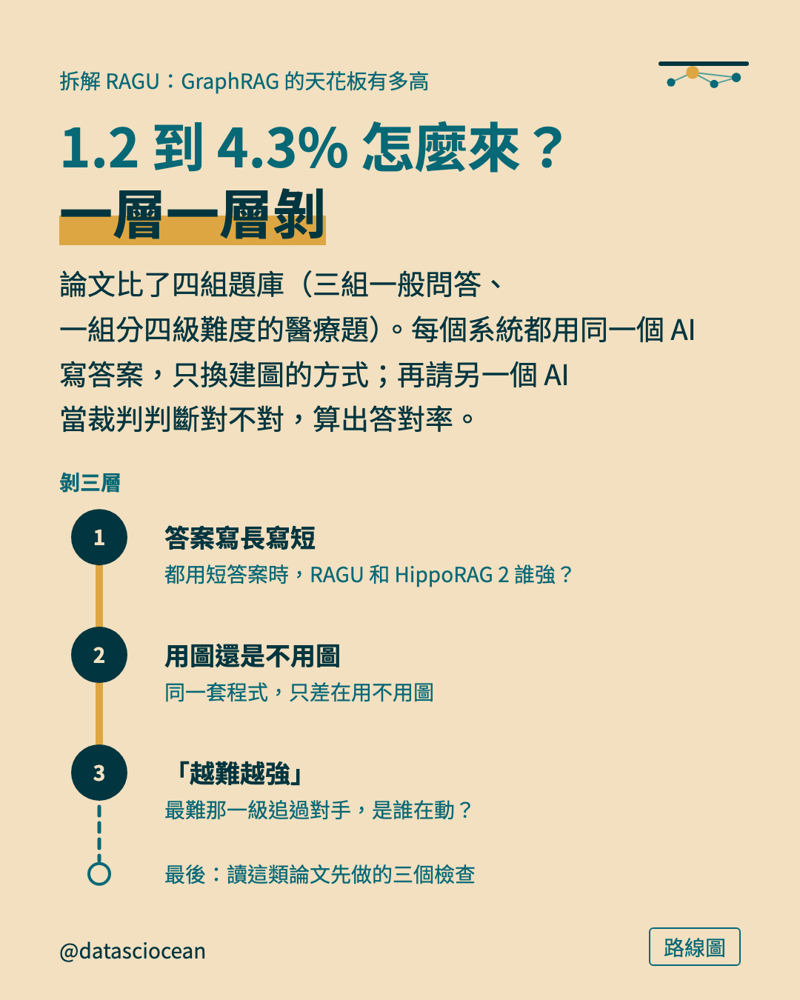
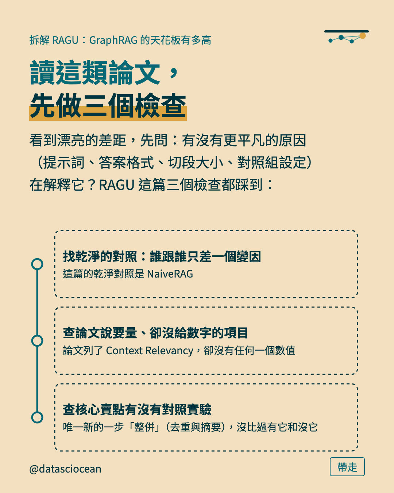
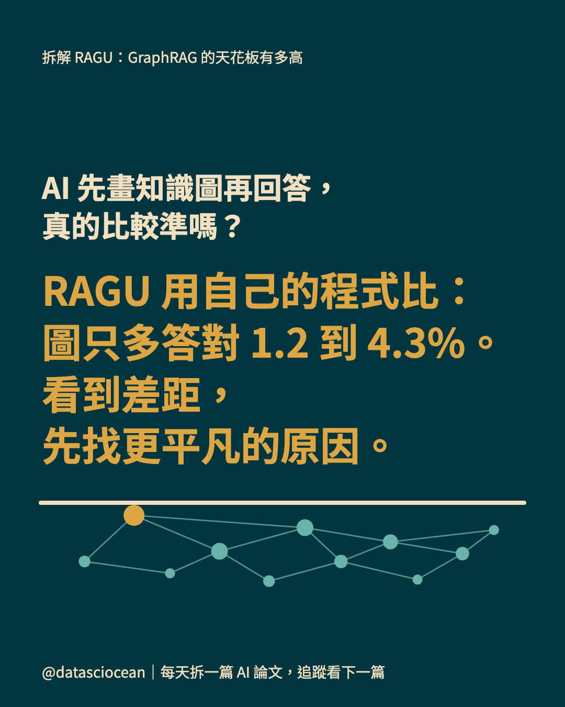

# Threads：剝掉混淆後，用圖只多答對 1.2 到 4.3%

- 發文方式：**一則輪播貼文**（正文＋全部 11 張圖，順序與 IG 相同），再用一則回覆放連結與系列（連結只放那則回覆）
- 圖檔在 `../ig/`（與 IG 輪播共用同一套）

## 貼文正文（附下方全部圖片）

```text
AI 先畫知識圖再回答，真的比較準嗎？

GraphRAG 的做法是先請 AI 把文件裡的人、組織、產品和它們的關係抽出來，建成一張知識圖，查資料時沿著圖走。RAGU（ITMO University 團隊，2026 年 7 月放上 arXiv）主張把建圖拆成抽取和整併兩個階段，圖會更乾淨。

但它的實驗裡，光把答案改短，BioASQ 的答對率就多 16.9%；都用短答案比，RAGU 對 HippoRAG 2 是平手或落後。RAGU 反而意外量出了 GraphRAG 的天花板：用它自己的程式、自己的提示詞，和不用圖的版本比，圖只多答對 1.2 到 4.3%。這種「不要做什麼」的結果很少有人願意發表；正在評估要不要導入 GraphRAG 的人，這比論文想證明的東西更有用。

答對率是另一個 AI 當裁判、只打一次的分數，論文沒有誤差範圍，也沒有人工檢查裁判準不準，所以差幾個百分點不宜當結論。細節在圖裡。

這是 RAGU 系列的第二則；證據撈得多、答案為什麼沒變好，在這個系列的下一則。
```

## 附圖（依序）








## 回覆：連結與系列

```text
看到漂亮的差距，先問有沒有更平凡的原因：提示詞、答案格式、切段大小、對照組設定。
文章：datasciocean.com/paper-intro/ragu
同系列：先定好名單再讓 AI 選，圖就少了斷線（尚未發布）
同系列：證據撈得更完整，答案不一定更好（尚未發布）
同系列：小模型夠用，是因為任務簡單（尚未發布）
```
