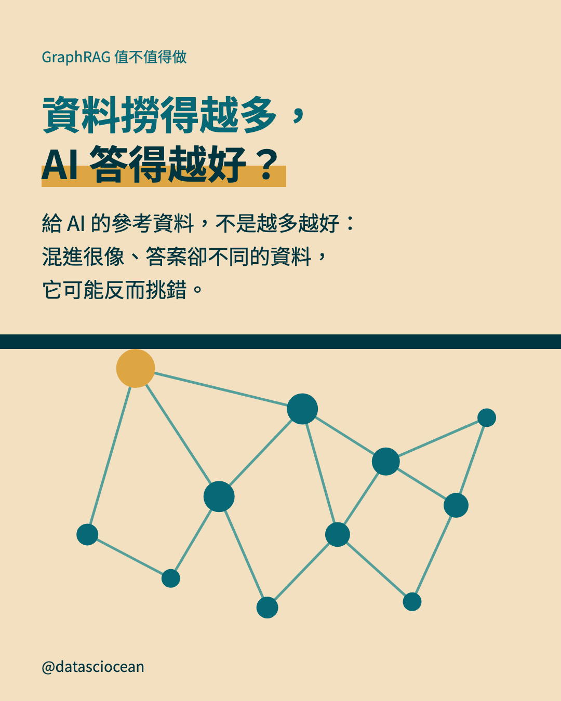
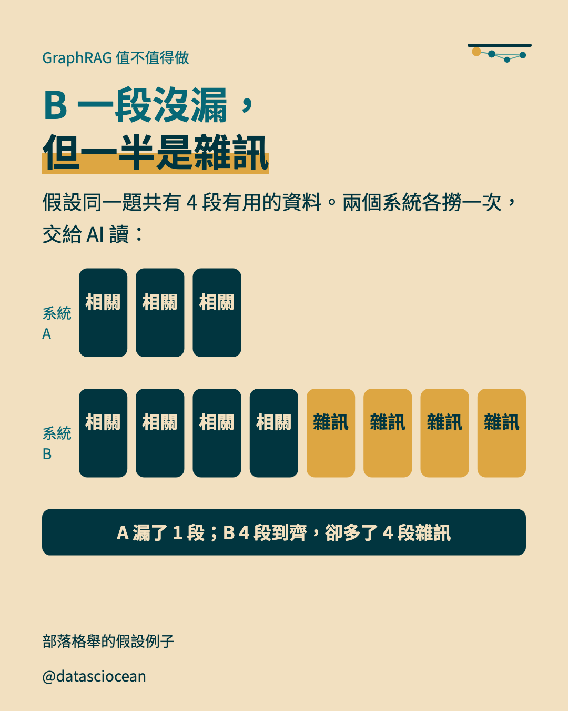
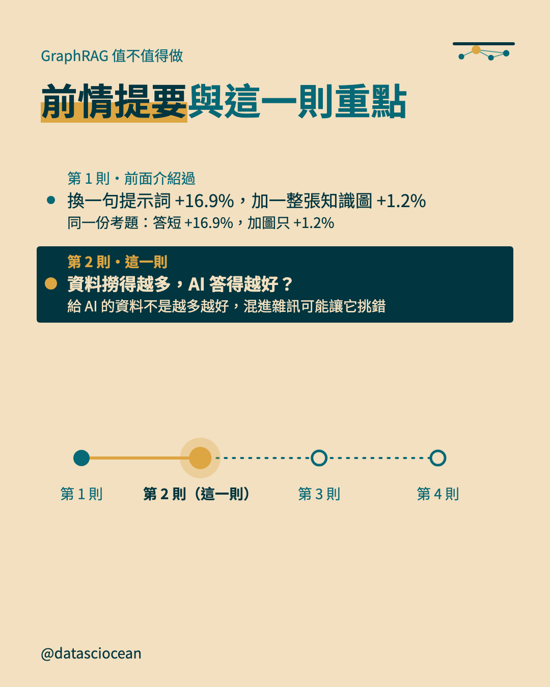
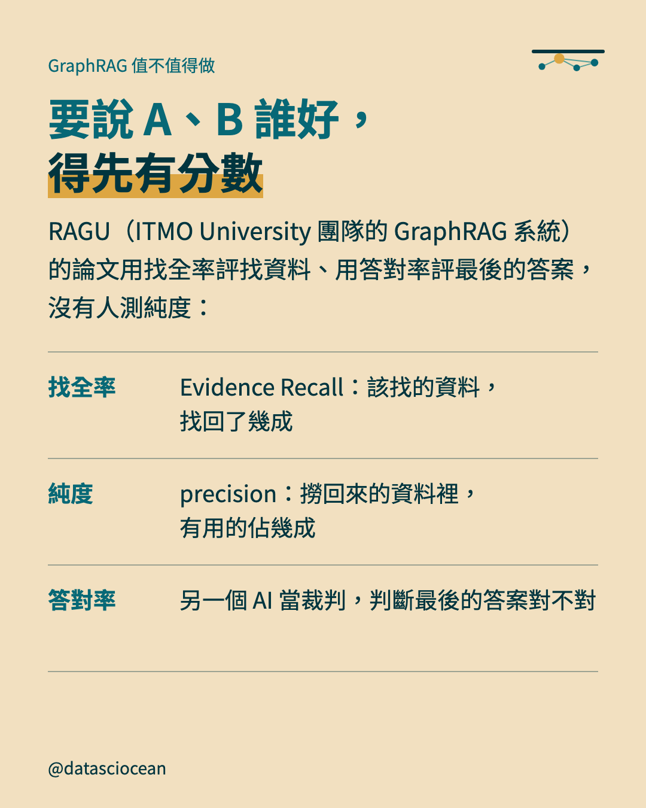
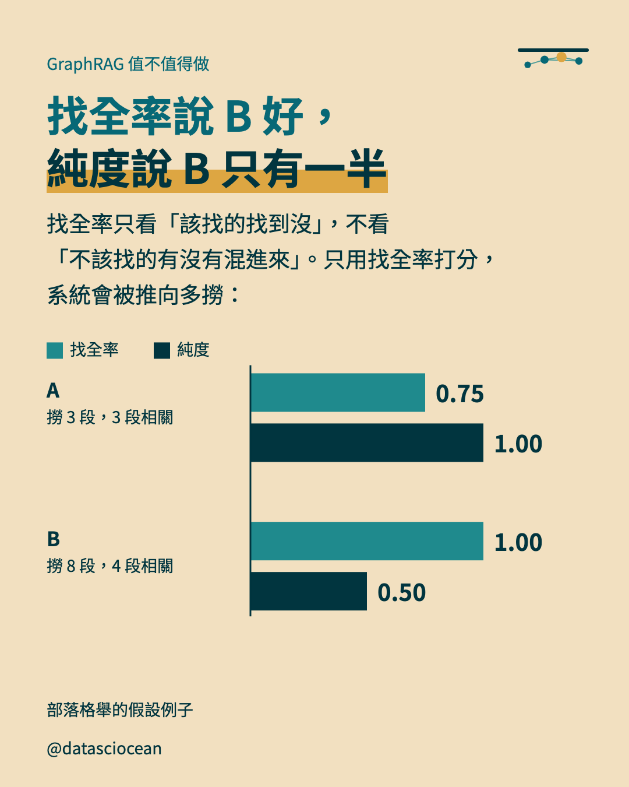
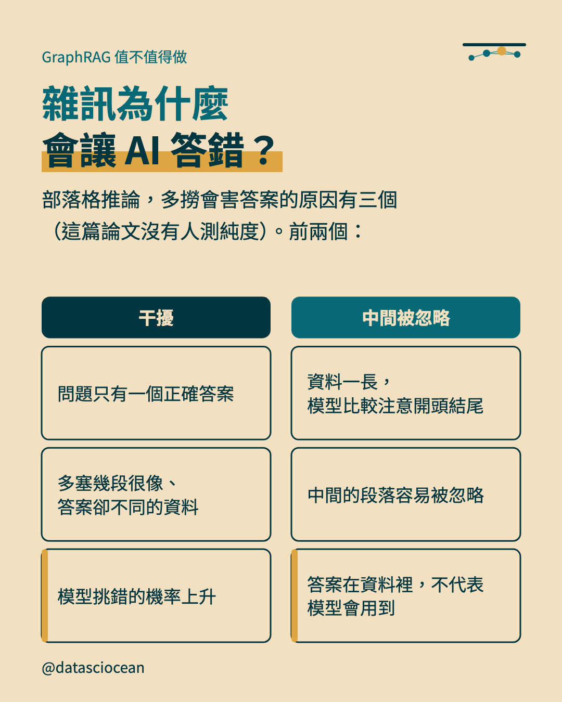
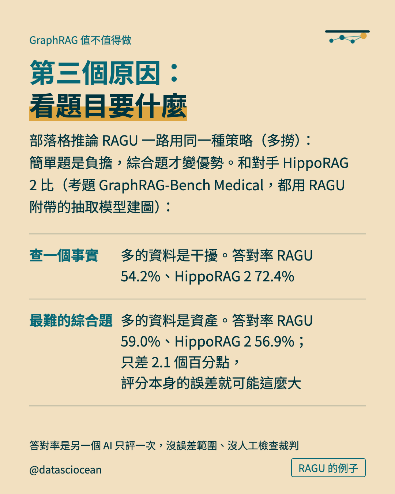
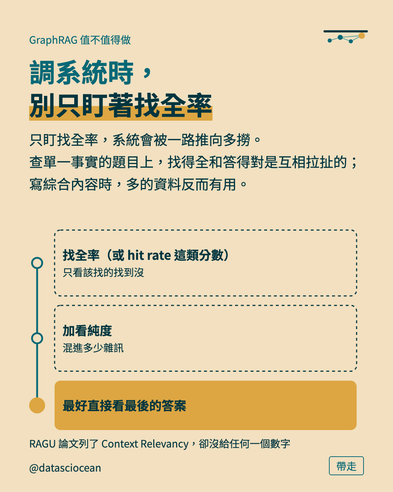
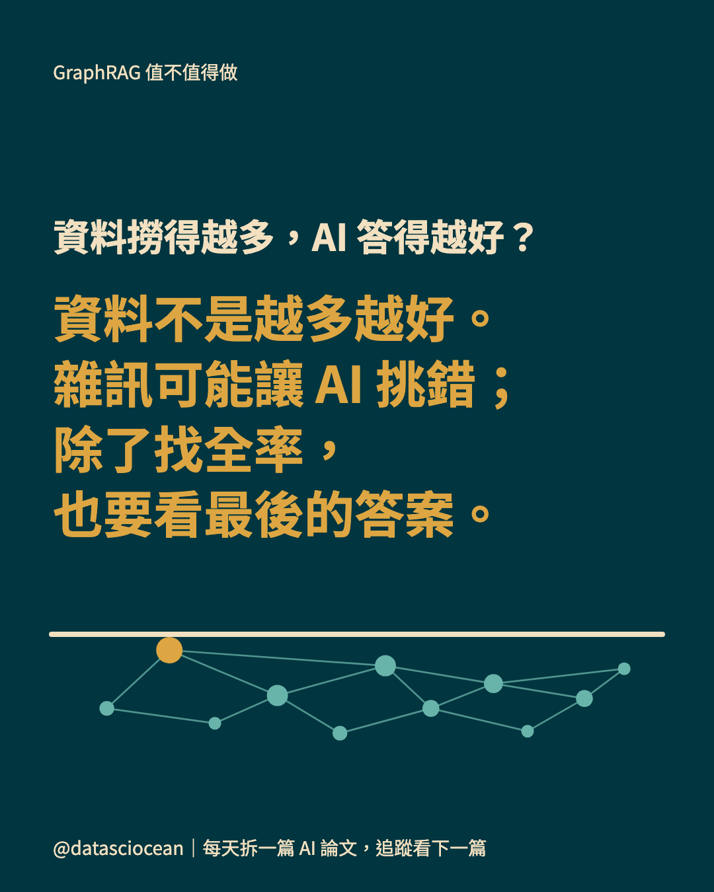

# IG 輪播：資料撈得越多，AI 答得越好？

- 系列：GraphRAG 值不值得做　｜　hook 樣態：讀者心中的疑問　｜　共 9 張，**依頁碼順序上傳**
- 每頁下方的「替代文字」貼到 IG 的替代文字欄；最後的 Caption 整段貼上

## 第 1 頁（封面）



- **主標**：資料撈得越多，
AI 答得越好？
- **副標**：給 AI 的參考資料，不是越多越好：
混進很像、答案卻不同的資料，
它可能反而挑錯。
- **替代文字**：資料撈得越多，
AI 答得越好？。給 AI 的參考資料，不是越多越好：
混進很像、答案卻不同的資料，
它可能反而挑錯。

## 第 2 頁（示意圖）



- **主標**：B 一段沒漏，
但一半是雜訊
- **補充**：假設同一題共有 4 段有用的資料。兩個系統各撈一次，交給 AI 讀：
- **示意圖（tokens）上的文字與數字**：系統 A｜相關｜相關｜相關｜系統 B｜相關｜相關｜相關｜相關｜雜訊｜雜訊｜雜訊｜雜訊｜A 漏了 1 段；B 4 段到齊，卻多了 4 段雜訊
- **圖註**：部落格舉的假設例子
- **替代文字**：B 一段沒漏，
但一半是雜訊。假設同一題共有 4 段有用的資料。兩個系統各撈一次，交給 AI 讀：。圖上寫：系統 A、相關、相關、相關、系統 B、相關、相關、相關、相關、雜訊、雜訊、雜訊、雜訊、A 漏了 1 段；B 4 段到齊，卻多了 4 段雜訊

## 第 3 頁（前情回顧）



- **主標**：前情提要與這一則重點
- **第 1 則**：換一句提示詞 +16.9%，加一整張知識圖 +1.2%　同一份考題：答短 +16.9%，加圖只 +1.2%
- **第 2 則**：資料撈得越多，AI 答得越好？　給 AI 的資料不是越多越好，混進雜訊可能讓它挑錯
- **替代文字**：前情提要與這一則重點。第 1 則「換一句提示詞 +16.9%，加一整張知識圖 +1.2%」：同一份考題：答短 +16.9%，加圖只 +1.2%；第 2 則「資料撈得越多，AI 答得越好？」：給 AI 的資料不是越多越好，混進雜訊可能讓它挑錯

## 第 4 頁（脈絡）



- **主標**：要說 A、B 誰好，
得先有分數
- **補充**：RAGU（ITMO University 團隊的 GraphRAG 系統）的論文用找全率評找資料、用答對率評最後的答案，沒有人測純度：
- **表列**：找全率｜Evidence Recall：該找的資料，找回了幾成
- **表列**：純度｜precision：撈回來的資料裡，有用的佔幾成
- **表列**：答對率｜另一個 AI 當裁判，判斷最後的答案對不對
- **替代文字**：要說 A、B 誰好，
得先有分數。RAGU（ITMO University 團隊的 GraphRAG 系統）的論文用找全率評找資料、用答對率評最後的答案，沒有人測純度：

## 第 5 頁（橫條圖）



- **主標**：找全率說 B 好，
純度說 B 只有一半
- **補充**：找全率只看「該找的找到沒」，不看「不該找的有沒有混進來」。只用找全率打分，系統會被推向多撈：
- **圖上項目**：A（撈 3 段，3 段相關）＝ 找全率 0.75 ；純度 1 
- **圖上項目**：B（撈 8 段，4 段相關）＝ 找全率 1 ；純度 0.5 
- **圖註**：部落格舉的假設例子
- **替代文字**：找全率說 B 好，
純度說 B 只有一半。找全率只看「該找的找到沒」，不看「不該找的有沒有混進來」。只用找全率打分，系統會被推向多撈：

## 第 6 頁（示意圖）



- **主標**：雜訊為什麼
會讓 AI 答錯？
- **補充**：部落格推論，多撈會害答案的原因有三個（這篇論文沒有人測純度）。前兩個：
- **示意圖（compare）上的文字與數字**：干擾｜問題只有一個正確答案｜多塞幾段很像、答案卻不同的資料｜模型挑錯的機率上升｜中間被忽略｜資料一長，模型比較注意開頭結尾｜中間的段落容易被忽略｜答案在資料裡，不代表 模型會用到
- **替代文字**：雜訊為什麼
會讓 AI 答錯？。部落格推論，多撈會害答案的原因有三個（這篇論文沒有人測純度）。前兩個：。圖上寫：干擾、問題只有一個正確答案、多塞幾段很像、答案卻不同的資料、模型挑錯的機率上升、中間被忽略、資料一長，模型比較注意開頭結尾、中間的段落容易被忽略、答案在資料裡，不代表 模型會用到

## 第 7 頁（對照表）



- **小標籤**：RAGU 的例子
- **主標**：第三個原因：
看題目要什麼
- **補充**：部落格推論 RAGU 一路用同一種策略（多撈）：簡單題是負擔，綜合題才變優勢。和對手 HippoRAG 2 比（考題 GraphRAG-Bench Medical，都用 RAGU 附帶的抽取模型建圖）：
- **表列**：查一個事實｜多的資料是干擾。答對率 RAGU 54.2%、HippoRAG 2 72.4%
- **表列**：最難的綜合題｜多的資料是資產。答對率 RAGU 59.0%、HippoRAG 2 56.9%；只差 2.1 個百分點，評分本身的誤差就可能這麼大
- **圖註**：答對率是另一個 AI 只評一次，沒誤差範圍、沒人工檢查裁判
- **替代文字**：第三個原因：
看題目要什麼。部落格推論 RAGU 一路用同一種策略（多撈）：簡單題是負擔，綜合題才變優勢。和對手 HippoRAG 2 比（考題 GraphRAG-Bench Medical，都用 RAGU 附帶的抽取模型建圖）：

## 第 8 頁（示意圖）



- **小標籤**：帶走
- **主標**：調系統時，
別只盯著找全率
- **補充**：只盯找全率，系統會被一路推向多撈。查單一事實的題目上，找得全和答得對是互相拉扯的；寫綜合內容時，多的資料反而有用。
- **示意圖（stops）上的文字與數字**：找全率（或 hit rate 這類分數）｜只看該找的找到沒｜加看純度｜混進多少雜訊｜最好直接看最後的答案
- **圖註**：RAGU 論文列了 Context Relevancy，卻沒給任何一個數字
- **替代文字**：調系統時，
別只盯著找全率。只盯找全率，系統會被一路推向多撈。查單一事實的題目上，找得全和答得對是互相拉扯的；寫綜合內容時，多的資料反而有用。。圖上寫：找全率（或 hit rate 這類分數）、只看該找的找到沒、加看純度、混進多少雜訊、最好直接看最後的答案

## 第 9 頁（帶走）



- **先問的問題**：資料撈得越多，AI 答得越好？
- **一句話**：資料不是越多越好。
雜訊可能讓 AI 挑錯；
除了找全率，
也要看最後的答案。
- **替代文字**：資料撈得越多，AI 答得越好？　資料不是越多越好。
雜訊可能讓 AI 挑錯；
除了找全率，
也要看最後的答案。

## Caption（整段貼到 IG）

```text
給 AI 的參考資料，撈得越多答得越好？混進很像但答案不同的資料，它可能反而挑錯

・B 一段沒漏，但一半是雜訊（假設同一題共有 4 段有用的資料）
・找全率說 B 好，純度說 B 只有一半
・雜訊為什麼，會讓 AI 答錯？
・RAGU 的例子：第三個原因：看題目要什麼
・帶走：調系統時，別只盯著找全率（只盯找全率，系統會被一路推向多撈）

完整文章在 datasciocean.com，搜「RAGU」

#RAGU #GraphRAG #RAG #LLM
```
