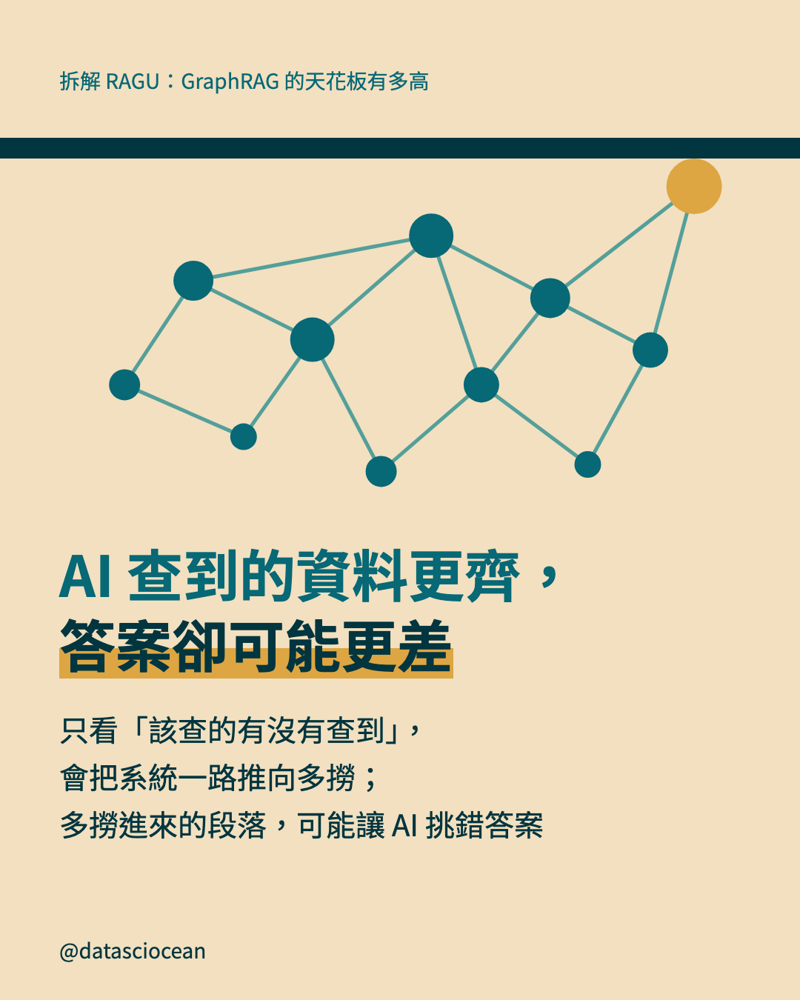
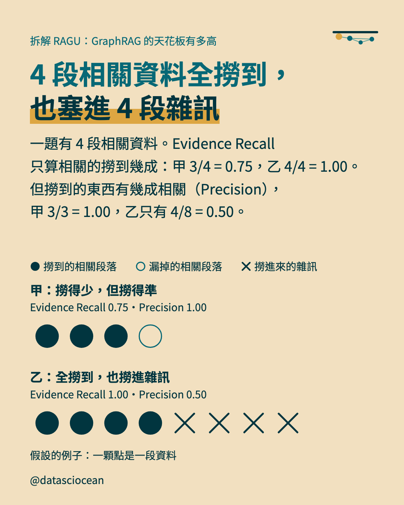
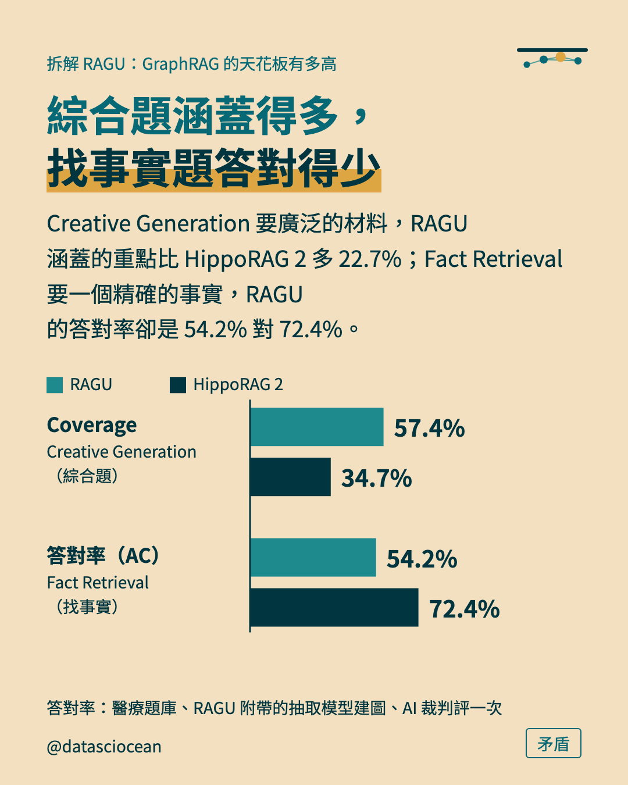
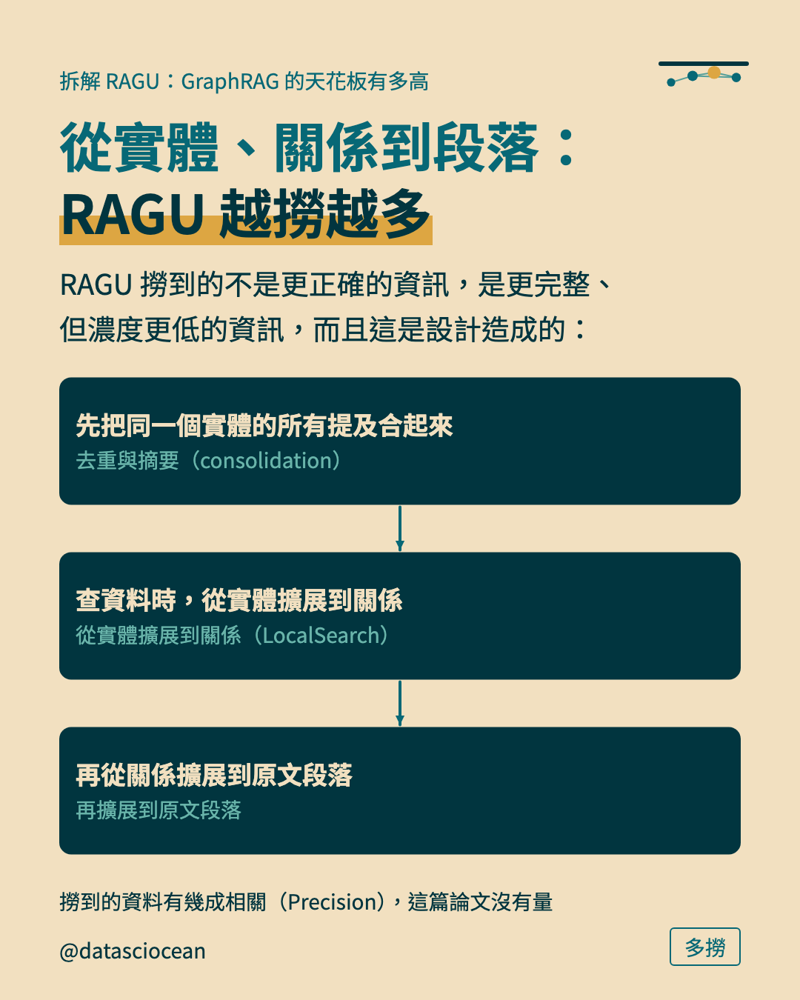
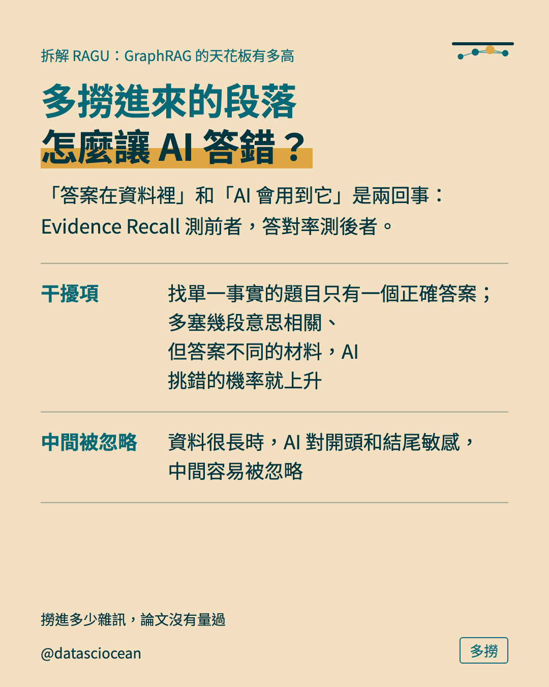
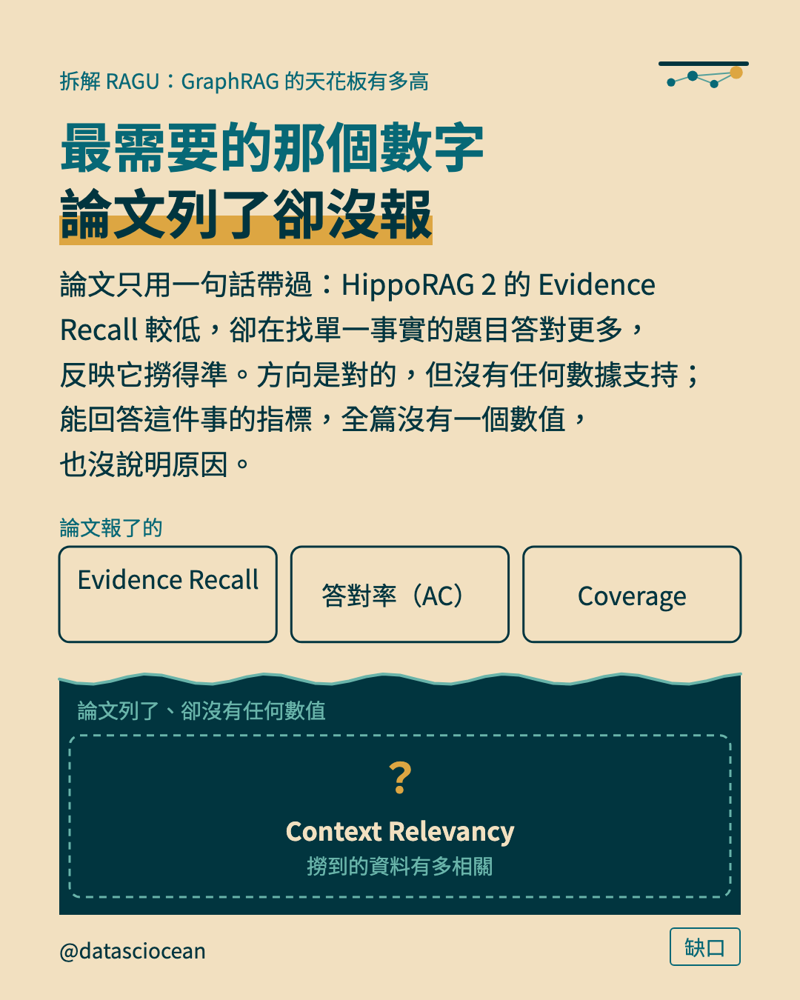
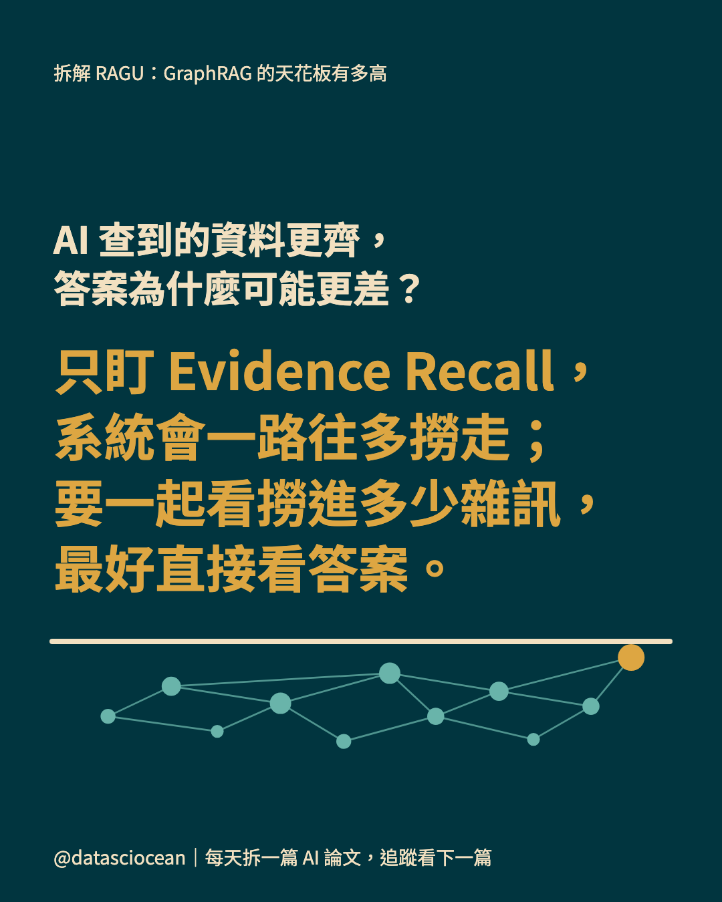

# Threads：證據撈得更完整，答案不一定更好

- 發文方式：**一則輪播貼文**（正文＋全部 11 張圖，順序與 IG 相同），再用一則回覆放連結與系列（連結只放那則回覆）
- 圖檔在 `../ig/`（與 IG 輪播共用同一套）

## 貼文正文（附下方全部圖片）

```text
AI 查到的資料更齊，答案卻可能更差。

替 AI 查資料的系統（RAG）有一種分數叫 Evidence Recall：該查到的相關資料，撈回了幾成。問題是它完全不測不該撈的有沒有撈進來。只盯著它，會把系統一路推向多撈。

這件事和 GraphRAG 無關：在找單一事實的題目上，衝高 Evidence Recall 和衝高答對率是互相拉扯的。所以調任何查資料的系統，至少要一起看撈進多少雜訊，最好直接看答案對不對；需要廣泛材料的綜合題則相反，多撈反而有用。RAGU 這篇 GraphRAG 論文剛好是例子，可能的原因是多撈進來的段落變成干擾，或在很長的資料中間被忽略。

答對率是另一個 AI 當裁判、只打一次的分數，論文沒有誤差範圍，也沒有人工檢查裁判準不準，個位數的差距不宜當結論；撈到的資料有幾成相關，這篇論文沒有量。細節在圖裡。

這是 RAGU 系列的第三則；建圖的 AI 該用多大，在這個系列的下一則。
```

## 附圖（依序）












## 回覆：連結與系列

```text
只盯 Evidence Recall，系統會一路往多撈走；調 RAG 要一起看撈進多少雜訊，最好直接看答案對不對。
文章：datasciocean.com/paper-intro/ragu
同系列：先定好名單再讓 AI 選，圖就少了斷線（尚未發布）
同系列：剝掉混淆後，用圖只多答對 1.2 到 4.3%（尚未發布）
同系列：小模型夠用，是因為任務簡單（尚未發布）
```
