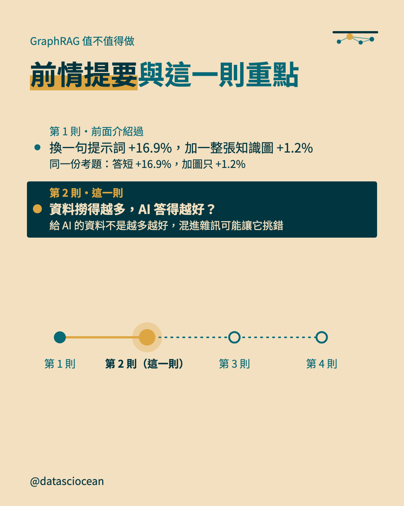
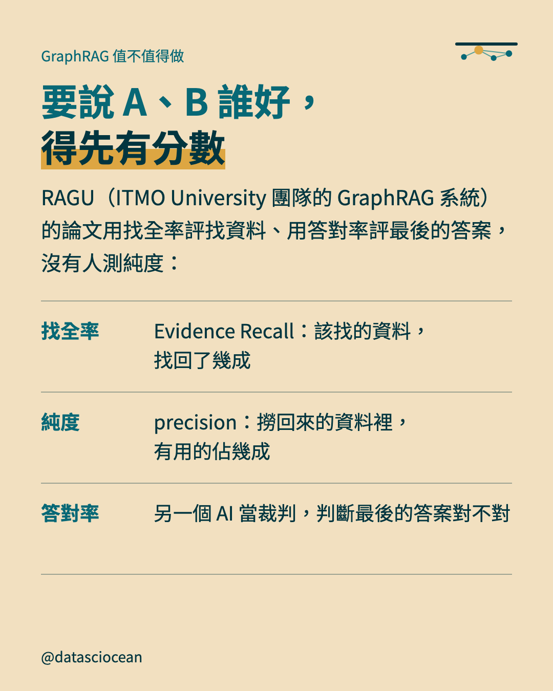
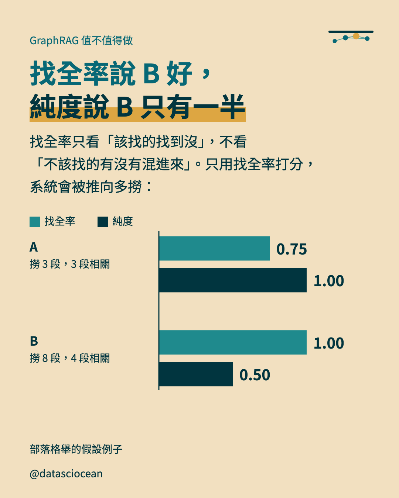
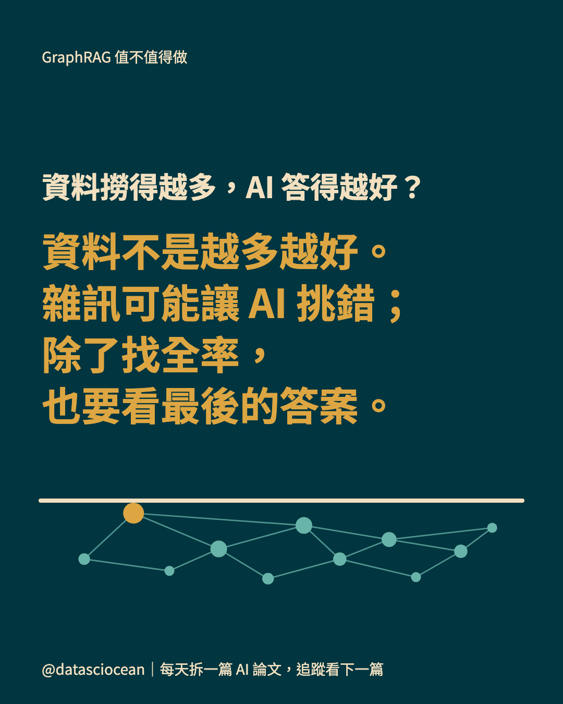

# Threads：資料撈得越多，AI 答得越好？

- 發文方式：**一則輪播貼文**（正文＋全部 9 張圖，順序與 IG 相同），再用一則回覆放連結與系列（連結只放那則回覆）
- 圖檔在 `../ig/`（與 IG 輪播共用同一套）

## 貼文正文（附下方全部圖片）

```text
參考資料撈得越多，AI 答得越好？撈得多，不等於答得好。

假設一題有 4 段有用的資料。A 撈 3 段、都有用；B 撈 8 段，一半是雜訊。論文用的 Evidence Recall（找全率）只看「該找的找到沒」：A 0.75、B 1.00，B 贏。但撈回來的資料裡有用的佔幾成（precision，純度）：A 1.00、B 0.50。

部落格推論多撈會害答案的原因有三個：問題只有一個正確答案時，多塞幾段很像、答案卻不同的資料，AI 挑錯的機率上升；資料一長，中間的段落容易被忽略；第三，要看題目，查事實時多的資料是干擾，寫綜合內容時是資產。

部落格推論 RAGU 一路用同一種策略（多撈），簡單題是負擔、綜合題才變優勢。和 HippoRAG 2 比（GraphRAG-Bench Medical，都用 RAGU 附帶的抽取模型建圖），查事實的答對率 54.2% 對 72.4%；最難的綜合題 59.0% 對 56.9%，只差 2.1 個百分點，評分誤差就可能這麼大。答對率是另一個 AI 只評一次，沒誤差範圍、沒人工檢查；論文沒測純度，列了 Context Relevancy 卻沒給數字。
```

## 附圖（依序）









## 回覆：連結與系列

```text
調系統時別只盯找全率：至少同時看 precision，最好直接看最後的答案。
文章：datasciocean.com/paper-intro/ragu
同系列：換一句提示詞 +16.9%，加一整張知識圖 +1.2%（尚未發布）
同系列：AI 會把同一個東西寫成兩個名字（尚未發布）
同系列：小模型夠用，是因為題目太簡單（尚未發布）
```
