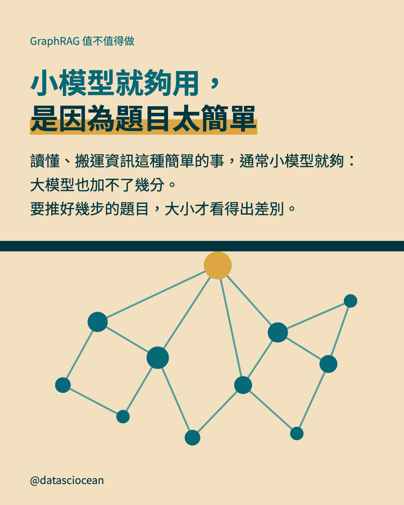
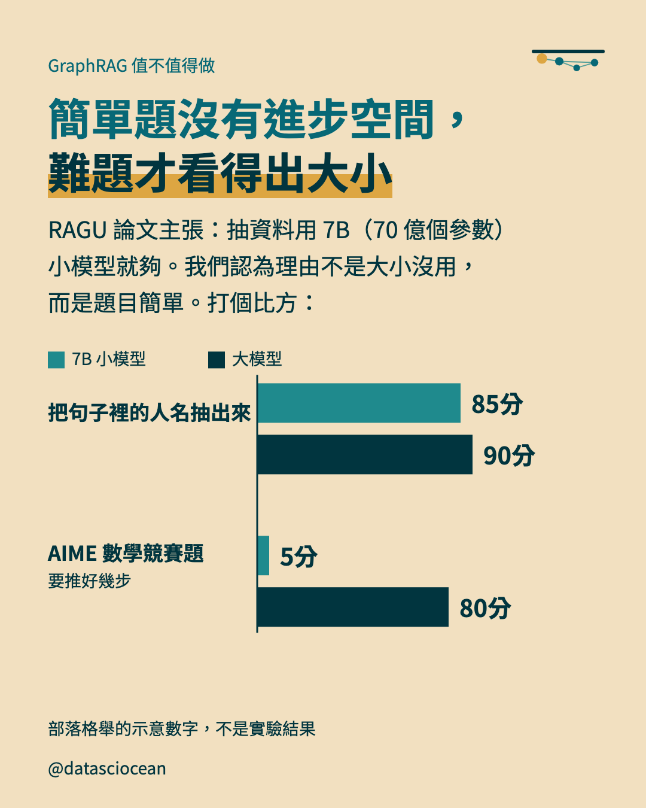
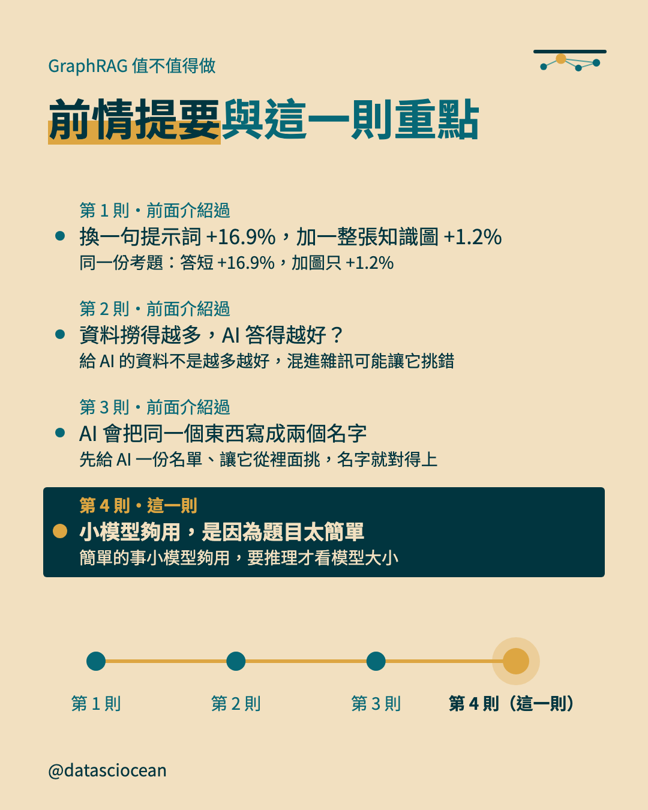
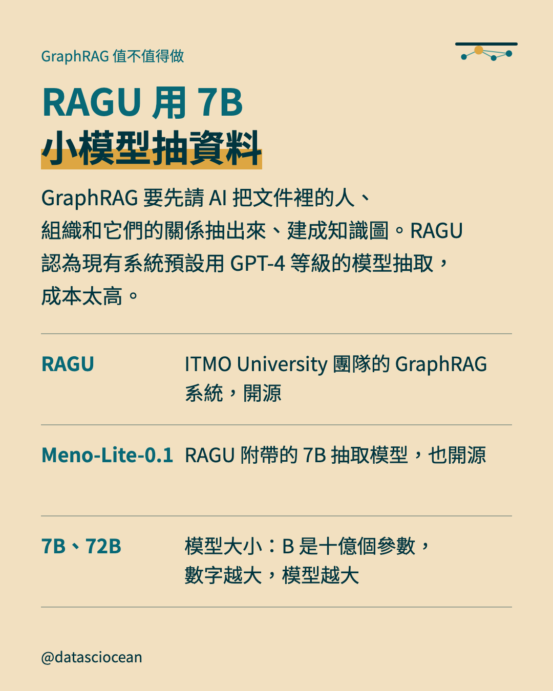
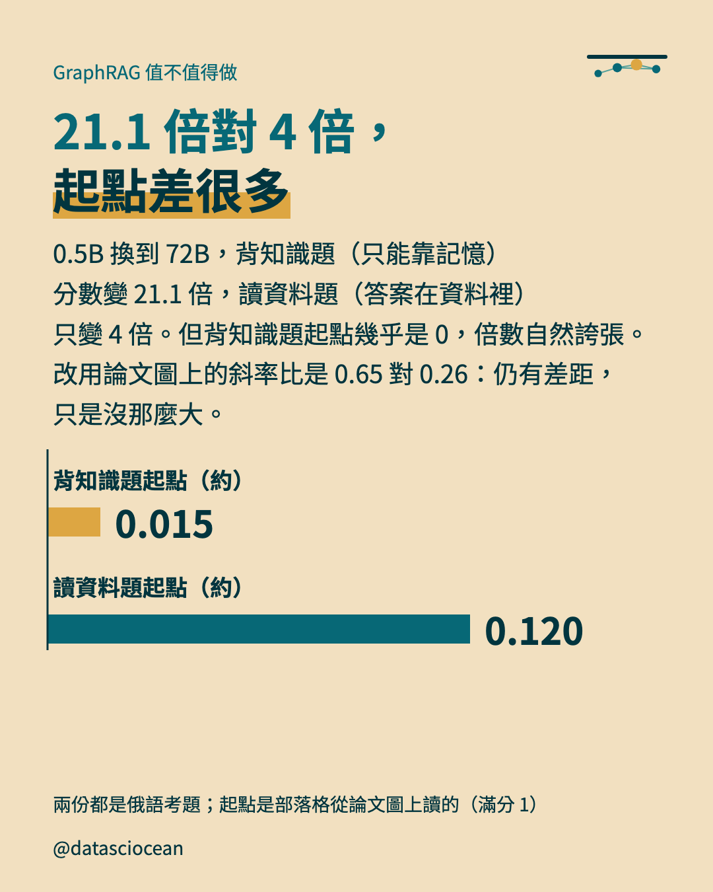
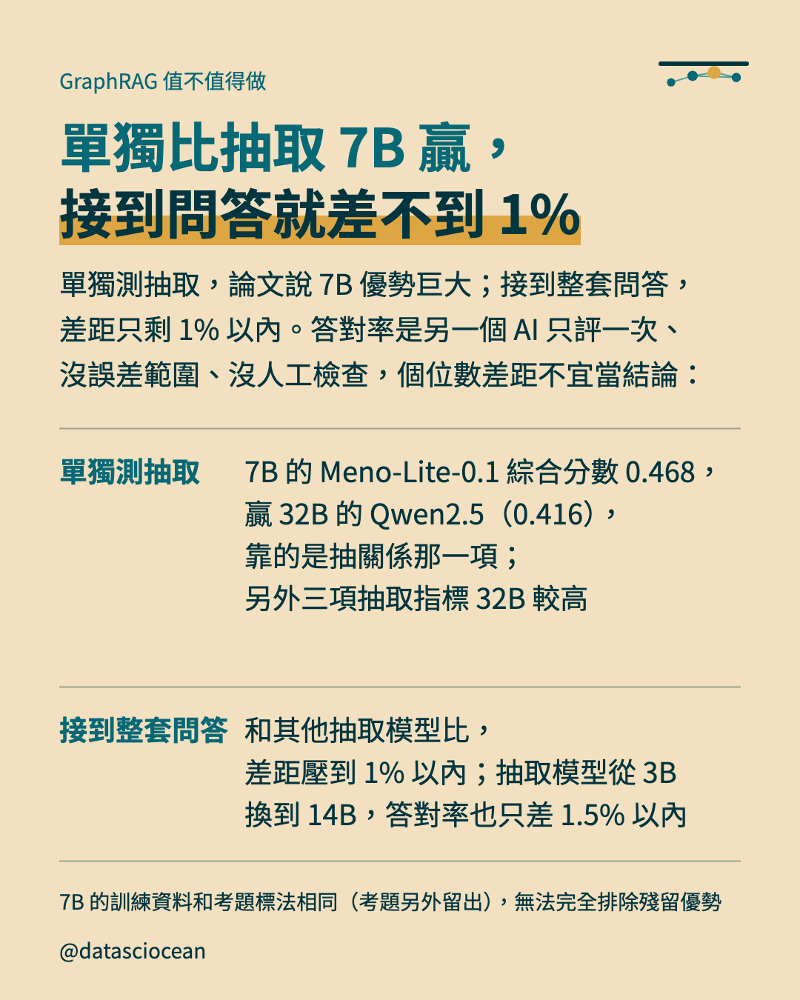
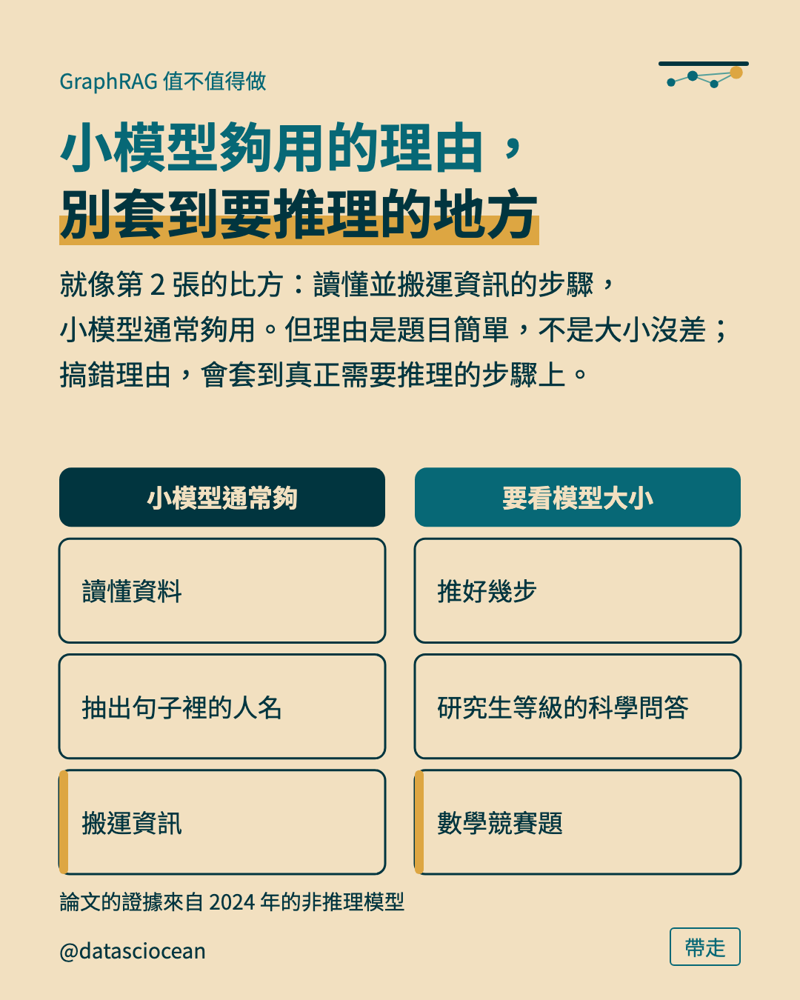
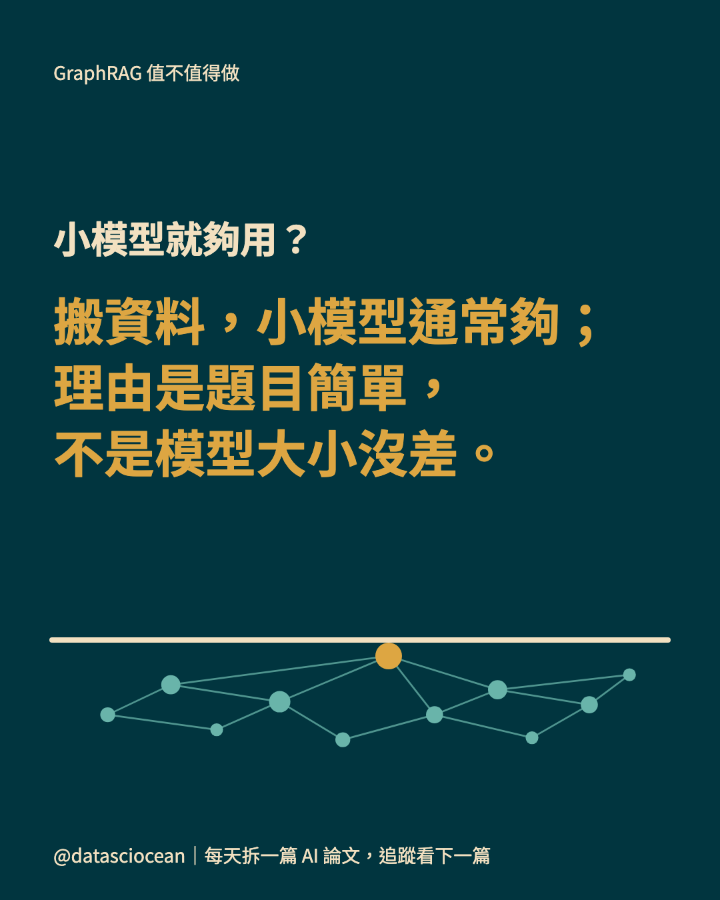

# IG 輪播：小模型夠用，是因為題目太簡單

- 系列：GraphRAG 值不值得做　｜　hook 樣態：反直覺斷言　｜　共 8 張，**依頁碼順序上傳**
- 每頁下方的「替代文字」貼到 IG 的替代文字欄；最後的 Caption 整段貼上

## 第 1 頁（封面）



- **主標**：小模型就夠用，
是因為題目太簡單
- **副標**：讀懂、搬運資訊這種簡單的事，通常小模型就夠：
大模型也加不了幾分。
要推好幾步的題目，大小才看得出差別。
- **替代文字**：小模型就夠用，
是因為題目太簡單。讀懂、搬運資訊這種簡單的事，通常小模型就夠：
大模型也加不了幾分。
要推好幾步的題目，大小才看得出差別。

## 第 2 頁（橫條圖）



- **主標**：簡單題沒有進步空間，
難題才看得出大小
- **補充**：RAGU 論文主張：抽資料用 7B（70 億個參數）小模型就夠。我們認為理由不是大小沒用，而是題目簡單。打個比方：
- **圖上項目**：把句子裡的人名抽出來（）＝ 7B 小模型 85 分；大模型 90 分
- **圖上項目**：AIME 數學競賽題（要推好幾步）＝ 7B 小模型 5 分；大模型 80 分
- **圖註**：部落格舉的示意數字，不是實驗結果
- **替代文字**：簡單題沒有進步空間，
難題才看得出大小。RAGU 論文主張：抽資料用 7B（70 億個參數）小模型就夠。我們認為理由不是大小沒用，而是題目簡單。打個比方：

## 第 3 頁（前情回顧）



- **主標**：前情提要與這一則重點
- **第 1 則**：換一句提示詞 +16.9%，加一整張知識圖 +1.2%　同一份考題：答短 +16.9%，加圖只 +1.2%
- **第 2 則**：資料撈得越多，AI 答得越好？　給 AI 的資料不是越多越好，混進雜訊可能讓它挑錯
- **第 3 則**：AI 會把同一個東西寫成兩個名字　先給 AI 一份名單、讓它從裡面挑，名字就對得上
- **第 4 則**：小模型夠用，是因為題目太簡單　簡單的事小模型夠用，要推理才看模型大小
- **替代文字**：前情提要與這一則重點。第 1 則「換一句提示詞 +16.9%，加一整張知識圖 +1.2%」：同一份考題：答短 +16.9%，加圖只 +1.2%；第 2 則「資料撈得越多，AI 答得越好？」：給 AI 的資料不是越多越好，混進雜訊可能讓它挑錯；第 3 則「AI 會把同一個東西寫成兩個名字」：先給 AI 一份名單、讓它從裡面挑，名字就對得上；第 4 則「小模型夠用，是因為題目太簡單」：簡單的事小模型夠用，要推理才看模型大小

## 第 4 頁（脈絡）



- **主標**：RAGU 用 7B
小模型抽資料
- **補充**：GraphRAG 要先請 AI 把文件裡的人、組織和它們的關係抽出來、建成知識圖。RAGU 認為現有系統預設用 GPT-4 等級的模型抽取，成本太高。
- **表列**：RAGU｜ITMO University 團隊的 GraphRAG 系統，開源
- **表列**：Meno-Lite-0.1｜RAGU 附帶的 7B 抽取模型，也開源
- **表列**：7B、72B｜模型大小：B 是十億個參數，數字越大，模型越大
- **替代文字**：RAGU 用 7B
小模型抽資料。GraphRAG 要先請 AI 把文件裡的人、組織和它們的關係抽出來、建成知識圖。RAGU 認為現有系統預設用 GPT-4 等級的模型抽取，成本太高。

## 第 5 頁（橫條圖）



- **主標**：21.1 倍對 4 倍，
起點差很多
- **補充**：0.5B 換到 72B，背知識題（只能靠記憶）分數變 21.1 倍，讀資料題（答案在資料裡）只變 4 倍。但背知識題起點幾乎是 0，倍數自然誇張。改用論文圖上的斜率比是 0.65 對 0.26：仍有差距，只是沒那麼大。
- **圖上項目**：背知識題起點（約）（）＝ 0.015 　★強調
- **圖上項目**：讀資料題起點（約）（）＝ 0.12 
- **圖註**：兩份都是俄語考題；起點是部落格從論文圖上讀的（滿分 1）
- **替代文字**：21.1 倍對 4 倍，
起點差很多。0.5B 換到 72B，背知識題（只能靠記憶）分數變 21.1 倍，讀資料題（答案在資料裡）只變 4 倍。但背知識題起點幾乎是 0，倍數自然誇張。改用論文圖上的斜率比是 0.65 對 0.26：仍有差距，只是沒那麼大。

## 第 6 頁（對照表）



- **主標**：單獨比抽取 7B 贏，
接到問答就差不到 1%
- **補充**：單獨測抽取，論文說 7B 優勢巨大；接到整套問答，差距只剩 1% 以內。答對率是另一個 AI 只評一次、沒誤差範圍、沒人工檢查，個位數差距不宜當結論：
- **表列**：單獨測抽取｜7B 的 Meno-Lite-0.1 綜合分數 0.468，贏 32B 的 Qwen2.5（0.416），靠的是抽關係那一項；另外三項抽取指標 32B 較高
- **表列**：接到整套問答｜和其他抽取模型比，差距壓到 1% 以內；抽取模型從 3B 換到 14B，答對率也只差 1.5% 以內
- **圖註**：7B 的訓練資料和考題標法相同（考題另外留出），無法完全排除殘留優勢
- **替代文字**：單獨比抽取 7B 贏，
接到問答就差不到 1%。單獨測抽取，論文說 7B 優勢巨大；接到整套問答，差距只剩 1% 以內。答對率是另一個 AI 只評一次、沒誤差範圍、沒人工檢查，個位數差距不宜當結論：

## 第 7 頁（示意圖）



- **小標籤**：帶走
- **主標**：小模型夠用的理由，
別套到要推理的地方
- **補充**：就像第 2 張的比方：讀懂並搬運資訊的步驟，小模型通常夠用。但理由是題目簡單，不是大小沒差；搞錯理由，會套到真正需要推理的步驟上。
- **示意圖（compare）上的文字與數字**：小模型通常夠｜讀懂資料｜抽出句子裡的人名｜搬運資訊｜要看模型大小｜推好幾步｜研究生等級的科學問答｜數學競賽題
- **圖註**：論文的證據來自 2024 年的非推理模型
- **替代文字**：小模型夠用的理由，
別套到要推理的地方。就像第 2 張的比方：讀懂並搬運資訊的步驟，小模型通常夠用。但理由是題目簡單，不是大小沒差；搞錯理由，會套到真正需要推理的步驟上。。圖上寫：小模型通常夠、讀懂資料、抽出句子裡的人名、搬運資訊、要看模型大小、推好幾步、研究生等級的科學問答、數學競賽題

## 第 8 頁（帶走）



- **先問的問題**：小模型就夠用？
- **一句話**：搬資料，小模型通常夠；
理由是題目簡單，
不是模型大小沒差。
- **替代文字**：小模型就夠用？　搬資料，小模型通常夠；
理由是題目簡單，
不是模型大小沒差。

## Caption（整段貼到 IG）

```text
小模型就夠用，是因為題目太簡單：讀懂、搬運資訊這種事，大模型通常也加不了幾分

・簡單題沒有進步空間，難題才看得出大小
・21.1 倍對 4 倍，起點差很多
・單獨比抽取 7B 贏，接到問答就差不到 1%（單獨測抽取，論文說 7B 優勢巨大）
・帶走：小模型夠用的理由，別套到要推理的地方

完整文章在 datasciocean.com，搜「RAGU」

#RAGU #GraphRAG #RAG #LLM
```
