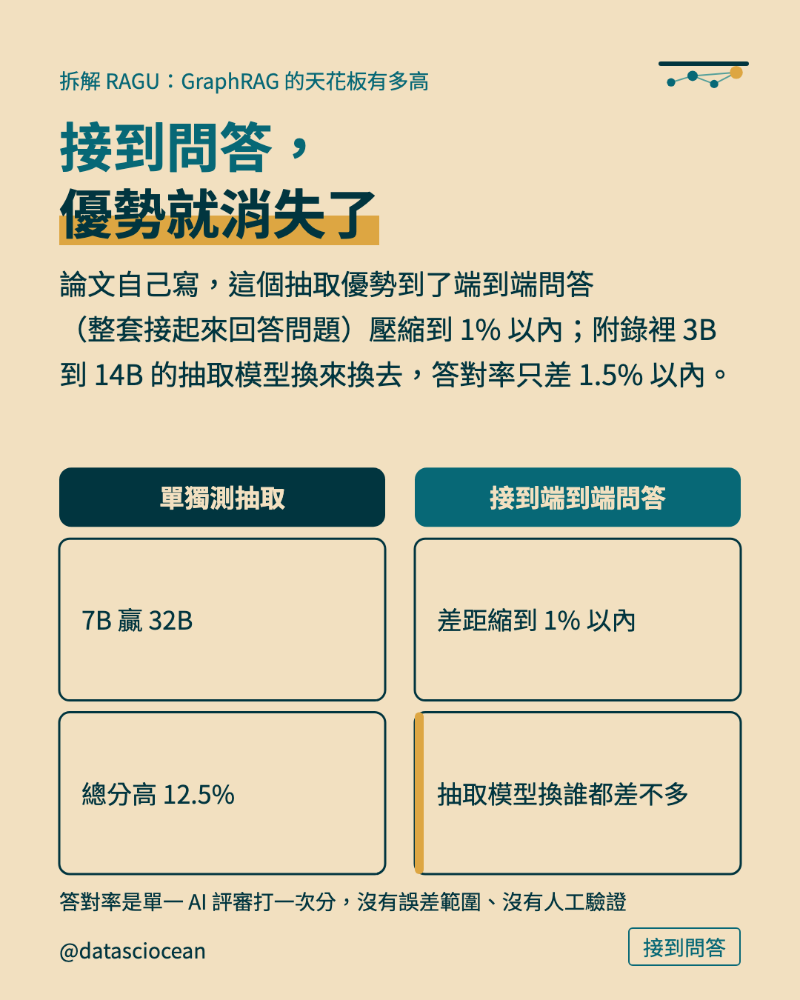

# IG 輪播：小模型夠用，是因為任務簡單

- 系列：拆解 RAGU：GraphRAG 的天花板有多高　｜　hook 樣態：反直覺斷言　｜　共 12 張，**依頁碼順序上傳**
- 每頁下方的「替代文字」貼到 IG 的替代文字欄；最後的 Caption 整段貼上

## 第 1 頁（封面）


- **主標**：小模型夠用，
是因為任務簡單
- **副標**：不是規模沒用：
簡單的題 7B 就快到頂，
難題上大模型才拉得開
- **替代文字**：小模型夠用，
是因為任務簡單。不是規模沒用：
簡單的題 7B 就快到頂，
難題上大模型才拉得開

## 第 2 頁（橫條圖）


- **小標籤**：天花板
- **主標**：抽人名，7B 可能就 85 分
難題才拉得開
- **補充**：「把這句話裡的人名抽出來」這種題，大多落在容易區，沒空間讓規模發揮；數學競賽題（AIME）要一連串推導，規模的效果才看得出來。
- **圖上項目**：抽人名（）＝ 7B 85 分；大模型 90 分
- **圖上項目**：數學競賽題（）＝ 7B 5 分；大模型 80 分
- **圖註**：blog 舉的示意數字，不是實測
- **替代文字**：抽人名，7B 可能就 85 分
難題才拉得開。「把這句話裡的人名抽出來」這種題，大多落在容易區，沒空間讓規模發揮；數學競賽題（AIME）要一連串推導，規模的效果才看得出來。

## 第 3 頁（前情回顧）


- **主標**：前情提要與這一則重點
- **第 1 則**：先定好名單再讓 AI 選，圖就少了斷線　抽取拆兩趟是能帶走的招式；圖畫錯了，答案仍可能是對的
- **第 2 則**：剝掉混淆後，用圖只多答對 1.2 到 4.3%　扣掉答案格式，RAGU 對 HippoRAG 2 平手或落後
- **第 3 則**：證據撈得更完整，答案不一定更好　Evidence Recall 不看撈進多少雜訊，多撈可能是干擾
- **第 4 則**：小模型夠用，是因為任務簡單　抽取落在大模型也加不了分的區；7B 的優勢接到問答就消失
- **替代文字**：前情提要與這一則重點。第 1 則「先定好名單再讓 AI 選，圖就少了斷線」：抽取拆兩趟是能帶走的招式；圖畫錯了，答案仍可能是對的；第 2 則「剝掉混淆後，用圖只多答對 1.2 到 4.3%」：扣掉答案格式，RAGU 對 HippoRAG 2 平手或落後；第 3 則「證據撈得更完整，答案不一定更好」：Evidence Recall 不看撈進多少雜訊，多撈可能是干擾；第 4 則「小模型夠用，是因為任務簡單」：抽取落在大模型也加不了分的區；7B 的優勢接到問答就消失

## 第 4 頁（脈絡）


- **主標**：先認識 RAGU 的小模型
- **補充**：RAGU 是一套 GraphRAG：先請 LLM 把文件裡的實體（人、地點、作品這些東西）和關係抽出來建成知識圖，再拿來找資料回答。它附了一個 7B 的抽取模型 Meno-Lite-0.1，兩者都開源。
- **表列**：為什麼｜RAGU 認為現有系統預設用 GPT-4 等級的模型做抽取，成本太高
- **表列**：7B、72B｜模型大小：B 是十億個參數，數字越大模型越大
- **替代文字**：先認識 RAGU 的小模型。RAGU 是一套 GraphRAG：先請 LLM 把文件裡的實體（人、地點、作品這些東西）和關係抽出來建成知識圖，再拿來找資料回答。它附了一個 7B 的抽取模型 Meno-Lite-0.1，兩者都開源。

## 第 5 頁（示意圖）


- **小標籤**：論文的說法
- **主標**：論文說：讀懂文件的能力
隨規模長得很慢
- **補充**：論文說：LLM 在 RAG（先找資料再回答）流程裡做的事屬於語言能力，不是世界知識，所以抽取用 7B 就夠。
- **示意圖（compare）上的文字與數字**：語言能力｜讀懂文件、抽實體、摘要｜隨規模成長很慢｜世界知識｜背下來的知識｜隨規模成長很快
- **替代文字**：論文說：讀懂文件的能力
隨規模長得很慢。論文說：LLM 在 RAG（先找資料再回答）流程裡做的事屬於語言能力，不是世界知識，所以抽取用 7B 就夠。。圖上寫：語言能力、讀懂文件、抽實體、摘要、隨規模成長很慢、世界知識、背下來的知識、隨規模成長很快

## 第 6 頁（橫條圖）


- **小標籤**：證據
- **主標**：論文拿出的證據，
21.1 倍對 4 倍
- **補充**：從 0.5B 到 72B，考背知識的 CheGeKa（俄語常識問答，沒有文件可看）成長 21.1 倍；考讀文件的 MultiQ（事實都在文件裡，要串好幾段才答得出來）只有 4 倍。
- **圖上項目**：CheGeKa（考背下來的知識）＝ 21.1 倍
- **圖上項目**：MultiQ（考讀文件）＝ 4 倍
- **圖註**：模型是 2024 年的 Qwen2.5-Instruct（不是推理模型）；題庫是俄語
- **替代文字**：論文拿出的證據，
21.1 倍對 4 倍。從 0.5B 到 72B，考背知識的 CheGeKa（俄語常識問答，沒有文件可看）成長 21.1 倍；考讀文件的 MultiQ（事實都在文件裡，要串好幾段才答得出來）只有 4 倍。

## 第 7 頁（對照表）


- **小標籤**：斜率
- **主標**：倍數有灌水成分，
換成斜率是 0.65 對 0.26
- **補充**：倍數是 72B 的分數除以 0.5B 的分數；斜率（模型每放大同樣倍數，分數漲多少）至少是在同一個尺度上比。
- **表列**：CheGeKa 起點｜0.5B 約 0.015（滿分 1）：分母趨近 0，倍數很誇張
- **表列**：MultiQ 終點｜大概 32B 就碰頂（約 0.57 後持平），倍數被壓低
- **表列**：換成斜率｜0.65 對 0.26：背知識還是漲得比較快，但這個比法比較站得住
- **替代文字**：倍數有灌水成分，
換成斜率是 0.65 對 0.26。倍數是 72B 的分數除以 0.5B 的分數；斜率（模型每放大同樣倍數，分數漲多少）至少是在同一個尺度上比。

## 第 8 頁（對照表）


- **小標籤**：缺口
- **主標**：這份證據
還有三個缺口
- **補充**：要推到「抽取用 7B 就夠」還有缺口：
- **表列**：測錯東西｜MultiQ 考讀文件，不是抽取；論文的抽取實驗裡，純 Qwen2.5 7B 0.356、32B 0.416，越大越高
- **表列**：俄語｜俄國常識題代表世界知識，再推到英語醫療資料，跨度不小
- **表列**：舊模型｜不是先想再答的推理模型；推理模型的進步主要來自 RL 後訓練（用獎勵再調教），論文沒碰到
- **替代文字**：這份證據
還有三個缺口。要推到「抽取用 7B 就夠」還有缺口：

## 第 9 頁（示意圖）


- **小標籤**：理由
- **主標**：搞錯理由
就會用錯地方
- **補充**：抽人名這類題目大多落在容易區，所以小模型通常夠用；以為是規模沒用，就會把它錯套到真正需要推理的環節。
- **示意圖（compare）上的文字與數字**：以為規模沒用｜抽取：小模型夠用｜推理的環節也拿來套｜知道是題目簡單｜抽取：小模型夠用｜推理的環節，規模看得出效果
- **替代文字**：搞錯理由
就會用錯地方。抽人名這類題目大多落在容易區，所以小模型通常夠用；以為是規模沒用，就會把它錯套到真正需要推理的環節。。圖上寫：以為規模沒用、抽取：小模型夠用、推理的環節也拿來套、知道是題目簡單、抽取：小模型夠用、推理的環節，規模看得出效果

## 第 10 頁（橫條圖）


- **小標籤**：單獨測
- **主標**：只看抽取，7B 贏 32B
主要靠關係抽取
- **補充**：Meno-Lite-0.1 是再訓練過（微調）的 7B；Qwen2.5 是論文拿來比的模型家族。贏主要靠關係抽取（找出誰和誰有什麼關係）；總分 HM 高 12.5%，另外三項 32B 較高。
- **圖上項目**：關係抽取 RE（）＝ Meno-Lite-0.1（7B） 0.347 ；Qwen2.5-32B 0.239 
- **圖上項目**：總分 HM（）＝ Meno-Lite-0.1（7B） 0.468 ；Qwen2.5-32B 0.416 
- **圖註**：微調資料和測試題同源（論文說只重疊格式與領域），殘留優勢無法排除
- **替代文字**：只看抽取，7B 贏 32B
主要靠關係抽取。Meno-Lite-0.1 是再訓練過（微調）的 7B；Qwen2.5 是論文拿來比的模型家族。贏主要靠關係抽取（找出誰和誰有什麼關係）；總分 HM 高 12.5%，另外三項 32B 較高。

## 第 11 頁（示意圖）



- **小標籤**：接到問答
- **主標**：接到問答，
優勢就消失了
- **補充**：論文自己寫，這個抽取優勢到了端到端問答（整套接起來回答問題）壓縮到 1% 以內；附錄裡 3B 到 14B 的抽取模型換來換去，答對率只差 1.5% 以內。
- **示意圖（compare）上的文字與數字**：單獨測抽取｜7B 贏 32B｜總分高 12.5%｜接到端到端問答｜差距縮到 1% 以內｜抽取模型換誰都差不多
- **圖註**：答對率是單一 AI 評審打一次分，沒有誤差範圍、沒有人工驗證
- **替代文字**：接到問答，
優勢就消失了。論文自己寫，這個抽取優勢到了端到端問答（整套接起來回答問題）壓縮到 1% 以內；附錄裡 3B 到 14B 的抽取模型換來換去，答對率只差 1.5% 以內。。圖上寫：單獨測抽取、7B 贏 32B、總分高 12.5%、接到端到端問答、差距縮到 1% 以內、抽取模型換誰都差不多

## 第 12 頁（帶走）


- **先問的問題**：RAGU 用 7B 抽取，為什麼夠用？
- **一句話**：小模型通常夠用，
是因為任務簡單，
不是規模沒用；
要推理的環節別照搬。
- **替代文字**：RAGU 用 7B 抽取，為什麼夠用？　小模型通常夠用，
是因為任務簡單，
不是規模沒用；
要推理的環節別照搬。

## Caption（整段貼到 IG）

```text
GraphRAG 抽取用 7B 小模型夠用，是因為任務簡單，不是規模沒用

・天花板：抽人名，7B 可能就 85 分，難題才拉得開
・論文的說法：論文說：讀懂文件的能力，隨規模長得很慢
・證據：論文拿出的證據，21.1 倍對 4 倍
・斜率：倍數有灌水成分，換成斜率是 0.65 對 0.26（倍數是 72B 的分數除以 0.5B 的分數）
・缺口：這份證據，還有三個缺口（要推到「抽取用 7B 就夠」還有缺口：）
・理由：搞錯理由，就會用錯地方（抽人名這類題目大多落在容易區，所以小模型通常夠用）
・單獨測：只看抽取，7B 贏 32B，主要靠關係抽取
・接到問答，優勢就消失了

完整文章在 datasciocean.com，搜「RAGU」

#RAGU #GraphRAG #知識圖 #LLM
```
