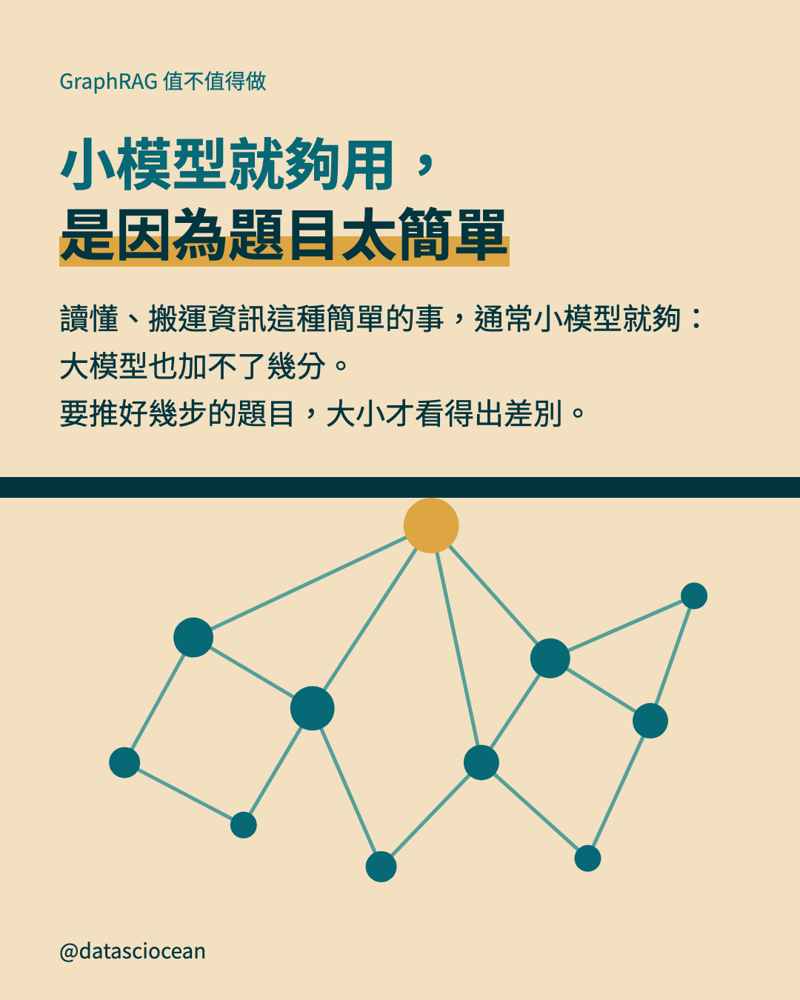
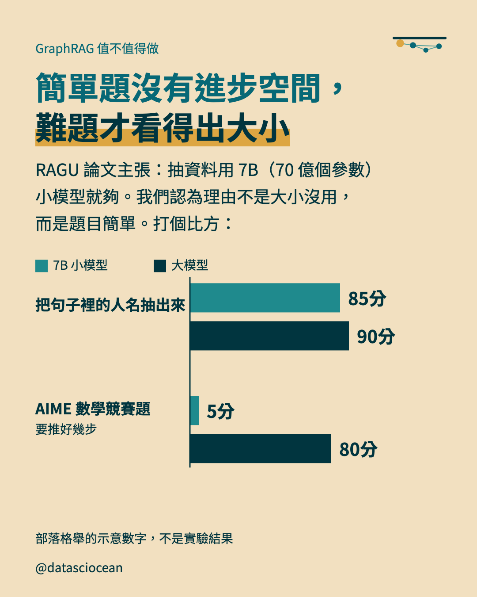
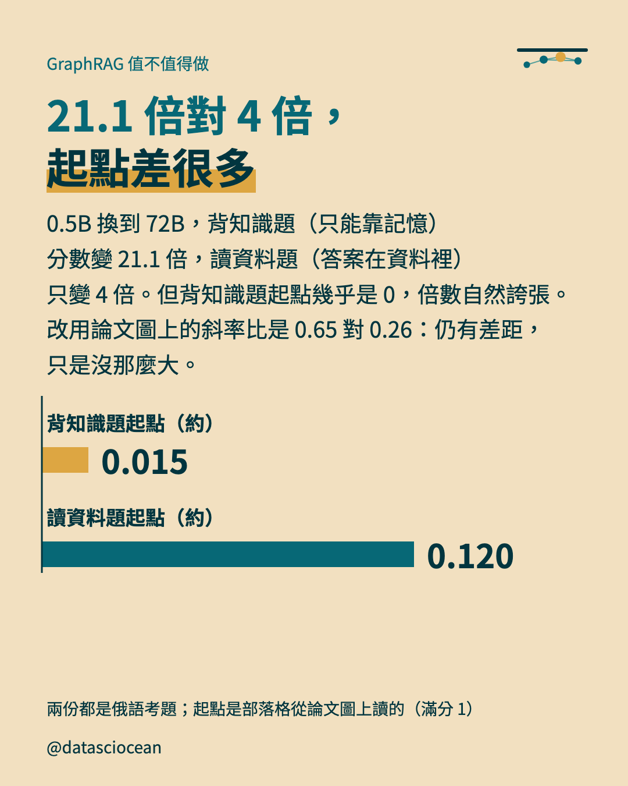
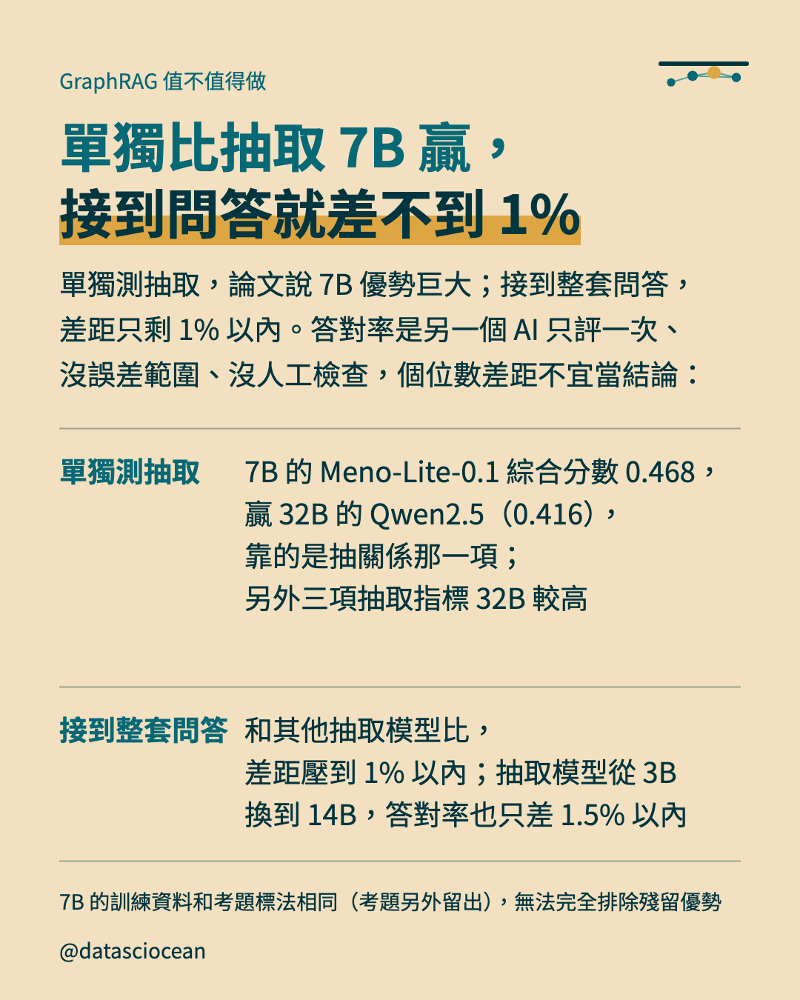

# Threads：小模型夠用，是因為題目太簡單

- 發文方式：**一則輪播貼文**（正文＋全部 8 張圖，順序與 IG 相同），再用一則回覆放連結與系列（連結只放那則回覆）
- 圖檔在 `../ig/`（與 IG 輪播共用同一套）

## 貼文正文（附下方全部圖片）

```text
小模型就夠用，是因為題目太簡單。

GraphRAG 要先請 AI 從文件抽出人、組織和關係；RAGU（ITMO University 團隊的開源 GraphRAG 系統）嫌 GPT-4 等級的模型抽取太貴，附了一個 7B 的抽取模型 Meno-Lite-0.1。論文的理由（Qwen2.5-Instruct，2024 年的非推理模型；兩份考題都是俄語）：模型從 0.5B 換到 72B，背知識題分數變 21.1 倍，讀資料題只變 4 倍，所以抽取用 7B 就夠。

部落格認為有灌水：背知識題起點幾乎是 0；比較站得住的是斜率，背知識題 0.65、讀資料題 0.26。真正的原因是天花板：抽人名這種事，7B 可能已經 85 分、大模型也只有 90 分；AIME 這類要推好幾步的題，7B 5 分、大模型 80 分（比方）。

實驗：單獨測抽取，7B 的綜合分數 0.468 贏 32B 的 0.416；接到整套問答，和其他抽取模型只差 1% 以內。限制：7B 的微調資料和考題同一套標註體系（考題另外留出），殘留優勢無法完全排除；答對率是另一個 AI 只評一次、沒人工檢查，個位數差距不宜當結論。
```

## 附圖（依序）









## 回覆：連結與系列

```text
讀懂並搬運資訊的元件，小模型通常夠用；但理由是題目簡單，別把它套到需要推理的環節上。
文章：datasciocean.com/paper-intro/ragu
同系列：換一句提示詞 +16.9%，加一整張知識圖 +1.2%（尚未發布）
同系列：資料撈得越多，AI 答得越好？（尚未發布）
同系列：AI 會把同一個東西寫成兩個名字（尚未發布）
```
