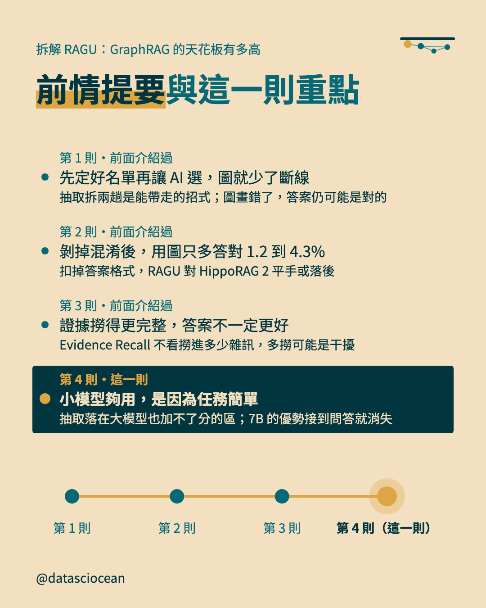
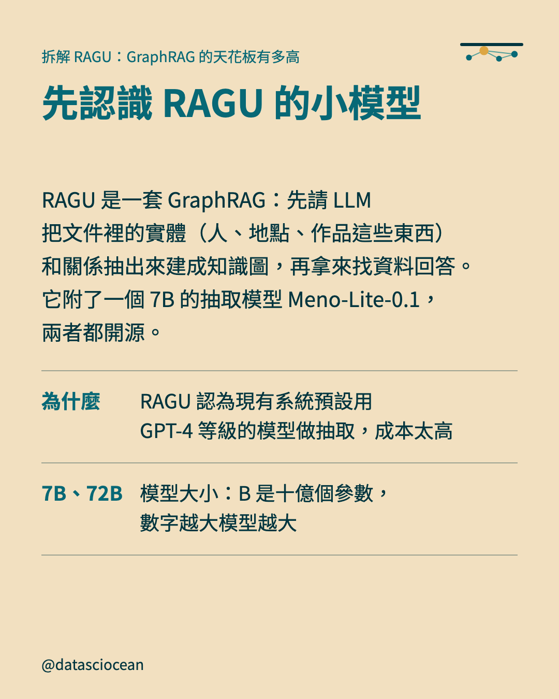
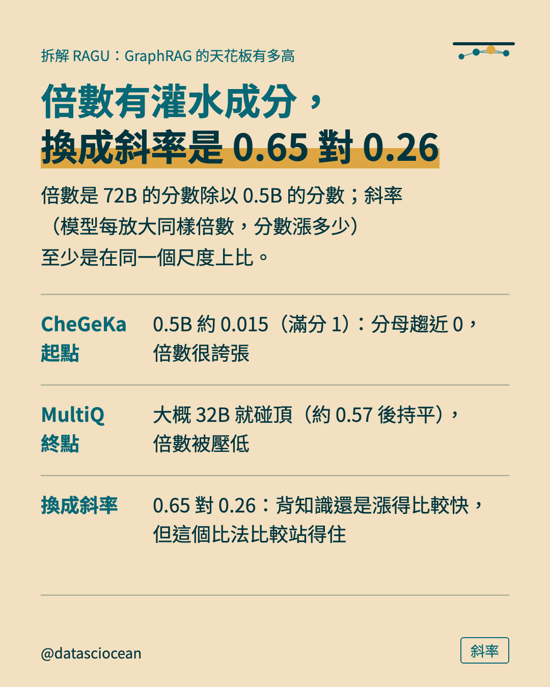
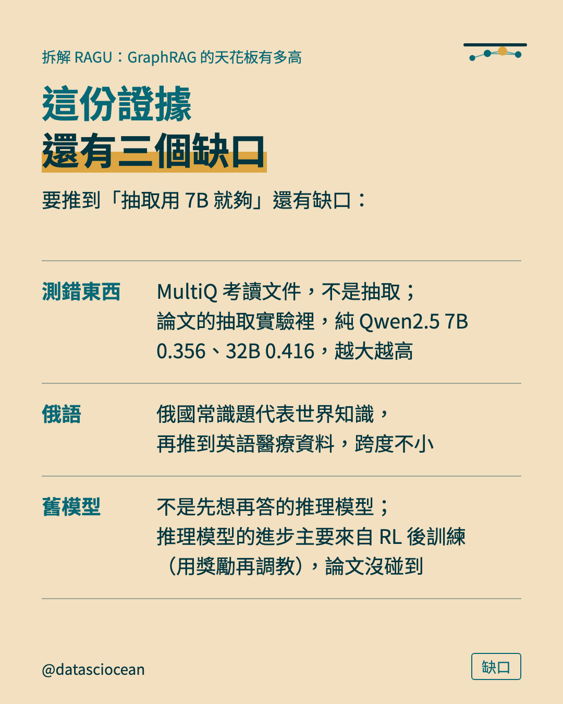
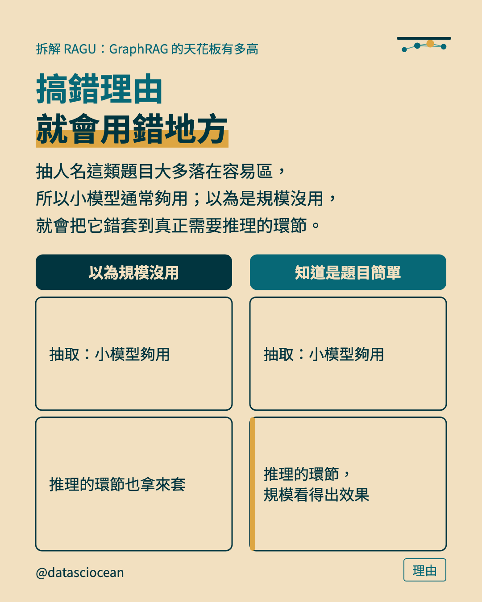
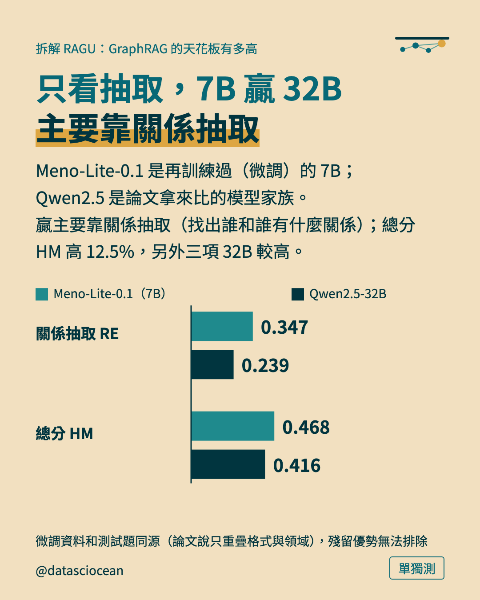
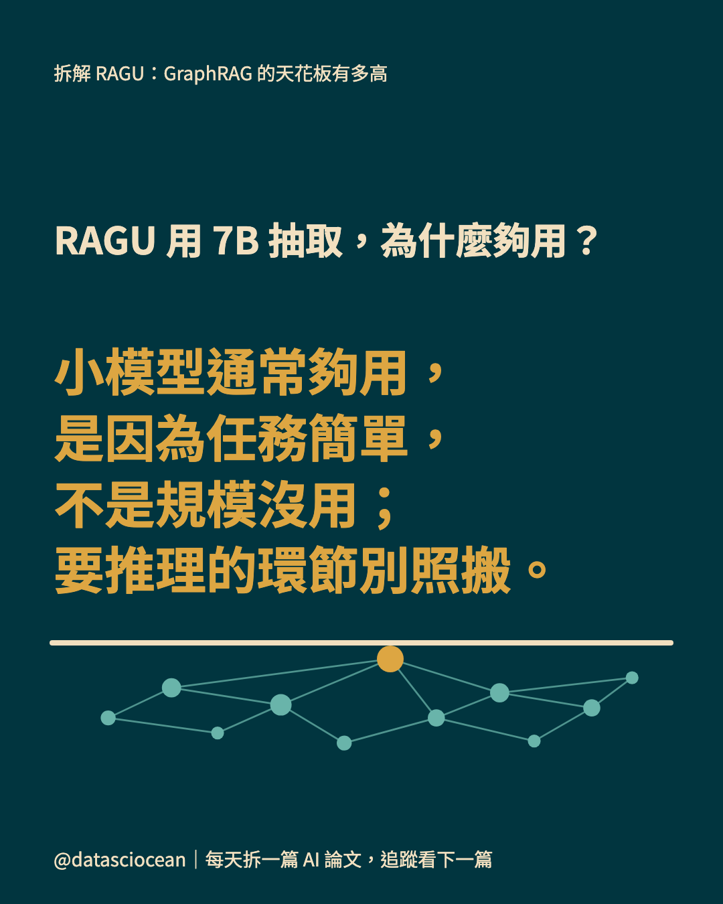

# Threads：小模型夠用，是因為任務簡單

- 發文方式：**一則輪播貼文**（正文＋全部 12 張圖，順序與 IG 相同），再用一則回覆放連結與系列（連結只放那則回覆）
- 圖檔在 `../ig/`（與 IG 輪播共用同一套）

## 貼文正文（附下方全部圖片）

```text
GraphRAG 裡負責讀懂、搬運資訊的環節，小模型通常就夠用；原因是任務簡單，不是規模沒用。

這點很重要：如果你以為「規模沒用」，就會把小模型錯套到真正需要推理的地方。

RAGU 論文的證據是從 0.5B 到 72B，背知識的題庫成長 21.1 倍、讀文件的只有 4 倍。但背知識那題在 0.5B 幾乎是 0 分，倍數有灌水；比較站得住的斜率是 0.65 對 0.26。題庫都是俄語、模型是 2024 年的非推理模型，而且論文自己的抽取實驗裡，純 Qwen2.5 家族是越大分數越高。

它附的 7B 抽取模型單獨測確實贏 32B，不過微調資料和測試題同源；論文說重疊僅限於標註格式和文本領域，但也在限制段自己承認，殘留優勢無法完全排除。接到問答後，差距縮到 1% 以內；附錄裡換不同大小的抽取模型，答對率也只差 1.5% 以內。答對率是單一 AI 評審打一次分，沒有誤差範圍、也沒人工驗證，個位數差距不宜當結論。

這是 RAGU 系列的最後一則。
```

## 附圖（依序）













## 回覆：連結與系列

```text
小模型通常夠用，是因為任務簡單，不是規模沒用；要推理的環節別照搬。
文章：datasciocean.com/paper-intro/ragu
同系列：先定好名單再讓 AI 選，圖就少了斷線（尚未發布）
同系列：剝掉混淆後，用圖只多答對 1.2 到 4.3%（尚未發布）
同系列：證據撈得更完整，答案不一定更好（尚未發布）
```
