# IG 輪播：SQL、向量、LLM 怎麼分工？

- 系列：SAG：不先建圖，查詢時才連　｜　hook 樣態：反直覺斷言　｜　共 16 張，**依頁碼順序上傳**
- 每頁下方的「替代文字」貼到 IG 的替代文字欄；最後的 Caption 整段貼上

## 第 1 頁（封面）

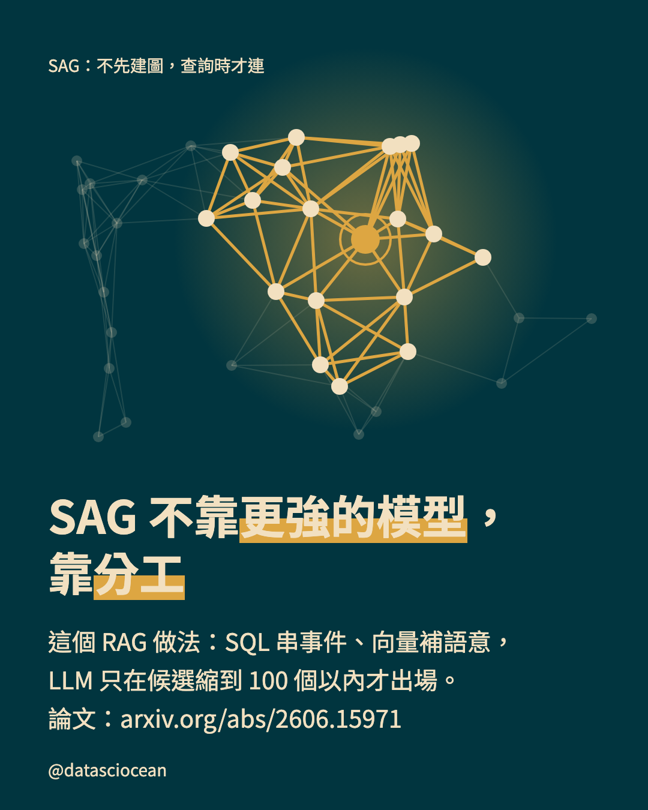

- **主標**：SAG 不靠更強的模型，靠分工
- **副標**：這個 RAG 做法：SQL 串事件、向量補語意，
LLM 只在候選縮到 100 個以內才出場。
論文：arxiv.org/abs/2606.15971
- **替代文字**：SAG 不靠更強的模型，靠分工。這個 RAG 做法：SQL 串事件、向量補語意，
LLM 只在候選縮到 100 個以內才出場。
論文：arxiv.org/abs/2606.15971

## 第 2 頁（前情回顧）

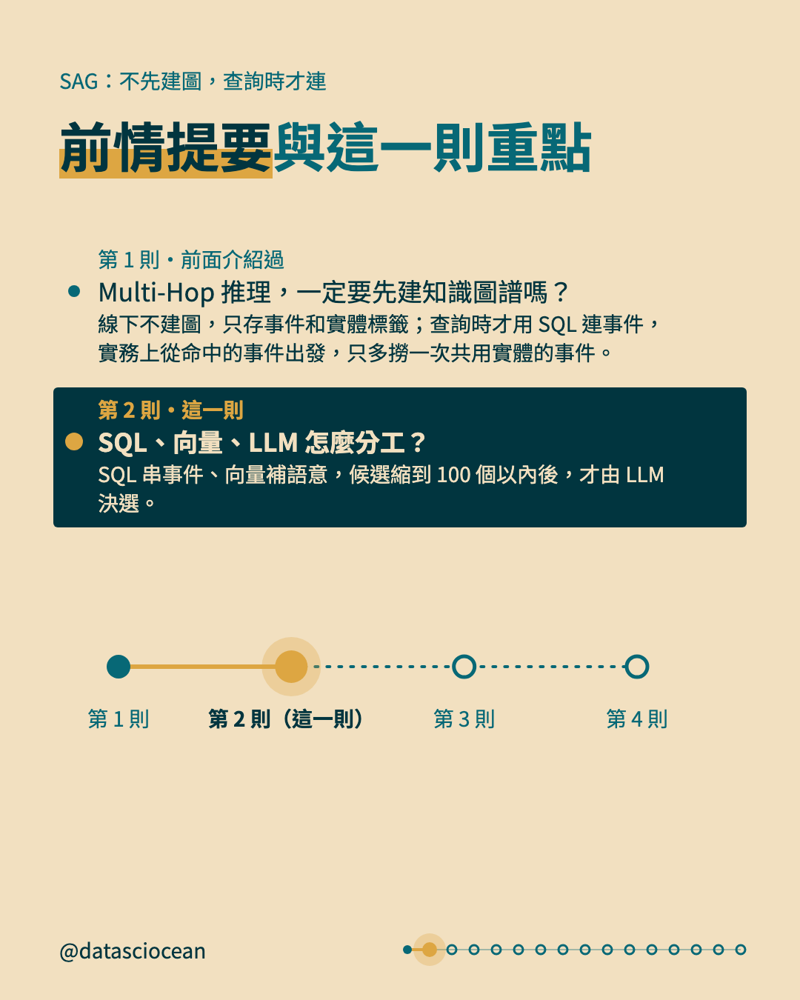

- **主標**：前情提要與這一則重點
- **第 1 則**：Multi-Hop 推理，一定要先建知識圖譜嗎？　線下不建圖，只存事件和實體標籤；查詢時才用 SQL 連事件，實務上從命中的事件出發，只多撈一次共用實體的事件。
- **第 2 則**：SQL、向量、LLM 怎麼分工？　SQL 串事件、向量補語意，候選縮到 100 個以內後，才由 LLM 決選。
- **替代文字**：前情提要與這一則重點。第 1 則「Multi-Hop 推理，一定要先建知識圖譜嗎？」：線下不建圖，只存事件和實體標籤；查詢時才用 SQL 連事件，實務上從命中的事件出發，只多撈一次共用實體的事件。；第 2 則「SQL、向量、LLM 怎麼分工？」：SQL 串事件、向量補語意，候選縮到 100 個以內後，才由 LLM 決選。

## 第 3 頁（脈絡）

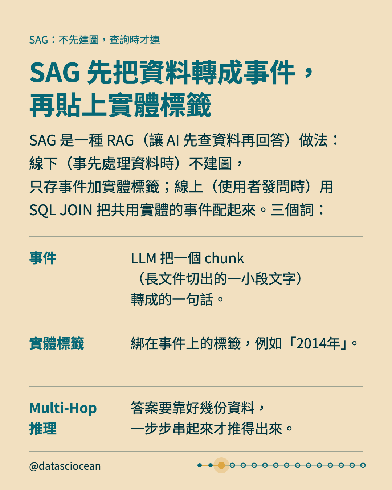

- **主標**：SAG 先把資料轉成事件，再貼上實體標籤
- **補充**：SAG 是一種 RAG（讓 AI 先查資料再回答）做法：線下（事先處理資料時）不建圖，只存事件加實體標籤；線上（使用者發問時）用 SQL JOIN 把共用實體的事件配起來。三個詞：
- **表列**：事件｜LLM 把一個 chunk（長文件切出的一小段文字）轉成的一句話。
- **表列**：實體標籤｜綁在事件上的標籤，例如「2014年」。
- **表列**：Multi-Hop 推理｜答案要靠好幾份資料，一步步串起來才推得出來。
- **替代文字**：SAG 先把資料轉成事件，再貼上實體標籤。SAG 是一種 RAG（讓 AI 先查資料再回答）做法：線下（事先處理資料時）不建圖，只存事件加實體標籤；線上（使用者發問時）用 SQL JOIN 把共用實體的事件配起來。三個詞：

## 第 4 頁（示意圖）

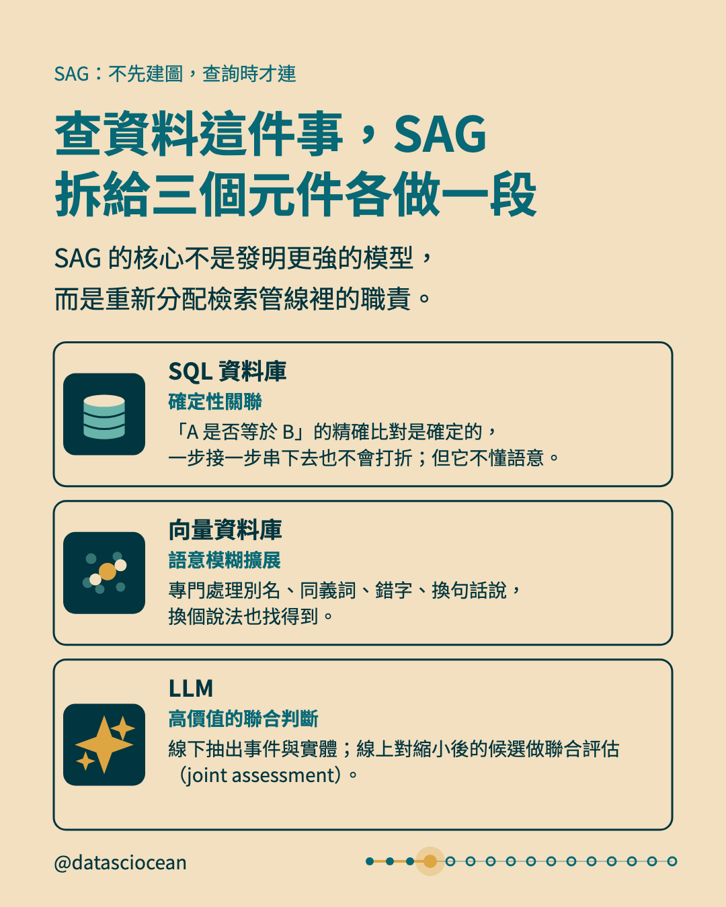

- **主標**：查資料這件事，SAG 拆給三個元件各做一段
- **補充**：SAG 的核心不是發明更強的模型，而是重新分配檢索管線裡的職責。
- **示意圖（roles）上的文字與數字**：SQL 資料庫｜確定性關聯｜「A 是否等於 B」的精確比對是確定的，一步接一步串下去也不會打折；但它不懂語意。｜向量資料庫｜語意模糊擴展｜專門處理別名、同義詞、錯字、換句話說，換個說法也找得到。｜LLM｜高價值的聯合判斷｜線下抽出事件與實體；線上對縮小後的候選做聯合評估（joint assessment）。
- **替代文字**：查資料這件事，SAG 拆給三個元件各做一段。SAG 的核心不是發明更強的模型，而是重新分配檢索管線裡的職責。。圖上寫：SQL 資料庫、確定性關聯、「A 是否等於 B」的精確比對是確定的，一步接一步串下去也不會打折；但它不懂語意。、向量資料庫、語意模糊擴展、專門處理別名、同義詞、錯字、換句話說，換個說法也找得到。、LLM、高價值的聯合判斷、線下抽出事件與實體；線上對縮小後的候選做聯合評估（joint assessment）。

## 第 5 頁（示意圖）

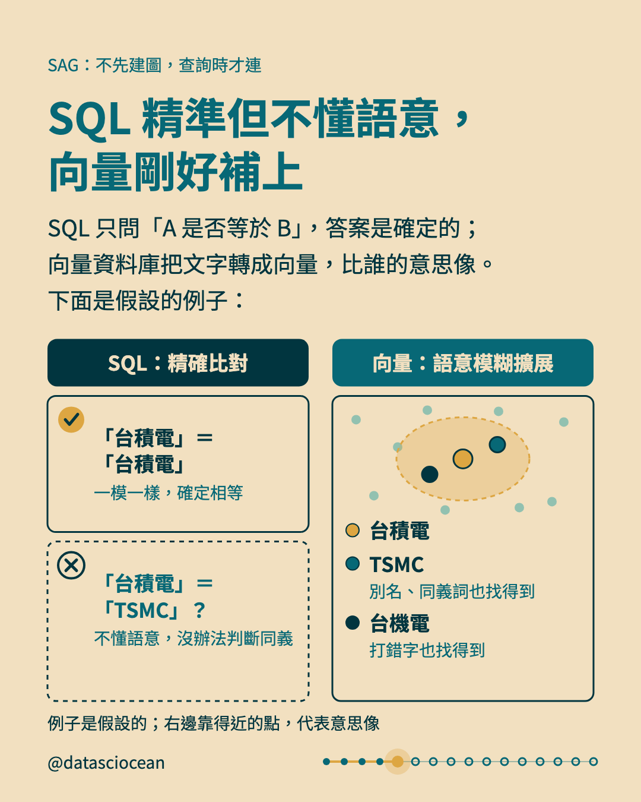

- **主標**：SQL 精準但不懂語意，向量剛好補上
- **補充**：SQL 只問「A 是否等於 B」，答案是確定的；向量資料庫把文字轉成向量，比誰的意思像。下面是假設的例子：
- **示意圖（embed）上的文字與數字**：「台積電」＝「台積電」｜一模一樣，確定相等｜「台積電」＝「TSMC」？｜不懂語意，沒辦法判斷同義｜台積電｜TSMC｜別名、同義詞也找得到｜台機電｜打錯字也找得到｜SQL：精確比對｜向量：語意模糊擴展
- **圖註**：例子是假設的；右邊靠得近的點，代表意思像
- **替代文字**：SQL 精準但不懂語意，向量剛好補上。SQL 只問「A 是否等於 B」，答案是確定的；向量資料庫把文字轉成向量，比誰的意思像。下面是假設的例子：。圖上寫：「台積電」＝「台積電」、一模一樣，確定相等、「台積電」＝「TSMC」？、不懂語意，沒辦法判斷同義、台積電、TSMC、別名、同義詞也找得到、台機電、打錯字也找得到、SQL：精確比對、向量：語意模糊擴展

## 第 6 頁（示意圖）

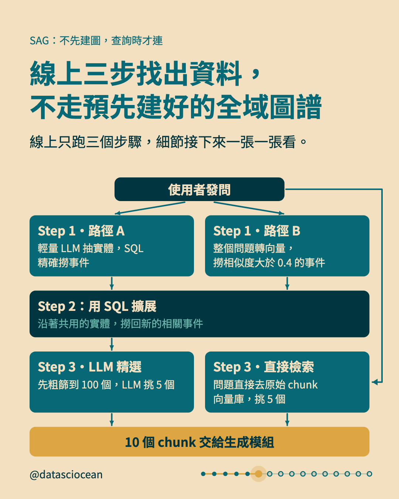

- **主標**：線上三步找出資料，不走預先建好的全域圖譜
- **補充**：線上只跑三個步驟，細節接下來一張一張看。
- **示意圖（online）上的文字與數字**：Step 1・路徑 A｜輕量 LLM 抽實體，SQL 精確撈事件｜Step 1・路徑 B｜整個問題轉向量，撈相似度大於 0.4 的事件｜Step 2：用 SQL 擴展｜沿著共用的實體，撈回新的相關事件｜Step 3・LLM 精選｜先粗篩到 100 個，LLM 挑 5 個｜Step 3・直接檢索｜問題直接去原始 chunk 向量庫，挑 5 個｜使用者發問｜10 個 chunk 交給生成模組
- **替代文字**：線上三步找出資料，不走預先建好的全域圖譜。線上只跑三個步驟，細節接下來一張一張看。。圖上寫：Step 1・路徑 A、輕量 LLM 抽實體，SQL 精確撈事件、Step 1・路徑 B、整個問題轉向量，撈相似度大於 0.4 的事件、Step 2：用 SQL 擴展、沿著共用的實體，撈回新的相關事件、Step 3・LLM 精選、先粗篩到 100 個，LLM 挑 5 個、Step 3・直接檢索、問題直接去原始 chunk 向量庫，挑 5 個、使用者發問、10 個 chunk 交給生成模組

## 第 7 頁（示意圖）

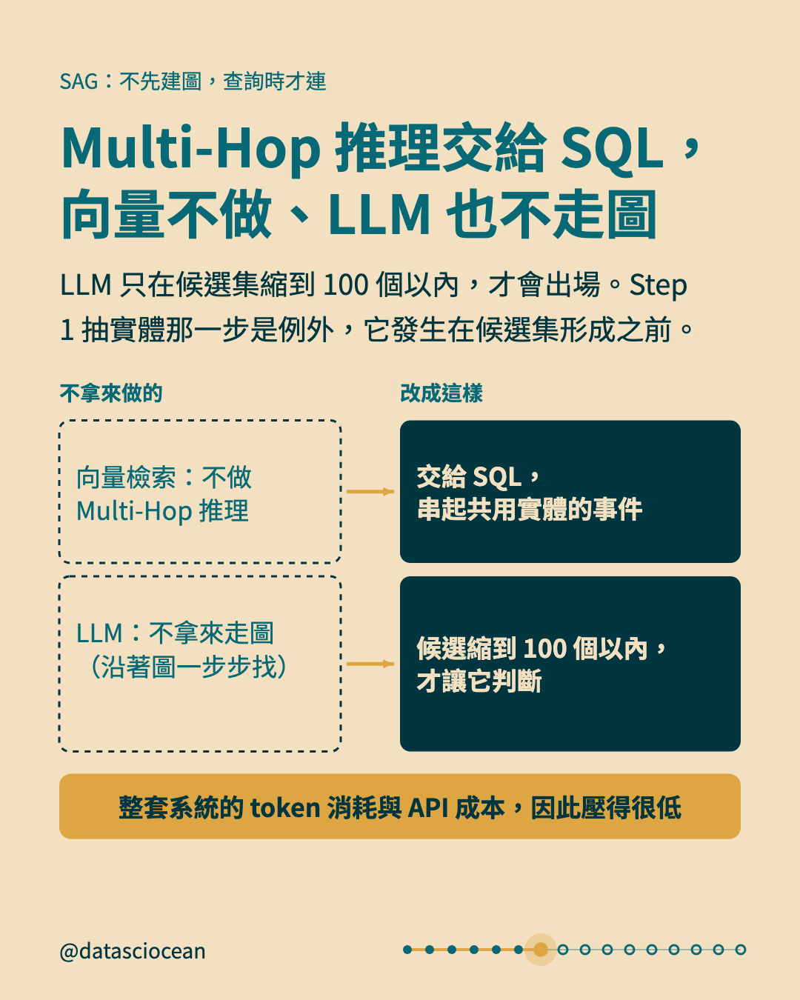

- **主標**：Multi-Hop 推理交給 SQL，向量不做、LLM 也不走圖
- **補充**：LLM 只在候選集縮到 100 個以內，才會出場。Step 1 抽實體那一步是例外，它發生在候選集形成之前。
- **示意圖（pairs）上的文字與數字**：整套系統的 token 消耗與 API 成本，因此壓得很低｜不拿來做的｜改成這樣｜向量檢索：不做 Multi-Hop 推理｜交給 SQL，串起共用實體的事件｜LLM：不拿來走圖（沿著圖一步步找）｜候選縮到 100 個以內，才讓它判斷
- **替代文字**：Multi-Hop 推理交給 SQL，向量不做、LLM 也不走圖。LLM 只在候選集縮到 100 個以內，才會出場。Step 1 抽實體那一步是例外，它發生在候選集形成之前。。圖上寫：整套系統的 token 消耗與 API 成本，因此壓得很低、不拿來做的、改成這樣、向量檢索：不做 Multi-Hop 推理、交給 SQL，串起共用實體的事件、LLM：不拿來走圖（沿著圖一步步找）、候選縮到 100 個以內，才讓它判斷

## 第 8 頁（示意圖）

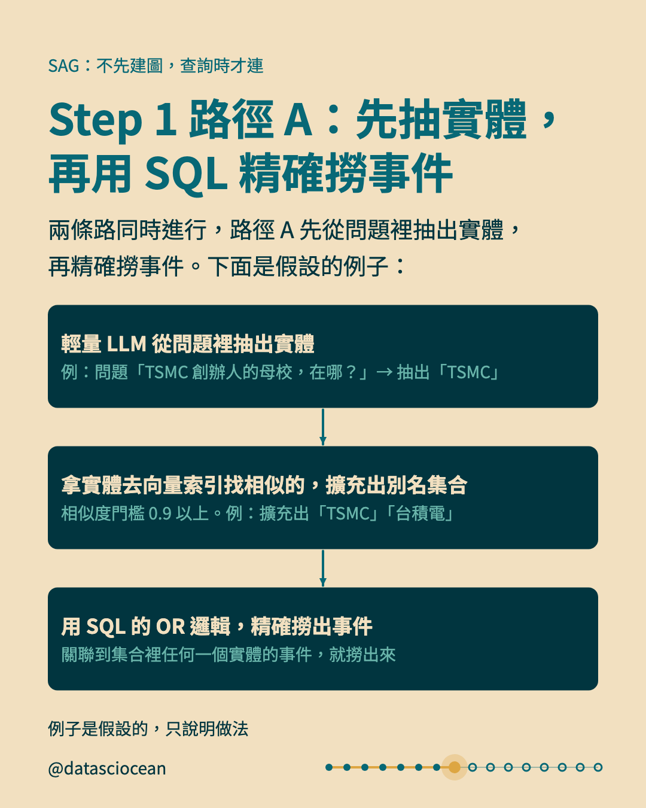

- **主標**：Step 1 路徑 A：先抽實體，再用 SQL 精確撈事件
- **補充**：兩條路同時進行，路徑 A 先從問題裡抽出實體，再精確撈事件。下面是假設的例子：
- **示意圖（flow）上的文字與數字**：輕量 LLM 從問題裡抽出實體｜例：問題「TSMC 創辦人的母校，在哪？」→ 抽出「TSMC」｜拿實體去向量索引找相似的，擴充出別名集合｜相似度門檻 0.9 以上。例：擴充出「TSMC」「台積電」｜用 SQL 的 OR 邏輯，精確撈出事件｜關聯到集合裡任何一個實體的事件，就撈出來
- **圖註**：例子是假設的，只說明做法
- **替代文字**：Step 1 路徑 A：先抽實體，再用 SQL 精確撈事件。兩條路同時進行，路徑 A 先從問題裡抽出實體，再精確撈事件。下面是假設的例子：。圖上寫：輕量 LLM 從問題裡抽出實體、例：問題「TSMC 創辦人的母校，在哪？」→ 抽出「TSMC」、拿實體去向量索引找相似的，擴充出別名集合、相似度門檻 0.9 以上。例：擴充出「TSMC」「台積電」、用 SQL 的 OR 邏輯，精確撈出事件、關聯到集合裡任何一個實體的事件，就撈出來

## 第 9 頁（示意圖）

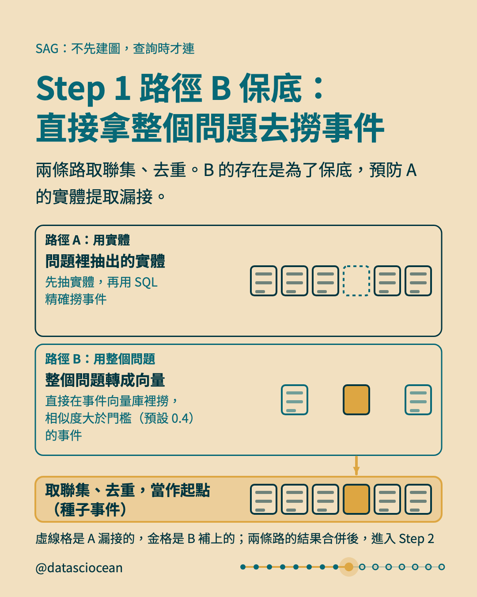

- **主標**：Step 1 路徑 B 保底：直接拿整個問題去撈事件
- **補充**：兩條路取聯集、去重。B 的存在是為了保底，預防 A 的實體提取漏接。
- **示意圖（rails）上的文字與數字**：問題裡抽出的實體｜先抽實體，再用 SQL 精確撈事件｜整個問題轉成向量｜直接在事件向量庫裡撈，相似度大於門檻（預設 0.4）的事件｜取聯集、去重，當作起點（種子事件）｜路徑 A：用實體｜路徑 B：用整個問題
- **圖註**：虛線格是 A 漏接的，金格是 B 補上的；兩條路的結果合併後，進入 Step 2
- **替代文字**：Step 1 路徑 B 保底：直接拿整個問題去撈事件。兩條路取聯集、去重。B 的存在是為了保底，預防 A 的實體提取漏接。。圖上寫：問題裡抽出的實體、先抽實體，再用 SQL 精確撈事件、整個問題轉成向量、直接在事件向量庫裡撈，相似度大於門檻（預設 0.4）的事件、取聯集、去重，當作起點（種子事件）、路徑 A：用實體、路徑 B：用整個問題

## 第 10 頁（示意圖）

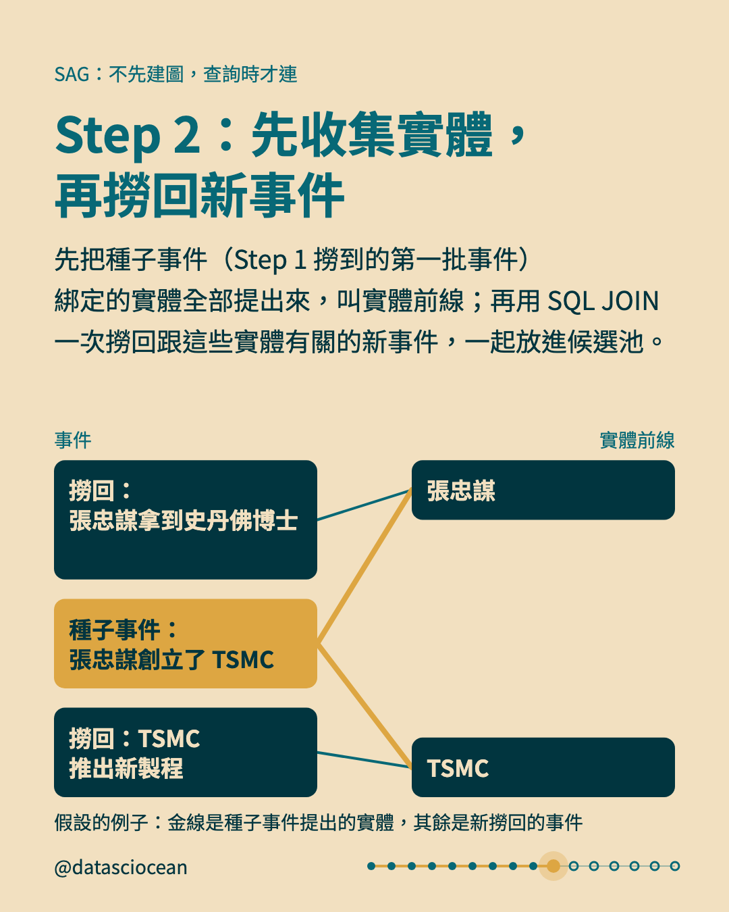

- **主標**：Step 2：先收集實體，再撈回新事件
- **補充**：先把種子事件（Step 1 撈到的第一批事件）綁定的實體全部提出來，叫實體前線；再用 SQL JOIN 一次撈回跟這些實體有關的新事件，一起放進候選池。
- **示意圖（links）上的文字與數字**：撈回：張忠謀拿到史丹佛博士｜種子事件：張忠謀創立了 TSMC｜撈回：TSMC 推出新製程｜張忠謀｜TSMC｜事件｜實體前線
- **圖註**：假設的例子：金線是種子事件提出的實體，其餘是新撈回的事件
- **替代文字**：Step 2：先收集實體，再撈回新事件。先把種子事件（Step 1 撈到的第一批事件）綁定的實體全部提出來，叫實體前線；再用 SQL JOIN 一次撈回跟這些實體有關的新事件，一起放進候選池。。圖上寫：撈回：張忠謀拿到史丹佛博士、種子事件：張忠謀創立了 TSMC、撈回：TSMC 推出新製程、張忠謀、TSMC、事件、實體前線

## 第 11 頁（示意圖）

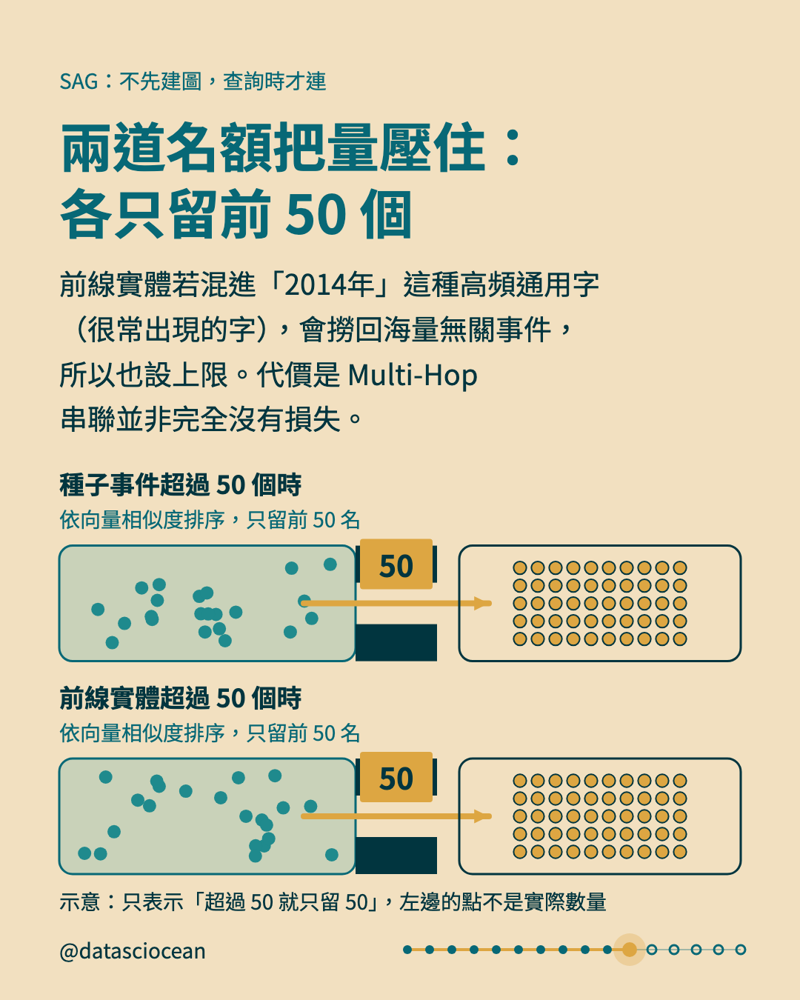

- **主標**：兩道名額把量壓住：各只留前 50 個
- **補充**：前線實體若混進「2014年」這種高頻通用字（很常出現的字），會撈回海量無關事件，所以也設上限。代價是 Multi-Hop 串聯並非完全沒有損失。
- **示意圖（gate）上的文字與數字**：種子事件超過 50 個時｜依向量相似度排序，只留前 50 名｜前線實體超過 50 個時｜依向量相似度排序，只留前 50 名｜50
- **圖註**：示意：只表示「超過 50 就只留 50」，左邊的點不是實際數量
- **替代文字**：兩道名額把量壓住：各只留前 50 個。前線實體若混進「2014年」這種高頻通用字（很常出現的字），會撈回海量無關事件，所以也設上限。代價是 Multi-Hop 串聯並非完全沒有損失。。圖上寫：種子事件超過 50 個時、依向量相似度排序，只留前 50 名、前線實體超過 50 個時、依向量相似度排序，只留前 50 名、50

## 第 12 頁（示意圖）

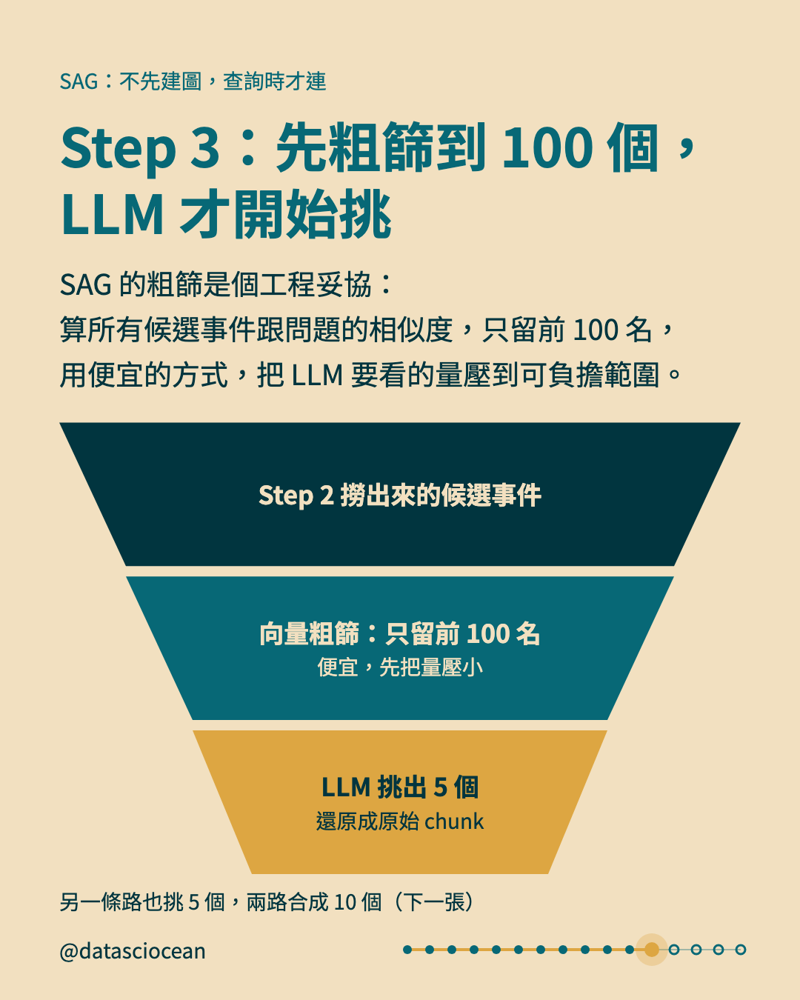

- **主標**：Step 3：先粗篩到 100 個，LLM 才開始挑
- **補充**：SAG 的粗篩是個工程妥協：算所有候選事件跟問題的相似度，只留前 100 名，用便宜的方式，把 LLM 要看的量壓到可負擔範圍。
- **示意圖（funnel）上的文字與數字**：Step 2 撈出來的候選事件｜向量粗篩：只留前 100 名｜便宜，先把量壓小｜LLM 挑出 5 個｜還原成原始 chunk
- **圖註**：另一條路也挑 5 個，兩路合成 10 個（下一張）
- **替代文字**：Step 3：先粗篩到 100 個，LLM 才開始挑。SAG 的粗篩是個工程妥協：算所有候選事件跟問題的相似度，只留前 100 名，用便宜的方式，把 LLM 要看的量壓到可負擔範圍。。圖上寫：Step 2 撈出來的候選事件、向量粗篩：只留前 100 名、便宜，先把量壓小、LLM 挑出 5 個、還原成原始 chunk

## 第 13 頁（示意圖）

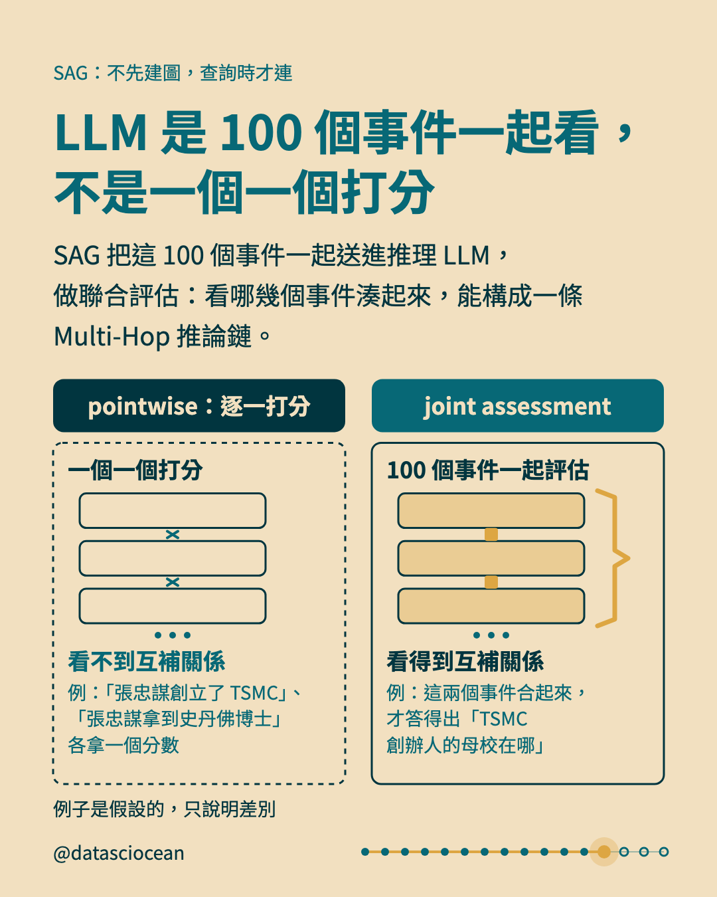

- **主標**：LLM 是 100 個事件一起看，不是一個一個打分
- **補充**：SAG 把這 100 個事件一起送進推理 LLM，做聯合評估：看哪幾個事件湊起來，能構成一條 Multi-Hop 推論鏈。
- **示意圖（joint）上的文字與數字**：一個一個打分｜例：「張忠謀創立了 TSMC」、「張忠謀拿到史丹佛博士」各拿一個分數｜看不到互補關係｜100 個事件一起評估｜例：這兩個事件合起來，才答得出「TSMC 創辦人的母校在哪」｜看得到互補關係｜pointwise：逐一打分｜joint assessment
- **圖註**：例子是假設的，只說明差別
- **替代文字**：LLM 是 100 個事件一起看，不是一個一個打分。SAG 把這 100 個事件一起送進推理 LLM，做聯合評估：看哪幾個事件湊起來，能構成一條 Multi-Hop 推論鏈。。圖上寫：一個一個打分、例：「張忠謀創立了 TSMC」、「張忠謀拿到史丹佛博士」各拿一個分數、看不到互補關係、100 個事件一起評估、例：這兩個事件合起來，才答得出「TSMC 創辦人的母校在哪」、看得到互補關係、pointwise：逐一打分、joint assessment

## 第 14 頁（示意圖）

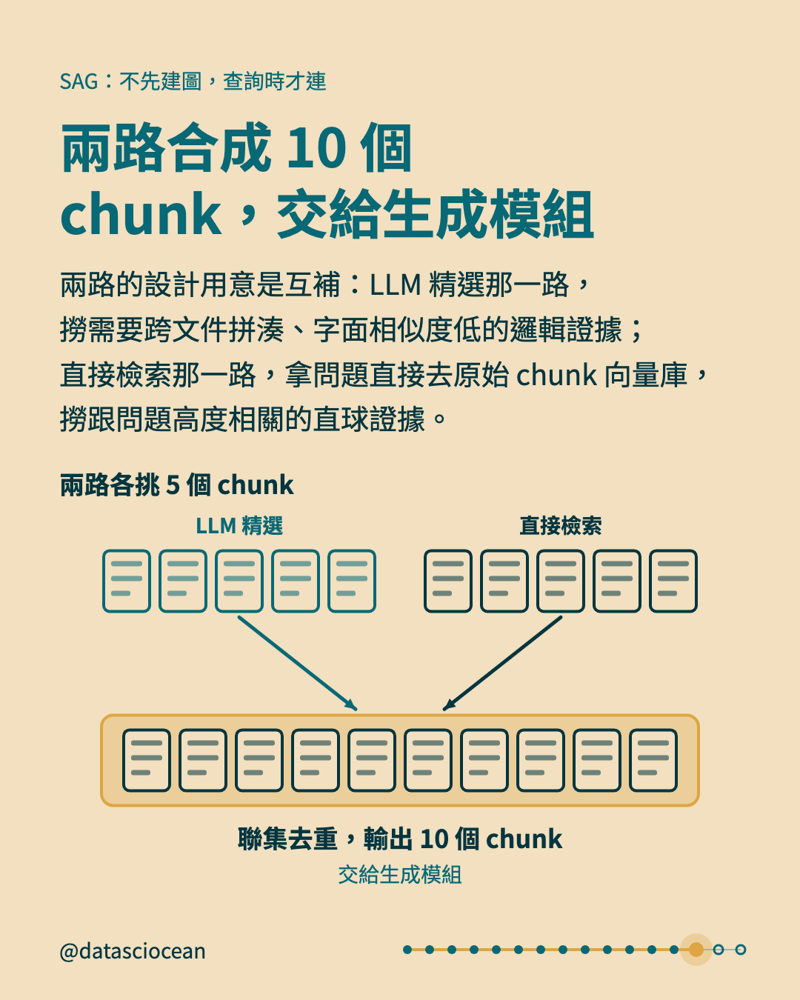

- **主標**：兩路合成 10 個 chunk，交給生成模組
- **補充**：兩路的設計用意是互補：LLM 精選那一路，撈需要跨文件拼湊、字面相似度低的邏輯證據；直接檢索那一路，拿問題直接去原始 chunk 向量庫，撈跟問題高度相關的直球證據。
- **示意圖（concat）上的文字與數字**：兩路各挑 5 個 chunk｜聯集去重，輸出 10 個 chunk｜交給生成模組｜LLM 精選｜直接檢索
- **替代文字**：兩路合成 10 個 chunk，交給生成模組。兩路的設計用意是互補：LLM 精選那一路，撈需要跨文件拼湊、字面相似度低的邏輯證據；直接檢索那一路，拿問題直接去原始 chunk 向量庫，撈跟問題高度相關的直球證據。。圖上寫：兩路各挑 5 個 chunk、聯集去重，輸出 10 個 chunk、交給生成模組、LLM 精選、直接檢索

## 第 15 頁（帶走）

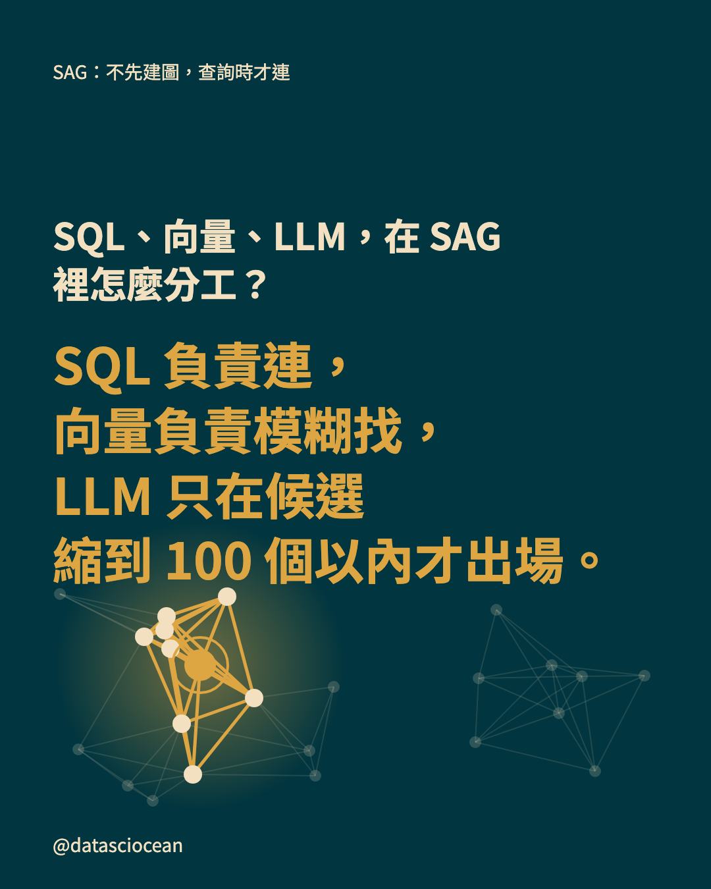

- **先問的問題**：SQL、向量、LLM，在 SAG 裡怎麼分工？
- **一句話**：SQL 負責連，
向量負責模糊找，
LLM 只在候選
縮到 100 個以內才出場。
- **替代文字**：SQL、向量、LLM，在 SAG 裡怎麼分工？　SQL 負責連，
向量負責模糊找，
LLM 只在候選
縮到 100 個以內才出場。

## 第 16 頁（系列地圖）

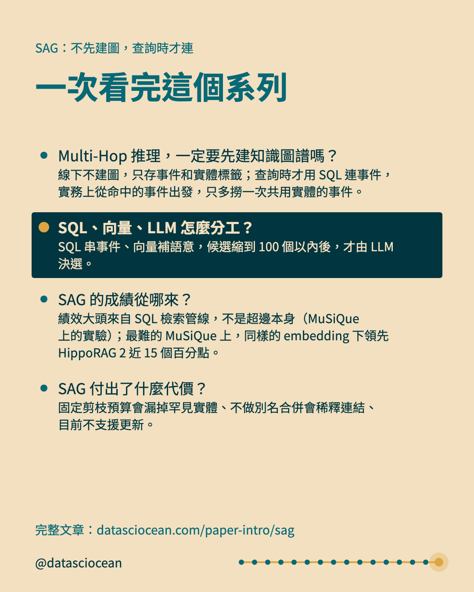

- **主標**：一次看完這個系列
- **導流行**：完整文章：datasciocean.com/paper-intro/sag
- **第 1 則**：Multi-Hop 推理，一定要先建知識圖譜嗎？　線下不建圖，只存事件和實體標籤；查詢時才用 SQL 連事件，實務上從命中的事件出發，只多撈一次共用實體的事件。
- **第 2 則**：SQL、向量、LLM 怎麼分工？　SQL 串事件、向量補語意，候選縮到 100 個以內後，才由 LLM 決選。
- **第 3 則**：SAG 的成績從哪來？　績效大頭來自 SQL 檢索管線，不是超邊本身（MuSiQue 上的實驗）；最難的 MuSiQue 上，同樣的 embedding 下領先 HippoRAG 2 近 15 個百分點。
- **第 4 則**：SAG 付出了什麼代價？　固定剪枝預算會漏掉罕見實體、不做別名合併會稀釋連結、目前不支援更新。
- **替代文字**：一次看完這個系列。Multi-Hop 推理，一定要先建知識圖譜嗎？：線下不建圖，只存事件和實體標籤；查詢時才用 SQL 連事件，實務上從命中的事件出發，只多撈一次共用實體的事件。、SQL、向量、LLM 怎麼分工？：SQL 串事件、向量補語意，候選縮到 100 個以內後，才由 LLM 決選。、SAG 的成績從哪來？：績效大頭來自 SQL 檢索管線，不是超邊本身（MuSiQue 上的實驗）；最難的 MuSiQue 上，同樣的 embedding 下領先 HippoRAG 2 近 15 個百分點。、SAG 付出了什麼代價？：固定剪枝預算會漏掉罕見實體、不做別名合併會稀釋連結、目前不支援更新。

## Caption（整段貼到 IG）

```text
SAG 是一種 RAG 檢索做法：SQL 串事件、向量補語意、LLM 只在候選縮小後才出場

・查資料這件事，SAG 拆給三個元件各做一段
・SQL 精準但不懂語意，向量剛好補上（SQL 只問「A 是否等於 B」，答案是確定的）
・線上三步找出資料，不走預先建好的全域圖譜（線上只跑三個步驟，細節接下來一張一張看）
・Multi-Hop 推理交給 SQL，向量不做、LLM 也不走圖（LLM 只在候選集縮到 100 個以內，才會出場）
・Step 1 路徑 A：先抽實體，再用 SQL 精確撈事件
・Step 1 路徑 B 保底：直接拿整個問題去撈事件（兩條路取聯集、去重）
・Step 2：先收集實體，再撈回新事件
・兩道名額把量壓住：各只留前 50 個
・Step 3：先粗篩到 100 個，LLM 才開始挑
・LLM 是 100 個事件一起看，不是一個一個打分
・兩路合成 10 個 chunk，交給生成模組

圖片來源：第 6 張（圖二）、第 10 張（圖二）、第 14 張（圖二）改繪自原始論文的圖表

完整文章請在 datasciocean.com 搜尋「SAG：拋開離線知識圖譜，查詢時用 SQL 連事件」

#DSO_SAG #SAG #RAG #MultiHop #SQL
```
