# Threads：SAG 付出了什麼代價？

- 發文方式：**一則輪播貼文**（正文＋全部 13 張圖，順序與 IG 相同），再用一則回覆放連結與系列（連結只放那則回覆）
- 圖檔在 `../ig/`（與 IG 輪播共用同一套）

## 貼文正文（附下方全部圖片）

```text
相較 GraphRAG，SAG 不先建知識圖譜，換來系統簡潔和高寫入吞吐量（單位時間能寫進多少資料），但有三個代價：

・漏掉罕見實體：前線實體超過 50 個時，只留跟問題相似的前 50 個。深層推論鏈裡又罕見、又跟問題不太相關的關鍵實體，容易被擠出去。SAG 在 2Wiki 資料集的 Recall@5（前 5 筆結果抓到答案所需資料的比例）是 88.0%，輸給 HippoRAG 2 的 90.4%（兩邊用同一個向量模型）。
・連結變稀：同一個實體寫法不同（例如 Meta 和 Facebook），向量相似度又沒到擴充別名用的 0.9 門檻，SQL 就把它們當成兩個無關的點。
・新舊衝突沒有內建判斷：目前只支援 append-only，資料可以一直新增，但不能修改舊資料；新舊事件互相衝突時，索引沒有原生機制判斷哪個有效。

論文：arxiv.org/abs/2606.15971
```

## 附圖（依序）

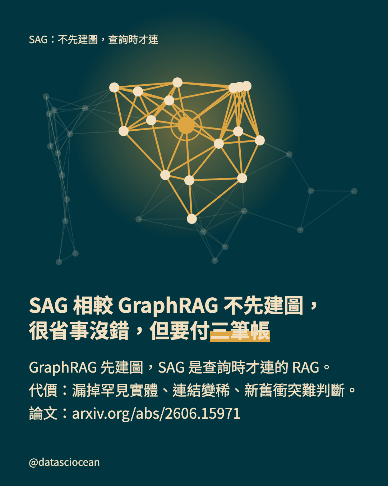
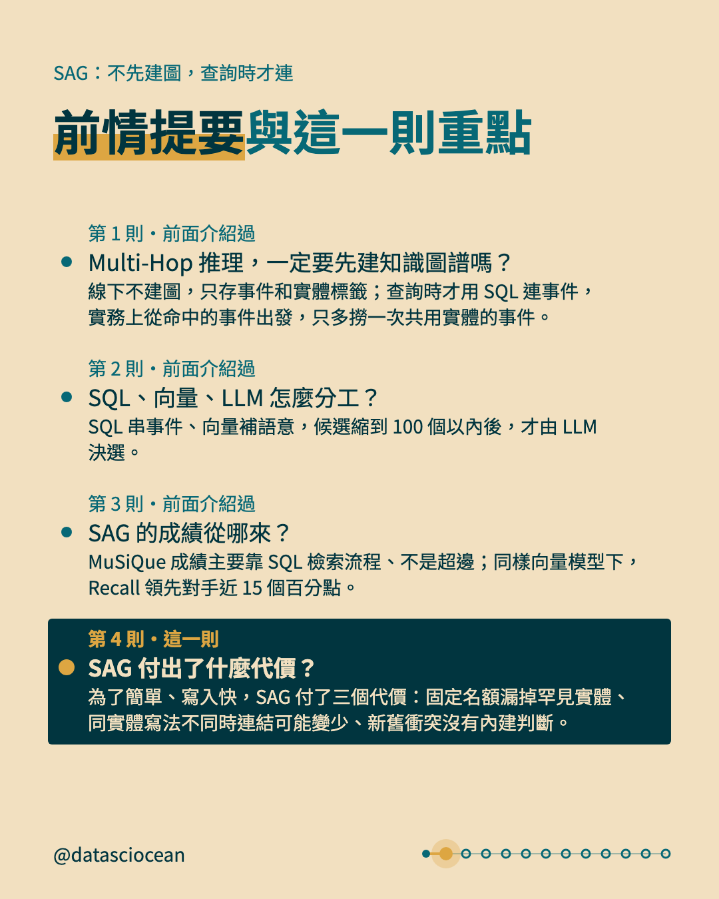
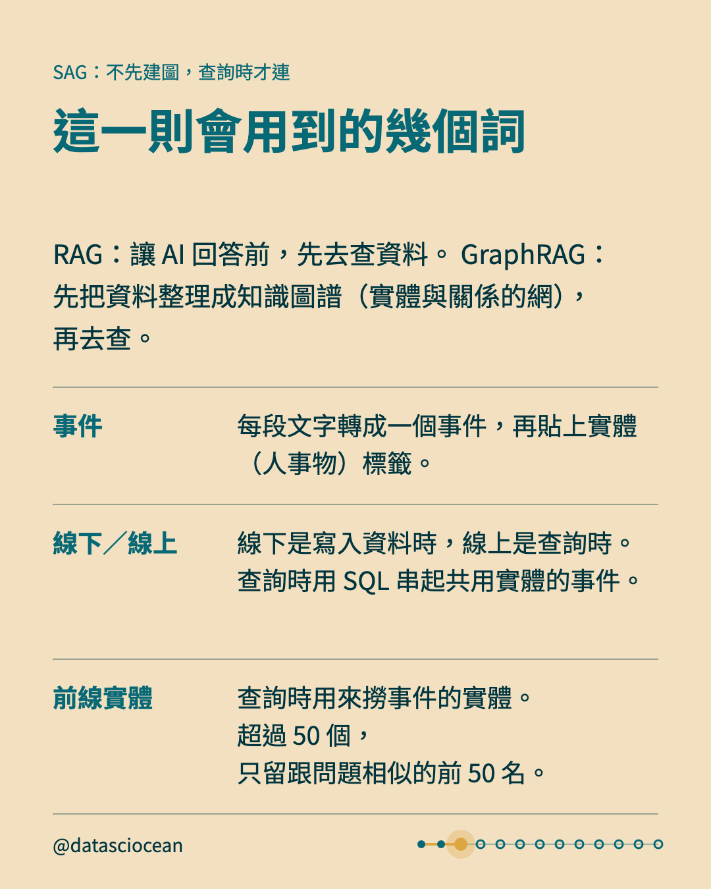
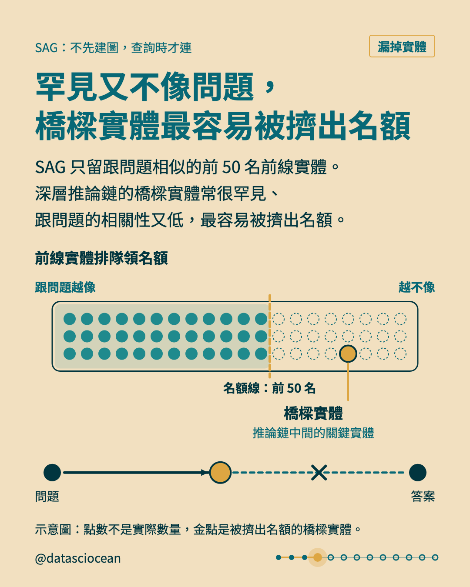
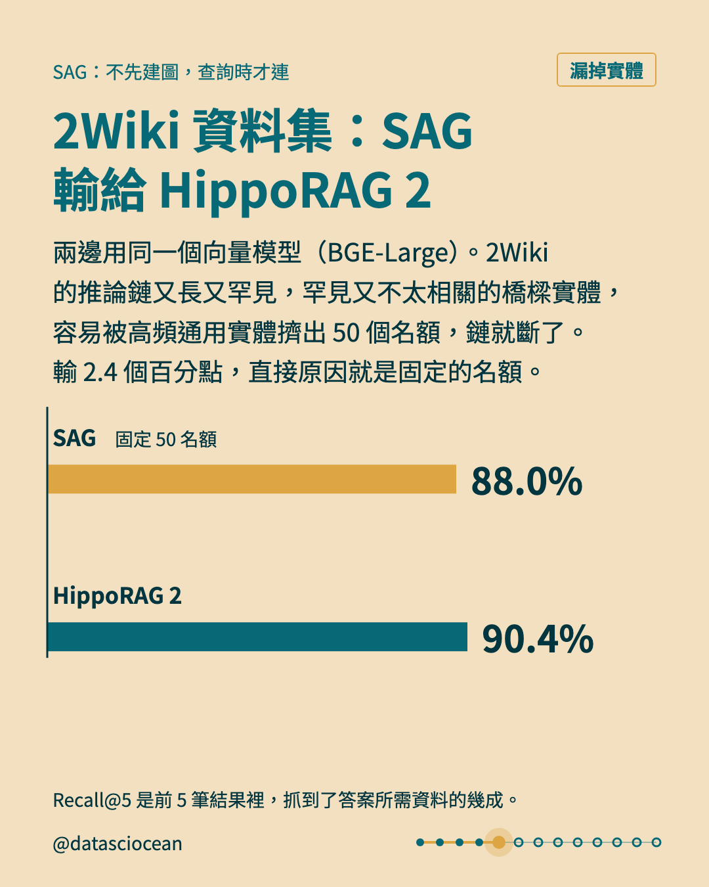
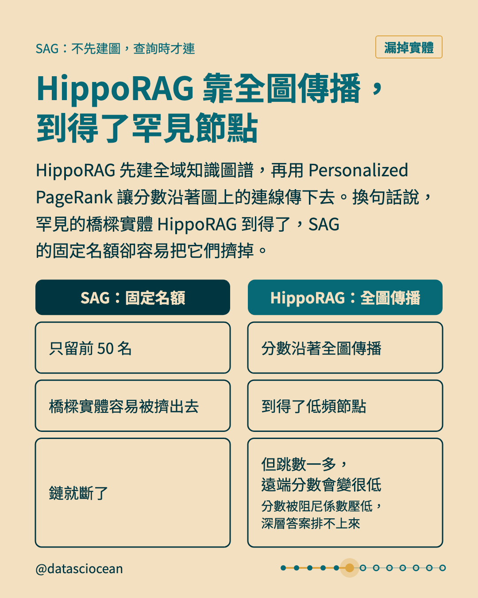
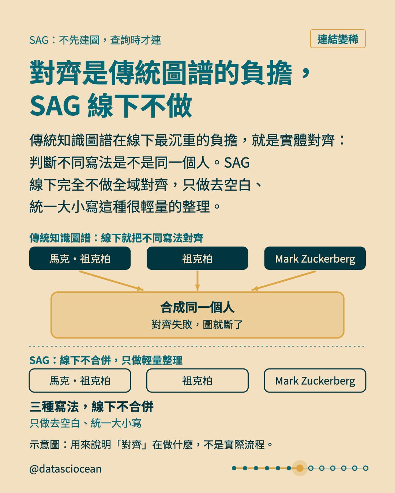
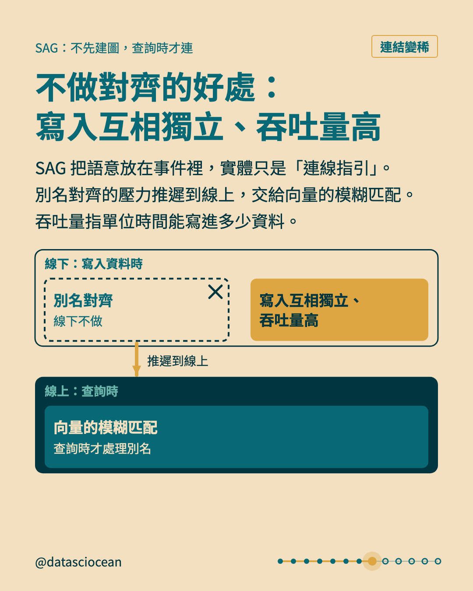
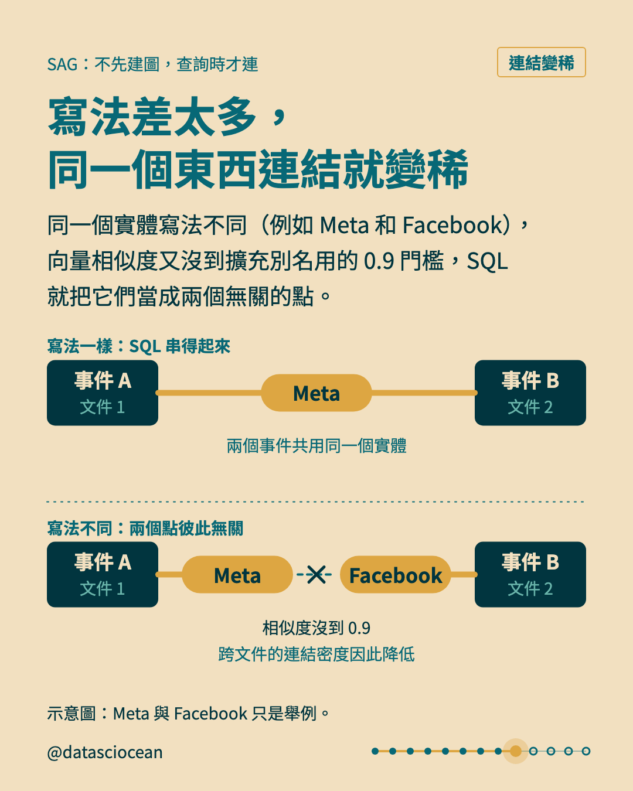
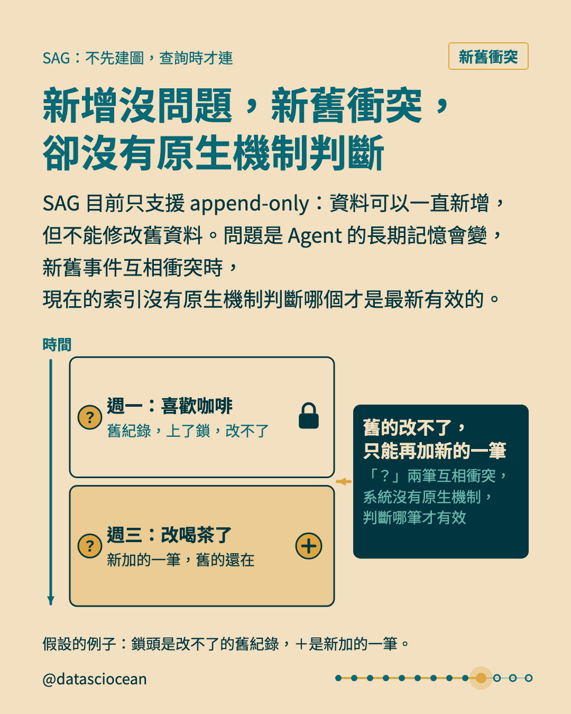
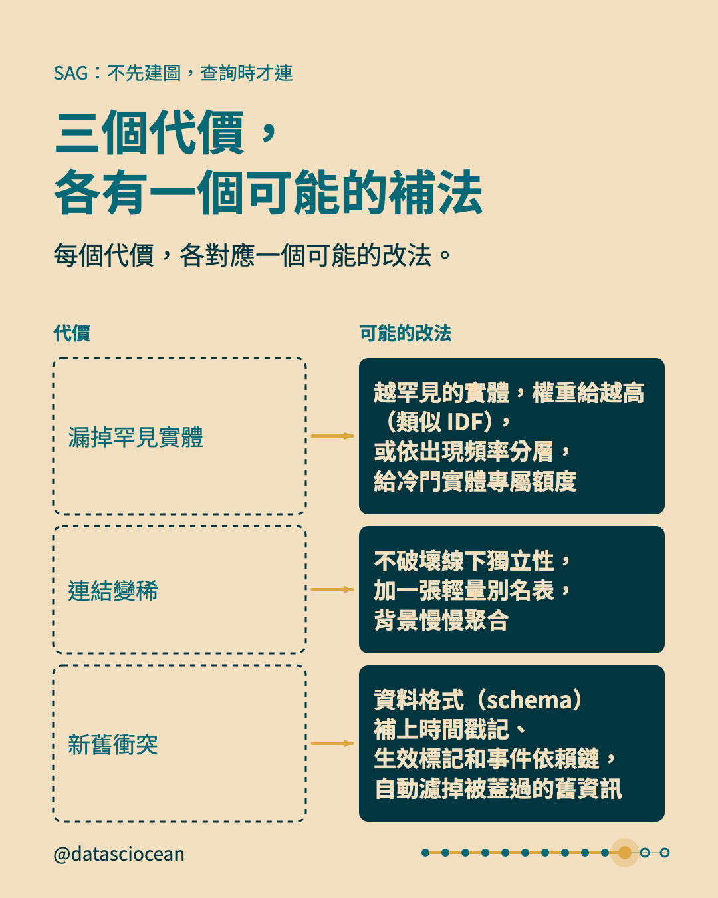
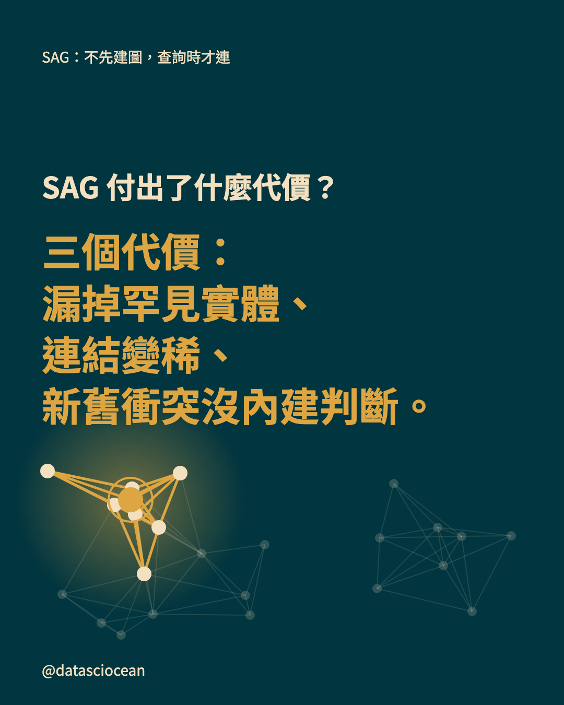
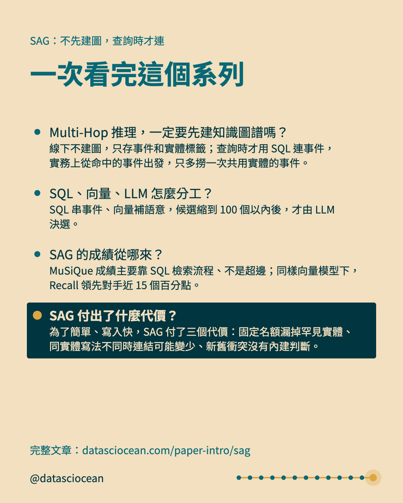

## 回覆：連結與系列

```text
SAG 的三個代價與可能的補法，完整內容在這篇文章裡。
文章：datasciocean.com/paper-intro/sag
同系列：Multi-Hop 推理，一定要先建知識圖譜嗎？
https://www.threads.com/@datasciocean/post/De5vTr5E64N
同系列：SQL、向量、LLM 怎麼分工？
https://www.threads.com/@datasciocean/post/De8MzobmMZi
同系列：SAG 的成績從哪來？
https://www.threads.com/@datasciocean/post/De-h-d2k-fB
```
