# IG 輪播：改完真的有變好嗎？拿沒看過的題目測試它

- 系列：SkillOpt: 自動優化你的 Agent Skill　｜　hook 樣態：讀者疑問　｜　共 17 張，**依頁碼順序上傳**
- 每頁下方的「替代文字」貼到 IG 的替代文字欄；最後的 Caption 整段貼上

## 第 1 頁（封面）


- **主標**：AI 改完 Skill，怎麼知道有沒有變好？
- **副標**：SkillOpt 的 AI 教練改完 Skill 後：
教練完全看不到驗收用的題目，
改完只拿沒看過的題目盲測，
分數要嚴格變高才收，平手也丟掉。
- **替代文字**：AI 改完 Skill，怎麼知道有沒有變好？。SkillOpt 的 AI 教練改完 Skill 後：
教練完全看不到驗收用的題目，
改完只拿沒看過的題目盲測，
分數要嚴格變高才收，平手也丟掉。

## 第 2 頁（脈絡）

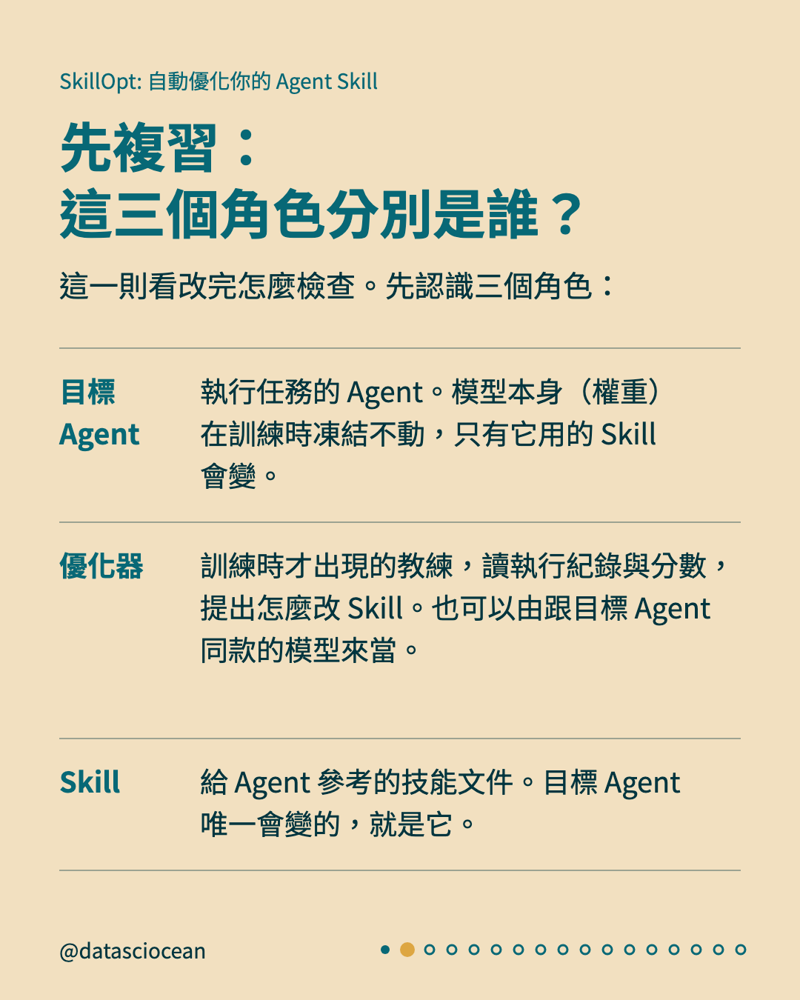

- **主標**：先複習：這三個角色分別是誰？
- **補充**：這一則看改完怎麼檢查。先認識三個角色：
- **表列**：目標 Agent｜執行任務的 Agent。模型本身（權重）在訓練時凍結不動，只有它用的 Skill 會變。
- **表列**：優化器｜訓練時才出現的教練，讀執行紀錄與分數，提出怎麼改 Skill。也可以由跟目標 Agent 同款的模型來當。
- **表列**：Skill｜給 Agent 參考的技能文件。目標 Agent 唯一會變的，就是它。
- **替代文字**：先複習：這三個角色分別是誰？。這一則看改完怎麼檢查。先認識三個角色：

## 第 3 頁（示意圖）

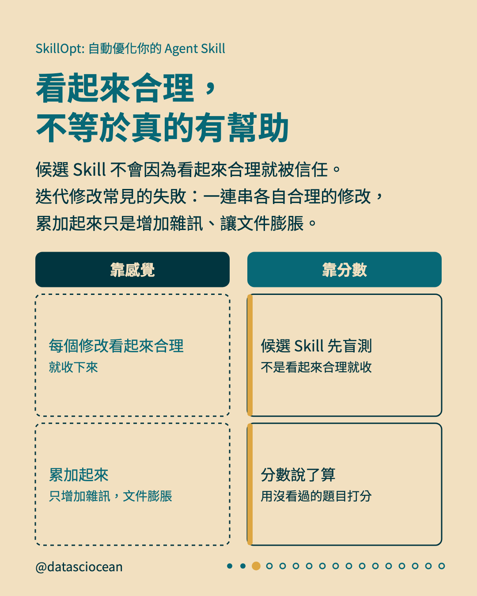

- **主標**：看起來合理，不等於真的有幫助
- **補充**：候選 Skill 不會因為看起來合理就被信任。迭代修改常見的失敗：一連串各自合理的修改，累加起來只是增加雜訊、讓文件膨脹。
- **示意圖（compare）上的文字與數字**：靠感覺｜每個修改看起來合理｜就收下來｜累加起來｜只增加雜訊，文件膨脹｜靠分數｜候選 Skill 先盲測｜不是看起來合理就收｜分數說了算｜用沒看過的題目打分
- **替代文字**：看起來合理，不等於真的有幫助。候選 Skill 不會因為看起來合理就被信任。迭代修改常見的失敗：一連串各自合理的修改，累加起來只是增加雜訊、讓文件膨脹。。圖上寫：靠感覺、每個修改看起來合理、就收下來、累加起來、只增加雜訊，文件膨脹、靠分數、候選 Skill 先盲測、不是看起來合理就收、分數說了算、用沒看過的題目打分

## 第 4 頁（示意圖）

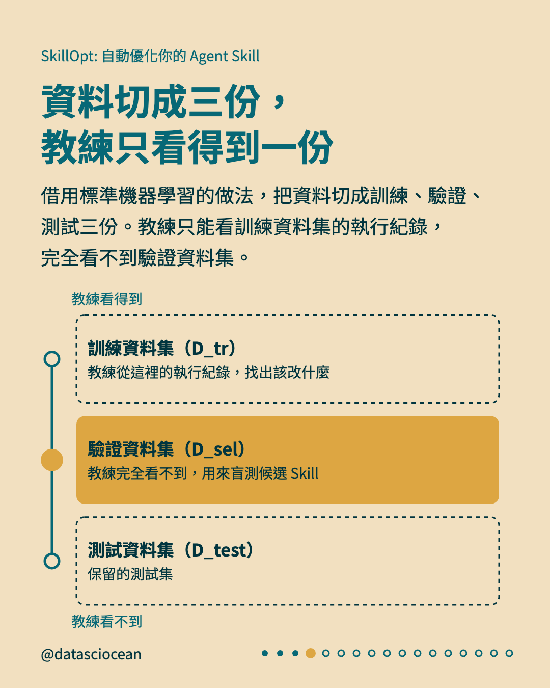

- **主標**：資料切成三份，教練只看得到一份
- **補充**：借用標準機器學習的做法，把資料切成訓練、驗證、測試三份。教練只能看訓練資料集的執行紀錄，完全看不到驗證資料集。
- **示意圖（stops）上的文字與數字**：訓練資料集（D_tr）｜教練從這裡的執行紀錄，找出該改什麼｜驗證資料集（D_sel）｜教練完全看不到，用來盲測候選 Skill｜測試資料集（D_test）｜保留的測試集｜教練看得到｜教練看不到
- **替代文字**：資料切成三份，教練只看得到一份。借用標準機器學習的做法，把資料切成訓練、驗證、測試三份。教練只能看訓練資料集的執行紀錄，完全看不到驗證資料集。。圖上寫：訓練資料集（D_tr）、教練從這裡的執行紀錄，找出該改什麼、驗證資料集（D_sel）、教練完全看不到，用來盲測候選 Skill、測試資料集（D_test）、保留的測試集、教練看得到、教練看不到

## 第 5 頁（示意圖）

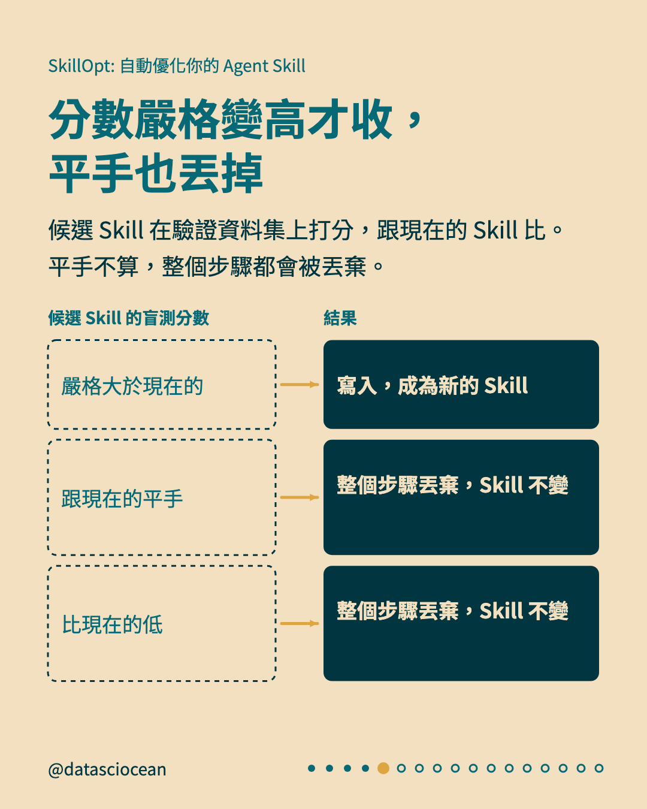

- **主標**：分數嚴格變高才收，平手也丟掉
- **補充**：候選 Skill 在驗證資料集上打分，跟現在的 Skill 比。平手不算，整個步驟都會被丟棄。
- **示意圖（pairs）上的文字與數字**：候選 Skill 的盲測分數｜結果｜嚴格大於現在的｜寫入，成為新的 Skill｜跟現在的平手｜整個步驟丟棄，Skill 不變｜比現在的低｜整個步驟丟棄，Skill 不變
- **替代文字**：分數嚴格變高才收，平手也丟掉。候選 Skill 在驗證資料集上打分，跟現在的 Skill 比。平手不算，整個步驟都會被丟棄。。圖上寫：候選 Skill 的盲測分數、結果、嚴格大於現在的、寫入，成為新的 Skill、跟現在的平手、整個步驟丟棄，Skill 不變、比現在的低、整個步驟丟棄，Skill 不變

## 第 6 頁（示意圖）

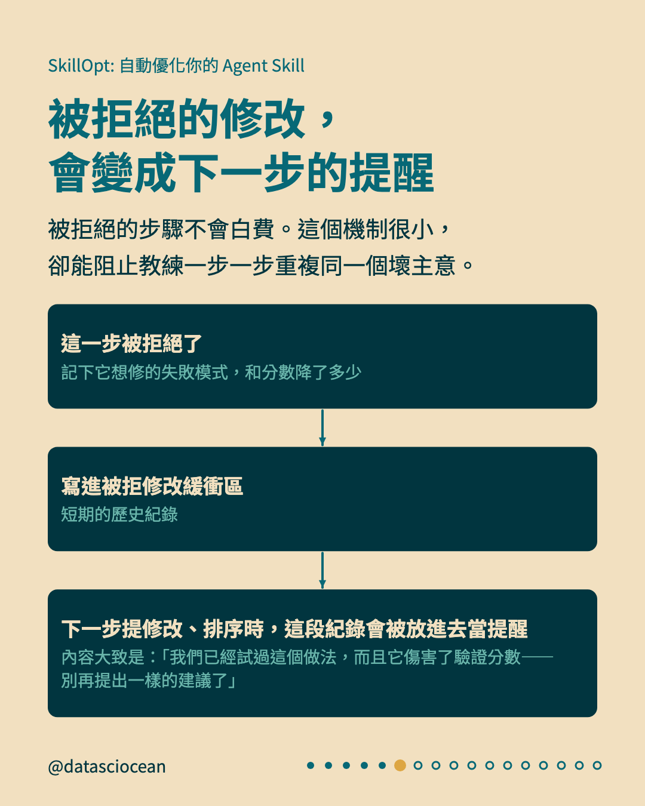

- **主標**：被拒絕的修改，會變成下一步的提醒
- **補充**：被拒絕的步驟不會白費。這個機制很小，卻能阻止教練一步一步重複同一個壞主意。
- **示意圖（flow）上的文字與數字**：這一步被拒絕了｜記下它想修的失敗模式，和分數降了多少｜寫進被拒修改緩衝區｜短期的歷史紀錄｜下一步提修改、排序時，這段紀錄會被放進去當提醒｜內容大致是：「我們已經試過這個做法，而且它傷害了驗證分數——別再提出一樣的建議了」
- **替代文字**：被拒絕的修改，會變成下一步的提醒。被拒絕的步驟不會白費。這個機制很小，卻能阻止教練一步一步重複同一個壞主意。。圖上寫：這一步被拒絕了、記下它想修的失敗模式，和分數降了多少、寫進被拒修改緩衝區、短期的歷史紀錄、下一步提修改、排序時，這段紀錄會被放進去當提醒、內容大致是：「我們已經試過這個做法，而且它傷害了驗證分數——別再提出一樣的建議了」

## 第 7 頁（示意圖）

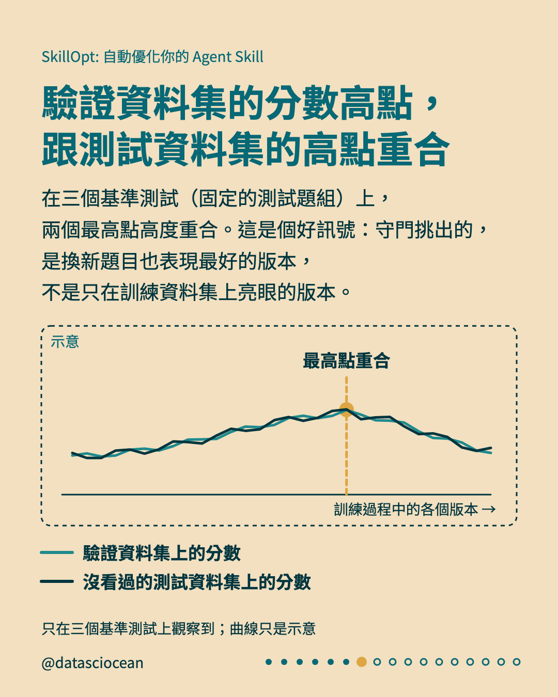

- **主標**：驗證資料集的分數高點，跟測試資料集的高點重合
- **補充**：在三個基準測試（固定的測試題組）上，兩個最高點高度重合。這是個好訊號：守門挑出的，是換新題目也表現最好的版本，不是只在訓練資料集上亮眼的版本。
- **示意圖（peaks）上的文字與數字**：驗證資料集上的分數｜沒看過的測試資料集上的分數｜最高點重合
- **圖註**：只在三個基準測試上觀察到；曲線只是示意
- **替代文字**：驗證資料集的分數高點，跟測試資料集的高點重合。在三個基準測試（固定的測試題組）上，兩個最高點高度重合。這是個好訊號：守門挑出的，是換新題目也表現最好的版本，不是只在訓練資料集上亮眼的版本。。圖上寫：驗證資料集上的分數、沒看過的測試資料集上的分數、最高點重合

## 第 8 頁（示意圖）

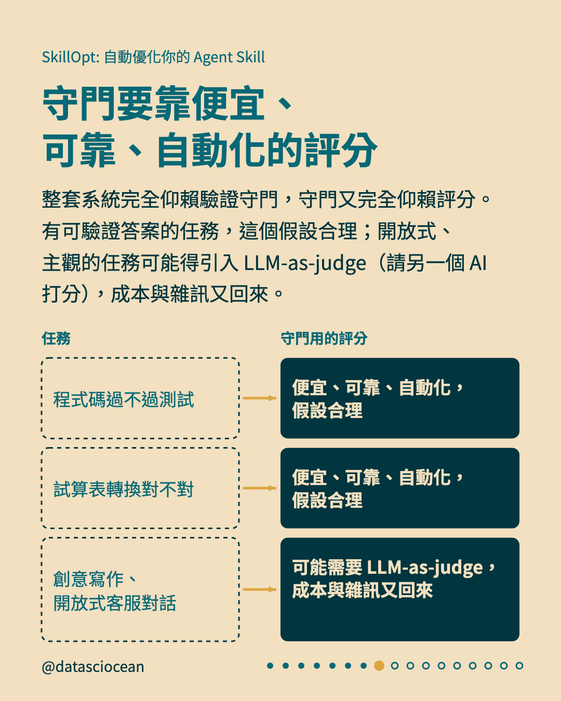

- **主標**：守門要靠便宜、可靠、自動化的評分
- **補充**：整套系統完全仰賴驗證守門，守門又完全仰賴評分。有可驗證答案的任務，這個假設合理；開放式、主觀的任務可能得引入 LLM-as-judge（請另一個 AI 打分），成本與雜訊又回來。
- **示意圖（pairs）上的文字與數字**：任務｜守門用的評分｜程式碼過不過測試｜便宜、可靠、自動化，假設合理｜試算表轉換對不對｜便宜、可靠、自動化，假設合理｜創意寫作、開放式客服對話｜可能需要 LLM-as-judge，成本與雜訊又回來
- **替代文字**：守門要靠便宜、可靠、自動化的評分。整套系統完全仰賴驗證守門，守門又完全仰賴評分。有可驗證答案的任務，這個假設合理；開放式、主觀的任務可能得引入 LLM-as-judge（請另一個 AI 打分），成本與雜訊又回來。。圖上寫：任務、守門用的評分、程式碼過不過測試、便宜、可靠、自動化，假設合理、試算表轉換對不對、便宜、可靠、自動化，假設合理、創意寫作、開放式客服對話、可能需要 LLM-as-judge，成本與雜訊又回來

## 第 9 頁（示意圖）

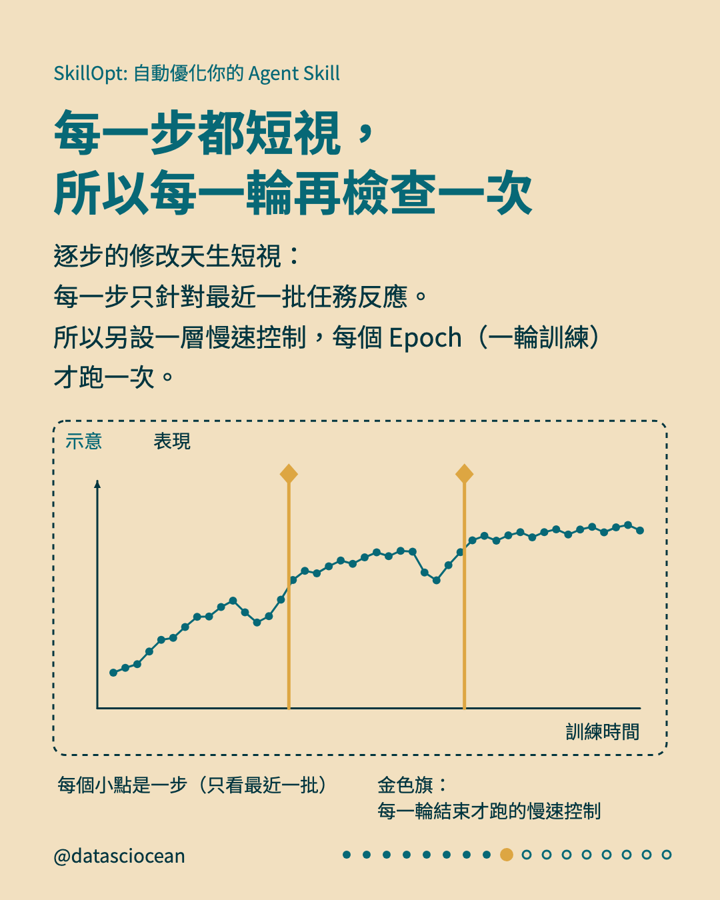

- **主標**：每一步都短視，所以每一輪再檢查一次
- **補充**：逐步的修改天生短視：每一步只針對最近一批任務反應。所以另設一層慢速控制，每個 Epoch（一輪訓練）才跑一次。
- **示意圖（epochs）上的文字與數字**：每個小點是一步（只看最近一批）｜金色旗：每一輪結束才跑的慢速控制
- **替代文字**：每一步都短視，所以每一輪再檢查一次。逐步的修改天生短視：每一步只針對最近一批任務反應。所以另設一層慢速控制，每個 Epoch（一輪訓練）才跑一次。。圖上寫：每個小點是一步（只看最近一批）、金色旗：每一輪結束才跑的慢速控制

## 第 10 頁（示意圖）

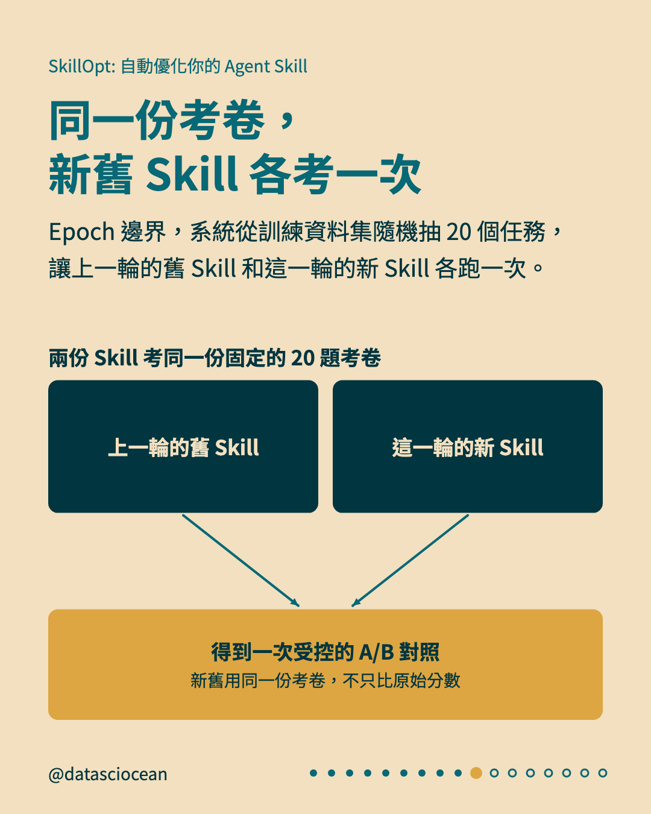

- **主標**：同一份考卷，新舊 Skill 各考一次
- **補充**：Epoch 邊界，系統從訓練資料集隨機抽 20 個任務，讓上一輪的舊 Skill 和這一輪的新 Skill 各跑一次。
- **示意圖（fan）上的文字與數字**：兩份 Skill 考同一份固定的 20 題考卷｜得到一次受控的 A/B 對照｜新舊用同一份考卷，不只比原始分數｜上一輪的舊 Skill｜這一輪的新 Skill
- **替代文字**：同一份考卷，新舊 Skill 各考一次。Epoch 邊界，系統從訓練資料集隨機抽 20 個任務，讓上一輪的舊 Skill 和這一輪的新 Skill 各跑一次。。圖上寫：兩份 Skill 考同一份固定的 20 題考卷、得到一次受控的 A/B 對照、新舊用同一份考卷，不只比原始分數、上一輪的舊 Skill、這一輪的新 Skill

## 第 11 頁（示意圖）


- **主標**：20 題分成四種狀態，退步最要緊
- **補充**：20 題裡的每一題，會落進其中一種狀態。新舊 Skill 在同一題上的表現互相比較。
- **示意圖（stops）上的文字與數字**：進步｜退步｜最清楚的訊號：最近的修改各自通過守門，加起來卻讓某些東西變糟｜持續失敗｜穩定成功
- **替代文字**：20 題分成四種狀態，退步最要緊。20 題裡的每一題，會落進其中一種狀態。新舊 Skill 在同一題上的表現互相比較。。圖上寫：進步、退步、最清楚的訊號：最近的修改各自通過守門，加起來卻讓某些東西變糟、持續失敗、穩定成功

## 第 12 頁（示意圖）

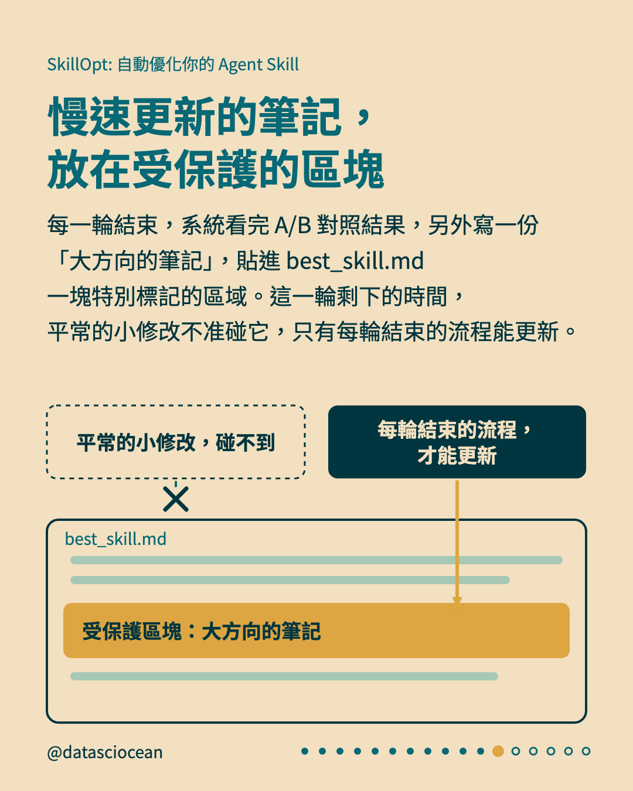

- **主標**：慢速更新的筆記，放在受保護的區塊
- **補充**：每一輪結束，系統看完 A/B 對照結果，另外寫一份「大方向的筆記」，貼進 best_skill.md 一塊特別標記的區域。這一輪剩下的時間，平常的小修改不准碰它，只有每輪結束的流程能更新。
- **示意圖（locked）上的文字與數字**：best_skill.md｜受保護區塊：大方向的筆記｜平常的小修改，碰不到｜每輪結束的流程，才能更新
- **替代文字**：慢速更新的筆記，放在受保護的區塊。每一輪結束，系統看完 A/B 對照結果，另外寫一份「大方向的筆記」，貼進 best_skill.md 一塊特別標記的區域。這一輪剩下的時間，平常的小修改不准碰它，只有每輪結束的流程能更新。。圖上寫：best_skill.md、受保護區塊：大方向的筆記、平常的小修改，碰不到、每輪結束的流程，才能更新

## 第 13 頁（示意圖）

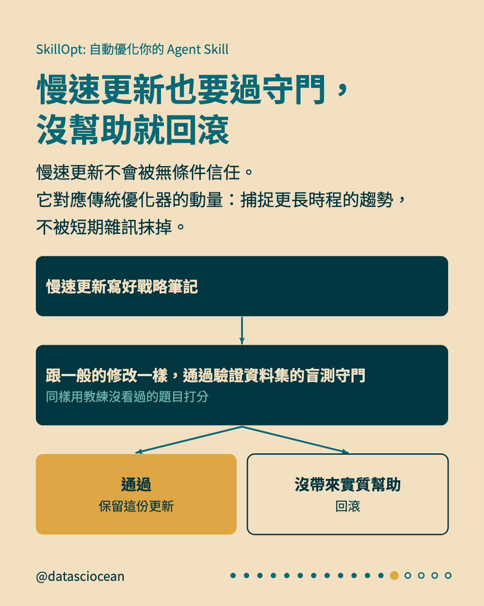

- **主標**：慢速更新也要過守門，沒幫助就回滾
- **補充**：慢速更新不會被無條件信任。它對應傳統優化器的動量：捕捉更長時程的趨勢，不被短期雜訊抹掉。
- **示意圖（flow）上的文字與數字**：慢速更新寫好戰略筆記｜跟一般的修改一樣，通過驗證資料集的盲測守門｜同樣用教練沒看過的題目打分｜通過｜保留這份更新｜沒帶來實質幫助｜回滾
- **替代文字**：慢速更新也要過守門，沒幫助就回滾。慢速更新不會被無條件信任。它對應傳統優化器的動量：捕捉更長時程的趨勢，不被短期雜訊抹掉。。圖上寫：慢速更新寫好戰略筆記、跟一般的修改一樣，通過驗證資料集的盲測守門、同樣用教練沒看過的題目打分、通過、保留這份更新、沒帶來實質幫助、回滾

## 第 14 頁（示意圖）

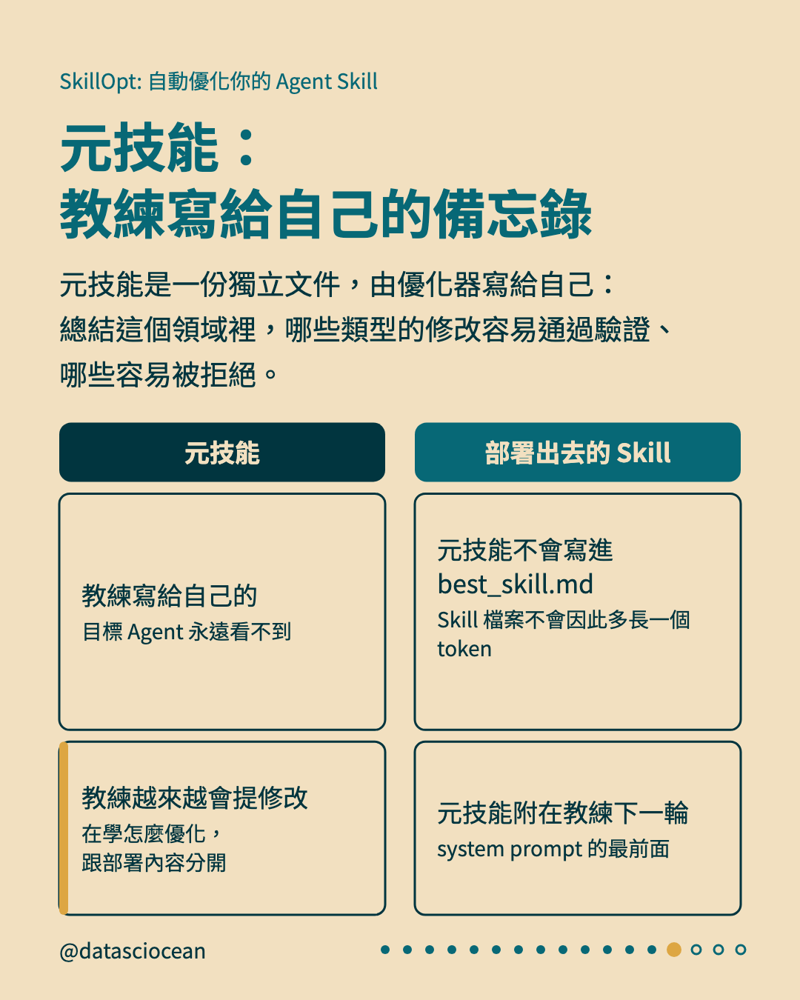

- **主標**：元技能：教練寫給自己的備忘錄
- **補充**：元技能是一份獨立文件，由優化器寫給自己：總結這個領域裡，哪些類型的修改容易通過驗證、哪些容易被拒絕。
- **示意圖（compare）上的文字與數字**：元技能｜教練寫給自己的｜目標 Agent 永遠看不到｜教練越來越會提修改｜在學怎麼優化，跟部署內容分開｜部署出去的 Skill｜元技能不會寫進 best_skill.md｜Skill 檔案不會因此多長一個 token｜元技能附在教練下一輪｜system prompt 的最前面
- **替代文字**：元技能：教練寫給自己的備忘錄。元技能是一份獨立文件，由優化器寫給自己：總結這個領域裡，哪些類型的修改容易通過驗證、哪些容易被拒絕。。圖上寫：元技能、教練寫給自己的、目標 Agent 永遠看不到、教練越來越會提修改、在學怎麼優化，跟部署內容分開、部署出去的 Skill、元技能不會寫進 best_skill.md、Skill 檔案不會因此多長一個 token、元技能附在教練下一輪、system prompt 的最前面

## 第 15 頁（示意圖）

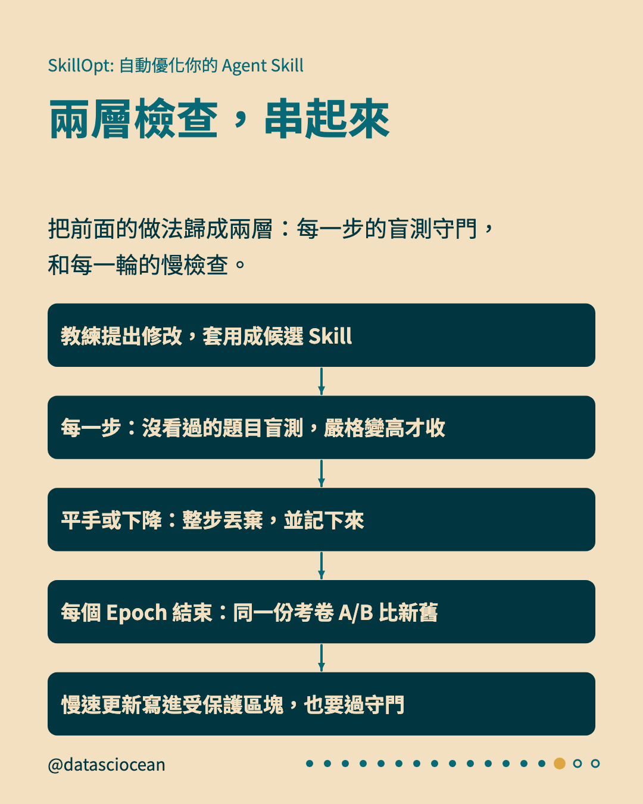

- **主標**：兩層檢查，串起來
- **補充**：把前面的做法歸成兩層：每一步的盲測守門，和每一輪的慢檢查。
- **示意圖（flow）上的文字與數字**：教練提出修改，套用成候選 Skill｜每一步：沒看過的題目盲測，嚴格變高才收｜平手或下降：整步丟棄，並記下來｜每個 Epoch 結束：同一份考卷 A/B 比新舊｜慢速更新寫進受保護區塊，也要過守門
- **替代文字**：兩層檢查，串起來。把前面的做法歸成兩層：每一步的盲測守門，和每一輪的慢檢查。。圖上寫：教練提出修改，套用成候選 Skill、每一步：沒看過的題目盲測，嚴格變高才收、平手或下降：整步丟棄，並記下來、每個 Epoch 結束：同一份考卷 A/B 比新舊、慢速更新寫進受保護區塊，也要過守門

## 第 16 頁（帶走）

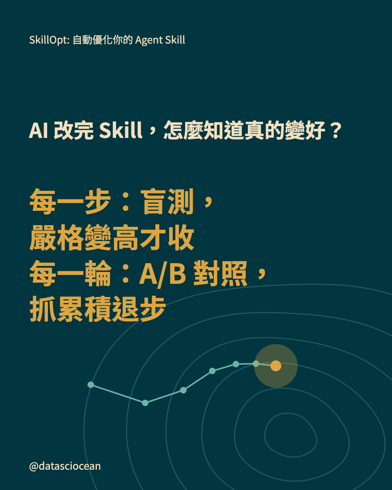

- **先問的問題**：AI 改完 Skill，怎麼知道真的變好？
- **一句話**：每一步：盲測，嚴格變高才收
每一輪：A/B 對照，抓累積退步
- **替代文字**：AI 改完 Skill，怎麼知道真的變好？　每一步：盲測，嚴格變高才收
每一輪：A/B 對照，抓累積退步

## 第 17 頁（系列地圖）

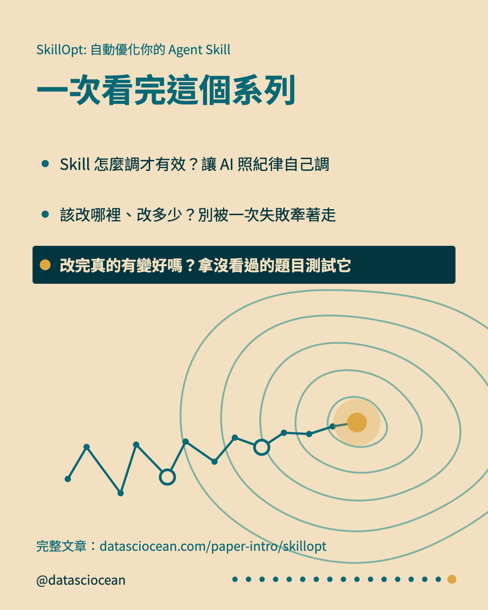

- **主標**：一次看完這個系列
- **導流行**：完整文章：datasciocean.com/paper-intro/skillopt
- **替代文字**：一次看完這個系列。Skill 怎麼調才有效？讓 AI 照紀律自己調、該改哪裡、改多少？別被一次失敗牽著走、改完真的有變好嗎？拿沒看過的題目測試它

## Caption（整段貼到 IG）

```text
SkillOpt 怎麼確認 AI Agent 的 Skill 變好：沒看過的題目盲測加 A/B。

・看起來合理，不等於真的有幫助（候選 Skill 不會因為看起來合理就被信任）
・資料切成三份，教練只看得到一份
・分數嚴格變高才收，平手也丟掉
・被拒絕的修改，會變成下一步的提醒（被拒絕的步驟不會白費）
・驗證資料集的分數高點，跟測試資料集的高點重合
・守門要靠便宜、可靠、自動化的評分（整套系統完全仰賴驗證守門，守門又完全仰賴評分）
・每一步都短視，所以每一輪再檢查一次（逐步的修改天生短視：每一步只針對最近一批任務反應）
・同一份考卷，新舊 Skill 各考一次
・20 題分成四種狀態，退步最要緊（20 題裡的每一題，會落進其中一種狀態）
・慢速更新的筆記，放在受保護的區塊
・慢速更新也要過守門，沒幫助就回滾（慢速更新不會被無條件信任）
・元技能：教練寫給自己的備忘錄
・兩層檢查，串起來

完整文章請在 datasciocean.com 搜尋「SkillOpt：把 AI Agent 的技能文件當成可訓練的權重來優化，不用碰模型本身」

#DSO_SkillOpt #SkillOpt #AgentSkill #AIAgent
```
