# IG 輪播：Skill 怎麼調才有效？讓 AI 照紀律自己調

- 系列：SkillOpt: 自動優化你的 Agent Skill　｜　hook 樣態：讀者疑問　｜　共 19 張，**依頁碼順序上傳**
- 每頁下方的「替代文字」貼到 IG 的替代文字欄；最後的 Caption 整段貼上

## 第 1 頁（封面）


- **主標**：Skill 怎麼調才有效？讓 AI 照紀律自己調！
- **副標**：SkillOpt 把深度學習訓練的紀律，
帶進 Agent Skill 的優化。
跟 TextGrad、GEPA 這類基準方法比，
52 組測試每一組都是最佳或並列最佳。
- **替代文字**：Skill 怎麼調才有效？讓 AI 照紀律自己調！。SkillOpt 把深度學習訓練的紀律，
帶進 Agent Skill 的優化。
跟 TextGrad、GEPA 這類基準方法比，
52 組測試每一組都是最佳或並列最佳。

## 第 2 頁（脈絡）

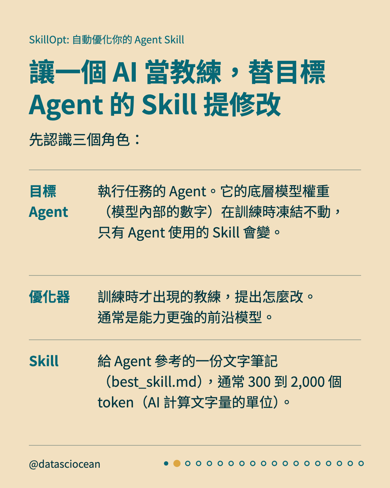

- **主標**：讓一個 AI 當教練，替目標 Agent 的 Skill 提修改
- **補充**：先認識三個角色：
- **表列**：目標 Agent｜執行任務的 Agent。它的底層模型權重（模型內部的數字）在訓練時凍結不動，只有 Agent 使用的 Skill 會變。
- **表列**：優化器｜訓練時才出現的教練，提出怎麼改。通常是能力更強的前沿模型。
- **表列**：Skill｜給 Agent 參考的一份文字筆記（best_skill.md），通常 300 到 2,000 個 token（AI 計算文字量的單位）。
- **替代文字**：讓一個 AI 當教練，替目標 Agent 的 Skill 提修改。先認識三個角色：

## 第 3 頁（示意圖）

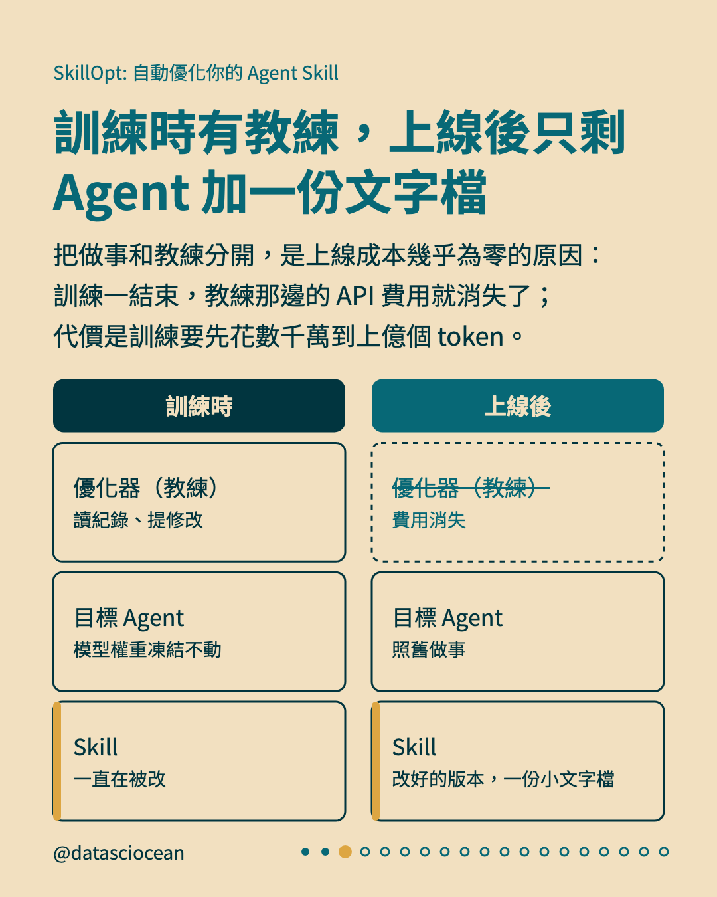

- **主標**：訓練時有教練，上線後只剩 Agent 加一份文字檔
- **補充**：把做事和教練分開，是上線成本幾乎為零的原因：訓練一結束，教練那邊的 API 費用就消失了；代價是訓練要先花數千萬到上億個 token。
- **示意圖（compare）上的文字與數字**：訓練時｜優化器（教練）｜讀紀錄、提修改｜目標 Agent｜模型權重凍結不動｜Skill｜一直在被改｜上線後｜優化器（教練）｜費用消失｜目標 Agent｜照舊做事｜Skill｜改好的版本，一份小文字檔
- **替代文字**：訓練時有教練，上線後只剩 Agent 加一份文字檔。把做事和教練分開，是上線成本幾乎為零的原因：訓練一結束，教練那邊的 API 費用就消失了；代價是訓練要先花數千萬到上億個 token。。圖上寫：訓練時、優化器（教練）、讀紀錄、提修改、目標 Agent、模型權重凍結不動、Skill、一直在被改、上線後、優化器（教練）、費用消失、目標 Agent、照舊做事、Skill、改好的版本，一份小文字檔

## 第 4 頁（示意圖）

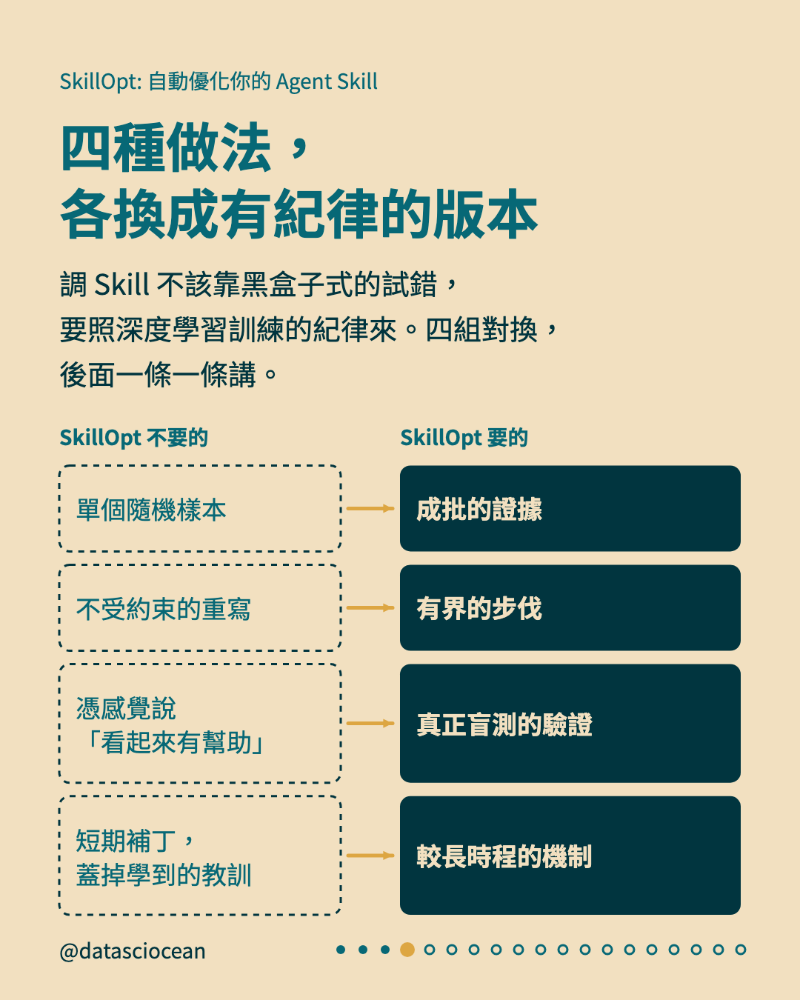

- **主標**：四種做法，各換成有紀律的版本
- **補充**：調 Skill 不該靠黑盒子式的試錯，要照深度學習訓練的紀律來。四組對換，後面一條一條講。
- **示意圖（pairs）上的文字與數字**：SkillOpt 不要的｜SkillOpt 要的｜單個隨機樣本｜成批的證據｜不受約束的重寫｜有界的步伐｜憑感覺說「看起來有幫助」｜真正盲測的驗證｜短期補丁，蓋掉學到的教訓｜較長時程的機制
- **替代文字**：四種做法，各換成有紀律的版本。調 Skill 不該靠黑盒子式的試錯，要照深度學習訓練的紀律來。四組對換，後面一條一條講。。圖上寫：SkillOpt 不要的、SkillOpt 要的、單個隨機樣本、成批的證據、不受約束的重寫、有界的步伐、憑感覺說「看起來有幫助」、真正盲測的驗證、短期補丁，蓋掉學到的教訓、較長時程的機制

## 第 5 頁（示意圖）

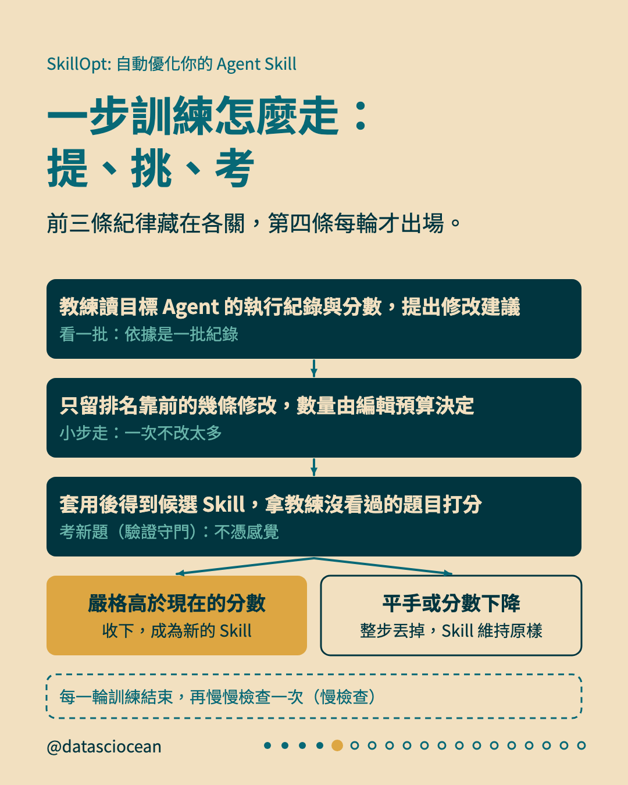

- **主標**：一步訓練怎麼走：提、挑、考
- **補充**：前三條紀律藏在各關，第四條每輪才出場。
- **示意圖（flow）上的文字與數字**：教練讀目標 Agent 的執行紀錄與分數，提出修改建議｜看一批：依據是一批紀錄｜只留排名靠前的幾條修改，數量由編輯預算決定｜小步走：一次不改太多｜套用後得到候選 Skill，拿教練沒看過的題目打分｜考新題（驗證守門）：不憑感覺｜嚴格高於現在的分數｜收下，成為新的 Skill｜平手或分數下降｜整步丟掉，Skill 維持原樣｜每一輪訓練結束，再慢慢檢查一次（慢檢查）
- **替代文字**：一步訓練怎麼走：提、挑、考。前三條紀律藏在各關，第四條每輪才出場。。圖上寫：教練讀目標 Agent 的執行紀錄與分數，提出修改建議、看一批：依據是一批紀錄、只留排名靠前的幾條修改，數量由編輯預算決定、小步走：一次不改太多、套用後得到候選 Skill，拿教練沒看過的題目打分、考新題（驗證守門）：不憑感覺、嚴格高於現在的分數、收下，成為新的 Skill、平手或分數下降、整步丟掉，Skill 維持原樣、每一輪訓練結束，再慢慢檢查一次（慢檢查）

## 第 6 頁（示意圖）

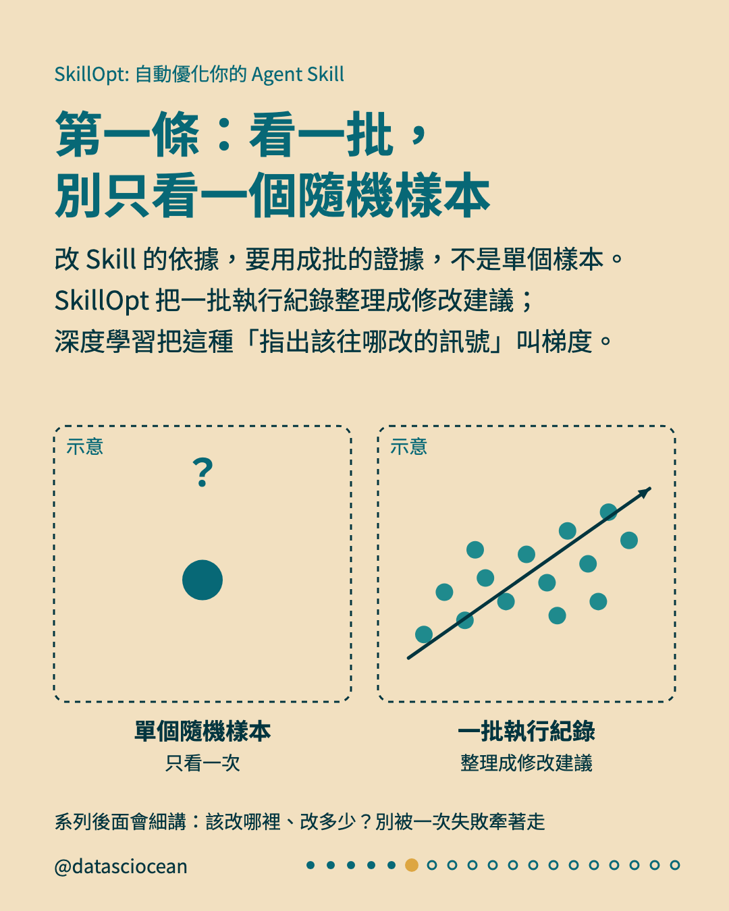

- **主標**：第一條：看一批，別只看一個隨機樣本
- **補充**：改 Skill 的依據，要用成批的證據，不是單個樣本。SkillOpt 把一批執行紀錄整理成修改建議；深度學習把這種「指出該往哪改的訊號」叫梯度。
- **示意圖（samples）上的文字與數字**：單個隨機樣本｜只看一次｜一批執行紀錄｜整理成修改建議
- **圖註**：系列後面會細講：該改哪裡、改多少？別被一次失敗牽著走
- **替代文字**：第一條：看一批，別只看一個隨機樣本。改 Skill 的依據，要用成批的證據，不是單個樣本。SkillOpt 把一批執行紀錄整理成修改建議；深度學習把這種「指出該往哪改的訊號」叫梯度。。圖上寫：單個隨機樣本、只看一次、一批執行紀錄、整理成修改建議

## 第 7 頁（示意圖）

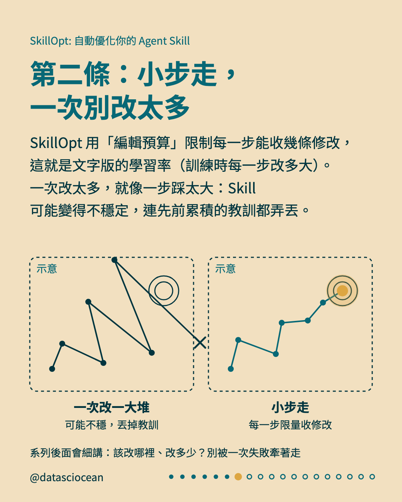

- **主標**：第二條：小步走，一次別改太多
- **補充**：SkillOpt 用「編輯預算」限制每一步能收幾條修改，這就是文字版的學習率（訓練時每一步改多大）。一次改太多，就像一步踩太大：Skill 可能變得不穩定，連先前累積的教訓都弄丟。
- **示意圖（paths）上的文字與數字**：一次改一大堆｜可能不穩，丟掉教訓｜小步走｜每一步限量收修改
- **圖註**：系列後面會細講：該改哪裡、改多少？別被一次失敗牽著走
- **替代文字**：第二條：小步走，一次別改太多。SkillOpt 用「編輯預算」限制每一步能收幾條修改，這就是文字版的學習率（訓練時每一步改多大）。一次改太多，就像一步踩太大：Skill 可能變得不穩定，連先前累積的教訓都弄丟。。圖上寫：一次改一大堆、可能不穩，丟掉教訓、小步走、每一步限量收修改

## 第 8 頁（示意圖）

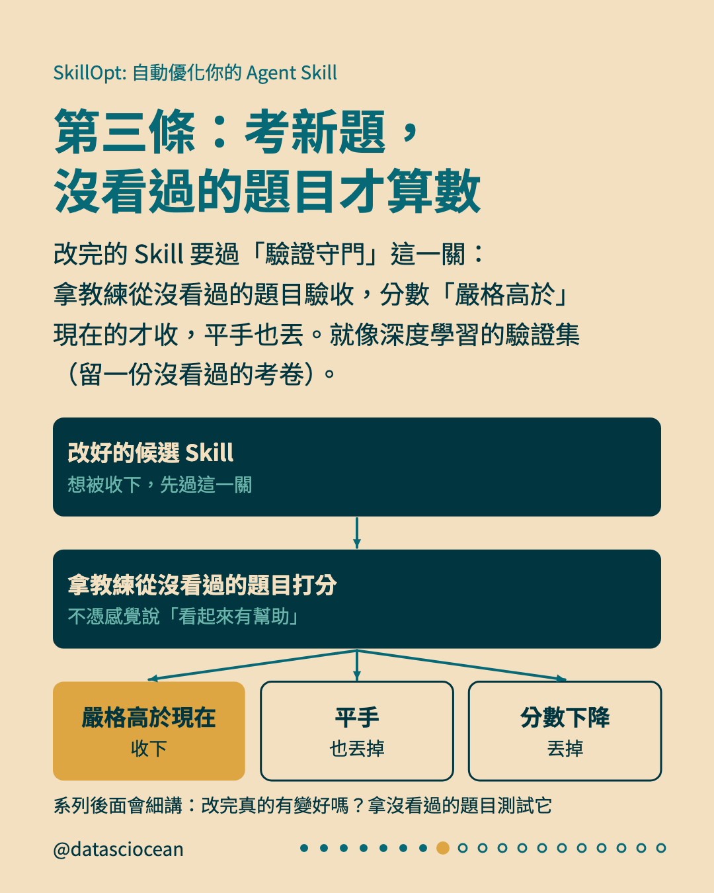

- **主標**：第三條：考新題，沒看過的題目才算數
- **補充**：改完的 Skill 要過「驗證守門」這一關：拿教練從沒看過的題目驗收，分數「嚴格高於」現在的才收，平手也丟。就像深度學習的驗證集（留一份沒看過的考卷）。
- **示意圖（flow）上的文字與數字**：改好的候選 Skill｜想被收下，先過這一關｜拿教練從沒看過的題目打分｜不憑感覺說「看起來有幫助」｜嚴格高於現在｜收下｜平手｜也丟掉｜分數下降｜丟掉
- **圖註**：系列後面會細講：改完真的有變好嗎？拿沒看過的題目測試它
- **替代文字**：第三條：考新題，沒看過的題目才算數。改完的 Skill 要過「驗證守門」這一關：拿教練從沒看過的題目驗收，分數「嚴格高於」現在的才收，平手也丟。就像深度學習的驗證集（留一份沒看過的考卷）。。圖上寫：改好的候選 Skill、想被收下，先過這一關、拿教練從沒看過的題目打分、不憑感覺說「看起來有幫助」、嚴格高於現在、收下、平手、也丟掉、分數下降、丟掉

## 第 9 頁（示意圖）

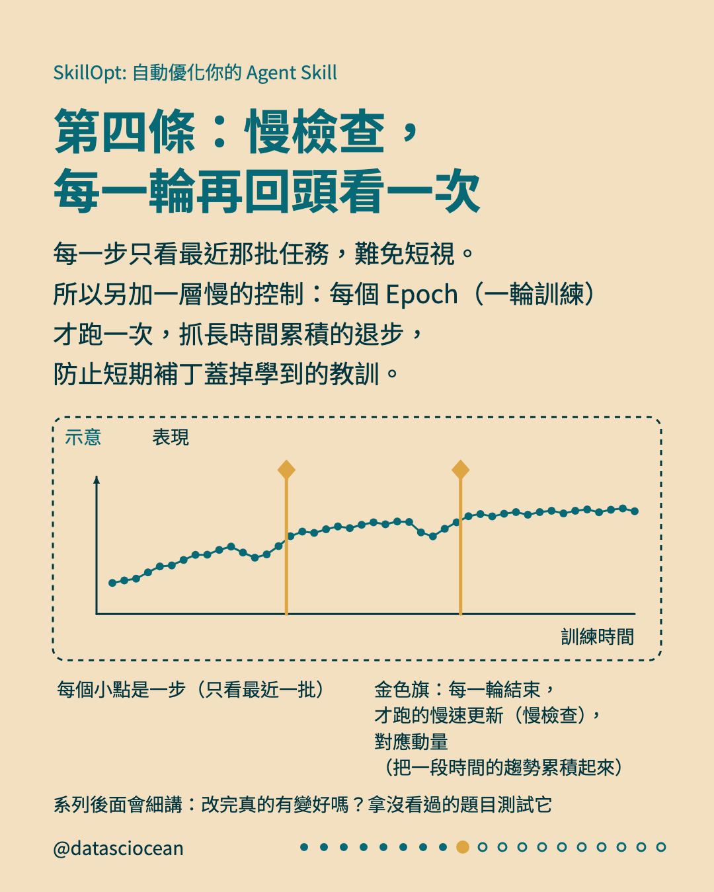

- **主標**：第四條：慢檢查，每一輪再回頭看一次
- **補充**：每一步只看最近那批任務，難免短視。所以另加一層慢的控制：每個 Epoch（一輪訓練）才跑一次，抓長時間累積的退步，防止短期補丁蓋掉學到的教訓。
- **示意圖（epochs）上的文字與數字**：每個小點是一步（只看最近一批）｜金色旗：每一輪結束，才跑的慢速更新（慢檢查），對應動量（把一段時間的趨勢累積起來）
- **圖註**：系列後面會細講：改完真的有變好嗎？拿沒看過的題目測試它
- **替代文字**：第四條：慢檢查，每一輪再回頭看一次。每一步只看最近那批任務，難免短視。所以另加一層慢的控制：每個 Epoch（一輪訓練）才跑一次，抓長時間累積的退步，防止短期補丁蓋掉學到的教訓。。圖上寫：每個小點是一步（只看最近一批）、金色旗：每一輪結束，才跑的慢速更新（慢檢查），對應動量（把一段時間的趨勢累積起來）

## 第 10 頁（示意圖）

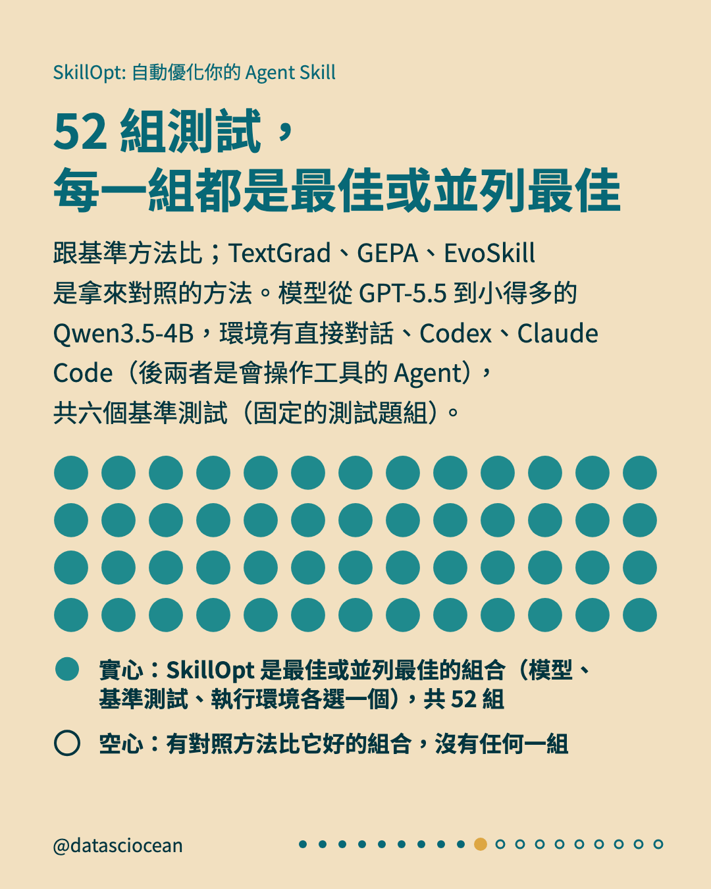

- **主標**：52 組測試，每一組都是最佳或並列最佳
- **補充**：跟基準方法比；TextGrad、GEPA、EvoSkill 是拿來對照的方法。模型從 GPT-5.5 到小得多的 Qwen3.5-4B，環境有直接對話、Codex、Claude Code（後兩者是會操作工具的 Agent），共六個基準測試（固定的測試題組）。
- **示意圖（dotgrid）上的文字與數字**：實心：SkillOpt 是最佳或並列最佳的組合（模型、基準測試、執行環境各選一個），共 52 組｜空心：有對照方法比它好的組合，沒有任何一組｜52
- **替代文字**：52 組測試，每一組都是最佳或並列最佳。跟基準方法比；TextGrad、GEPA、EvoSkill 是拿來對照的方法。模型從 GPT-5.5 到小得多的 Qwen3.5-4B，環境有直接對話、Codex、Claude Code（後兩者是會操作工具的 Agent），共六個基準測試（固定的測試題組）。。圖上寫：實心：SkillOpt 是最佳或並列最佳的組合（模型、基準測試、執行環境各選一個），共 52 組、空心：有對照方法比它好的組合，沒有任何一組、52

## 第 11 頁（示意圖）


- **主標**：教練提的修改，每個測試最後只收 1 到 4 次
- **補充**：驗證守門把絕大多數提出的修改都擋了下來。六個基準測試最後的 Skill，都只收了 1 到 4 次修改。
- **示意圖（funnel）上的文字與數字**：教練提出的修改｜過了驗證守門的｜絕大多數都被擋下｜最終只收 1 到 4 次
- **替代文字**：教練提的修改，每個測試最後只收 1 到 4 次。驗證守門把絕大多數提出的修改都擋了下來。六個基準測試最後的 Skill，都只收了 1 到 4 次修改。。圖上寫：教練提出的修改、過了驗證守門的、絕大多數都被擋下、最終只收 1 到 4 次

## 第 12 頁（示意圖）

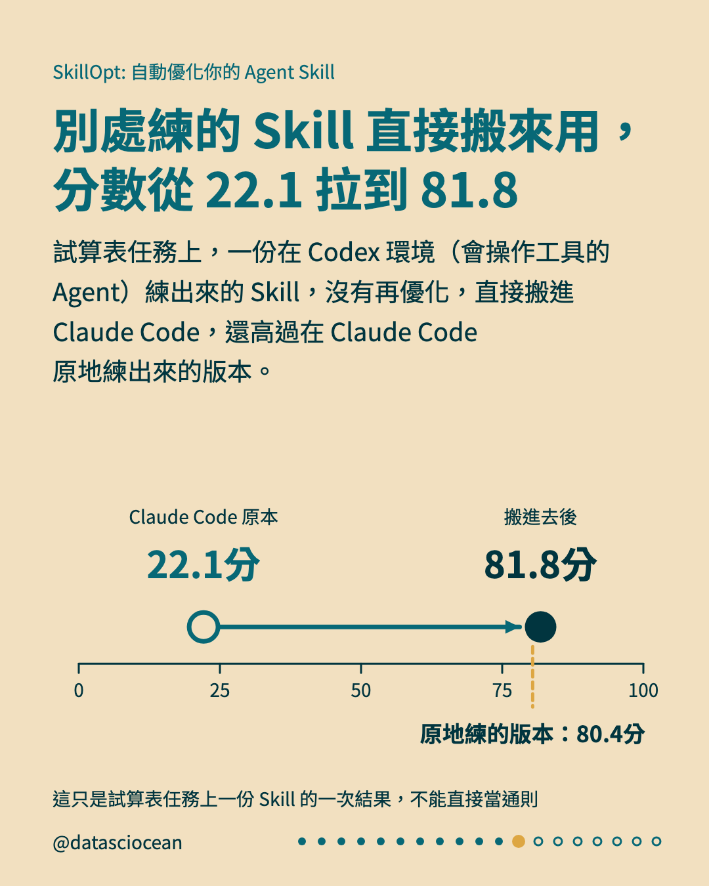

- **主標**：別處練的 Skill 直接搬來用，分數從 22.1 拉到 81.8
- **補充**：試算表任務上，一份在 Codex 環境（會操作工具的 Agent）練出來的 Skill，沒有再優化，直接搬進 Claude Code，還高過在 Claude Code 原地練出來的版本。
- **示意圖（dumbbell）上的文字與數字**：Claude Code 原本｜22.1分｜搬進去後｜81.8分｜原地練的版本｜80.4分
- **圖註**：這只是試算表任務上一份 Skill 的一次結果，不能直接當通則
- **替代文字**：別處練的 Skill 直接搬來用，分數從 22.1 拉到 81.8。試算表任務上，一份在 Codex 環境（會操作工具的 Agent）練出來的 Skill，沒有再優化，直接搬進 Claude Code，還高過在 Claude Code 原地練出來的版本。。圖上寫：Claude Code 原本、22.1分、搬進去後、81.8分、原地練的版本、80.4分

## 第 13 頁（示意圖）

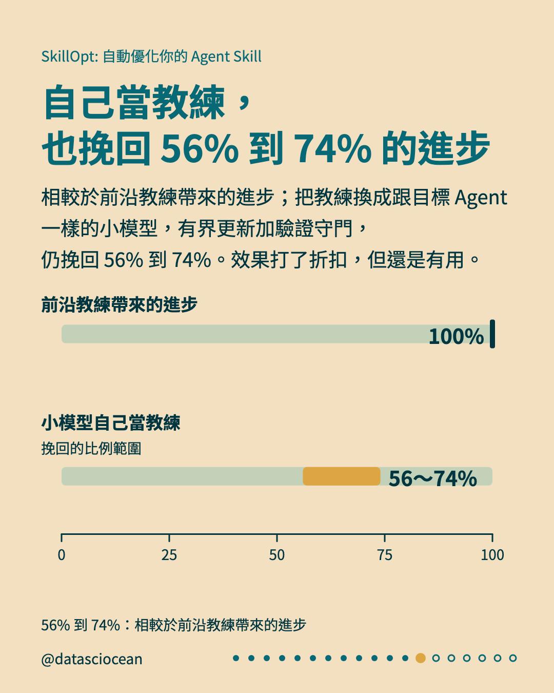

- **主標**：自己當教練，也挽回 56% 到 74% 的進步
- **補充**：相較於前沿教練帶來的進步；把教練換成跟目標 Agent 一樣的小模型，有界更新加驗證守門，仍挽回 56% 到 74%。效果打了折扣，但還是有用。
- **示意圖（range）上的文字與數字**：前沿教練帶來的進步｜100%｜100%｜小模型自己當教練｜挽回的比例範圍｜56%｜74%
- **圖註**：56% 到 74%：相較於前沿教練帶來的進步
- **替代文字**：自己當教練，也挽回 56% 到 74% 的進步。相較於前沿教練帶來的進步；把教練換成跟目標 Agent 一樣的小模型，有界更新加驗證守門，仍挽回 56% 到 74%。效果打了折扣，但還是有用。。圖上寫：前沿教練帶來的進步、100%、100%、小模型自己當教練、挽回的比例範圍、56%、74%

## 第 14 頁（示意圖）

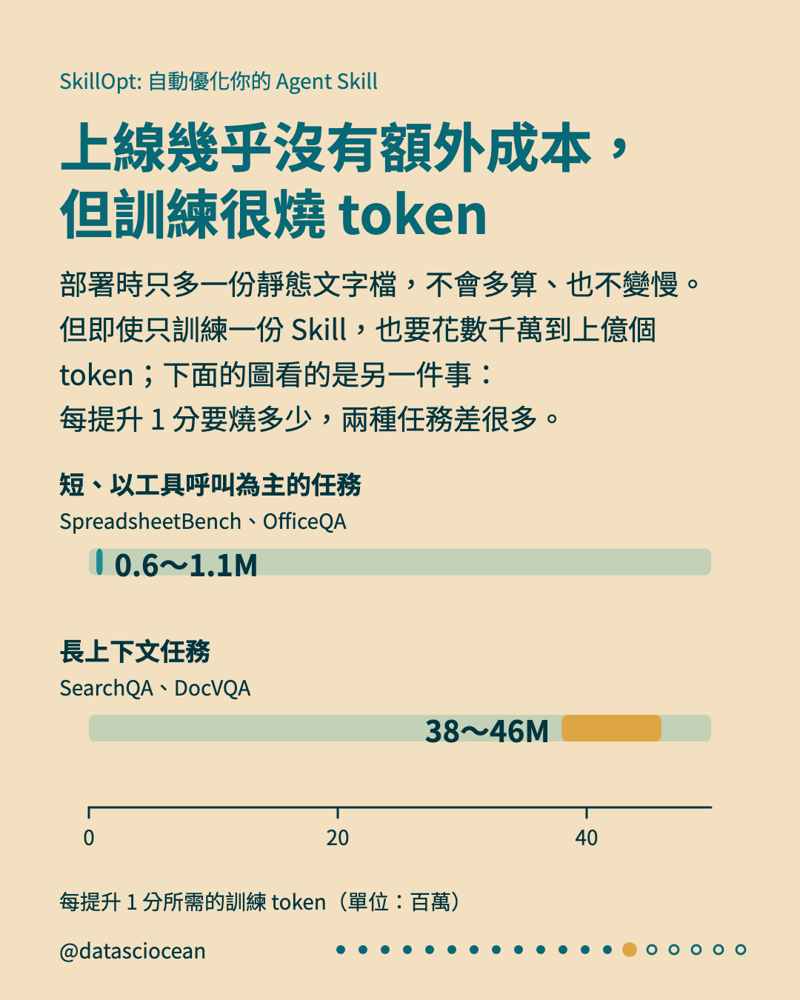

- **主標**：上線幾乎沒有額外成本，但訓練很燒 token
- **補充**：部署時只多一份靜態文字檔，不會多算、也不變慢。但即使只訓練一份 Skill，也要花數千萬到上億個 token；下面的圖看的是另一件事：每提升 1 分要燒多少，兩種任務差很多。
- **示意圖（range）上的文字與數字**：短、以工具呼叫為主的任務｜SpreadsheetBench、OfficeQA｜0.6M｜1.1M｜長上下文任務｜SearchQA、DocVQA｜38M｜46M
- **圖註**：每提升 1 分所需的訓練 token（單位：百萬）
- **替代文字**：上線幾乎沒有額外成本，但訓練很燒 token。部署時只多一份靜態文字檔，不會多算、也不變慢。但即使只訓練一份 Skill，也要花數千萬到上億個 token；下面的圖看的是另一件事：每提升 1 分要燒多少，兩種任務差很多。。圖上寫：短、以工具呼叫為主的任務、SpreadsheetBench、OfficeQA、0.6M、1.1M、長上下文任務、SearchQA、DocVQA、38M、46M

## 第 15 頁（示意圖）

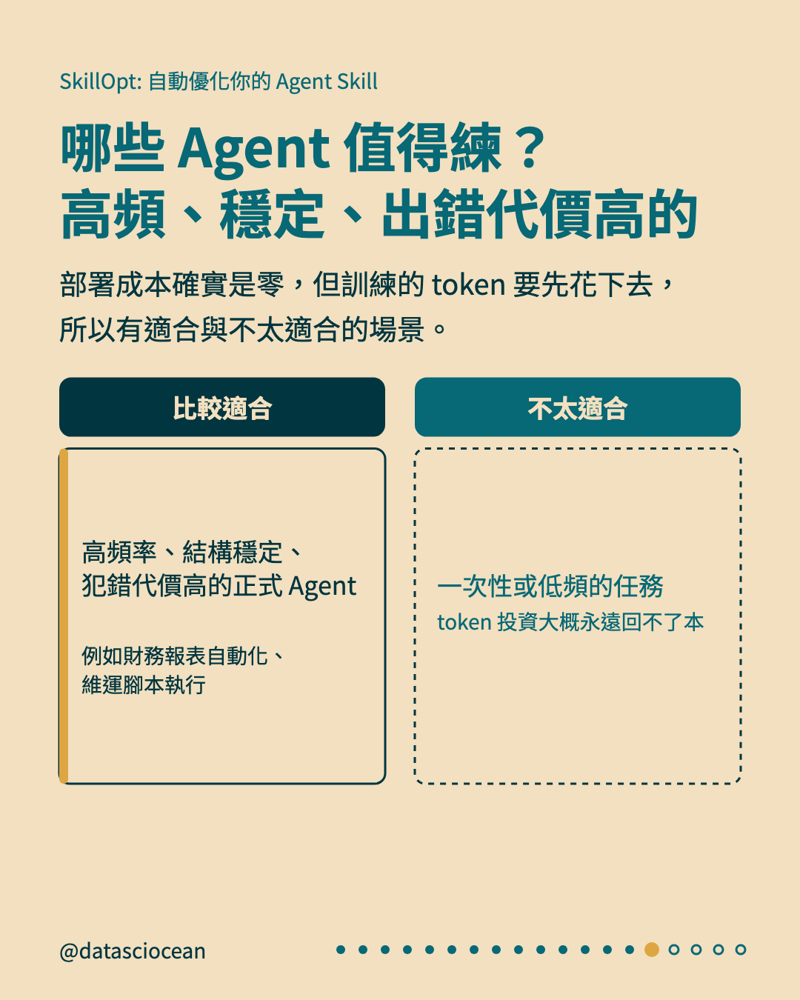

- **主標**：哪些 Agent 值得練？高頻、穩定、出錯代價高的
- **補充**：部署成本確實是零，但訓練的 token 要先花下去，所以有適合與不太適合的場景。
- **示意圖（compare）上的文字與數字**：比較適合｜高頻率、結構穩定、犯錯代價高的正式 Agent｜例如財務報表自動化、維運腳本執行｜不太適合｜一次性或低頻的任務｜token 投資大概永遠回不了本
- **替代文字**：哪些 Agent 值得練？高頻、穩定、出錯代價高的。部署成本確實是零，但訓練的 token 要先花下去，所以有適合與不太適合的場景。。圖上寫：比較適合、高頻率、結構穩定、犯錯代價高的正式 Agent、例如財務報表自動化、維運腳本執行、不太適合、一次性或低頻的任務、token 投資大概永遠回不了本

## 第 16 頁（示意圖）

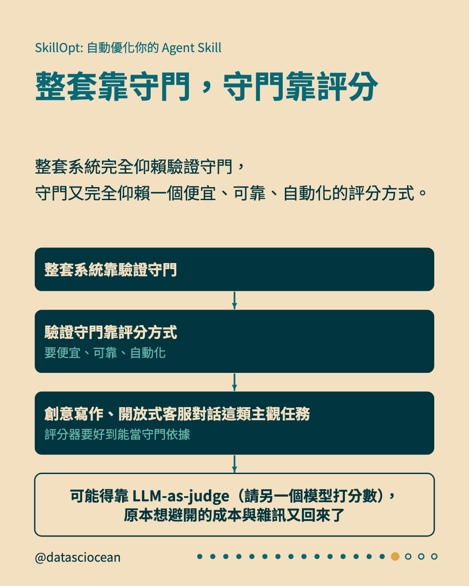

- **主標**：整套靠守門，守門靠評分
- **補充**：整套系統完全仰賴驗證守門，守門又完全仰賴一個便宜、可靠、自動化的評分方式。
- **示意圖（flow）上的文字與數字**：整套系統靠驗證守門｜驗證守門靠評分方式｜要便宜、可靠、自動化｜創意寫作、開放式客服對話這類主觀任務｜評分器要好到能當守門依據｜可能得靠 LLM-as-judge（請另一個模型打分數），原本想避開的成本與雜訊又回來了
- **替代文字**：整套靠守門，守門靠評分。整套系統完全仰賴驗證守門，守門又完全仰賴一個便宜、可靠、自動化的評分方式。。圖上寫：整套系統靠驗證守門、驗證守門靠評分方式、要便宜、可靠、自動化、創意寫作、開放式客服對話這類主觀任務、評分器要好到能當守門依據、可能得靠 LLM-as-judge（請另一個模型打分數），原本想避開的成本與雜訊又回來了

## 第 17 頁（示意圖）

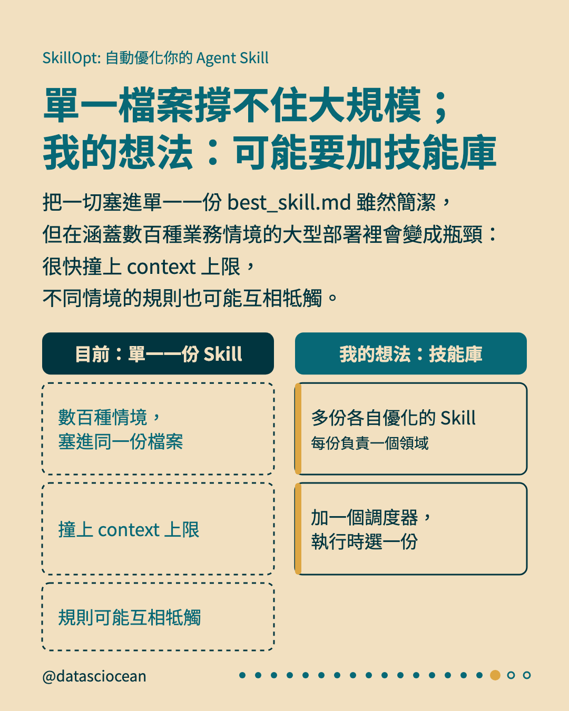

- **主標**：單一檔案撐不住大規模；我的想法：可能要加技能庫
- **補充**：把一切塞進單一一份 best_skill.md 雖然簡潔，但在涵蓋數百種業務情境的大型部署裡會變成瓶頸：很快撞上 context 上限，不同情境的規則也可能互相牴觸。
- **示意圖（compare）上的文字與數字**：目前：單一一份 Skill｜數百種情境，塞進同一份檔案｜撞上 context 上限｜規則可能互相牴觸｜我的想法：技能庫｜多份各自優化的 Skill｜每份負責一個領域｜加一個調度器，執行時選一份
- **替代文字**：單一檔案撐不住大規模；我的想法：可能要加技能庫。把一切塞進單一一份 best_skill.md 雖然簡潔，但在涵蓋數百種業務情境的大型部署裡會變成瓶頸：很快撞上 context 上限，不同情境的規則也可能互相牴觸。。圖上寫：目前：單一一份 Skill、數百種情境，塞進同一份檔案、撞上 context 上限、規則可能互相牴觸、我的想法：技能庫、多份各自優化的 Skill、每份負責一個領域、加一個調度器，執行時選一份

## 第 18 頁（帶走）

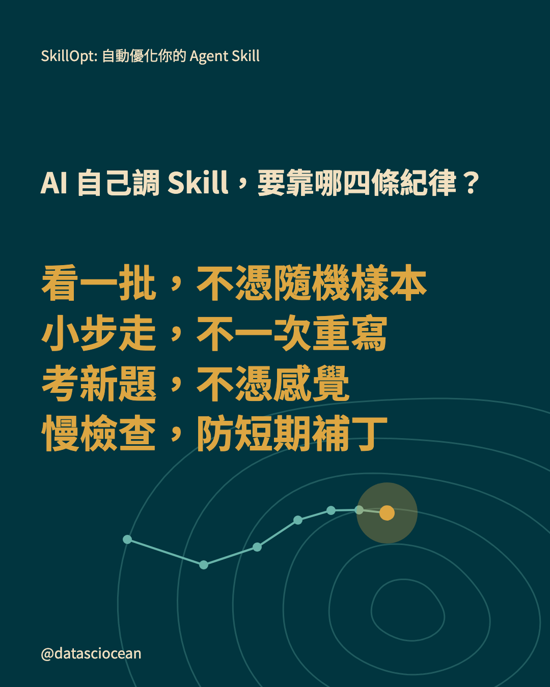

- **先問的問題**：AI 自己調 Skill，要靠哪四條紀律？
- **一句話**：看一批，不憑隨機樣本
小步走，不一次重寫
考新題，不憑感覺
慢檢查，防短期補丁
- **替代文字**：AI 自己調 Skill，要靠哪四條紀律？　看一批，不憑隨機樣本
小步走，不一次重寫
考新題，不憑感覺
慢檢查，防短期補丁

## 第 19 頁（系列地圖）

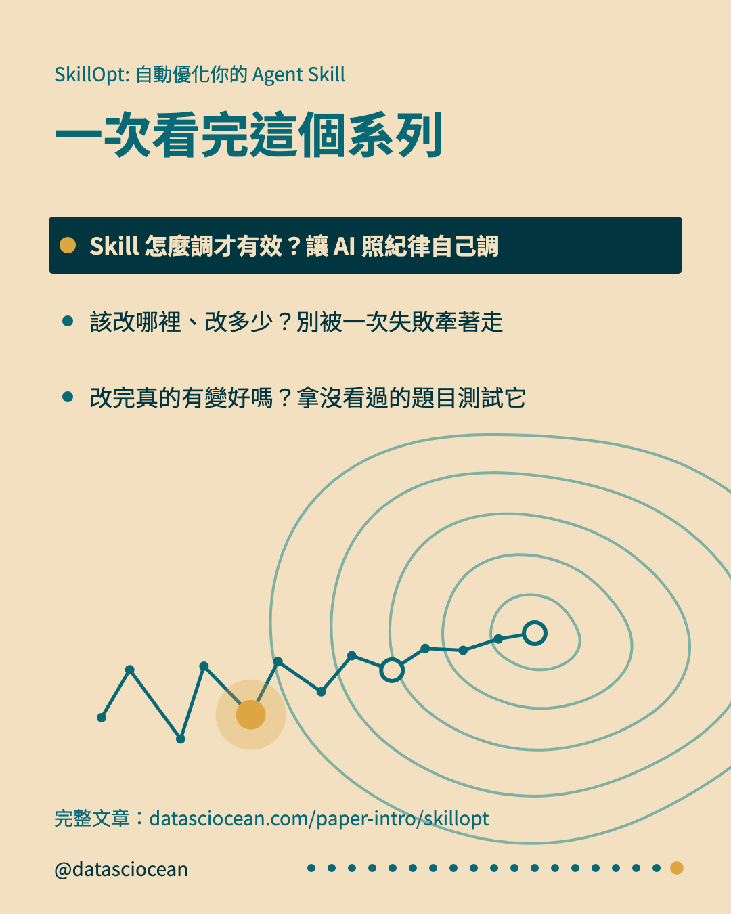

- **主標**：一次看完這個系列
- **導流行**：完整文章：datasciocean.com/paper-intro/skillopt
- **替代文字**：一次看完這個系列。Skill 怎麼調才有效？讓 AI 照紀律自己調、該改哪裡、改多少？別被一次失敗牽著走、改完真的有變好嗎？拿沒看過的題目測試它

## Caption（整段貼到 IG）

```text
SkillOpt 自動優化 Agent Skill：用深度學習的訓練紀律，怎麼調才有效？

・訓練時有教練，上線後只剩 Agent 加一份文字檔
・四種做法，各換成有紀律的版本
・一步訓練怎麼走：提、挑、考（前三條紀律藏在各關，第四條每輪才出場）
・第一條：看一批，別只看一個隨機樣本
・第二條：小步走，一次別改太多
・第三條：考新題，沒看過的題目才算數
・第四條：慢檢查，每一輪再回頭看一次（每一步只看最近那批任務，難免短視）
・52 組測試，每一組都是最佳或並列最佳（跟基準方法比）
・教練提的修改，每個測試最後只收 1 到 4 次（驗證守門把絕大多數提出的修改都擋了下來）
・別處練的 Skill 直接搬來用，分數從 22.1 拉到 81.8
・自己當教練，也挽回 56% 到 74% 的進步（相較於前沿教練帶來的進步）
・上線幾乎沒有額外成本，但訓練很燒 token（部署時只多一份靜態文字檔，不會多算、也不變慢）
・哪些 Agent 值得練？高頻、穩定、出錯代價高的
・整套靠守門，守門靠評分
・單一檔案撐不住大規模；我的想法：可能要加技能庫

完整文章請在 datasciocean.com 搜尋「SkillOpt：把 AI Agent 的技能文件當成可訓練的權重來優化，不用碰模型本身」

#DSO_SkillOpt #SkillOpt #AgentSkill #AIAgent
```
