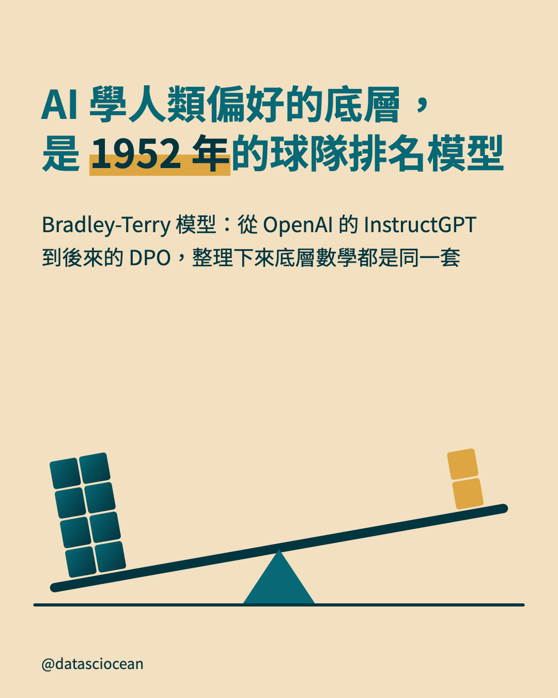
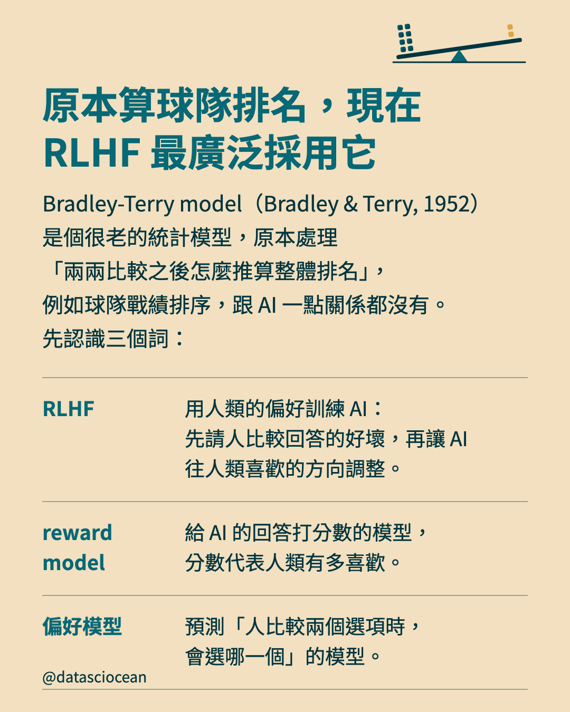
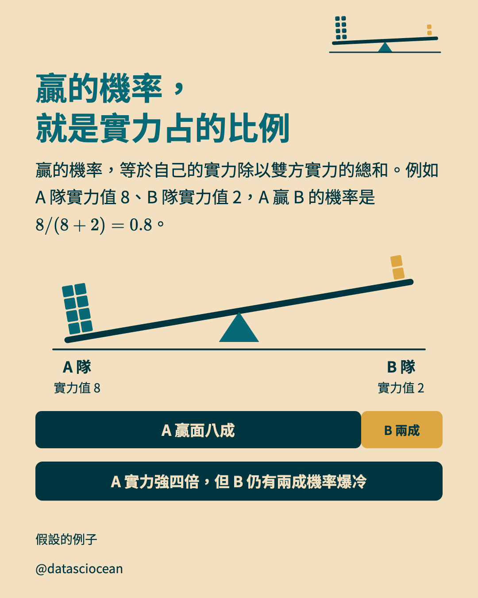
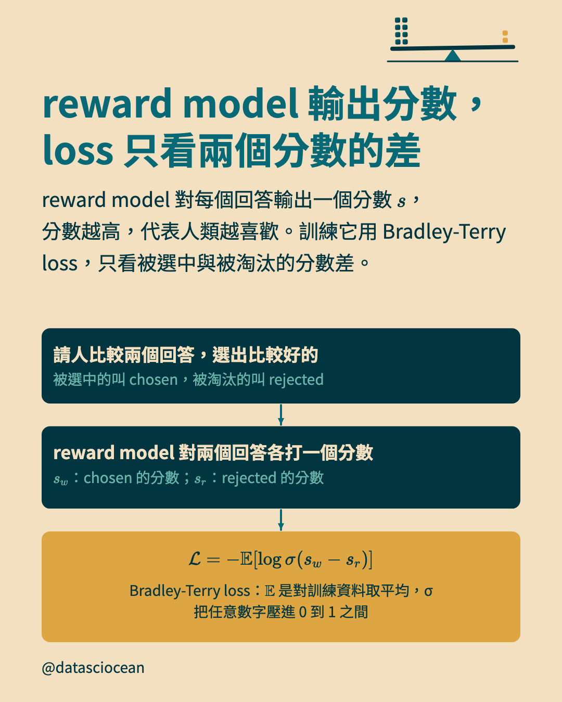
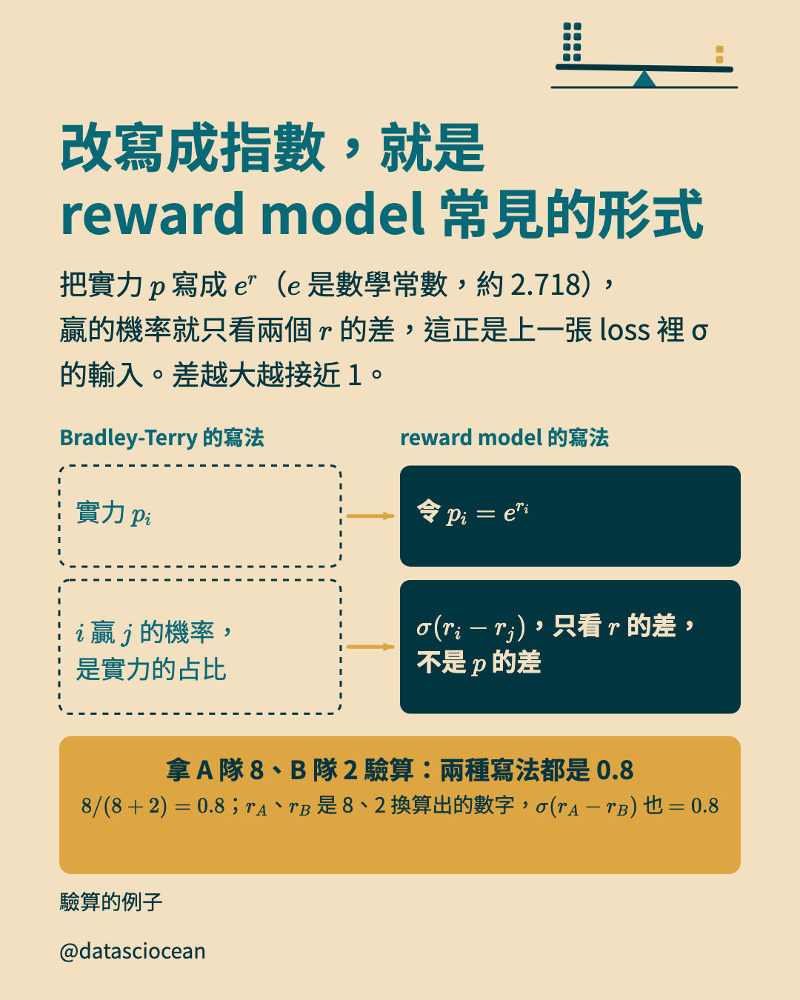
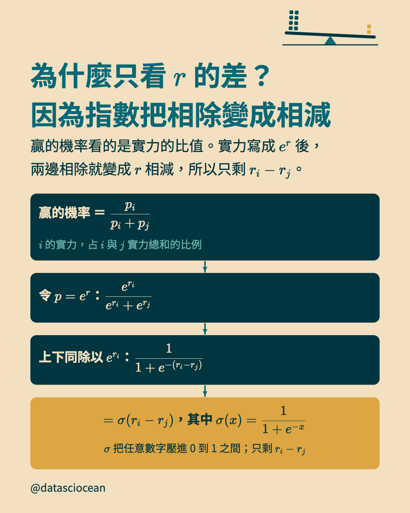
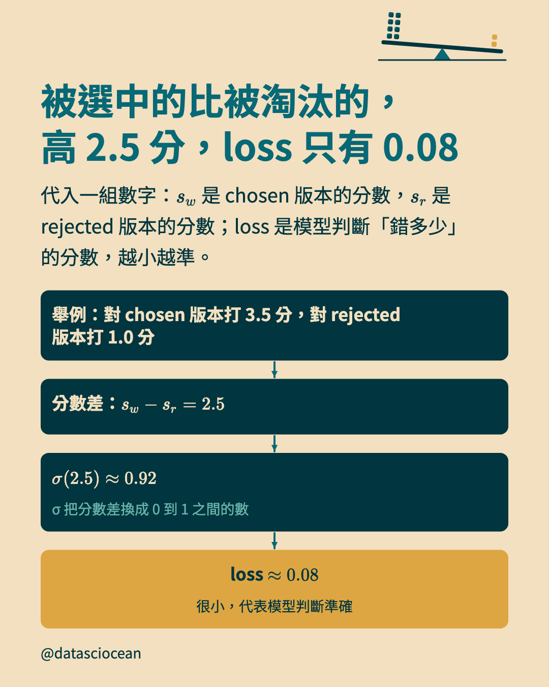
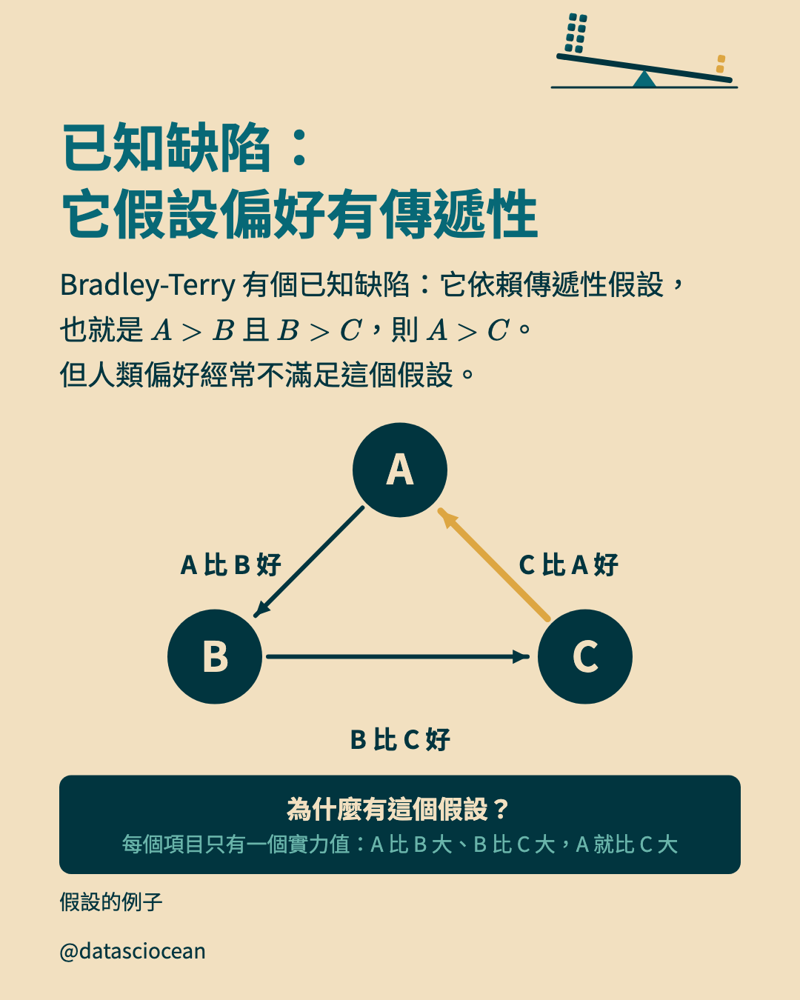

# IG 輪播：Bradley-Terry 把兩兩比較看成每個項目隱藏「實力值」的機率反映，是 RLHF reward model 的共同底層；成對比較比直接打分共識度高，但有傳遞性假設的缺陷

- 系列：（獨立貼文）　｜　hook 樣態：反直覺斷言　｜　共 12 張，**依頁碼順序上傳**
- 每頁下方的「替代文字」貼到 IG 的替代文字欄；最後的 Caption 整段貼上

## 第 1 頁（封面）



- **主標**：AI 學人類偏好的底層，是 1952 年的球隊排名模型
- **副標**：Bradley-Terry 模型：從 OpenAI 的 InstructGPT 到後來的 DPO，整理下來底層數學都是同一套
- **替代文字**：AI 學人類偏好的底層，是 1952 年的球隊排名模型。Bradley-Terry 模型：從 OpenAI 的 InstructGPT 到後來的 DPO，整理下來底層數學都是同一套

## 第 2 頁（脈絡）



- **主標**：原本算球隊排名，現在 RLHF 最廣泛採用它
- **補充**：Bradley-Terry model（Bradley & Terry, 1952）是個很老的統計模型，原本處理「兩兩比較之後怎麼推算整體排名」，例如球隊戰績排序，跟 AI 一點關係都沒有。先認識三個詞：
- **表列**：RLHF｜用人類的偏好訓練 AI：先請人比較回答的好壞，再讓 AI 往人類喜歡的方向調整。
- **表列**：reward model｜給 AI 的回答打分數的模型，分數代表人類有多喜歡。
- **表列**：偏好模型｜預測「人比較兩個選項時，會選哪一個」的模型。
- **替代文字**：原本算球隊排名，現在 RLHF 最廣泛採用它。Bradley-Terry model（Bradley & Terry, 1952）是個很老的統計模型，原本處理「兩兩比較之後怎麼推算整體排名」，例如球隊戰績排序，跟 AI 一點關係都沒有。先認識三個詞：

## 第 3 頁（示意圖）


- **主標**：打分容易各說各話，二選一的共識度高得多
- **補充**：直接打分，每個人心裡的 7 分不一樣；「A 跟 B 哪個比較好」，人類直覺上容易判斷。
- **示意圖（compare）上的文字與數字**：請 3 人打分｜甲：7 分｜乙：4 分｜丙：9 分｜同一個回答，三種分數｜請 3 人二選一｜甲：選 A｜乙：選 A｜丙：選 A｜同一組回答，選擇一致
- **圖註**：假設的例子
- **替代文字**：打分容易各說各話，二選一的共識度高得多。直接打分，每個人心裡的 7 分不一樣；「A 跟 B 哪個比較好」，人類直覺上容易判斷。。圖上寫：請 3 人打分、甲：7 分、乙：4 分、丙：9 分、同一個回答，三種分數、請 3 人二選一、甲：選 A、乙：選 A、丙：選 A、同一組回答，選擇一致

## 第 4 頁（示意圖）


- **主標**：比賽結果看得見，實力值看不見
- **補充**：比賽結果看得到，但每支球隊有多強，看不到。Bradley-Terry 的核心假設：每個項目都有一個看不見的「實力值」，比賽結果只是它的機率反映，不是絕對保證。
- **示意圖（hidden）上的文字與數字**：第 1 場：A 隊贏｜第 2 場：A 隊贏｜第 3 場：B 隊贏｜A 隊｜實力值：？｜B 隊｜實力值：？｜看得到：比賽結果｜看不到：每支球隊的實力值
- **圖註**：假設的例子；RLHF 裡要比的是 AI 的不同回答
- **替代文字**：比賽結果看得見，實力值看不見。比賽結果看得到，但每支球隊有多強，看不到。Bradley-Terry 的核心假設：每個項目都有一個看不見的「實力值」，比賽結果只是它的機率反映，不是絕對保證。。圖上寫：第 1 場：A 隊贏、第 2 場：A 隊贏、第 3 場：B 隊贏、A 隊、實力值：？、B 隊、實力值：？、看得到：比賽結果、看不到：每支球隊的實力值

## 第 5 頁（示意圖）



- **主標**：贏的機率，就是實力占的比例
- **補充**：贏的機率，等於自己的實力除以雙方實力的總和。例如 A 隊實力值 8、B 隊實力值 2，A 贏 B 的機率是 8/(8+2) = 0.8。
- **示意圖（seesaw）上的文字與數字**：A 隊｜實力值 8｜A 贏面八成｜B 隊｜實力值 2｜B 兩成｜A 實力強四倍，但 B 仍有兩成機率爆冷
- **圖註**：假設的例子
- **替代文字**：贏的機率，就是實力占的比例。贏的機率，等於自己的實力除以雙方實力的總和。例如 A 隊實力值 8、B 隊實力值 2，A 贏 B 的機率是 8/(8+2) = 0.8。。圖上寫：A 隊、實力值 8、A 贏面八成、B 隊、實力值 2、B 兩成、A 實力強四倍，但 B 仍有兩成機率爆冷

## 第 6 頁（示意圖）



- **主標**：reward model 輸出分數，loss 只看兩個分數的差
- **補充**：reward model 對每個回答輸出一個分數 s，分數越高，代表人類越喜歡。訓練它用 Bradley-Terry loss，只看被選中與被淘汰的分數差。
- **示意圖（flow）上的文字與數字**：請人比較兩個回答，選出比較好的｜被選中的叫 chosen，被淘汰的叫 rejected｜reward model 對兩個回答各打一個分數｜s_w：chosen 的分數；s_r：rejected 的分數｜L = -E[log σ(s_w - s_r)]｜Bradley-Terry loss：E 是對訓練資料取平均，σ 把任意數字壓進 0 到 1 之間
- **替代文字**：reward model 輸出分數，loss 只看兩個分數的差。reward model 對每個回答輸出一個分數 s，分數越高，代表人類越喜歡。訓練它用 Bradley-Terry loss，只看被選中與被淘汰的分數差。。圖上寫：請人比較兩個回答，選出比較好的、被選中的叫 chosen，被淘汰的叫 rejected、reward model 對兩個回答各打一個分數、s_w：chosen 的分數；s_r：rejected 的分數、L = -E[log σ(s_w - s_r)]、Bradley-Terry loss：E 是對訓練資料取平均，σ 把任意數字壓進 0 到 1 之間

## 第 7 頁（示意圖）



- **主標**：改寫成指數，就是 reward model 常見的形式
- **補充**：把實力 p 寫成 e^r（e 是數學常數，約 2.718），贏的機率就只看兩個 r 的差，這正是上一張 loss 裡 σ 的輸入。差越大越接近 1。
- **示意圖（pairs）上的文字與數字**：拿 A 隊 8、B 隊 2 驗算：兩種寫法都是 0.8｜8/(8+2) = 0.8；r_A、r_B 是 8、2 換算出的數字，σ(r_A - r_B) 也 = 0.8｜Bradley-Terry 的寫法｜reward model 的寫法｜實力 p_i｜令 p_i = e^(r_i)｜i 贏 j 的機率，是實力的占比｜σ(r_i - r_j)，只看 r 的差，不是 p 的差
- **圖註**：驗算的例子
- **替代文字**：改寫成指數，就是 reward model 常見的形式。把實力 p 寫成 e^r（e 是數學常數，約 2.718），贏的機率就只看兩個 r 的差，這正是上一張 loss 裡 σ 的輸入。差越大越接近 1。。圖上寫：拿 A 隊 8、B 隊 2 驗算：兩種寫法都是 0.8、8/(8+2) = 0.8；r_A、r_B 是 8、2 換算出的數字，σ(r_A - r_B) 也 = 0.8、Bradley-Terry 的寫法、reward model 的寫法、實力 p_i、令 p_i = e^(r_i)、i 贏 j 的機率，是實力的占比、σ(r_i - r_j)，只看 r 的差，不是 p 的差

## 第 8 頁（示意圖）



- **主標**：為什麼只看 r 的差？因為指數把相除變成相減
- **補充**：贏的機率看的是實力的比值。實力寫成 e^r 後，兩邊相除就變成 r 相減，所以只剩 r_i - r_j。
- **示意圖（flow）上的文字與數字**：贏的機率 ＝ p_i/(p_i + p_j)｜i 的實力，占 i 與 j 實力總和的比例｜令 p = e^r：(e^(r_i))/(e^(r_i) + e^(r_j))｜上下同除以 e^(r_i)：1/(1 + e^(-(r_i - r_j)))｜= σ(r_i - r_j)，其中 σ(x) = 1/(1 + e^(-x))｜σ 把任意數字壓進 0 到 1 之間；只剩 r_i - r_j
- **替代文字**：為什麼只看 r 的差？因為指數把相除變成相減。贏的機率看的是實力的比值。實力寫成 e^r 後，兩邊相除就變成 r 相減，所以只剩 r_i - r_j。。圖上寫：贏的機率 ＝ p_i/(p_i + p_j)、i 的實力，占 i 與 j 實力總和的比例、令 p = e^r：(e^(r_i))/(e^(r_i) + e^(r_j))、上下同除以 e^(r_i)：1/(1 + e^(-(r_i - r_j)))、= σ(r_i - r_j)，其中 σ(x) = 1/(1 + e^(-x))、σ 把任意數字壓進 0 到 1 之間；只剩 r_i - r_j

## 第 9 頁（示意圖）



- **主標**：被選中的比被淘汰的，高 2.5 分，loss 只有 0.08
- **補充**：代入一組數字：s_w 是 chosen 版本的分數，s_r 是 rejected 版本的分數；loss 是模型判斷「錯多少」的分數，越小越準。
- **示意圖（flow）上的文字與數字**：舉例：對 chosen 版本打 3.5 分，對 rejected 版本打 1.0 分｜分數差：s_w - s_r = 2.5｜σ(2.5) ≈ 0.92｜σ 把分數差換成 0 到 1 之間的數｜loss ≈ 0.08｜很小，代表模型判斷準確
- **替代文字**：被選中的比被淘汰的，高 2.5 分，loss 只有 0.08。代入一組數字：s_w 是 chosen 版本的分數，s_r 是 rejected 版本的分數；loss 是模型判斷「錯多少」的分數，越小越準。。圖上寫：舉例：對 chosen 版本打 3.5 分，對 rejected 版本打 1.0 分、分數差：s_w - s_r = 2.5、σ(2.5) ≈ 0.92、σ 把分數差換成 0 到 1 之間的數、loss ≈ 0.08、很小，代表模型判斷準確

## 第 10 頁（示意圖）


- **主標**：從 RLHF 到 DPO，整理下來底層是同一套數學
- **補充**：RLHF 一路發展到 DPO，這幾個研究的底層，用的都是 Bradley-Terry loss。
- **示意圖（stops）上的文字與數字**：Christiano et al. (2017)｜RLHF 的開山文獻
arxiv.org/abs/1706.03741｜OpenAI 的 InstructGPT｜Ouyang et al. (2022)，OpenAI 的語言模型
arxiv.org/abs/2203.02155｜後來的 DPO｜Rafailov et al. (2023)，RLHF 之後出現的做法：直接用偏好資料調整語言模型
arxiv.org/abs/2305.18290｜同一套數學：Bradley-Terry loss｜差別只在怎麼用
- **替代文字**：從 RLHF 到 DPO，整理下來底層是同一套數學。RLHF 一路發展到 DPO，這幾個研究的底層，用的都是 Bradley-Terry loss。。圖上寫：Christiano et al. (2017)、RLHF 的開山文獻
arxiv.org/abs/1706.03741、OpenAI 的 InstructGPT、Ouyang et al. (2022)，OpenAI 的語言模型
arxiv.org/abs/2203.02155、後來的 DPO、Rafailov et al. (2023)，RLHF 之後出現的做法：直接用偏好資料調整語言模型
arxiv.org/abs/2305.18290、同一套數學：Bradley-Terry loss、差別只在怎麼用

## 第 11 頁（示意圖）



- **主標**：已知缺陷：它假設偏好有傳遞性
- **補充**：Bradley-Terry 有個已知缺陷：它依賴傳遞性假設，也就是 A>B 且 B>C，則 A>C。但人類偏好經常不滿足這個假設。
- **示意圖（cycle）上的文字與數字**：A｜B｜C｜為什麼有這個假設？｜每個項目只有一個實力值：A 比 B 大、B 比 C 大，A 就比 C 大｜A 比 B 好｜B 比 C 好｜C 比 A 好
- **圖註**：假設的例子
- **替代文字**：已知缺陷：它假設偏好有傳遞性。Bradley-Terry 有個已知缺陷：它依賴傳遞性假設，也就是 A>B 且 B>C，則 A>C。但人類偏好經常不滿足這個假設。。圖上寫：A、B、C、為什麼有這個假設？、每個項目只有一個實力值：A 比 B 大、B 比 C 大，A 就比 C 大、A 比 B 好、B 比 C 好、C 比 A 好

## 第 12 頁（帶走）


- **先問的問題**：所以，Bradley-Terry 怎麼看輸贏？
- **一句話**：每個選項都有一個
看不見的實力值，
比較結果只是它的
機率反映，不是絕對保證
- **替代文字**：所以，Bradley-Terry 怎麼看輸贏？　每個選項都有一個
看不見的實力值，
比較結果只是它的
機率反映，不是絕對保證

## Caption（整段貼到 IG）

```text
Bradley-Terry 模型是什麼？球隊排名的老模型，如今是 RLHF 最廣泛採用的偏好模型

・打分容易各說各話，二選一的共識度高得多（直接打分，每個人心裡的 7 分不一樣）
・比賽結果看得見，實力值看不見（比賽結果看得到，但每支球隊有多強，看不到）
・贏的機率，就是實力占的比例（贏的機率，等於自己的實力除以雙方實力的總和）
・reward model 輸出分數，loss 只看兩個分數的差
・改寫成指數，就是 reward model 常見的形式
・為什麼只看 r 的差？因為指數把相除變成相減（贏的機率看的是實力的比值）
・被選中的比被淘汰的，高 2.5 分，loss 只有 0.08
・從 RLHF 到 DPO，整理下來底層是同一套數學
・已知缺陷：它假設偏好有傳遞性

#BradleyTerry #RLHF #RewardModel #機器學習
```
