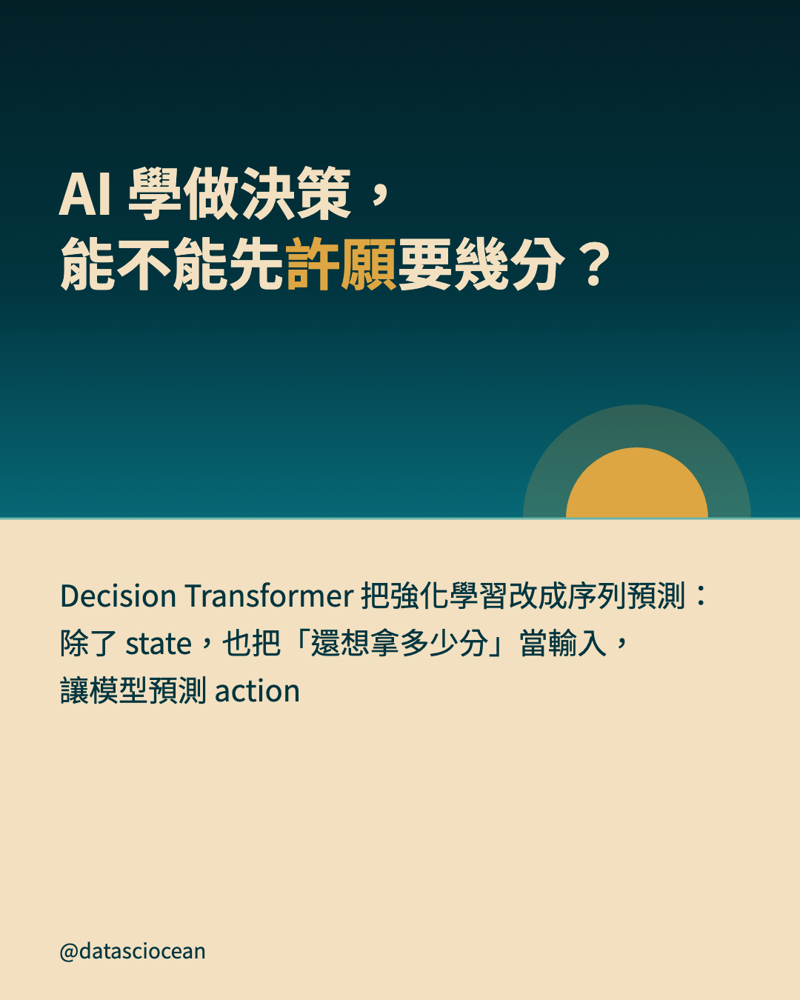
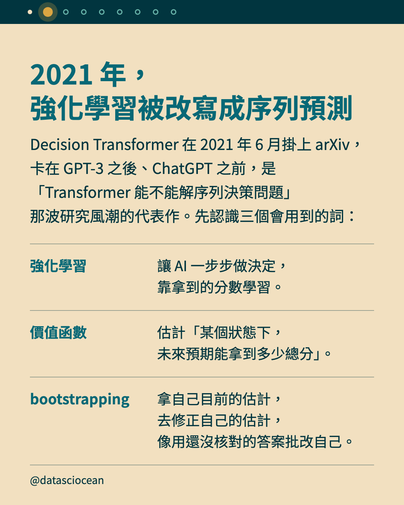
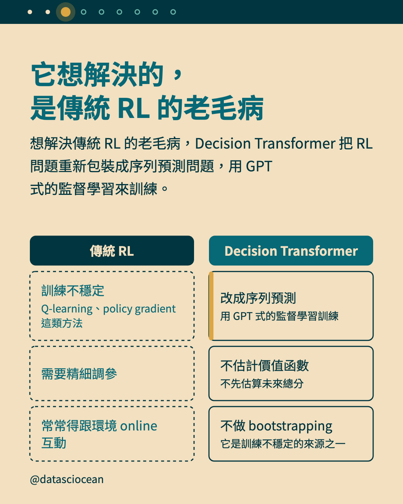
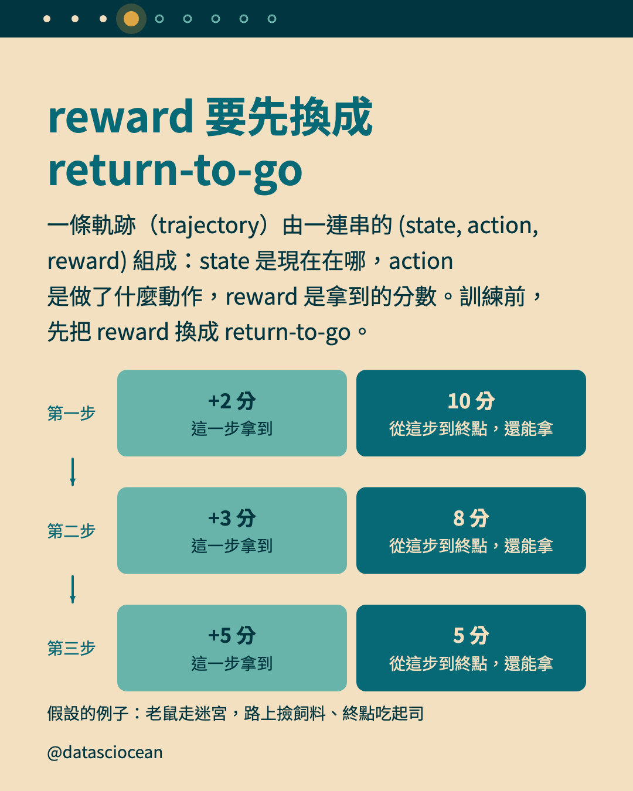
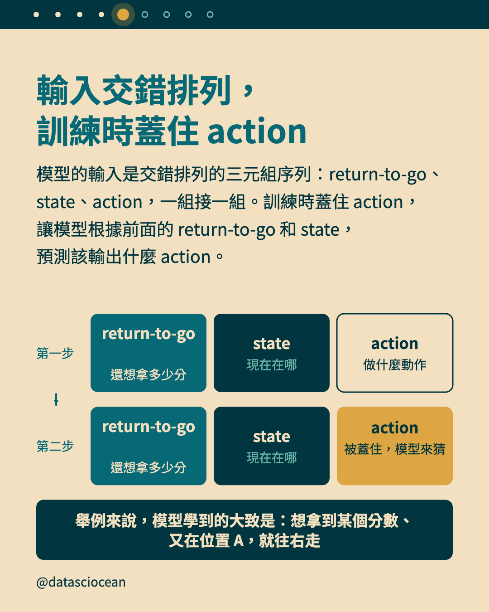
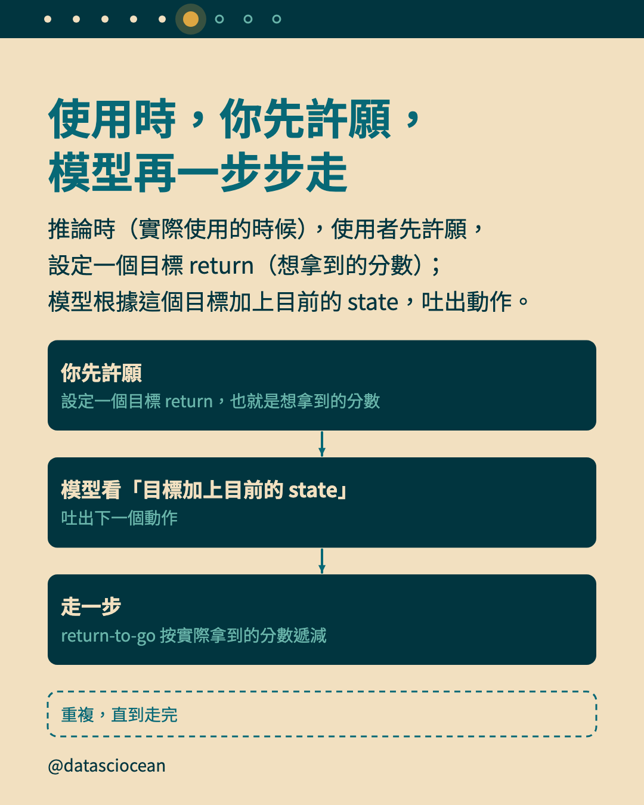
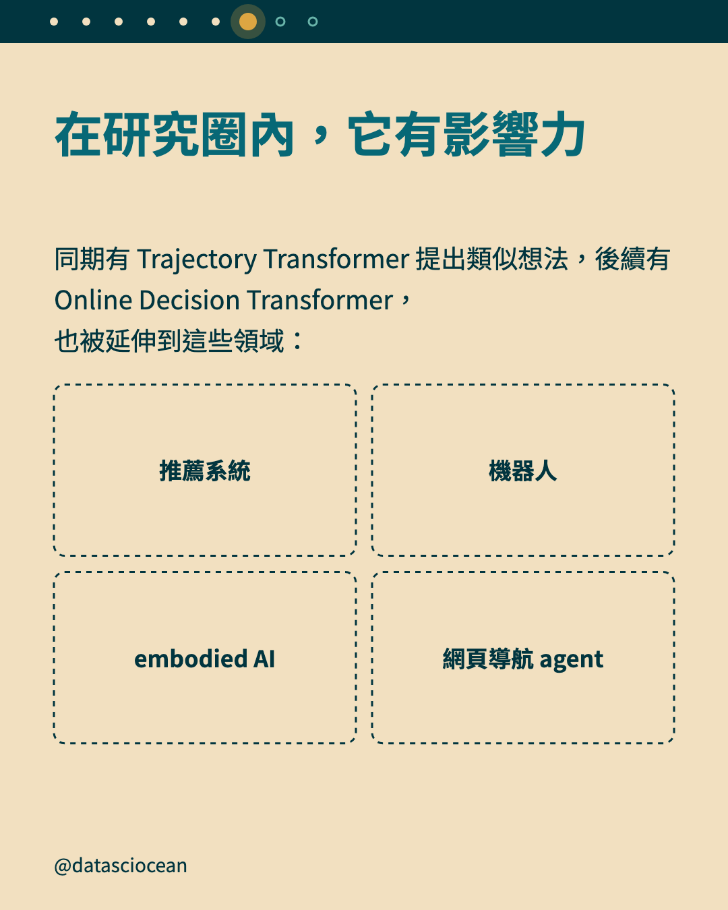
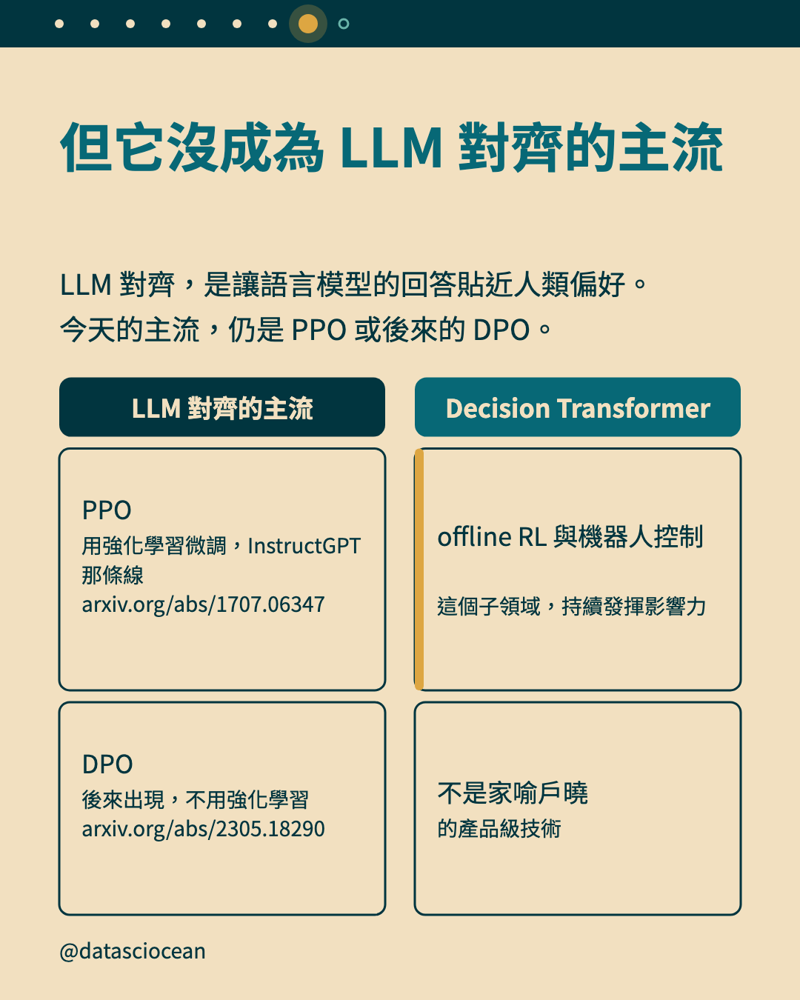
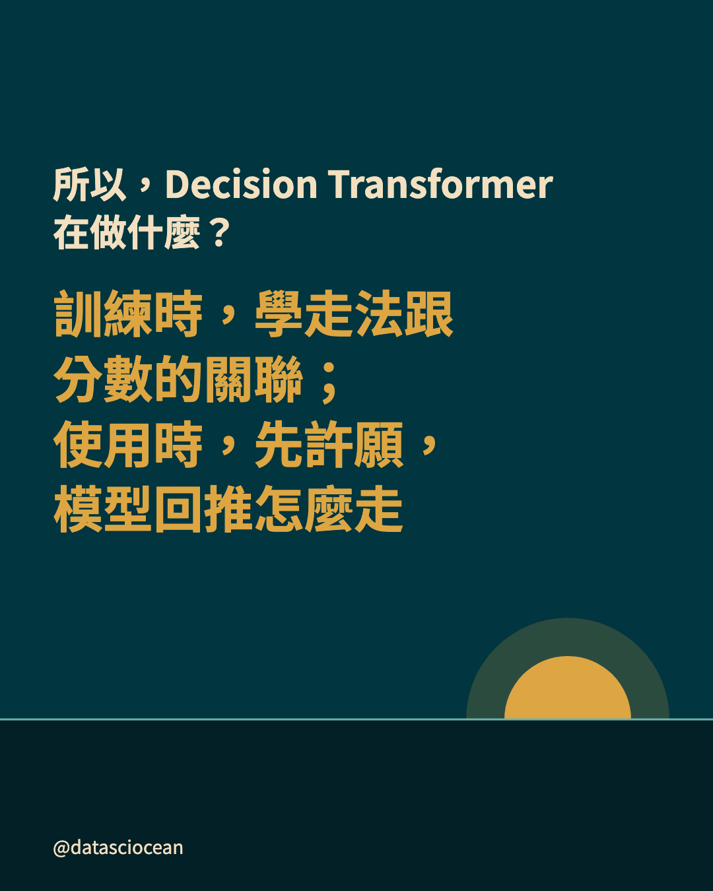

# Threads：Decision Transformer 把強化學習改寫成序列預測：訓練時學「怎麼走與最後拿多少分」的關聯，使用時先設定想要的分數；它的威力在多步決策，單次生成只借得到表層技巧

- 發文方式：**一則輪播貼文**（正文＋全部 9 張圖，順序與 IG 相同），再用一則回覆放連結與系列（連結只放那則回覆）
- 圖檔在 `../ig/`（與 IG 輪播共用同一套）

## 貼文正文（附下方全部圖片）

```text
AI 學做決策，能不能先許願要幾分？

Decision Transformer（2021 年）把強化學習改寫成序列預測，用 GPT 式的監督學習訓練：訓練時，觀察別人怎麼走、最後拿多少分，學會兩者的關聯；使用時，你先設定想要的分數，模型回推該怎麼走。

它想解決傳統強化學習的老毛病：訓練不穩定、需要精細調參，而且常常得跟環境 online 互動（訓練時要不斷取得新資料）。

在研究圈內它有影響力，但沒有成為 LLM 對齊的主流（今天仍然是 PPO 或後來的 DPO）。
```

## 附圖（依序）











## 回覆：連結與系列

```text
Decision Transformer 是什麼？訓練時學「怎麼走」跟「最後拿多少分」的關聯，使用時你先設定想要的分數，模型回推該怎麼走。
```
