# IG 輪播：AI 怎麼決定這題去哪裡查？

- 系列：拆解 UniversalRAG：先問這題該去哪裡查　｜　hook 樣態：讀者疑問　｜　共 13 張，**依頁碼順序上傳**
- 每頁下方的「替代文字」貼到 IG 的替代文字欄；最後的 Caption 整段貼上

## 第 1 頁（封面）

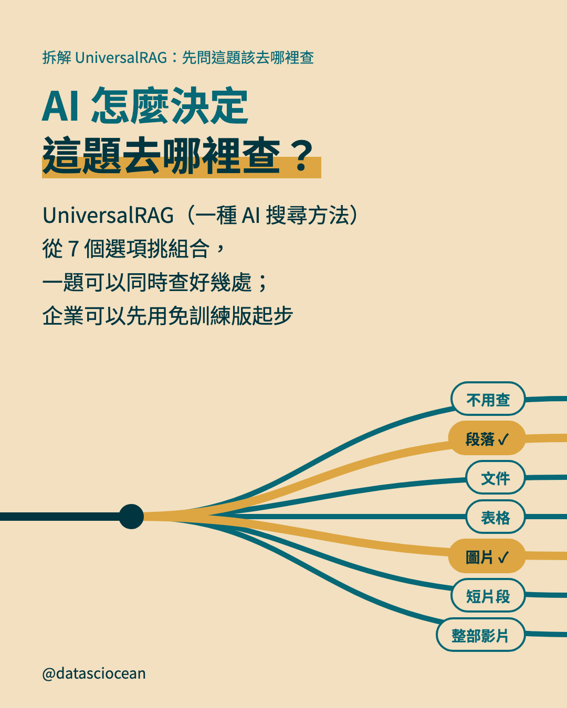

- **主標**：AI 怎麼決定
這題去哪裡查？
- **副標**：UniversalRAG（一種 AI 搜尋方法）從 7 個選項挑組合，
一題可以同時查好幾處；
企業可以先用免訓練版起步
- **替代文字**：AI 怎麼決定
這題去哪裡查？。UniversalRAG（一種 AI 搜尋方法）從 7 個選項挑組合，
一題可以同時查好幾處；
企業可以先用免訓練版起步。岔路通往：不用查、段落 ✓、文件、表格、圖片 ✓、短片段、整部影片

## 第 2 頁（示意圖）

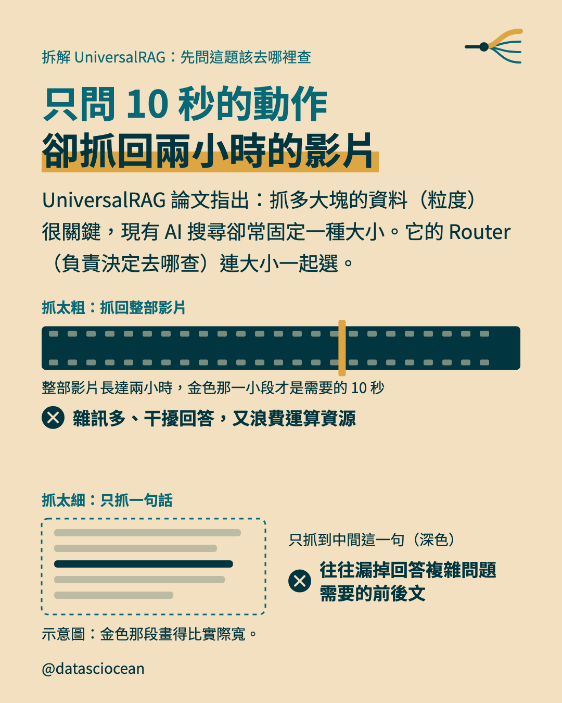

- **主標**：只問 10 秒的動作
卻抓回兩小時的影片
- **補充**：UniversalRAG 論文指出：抓多大塊的資料（粒度）很關鍵，現有 AI 搜尋卻常固定一種大小。它的 Router（負責決定去哪查）連大小一起選。
- **示意圖（grain）上的文字與數字**：整部影片長達兩小時，金色那一小段才是需要的 10 秒｜只抓到中間這一句（深色）｜雜訊多、干擾回答，又浪費運算資源｜往往漏掉回答複雜問題
需要的前後文｜抓太粗：抓回整部影片｜抓太細：只抓一句話
- **示意圖的畫面**：上段一條深色膠捲（整部影片），只有中間一小段是金色（真正需要的那一段，寬度不按比例）；膠捲下一行說明、一個被打叉的下場。下段一段文字（五行淡灰條），只有中間一行是深色（只抓到這一句），右邊一行說明與一個被打叉的下場
- **圖註**：示意圖：金色那段畫得比實際寬。
- **替代文字**：只問 10 秒的動作
卻抓回兩小時的影片。UniversalRAG 論文指出：抓多大塊的資料（粒度）很關鍵，現有 AI 搜尋卻常固定一種大小。它的 Router（負責決定去哪查）連大小一起選。。圖上寫：整部影片長達兩小時，金色那一小段才是需要的 10 秒、只抓到中間這一句（深色）、雜訊多、干擾回答，又浪費運算資源、往往漏掉回答複雜問題
需要的前後文、抓太粗：抓回整部影片、抓太細：只抓一句話

## 第 3 頁（前情回顧）

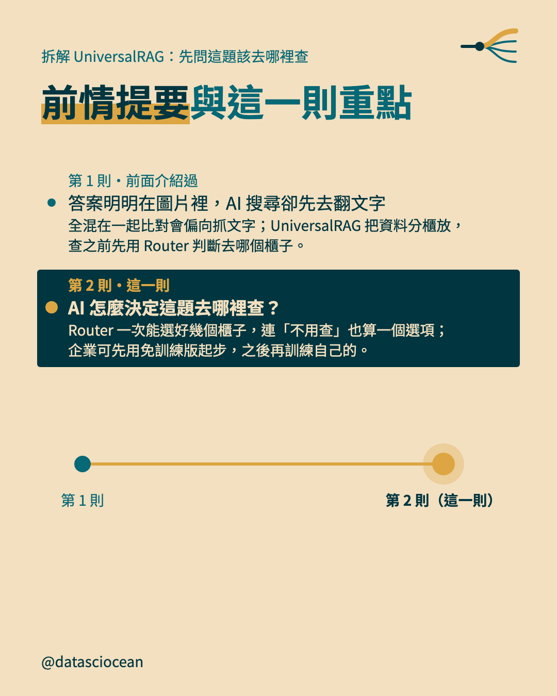

- **主標**：前情提要與這一則重點
- **第 1 則**：答案明明在圖片裡，AI 搜尋卻先去翻文字　全混在一起比對會偏向抓文字；UniversalRAG 把資料分櫃放，查之前先用 Router 判斷去哪個櫃子。
- **第 2 則**：AI 怎麼決定這題去哪裡查？　Router 一次能選好幾個櫃子，連「不用查」也算一個選項；企業可先用免訓練版起步，之後再訓練自己的。
- **替代文字**：前情提要與這一則重點。第 1 則「答案明明在圖片裡，AI 搜尋卻先去翻文字」：全混在一起比對會偏向抓文字；UniversalRAG 把資料分櫃放，查之前先用 Router 判斷去哪個櫃子。；第 2 則「AI 怎麼決定這題去哪裡查？」：Router 一次能選好幾個櫃子，連「不用查」也算一個選項；企業可先用免訓練版起步，之後再訓練自己的。

## 第 4 頁（脈絡）

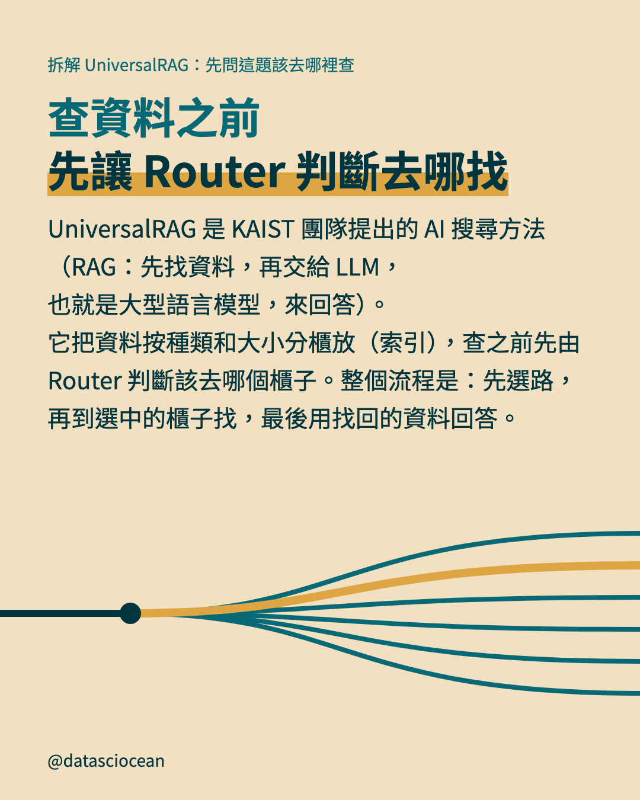

- **主標**：查資料之前
先讓 Router 判斷去哪找
- **補充**：UniversalRAG 是 KAIST 團隊提出的 AI 搜尋方法（RAG：先找資料，再交給 LLM，也就是大型語言模型，來回答）。它把資料按種類和大小分櫃放（索引），查之前先由 Router 判斷該去哪個櫃子。整個流程是：先選路，再到選中的櫃子找，最後用找回的資料回答。
- **替代文字**：查資料之前
先讓 Router 判斷去哪找。UniversalRAG 是 KAIST 團隊提出的 AI 搜尋方法（RAG：先找資料，再交給 LLM，也就是大型語言模型，來回答）。它把資料按種類和大小分櫃放（索引），查之前先由 Router 判斷該去哪個櫃子。整個流程是：先選路，再到選中的櫃子找，最後用找回的資料回答。

## 第 5 頁（示意圖）

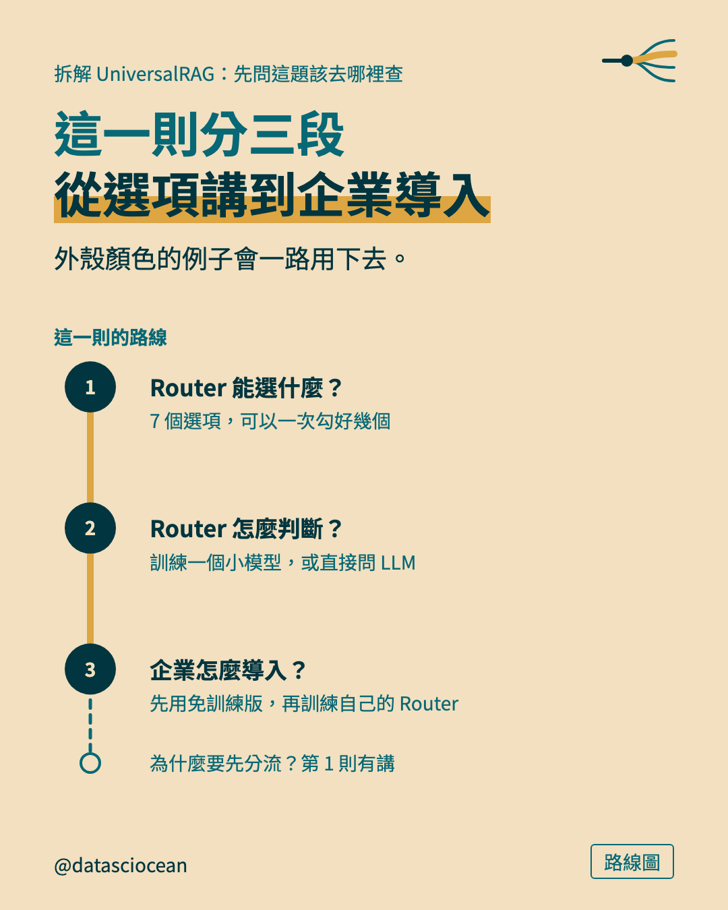

- **小標籤**：路線圖
- **主標**：這一則分三段
從選項講到企業導入
- **補充**：外殼顏色的例子會一路用下去。
- **示意圖（route）上的文字與數字**：Router 能選什麼？｜7 個選項，可以一次勾好幾個｜Router 怎麼判斷？｜訓練一個小模型，或直接問 LLM｜企業怎麼導入？｜先用免訓練版，再訓練自己的 Router｜這一則的路線｜為什麼要先分流？第 1 則有講
- **替代文字**：這一則分三段
從選項講到企業導入。外殼顏色的例子會一路用下去。。圖上寫：Router 能選什麼？、7 個選項，可以一次勾好幾個、Router 怎麼判斷？、訓練一個小模型，或直接問 LLM、企業怎麼導入？、先用免訓練版，再訓練自己的 Router、這一則的路線、為什麼要先分流？第 1 則有講

## 第 6 頁（示意圖）

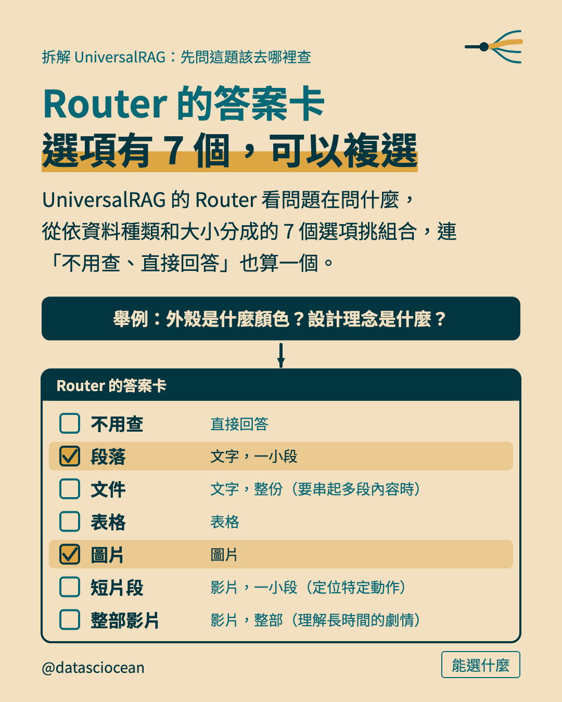

- **小標籤**：能選什麼
- **主標**：Router 的答案卡
選項有 7 個，可以複選
- **補充**：UniversalRAG 的 Router 看問題在問什麼，從依資料種類和大小分成的 7 個選項挑組合，連「不用查、直接回答」也算一個。
- **示意圖（ballot）上的文字與數字**：舉例：外殼是什麼顏色？設計理念是什麼？｜不用查｜直接回答｜段落｜文字，一小段｜文件｜文字，整份（要串起多段內容時）｜表格｜表格｜圖片｜圖片｜短片段｜影片，一小段（定位特定動作）｜整部影片｜影片，整部（理解長時間的劇情）｜Router 的答案卡
- **示意圖的畫面**：一張答案卡：深色抬頭，下面一列一個選項，每列左邊一個方格；打勾的格子是金色、整列墊淡金色；上方可有一個問題框，箭頭指向答案卡
- **替代文字**：Router 的答案卡
選項有 7 個，可以複選。UniversalRAG 的 Router 看問題在問什麼，從依資料種類和大小分成的 7 個選項挑組合，連「不用查、直接回答」也算一個。。圖上寫：舉例：外殼是什麼顏色？設計理念是什麼？、不用查、直接回答、段落、文字，一小段、文件、文字，整份（要串起多段內容時）、表格、表格、圖片、圖片、短片段、影片，一小段（定位特定動作）、整部影片、影片，整部（理解長時間的劇情）、Router 的答案卡

## 第 7 頁（示意圖）

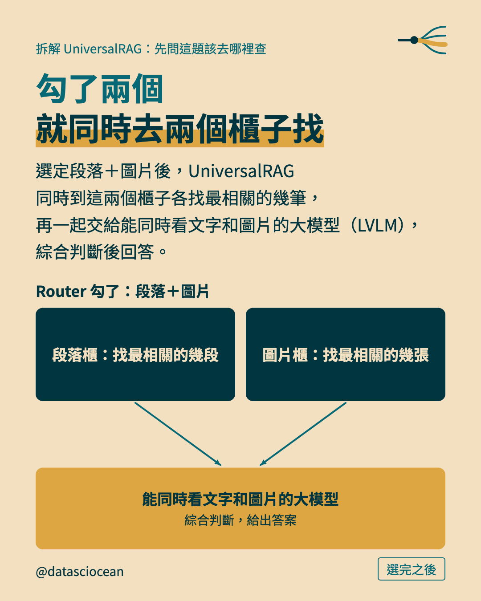

- **小標籤**：選完之後
- **主標**：勾了兩個
就同時去兩個櫃子找
- **補充**：選定段落＋圖片後，UniversalRAG 同時到這兩個櫃子各找最相關的幾筆，再一起交給能同時看文字和圖片的大模型（LVLM），綜合判斷後回答。
- **示意圖（fan）上的文字與數字**：Router 勾了：段落＋圖片｜能同時看文字和圖片的大模型｜綜合判斷，給出答案｜段落櫃：找最相關的幾段｜圖片櫃：找最相關的幾張
- **替代文字**：勾了兩個
就同時去兩個櫃子找。選定段落＋圖片後，UniversalRAG 同時到這兩個櫃子各找最相關的幾筆，再一起交給能同時看文字和圖片的大模型（LVLM），綜合判斷後回答。。圖上寫：Router 勾了：段落＋圖片、能同時看文字和圖片的大模型、綜合判斷，給出答案、段落櫃：找最相關的幾段、圖片櫃：找最相關的幾張

## 第 8 頁（示意圖）

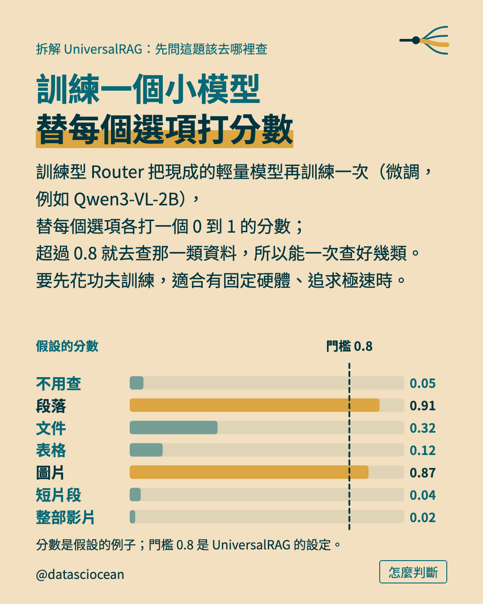

- **小標籤**：怎麼判斷
- **主標**：訓練一個小模型
替每個選項打分數
- **補充**：訓練型 Router 把現成的輕量模型再訓練一次（微調，例如 Qwen3-VL-2B），替每個選項各打一個 0 到 1 的分數；超過 0.8 就去查那一類資料，所以能一次查好幾類。要先花功夫訓練，適合有固定硬體、追求極速時。
- **示意圖（thresh）上的文字與數字**：不用查｜段落｜文件｜表格｜圖片｜短片段｜整部影片｜假設的分數｜0.05｜0.91｜0.32｜0.12｜0.87｜0.04｜0.02｜門檻｜0.8
- **示意圖的畫面**：每個選項一條橫條（長度與分數成正比，軸 0 到 1），一條直的虛線標出門檻；超過門檻的橫條是金色，其餘是半透明藍綠；每條右邊寫分數
- **圖註**：分數是假設的例子；門檻 0.8 是 UniversalRAG 的設定。
- **替代文字**：訓練一個小模型
替每個選項打分數。訓練型 Router 把現成的輕量模型再訓練一次（微調，例如 Qwen3-VL-2B），替每個選項各打一個 0 到 1 的分數；超過 0.8 就去查那一類資料，所以能一次查好幾類。要先花功夫訓練，適合有固定硬體、追求極速時。。圖上寫：不用查、段落、文件、表格、圖片、短片段、整部影片、假設的分數、0.05、0.91、0.32、0.12、0.87、0.04、0.02、門檻、0.8

## 第 9 頁（示意圖）

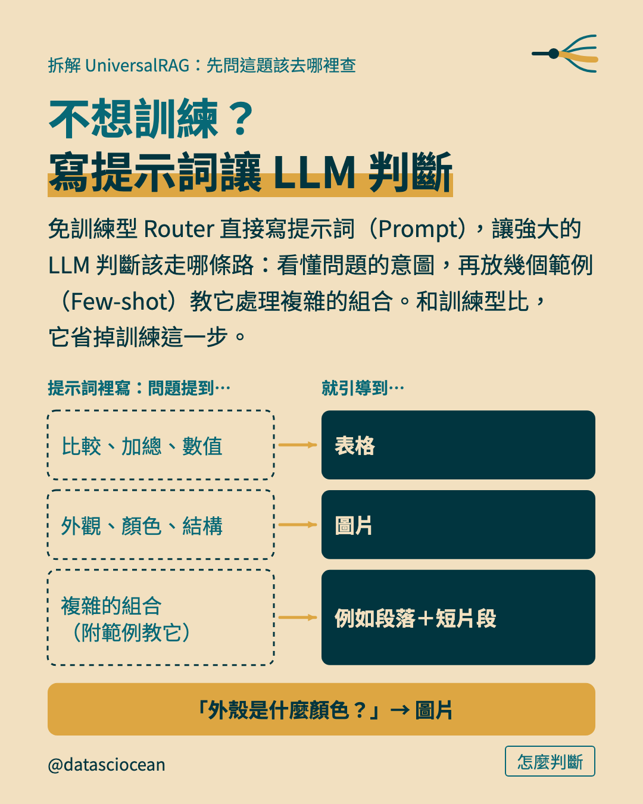

- **小標籤**：怎麼判斷
- **主標**：不想訓練？
寫提示詞讓 LLM 判斷
- **補充**：免訓練型 Router 直接寫提示詞（Prompt），讓強大的 LLM 判斷該走哪條路：看懂問題的意圖，再放幾個範例（Few-shot）教它處理複雜的組合。和訓練型比，它省掉訓練這一步。
- **示意圖（pairs）上的文字與數字**：「外殼是什麼顏色？」→ 圖片｜提示詞裡寫：問題提到…｜就引導到…｜比較、加總、數值｜表格｜外觀、顏色、結構｜圖片｜複雜的組合（附範例教它）｜例如段落＋短片段
- **替代文字**：不想訓練？
寫提示詞讓 LLM 判斷。免訓練型 Router 直接寫提示詞（Prompt），讓強大的 LLM 判斷該走哪條路：看懂問題的意圖，再放幾個範例（Few-shot）教它處理複雜的組合。和訓練型比，它省掉訓練這一步。。圖上寫：「外殼是什麼顏色？」→ 圖片、提示詞裡寫：問題提到…、就引導到…、比較、加總、數值、表格、外觀、顏色、結構、圖片、複雜的組合（附範例教它）、例如段落＋短片段

## 第 10 頁（示意圖）

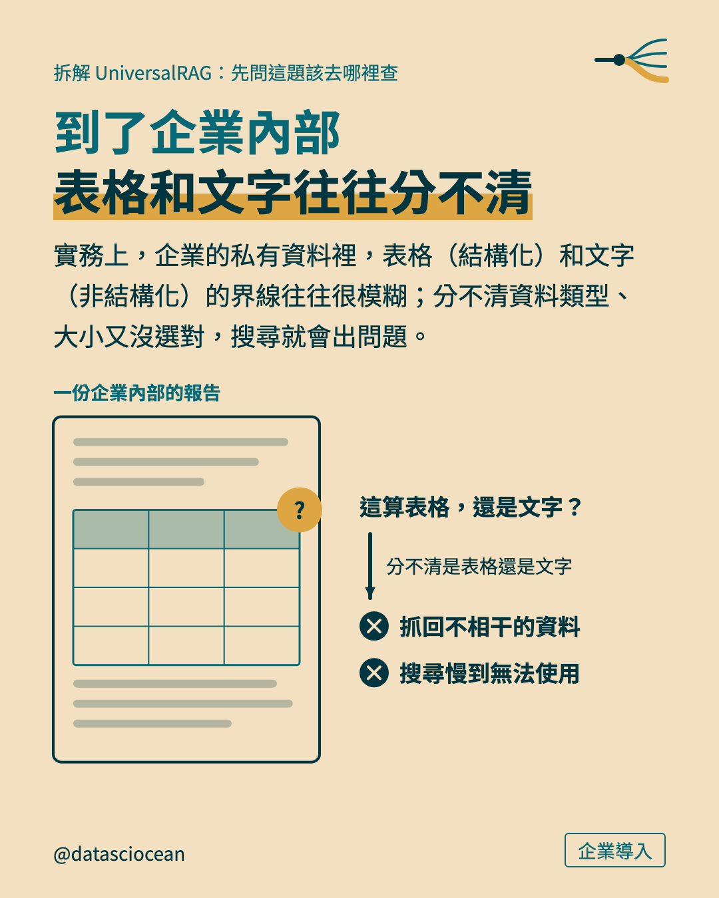

- **小標籤**：企業導入
- **主標**：到了企業內部
表格和文字往往分不清
- **補充**：實務上，企業的私有資料裡，表格（結構化）和文字（非結構化）的界線往往很模糊；分不清資料類型、大小又沒選對，搜尋就會出問題。
- **示意圖（murky）上的文字與數字**：分不清是表格還是文字｜抓回不相干的資料｜搜尋慢到無法使用｜一份企業內部的報告｜這算表格，還是文字？
- **示意圖的畫面**：左邊一頁報告：上下是文字灰條、中間夾一張小表格，表格角落一個金色問號；右邊一句問話，箭頭往下指向兩個被打叉的下場
- **替代文字**：到了企業內部
表格和文字往往分不清。實務上，企業的私有資料裡，表格（結構化）和文字（非結構化）的界線往往很模糊；分不清資料類型、大小又沒選對，搜尋就會出問題。。圖上寫：分不清是表格還是文字、抓回不相干的資料、搜尋慢到無法使用、一份企業內部的報告、這算表格，還是文字？

## 第 11 頁（示意圖）

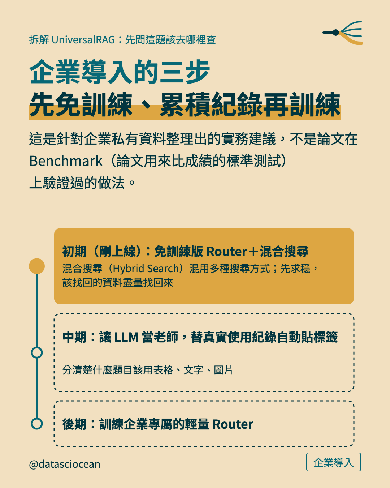

- **小標籤**：企業導入
- **主標**：企業導入的三步
先免訓練、累積紀錄再訓練
- **補充**：這是針對企業私有資料整理出的實務建議，不是論文在 Benchmark（論文用來比成績的標準測試）上驗證過的做法。
- **示意圖（stops）上的文字與數字**：初期（剛上線）：免訓練版 Router＋混合搜尋｜混合搜尋（Hybrid Search）混用多種搜尋方式；先求穩，該找回的資料盡量找回來｜中期：讓 LLM 當老師，替真實使用紀錄自動貼標籤｜分清楚什麼題目該用表格、文字、圖片｜後期：訓練企業專屬的輕量 Router
- **替代文字**：企業導入的三步
先免訓練、累積紀錄再訓練。這是針對企業私有資料整理出的實務建議，不是論文在 Benchmark（論文用來比成績的標準測試）上驗證過的做法。。圖上寫：初期（剛上線）：免訓練版 Router＋混合搜尋、混合搜尋（Hybrid Search）混用多種搜尋方式；先求穩，該找回的資料盡量找回來、中期：讓 LLM 當老師，替真實使用紀錄自動貼標籤、分清楚什麼題目該用表格、文字、圖片、後期：訓練企業專屬的輕量 Router

## 第 12 頁（帶走）

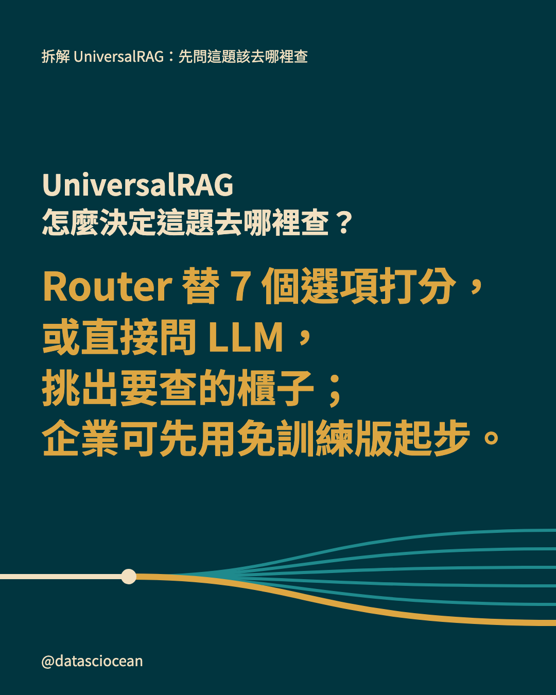

- **先問的問題**：UniversalRAG 怎麼決定這題去哪裡查？
- **一句話**：Router 替 7 個選項打分，
或直接問 LLM，挑出要查的櫃子；
企業可先用免訓練版起步。
- **替代文字**：UniversalRAG 怎麼決定這題去哪裡查？　Router 替 7 個選項打分，
或直接問 LLM，挑出要查的櫃子；
企業可先用免訓練版起步。

## 第 13 頁（系列地圖）

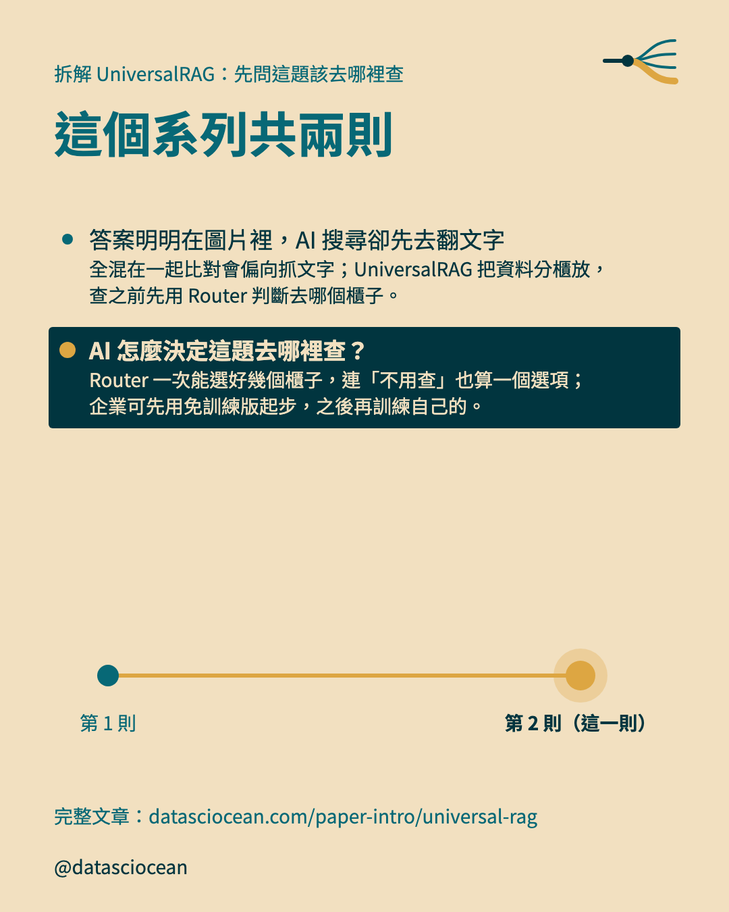

- **主標**：這個系列共兩則
- **導流行**：完整文章：datasciocean.com/paper-intro/universal-rag
- **第 1 則**：答案明明在圖片裡，AI 搜尋卻先去翻文字　全混在一起比對會偏向抓文字；UniversalRAG 把資料分櫃放，查之前先用 Router 判斷去哪個櫃子。
- **第 2 則**：AI 怎麼決定這題去哪裡查？　Router 一次能選好幾個櫃子，連「不用查」也算一個選項；企業可先用免訓練版起步，之後再訓練自己的。
- **替代文字**：這個系列共兩則。答案明明在圖片裡，AI 搜尋卻先去翻文字：全混在一起比對會偏向抓文字；UniversalRAG 把資料分櫃放，查之前先用 Router 判斷去哪個櫃子。、AI 怎麼決定這題去哪裡查？：Router 一次能選好幾個櫃子，連「不用查」也算一個選項；企業可先用免訓練版起步，之後再訓練自己的。

## Caption（整段貼到 IG）

```text
只問 10 秒的動作，卻抓回兩小時影片怎麼辦？UniversalRAG 的 Router 這樣選

・只問 10 秒的動作，卻抓回兩小時的影片
・能選什麼：Router 的答案卡，選項有 7 個，可以複選
・選完之後：勾了兩個，就同時去兩個櫃子找
・怎麼判斷：訓練一個小模型，替每個選項打分數
・不想訓練？寫提示詞讓 LLM 判斷
・企業導入：到了企業內部，表格和文字往往分不清
・企業導入的三步，先免訓練、累積紀錄再訓練

完整文章在 datasciocean.com，搜「UniversalRAG」

#UniversalRAG #多模態RAG #RAG
```
