# Threads：AI 怎麼決定這題去哪裡查？

- 發文方式：**一則輪播貼文**（正文＋全部 13 張圖，順序與 IG 相同），再用一則回覆放連結與系列（連結只放那則回覆）
- 圖檔在 `../ig/`（與 IG 輪播共用同一套）

## 貼文正文（附下方全部圖片）

```text
假設只問一個 10 秒的動作，系統卻抓回整部兩小時的影片：這就是資料抓得太粗。

UniversalRAG 是一種 AI 搜尋方法：它把文字、表格、圖片、影片按種類和大小分櫃放，查之前先讓 Router（負責決定去哪查）從 7 個選項挑組合，而且可以複選，連「不用查、直接回答」也算一個。

Router 有兩種做法：訓練一個輕量模型替每個選項打分數，超過 0.8 就去查那一類；或者不訓練，直接寫提示詞讓 LLM 判斷。企業可以先用免訓練版起步，累積真實使用紀錄後再訓練自己的 Router；這是針對企業資料的實務建議，不是論文在 Benchmark（論文用來比成績的標準測試）上驗證過的做法。細節看圖。

這是 UniversalRAG 系列的第 2 則；為什麼要先分流，在這個系列的第 1 則。
```

## 附圖（依序）

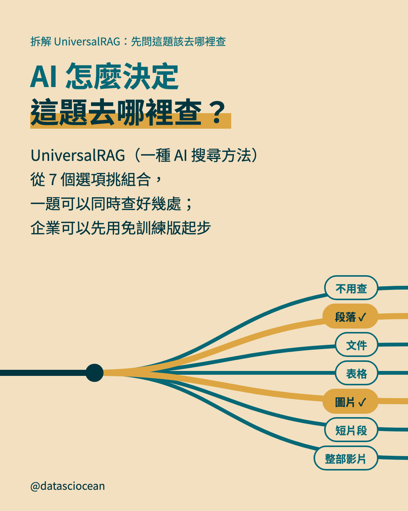
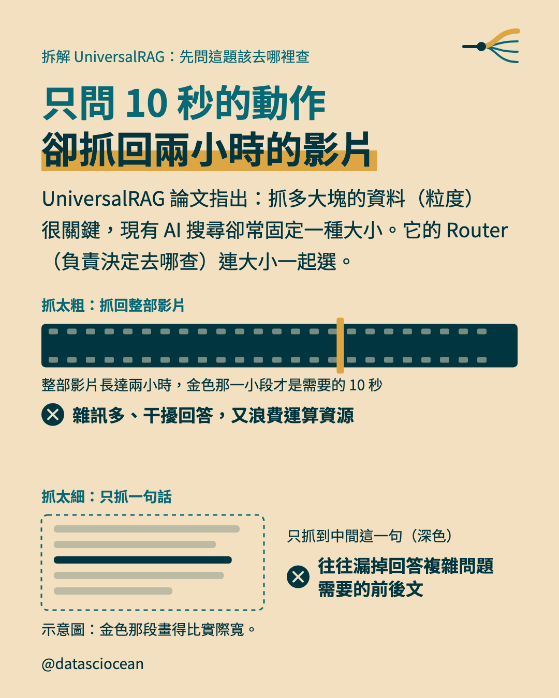
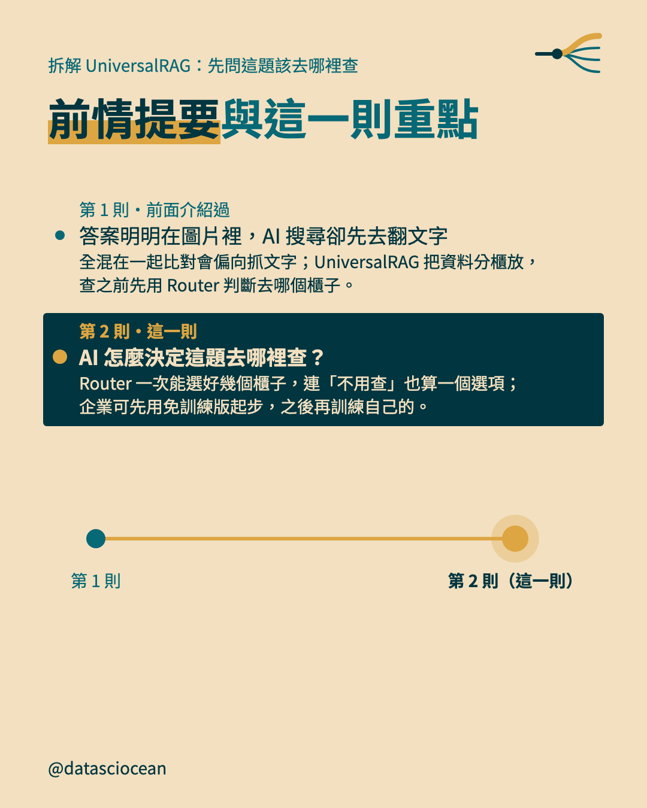
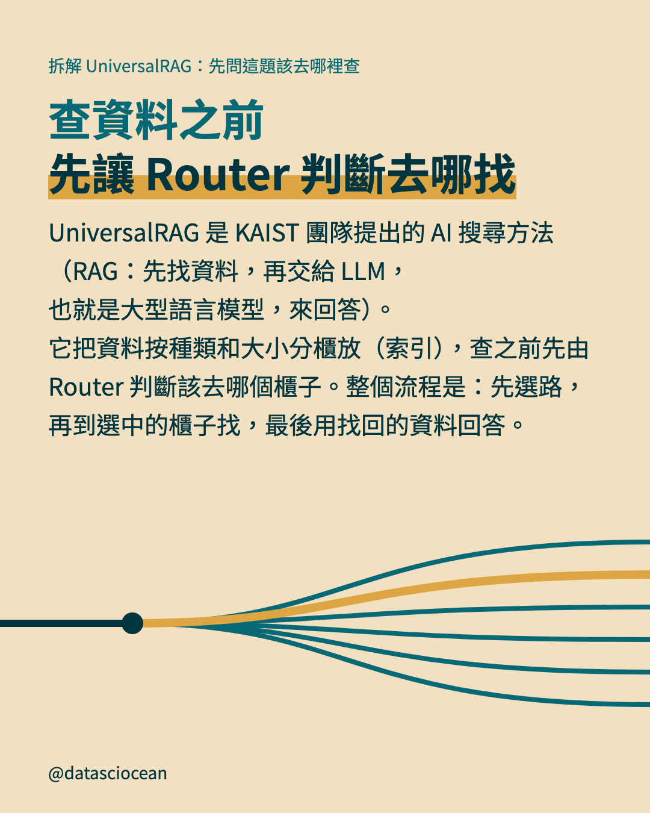
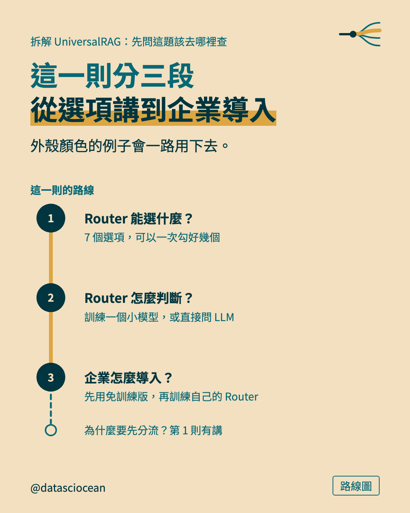
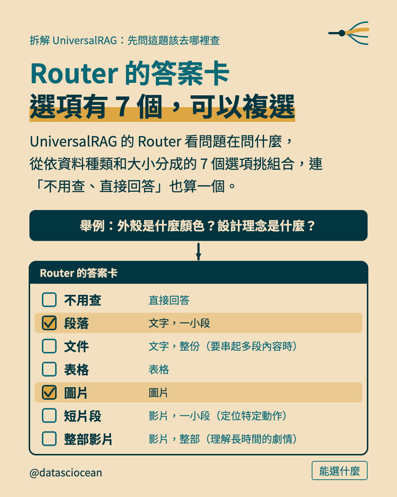
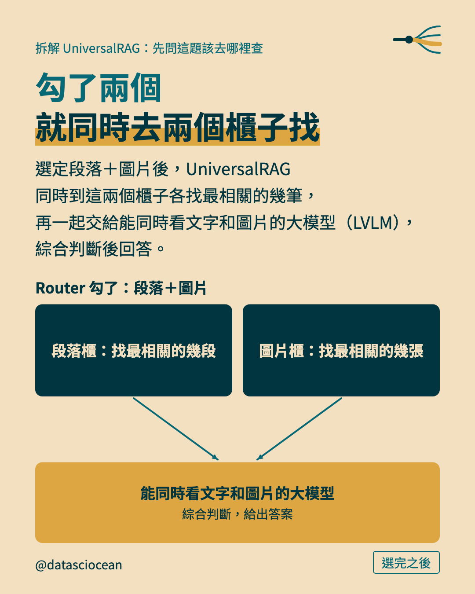
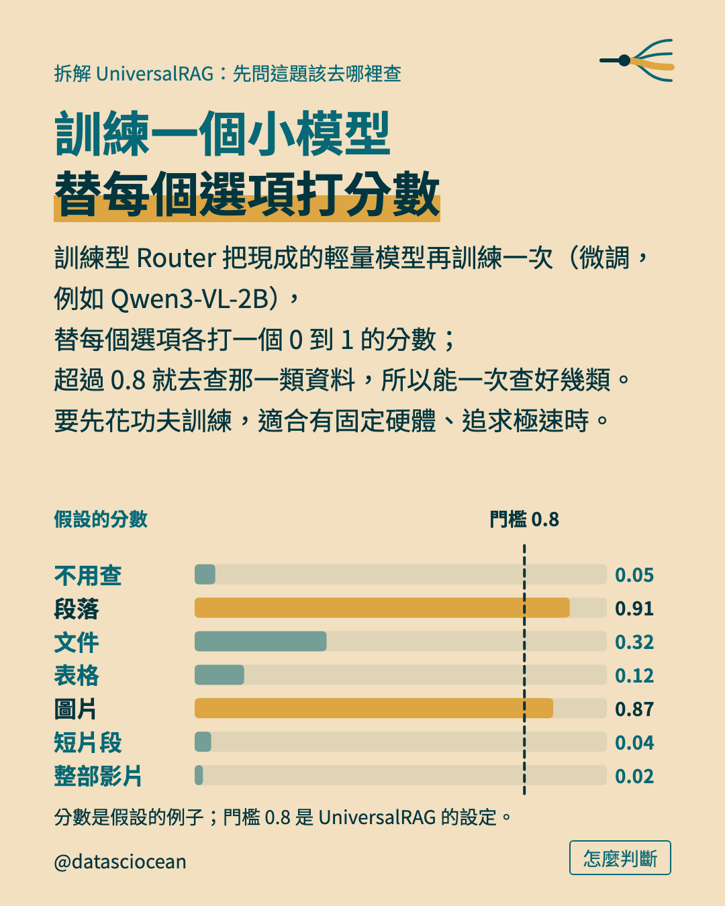
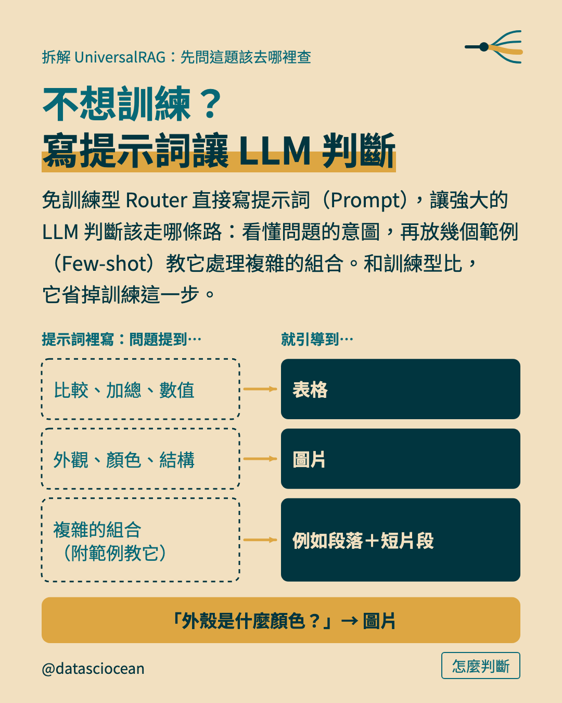
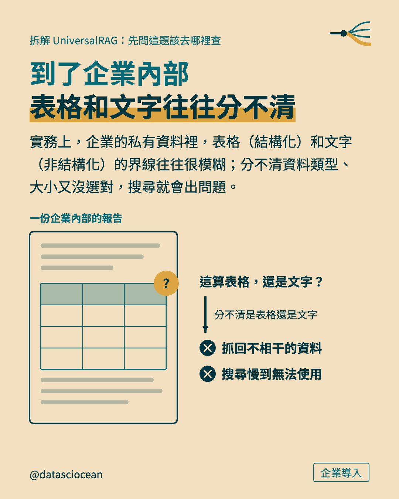
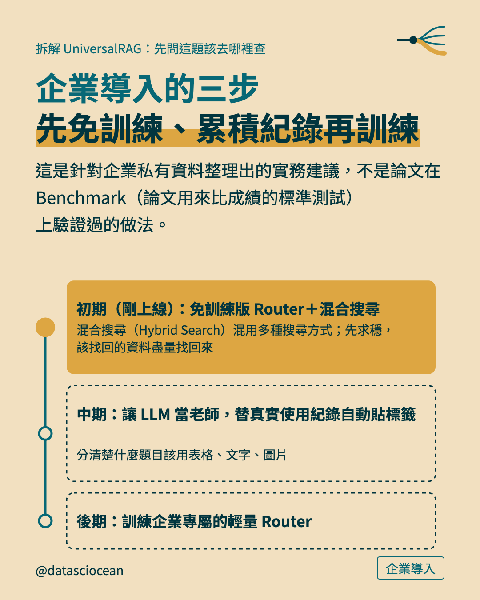
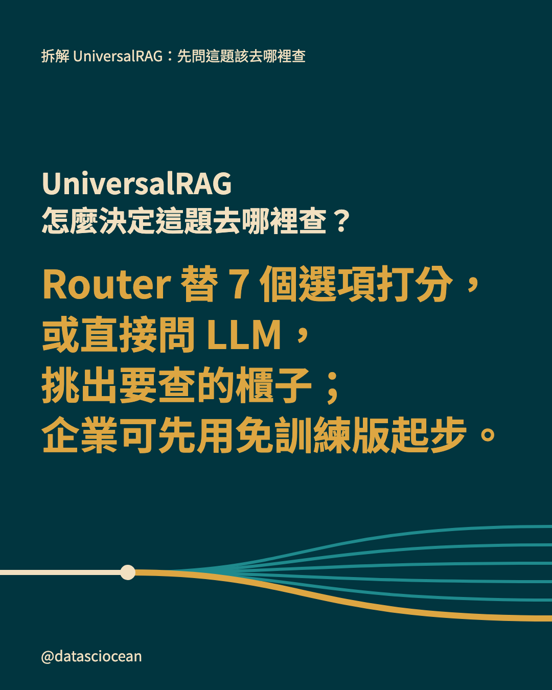
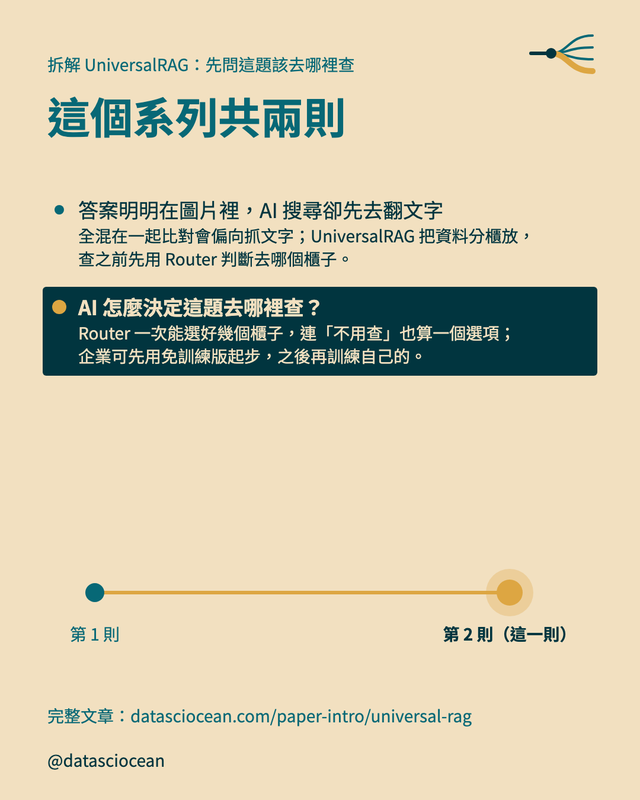

## 回覆：連結與系列

```text
UniversalRAG 的 Router：從 7 個選項挑組合、可以複選；企業可以先用免訓練版起步，累積使用紀錄再訓練自己的 Router。
文章：datasciocean.com/paper-intro/universal-rag
同系列：答案明明在圖片裡，AI 搜尋卻先去翻文字
https://www.threads.com/@datasciocean/post/DfipBuME42W
```
