# IG 輪播：答案明明在圖片裡，AI 搜尋卻先去翻文字

- 系列：拆解 UniversalRAG：先問這題該去哪裡查　｜　hook 樣態：情境痛點　｜　共 12 張，**依頁碼順序上傳**
- 每頁下方的「替代文字」貼到 IG 的替代文字欄；最後的 Caption 整段貼上

## 第 1 頁（封面）

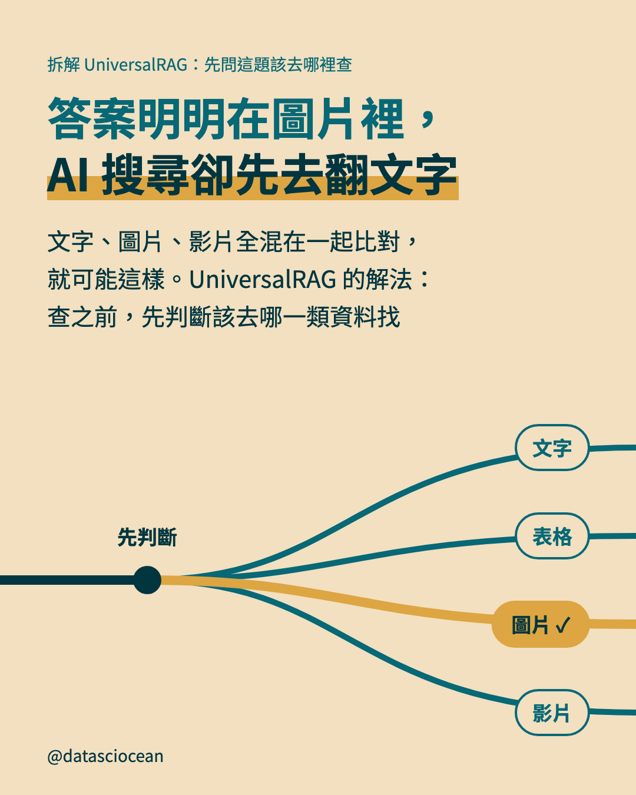

- **主標**：答案明明在圖片裡，
AI 搜尋卻先去翻文字
- **副標**：文字、圖片、影片全混在一起比對，
就可能這樣。UniversalRAG 的解法：
查之前，先判斷該去哪一類資料找
- **替代文字**：答案明明在圖片裡，
AI 搜尋卻先去翻文字。文字、圖片、影片全混在一起比對，
就可能這樣。UniversalRAG 的解法：
查之前，先判斷該去哪一類資料找。岔路通往：文字、表格、圖片 ✓、影片（岔口寫著「先判斷」）

## 第 2 頁（示意圖）

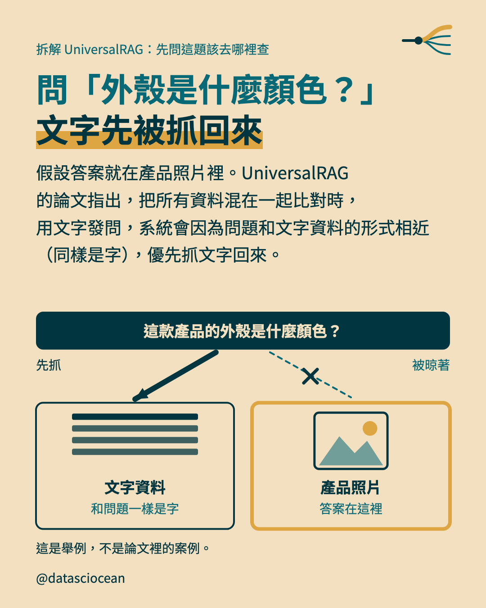

- **主標**：問「外殼是什麼顏色？」
文字先被抓回來
- **補充**：假設答案就在產品照片裡。UniversalRAG 的論文指出，把所有資料混在一起比對時，用文字發問，系統會因為問題和文字資料的形式相近（同樣是字），優先抓文字回來。
- **示意圖（magnet）上的文字與數字**：這款產品的外殼是什麼顏色？｜文字資料｜和問題一樣是字｜產品照片｜答案在這裡｜先抓｜被晾著
- **圖註**：這是舉例，不是論文裡的案例。
- **替代文字**：問「外殼是什麼顏色？」
文字先被抓回來。假設答案就在產品照片裡。UniversalRAG 的論文指出，把所有資料混在一起比對時，用文字發問，系統會因為問題和文字資料的形式相近（同樣是字），優先抓文字回來。。圖上寫：這款產品的外殼是什麼顏色？、文字資料、和問題一樣是字、產品照片、答案在這裡、先抓、被晾著

## 第 3 頁（脈絡）

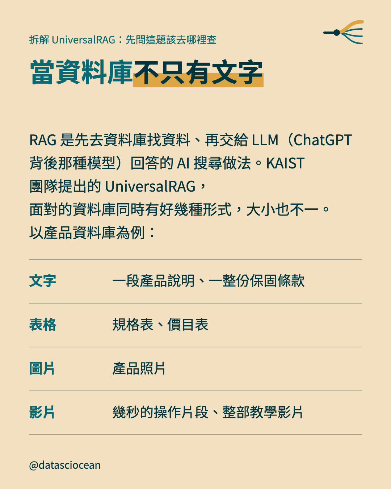

- **主標**：當資料庫不只有文字
- **補充**：RAG 是先去資料庫找資料、再交給 LLM（ChatGPT 背後那種模型）回答的 AI 搜尋做法。KAIST 團隊提出的 UniversalRAG，面對的資料庫同時有好幾種形式，大小也不一。以產品資料庫為例：
- **表列**：文字｜一段產品說明、一整份保固條款
- **表列**：表格｜規格表、價目表
- **表列**：圖片｜產品照片
- **表列**：影片｜幾秒的操作片段、整部教學影片
- **替代文字**：當資料庫不只有文字。RAG 是先去資料庫找資料、再交給 LLM（ChatGPT 背後那種模型）回答的 AI 搜尋做法。KAIST 團隊提出的 UniversalRAG，面對的資料庫同時有好幾種形式，大小也不一。以產品資料庫為例：

## 第 4 頁（示意圖）

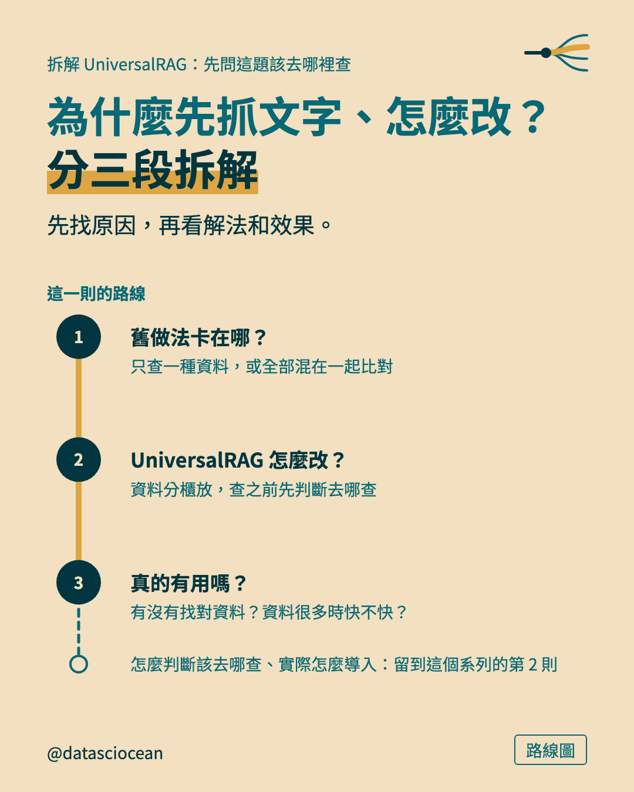

- **小標籤**：路線圖
- **主標**：為什麼先抓文字、怎麼改？
分三段拆解
- **補充**：先找原因，再看解法和效果。
- **示意圖（route）上的文字與數字**：舊做法卡在哪？｜只查一種資料，或全部混在一起比對｜UniversalRAG 怎麼改？｜資料分櫃放，查之前先判斷去哪查｜真的有用嗎？｜有沒有找對資料？資料很多時快不快？｜這一則的路線｜怎麼判斷該去哪查、實際怎麼導入：留到這個系列的第 2 則
- **替代文字**：為什麼先抓文字、怎麼改？
分三段拆解。先找原因，再看解法和效果。。圖上寫：舊做法卡在哪？、只查一種資料，或全部混在一起比對、UniversalRAG 怎麼改？、資料分櫃放，查之前先判斷去哪查、真的有用嗎？、有沒有找對資料？資料很多時快不快？、這一則的路線、怎麼判斷該去哪查、實際怎麼導入：留到這個系列的第 2 則

## 第 5 頁（示意圖）

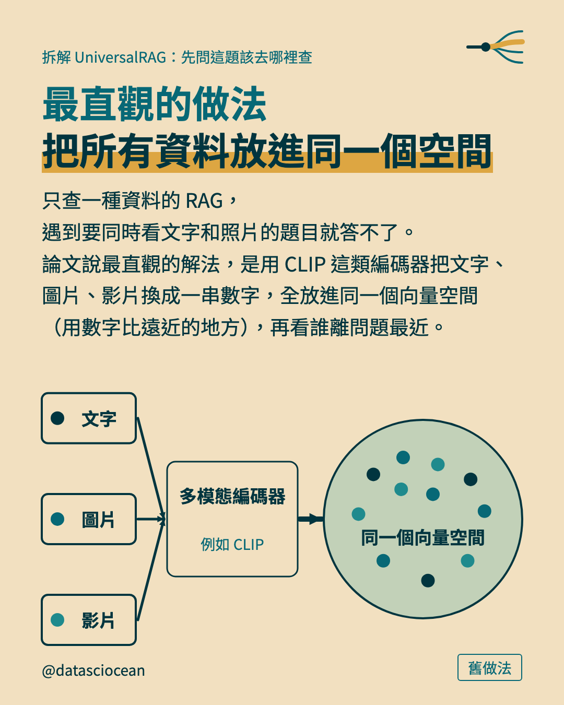

- **小標籤**：舊做法
- **主標**：最直觀的做法
把所有資料放進同一個空間
- **補充**：只查一種資料的 RAG，遇到要同時看文字和照片的題目就答不了。論文說最直觀的解法，是用 CLIP 這類編碼器把文字、圖片、影片換成一串數字，全放進同一個向量空間（用數字比遠近的地方），再看誰離問題最近。
- **示意圖（merge）上的文字與數字**：多模態編碼器｜例如 CLIP｜同一個向量空間｜文字｜圖片｜影片
- **替代文字**：最直觀的做法
把所有資料放進同一個空間。只查一種資料的 RAG，遇到要同時看文字和照片的題目就答不了。論文說最直觀的解法，是用 CLIP 這類編碼器把文字、圖片、影片換成一串數字，全放進同一個向量空間（用數字比遠近的地方），再看誰離問題最近。。圖上寫：多模態編碼器、例如 CLIP、同一個向量空間、文字、圖片、影片

## 第 6 頁（示意圖）

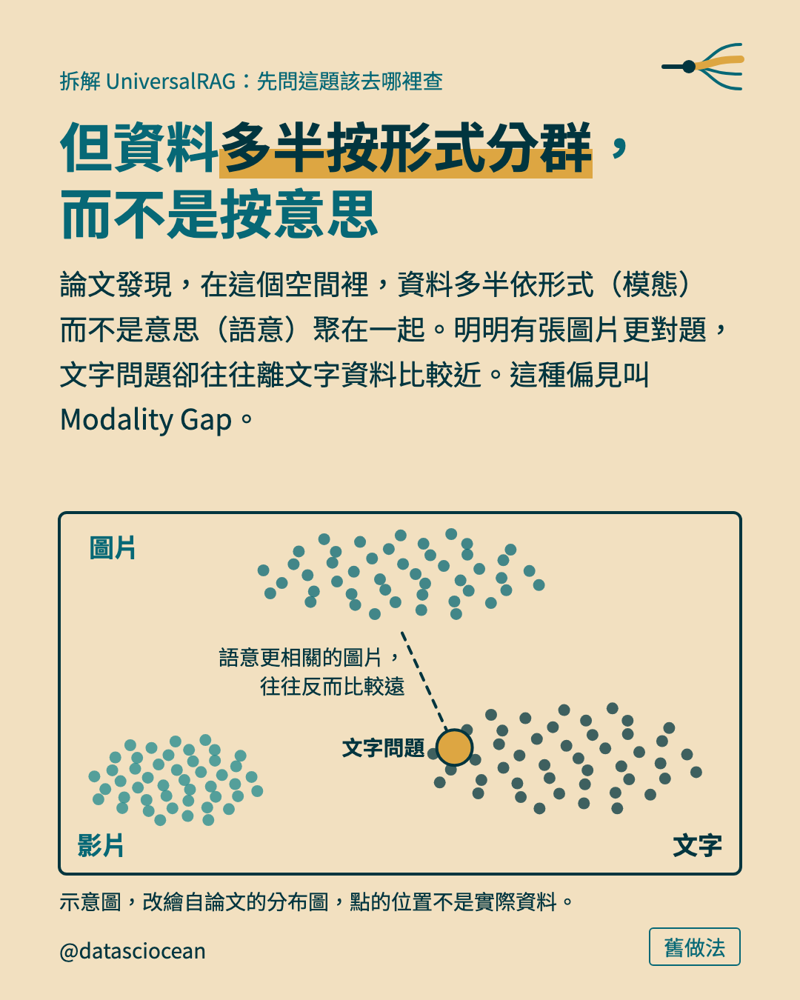

- **小標籤**：舊做法
- **主標**：但資料多半按形式分群，
而不是按意思
- **補充**：論文發現，在這個空間裡，資料多半依形式（模態）而不是意思（語意）聚在一起。明明有張圖片更對題，文字問題卻往往離文字資料比較近。這種偏見叫 Modality Gap。
- **示意圖（clusters）上的文字與數字**：文字問題｜語意更相關的圖片，往往反而比較遠｜圖片｜影片｜文字
- **圖註**：示意圖，改繪自論文的分布圖，點的位置不是實際資料。
- **替代文字**：但資料多半按形式分群，
而不是按意思。論文發現，在這個空間裡，資料多半依形式（模態）而不是意思（語意）聚在一起。明明有張圖片更對題，文字問題卻往往離文字資料比較近。這種偏見叫 Modality Gap。。圖上寫：文字問題、語意更相關的圖片，往往反而比較遠、圖片、影片、文字

## 第 7 頁（示意圖）

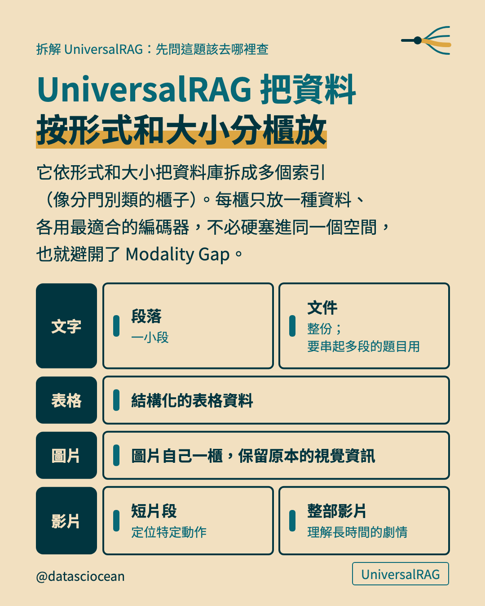

- **小標籤**：UniversalRAG
- **主標**：UniversalRAG 把資料
按形式和大小分櫃放
- **補充**：它依形式和大小把資料庫拆成多個索引（像分門別類的櫃子）。每櫃只放一種資料、各用最適合的編碼器，不必硬塞進同一個空間，也就避開了 Modality Gap。
- **示意圖（shelves）上的文字與數字**：文字｜段落｜一小段｜文件｜整份；要串起多段的題目用｜表格｜結構化的表格資料｜圖片｜圖片自己一櫃，保留原本的視覺資訊｜影片｜短片段｜定位特定動作｜整部影片｜理解長時間的劇情
- **替代文字**：UniversalRAG 把資料
按形式和大小分櫃放。它依形式和大小把資料庫拆成多個索引（像分門別類的櫃子）。每櫃只放一種資料、各用最適合的編碼器，不必硬塞進同一個空間，也就避開了 Modality Gap。。圖上寫：文字、段落、一小段、文件、整份；要串起多段的題目用、表格、結構化的表格資料、圖片、圖片自己一櫃，保留原本的視覺資訊、影片、短片段、定位特定動作、整部影片、理解長時間的劇情

## 第 8 頁（示意圖）

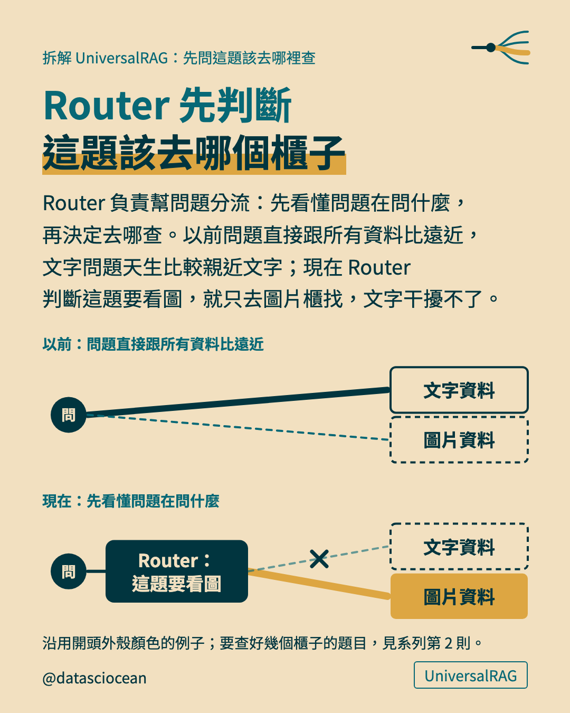

- **小標籤**：UniversalRAG
- **主標**：Router 先判斷
這題該去哪個櫃子
- **補充**：Router 負責幫問題分流：先看懂問題在問什麼，再決定去哪查。以前問題直接跟所有資料比遠近，文字問題天生比較親近文字；現在 Router 判斷這題要看圖，就只去圖片櫃找，文字干擾不了。
- **示意圖（duel）上的文字與數字**：文字資料｜圖片資料｜Router：這題要看圖｜以前：問題直接跟所有資料比遠近｜現在：先看懂問題在問什麼
- **圖註**：沿用開頭外殼顏色的例子；要查好幾個櫃子的題目，見系列第 2 則。
- **替代文字**：Router 先判斷
這題該去哪個櫃子。Router 負責幫問題分流：先看懂問題在問什麼，再決定去哪查。以前問題直接跟所有資料比遠近，文字問題天生比較親近文字；現在 Router 判斷這題要看圖，就只去圖片櫃找，文字干擾不了。。圖上寫：文字資料、圖片資料、Router：這題要看圖、以前：問題直接跟所有資料比遠近、現在：先看懂問題在問什麼

## 第 9 頁（示意圖）

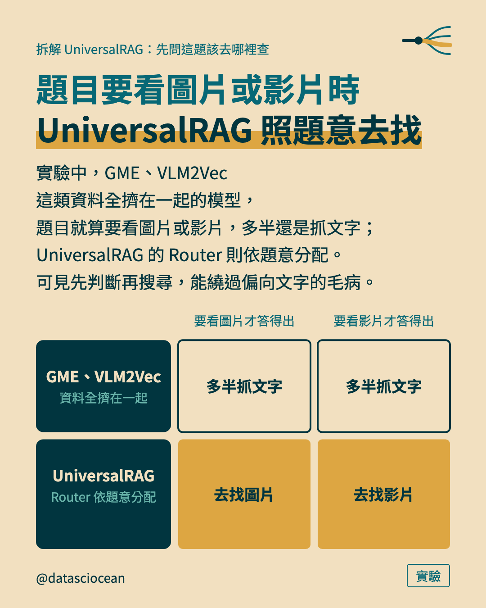

- **小標籤**：實驗
- **主標**：題目要看圖片或影片時
UniversalRAG 照題意去找
- **補充**：實驗中，GME、VLM2Vec 這類資料全擠在一起的模型，題目就算要看圖片或影片，多半還是抓文字；UniversalRAG 的 Router 則依題意分配。可見先判斷再搜尋，能繞過偏向文字的毛病。
- **示意圖（matrix）上的文字與數字**：GME、VLM2Vec｜資料全擠在一起｜UniversalRAG｜Router 依題意分配｜多半抓文字｜多半抓文字｜去找圖片｜去找影片｜要看圖片才答得出｜要看影片才答得出
- **替代文字**：題目要看圖片或影片時
UniversalRAG 照題意去找。實驗中，GME、VLM2Vec 這類資料全擠在一起的模型，題目就算要看圖片或影片，多半還是抓文字；UniversalRAG 的 Router 則依題意分配。可見先判斷再搜尋，能繞過偏向文字的毛病。。圖上寫：GME、VLM2Vec、資料全擠在一起、UniversalRAG、Router 依題意分配、多半抓文字、多半抓文字、去找圖片、去找影片、要看圖片才答得出、要看影片才答得出

## 第 10 頁（示意圖）

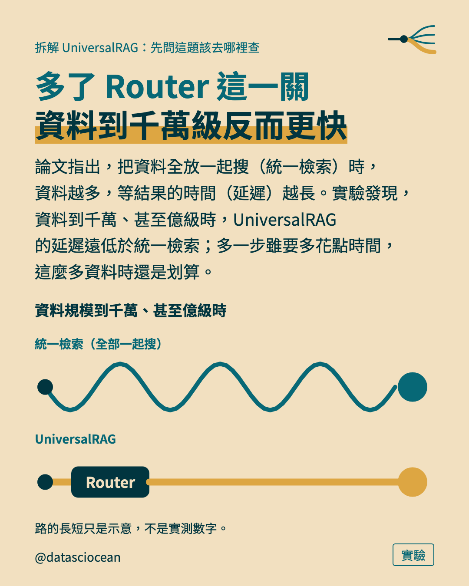

- **小標籤**：實驗
- **主標**：多了 Router 這一關
資料到千萬級反而更快
- **補充**：論文指出，把資料全放一起搜（統一檢索）時，資料越多，等結果的時間（延遲）越長。實驗發現，資料到千萬、甚至億級時，UniversalRAG 的延遲遠低於統一檢索；多一步雖要多花點時間，這麼多資料時還是划算。
- **示意圖（race）上的文字與數字**：資料規模到千萬、甚至億級時｜Router｜統一檢索（全部一起搜）｜UniversalRAG
- **圖註**：路的長短只是示意，不是實測數字。
- **替代文字**：多了 Router 這一關
資料到千萬級反而更快。論文指出，把資料全放一起搜（統一檢索）時，資料越多，等結果的時間（延遲）越長。實驗發現，資料到千萬、甚至億級時，UniversalRAG 的延遲遠低於統一檢索；多一步雖要多花點時間，這麼多資料時還是划算。。圖上寫：資料規模到千萬、甚至億級時、Router、統一檢索（全部一起搜）、UniversalRAG

## 第 11 頁（帶走）

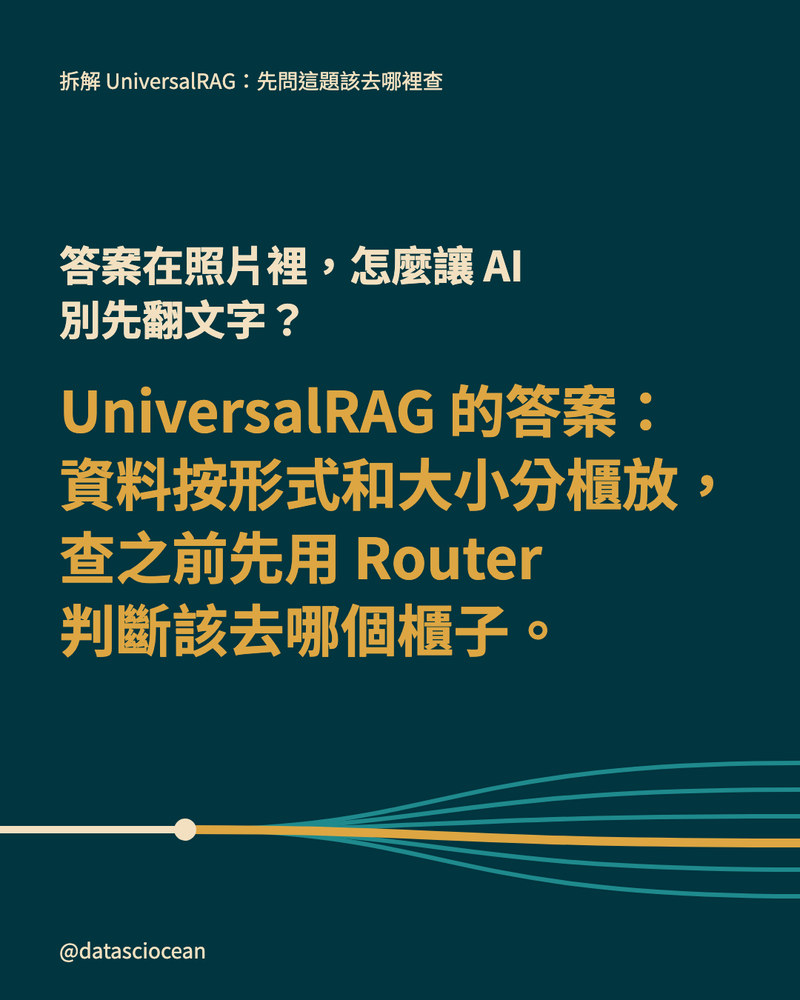

- **先問的問題**：答案在照片裡，怎麼讓 AI 別先翻文字？
- **一句話**：UniversalRAG 的答案：
資料按形式和大小分櫃放，
查之前先用 Router
判斷該去哪個櫃子。
- **替代文字**：答案在照片裡，怎麼讓 AI 別先翻文字？　UniversalRAG 的答案：
資料按形式和大小分櫃放，
查之前先用 Router
判斷該去哪個櫃子。

## 第 12 頁（系列地圖）

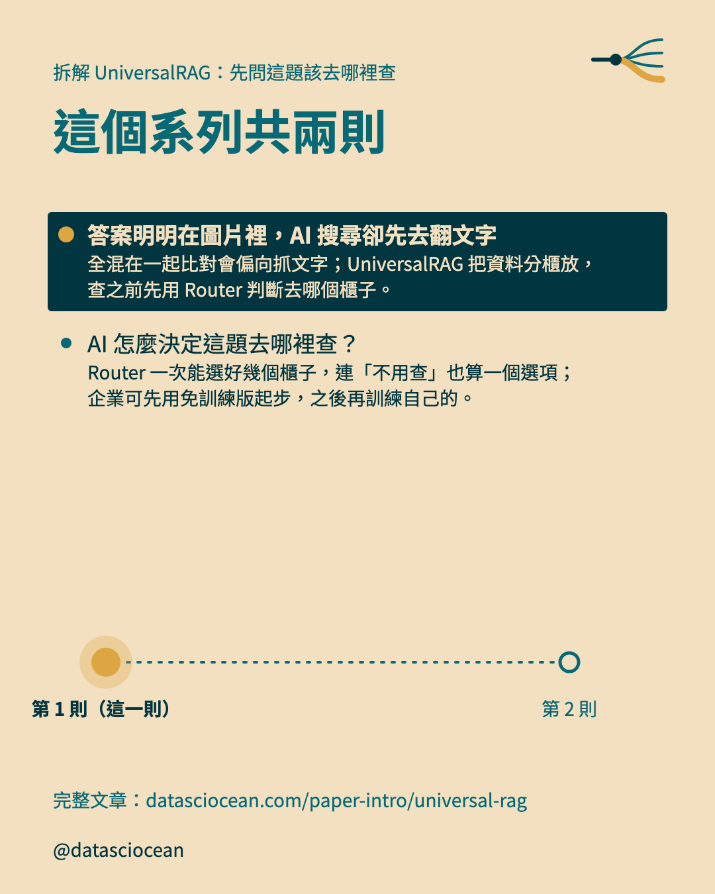

- **主標**：這個系列共兩則
- **導流行**：完整文章：datasciocean.com/paper-intro/universal-rag
- **第 1 則**：答案明明在圖片裡，AI 搜尋卻先去翻文字　全混在一起比對會偏向抓文字；UniversalRAG 把資料分櫃放，查之前先用 Router 判斷去哪個櫃子。
- **第 2 則**：AI 怎麼決定這題去哪裡查？　Router 一次能選好幾個櫃子，連「不用查」也算一個選項；企業可先用免訓練版起步，之後再訓練自己的。
- **替代文字**：這個系列共兩則。答案明明在圖片裡，AI 搜尋卻先去翻文字：全混在一起比對會偏向抓文字；UniversalRAG 把資料分櫃放，查之前先用 Router 判斷去哪個櫃子。、AI 怎麼決定這題去哪裡查？：Router 一次能選好幾個櫃子，連「不用查」也算一個選項；企業可先用免訓練版起步，之後再訓練自己的。

## Caption（整段貼到 IG）

```text
把文字、圖片混在一起比對的多模態 RAG，為什麼反而先抓文字？UniversalRAG 這樣解

・問「外殼是什麼顏色？」，文字先被抓回來（假設答案就在產品照片裡）
・舊做法：最直觀的做法，把所有資料放進同一個空間
・但資料多半按形式分群，而不是按意思
・UniversalRAG 把資料，按形式和大小分櫃放
・Router 先判斷，這題該去哪個櫃子
・實驗：題目要看圖片或影片時，UniversalRAG 照題意去找
・多了 Router 這一關，資料到千萬級反而更快

圖片來源：第 6 張改繪自原始論文的圖表

完整文章在 datasciocean.com，搜「UniversalRAG」

#UniversalRAG #多模態RAG #RAG
```
