# Threads：答案明明在圖片裡，AI 搜尋卻先去翻文字

- 發文方式：**一則輪播貼文**（正文＋全部 12 張圖，順序與 IG 相同），再用一則回覆放連結與系列（連結只放那則回覆）
- 圖檔在 `../ig/`（與 IG 輪播共用同一套）

## 貼文正文（附下方全部圖片）

```text
答案明明在圖片裡，AI 搜尋卻先去翻文字。

假設你問「這款產品的外殼是什麼顏色？」，答案在產品照片裡（這是舉例）。論文指出，把文字、圖片、影片全混在一起比對時，資料多半依形式而不是意思聚在一起，用文字發問就容易先抓到文字。

UniversalRAG 的做法是把資料按形式和大小分櫃放，查之前先讓 Router（負責幫問題分流）判斷這題該去哪個櫃子：要看圖，就只去圖片櫃找。

實驗中，把所有資料擠在一起的模型，就算題目要看圖片或影片才答得出來，多半還是抓文字；UniversalRAG 則照題意去找。資料多到千萬級時，它反而比全部一起搜的做法快，細節在圖裡。

這是 UniversalRAG 系列的第 1 則；Router 怎麼判斷去哪查，在這個系列的第 2 則。
```

## 附圖（依序）

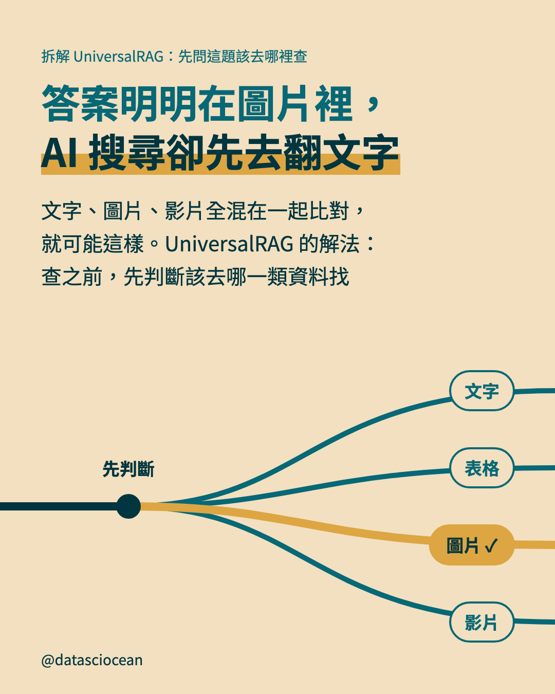
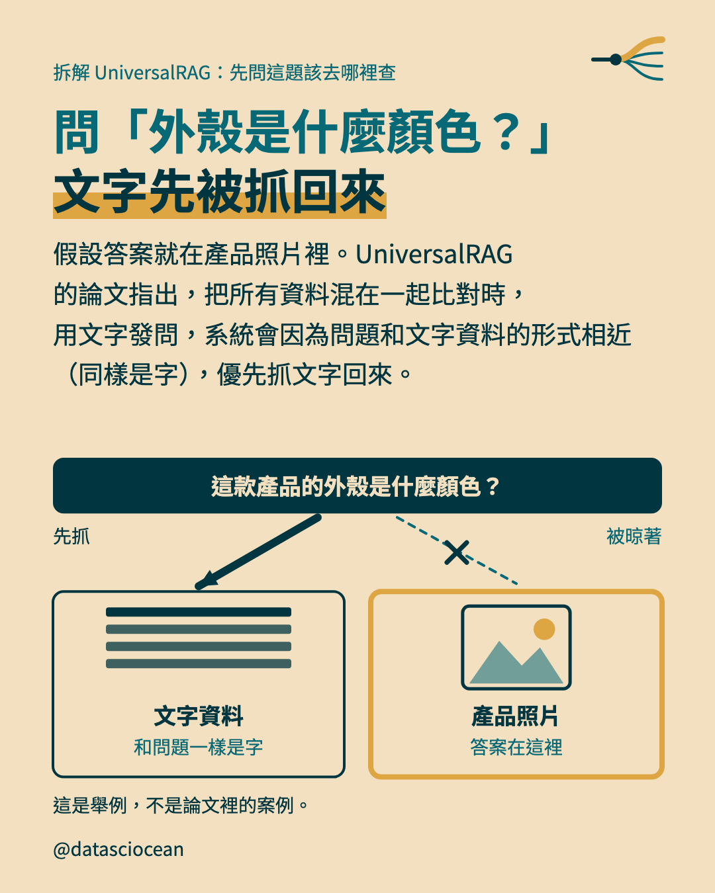
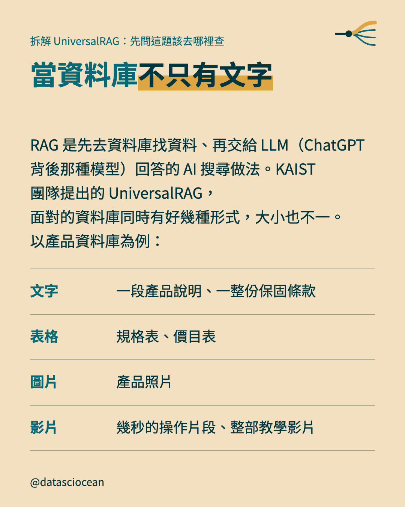
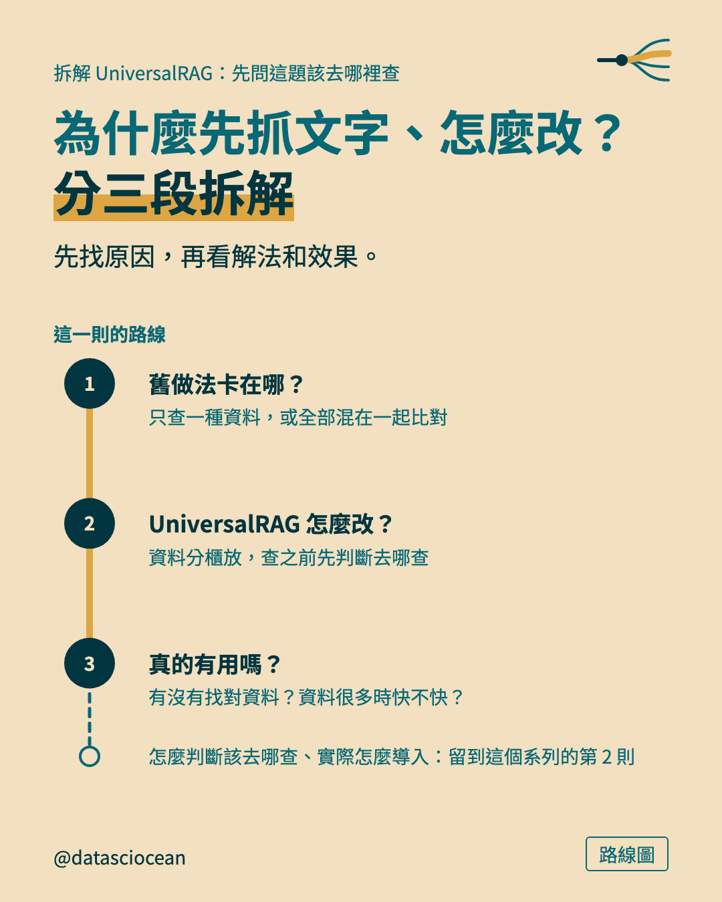
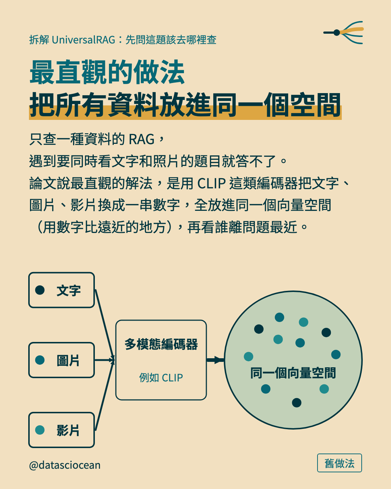
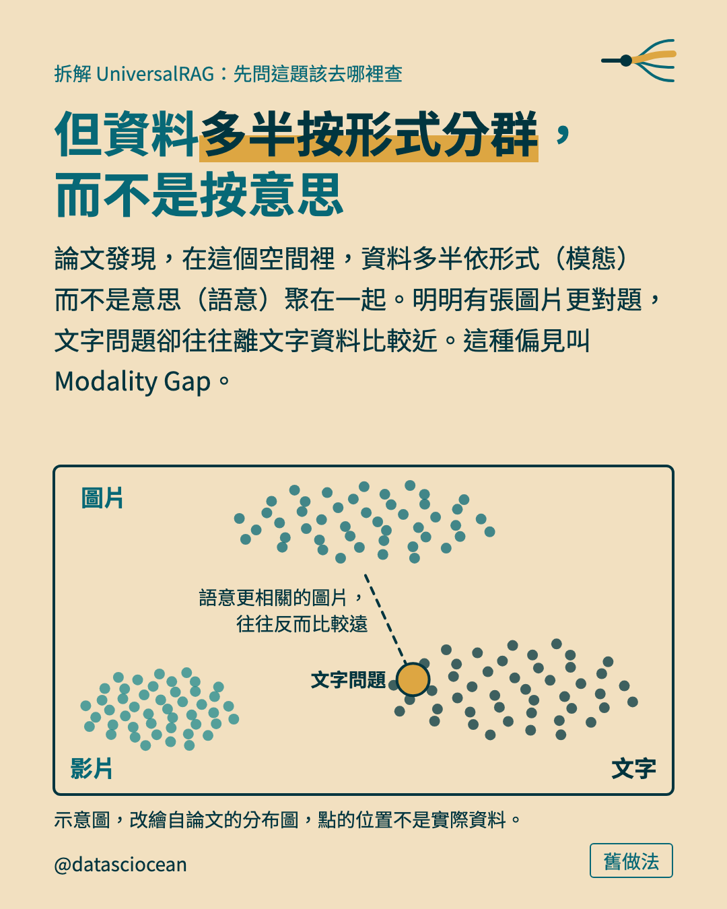
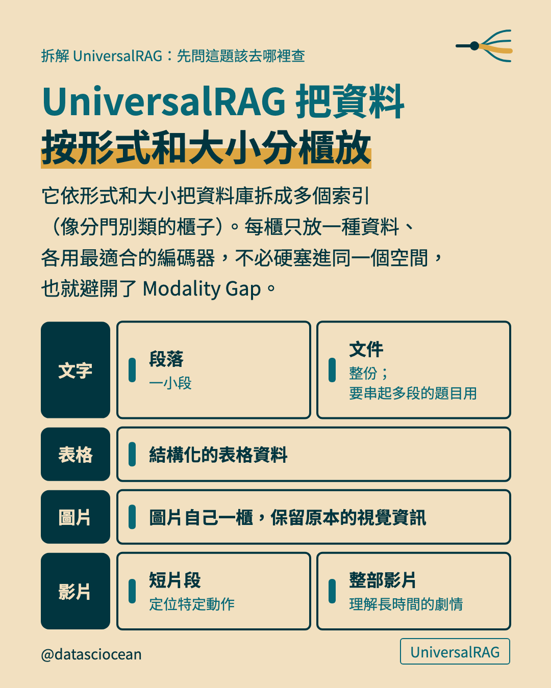
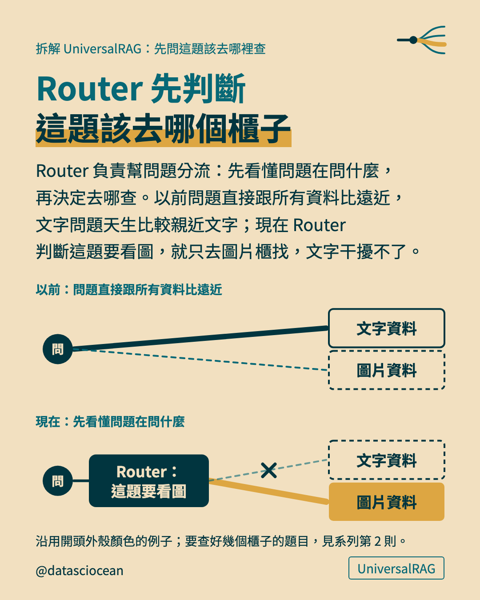
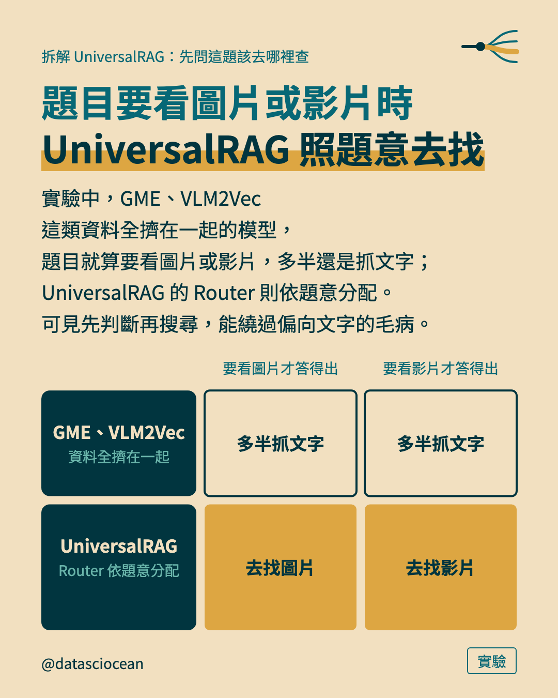
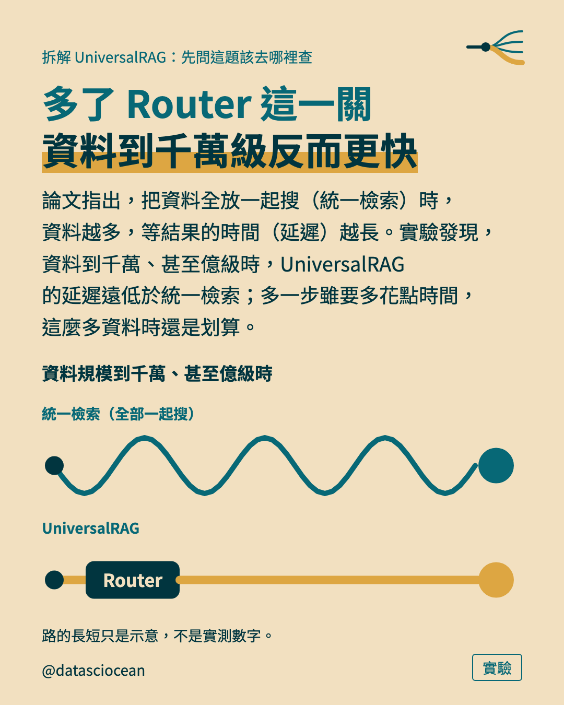
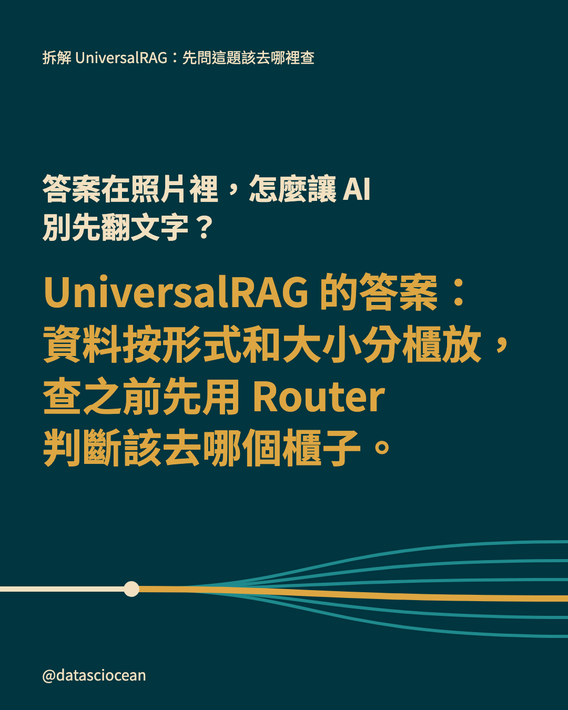
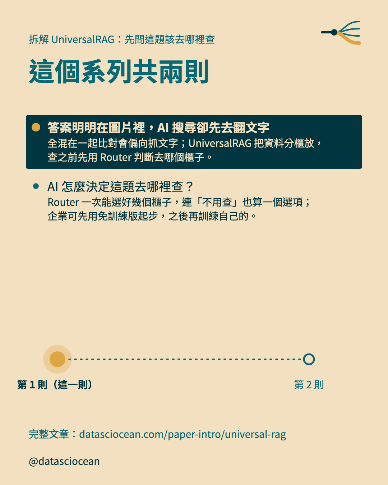

## 回覆：連結與系列

```text
UniversalRAG：資料按形式和大小分櫃放，查之前先用 Router 判斷該去哪個櫃子。
文章：datasciocean.com/paper-intro/universal-rag
同系列：AI 怎麼決定這題去哪裡查？（尚未發布）
```
